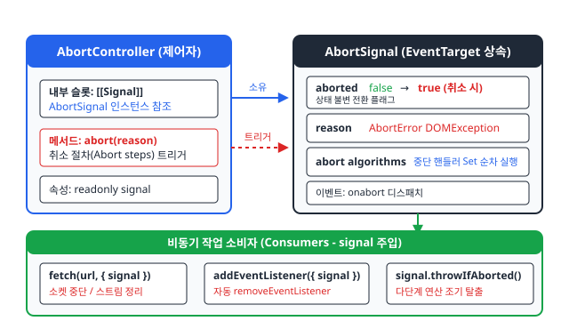

# 261028 AbortController와 AbortSignal

> 한 줄 요약 · 분야: 비동기 · 동시성 · Baseline: Widely available (2019년 3월 Safari 12.1 지원을 기점으로 모든 주요 모던 브라우저 엔진에 배포되어 30개월 이상 경과) · 읽는 시간 약 6분

## 1. 왜 쓰는가

웹 플랫폼에서 비동기 작업의 생명주기를 안전하게 제어하고 불필요한 시스템 자원을 회수하기 위해서는 표준화된 취소 인터페이스가 필수적이다. 비동기 작업의 취소 메커니즘이 확립되기 전까지 자바스크립트 생태계는 심각한 자원 낭비와 아키텍처적 결함을 겪었다.

과거 TC39에서는 프로미스 체인 자체에 취소 기능을 부여하기 위해 취소 가능한 프로미스(Cancelable Promises) 제안을 논의했다 [7]. 그러나 프로미스는 이미 결정되었거나 미래에 결정될 불변의 결과 값을 표현하는 값 컨테이너(Value Container)라는 기본 언어 철학을 갖는다. 프로미스 인스턴스에 취소 상태를 부여하면 단일 프로미스를 구독하는 다수의 소비자 사이에서 공유 참조 충돌이 발생하며, 성공(Fulfilled)과 실패(Rejected) 외에 제3의 상태(Third state)가 언어 코어에 침투하는 문제를 야기하여 해당 제안은 2016년에 최종 철회되었다 [7].

프로미스 자체의 취소가 무산된 뒤 개발자들은 불리언 플래그(예: `isCancelled = true`)를 임의로 선언하여 비동기 작업이 끝났을 때 콜백 실행을 건너뛰는 방식을 사용했다. 하지만 이 방식은 UI 업데이트만 막을 뿐, 이미 커널 및 브라우저 네트워킹 계층에서 진행 중인 HTTP 연결, TCP 소켓 패킷 송수신, 대용량 스트리밍 데이터 전송을 물리적으로 중단하지 못해 네트워크 대역폭과 메모리가 낭비되었다.

레거시 `XMLHttpRequest`의 경우 `xhr.abort()` 메서드를 통해 소켓 중단이 가능했으나, 이벤트 콜백 기반의 구식 설계로 인해 현대적인 `Promise` 체이닝이나 `Fetch API`, `Streams API` 파이프라인과 결합할 수 없었다. 서드파티 라이브러리인 Axios의 `CancelToken`이나 RxJS의 `Subscription`은 번들 크기를 증가시켰을 뿐 아니라, 브라우저 네이티브 DOM 이벤트나 플랫폼 표준 Fetch와 직접 상호 운용되지 못했다(Axios 또한 v0.22.0부터 CancelToken을 공식 deprecated 처리하고 웹 표준 AbortController로 전환했다).

이러한 문제를 해결하기 위해 WHATWG DOM 표준은 프로미스 객체를 직접 수정하지 않고, 비동기 작업 실행 자체를 제어하기 위한 독립적인 신호 전달 메커니즘으로 `AbortController`와 `AbortSignal`을 도입했다 [1]. 이는 2019년 3월 Safari 12.1 지원을 기점으로 모든 주요 브라우저 엔진에 탑재되어 Baseline의 Widely available 상태로 안착했다 [2].

## 2. 핵심 개념

`AbortController`와 `AbortSignal`은 제어권(Capability to Abort)과 관찰권(Observation of Abort)을 물리적으로 분리하도록 설계된 객체 쌍이다 [1].



- **`AbortController` (제어자)**: 비동기 작업의 취소를 능동적으로 발동할 수 있는 제어 객체다 [1]. 인스턴스화될 때 내부 슬롯에 단일 `AbortSignal` 인스턴스를 생성하여 보관하며, `abort(reason)` 메서드를 호출하여 해당 시그널에 취소 전파를 명령한다 [1]. 제어 권한을 은닉하기 위해 작업 수행 주체에는 컨트롤러가 아닌 시그널만을 전달한다.
- **`AbortSignal` (관찰자 / 신호기)**: `EventTarget`을 상속하는 읽기 전용 상태 객체다 [1]. 내부적으로 취소 여부를 나타내는 `aborted` 불리언 플래그, 취소 사유를 담는 `abort reason` 값, 그리고 등록된 중단 동작을 순차 실행하기 위한 `abort algorithms` 집합(Set)을 유지 관리한다 [1].
- **`abort algorithms` (내부 중단 알고리즘 집합)**: `AbortSignal`의 내부 슬롯에 저장되는 실행 단위다 [1]. `fetch()`나 `addEventListener()` 등의 표준 API에 시그널이 전달되면, 각 API는 소켓 단절 처리나 리스너 제거 작업을 시그널의 `abort algorithms` 집합에 등록한다 [1][4].
- **`abort reason` (중단 사유)**: 취소가 발생한 구체적인 원인 값을 보관한다 [1]. `controller.abort(reason)` 호출 시 전달되며, 인자를 생략하면 기본값으로 `AbortError`라는 이름의 `DOMException`이 할당된다 [1].

## 3. 동작 원리

취소 절차는 `controller.abort(reason)`가 호출되는 시점에 동기적으로 시작되며, WHATWG DOM 명세의 Signal abort steps에 따라 순차 실행된다 [1].

```diagram
종류: 시퀀스
번호: 켬

[호출자 (Caller)]
[AbortController]
[AbortSignal]
[네트워크 소켓 / Fetch API]
[이벤트 리스너 (EventTarget)]

호출자 (Caller) -> AbortController : new AbortController()
AbortController -> AbortSignal : 단일 AbortSignal 인스턴스 생성 및 연결
호출자 (Caller) -> 네트워크 소켓 / Fetch API : fetch(url, { signal })
네트워크 소켓 / Fetch API -> AbortSignal : abort algorithms에 소켓 중단 알고리즘 등록
호출자 (Caller) -> 이벤트 리스너 (EventTarget) : addEventListener(type, handler, { signal })
이벤트 리스너 (EventTarget) -> AbortSignal : abort algorithms에 removeEventListener 등록
호출자 (Caller) -> AbortController : abort(reason)
AbortController -> AbortSignal : aborted = true 설정 및 reason 저장
AbortSignal -> 네트워크 소켓 / Fetch API : abort algorithms 실행: 소켓 전송 즉시 차단 및 스트림 정리
AbortSignal -> 이벤트 리스너 (EventTarget) : abort algorithms 실행: 리스너 자동 제거
AbortSignal -> AbortSignal : 'abort' 이벤트 디스패치
네트워크 소켓 / Fetch API --> 호출자 (Caller) : Promise rejection (AbortError DOMException)
```

1. **상태 검증 및 멱등성 보장**: `controller.abort()`가 호출되면 먼저 시그널의 내부 `aborted` 플래그를 확인한다 [1]. 이미 `true`로 설정되어 있다면 아무런 동작도 수행하지 않고 즉시 반환하여 멱등성을 보장한다 [1].
2. **플래그 및 사유 저장**: `aborted` 플래그가 `false`인 경우 이를 즉시 `true`로 변경하고, 전달받은 `reason`(생략 시 `AbortError DOMException`)을 내부 `reason` 슬롯에 할당한다 [1].
3. **`abort algorithms` 동기 순차 실행**: 시그널 객체의 `abort algorithms` 집합에 등록된 모든 핸들러를 순서대로 동기 실행한다 [1].
   - `fetch()`에 연결된 알고리즘은 즉시 하부 TCP 소켓 연결을 끊고, 응답 본문 스트림(`ReadableStream`)을 닫아 대역폭 소모와 버퍼 메모리를 회수한다 [4].
   - `addEventListener()`의 `{ signal }` 옵션으로 등록된 알고리즘은 해당 이벤트 리스너를 대상 객체에서 즉각 제거한다 [1][6].
4. **이벤트 디스패치**: 알고리즘 실행이 완료되면 시그널 객체에서 `abort` 이벤트를 발생(`dispatchEvent`)시켜 사용자가 직접 연결한 `signal.onabort` 또는 `addEventListener('abort', ...)` 콜백을 실행한다 [1].
5. **프로미스 거부**: `fetch()`의 반환 프로미스는 `AbortError`라는 이름의 `DOMException`과 함께 거부(reject)된다 [5]. 만약 `addEventListener()` 호출 시 이미 취소된(`aborted === true`) 시그널을 전달하면 브라우저는 리스너를 등록하지 않고 즉시 종료한다 [1].

## 4. 기본 사용법

아래는 비동기 HTTP 요청을 발생시키고 `AbortController`를 통해 즉시 취소하는 완전한 실행 코드다.

```js
const controller = new AbortController();
const { signal } = controller;

async function executeRequest() {
  try {
    const response = await fetch('https://api.example.com/data', { signal });
    const data = await response.json();
    return data;
  } catch (error) {
    if (error.name === 'AbortError') {
      console.log('작업이 성공적으로 중단되었습니다.');
      return null;
    }
    throw error;
  }
}

const requestPromise = executeRequest();
controller.abort();
```

- **1행**: `new AbortController()`를 호출하여 취소 제어자 인스턴스를 생성한다 [1]. 이 과정에서 내부 슬롯에 단일 `AbortSignal`이 생성되어 바인딩된다 [1].
- **2행**: 제어자 객체로부터 외부 비동기 작업에 주입할 읽기 전용 속성인 `signal`을 추출한다 [1].
- **4행**: 비동기 네트워크 작업을 캡슐화한 `executeRequest` 비동기 함수를 선언한다.
- **5행**: 비동기 작업 실행 및 중단 시 발생할 예외를 가로채기 위해 `try` 블록을 구성한다 [5].
- **6행**: `fetch()` API의 두 번째 옵션 매개변수로 `{ signal }`을 주입하여 네트워크 소켓 요청과 응답 본문 스트림 처리를 시그널에 연동한다 [4].
- **7행**: 수신된 HTTP 응답 본문 스트림(`ReadableStream`)을 JSON 구조로 파싱한다 [4].
- **8행**: 성공적으로 수신 및 파싱된 데이터를 반환한다.
- **9행**: 네트워크 에러 또는 중단 신호에 의해 거부(reject)된 예외 객체를 잡는다 [5].
- **10행**: 발생한 에러 객체의 `name` 속성을 검사하여 의도된 취소 신호인 `AbortError`인지 판별한다 [5].
- **11행**: 작업 취소가 확인되었으므로 중단 안내 로그를 콘솔에 기록한다.
- **12행**: 취소된 요청에 대해 안전한 기본값인 `null`을 반환하고 실행을 정상 종료한다.
- **13행**: 중단 판별 조건 블록을 닫는다.
- **14행**: `AbortError`가 아닌 실제 네트워크 단절, DNS 에러 등 일반 장애는 상위 호출자로 다시 던진다(`rethrow`).
- **15행**: `catch` 예외 처리 블록을 닫는다.
- **16행**: `executeRequest` 함수 선언을 닫는다.
- **18행**: `executeRequest()` 함수를 실행하여 네트워크 요청을 시작하고 반환된 프로미스를 변수에 할당한다.
- **19행**: `controller.abort()`를 즉시 실행하여 연결된 시그널의 `aborted`를 `true`로 설정하고 소켓 전송을 즉시 중단시킨다 [1][4].

## 5. 실무 예시

### 실무 예시 1. 검색창 자동완성(Typeahead) 경쟁 상태 방지

- **상황**: 사용자가 검색창에 텍스트를 연속해서 입력할 때 이전 검색 요청이 네트워크 지연으로 인해 늦게 도착하여 최신 검색 결과를 덮어쓰는 응답 역전 현상(Race Condition)을 방지하고 불필요한 대역폭을 절약해야 한다.
- **코드**:
```js
let searchController = null;

async function handleSearchInput(keyword) {
  // 이전 진행 중인 요청이 있다면 즉시 취소하여 네트워크 대역폭 낭비와 응답 역전 현상 차단
  if (searchController) {
    searchController.abort();
  }
  searchController = new AbortController();

  try {
    const response = await fetch(`/api/search?q=${encodeURIComponent(keyword)}`, {
      signal: searchController.signal,
    });
    const results = await response.json();
    renderSearchResults(results);
  } catch (error) {
    if (error.name === 'AbortError') {
      // 의도된 중단이므로 조용히 무시
      return;
    }
    showErrorMessage(error);
  }
}
```
- **주의점**: 요청 취소 시 `fetch` 프로미스는 정상 반환이 아니라 거부(reject)되며 `AbortError`를 발생시키므로, catch 블록에서 `error.name === 'AbortError'` 검사를 거쳐 에러 UI가 노출되지 않도록 조용히 반환해야 한다 [5].

### 실무 예시 2. 모달 컴포넌트 생명주기 teardown 시 이벤트 리스너 일괄 해제

- **상황**: 동적 모달 창이 열릴 때 등록된 키보드 ESC 단축키, 창 크기 재계산 리사이즈, 배경 클릭 등 복수의 이벤트 리스너를 모달이 닫히거나 언마운트될 때 일일이 함수 참조를 유지하지 않고 단 한 번에 정리해야 한다.
- **코드**:
```js
function setupModalListeners(modalElement) {
  const controller = new AbortController();
  const { signal } = controller;

  // 여러 이벤트 리스너에 동일한 signal 전달
  window.addEventListener('keydown', (e) => {
    if (e.key === 'Escape') closeModal();
  }, { signal });

  window.addEventListener('resize', handleModalReposition, { signal });
  modalElement.addEventListener('click', handleBackdropClick, { signal });

  // 모달이 닫히거나 파괴될 때 단 한 번의 호출로 등록된 모든 리스너 일괄 해제
  return function teardown() {
    controller.abort();
  };
}
```
- **주의점**: WebKit 엔진의 버그 218753 패치를 포함해 모든 주요 브라우저에서 `addEventListener`의 `{ signal }` 옵션이 지원된다 [1][6]. 단, 이미 `aborted`된 시그널을 전달하면 리스너 자체가 등록되지 않으므로 컴포넌트 마운트 시마다 새 `AbortController`를 생성해야 한다 [1].

### 실무 예시 3. AbortSignal.any()와 AbortSignal.timeout()을 결합한 복합 취소 패턴

- **상황**: 네트워크 요청 시 사용자가 취소 버튼을 수동으로 누르는 경우와 네트워크 응답 지연으로 지정된 5000ms 타임아웃이 초과되는 경우 중 어느 하나라도 먼저 도달하면 요청을 즉각 차단해야 한다.
- **코드**:
```js
async function fetchWithTimeoutAndCancel(url, userCancelSignal, timeoutMs = 5000) {
  // 사용자 취소 신호와 5초 자동 타임아웃 신호를 결합
  const combinedSignal = AbortSignal.any([
    userCancelSignal,
    AbortSignal.timeout(timeoutMs),
  ]);

  try {
    const response = await fetch(url, { signal: combinedSignal });
    return await response.json();
  } catch (error) {
    if (error.name === 'TimeoutError') {
      throw new Error(`요청 시간이 ${timeoutMs}ms를 초과하여 자동 중단되었습니다.`);
    } else if (error.name === 'AbortError') {
      throw new Error('사용자에 의해 요청이 취소되었습니다.');
    }
    throw error;
  }
}
```
- **주의점**: `AbortSignal.timeout()`에 의한 자동 중단은 `TimeoutError`를 발생시키고 수동 `abort()`는 기본적으로 `AbortError`를 발생시키므로, catch 문에서 에러 이름(`error.name`)에 따른 분기 로직을 누락하지 않아야 명확한 사용자 피드백을 구분하여 제공할 수 있다 [1][3].

## 6. 장점 · 단점

| 장점 | 단점 |
| :--- | :--- |
| **표준화된 통합 취소 인터페이스**: Fetch API뿐만 아니라 EventTarget, Streams, Web Locks, WebSocketStream, Node.js 런타임까지 동일한 방식으로 제어할 수 있다 [1][4]. | **일회성(Single-use) 라이프사이클**: AbortController 인스턴스는 한 번 abort되면 상태를 되돌리거나 재사용할 수 없으므로, 새 작업을 시작할 때마다 인스턴스를 매번 다시 생성해야 한다. |
| **역할과 권한의 명확한 분리(Capability Separation)**: 제어권(AbortController)과 관찰권(AbortSignal)이 물리적으로 분리되어 있어, 비동기 작업 소비자에게 안전하게 읽기 전용 취소 신호만 주입할 수 있다 [1]. | **예외(Rejection) 기반 흐름 강제**: 취소 시 정상적인 종료가 아닌 AbortError / TimeoutError DOMException을 throw하므로, 호출부마다 try/catch 또는 .catch()로 예외를 가로채 확인하는 방어 코드가 필요하다 [5]. |
| **이벤트 리스너 해제 보일러플레이트 제거**: addEventListener의 { signal } 옵션을 통해 핸들러 참조를 일일이 보관하지 않고도 단일 abort() 호출로 복수의 리스너를 일괄 정리할 수 있다 [1][6]. | **타임아웃과 수동 중단의 에러 분기 복잡성**: AbortSignal.timeout()은 TimeoutError를, 수동 abort()는 기본적으로 AbortError를 발생시키므로 에러 이름(error.name) 확인 로직이 누락되면 예기치 않은 버그가 발생하기 쉽다 [1][3]. |
| **선언적 결합 기능 지원**: AbortSignal.timeout()과 AbortSignal.any()를 통해 타이머 제어나 복수 취소 조건 병합을 외부 라이브러리 없이 네이티브 한 줄로 구현할 수 있다 [1][3]. | - |

## 7. 한계와 함정

- **경계 사례: 다단계 파이프라인의 연산 미중단**: `fetch()` 네트워크 통신이 취소되어 중단되더라도, 이후 이어지는 대용량 데이터 변환이나 무거운 CPU 루프 작업은 자동으로 멈추지 않는다. 비동기 단계 사이마다 `signal.throwIfAborted()`를 직접 호출하지 않으면 백그라운드 연산이 지속되어 CPU 자원이 고갈된다.
```js
async function processPipeline(dataChunks, signal) {
  for (const chunk of dataChunks) {
    // 작업 단계마다 취소 여부를 즉각 확인하여 불필요한 고비용 CPU 연산 차단
    signal.throwIfAborted();
    await heavyAsyncTransformation(chunk);
  }
}
```
- **성능 및 메모리: 장기 생존 Signal의 가비지 컬렉션 누락**: 전역 객체나 싱글톤 서비스 등 수명이 긴 프로세스에 바인딩된 `AbortSignal`에 이벤트 리스너를 등록하고 명시적으로 `abort()`하지 않으면, 리스너와 캡처된 스코프 참조가 메모리에 영구 유지되어 메모리 누수가 발생한다.
- **백엔드 한계: 서버 측 연산의 즉시 중단 미보장**: 클라이언트 브라우저에서 `controller.abort()`를 실행하여 HTTP TCP 소켓 연결을 끊더라도, 서버 인프라가 클라이언트 연결 단절(disconnect)을 즉각 감지하여 진행 중인 데이터베이스 쿼리나 백엔드 연산을 중단하도록 구성되어 있지 않다면 서버 측 리소스 낭비는 계속된다.
- **접근성(a11y): 상태 피드백 누락으로 인한 인지 장애**: 사용자 입력이나 자동완성 도중 네트워크 요청이 지속적으로 취소될 때 적절한 `aria-live` 상태 알림이나 로딩 피드백이 제공되지 않으면, 스크린 리더 사용자는 시스템이 응답하지 않거나 네트워크 오류로 멈춘 것으로 오인할 수 있다.
- **보안 및 권한 격리(Capability Security)**: 서드파티 라이브러리, 외부 플러그인, 또는 신뢰할 수 없는 하위 모듈에 `AbortController` 인스턴스 자체를 넘겨주면 외부 코드에서 임의로 `abort()`를 호출하여 애플리케이션의 핵심 비동기 트랜잭션을 중단시킬 수 있다. 따라서 외부 모듈에는 오직 읽기 전용인 `AbortSignal`만을 전달하여 실행 제어권을 엄격히 격리해야 한다.

## 8. 다른 방법과 비교

| 방법 | 언제 | 비용 | 한계 |
| :--- | :--- | :--- | :--- |
| **불리언 플래그 (`isCancelled`)** | 컴포넌트 언마운트 후 UI 렌더링 콜백만 건너뛸 때 | 추가 번들 없음, 최소 구현 비용 | 커널 및 브라우저의 소켓 전송이나 스트리밍을 물리적으로 멈추지 못해 네트워크 대역폭과 메모리가 낭비됨 |
| **XMLHttpRequest.abort()** | 구형 브라우저 엔진 지원이 필수적인 레거시 시스템 | 웹 표준 API로 추가 번들 없음 | 콜백 기반 구조로 Promise 체이닝, Fetch API, Streams 파이프라인과 직접 결합 불가 |
| **서드파티 라이브러리 (Axios CancelToken, RxJS)** | 이미 해당 라이브러리를 전면적으로 채택한 레거시 아키텍처 | 외부 패키지 번들 크기 추가 발생 | 웹 표준 DOM 이벤트 및 Fetch와 직접 호환되지 않음 (Axios도 v0.22.0부터 AbortController로 전환) |
| **TC39 Cancelable Promises (철회)** | 과거 표준화 논의 단계 | 표준 제안 철회로 사용 불가 | 불변 값 표현이라는 프로미스 철학과 충돌, 공유 참조 및 제3의 상태(Third state) 불일치로 기각 [7] |
| **AbortController / AbortSignal** | 모던 웹 플랫폼 전반의 비동기 작업 및 이벤트 취소 | 웹 표준 내장 API로 추가 번들 비용 제로 | 단일 사용(Single-use) 라이프사이클로 매번 재생성 필요, Rejection 예외 분기 처리 필수 |

- **이것을 고르지 않는 경우**:
  - `AbortController`는 일회성 라이프사이클을 갖기 때문에 한 번 abort되면 상태를 초기화할 수 없다. 따라서 지속적인 웹소켓 재연결 루프나 영구적인 이벤트 스트림에서 동일한 제어기 인스턴스를 무한 재사용하려는 구조에는 적합하지 않다.
  - 또한 취소 시 정상 종료가 아닌 `AbortError` / `TimeoutError` 예외를 반드시 발생시키므로, 예외 처리 파이프라인의 오버헤드를 원하지 않고 단순히 컴포넌트 마운트 해제 여부만 확인하여 상태 업데이트를 넘기려는 초경량 컴포넌트에서는 불리언 플래그 방식을 보조적으로 활용할 수 있다.

## 9. 대비와 새로운 시도

`AbortController`와 `AbortSignal`은 단순한 Fetch 취소를 넘어 웹 플랫폼 비동기 생태계의 공통 취소 원시 타입(Primitive)으로 확장되고 있다.

1. **`AbortSignal.any()`의 공식 Baseline 안착**: 복수의 시그널 중 하나라도 취소되면 즉각 반응하는 종속 시그널(dependent signal) 생성 메서드인 `AbortSignal.any()`가 2024년 3월 Safari 17.4 배포를 완료하며 Chromium, Gecko, WebKit 전반에서 Baseline 기능으로 완전히 안착했다 [1].
2. **Prioritized Task Scheduling API (`scheduler.postTask`) 연동**: W3C 및 WICG 표준인 `scheduler.postTask()`에서 비동기 작업의 실행 우선순위 동적 변경과 작업 취소를 처리하기 위해 `AbortSignal`을 상속한 `TaskSignal`을 핵심 제어 인터페이스로 채택하여 운용하고 있다.
3. **TC39 / WHATWG `Observable` 표준 제안**: 자바스크립트 표준 비동기 스트림 인터페이스로 논의 중인 `Observable` 명세에서 구독 해제(Unsubscribe) 및 흐름 제어 신호로 `AbortSignal`과의 네이티브 통합이 표준화 단계에서 설계되고 있다.
4. **Chrome On-device AI (Prompt API) 적용**: 브라우저 내장 대형언어모델(Gemini Nano) 세션 생성 및 실시간 텍스트 스트리밍 생성을 사용자가 즉시 중단할 수 있도록 지원하는 필수 파라미터로 `AbortSignal`이 사용된다.
5. **Navigation API의 `NavigateEvent.signal`**: 브라우저 내 단일 페이지 애플리케이션(SPA) 페이지 이동과 주소 라우팅을 가로채는 Navigation API에서 이전 내비게이션 작업 처리를 중단하기 위한 표준 메커니즘으로 `signal` 속성이 기본 탑재되어 제공된다.

## 10. 다른 사람에게 설명하기

- **세 문장 요약**:
  1. AbortController와 AbortSignal은 프로미스 자체를 수정하지 않고 비동기 작업의 취소를 제어하기 위해 WHATWG DOM 표준으로 도입된 웹 표준 취소 프리미티브다 [1][7].
  2. 제어자(Controller)의 `abort()` 호출은 시그널의 `aborted` 플래그를 변경하고 내부 `abort algorithms`를 동기 실행하여 하부 네트워크 소켓 연결을 물리적으로 닫고 이벤트 리스너를 자동 정리한다 [1][4][6].
  3. `AbortSignal.timeout()`과 `AbortSignal.any()`를 통해 복합 취소를 선언적으로 구현할 수 있으나, 일회성 라이프사이클과 Rejection 기반 예외 처리, 다단계 작업 시 `throwIfAborted()` 수동 호출 필요성을 숙지해야 한다 [1][3][5].
- **스스로 확인할 질문 3개(답은 적지 않는다)**:
  1. 프로미스 객체에 직접 `.cancel()` 메서드를 추가하려던 TC39 제안이 기각되고, 제어자(AbortController)와 관찰자(AbortSignal)를 분리하는 모델이 채택된 이유는 무엇인가?
  2. 비동기 작업 취소 시 단순 불리언 플래그 방식과 비교하여 `AbortSignal`을 주입한 `fetch()`가 네트워크 소켓 및 스트림 자원 관점에서 갖는 물리적 차이는 무엇인가?
  3. `AbortSignal.timeout()`에 의한 타임아웃 중단과 `controller.abort()`에 의한 수동 중단이 발생했을 때 각각 어떤 에러 이름(`error.name`)이 던져지며 이를 애플리케이션에서 어떻게 분기해야 하는가?

## 참고 자료
1. [WHATWG DOM Standard - Aborting ongoing activities](https://dom.spec.whatwg.org/#aborting-ongoing-activities)
2. [MDN Web Docs - AbortController](https://developer.mozilla.org/en-US/docs/Web/API/AbortController)
3. [MDN Web Docs - AbortSignal](https://developer.mozilla.org/en-US/docs/Web/API/AbortSignal)
4. [web.dev - Aborting a fetch](https://web.dev/articles/aborting-a-fetch)
5. [Chrome for Developers - Abortable fetch](https://developer.chrome.com/blog/abortable-fetch)
6. [WebKit Bug 218753 - Add support for AbortSignal in addEventListener](https://bugs.webkit.org/show_bug.cgi?id=218753)
7. [GitHub tc39/proposal-cancelable-promises](https://github.com/tc39/proposal-cancelable-promises)

조사: 2026-10-28

## 내 리뷰

Q. TCP39가 무엇일까
본문: "TC39에서는"

> **A.** 질문에서 언급된 TCP39는 본문의 TC39를 네트워크 통신 프로토콜인 TCP(Transmission Control Protocol)와 혼동하였거나 잘못 표기한 것으로 보입니다. TC39(Technical Committee 39)는 국제 표준화 기구인 Ecma International 산하에서 자바스크립트(ECMAScript, ECMA-262) 언어 규격을 공식 개발하고 관리하는 기술 위원회입니다. 이 위원회에는 브라우저 엔진 개발사, 학계, 주요 IT 기업의 대표들이 참여하며, 0단계(Strawman)부터 4단계(Finished)에 이르는 제안 절차를 거쳐 새로운 언어 기능을 심의하고 연례 표준에 반영합니다. 본문에서는 프로미스 객체 자체에 취소 기능을 부여하려던 규격 제안(Cancelable Promises)을 검토한 후 언어 설계 철학과 상태 충돌 문제로 인해 2016년에 공식 철회했던 주체로 언급되었습니다.
> 출처: [Ecma International - TC39](https://tc39.es/) · [MDN Web Docs Glossary - ECMAScript](https://developer.mozilla.org/en-US/docs/Glossary/ECMAScript) · [GitHub - tc39/proposal-cancelable-promises](https://github.com/tc39/proposal-cancelable-promises)
> — Antigravity 2026-11-02 13:12

Q. 대역폭에 대한 기본 개념 이해하고 싶어
본문: "대역폭"

> **A.** 대역폭(Bandwidth)은 특정 네트워크 연결을 통해 주어진 시간 동안 전송할 수 있는 데이터의 최대 처리량을 의미하며, 일반적으로 초당 비트 수(bps, bits per second) 단위로 측정됩니다. 네트워크 대역폭은 물리적으로 한정된 자원이기 때문에 특정 통신 작업이 대용량 데이터를 지속적으로 수신하면 동일 회선을 사용하는 다른 통신의 전송 속도가 지연될 수 있습니다. 본문에서 언급된 대역폭 낭비는 비동기 작업이 취소되었음에도 하부 HTTP 연결과 TCP 소켓이 닫히지 않아 불필요한 패킷이 브라우저로 계속 다운로드되는 상황을 가리킵니다. `AbortController`를 사용하여 네트워크 요청을 중단하면 소켓 연결을 즉시 끊고 스트림을 닫아 무의미한 패킷 수신을 차단하고 한정된 대역폭을 보존할 수 있습니다.
> 출처: [MDN Web Docs Glossary - Bandwidth](https://developer.mozilla.org/en-US/docs/Glossary/Bandwidth) · [web.dev - Aborting a fetch](https://web.dev/articles/aborting-a-fetch)
> — Antigravity 2026-11-02 13:12

Q. EventListener에 signal을 추가하는 경우 removeEventListener를 임의로 실행 해주는건가? clean-up에 대응 되는 구조인건가?
본문: "return function teardown() { controller.abort(); };"

> **A.** 네, 질문하신 내용대로 브라우저가 리스너 제거를 직접 수행하며 클린업(clean-up) 메커니즘에 대응되는 구조가 맞습니다. WHATWG DOM 표준에 따르면 `addEventListener`의 옵션으로 `signal`을 전달할 경우, 브라우저는 해당 시그널의 내부 중단 알고리즘 목록(`abort algorithms`)에 이벤트 리스너 제거 작업을 등록합니다. 이후 `controller.abort()`가 호출되면 등록된 알고리즘이 동기적으로 실행되어 `removeEventListener`를 직접 호출한 것과 동일하게 대상 객체에서 리스너가 즉각 제거됩니다. 따라서 개발자가 핸들러 함수의 참조를 따로 유지하며 수동으로 해제할 필요가 없으며, 단 한 번의 중단 명령으로 동일한 시그널을 주입한 다수의 리스너를 일괄 정리할 수 있습니다. 이는 모달 해제나 리액트 컴포넌트의 언마운트 시점에 수행하는 리소스 정리(teardown) 패턴에 적합하게 동작합니다.
>
> ```js
> // abort() 호출 시 브라우저가 등록된 이벤트 리스너를 자동으로 해제합니다.
> window.addEventListener('keydown', handleKeydown, { signal });
> controller.abort();
> ```
> 출처: [WHATWG DOM Standard - EventTarget.addEventListener()](https://dom.spec.whatwg.org/#dom-eventtarget-addeventlistener) · [MDN Web Docs - EventTarget: addEventListener() method](https://developer.mozilla.org/en-US/docs/Web/API/EventTarget/addEventListener)
> — Antigravity 2026-11-02 13:12
