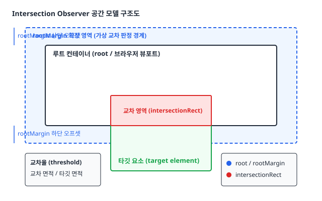
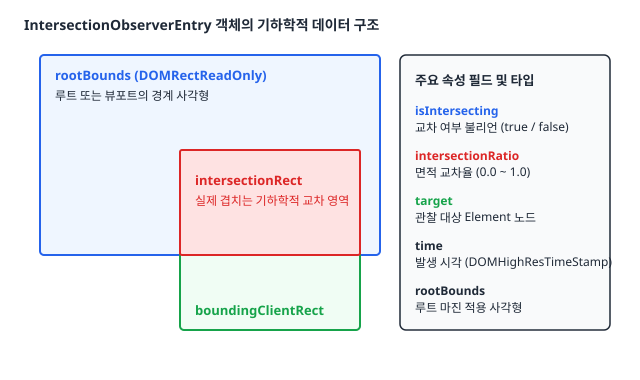

# 261028 Intersection Observer

> Intersection Observer는 브라우저 렌더링 파이프라인과 연동하여 DOM 요소의 기하학적 교차 상태를 메인 스레드 부하 없이 비동기적으로 관찰하는 웹 플랫폼 표준 API이다. · 분야: 웹 플랫폼 · Baseline: Widely available (2019년 3월 Safari 12.1 지원 이후 주요 모든 브라우저 엔진에 적용되어 안정적으로 지원됨) · 읽는 시간 약 6분
## 1. 왜 쓰는가
과거 웹 환경에서는 특정 DOM 요소가 화면에 진입했는지 확인하거나 가시성을 파악하기 위해 `window`의 `scroll` 또는 `resize` 이벤트에 리스너를 바인딩하고 반복적으로 `Element.getBoundingClientRect()` 메서드를 호출했다 [3][6]. 이 방식은 브라우저 렌더링 엔진의 정상적인 파이프라인 흐름을 방해한다. 자바스크립트가 실행되는 도중 DOM 요소의 최신 기하 좌표를 동기적으로 요청하면, 브라우저는 대기 중이던 스타일 재계산과 레이아웃 연산을 즉시 강제 수행하는 강제 동기식 레이아웃(Forced Synchronous Layout, Layout Thrashing)을 발생시킨다 [4][6]. 스크롤 동작은 초당 60회 이상 연속적으로 발생하므로 매 스크롤 틱마다 레이아웃 트래싱이 누적되어 메인 스레드가 블로킹되고, 결과적으로 심각한 프레임 드롭(jank)과 스크롤 버벅임이 발생했다 [4][6].

동일 출처 정책(Same-Origin Policy)에 따른 크로스 오리진 측정 한계 또한 심각한 문제였다. 서드파티 광고 배너나 외부 위젯이 삽입된 크로스 오리진 `<iframe>` 내부에서는 브라우저의 보안 정책으로 인해 부모 윈도우의 뷰포트 정보, 스크롤 오프셋, 상대 좌표에 접근할 수 없다 [1][4][6]. 이로 인해 광고가 사용자 뷰포트에 실제로 노출되었는지 확인하는 광고 노출률(Viewability) 측정이 원천적으로 불가능하거나 불안정한 해킹성 우회 기법에 의존해야 했다 [1][4][6].

W3C와 브라우저 벤더들은 이러한 메인 스레드 병목 현상과 크로스 오리진 샌드박스 측정 한계를 해결하기 위해 브라우저 엔진 레벨에서 기하학적 교차 상태를 비동기로 연산하는 Intersection Observer API를 표준화했다 [1][4]. 이를 통해 요소의 가시성 감시 책임을 브라우저 내부 렌더링 파이프라인으로 이관하여 메인 스레드를 해방시키고 보안 경계를 유지하면서도 안정적인 교차 감지를 가능하게 만들었다 [1][4].

## 2. 핵심 개념
Intersection Observer는 관찰 대상 요소(`target`)와 기준 영역(`root`) 간의 2차원 사각형 교차 상태를 모델링한다.



기하학적 교차 모델을 구성하는 핵심 용어는 다음과 같다.
- `root`: 타깃 요소의 교차 여부를 판별하는 기준 뷰포트 또는 상위 컨테이너 요소이다 [1][3]. 생성자 옵션에서 명시하지 않거나 `null`로 지정하면 최상위 브라우저 뷰포트(Top-level document viewport)가 기본 루트로 동작한다 [1][3].
- `rootMargin`: 루트 컨테이너의 바운딩 박스를 CSS 마진 문법(예: `'100px 0px 200px 0px'`)과 동일하게 확장하거나 축소하는 가상 오프셋 영역이다 [1][3]. 이를 통해 요소가 실제 루트 경계에 도달하기 전 또는 일정 거리 이상 진입한 후에 교차 판정을 시작하도록 제어한다 [1][3].
- `threshold`: 타깃 요소의 전체 면적 대비 루트와 겹치는 교차 영역의 비율(0.0~1.0)로서 콜백 함수가 실행되는 트리거 임계값이다 [1][3]. 단일 부동소수점 값(예: `0.5`) 또는 배열(예: `[0, 0.25, 0.5, 0.75, 1.0]`) 형태로 전달할 수 있다 [1][3].
- `target`: 루트 컨테이너와의 교차 여부를 관찰하는 대상 DOM 요소이다 [1][3].



교차 상태가 변경될 때 콜백 함수로 전달되는 `IntersectionObserverEntry` 객체는 다음과 같은 기하학적 상태 정보를 제공한다 [1][3]:
- `boundingClientRect`: 타깃 요소의 사각형 경계 좌표를 나타내는 `DOMRectReadOnly` 객체이다 [1][3].
- `rootBounds`: `rootMargin` 오프셋이 적용된 최종 루트 영역의 사각형 경계 좌표이다 [1][3].
- `intersectionRect`: 루트 영역과 타깃 요소가 실제로 겹치는 교차 사각형의 좌표 및 크기이다 [1][3].
- `intersectionRatio`: `boundingClientRect`의 전체 면적 대비 `intersectionRect` 면적의 비율(0.0 이상 1.0 이하)이다 [1][3].
- `isIntersecting`: 타깃 요소가 현재 루트 영역과 교차 상태에 있는지를 나타내는 불리언(Boolean) 값이다 [1][3].
- `target`: 관찰 대상인 실제 DOM 노드 참조이다 [1][3].
- `time`: 관찰이 기록된 시점을 브라우저 세션 시작 기준 고해상도 타임스탬프(`DOMHighResTimeStamp`)로 나타낸 수치이다 [1][3].

## 3. 동작 원리
Intersection Observer의 교차 계산 알고리즘은 WHATWG HTML 명세에 정의된 이벤트 루프의 "렌더링 갱신(Update the rendering)" 단계에서 정밀하게 실행된다 [1][2].

이벤트 루프의 렌더링 파이프라인은 `requestAnimationFrame` 콜백 실행, 스타일 재계산(Style recalculation), 레이아웃(Layout) 연산을 순차적으로 거친 후 페인트(Paint) 단계 직전에 "교차 관찰 갱신 단계(run the update intersection observations steps)"를 호출한다 [1][2]. 이 단계에서 브라우저 엔진은 현재 화면에 등록된 모든 `IntersectionObserver` 인스턴스의 타깃 요소들을 일괄 수합하여 기하학적 교차 면적을 산출한다 [1][2].

관찰 중인 대상 요소의 교차율이 설정된 `threshold` 경계를 넘어서면 브라우저는 내부 큐(`[[QueuedEntries]]`)에 새 `IntersectionObserverEntry` 객체를 적재한다 [1][2]. 이후 브라우저는 이벤트 루프의 태스크 큐(Task Queue)에 콜백 실행을 위한 비동기 매크로태스크를 발행한다 [1][2]. 따라서 교차 계산 자체는 브라우저 내부 렌더링 파이프라인에서 최적화되어 메인 스레드의 동기 레이아웃 재계산을 유발하지 않으며, 최종 콜백 함수 호출만 메인 스레드 태스크 큐를 통해 비동기로 수행된다 [1][2][4].

```diagram
종류: 시퀀스

[사용자 및 스크롤]
[브라우저 엔진]
[렌더링 파이프라인]
[태스크 큐]

사용자 및 스크롤 -> 브라우저 엔진 : 스크롤 및 레이아웃 변형 발생
브라우저 엔진 -> 렌더링 파이프라인 : 렌더링 갱신 단계 진입
렌더링 파이프라인 -> 렌더링 파이프라인 : 스타일 및 레이아웃 재계산
렌더링 파이프라인 -> 렌더링 파이프라인 : 교차 관찰 갱신 단계 실행
렌더링 파이프라인 -> 태스크 큐 : 임계값 초과 항목 저장 및 태스크 발행
렌더링 파이프라인 -> 브라우저 엔진 : 화면 페인트 완료
태스크 큐 -> 브라우저 엔진 : 등록된 옵저버 콜백 비동기 실행
```

## 4. 기본 사용법
다음은 Intersection Observer를 선언하고 타깃 요소를 관찰하는 동작 가능한 자바스크립트 코드이다 [1][3].

```js
const options = {
  root: null,
  rootMargin: '0px 0px 100px 0px',
  threshold: [0, 0.5, 1.0],
};

const handleIntersect = (entries, observer) => {
  entries.forEach((entry) => {
    if (entry.isIntersecting) {
      console.log(`교차 진입: ${entry.target.id}, 교차율: ${entry.intersectionRatio}`);
      if (entry.intersectionRatio >= 1.0) {
        observer.unobserve(entry.target);
      }
    } else {
      console.log(`교차 이탈: ${entry.target.id}`);
    }
  });
};

const observer = new IntersectionObserver(handleIntersect, options);

const targetElement = document.querySelector('#target');
if (targetElement) {
  observer.observe(targetElement);
}
```

- 1행: 관찰 환경을 정의하기 위한 `options` 객체를 선언한다.
- 2행: `root`를 `null`로 지정하여 최상위 문서의 브라우저 뷰포트를 교차 판정의 기본 컨테이너로 설정한다 [1][3].
- 3행: `rootMargin`을 `'0px 0px 100px 0px'`로 지정하여 뷰포트 하단 경계를 가상으로 100px 확장한다 [1][3].
- 4행: `threshold`에 `[0, 0.5, 1.0]` 배열을 지정하여 요소가 0%, 50%, 100% 교차하는 세 시점에 콜백이 호출되도록 설정한다 [1][3].
- 5행: 설정 옵션 객체의 선언을 종료한다.
- 6행: 빈 줄이다.
- 7행: 교차 변화 발생 시 실행할 콜백 함수 `handleIntersect`를 선언하며, 매개변수로 `entries` 목록과 `observer` 인스턴스를 수신한다 [1][3].
- 8행: 전달받은 `IntersectionObserverEntry` 객체 배열을 순회하기 위해 `forEach` 반복을 시작한다 [1][3].
- 9행: `entry.isIntersecting` 불리언 값을 평가하여 타깃 요소가 루트 마진 영역 안으로 진입했는지 확인한다 [1][3].
- 10행: 요소가 진입한 경우 타깃 요소의 ID와 현재 교차율(`intersectionRatio`)을 콘솔에 기록한다 [1][3].
- 11행: 교차율이 1.0 이상(100% 완전 가시 상태)에 도달했는지 확인한다 [1][3].
- 12행: 100% 가시 조건을 충족하면 불필요한 감시 비용을 방지하기 위해 `observer.unobserve(entry.target)`를 호출하여 관찰을 중단한다 [1][3].
- 13행: 완전 가시 조건 분기 처리를 종료한다.
- 14행: 요소가 루트 영역 밖으로 벗어난 미교차 상태(`else`)를 처리한다 [1][3].
- 15행: 요소가 교차 영역에서 이탈했음을 알리는 로그를 콘솔에 출력한다.
- 16행: 교차 여부 분기 처리를 종료한다.
- 17행: `forEach` 순회 블록을 종료한다.
- 18행: 콜백 함수 블록을 종료한다.
- 19행: 빈 줄이다.
- 20행: 선언한 콜백 함수와 옵션을 인수로 전달하여 새 `IntersectionObserver` 인스턴스를 생성한다 [1][3].
- 21행: 빈 줄이다.
- 22행: DOM에서 관찰 대상이 될 요소를 ID 선택자(`#target`)로 탐색한다.
- 23행: 대상 DOM 요소가 문서에 실제로 존재하는지 유효성을 검증한다.
- 24행: `observer.observe(targetElement)`를 호출하여 브라우저 렌더링 엔진에 타깃 요소의 교차 관찰 등록을 지시한다 [1][3].
- 25행: 조건문 블록을 종료한다.

## 5. 실무 예시

### 예시 1. 이미지 및 미디어 지연 로딩 (Lazy Loading)
- 상황: 초기 페이지 로딩 시 화면 밖에 위치한 이미지 리소스를 선별하여 대역폭 소모를 방지하고, 사용자가 스크롤하여 이미지에 도달하기 200px 전에 미리 다운로드를 시작하려는 경우이다 [3][6].
- 코드:
```js
const lazyImageObserver = new IntersectionObserver((entries, observer) => {
  entries.forEach((entry) => {
    if (entry.isIntersecting) {
      const img = entry.target;
      const realSrc = img.getAttribute('data-src');
      if (realSrc) {
        img.setAttribute('src', realSrc);
      }
      observer.unobserve(img);
    }
  });
}, {
  rootMargin: '200px 0px',
  threshold: 0,
});

document.querySelectorAll('img.lazy-load').forEach((img) => {
  lazyImageObserver.observe(img);
});
```
- 주의점: 지연 로딩 완료 즉시 `observer.unobserve(img)`를 호출하여 해당 요소에 대한 관찰을 해제해야 한다. 해제하지 않으면 이미지가 로드된 후에도 스크롤 시마다 콜백이 불필요하게 발행된다. 또한 자바스크립트가 비활성화된 환경에서는 이미지가 로드되지 않으므로 마크업 차원의 기본 대응이 필요하다.

### 예시 2. 무한 스크롤 센티넬 감시 (Infinite Scrolling)
- 상황: 긴 피드나 상품 목록에서 사용자가 리스트 끝에 도달했을 때 다음 페이지 데이터를 네트워크에서 비동기로 수신하여 DOM에 추가 렌더링하려는 경우이다 [3].
- 코드:
```js
let isFetching = false;
let page = 1;

const sentinel = document.querySelector('#scroll-sentinel');

const infiniteScrollObserver = new IntersectionObserver(async (entries) => {
  const [entry] = entries;
  if (entry.isIntersecting && !isFetching) {
    isFetching = true;
    try {
      const response = await fetch(`/api/feed?page=${page}`);
      const data = await response.json();
      renderItems(data.items);
      page += 1;
    } catch (error) {
      console.error(error);
    } finally {
      isFetching = false;
    }
  }
}, {
  rootMargin: '100px 0px',
  threshold: 0,
});

if (sentinel) {
  infiniteScrollObserver.observe(sentinel);
}
```
- 주의점: 네트워크 응답이 지연되는 동안 사용자의 추가 스크롤로 인해 센티넬이 계속 뷰포트에 머물면 중복 요청이 발생할 수 있으므로 `isFetching`과 같은 상태 플래그를 두어 다중 실행을 차단해야 한다. 또한 연속 스크롤 시 무한히 DOM 노드가 증가하므로 장기적으로 메모리 관리가 요구된다.

### 예시 3. 광고 노출(Ad Viewability) 및 분석 지표 측정
- 상황: 광고 요소의 50% 이상이 사용자 뷰포트에 1초 이상 머무르는지 감지하여 MRC(Media Rating Council) 표준 노출 요건을 충족하는 유효 트래픽을 서버에 집계하려는 경우이다 [3][5].
- 코드:
```js
const adTimerMap = new WeakMap();

const adObserver = new IntersectionObserver((entries) => {
  entries.forEach((entry) => {
    const adElement = entry.target;
    if (entry.isIntersecting && entry.intersectionRatio >= 0.5) {
      const timerId = window.setTimeout(() => {
        sendAdViewLog(adElement.dataset.adId);
        adObserver.unobserve(adElement);
      }, 1000);
      adTimerMap.set(adElement, timerId);
    } else {
      const existingTimer = adTimerMap.get(adElement);
      if (existingTimer) {
        clearTimeout(existingTimer);
        adTimerMap.delete(adElement);
      }
    }
  });
}, {
  threshold: [0.5],
});

document.querySelectorAll('.ad-unit').forEach((ad) => {
  adObserver.observe(ad);
});
```
- 주의점: Intersection Observer v1은 순수 사각형 경계의 기하학적 겹침만을 측정하므로 모달 창이나 투명한 오버레이로 광고가 덮여 있는 실제 비가시 상태를 걸러내지 못한다. 따라서 정밀한 광고 사기 방지가 요구되는 환경에서는 Intersection Observer v2 사양을 검토해야 한다 [5].

## 6. 장점 · 단점

| 장점 | 단점 |
| :--- | :--- |
| 비동기 기하 연산: 브라우저 내부 렌더링 루프에서 교차를 계산하므로 메인 스레드의 강제 동기식 레이아웃(Layout Thrashing)을 방지하고 프레임 드롭(jank)을 제거한다 [1][4][6]. | 비동기 실행으로 인한 즉각적 동기화 한계: 콜백이 메인 스레드 태스크 큐를 통해 비동기로 실행되므로, 스크롤 위치와 1:1로 즉각 반응해야 하는 패럴랙스(Parallax) 스크롤 효과 등에는 적합하지 않다. |
| 자원 절감: 빈번한 `scroll`, `resize` 이벤트 리스너 등록과 주기적인 폴링 루프를 제거하여 CPU 점유율 및 모바일 기기의 배터리 소모를 획기적으로 낮춘다 [3][6]. | 프레임 레이트에 종속된 이벤트 통지: 브라우저 렌더링 갱신 주기에 맞춰 교차 계산이 이루어지므로 사용자가 매우 빠르게 스크롤할 경우 중간 임계값(`threshold`) 단계가 건너뛰어질 수 있다. |
| 크로스 오리진 `<iframe>` 뷰어빌리티 지원: 동일 출처 정책(SOP)을 위반하거나 부모 페이지의 민감한 좌표 정보를 노출하지 않으면서도 외부 광고/위젯의 노출 비율을 안전하게 측정할 수 있다 [1][4][6]. | v1의 시각적 가림(Occlusion) 감지 불가: 기본 v1 명세는 순수 사각형 경계의 기하학적 교차만 계산하므로, 다른 요소(모달, 플로팅 배너 등)에 덮여 있거나 `opacity: 0`으로 투명해진 실제 비가시 상태를 분별하지 못한다 [5]. |
| 인스턴스 재사용 및 다중 타깃 관찰: 단일 `IntersectionObserver` 인스턴스로 수십~수백 개의 DOM 요소를 효율적으로 일괄 관찰(`observe`)할 수 있다 [3]. | 서브픽셀 렌더링 오차: 브라우저 줌 비율이나 디바이스 픽셀 밀도(DPR)에 따라 소수점 단위 오차가 발생하여 100% 가시 상태에서도 `intersectionRatio`가 1.0에 도달하지 않고 0.999 등으로 전달될 수 있다. |
| 선제적 오프셋 제어: `rootMargin` 옵션을 활용하여 타깃 요소가 화면에 진입하기 일정 거리 전에 미리 리소스를 프리로드하거나 준비할 수 있다 [1][3]. | 콜백 내부 연산의 메인 스레드 부하: 교차 계산 자체는 브라우저 내부에서 최적화되지만, 전달된 콜백 함수 자체는 메인 스레드에서 실행되므로 콜백 내부의 연산이 무거우면 여전히 UI 블로킹이 발생할 수 있다 [1][2][4]. |
| 완벽한 브라우저 호환성: 모든 주요 모던 브라우저 엔진에서 지원하는 Baseline Widely available 기능으로, 별도의 외부 라이브러리나 폴리필 없이 신뢰도 높게 사용 가능하다 [3][7]. | - |

## 7. 한계와 함정
- 성능 함정 (콜백 내 레이아웃 쓰래싱): 교차 상태 감지 자체는 브라우저 파이프라인에서 비동기로 수행되지만, 콜백 함수 내부에서 DOM 스타일을 변경한 직후 `offsetHeight`, `getBoundingClientRect()` 등의 기하 속성을 호출하면 메인 스레드에서 다시 동기 레이아웃이 강제되어 심각한 렌더링 병목이 생긴다.
- 성능 함정 (과도한 임계값 설정): `threshold` 배열에 `[0, 0.01, ..., 1.0]`처럼 수많은 구간을 지정하면 렌더링 갱신 단계마다 평가 및 콜백 발행 비용이 급증하므로 필요한 최소한의 임계값만 지정해야 한다.
- 접근성(A11y) 함정 (무한 스크롤 키보드 트랩): 무한 스크롤 구현 시 센티넬을 통한 자동 로딩이 반복되면 키보드 탐색 사용자나 스크린 리더 사용자가 푸터(Footer) 영역이나 하단 중요 링크에 영원히 도달하지 못하는 키보드 트랩이 발생할 수 있다.
- 접근성(A11y) 함정 (스크롤 애니메이션 모션 민감성): 화면 진입 시 트리거되는 페이드인 및 이동 애니메이션은 전정기관 장애가 있는 사용자를 위해 `prefers-reduced-motion` 미디어 쿼리를 반드시 존중하여 감쇠하거나 비활성화해야 한다.
- 보안 및 클릭재킹(Clickjacking) 위험: v1 교차 감지만 믿고 투명한 클릭재킹 오버레이에 가려진 버튼이나 광고를 사용자에게 노출된 상태로 처리하면 보안 취약점 및 부정 광고 트래픽(Ad fraud)이 유발될 수 있다 [5].
- 개인정보 보호 및 부채널(Side-channel) 제약: 크로스 오리진 환경에서 교차 좌표가 악의적인 사용자 창 크기 추적이나 핑거프린팅 부채널로 악용되는 것을 방지하기 위해 사양상 좌표값 정밀도 제한 및 샌드박싱 제한이 부과된다 [1].
- 스타일 변경 함정 (`display: none`): 관찰 중인 요소가 `display: none`이 되거나 DOM 트리에서 분리되면 교차 영역이 즉시 0이 되어 의도치 않게 비가시 상태(`isIntersecting: false`) 이벤트가 트리거된다.
- 메모리 누수 위험: 일회성 지연 로딩 완료 후 `unobserve()`를 호출하지 않거나, SPA 컴포넌트 파기 시 `disconnect()`를 호출하지 않으면 참조가 유지되어 분리된 DOM 노드 메모리 누수가 발생한다.

## 8. 다른 방법과 비교

| 방법 | 언제 | 비용 | 한계 |
| :--- | :--- | :--- | :--- |
| `scroll` / `resize` + `getBoundingClientRect()` | 동기적으로 즉시 좌표를 확인해야 하는 레거시 환경 | 메인 스레드 블로킹, 강제 동기 레이아웃 유발 | 크로스 오리진 `<iframe>` 내부 측정 불가, 스크롤 성능 저하 |
| HTML `loading="lazy"` 속성 | `` 및 `<iframe>` 태그의 단순 선언적 지연 로딩 | 자바스크립트 실행 비용 없음 (브라우저 네이티브 처리) | 일반 DOM 요소, 배경 이미지, 동영상 재생 제어 불가 |
| CSS Scroll-driven Animations (`animation-timeline: view()`) | 교차에 따른 시각적 변형 및 페이드인 애니메이션 | 0 (컴포지터 스레드 하드웨어 가속, 120fps 보장) | 데이터 페칭, 동적 DOM 조작 등 자바스크립트 로직 실행 불가 |
| CSS `content-visibility: auto` | 화면 밖 대규모 문서 영역의 초기 렌더링 비용 절감 | 자바스크립트 없음 (브라우저가 렌더링 단계 자체를 스킵) | 자바스크립트 이벤트 통지 및 교차 콜백 실행 불가 |
| `ResizeObserver` 및 `MutationObserver` | 개별 DOM 노드의 자체 크기 변화 또는 구조/속성 변화 감시 | 메인 스레드 옵저버 연산 | 뷰포트와의 상대적 교차 상태 판별 불가 |
| `IntersectionObserver` | 뷰포트 진입에 따른 자바스크립트 비즈니스 로직(페칭, 로깅) 실행 | 메인 스레드 콜백 실행 (교차 연산은 최적화) | 비동기 통지로 인한 즉각적 동기화 한계, v1 시각적 가림 판별 불가 |

### 이것을 고르지 않는 경우
- 스크롤 위치와 1:1로 즉각 반응해야 하는 패럴랙스(Parallax) 스크롤 효과나 정밀 시각 애니메이션을 구현할 때는 비동기 통지 지연이 있는 Intersection Observer 대신 컴포지터 스레드에서 직접 처리되는 CSS Scroll-driven Animations(`animation-timeline: view()`)을 사용해야 한다.
- 표준 `` 또는 `<iframe>` 태그의 단순 지연 로딩에는 복잡한 스크립트 작성 없이 브라우저가 네트워크 환경에 맞춰 자동 최적화하는 HTML 선언형 속성 `loading="lazy"`를 우선 적용한다.
- 긴 문서에서 화면 밖 DOM 노드의 렌더링 연산(스타일, 레이아웃, 페인트)을 완전히 생략하여 초기 로딩 속도를 높이려는 목적이라면 자바스크립트 이벤트 감시가 불필요한 CSS `content-visibility: auto`를 선택한다.
- 뷰포트와의 교차 상태가 아니라 DOM 요소 자체의 박스 크기 변경이나 속성/트리 변경을 감지해야 하는 경우에는 `ResizeObserver` 또는 `MutationObserver`를 사용해야 한다.

## 9. 대비와 새로운 시도
- Intersection Observer v2 (`trackVisibility`, `delay`, `isVisible`): 단순한 사각형 겹침을 넘어, 다른 요소에 의한 가림(Occlusion)이나 `opacity`, `transform`, `filter` 등의 CSS 효과로 인해 요소가 실제로 가려졌는지를 판별하는 표준 사양이다 [5]. Chromium 계열(Chrome 74+)에 구현되어 광고 부정 클릭 방지 및 클릭재킹 방어에 실무 적용되고 있다 [5].
- `scrollMargin` 옵션: 중첩된 스크롤 컨테이너(Nested scroll container) 내부의 타깃 요소가 클리핑되기 전에 미리 교차를 감지할 수 있도록 스크롤 경계 마진을 확장하는 기능으로, W3C 명세에 반영되어 Chrome 122+ 등에 탑재되었다 [1][6].
- CSS Scroll-driven Animations 및 View Timelines: W3C Scroll-driven Animations 명세를 통해 기존 Intersection Observer로 자바스크립트 클래스를 토글하며 처리하던 교차 애니메이션을 순수 CSS로 선언하고 컴포지터 레벨에서 오프로딩하는 생태계 전환이 가속화되고 있다.
- Scroll Snap Events (`scrollSnapChange`, `scrollSnapChanging`): 스크롤 스냅 대상이 전환되는 시점을 네이티브 이벤트로 제공하여, 스냅 캐러셀 UI 등에서 Intersection Observer를 이용해 복잡하게 타깃을 추적하던 코드를 단순화하는 웹 표준 작업이 진행되고 있다.

## 10. 다른 사람에게 설명하기

### 세 문장 요약
- Intersection Observer는 과거 스크롤 이벤트와 동기 지오메트리 조회로 인한 메인 스레드 레이아웃 쓰래싱 문제를 해결하기 위해 브라우저 렌더링 파이프라인에서 비동기로 교차 상태를 계산하는 웹 표준 API이다 [1][4][6].
- 브라우저의 렌더링 갱신 단계에서 타깃과 루트의 교차율을 일괄 산출하고 임계값을 넘을 때만 태스크 큐를 통해 콜백을 비동기 호출하므로, 지연 로딩, 무한 스크롤, 노출 지표 수집을 최소한의 자원으로 처리할 수 있다 [1][2][3].
- 모든 주요 모던 브라우저에서 안정적으로 지원되는 Baseline 기능이지만, 콜백 내 동기 레이아웃 유발, v1의 시각적 가림 판별 한계, 키보드 접근성 문제 등의 함정이 존재하므로 적절한 수명 주기 관리와 최신 스펙 보완을 고려해 적용해야 한다 [3][5][7].

### 스스로 확인할 질문
- Q1. Intersection Observer의 교차 연산 단계는 WHATWG 이벤트 루프의 렌더링 파이프라인 중 정확히 어느 시점에 실행되며, 왜 메인 스레드의 동기 레이아웃 쓰래싱을 유발하지 않는가?
- Q2. 동일 출처 정책(SOP)이 적용되는 크로스 오리진 `<iframe>` 환경에서 Intersection Observer는 어떤 원리로 부모 페이지의 민감한 좌표를 보호하면서 요소의 뷰어빌리티를 계산하는가?
- Q3. 스크롤 위치와 1:1로 정밀하게 연동되어야 하는 패럴랙스 애니메이션 구현 시 Intersection Observer 대신 CSS Scroll-driven Animations을 선택해야 하는 이유는 무엇인가?

## 참고 자료
1. [Intersection Observer - W3C Working Draft](https://w3c.github.io/IntersectionObserver/)
2. [HTML Living Standard: Event loops - Update the rendering](https://html.spec.whatwg.org/multipage/webappapis.html#update-the-rendering)
3. [Intersection Observer API - MDN Web Docs](https://developer.mozilla.org/en-US/docs/Web/API/Intersection_Observer_API)
4. [IntersectionObserver in WebKit - WebKit Blog](https://webkit.org/blog/8695/intersectionobserver-in-webkit/)
5. [Trust is Good, Observation is Better—Intersection Observer v2 - web.dev](https://web.dev/articles/intersectionobserver-v2)
6. [IntersectionObserver’s Coming to Town - Chrome Developers](https://developer.chrome.com/blog/intersectionobserver/)
7. [IntersectionObserver browser support - Can I use](https://caniuse.com/intersectionobserver)
조사: 2026-10-28

## 내 리뷰

Q. entries는 observer를 생성해서 observe 할 때 마다 늘어나는 것 인가? 아니면 sentinel인가? 뭘 의미하지?
본문: "entries"
