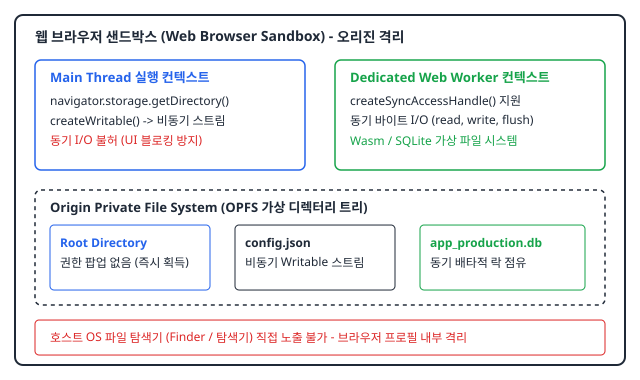
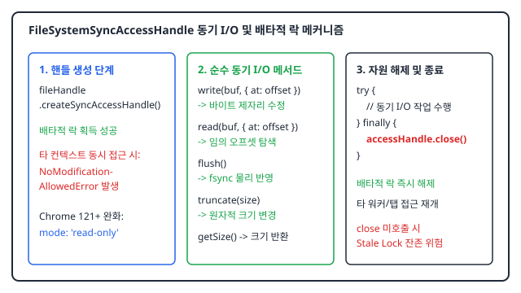

# 261028 Origin Private File System (OPFS)

> Origin Private File System(OPFS)은 브라우저가 웹 오리진 단위로 격리 제공하는 고성능 비공개 가상 파일 시스템으로, 사용자 권한 프롬프트 없이 바이트 단위 제자리 수정과 Worker 기반 초고속 동기 파일 I/O를 지원한다. · 분야: 네트워크 · 저장 · Baseline: Widely available (2023년 3월) · 읽는 시간 약 7분

## 1. 왜 쓰는가
웹 플랫폼에서 대용량 데이터를 처리하거나 데스크톱급 애플리케이션을 구동할 때 기존 브라우저 저장소 체계는 성능과 구조 측면에서 명확한 한계를 드러냈다 [4] [5].

첫째, 기존 웹 표준 저장소인 IndexedDB는 구조화된 자바스크립트 객체나 키-값 쌍을 저장하도록 설계되었다 [4]. 대용량 바이너리 블록(Blob, ArrayBuffer)을 다룰 때 직렬화 및 역직렬화 과정에서 CPU 오버헤드와 메모리 복사가 대량으로 발생한다 [4] [5]. 가장 결정적인 문제는 파일 내부의 특정 바이트 오프셋만 수정하는 제자리 수정(in-place write)이 불가능하다는 점이다 [4] [5]. 예를 들어 100MB 크기의 데이터베이스 파일에서 4KB 크기의 단일 페이지만 갱신하려 해도 전체 100MB 데이터를 메모리로 읽어 들인 후 수정하여 데이터베이스 전체를 다시 써야 하므로 극심한 쓰기 증폭(write amplification)과 I/O 병목이 발생한다 [4] [5].

둘째, 웹 관계형 데이터베이스로 활용되던 Web SQL이 공식 표준에서 완전히 폐기되면서, C/C++나 Rust 기반의 임베디드 데이터베이스(예: SQLite)를 웹어셈블리(Wasm)로 포팅해 로컬 데이터베이스 엔진으로 구동하려는 수요가 급증했다 [5]. 그러나 브라우저에는 임베디드 데이터베이스 엔진의 B-Tree 탐색과 원자적 페이지 갱신을 뒷받침할 저수준 파일 I/O 추상화 계층이 존재하지 않았다 [5].

셋째, 기존의 대체 수단들도 각각 구조적 한계를 안고 있었다 [4] [5]:
- Cache API: HTTP Request 및 Response 객체의 네트워크 응답 캐싱에 최적화된 인터페이스로, 가상 디렉터리 계층 구조를 탐색하거나 임의 바이트 오프셋에 접근하는 일반 파일 I/O 용도로는 적합하지 않다 [4].
- Wasm 메모리 파일 시스템: Emscripten MEMFS는 브라우저 힙 메모리에만 상주하므로 탭을 닫거나 새로고침하면 데이터가 완전히 휘발된다 [5]. Emscripten IDBFS는 영속성을 위해 IndexedDB를 백엔드로 사용하지만, 애플리케이션 시작 시 IndexedDB의 전체 파일 데이터를 메모리로 일괄 적재하고 종료 시 메모리 전체를 IndexedDB로 일괄 덤프하는 스냅샷 방식을 취한다 [4] [5]. 이로 인해 파일 크기가 수십~수백 메가바이트 단위로 증가하면 시작 지연, 메모리 사용량 폭증, 가비지 컬렉션 부하가 발생한다 [4] [5].
- 사용자 대면 File System Access API(`showOpenFilePicker`, `showSaveFilePicker`): 사용자의 실제 호스트 OS 파일 시스템에 직접 접근할 수 있고 OS 파일 탐색기에 노출되지만, 반드시 사용자의 명시적인 권한 허용 팝업과 파일 선택 상호작용이 요구된다 [2] [4]. 따라서 애플리케이션 내부에서 백그라운드로 자동 관리되는 전용 데이터 저장소로는 채택할 수 없다 [2] [4].

Origin Private File System(OPFS)은 이러한 문제를 해결하기 위해 WHATWG File System Standard의 핵심 규격으로 제정되었다 [1] [2]. OPFS는 브라우저가 각 오리진(Origin)에 격리된 비공개 가상 파일 시스템 엔드포인트를 제공하여, 사용자 권한 프롬프트 없이 즉시 파일 계층을 구성하고 고속 동기·비동기 I/O를 수행할 수 있게 한다 [1] [2] [4].

## 2. 핵심 개념




OPFS를 이해하기 위한 핵심 개념과 인터페이스는 다음과 같다:

1. **Origin Private File System (OPFS)**: File System API의 하위 명세로 제공되는 오리진(Scheme + Host + Port) 격리 가상 파일 시스템이다 [1] [2]. 호스트 운영체제의 파일 관리자(Windows 탐색기, macOS Finder 등)에 실제 파일 경로가 노출되지 않고 브라우저 프로필 내부 샌드박스에서 독립적으로 관리된다 [2] [4].
2. **루트 디렉터리 핸들 (`FileSystemDirectoryHandle`)**: 오리진 전용 가상 파일 시스템의 최상위 루트 디렉터리를 가리킨다. `navigator.storage.getDirectory()` 메서드를 통해 비동기 Promise로 즉시 획득할 수 있으며, 사용자 권한 팝업이나 대화상자가 일절 발생하지 않는다 [1] [4].
3. **파일 핸들 (`FileSystemFileHandle`)**: 가상 파일 시스템 내의 개별 파일을 가리키는 엔트리 객체다. 디렉터리 핸들의 `getFileHandle(name, { create: true })` 호출을 통해 탐색하거나 새로 생성한다 [1] [2].
4. **비동기 쓰기 스트림 (`FileSystemWritableFileStream`)**: 메인 스레드 및 Worker 환경에서 `fileHandle.createWritable()` 호출을 통해 생성하는 스트리밍 I/O 인터페이스다 [1] [2]. 데이터 청크를 파이프라인 방식으로 기록하며, 내부적으로 임시 스왑 파일을 거쳐 `close()` 시점에 원본 파일에 원자적으로 반영된다 [1] [2].
5. **동기 접근 핸들 (`FileSystemSyncAccessHandle`)**: 전용 웹 워커(Dedicated Web Worker) 환경에서만 `fileHandle.createSyncAccessHandle()`을 통해 생성할 수 있는 저수준 고성능 핸들이다 [1] [3]. 자바스크립트 이벤트 루프 지연이나 Promise 오버헤드 없이 `read()`, `write()`, `truncate()`, `getSize()`, `flush()`, `close()`와 같은 순수 동기 함수를 직접 실행한다 [3].
6. **배타적 락 (Exclusive Lock)**: `createSyncAccessHandle()`은 기본적으로 해당 파일 엔트리에 대해 독점적인 배타적 락을 획득한다 [1] [3]. 이 락이 유지되는 동안 다른 웹 워커, 브라우저 탭, 쓰기 스트림이 동일 파일의 핸들을 열려고 시도하면 브라우저는 `NoModificationAllowedError` 예외를 던진다 [1] [3].
7. **스토리지 할당량과 지속성 (Storage Quota & Persistence)**: OPFS 파일은 브라우저의 통합 스토리지 풀 할당량 정책에 종속된다 [2] [4]. 브라우저 디스크 압박(Storage Pressure) 상황에서 데이터가 임의로 삭제되는 자동 퇴출(Eviction) 위험을 차단하려면 `navigator.storage.persist()`를 호출해 지속적 스토리지(Persistent Storage) 권한을 획득해야 한다 [2] [4].

## 3. 동작 원리
OPFS의 I/O 동작 원리는 접근 컨텍스트(메인 스레드 vs Dedicated Web Worker)와 핸들 종류에 따라 명확히 구분된다.

```diagram
종류: 시퀀스

[MainThread]
[DedicatedWorker]
[OPFSEngine]
[StorageDisk]

MainThread -> DedicatedWorker : postMessage(startSyncTask)
DedicatedWorker -> OPFSEngine : navigator.storage.getDirectory()
OPFSEngine --> DedicatedWorker : FileSystemDirectoryHandle
DedicatedWorker -> OPFSEngine : getFileHandle(app.db, create)
OPFSEngine --> DedicatedWorker : FileSystemFileHandle
DedicatedWorker -> OPFSEngine : createSyncAccessHandle()
OPFSEngine -> StorageDisk : acquireExclusiveLock()
OPFSEngine --> DedicatedWorker : FileSystemSyncAccessHandle
DedicatedWorker -> StorageDisk : write(data, at: 0)
StorageDisk --> DedicatedWorker : bytesWritten
DedicatedWorker -> StorageDisk : flush()
StorageDisk --> DedicatedWorker : fsyncCompleted
DedicatedWorker -> StorageDisk : read(buffer, at: 0)
StorageDisk --> DedicatedWorker : bytesRead
DedicatedWorker -> OPFSEngine : close()
OPFSEngine -> StorageDisk : releaseExclusiveLock()
DedicatedWorker -> MainThread : postMessage(taskFinished)
```

### 1. 엔드포인트 해석 및 디렉터리 탐색
`navigator.storage.getDirectory()`가 호출되면 브라우저의 스토리지 하위 시스템은 현재 실행 컨텍스트의 오리진을 확인하고, 오리진 단위로 샌드박스 처리된 디렉터리의 `FileSystemDirectoryHandle` 객체를 반환한다 [1] [4]. 이 과정은 비동기 Promise로 처리되며 사용자 보안 확인 절차 없이 즉시 완료된다 [1] [4].

### 2. 스트리밍 비동기 쓰기 (메인 스레드 및 Worker)
메인 스레드나 Worker에서 `fileHandle.createWritable()`을 호출하면 `FileSystemWritableFileStream` 인스턴스가 반환된다 [1] [2]. 스트림에 `write()`를 호출할 때 브라우저는 즉시 원본 파일을 덮어쓰지 않고 내부 임시 스왑(swap) 파일에 청크 데이터를 기록한다 [1] [2]. 스트림의 `close()`가 호출되는 시점에 브라우저는 스왑 파일을 원본 파일 경로로 원자적 교체(atomic swap)하여 중간 크래시로 인한 파일 손상을 방지한다 [1] [2].

### 3. Dedicated Web Worker 전용 동기 바이트 I/O 및 스펙 제약
Dedicated Web Worker 내에서 `fileHandle.createSyncAccessHandle()`을 호출하면 저수준 파일 I/O를 위한 `FileSystemSyncAccessHandle`이 생성된다 [1] [3]. 
- **스펙 근거**: 동기 파일 I/O 메서드는 파일 시스템 탐색 지연(Seek time)이나 디스크 블록 플러시 동안 스레드 실행을 동기 블로킹한다 [3] [6]. 만약 메인 스레드에서 이러한 동기 연산이 허용되면 브라우저 UI 렌더링 파이프라인과 입력 처리가 중단되어 화면 멈춤(Jank)이 발생한다 [3] [6]. 따라서 WHATWG 명세상 `createSyncAccessHandle()`은 메인 스레드와 Service Worker에서 노출되지 않으며, 오직 UI와 격리된 Dedicated Web Worker 환경에서만 호출이 허용된다 [3] [6].
- **메서드 실행 구조**:
  - `write(buffer, { at: offset })`: 지정한 오프셋 바이트 위치의 디스크 블록에 TypedArray 데이터를 동기적으로 직접 덮어쓴다 [3]. 메모리 전체를 복사하거나 재기록하지 않고 특정 섹터만 갱신하므로 O(1) 수준의 제자리 수정(in-place write)을 달성한다 [3] [4].
  - `read(buffer, { at: offset })`: 지정한 오프셋에서 시작하여 버퍼의 길이만큼 디스크에서 바이트를 직접 읽어 들인다 [3].
  - `flush()`: 운영체제 커널의 페이지 캐시에 남아 있는 미기록 버퍼를 물리 스토리지 디스크로 강제 동기화하는 시스템 콜(`fsync`)을 실행하여 데이터의 영속적 반영을 보장한다 [3] [5].
  - `truncate(newSize)`: 파일의 바이트 길이를 즉시 지정한 크기로 확장하거나 축소한다 [3].
  - `getSize()`: 파일의 현재 바이트 크기를 동기적으로 반환한다 [3].

### 4. 락 획득 및 해제 생명주기
`createSyncAccessHandle()`이 실행되는 순간 브라우저는 해당 파일 엔트리에 대해 독점적인 배타적 락을 생성한다 [1] [3]. 락이 유지되는 동안에는 다른 Worker 스레드나 브라우저 탭, 비동기 스트림이 동일 파일에 접근할 수 없다 [1] [3]. 작업이 끝난 후 `accessHandle.close()`를 호출해야만 커널 파일 디스크립터가 닫히고 배타적 락이 반환되어 다른 프로세스나 컨텍스트의 접근이 재개된다 [3].

## 4. 기본 사용법
Dedicated Web Worker 환경에서 OPFS 파일 핸들을 획득하고, `FileSystemSyncAccessHandle`을 생성하여 바이트 쓰기, 디스크 플러시, 바이트 읽기, 크기 조절, 핸들 닫기를 수행하는 완전한 자바스크립트 코드다.

```js
// worker.js - Dedicated Web Worker 실행 컨텍스트
self.onmessage = async (event) => {
  // 1. 현재 오리진에 격리된 OPFS 루트 디렉터리 핸들을 비동기로 획득한다.
  const root = await navigator.storage.getDirectory();

  // 2. 루트 디렉터리 내에서 'database.bin' 파일 핸들을 탐색하며, 없으면 새로 생성한다.
  const fileHandle = await root.getFileHandle('database.bin', { create: true });

  // 3. Dedicated Worker 전용 동기 접근 핸들을 생성하며, 해당 파일의 배타적 락을 획득한다.
  const accessHandle = await fileHandle.createSyncAccessHandle();

  try {
    // 4. 기록할 바이너리 데이터를 생성하고 인코딩한다.
    const encoder = new TextEncoder();
    const writeBuffer = encoder.encode('OPFS-BINARY-PAGE-DATA-OFFSET-0');

    // 5. 오프셋 0 바이트 위치에 버퍼의 내용을 동기적으로 제자리 수정(in-place write)한다.
    const bytesWritten = accessHandle.write(writeBuffer, { at: 0 });

    // 6. OS 커널 캐시의 데이터를 물리 디스크 블록에 즉시 동기화(fsync)한다.
    accessHandle.flush();

    // 7. 현재 파일의 전체 바이트 크기를 동기적으로 조회한다.
    const fileSize = accessHandle.getSize();

    // 8. 기록된 바이트 수만큼 읽기 버퍼를 할당한다.
    const readBuffer = new Uint8Array(bytesWritten);

    // 9. 오프셋 0 바이트 위치에서 할당된 버퍼 크기만큼 동기적으로 데이터를 읽는다.
    const bytesRead = accessHandle.read(readBuffer, { at: 0 });

    // 10. 읽어 들인 바이너리 데이터를 문자열로 디코딩한다.
    const decoder = new TextDecoder();
    const resultText = decoder.decode(readBuffer);

    // 11. 파일의 크기를 4096 바이트(4KB) 고정 크기로 원자적으로 조절(truncate)한다.
    accessHandle.truncate(4096);

    // 12. 메인 스레드로 처리 결과 수치와 디코딩된 데이터를 전달한다.
    self.postMessage({
      status: 'SUCCESS',
      bytesWritten,
      bytesRead,
      initialSize: fileSize,
      finalSize: accessHandle.getSize(),
      content: resultText,
    });
  } finally {
    // 13. 중요: 파일의 배타적 락을 해제하고 시스템 자원을 반환하기 위해 핸들을 반드시 닫는다.
    accessHandle.close();
  }
};
```

줄별 설명:
- 1행: Dedicated Web Worker의 메시지 수신 이벤트 핸들러를 비동기 함수로 등록한다.
- 3행: `navigator.storage.getDirectory()`를 호출하여 사용자 권한 팝업 없이 현재 오리진의 최상위 `FileSystemDirectoryHandle` 객체를 비동기로 가져온다 [1] [4].
- 6행: 루트 디렉터리 내에 `database.bin` 파일이 존재하면 핸들을 반환하고, 존재하지 않으면 `{ create: true }` 옵션에 따라 새 파일을 생성하여 `FileSystemFileHandle`을 반환한다 [1] [2].
- 9행: `fileHandle.createSyncAccessHandle()`을 호출하여 초고속 동기 I/O를 수행할 수 있는 `FileSystemSyncAccessHandle`을 초기화하고 파일에 대한 독점 배타적 락을 설정한다 [1] [3].
- 11행: 락 해제를 보장하기 위해 `try...finally` 예외 처리 블록을 시작한다 [3].
- 13~14행: 텍스트 인코더를 인스턴스화하고 기록할 문자열을 UTF-8 바이트 배열(`Uint8Array`)로 변환한다.
- 17행: `accessHandle.write()`를 호출하여 오프셋 0번 위치에 바이트 배열을 동기적으로 기록하고, 실제로 디스크에 쓰인 바이트 수를 반환받는다 [3].
- 20행: `accessHandle.flush()`를 실행해 OS 레벨의 쓰기 버퍼를 물리 디스크로 동기화하여 안정성을 보장한다 [3] [5].
- 23행: `accessHandle.getSize()`를 실행해 파일의 현재 전체 바이트 크기를 동기적으로 계산하여 반환받는다 [3].
- 26행: 읽기 작업을 수행하기 위해 방금 기록된 바이트 수와 동일한 크기의 `Uint8Array`를 메모리에 할당한다.
- 29행: `accessHandle.read()`를 호출하여 오프셋 0번 위치부터 버퍼 크기만큼 동기적으로 데이터를 읽어 버퍼를 채운다 [3].
- 32~33행: 텍스트 디코더를 초기화하고 바이트 버퍼를 다시 문자열로 복원한다.
- 36행: `accessHandle.truncate(4096)`을 호출하여 파일의 크기를 4KB(4096바이트)로 확장하거나 축소한다 [3].
- 39~46행: 메인 스레드로 기록 결과, 읽은 바이트 수, 파일 크기 변화, 디코딩 문자열을 `postMessage`로 전달한다.
- 48행: `finally` 블록에서 `accessHandle.close()`를 실행하여 배타적 락을 해제함으로써 다른 워커나 탭이 해당 파일에 접근할 수 있도록 보장한다 [3].

## 5. 실무 예시

### 실무 예시 1: SQLite Wasm 가상 파일 시스템(VFS) 연동을 통한 로컬 데이터베이스 구동
- **상황**: 브라우저 내에서 SQLite Wasm 라이브러리를 구동하여 수만 건의 레코드를 관리하고, 인덱스 갱신 시 B-Tree의 특정 4KB 페이지만 제자리 수정(in-place write)하여 네이티브 수준의 데이터베이스 처리량을 달성해야 하는 상황이다 [5].
- **코드**:
```js
// sqlite-vfs-worker.js
self.onmessage = async (event) => {
  const root = await navigator.storage.getDirectory();
  const dbHandle = await root.getFileHandle('app_production.db', { create: true });
  
  // Dedicated Worker 환경에서 배타적 동기 핸들 오픈
  const accessHandle = await dbHandle.createSyncAccessHandle();

  try {
    // 4KB 크기의 SQLite DB 페이지 버퍼 준비
    const pageSize = 4096;
    const pageOffset = 8192; // 2번 페이지 위치
    const pageBuffer = new Uint8Array(pageSize);
    crypto.getRandomValues(pageBuffer);

    // 1. 임의 페이지 위치에 제자리 쓰기 (In-place Write)
    const written = accessHandle.write(pageBuffer, { at: pageOffset });

    // 2. 트랜잭션 커밋을 위한 디스크 동기화 (fsync)
    accessHandle.flush();

    // 3. 기록된 페이지 다시 검증 읽기
    const verifyBuffer = new Uint8Array(pageSize);
    accessHandle.read(verifyBuffer, { at: pageOffset });

    self.postMessage({ success: true, page: 2, bytes: written });
  } finally {
    // 트랜잭션 또는 세션 종료 시 반드시 락 해제
    accessHandle.close();
  }
};
```
- **주의점**: `createSyncAccessHandle()`은 기본적으로 파일에 배타적 락을 걸기 때문에 `accessHandle.close()`를 호출하지 않은 상태에서 다른 워커나 메인 스레드가 파일에 접근하면 `NoModificationAllowedError` 예외가 발생한다 [1] [3]. 작업 중 에러가 발생해도 락이 해제되도록 반드시 `try...finally` 구문으로 핸들을 닫아야 한다 [3]. 또한 이 핸들은 메인 스레드나 Service Worker에서는 생성할 수 없으므로 반드시 Dedicated Web Worker 통신 구조를 갖추어야 한다 [3] [6].

### 실무 예시 2: 브라우저 스토리지 자동 퇴출(Eviction) 방지 및 용량 모니터링
- **상황**: 디스크 공간 압박(Storage Pressure) 상황에서 브라우저가 OPFS 내부의 중요 데이터베이스 파일을 임의로 삭제하는 사태를 방지하고, 현재 저장소 사용량과 할당량을 추적해야 하는 상황이다 [2] [4].
- **코드**:
```js
// storage-manager.js
async function initPersistentStorage() {
  // 1. 영속적 저장 권한(Persistent Storage) 요청
  if (navigator.storage && navigator.storage.persist) {
    const isPersisted = await navigator.storage.persist();
    console.log(`스토리지 지속성 확보 성공 여부: ${isPersisted}`);
  }

  // 2. 스토리지 할당량 및 현재 사용량 추정
  if (navigator.storage && navigator.storage.estimate) {
    const { quota, usage } = await navigator.storage.estimate();
    const usageMB = (usage / (1024 * 1024)).toFixed(2);
    const quotaMB = (quota / (1024 * 1024)).toFixed(2);
    const percentUsed = ((usage / quota) * 100).toFixed(2);

    console.log(`사용량: ${usageMB}MB / 할당량: ${quotaMB}MB (${percentUsed}%)`);
    return { usage, quota, percentUsed };
  }
}
```
- **주의점**: `navigator.storage.persist()`의 승인 여부는 사용자 상호작용 빈도, 사이트 북마크 등록 여부 등 브라우저 내부 휴리스틱에 따라 결정된다 [4]. 거절될 경우 디스크 용량이 부족할 때 OPFS 파일이 자동 퇴출(Eviction)될 수 있으므로 백업 대책이 요구된다 [2] [4]. 특히 Safari의 개인정보 보호 브라우징(Private Browsing) 모드에서는 저장이 전면 차단되거나 브라우징 세션 종료 시 데이터가 완전히 삭제된다 [6].

### 실무 예시 3: 최신 동시성 제어(`mode: 'read-only'`) 및 파일 실시간 변경 감지(`FileSystemObserver`)
- **상황**: 다중 탭 환경에서 배타적 락 충돌 없이 동일한 OPFS 바이너리 파일을 동시에 읽고, 파일의 변경이나 삭제를 폴링 루프 없이 실시간으로 감지해야 하는 상황이다 [7].
- **코드**:
```js
// advanced-opfs.js
async function setupConcurrentReadAndObserve(fileHandle, directoryHandle) {
  // 1. 다중 탭 동시 읽기를 허용하는 읽기 전용 동기 핸들 오픈 (Chrome 121+)
  const readHandle = await fileHandle.createSyncAccessHandle({ mode: 'read-only' });
  const headerBuffer = new Uint8Array(64);
  readHandle.read(headerBuffer, { at: 0 });
  readHandle.close();

  // 2. FileSystemObserver를 통한 OPFS 디렉터리 내 파일 변경 감지 (Chrome 133+)
  if ('FileSystemObserver' in self) {
    const observer = new FileSystemObserver((records) => {
      for (const record of records) {
        console.log(`파일 변경 이벤트: 타입=${record.type}, 경로=${record.relativePathComponents.join('/')}`);
      }
    });

    await observer.observe(directoryHandle, { recursive: true });
  }
}
```
- **주의점**: `mode: 'read-only'` 옵션은 Chrome 121+, `FileSystemObserver`는 Chrome 133+에 도입된 최신 기능이므로 미지원 브라우저 환경에서는 기능 탐지(`if ('FileSystemObserver' in self)`) 및 모드 폴백 처리가 필수적이다 [7].

## 6. 장점 · 단점

| 장점 | 단점 |
| :--- | :--- |
| **바이트 오프셋 지정 임의 읽기/쓰기(In-place Random Access)**: 전체 파일을 메모리에 적재하지 않고 필요한 바이트 범위만 즉시 수정할 수 있어 대용량 파일 수정 시 쓰기 증폭이 발생하지 않는다 [1] [3] [4]. | **운영체제 파일 탐색기 직접 접근 불가**: 파일이 브라우저 프로필 내부 가상 샌드박스에 격리되어 관리되므로 사용자가 OS 탐색기(Finder, 탐색기)를 통해 직접 확인하거나 외부로 백업하기 어렵다 [2] [4]. |
| **사용자 권한 프롬프트 제거**: 일반 파일 시스템 접근 API와 달리 권한 허용 팝업이나 파일 선택 대화상자 없이 `navigator.storage.getDirectory()`를 통해 즉각 가상 루트 핸들을 획득한다 [1] [4]. | **Dedicated Web Worker 종속성**: 초고속 동기 I/O를 제공하는 `createSyncAccessHandle()`은 메인 스레드에서 직접 호출할 수 없어 별도의 Web Worker 아키텍처 및 `postMessage` 통신 계층을 구현해야 한다 [1] [3] [6]. |
| **네이티브 수준 I/O 처리량**: Dedicated Web Worker 내에서 동기식 `FileSystemSyncAccessHandle`을 사용하여 Promise 및 이벤트 루프 지연 없이 C/C++/Rust Wasm 엔진을 고속 구동할 수 있다 [3] [5]. | **POSIX 단일 문자열 경로 부재**: `/path/to/file.txt`와 같은 단일 경로 문자열 대신 `DirectoryHandle`에서 `FileHandle`로 이어지는 재귀 핸들 탐색 코드를 작성해야 한다 [2]. |
| **데이터 무결성 및 원자성 보장**: 원자적 파일 크기 조절(`truncate`)과 강제 디스크 플러시(`flush`, `fsync`)를 지원하여 브라우저 비정상 종료 시 데이터 손상을 방지할 수 있다 [3] [5]. | **Service Worker 미지원**: 백그라운드 푸시 알림이나 백그라운드 동기화 작업을 수행하는 Service Worker 환경에서는 `createSyncAccessHandle()`이 지원되지 않는다 [3] [6]. |

## 7. 한계와 함정
OPFS를 실무에 도입할 때 반드시 고려해야 할 경계 사례, 성능, 접근성, 보안, 개인정보 이슈는 다음과 같다:

1. **경계 사례 (Edge Cases)**:
   - **다중 탭 동시 접근 시 `NoModificationAllowedError` 발생**: 기본 모드의 `createSyncAccessHandle()`은 독점적인 배타적 락을 점유한다 [1] [3]. 동일한 오리진의 여러 브라우저 탭이나 여러 워커가 동일 파일의 동기 핸들을 열려고 시도하면 즉시 `NoModificationAllowedError` 예외가 발생하며 중단된다 [1] [3]. 이를 방지하려면 Web Locks API(`navigator.locks`)를 연계하여 탭 간 접근 순서를 제어하거나, SharedWorker를 단일 파일 중계자(broker)로 두는 아키텍처를 구성해야 한다.
   - **워커 비정상 종료 시 Stale Lock 잔존**: Worker 프로세스가 예기치 않게 강제 종료되거나 에러 핸들링 미흡으로 `accessHandle.close()`를 호출하지 못하면, 브라우저가 해당 파일의 잠금 상태(Stale Lock)를 유지하여 탭을 닫기 전까지 파일 재접근이 영구 차단될 수 있다 [3].

2. **성능 (Performance)**:
   - **메인 스레드 비동기 스트림 지연**: 메인 스레드에서는 `createWritable()` 비동기 스트림만 지원된다 [1] [2]. 대량의 데이터 청크를 연속 기록할 때 매 Promise 틱마다 마이크로태스크 지연이 발생하며, 스트림 완료 시 원자적 교체(swap) 비용이 수반된다 [1] [2].
   - **메인 스레드-워커 간 데이터 전송 오버헤드**: 동기 I/O를 활용하려면 메인 스레드와 Dedicated Web Worker 간 `postMessage` 통신이 필수적이다 [3] [6]. 대용량 데이터를 주고받을 때 구조화된 복제(Structured Clone) 비용을 피하기 위해 `ArrayBuffer` 전송 시 소유권을 이전하는 `Transferable` 객체 방식을 사용해야 한다.

3. **접근성 (Accessibility)**:
   - 파일 I/O API 자체는 시각적 UI 요소를 렌더링하지 않으므로 보조 기기에 직접 영향을 미치지 않는다. 그러나 OPFS 기반 대용량 파일 작업, 동기화 지연, 스토리지 공간 부족 오류 발생 시 스크린 리더 사용자가 상태를 인지할 수 있도록 WAI-ARIA 라이브 리전(`aria-live="polite"` 또는 `assertive`)을 통해 시맨틱 상태 메시지를 즉각 제공해야 한다.

4. **보안 (Security)**:
   - **오리진 격리 샌드박스**: 동일 출처 정책(SOP)에 따라 각 오리진은 자신만의 격리된 가상 파일 시스템만 접근할 수 있다 [1] [2]. 타 도메인이 데이터에 무단 접근하거나 오염시키는 행위가 브라우저 엔진 레벨에서 차단된다 [1] [2].
   - **호스트 OS 분리**: 브라우저 외부의 실제 호스트 OS 파일 경로에 접근할 수 없으므로, 경로 조작(Path Traversal) 공격을 통해 시스템 파일을 탈취하는 취약점이 원천 차단된다 [2] [4].

5. **개인정보 (Privacy)**:
   - **디스크 압박 시 자동 퇴출(Eviction)**: OPFS는 브라우저의 통합 스토리지 할당량 정책을 따른다 [2] [4]. 호스트 디스크 여유 공간이 부족해지면 브라우저는 사용자 경고 없이 데이터를 임의로 삭제할 수 있다 [2] [4]. 영속적 데이터 유지가 필요한 경우 `navigator.storage.persist()` 승인 여부를 사전에 반드시 검증해야 한다 [2] [4].
   - **Safari 프라이빗 브라우징 제한**: Safari 및 iOS 환경의 Private Browsing 모드에서는 OPFS 저장이 완전히 차단되거나 브라우징 세션 종료 시 모든 파일이 영구 삭제된다 [6].

## 8. 다른 방법과 비교

| 방법 | 언제 | 비용 | 한계 |
| :--- | :--- | :--- | :--- |
| **Origin Private File System (OPFS)** | 대용량 바이너리 파일의 임의 오프셋 제자리 수정(in-place write), Wasm 임베디드 DB(SQLite) 구축 시 [3] [5] | Dedicated Web Worker 구축 및 postMessage 통신 계층 개발 비용 [1] [3] | OS 탐색기 직접 확인 불가, 기본 모드 다중 탭 동시 접근 시 락 충돌 발생 [1] [3] [4] |
| **IndexedDB** | 구조화된 자바스크립트 객체 저장, 키 기반 범위 검색 및 인덱스 쿼리가 필요할 때 [4] | 객체 직렬화/역직렬화 및 트랜잭션 관리 오버헤드 [4] [5] | 임의 바이트 오프셋 제자리 수정 불가, 대용량 바이너리 수정 시 파일 전체 재기록 필요 [4] [5] |
| **Cache API** | 오프라인 PWA 구동을 위해 HTTP Request/Response 네트워크 응답을 캐싱할 때 [4] | 네트워크 응답 객체 래핑 및 키 매칭 연산 비용 | 가상 디렉터리 트리 미지원, 바이트 단위 임의 읽기/쓰기 불가능 [4] |
| **File System Access API (showOpenFilePicker)** | 사용자가 호스트 OS의 실제 파일을 직접 선택하고 외부 탐색기에서 파일을 관리해야 할 때 [2] [4] | 파일 선택기 호출 시마다 사용자 상호작용 및 명시적 권한 팝업 필수 [2] [4] | 백그라운드 자동 파일 I/O 불가, 사용자 승인 거부 시 작업 전면 중단 [2] [4] |
| **Wasm 메모리 FS (MEMFS / IDBFS)** | 소규모 임시 파일 연산(MEMFS) 또는 기존 C/POSIX 파일 코드를 최소 수정으로 이식할 때 [4] [5] | 시작 시 전체 데이터 메모리 로드 및 종료 시 IndexedDB 전체 덤프 비용 [4] [5] | MEMFS는 새로고침 시 휘발, IDBFS는 대용량 파일 시 메모리 폭증 및 심각한 지연 유발 [4] [5] |

### 이것을 고르지 않는 경우
- JSON 설정 데이터나 사용자 프로필 등 구조화된 자바스크립트 객체를 인덱스 기반으로 검색·조회하는 것이 주 목적인 경우에는 IndexedDB가 훨씬 적합하다 [4].
- Service Worker 내에서 네트워크 요청을 가로채 정적 에셋(HTML, JS, CSS, 이미지)을 캐싱하는 용도라면 Cache API를 사용해야 한다 [4].
- 사용자가 데스크톱 탐색기에서 특정 텍스트 문서나 미디어 파일을 직접 선택하여 열고, 작업 후 OS 파일 경로에 그대로 저장해야 하는 데스크톱 상호작용 환경이라면 `showOpenFilePicker`를 사용해야 한다 [2] [4].
- 세션 동안만 잠시 유지되고 사라져도 무방한 소규모 임시 버퍼 연산이라면 브라우저 힙 메모리 기반의 Emscripten MEMFS로 충분하다 [5].

## 9. 대비와 새로운 시도
OPFS의 초기 한계점이었던 동시성 병목과 파일 변경 추적 문제를 해결하기 위해 표준 기구와 브라우저 벤더들은 다음과 같은 후속 명세를 제안하고 구현을 진행하고 있다:

1. **FileSystemObserver API 정식 도입**:
   - 파일이나 디렉터리의 실시간 변경(생성, 수정, 삭제, 이동)을 감지하기 위해 기존에는 타이머 기반 폴링을 수행해야 했다 [7].
   - WHATWG 명세 논의와 Chrome 129 오리진 트라이얼을 거쳐 Chrome 133부터 `FileSystemObserver` API가 정식 탑재되었다 [7].
   - 이를 통해 애플리케이션은 OPFS 디렉터리 트리의 변화를 이벤트 스트림으로 비동기 수신하여 UI 갱신이나 백그라운드 인덱싱을 폴링 오버헤드 없이 즉시 처리할 수 있게 되었다 [7].

2. **`createSyncAccessHandle` 동시성 락 모드 완화**:
   - 기존의 단일 배타적 락 정책은 다중 탭 환경에서 읽기 작업마저 전면 차단하는 심각한 병목을 유발했다 [1] [7].
   - Chrome 121부터 `createSyncAccessHandle`에 새로운 동시성 제어 옵션이 추가되었다 [7]:
     - `mode: 'read-only'`: 여러 탭이나 워커에서 동일 파일에 대해 동시에 여러 개의 읽기 전용 동기 핸들을 열 수 있도록 허용한다 [7].
     - `mode: 'readwrite-unsafe'`: 파일에 대한 다중 쓰기 핸들 오픈을 허용하되, 데이터 정합성 보장을 애플리케이션 레벨의 락(Web Locks API 등)에 위임한다 [7].

3. **원자적 파일 이동 및 삭제 표준화 (`move()`, `remove()`)**:
   - 기존에는 OPFS 내에서 파일 이름을 바꾸거나 디렉터리를 이동하려면 대상 위치에 새 파일을 생성하고 내용을 복사한 뒤 원본을 삭제해야 했다.
   - 이를 개선하기 위해 `FileSystemHandle.prototype.move()` 및 `remove()` 표준 메서드가 제안되어 브라우저 엔진에 단계적으로 구현 및 안정화 작업이 진행 중이다 [7].

## 10. 다른 사람에게 설명하기

### 세 문장 요약
Origin Private File System(OPFS)은 브라우저가 각 웹 오리진에 격리 제공하는 고성능 비공개 가상 파일 시스템으로, 사용자 권한 프롬프트 없이 즉시 파일 디렉터리 핸들을 획득할 수 있다 [1] [4]. 기존 IndexedDB의 직렬화 오버헤드와 파일 내 바이트 제자리 수정(in-place write) 불가능 문제를 해결하며, Dedicated Web Worker 환경에서 `createSyncAccessHandle()`을 통해 이벤트 루프 지연 없는 순수 동기 저수준 I/O를 지원한다 [3] [4] [5]. 2023년 3월 Firefox 111 지원을 기점으로 모든 주요 모던 브라우저 엔진에서 Baseline Widely available 상태가 되었으며, 공식 SQLite Wasm의 가상 파일 시스템 백엔드로 채택되어 실무 웹 애플리케이션의 핵심 저장소로 활용된다 [5] [8].

### 스스로 확인할 질문 3개
1. `FileSystemSyncAccessHandle`을 메인 스레드나 Service Worker에서 직접 호출할 수 없고 오직 Dedicated Web Worker에서만 호출하도록 스펙이 제한된 이유는 무엇인가?
2. 기본 모드로 열린 `createSyncAccessHandle`이 유지되는 도중 다른 브라우저 탭에서 동일한 OPFS 파일에 접근할 때 발생하는 예외는 무엇이며, 다중 탭 환경에서 이를 조율하기 위한 아키텍처는 어떻게 구성해야 하는가?
3. 브라우저 디스크 압박(Storage Pressure) 상황에서 OPFS 내부 파일이 예기치 않게 삭제되는 자동 퇴출(Eviction)을 방지하기 위해 호출해야 하는 Storage API 메서드는 무엇이며, Safari 프라이빗 브라우징 환경에서는 어떤 한계가 존재하는가?

## 참고 자료
1. [File System Standard (WHATWG)](https://fs.spec.whatwg.org/)
2. [Origin private file system - Web APIs | MDN](https://developer.mozilla.org/en-US/docs/Web/API/File_System_API/Origin_private_file_system)
3. [FileSystemSyncAccessHandle - Web APIs | MDN](https://developer.mozilla.org/en-US/docs/Web/API/FileSystemSyncAccessHandle)
4. [The origin private file system (web.dev)](https://web.dev/articles/origin-private-file-system)
5. [SQLite Wasm in the browser backed by the Origin Private File System (Chrome for Developers)](https://developer.chrome.com/blog/sqlite-wasm-in-the-browser-backed-by-the-origin-private-file-system)
6. [The File System Access API with Origin Private File System (WebKit Blog)](https://webkit.org/blog/12257/the-file-system-access-api-with-origin-private-file-system/)
7. [FileSystemObserver API: observe file system changes (Chrome for Developers)](https://developer.chrome.com/blog/file-system-observer)
8. [Can I use: FileSystemSyncAccessHandle (Baseline Widely Available)](https://caniuse.com/mdn-api_filesystemsyncaccesshandle)
조사: 2026-10-28

## 내 리뷰
(읽고 느낀 점 · 궁금한 것을 적는다. 질문은 Q. 로 시작)
