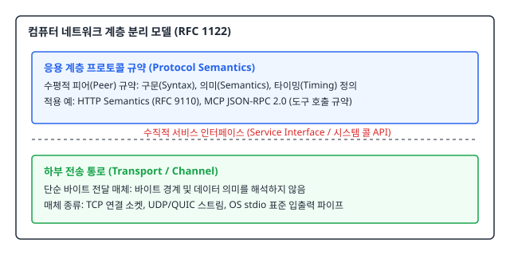
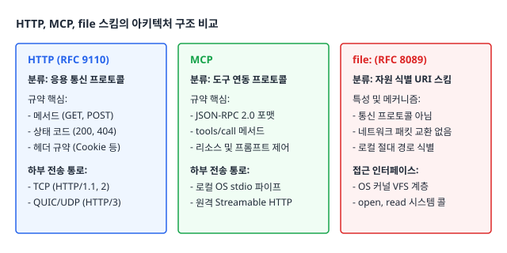
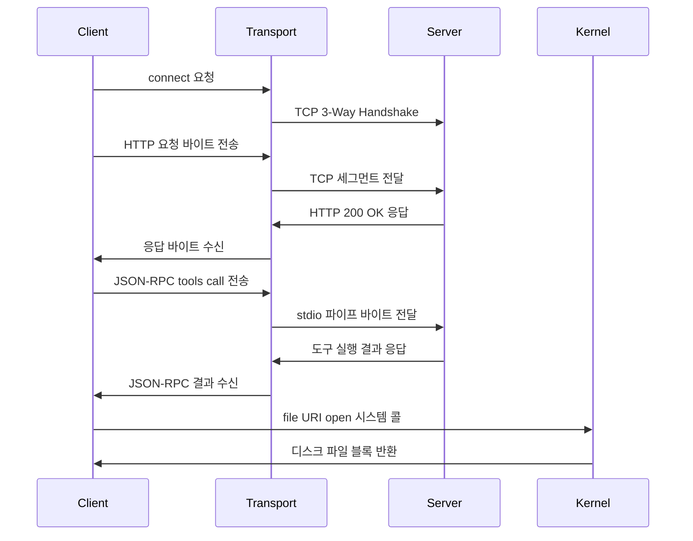

# 261028 통신 프로토콜

> 한 줄 요약: 프로토콜은 데이터를 운반하는 하부 전송 매체(통로)와 분리되어, 이종 시스템 간 데이터 교환의 구문(Syntax), 의미(Semantics), 타이밍(Timing)을 정의하는 공식 규약이다. · 분야: 네트워크 · 저장 · Baseline: 해당 없음: 통신 프로토콜은 웹 브라우저 엔진 전용 Web API(예: DOM, Canvas 등)가 아니라 컴퓨터 네트워크 및 분산 소프트웨어 시스템 전반에서 데이터 교환 규칙을 정의하는 근본 아키텍처 규약(IETF RFC 및 컴퓨터 과학 표준)이므로 브라우저 기능 호환성 지표인 Baseline의 평가 대상이 아님. · 읽는 시간 약 6분

## 1. 왜 쓰는가
프로토콜(Protocol)을 단순히 데이터가 오가는 물리적·논리적 통로로 규정하는 것은 통신 아키텍처의 계층적 구조를 혼동한 것이다 [1]. 네트워크 케이블, 운영체제 파이프(Pipe), TCP 소켓(Socket), 연결 세션은 비트와 바이트를 한 지점에서 다른 지점으로 전달하는 전송 매체(Transport/Channel)일 뿐이며, 전송되는 바이트가 어떠한 구조를 갖추고 있는지 또는 무엇을 의미하는지 해석하지 못한다 [1]. 프로토콜은 전송 매체 위를 흐르는 원시 바이트의 경계를 식별하고, 제어 정보와 데이터의 의미를 부여하며, 송수신 개체 간의 동작 순서를 정의하는 상호 합의된 공식 규약이다 [1].

규약 없이 소켓에 독자적인 바이트를 직접 흘려보내는 비표준 Raw Socket 스트림 방식을 사용할 경우, 통로 오버헤드는 최소화할 수 있으나 메시지의 시작과 끝 경계(Framing)를 분별할 수 없다. 또한 패킷 손실 시 재전송 및 에러 복구 절차가 결여되며, 송신자와 수신자의 하드웨어나 운영체제가 상이할 때 데이터 상호운용성을 확보할 수 없다. 프로토콜은 데이터 형식과 배치 규칙(구문), 필드와 상태 코드의 해석 기준(의미), 데이터 송수신 속도와 순서 동기화(타이밍)를 명문화함으로써 이 문제를 해결한다 [1].

이러한 전송 통로와 프로토콜 규약의 분리는 독자가 질문한 HTTP, MCP, file의 관계를 분석할 때 명확하게 드러난다 [2, 5, 7].
1. HTTP(Hypertext Transfer Protocol)는 웹 환경의 분산 정보 시스템을 위한 상태 비보존형(Stateless) 응용 계층 프로토콜이다 [2]. HTTP의 본질은 요청·응답 구조, 메서드(GET, POST), 상태 코드(200, 404), 헤더 필드의 의미론을 정의한 HTTP Semantics(RFC 9110)에 존재한다 [2]. 이 프로토콜 규약은 하부 전송 통로가 TCP 텍스트 스트림(HTTP/1.1)이든, TCP 바이너리 멀티플렉싱 프레임(HTTP/2)이든, UDP 기반 QUIC 스트림(HTTP/3)이든 관계없이 동일한 의미론을 유지하며 통로를 교체할 수 있다 [2].
2. MCP(Model Context Protocol)는 LLM 기반 클라이언트 애플리케이션과 외부 데이터 소스 또는 도구(Server) 간의 상호작용을 표준화하기 위해 설계된 응용 계층 프로토콜이다 [7]. MCP는 JSON-RPC 2.0을 와이어 포맷으로 채택하여 도구 호출(tools/call), 리소스 읽기, 프롬프트 템플릿의 규약(Semantics)을 정의한다 [7]. MCP는 상위 규약과 하위 전송 계층(Transport)을 완전히 분리하였으므로, 동일한 프로토콜 규약을 로컬 프로세스 간 통신 통로인 stdio 파이프와 원격 웹 통로인 Streamable HTTP/SSE 모두에서 동일하게 구동할 수 있다 [7].
3. file은 통신 프로토콜이 아니며, 로컬 및 네트워크 파일 시스템에 위치한 파일의 경로를 식별하기 위해 제정된 URI 스킴(Scheme)이다 [5]. file URI 스킴은 원격 피어와의 네트워크 패킷 교환이나 핸드셰이크 절차를 수반하지 않는다 [5]. 웹 브라우저나 애플리케이션이 file:/// 경로에 접근할 때, 네트워크 프로토콜 스택 대신 운영체제 커널의 가상 파일 시스템(VFS) 추상화 계층 및 파일 I/O 시스템 콜(open, read)을 직접 호출하여 로컬 저장 장치의 데이터를 메모리로 적재한다 [5].

## 2. 핵심 개념
프로토콜을 정확하게 이해하기 위해서는 컴퓨터 네트워크 아키텍처의 수평적 피어 규약과 수직적 서비스 인터페이스의 분리 구조를 파악해야 한다 [1].



위 도식에서 나타나듯, 프로토콜은 동일한 계층에 위치한 피어(Peer) 개체 간에 수평적으로 동작하는 규약이다 [1]. 반면 상하 인접 계층 간에는 수직적인 서비스 인터페이스(API)가 작동한다 [1]. 응용 계층은 하부 전송 통로(소켓, 파이프)가 데이터를 어떠한 방식으로 목적지까지 전달하는지 관여하지 않고 시스템 콜 인터페이스를 통해 바이트를 위임하며, 하부 전송 통로는 상위 응용 계층의 프로토콜 구문이나 의미를 해석하지 않은 채 바이트를 목적지 피어로 운반한다 [1].



프로토콜을 구성하고 구별하는 핵심 용어 및 개념은 다음과 같다.
- 구문(Syntax): 데이터의 구성 형식, 필드 배치, 부호화 방식, 비트/바이트 수준의 구조를 정의한다 [1]. HTTP/1.1의 CRLF 텍스트 구분자, HTTP/2의 9바이트 고정 헤더 바이너리 프레임, MCP의 JSON-RPC 2.0 객체 구조가 구문에 해당한다 [2, 7].
- 의미(Semantics): 각 필드, 제어 비트, 식별자가 나타내는 의미와 동작, 상태 전이를 정의한다 [1]. HTTP의 GET 메서드가 지닌 멱등성(Idempotency), 상태 코드 200 OK의 성공 의미, MCP의 tools/call 메서드가 지닌 원격 실행 의미가 이에 속한다 [2, 7].
- 타이밍(Timing): 송수신 개체 간의 전송 속도 제어, 메시지 순서 동기화, 상태 대기 시간을 규정한다 [1]. TCP의 슬라이딩 윈도우 흐름 제어, 핸드셰이크 순서, 요청에 대한 타임아웃 처리가 타이밍의 대표적인 요소다 [3].
- 전송 통로(Transport / Channel): 원시 바이트를 한 지점에서 다른 지점으로 전달하는 논리적·물리적 매체다 [1]. 운영체제 프로세스 간 통신 파이프(stdio), 네트워크 전송 계층 소켓(TCP, UDP), 스트림(QUIC)이 여기에 해당한다 [1, 3, 4, 7].
- URI 스킴(URI Scheme): 리소스의 위치나 접근 방식을 나타내는 식별자 규약이다 [5, 6]. WHATWG URL 표준은 http, https, ws, wss, ftp, file을 특별한 파싱 규칙(호스트 정규화, 기본 포트 매핑)이 적용되는 특별 스킴(Special Scheme)으로 분류한다 [6]. file 스킴은 네트워크 통신 프로토콜이 아닌 로컬 파일 시스템 경로 식별자다 [5].

## 3. 동작 원리
프로토콜은 메시지가 생성되는 시점, 전송 매체로 바이트 스트림이 직렬화되어 전달되는 시점, 수신 측에서 역직렬화 및 상태 머신이 계산되는 시점에 단계적으로 실행된다 [1, 2, 7].



스펙에 따른 구체적인 동작 메커니즘과 계산 절차는 다음과 같다.
1. HTTP 동작 원리: 클라이언트 애플리케이션이 리소스를 요청하면, 브라우저 HTTP 스택은 RFC 9110 규약에 따라 요청 라인(메서드, 경로, 프로토콜 버전), 헤더 필드, 본문을 결합하여 바이트 스트림으로 직렬화한다 [2, 8]. 하부 전송 계층이 TCP인 경우, RFC 9293에 규정된 3-Way Handshake(SYN -> SYN-ACK -> ACK)를 거쳐 논리적 연결을 수립한다 [3]. 송신 측 TCP 스택은 바이트 스트림에 순서 번호(Sequence Number)를 부여하여 세그먼트로 분할 전송하며, 수신 측은 순서 번호를 검증하여 패킷을 재정렬하고 중복을 제거한다 [3]. 서버의 응답(200 OK 등)이 수신되면 클라이언트는 헤더의 Content-Type MIME 규약에 따라 본문을 파싱하고 DOM 및 렌더링 파이프라인을 실행한다 [8].
2. MCP 동작 원리: LLM 클라이언트가 외부 도구 실행을 결정하면, Model Context Protocol 스펙에 따라 와이어 포맷인 JSON-RPC 2.0 규격의 요청 메시지(jsonrpc 버전, id, method: tools/call, params 객체)를 구성한다 [7]. 클라이언트는 하부 전송 계층으로 바인딩된 매체(stdio 파이프 또는 Streamable HTTP 연결)로 해당 텍스트를 전송한다 [7]. 로컬 stdio 통로의 경우, 개행 문자(\n)로 구분된 메시지 단위로 운영체제 파이프 버퍼에 기록된다 [7]. 도구 서버 프로세스는 표준 입력을 통해 스트림을 수신하고, 개행을 기준으로 JSON을 역직렬화한 뒤 도구를 실행하여 동일한 id를 지닌 JSON-RPC 응답 메시지를 반환한다 [7].
3. file 스킴 동작 원리: 사용자가 file:/// 경로를 요청하면, 브라우저의 URL 파서는 WHATWG URL 표준의 특별 스킴 규칙에 따라 호스트명과 경로 문자열을 정규화한다 [5, 6]. 이때 네트워크 소켓 열기, DNS 질의, 핸드셰이크는 일체 수행되지 않는다 [5]. 런타임 엔진은 파일 경로를 인자로 전달하여 운영체제 커널의 가상 파일 시스템(VFS) 계층에 open 및 read 시스템 콜을 호출한다 [5]. 커널은 로컬 스토리지 컨트롤러를 구동하여 디스크 블록에서 데이터를 읽어 들인 후 프로세스 메모리 버퍼로 직접 복사한다 [5].

## 4. 기본 사용법
하부 전송 통로와 상위 프로토콜 파싱 로직을 명확히 분리하여 구현한 JavaScript 예시는 다음과 같다. Node.js 스트림 통로 위에서 개행 프레이밍(Framing) 규약과 JSON-RPC 2.0 프로토콜 의미론을 처리한다.

```js
import { Readable, Writable } from 'node:stream';

class ProtocolChannel {
  constructor(inputStream, outputStream) {
    this.inputStream = inputStream;
    this.outputStream = outputStream;
    this.buffer = '';
  }

  listen(handler) {
    this.inputStream.on('data', (chunk) => {
      this.buffer += chunk.toString('utf-8');
      const messages = this.buffer.split('\n');
      this.buffer = messages.pop() ?? '';
      for (const rawMessage of messages) {
        if (rawMessage.trim().length > 0) {
          handler(JSON.parse(rawMessage));
        }
      }
    });
  }

  send(messagePayload) {
    const serialized = JSON.stringify(messagePayload) + '\n';
    this.outputStream.write(serialized);
  }
}

const transportInput = new Readable({ read() {} });
const transportOutput = new Writable({
  write(chunk, encoding, callback) {
    process.stdout.write(`전송 통로 전달 바이트: ${chunk.toString('utf-8')}`);
    callback();
  }
});

const channel = new ProtocolChannel(transportInput, transportOutput);

channel.listen((parsedMessage) => {
  if (parsedMessage.jsonrpc === '2.0' && parsedMessage.method === 'tools/call') {
    channel.send({
      jsonrpc: '2.0',
      id: parsedMessage.id,
      result: { executed: true, data: parsedMessage.params }
    });
  }
});

transportInput.push('{"jsonrpc":"2.0","id":1,"method":"tools/call","params":{"tool":"query"}}\n');
```

코드의 각 줄별 동작 설명은 다음과 같다.
- 1행: Node.js의 node:stream 모듈에서 단방향 읽기 스트림인 Readable과 쓰기 스트림인 Writable 클래스를 불러온다.
- 2행: 코드 가독성을 위한 공백 줄이다.
- 3행: 하부 전송 스트림 통로와 결합하여 메시지 프레이밍과 직렬화를 처리할 ProtocolChannel 클래스를 선언한다.
- 4행: 전송 통로인 inputStream과 outputStream을 주입받는 생성자를 정의한다.
- 5행: 수신 통로 스트림 인스턴스를 클래스 속성에 할당한다.
- 6행: 송신 통로 스트림 인스턴스를 클래스 속성에 할당한다.
- 7행: 파편화되어 유입되는 바이트 스트림 조각을 결합하기 위한 임시 문자열 버퍼를 빈 문자열로 초기화한다.
- 8행: 생성자 블록을 마친다.
- 9행: 코드 구분을 위한 공백 줄이다.
- 10행: 역직렬화된 프로토콜 메시지를 처리할 콜백 함수를 등록하는 listen 메서드를 정의한다.
- 11행: 수신 전송 통로(inputStream)의 data 이벤트에 리스너를 등록하여 원시 바이트 청크(chunk)가 도착할 때마다 호출되도록 한다.
- 12행: 유입된 바이너리 청크를 UTF-8 문자열로 디코딩한 뒤 클래스 내부 버퍼에 누적 결합한다.
- 13행: 스트림 상에서 메시지의 끝 경계를 나타내는 프레이밍 규약인 개행 문자(\n)를 기준으로 버퍼를 분할한다.
- 14행: 분할된 배열의 마지막 요소(아직 개행 문자가 도달하지 않아 완성되지 않은 미완성 청크)를 꺼내어 버퍼에 유지한다.
- 15행: 완전하게 수신된 개별 메시지 문자열 배열을 순회하는 for...of 반복문을 실행한다.
- 16행: 메시지 전후의 공백 문자를 제거한 후 내용이 존재하는 유효한 데이터인지 검증한다.
- 17행: 프로토콜 구문 규칙에 따라 JSON 문자열을 객체로 역직렬화한 뒤 등록된 핸들러 함수로 전달한다.
- 18행: 조건문 블록을 마친다.
- 19행: 메시지 순회 반복문 블록을 마친다.
- 20행: data 이벤트 리스너 함수 및 호출 블록을 마친다.
- 21행: listen 메서드 블록을 마친다.
- 22행: 코드 구분을 위한 공백 줄이다.
- 23행: 프로토콜 객체를 전송 통로 규격에 맞추어 송신하는 send 메서드를 정의한다.
- 24행: 프로토콜 페이로드를 JSON 문자열로 직렬화하고, 메시지 경계 프레이밍 규약인 개행 문자(\n)를 끝에 결합한다.
- 25행: 하부 송신 전송 통로(outputStream)의 write 메서드를 호출하여 원시 바이트를 전달한다.
- 26행: send 메서드 블록을 마친다.
- 27행: ProtocolChannel 클래스 선언 블록을 마친다.
- 28행: 코드 구분을 위한 공백 줄이다.
- 29행: 하부 수신 전송 통로 역할을 수행할 Readable 스트림 인스턴스를 생성한다.
- 30행: 하부 송신 전송 통로 역할을 수행할 Writable 스트림 인스턴스를 선언한다.
- 31행: Writable 스트림으로 유입된 바이트를 처리하는 write 메서드를 정의한다.
- 32행: 전송 통로를 통과하는 바이트 데이터를 표준 출력으로 로깅하여 통로의 물리적 전달 상태를 확인한다.
- 33행: 스트림 쓰기 작업이 완료되었음을 런타임에 알리는 콜백 함수를 호출한다.
- 34행: Writable의 write 메서드 구현 블록을 마친다.
- 35행: Writable 인스턴스 생성 블록을 마친다.
- 36행: 코드 구분을 위한 공백 줄이다.
- 37행: 임의로 생성한 가상 전송 통로 인스턴스들을 주입하여 ProtocolChannel 객체를 초기화한다.
- 38행: 코드 구분을 위한 공백 줄이다.
- 39행: 완성된 프로토콜 메시지를 수신했을 때 수행할 동작 핸들러를 등록한다.
- 40행: JSON-RPC 2.0 스펙 규격(jsonrpc 버전 및 tools/call 메서드명)에 부합하는지 프로토콜 의미론을 검증한다.
- 41행: 검증을 통과한 요청에 대해 JSON-RPC 2.0 성공 응답 객체를 구성하여 send 메서드를 호출한다.
- 42행: JSON-RPC 2.0 버전을 명시한다.
- 43행: 요청 메시지와 동일한 요청 식별자(id)를 응답에 매핑하여 동기화를 보장한다.
- 44행: 실행 완료 상태와 전달받은 매개변수를 담은 result 객체를 구성한다.
- 45행: send 메서드 인자 객체 블록을 닫는다.
- 46행: 조건문 블록을 마친다.
- 47행: listen 핸들러 블록을 마친다.
- 48행: 코드 구분을 위한 공백 줄이다.
- 49행: 수신 전송 통로(transportInput)에 JSON-RPC tools/call 요청 문자열과 프레이밍 개행 문자를 밀어 넣어 통신을 시뮬레이션한다.

## 5. 실무 예시

### 예시 1: HTTP/REST API 호출 및 RFC 9110 의미론 처리
- 상황: 웹 프론트엔드가 fetch API를 통해 원격 HTTP/REST API 서버로 데이터를 요청하고, RFC 9110 규약에 따른 상태 코드 및 Content-Type 응답 헤더를 검증하여 데이터를 역직렬화하는 상황 [2, 8].
- 코드:
```js
async function requestUserData(endpoint) {
  const response = await fetch(endpoint, {
    method: 'GET',
    headers: {
      'Accept': 'application/json'
    }
  });

  if (!response.ok) {
    throw new Error(`HTTP 요청 실패: 상태 코드 ${response.status}`);
  }

  const contentType = response.headers.get('content-type');
  if (!contentType || !contentType.includes('application/json')) {
    throw new Error(`유효하지 않은 MIME 타입 응답: ${contentType}`);
  }

  const payload = await response.json();
  return payload;
}
```
- 주의점: fetch API는 HTTP 응답 상태 코드가 404 Not Found나 500 Internal Server Error를 반환하더라도 네트워크 물리 연결이 두절되지 않는 한 프로미스를 거부(reject)하지 않는다. 따라서 response.ok 플래그나 response.status 수치를 조건문으로 반드시 검증해야 한다. 또한 단일 TCP 소켓 연결을 공유하는 HTTP/1.1 환경에서는 선행 요청의 패킷 지연이 후속 요청을 지연시키는 Head-of-Line Blocking(HOLB)이 발생할 수 있다.

### 예시 2: MCP stdio 파이프 기반 로컬 도구 호출
- 상황: 데스크톱 AI 애플리케이션이 외부 도구를 제어하기 위해 로컬 도구 프로세스를 구동하고, stdio(표준 입출력) 통로 위에서 Model Context Protocol 규격의 JSON-RPC 2.0 tools/call 요청을 전송하여 응답을 수신하는 상황 [7].
- 코드:
```js
import { spawn } from 'node:child_process';
import { createInterface } from 'node:readline';

function executeTool(toolName, toolArgs) {
  return new Promise((resolve, reject) => {
    const processHandle = spawn('node', ['server.js'], {
      stdio: ['pipe', 'pipe', 'inherit']
    });

    const lineReader = createInterface({
      input: processHandle.stdout,
      crlfDelay: Infinity
    });

    lineReader.on('line', (line) => {
      try {
        const response = JSON.parse(line);
        if (response.id === 101) {
          resolve(response.result);
          processHandle.kill();
        }
      } catch (error) {
        reject(error);
      }
    });

    const mcpPayload = {
      jsonrpc: '2.0',
      id: 101,
      method: 'tools/call',
      params: {
        name: toolName,
        arguments: toolArgs
      }
    };

    processHandle.stdin.write(JSON.stringify(mcpPayload) + '\n');
  });
}
```
- 주의점: 하부 stdio 통로는 원시 바이트 스트림이므로 메시지 경계를 스스로 인지하지 못한다. JSON-RPC 메시지 끝에 개행 문자(\n)를 추가하는 프레이밍 규약을 누락하거나 파이프 버퍼가 잘려 도착할 때 readline과 같은 스트림 프레이밍 처리를 누락하면 JSON 파싱 오류(SyntaxError)가 발생한다.

### 예시 3: WHATWG URL 표준을 통한 http와 file URI 스킴 분기 처리
- 상황: 웹 프론트엔드 또는 하이브리드 애플리케이션 환경에서 사용자 입력 경로를 파싱할 때, 네트워크 통신 프로토콜인 http:와 로컬 파일 시스템 경로 식별자인 file: 스킴의 특성을 WHATWG URL 표준에 따라 판별하고 안전하게 분기하는 상황 [5, 6].
- 코드:
```js
function routeResource(targetUri) {
  const parsedUrl = new URL(targetUri);

  if (parsedUrl.protocol === 'http:' || parsedUrl.protocol === 'https:') {
    return {
      type: 'NETWORK_RESOURCE',
      address: parsedUrl.href,
      requiresNetwork: true
    };
  }

  if (parsedUrl.protocol === 'file:') {
    return {
      type: 'LOCAL_FILE_PATH',
      address: parsedUrl.pathname,
      requiresNetwork: false
    };
  }

  throw new Error(`지원하지 않는 URI 스킴: ${parsedUrl.protocol}`);
}
```
- 주의점: file:은 원격 네트워크 통신 프로토콜이 아니며 운영체제 VFS 경로를 식별하는 URI 스킴이다 [5]. 브라우저 보안 모델은 동일 출처 정책(SOP)에 따라 웹 오리진(http://, https://)에서 구동되는 스크립트가 file:/// URI로 직접 리소스를 요청하는 동작을 보안 침해로 간주하여 차단하므로, 스킴 검증을 통해 부적절한 네트워크 호출 시도를 차단해야 한다.

## 6. 장점 · 단점

| 장점 | 단점 |
| :--- | :--- |
| **이종 시스템 간 상호운용성(Interoperability)**: 하드웨어, 운영체제, 프로그래밍 언어가 상이한 시스템 간에도 공통 프로토콜 규약을 준수하면 데이터 교환이 가능하다 [1]. | **메타데이터 및 프레이밍 오버헤드**: 데이터 페이로드 외에 헤더, 프레임 경계 표기, 제어 비트, 상태 플래그가 추가되어 대역폭과 메모리 소모가 발생한다. |
| **계층 분리(Layering)에 따른 유연성**: 상위 프로토콜 의미론(Semantics)과 하부 전송 통로(Transport)가 독립되어 있어, 비즈니스 로직 수정 없이 전송 계층을 TCP에서 QUIC으로 교체할 수 있다 [2]. | **직렬화 및 역직렬화(Serialization/Deserialization) 비용**: JSON 텍스트 파싱이나 바이너리 프레임 인코딩/디코딩 과정에서 CPU 연산 비용이 추가로 소모된다. |
| **느슨한 결합(Loose Coupling)과 독립적 확장**: 클라이언트와 서버가 내부 시스템 구조를 은닉하고 표준 메시지 인터페이스(JSON-RPC, REST)만으로 통신하므로 시스템의 독립적 배포가 용이하다 [7]. | **프로토콜 파편화 및 하위 호환성 유지 부담**: 스펙 개정 시 구형 클라이언트와의 호환성을 지속해서 유지해야 하며, 구현체 간 미세한 해석 차이로 인한 상호운용성 버그가 발생할 수 있다. |
| **표준화된 에러 처리 및 제어 흐름**: 성공/실패 상태 코드, 타임아웃 규칙, 흐름 제어 및 재전송 알고리즘이 사전 정의되어 시스템 예외 발생 시 전면 장애를 방지한다 [1, 2, 3]. | **설계 및 구현 복잡성**: 상태 전이 머신(State Machine), 재전송 타이머, 윈도우 흐름 제어, 에러 복구 로직을 정확하게 구현하는 데 높은 엔지니어링 비용이 요구된다 [3]. |

## 7. 한계와 함정
프로토콜을 설계하고 운영할 때 마주하는 구조적 한계와 함정은 다음과 같다.
- 성능(Performance): 단일 스트림 기반의 TCP 프로토콜은 패킷 손실이 발생했을 때 손실된 패킷이 재전송되어 수신될 때까지 후속 패킷 전달이 전면 중단되는 Head-of-Line Blocking(HOLB) 병목을 유발한다 [3]. 또한 TCP 3-Way Handshake(1 RTT)와 TLS 암호화 핸드셰이크(1~2 RTT)가 결합될 경우 첫 바이트 수신 시간(TTFB)까지 상당한 왕복 지연이 누적된다 [3, 4].
- 보안(Security): TLS와 같은 암호화 핸드셰이크 규약이 없는 평문 통신 프로토콜은 중간자 공격(MitM), 패킷 스니핑, 데이터 위변조에 완전히 노출된다.
- 개인정보(Privacy): HTTP 요청 시 전송되는 User-Agent, 클라이언트 힌트, IP 주소, Referer 등의 프로토콜 메타데이터는 웹 브라우징 환경에서 기기 핑거프린팅 및 사용자 무단 추적에 악용될 위험이 존재한다.
- 경계 사례(Edge Cases) 및 네트워크 환경: 방화벽, NAT, 프록시 등 네트워크 중간 장치(Middlebox)가 기존의 고착화된 포맷(TCP 포트 80, 443)에만 트래픽을 허용하도록 경직(Ossification)되어 있어, 새로운 전송 계층 규약(UDP 기반 QUIC 등)의 전역 배포 시 패킷 드롭이 발생하는 경계 상황이 발생한다 [4].
- 접근성 및 상태 유지 한계: HTTP의 기본 설계는 무상태(Stateless) 프로토콜이므로, 사용자 인증이나 화면 상태 유지를 위해 헤더 규약(Cookie, Set-Cookie)을 상위에 결합해야 하는 구조적 한계가 존재한다 [8]. 또한 로컬 file URI 스킴은 네트워크 접근 권한이 배제되어 웹 보안 샌드박스 내부에서 원격 오리진 리소스와 교차 결합할 수 없는 격리 경계를 갖는다 [5].

## 8. 다른 방법과 비교

| 방법 | 언제 | 비용 | 한계 |
| :--- | :--- | :--- | :--- |
| **비표준 Raw Socket 스트림** | 프로토콜 헤더 오버헤드를 극단적으로 제거해야 하는 특수 임베디드 단일 환경 | 헤더 오버헤드 0바이트 수렴 | 메시지 경계(Framing) 식별 불가, 패킷 유실 시 에러 복구 부재, 이종 시스템 간 상호운용성 결여 |
| **공유 메모리(Shared Memory) 및 로컬 파일 교환(file://)** | 동일 머신 내부 프로세스 간 초고속 대용량 데이터 교환 시 | 네트워크 스택 오버헤드 0, VFS 시스템 콜 오버헤드 | 동기화 락(Lock) 관리의 극심한 복잡성, 물리적으로 분리된 분산 네트워크 환경으로 확장 불가 [5] |
| **RPC 계열 (gRPC, JSON-RPC, MCP)** | REST 문서 모델 대신 명시적인 원격 프로시저/도구 호출 추상화가 필요할 때 [7] | IDL 스키마 정의 및 바이너리/JSON 직렬화·역직렬화 CPU 비용 [7] | 웹 표준 캐싱 및 HTTP 중간 프록시 인프라 활용의 제약, 호출 규약에 대한 양단 종속성 |
| **메시지 브로커 / 이벤트 큐 (Kafka, RabbitMQ)** | 비동기 발행-구독(Pub/Sub) 모델로 서비스 간 시공간적 결합도를 제거해야 할 때 | 브로커 클러스터 유지 인프라 비용 및 큐 관리 오버헤드 | 실시간 동기식 즉시 응답 확인 불가, 분산 트랜잭션 관리 난이도 증가 |

### 이것을 고르지 않는 경우
- 단일 컴퓨터 내부 프로세스 간에 마이크로초 단위의 극단적인 처리 속도가 요구되어 통신 프로토콜 스택 대신 공유 메모리(Shared Memory)를 직접 매핑해야 하는 경우.
- 분산 시스템 간 결합도를 완전히 제거하고 대규모 이벤트 스트림을 비동기로 버퍼링하기 위해 점대점(Point-to-Point) 요청/응답 프로토콜 대신 메시지 브로커(Kafka, RabbitMQ)를 사용하는 경우.
- 원격 통신 규약이나 패킷 교환이 일체 필요 없고, 로컬 운영체제 저장 장치의 파일 절대 경로만을 식별하여 커널 파일 I/O를 직접 수행하는 file URI 스킴으로 충분한 경우 [5].

## 9. 대비와 새로운 시도
기존 프로토콜의 성능 한계와 분산 시스템 환경의 변화에 대응하기 위해 다음과 같은 새로운 규약 및 표준화 작업이 진행되고 있다.
1. HTTP/3 및 QUIC (RFC 9000, RFC 9114)의 정착: TCP의 Head-of-Line Blocking(HOLB) 병목과 3-Way Handshake 왕복 지연을 해결하기 위해 UDP 기반 멀티플렉싱 전송 프로토콜인 QUIC이 IETF 표준으로 제정되었다 [4]. QUIC은 TLS 1.3 암호화를 전송 계층에 직접 통합하여 0-RTT 연결 수립을 지원하며, 독립적인 다중 스트림을 통해 패킷 손실이 다른 스트림을 차단하지 않도록 개선되었다 [4].
2. Model Context Protocol (MCP) 생태계 확장: Anthropic이 제정한 MCP는 LLM 에이전트와 도구/데이터 간의 인터페이스 표준으로 확장되고 있다 [7]. 하부 전송 계층을 로컬 프로세스 통신(stdio 파이프)과 원격 클라우드 통신(Streamable HTTP / SSE)으로 분리하여 환경에 구애받지 않는 도구 연동 규약을 확립해 나가고 있다 [7].
3. WebTransport (W3C / IETF 표준화): 웹 브라우저와 서버 간에 HTTP/3(QUIC) 전송 계층을 기반으로 양방향 단방향/다방향 스트림과 비신뢰성 데이터그램(Datagram)을 저지연으로 교환할 수 있는 차세대 웹 API 표준화가 진행 중이다.
4. Media over QUIC (MoQ) IETF 워킹그룹: 실시간 라이브 미디어 스트리밍 및 양방향 인터랙티브 방송 환경에서 WebRTC와 HTTP 스트리밍 기술을 융합하기 위해 QUIC 기반의 응용 프로토콜 표준화 작업이 추진되고 있다.

## 10. 다른 사람에게 설명하기

### 세 문장 요약
1. 프로토콜은 데이터를 운반하는 물리적·논리적 매체인 전송 통로(소켓, 파이프)와 엄격히 분리되어, 상호 통신 개체 간 데이터 교환의 구문(Syntax), 의미(Semantics), 타이밍(Timing)을 규정하는 공식 규약이다 [1].
2. HTTP와 MCP는 동일한 프로토콜 의미론을 유지한 채 TCP, QUIC, stdio 파이프, Streamable HTTP 등 하부 전송 통로를 교체하며 동작할 수 있는 응용 프로토콜이다 [2, 7].
3. 반면 file은 원격 패킷 교환이나 통신 핸드셰이크 규약이 없는 로컬 파일 시스템 경로 식별용 URI 스킴이며, 운영체제 커널의 VFS 및 open/read 시스템 콜을 직접 호출하여 동작한다 [5, 6].

### 스스로 확인할 질문
- Q1. 하부 전송 통로(TCP 소켓, OS stdio 파이프)와 상위 응용 프로토콜(HTTP, MCP)이 컴퓨터 네트워크 아키텍처에서 분리되는 구조적 이유는 무엇인가?
- Q2. HTTP Semantics(RFC 9110)가 HTTP/1.1, HTTP/2, HTTP/3으로 전송 계층 통로가 바뀌어도 동일하게 유지될 수 있는 기술적 원리는 무엇인가?
- Q3. URI 표기에서 접두어로 사용되는 file:이 HTTP나 MCP와 달리 통신 프로토콜이 아닌 URI 스킴으로 분류되는 명확한 근거는 무엇인가?

## 참고 자료
1. [RFC 1122: Requirements for Internet Hosts -- Communication Layers](https://www.rfc-editor.org/rfc/rfc1122)
2. [RFC 9110: HTTP Semantics](https://www.rfc-editor.org/rfc/rfc9110)
3. [RFC 9293: Transmission Control Protocol (TCP)](https://www.rfc-editor.org/rfc/rfc9293)
4. [RFC 9000: QUIC: A UDP-Based Multiplexed and Secure Transport](https://www.rfc-editor.org/rfc/rfc9000)
5. [RFC 8089: The 'file' URI Scheme](https://www.rfc-editor.org/rfc/rfc8089)
6. [WHATWG URL Standard](https://url.spec.whatwg.org/)
7. [Model Context Protocol Specification](https://spec.modelcontextprotocol.io/)
8. [MDN Web Docs: An Overview of HTTP](https://developer.mozilla.org/en-US/docs/Web/HTTP/Overview)

조사: 2026-10-28

## 내 리뷰

Q. 그럼 HTTP, MCP는 응용 계층 프로토콜이고, 각 네트워크의 전송 규약과 LLM과의 상호작용을 표준화하기 위한 약속이라고 볼 수 있겠네. 마찬가지로 추상적 개념 관점에서는 file또한 운영체제의 특정 파일 개념에 접근할 때, 사용하는 약속이긴 하나, 이는 네트워크 케이블, 운영체제 파이프, TCP 소켓, 연결 세션에 대한 비트와 바이트 Boundary를 규명하지 않기 때문에 프로토콜이라 부르지 않고 URI 스킴이라 명명하는건가?
본문: "HTTP(Hypertext Transfer Protocol)는 웹 환경의 분산 정보 시스템을 위한 상태 비보존형(Stateless) 응용 계층 프로토콜이다 [2]. HTTP의 본질은 요청·응답 구조, 메서드(GET, POST), 상태 코드(200, 404), 헤더 필드의 의미론을 정의한 HTTP Semantics(RFC 9110)에 존재한다 [2]. 이 프로토콜 규약은 하부 전송 통로가 TCP 텍스트 스트림(HTTP/1.1)이든, TCP 바이너리 멀티플렉싱 프레임(HTTP/2)이든, UDP 기반 QUIC 스트림(HTTP/3)이든 관…"

> **A.** 단순히 전송 매체의 비트와 바이트 경계를 규명하지 않아서가 아니라, file은 통신 개체 간의 데이터 교환 규칙을 정의하지 않는 식별자 체계이기 때문에 프로토콜이 아닌 URI 스킴으로 분류됩니다. RFC 3986에 따르면 URI 스킴은 리소스를 식별하고 구문을 파싱하기 위한 명명 규칙이며, RFC 8089는 file URI 스킴이 특정 프로토콜이나 미디어 타입과 결합되어 있지 않다고 명시합니다. 통신 프로토콜은 핸드셰이크, 요청과 응답 메시지 구조, 상태 전이 같은 상호작용 규약을 정의해야 하지만, file은 로컬 또는 네트워크 파일 시스템의 경로를 지칭할 뿐 메시지 교환 절차를 규정하지 않습니다. HTTP나 MCP처럼 프로토콜 역시 하부 전송 매체의 바이트 프레이밍 방식과 분리되어 독립적인 의미론을 정의할 수 있으므로, 전송 통로의 바이트 경계 규정 여부가 프로토콜의 성립 기준이 되지는 않습니다. file URI를 통한 데이터 접근은 통신 규약의 실행이 아니라 런타임이 운영체제 커널의 가상 파일 시스템 및 파일 입출력 시스템 콜을 직접 호출하여 수행됩니다. WHATWG URL 표준에서도 file을 네트워크 기본 포트가 없는 특별 스킴으로 정의하여 경로 정규화 및 파싱 규칙만 다룹니다.
> 출처: [RFC 8089: The 'file' URI Scheme](https://www.rfc-editor.org/rfc/rfc8089) · [RFC 3986: Uniform Resource Identifier (URI): Generic Syntax](https://www.rfc-editor.org/rfc/rfc3986) · [WHATWG URL Standard](https://url.spec.whatwg.org/)
> — Antigravity 2026-10-29 10:25

Q. 일반적인 JSON 구조로 통신한다는건가? RPC는 무엇이고 JSON-RPC는 무엇을 의미하는가?
본문: "JSON-RPC 2.0"

> **A.** 일반적인 임의의 JSON 형식이 아니라, JSON-RPC 2.0 표준 규격에 정의된 필수 필드와 구조를 준수하는 JSON 객체로 통신합니다. RPC(Remote Procedure Call)는 분산 컴퓨팅 환경에서 원격 시스템에 위치한 함수나 프로시저를 로컬 함수 호출과 유사한 방식으로 원격 실행할 수 있도록 지원하는 통신 패러다임입니다. JSON-RPC는 데이터 직렬화 포맷으로 JSON을 채택한 가볍고 상태 비보존형(Stateless)인 원격 프로시저 호출 프로토콜입니다. JSON-RPC 2.0 규격의 요청 메시지는 버전 표기(jsonrpc: '2.0'), 실행할 함수명(method), 인자(params), 요청을 식별하는 고유값(id)으로 구성됩니다. 응답 메시지는 요청과 일치하는 id와 함께 정상 실행 데이터(result) 또는 오류 정보(error)를 포함하는 JSON 객체를 반환합니다. 요청 객체에서 id를 생략하면 서버가 응답을 반환하지 않는 단방향 알림(Notification)으로 동작합니다.
>
> ```js
> const request = { jsonrpc: '2.0', method: 'subtract', params: [42, 23], id: 1 };
> const response = { jsonrpc: '2.0', result: 19, id: 1 };
> ```
> 출처: [JSON-RPC 2.0 Specification](https://www.jsonrpc.org/specification) · [RFC 5531: RPC: Remote Procedure Call Protocol Specification Version 2](https://www.rfc-editor.org/rfc/rfc5531)
> — Antigravity 2026-10-29 10:25

Q. 여긴 어디야? 위원회인가?
본문: "WHATWG"

> **A.** WHATWG(Web Hypertext Application Technology Working Group)는 HTML, DOM, URL, Fetch 등 웹 플랫폼의 핵심 기술 표준을 제정하고 관리하는 실무 작업 그룹입니다. ISO나 W3C 초기 형태와 같은 전통적인 관료제형 표준화 위원회(committee)가 아니라, 브라우저 엔진 벤더와 웹 엔지니어들이 중심이 되어 운영하는 개방형 기술 협력 단체입니다. 2004년 W3C가 실무 웹 생태계와 동떨어진 XHTML 2.0에 집중하자 이에 반발한 Apple, Mozilla, Opera 소속 개발자들이 실제 브라우저에서 구현 가능한 표준을 빠르게 발전시키기 위해 결성했습니다. 특정 주기마다 고정된 버전 사양을 투표로 통과시키는 위원회 방식 대신, 에디터(Editor)가 구현 피드백을 실시간으로 반영하여 사양을 상시 개정하는 리빙 스탠다드(Living Standard) 모델을 채택하고 있습니다. 현재는 주요 브라우저 엔진 개발사인 Apple, Google, Microsoft, Mozilla가 참여하는 운영 그룹(Steering Group)이 거버넌스를 총괄합니다. 2019년 W3C와의 공식 협약을 통해 HTML과 DOM 사양의 단일 표준 개발 주체로 일원화되었습니다.
> 출처: [WHATWG FAQ](https://whatwg.org/faq) · [WHATWG Principles](https://whatwg.org/principles) · [MDN Web Docs Glossary: WHATWG](https://developer.mozilla.org/en-US/docs/Glossary/WHATWG)
> — Antigravity 2026-10-29 10:32
