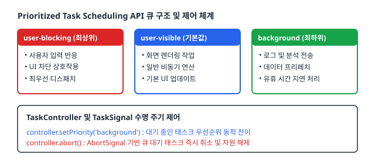
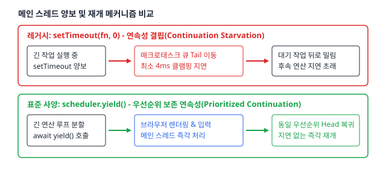

# 261030 Prioritized Task Scheduling API

> 한 줄 요약 · 분야: 메모리 · 성능 · Baseline: Limited availability · 읽는 시간 약 6분
## 1. 왜 쓰는가
자바스크립트는 단일 메인 스레드 기반의 실행 환경(Run-to-completion)으로 동작하므로, 50ms를 초과하는 긴 작업(Long Task)이 실행되면 브라우저의 렌더링 파이프라인과 사용자 입력 처리가 전면 중단된다 [3] [4]. 메인 스레드가 긴 작업에 의해 점유되는 동안 디스플레이 갱신이 멈추어 페이지 프리징이 발생하고, 상호작용 후 다음 페인트까지의 지연 시간을 나타내는 핵심 사용자 경험 지표인 INP(Interaction to Next Paint)가 직접적으로 악화된다 [3] [4].

이러한 성능 저하를 방지하기 위해 과거에는 긴 작업을 미세한 조각으로 분할하여 `setTimeout(fn, 0)`이나 `MessageChannel`을 통해 메인 스레드에 제어를 양보하는 방식을 사용하였다 [1] [3]. 그러나 `setTimeout`은 HTML 스펙에 따라 5회 이상 중첩 호출될 경우 브라우저 레벨에서 최소 4ms의 타이머 클램핑(Clamping)이 강제된다 [1] [3]. 또한 분할된 후속 작업이 브라우저 매크로태스크 큐의 맨 뒤(Tail)로 배치되므로, 대기 중이던 서드파티 스크립트나 기타 작업에 밀려 후속 태스크 완수 시간이 비정상적으로 늘어나는 연속성 결핍(Continuation Starvation) 문제가 구조적으로 발생한다 [1] [3].

반면 `queueMicrotask`나 `Promise.resolve().then(...)` 같은 마이크로태스크는 이벤트 루프가 렌더링 및 UI 입력 처리 단계로 넘어가기 전에 마이크로태스크 큐가 완전히 빌 때까지 연속 실행(Drain)된다 [4]. 따라서 현재 작업이 종료되기 전에 마이크로태스크 큐가 모두 소진되므로 메인 스레드 렌더링 양보 효과가 전혀 발생하지 않는다 [4].

Prioritized Task Scheduling API는 이러한 한계를 극복하기 위해 제안되었다 [1] [2]. 메인 스레드 및 워커 환경에서 작업의 우선순위를 명시적으로 부여하고 브라우저 이벤트 루프에 협력적으로 제어를 양보(Cooperative yielding)할 수 있는 표준 스케줄링 메커니즘을 제공하여, 4ms 클램핑 없이 렌더링과 사용자 입력을 즉시 처리하고 본래 작업으로 지연 없이 복귀하도록 돕는다 [1] [2] [3].

## 2. 핵심 개념


Prioritized Task Scheduling API는 브라우저가 관리하는 우선순위 큐와 개발자가 제어하는 스케줄러 인터페이스로 구성된다 [1] [2]. 핵심 용어와 구조는 다음과 같다.

- `scheduler`: Prioritized Task Scheduling API의 진입점 역할을 하는 전역 객체로, 메인 스레드(`window.scheduler`)와 워커(`self.scheduler`) 스코프 모두에서 접근할 수 있다 [1] [2].
- `TaskPriority`: 작업의 실행 우선순위를 결정하는 3단계 고정 열거형(Enum)이다 [1] [2].
  - `user-blocking`: 사용자 클릭, 탭, 키보드 입력 등 화면에 즉각 반응해야 하는 최상위 우선순위다 [1] [2].
  - `user-visible`: 기본값(Default)으로, 화면에 표시되지만 사용자 입력을 직접 차단하지 않는 일반적인 렌더링 및 연산 우선순위다 [1] [2].
  - `background`: 분석 데이터 수집, 텔레메트리 전송, 리소스 프리페치 등 유휴 시점에 실행해도 되는 최하위 우선순위다 [1] [2].
- `TaskController`: `AbortController`를 상속하여 확장한 인터페이스다 [1] [2]. `controller.signal`을 작업에 전달하여 `controller.abort()` 메서드로 대기 중인 작업을 취소할 수 있으며, `controller.setPriority()` 메서드로 이미 큐에 등록된 작업의 우선순위를 런타임에 동적으로 변경할 수 있다 [1] [2].
- `TaskSignal`: `TaskController`와 연결된 신호 객체로, 작업의 현재 우선순위와 취소 상태를 스케줄러에 전달한다 [1] [2].
- `scheduler.postTask(callback, options)`: 지정한 콜백을 우선순위 큐에 등록하고 결과값을 해결하는 `Promise`를 반환하는 메서드다 [1] [2]. `priority`, `delay`, `signal` 옵션을 지정할 수 있다 [1] [2].
- `scheduler.yield()`: 실행 중인 긴 작업 중간에 호출하여 브라우저 이벤트 루프에 제어권을 일시 양보하고, 렌더링과 긴급 입력을 처리한 뒤 즉시 이전 실행 상태를 이어가도록 설계된 원시 기능(Primitive)이다 [1] [3].



- `Prioritized Continuations`: `scheduler.yield()`가 생성하는 continuation task는 일반적인 `setTimeout(0)`과 달리 큐의 맨 뒤로 밀리지 않고, 양보 전 작업의 우선순위를 보존한 채 동일 우선순위 큐의 최선두(Head)에서 즉시 재개되도록 보장하는 개념이다 [1] [3].

## 3. 동작 원리
Prioritized Task Scheduling API는 W3C WICG Scheduling APIs 명세에 정의된 다중 우선순위 큐 모델을 기반으로 동작한다 [1]. 

```diagram
종류: 시퀀스
번호: 켬

[긴 연산 태스크]
[scheduler]
[브라우저 이벤트 루프]
[렌더링 및 입력 처리]

긴 연산 태스크 -> scheduler : scheduler.yield 호출
scheduler -> 브라우저 이벤트 루프 : 메인 스레드 제어권 양보
브라우저 이벤트 루프 -> 렌더링 및 입력 처리 : 렌더링 파이프라인 및 UI 이벤트 디스패치
렌더링 및 입력 처리 --> 브라우저 이벤트 루프 : 화면 갱신 완료
브라우저 이벤트 루프 -> scheduler : 동일 우선순위 큐 선두의 continuation 디스패치
scheduler --> 긴 연산 태스크 : await 반환 및 연산 루프 즉시 재개
```

1. **태스크 등록 및 큐잉 시점**: `scheduler.postTask(callback, options)`가 호출되면, 브라우저는 지정된 `priority`(또는 `signal`의 우선순위)를 확인하여 `user-blocking`, `user-visible`, `background` 중 적합한 내부 큐에 콜백을 삽입한다 [1] [2]. 만약 `delay` 옵션이 설정되어 있다면 타이머가 만료된 후 해당 우선순위 큐로 전이된다 [1] [2].
2. **이벤트 루프 디스패치 순서**: 이벤트 루프는 매 틱(Tick)마다 우선순위 큐를 상위 레벨부터 순차적으로 검사한다 [1] [2]. `user-blocking` 큐에 대기 중인 태스크가 항상 `user-visible`이나 `background` 태스크보다 먼저 실행된다 [1] [2].
3. **제어권 양보(Yielding) 계산 시점**: CPU 연산 루프 도중 `await scheduler.yield()`가 실행되면, 현재 실행 중인 동기적 호출 스택이 일시 정지되고 제어권이 브라우저 이벤트 루프로 즉시 반환된다 [1] [3].
4. **렌더링 파이프라인 수행**: 이벤트 루프는 양보된 시점을 활용하여 보류 중이던 사용자 터치·클릭 이벤트 큐를 처리하고, 스타일 계산(Style), 레이아웃(Layout), 페인트(Paint), 합성(Composite) 단계로 구성된 렌더링 파이프라인을 실행한다 [3] [4].
5. **우선순위 상속 재개(Continuation) 시점**: 렌더링 및 입력 처리가 완료되면 스케줄러는 `scheduler.yield()` 호출 시점에 생성해 둔 continuation task를 실행한다 [1] [3]. 이 태스크는 큐의 맨 뒤(Tail)로 밀리지 않고, 양보 전 작업이 가지고 있던 우선순위를 그대로 유지한 채 해당 우선순위 큐의 최선두(Head)에 배치되어 즉시 디스패치된다 [1] [3]. 이에 따라 우선순위 역전(Priority Inversion)과 후속 태스크 굶주림(Starvation)이 발생하지 않는다 [1] [3].

## 4. 기본 사용법
다음은 `scheduler.postTask`와 `TaskController`, 그리고 `scheduler.yield`를 활용하여 우선순위를 동적으로 관리하고 제어를 양보하는 완전한 기본 예제 코드다 [1] [2] [3].

```js
async function executeHeavyTask() {
  const controller = new TaskController({ priority: 'user-visible' });

  const taskPromise = scheduler.postTask(
    async () => {
      let total = 0;
      for (let i = 0; i < 1000; i++) {
        total += i;

        if (i % 200 === 0) {
          await scheduler.yield();
        }
      }
      return total;
    },
    { signal: controller.signal }
  );

  controller.setPriority('background');
  const result = await taskPromise;
  return result;
}
```

- 1줄: 비동기 함수 `executeHeavyTask`를 선언하여 스케줄러 기반의 작업을 캡슐화한다.
- 2줄: 초기 우선순위를 `user-visible`로 지정한 `TaskController` 인스턴스를 생성한다 [1] [2].
- 4줄: `scheduler.postTask`를 호출하여 콜백 함수를 스케줄러 큐에 등록하고 결과를 다룰 `Promise`를 반환받는다 [1] [2].
- 5줄: 비동기 콜백 함수 본문을 정의한다.
- 6줄: 연산 결과를 누적할 변수 `total`을 0으로 초기화한다.
- 7줄: 1000회 반복하는 CPU 루프를 시작한다.
- 8줄: 변수 `total`에 반복 변수 `i`의 값을 가산한다.
- 10줄: 200회 반복마다 한 번씩 실행되도록 조건문을 평가한다.
- 11줄: `await scheduler.yield()`를 호출하여 브라우저에 제어를 양보하고, 렌더링 및 UI 입력을 처리한 뒤 동일 우선순위 큐 선두로 복귀하도록 한다 [1] [3].
- 13줄: 반복문 블록을 종료한다.
- 14줄: 계산이 완료된 `total` 값을 반환한다.
- 16줄: `options` 객체로 `controller.signal`을 전달하여 작업의 우선순위 변경 및 취소 수명 주기를 제어기에 연결한다 [1] [2].
- 19줄: `controller.setPriority('background')`를 호출하여 큐에서 대기 중인 작업의 우선순위를 런타임에 `background`로 즉시 강등한다 [1] [2].
- 20줄: `await taskPromise`를 통해 태스크가 최종 완료될 때까지 기다리고 결과값을 추출한다.
- 21줄: 계산 결과 변수 `result`를 최종 반환한다.

## 5. 실무 예시

### 예시 1: 16ms 시간 예산(Time-slicing Budget) 기반 대규모 배열 처리
- **상황**: 대용량 배열 필터링이나 대규모 데이터 파싱 작업이 50ms 이상 이어질 때, 단일 프레임 목표 시간인 16ms(60fps 기준)를 초과하지 않도록 주기적으로 제어를 양보하여 페이지 반응성을 유지해야 한다 [3] [4].
- **코드**:
```js
async function processLargeDataset(items) {
  const TIME_BUDGET_MS = 16;
  let lastYieldTime = performance.now();

  for (let i = 0; i < items.length; i++) {
    computeHeavyItem(items[i]);

    if (performance.now() - lastYieldTime >= TIME_BUDGET_MS) {
      if ('scheduler' in window && 'yield' in scheduler) {
        await scheduler.yield();
      } else {
        await new Promise(resolve => setTimeout(resolve, 0));
      }
      lastYieldTime = performance.now();
    }
  }
}
```
- **주의점**: 매 반복 회차마다 무조건 `yield()`를 호출하면 프로미스 생성과 이벤트 루프 스케줄링 오버헤드가 누적되므로, 반드시 `performance.now()` 데드라인 측정을 통한 시간 예산 기반으로 호출해야 한다 [3].

### 예시 2: TaskController를 활용한 런타임 우선순위 동적 제어 및 취소
- **상황**: 사용자 인터랙션 응답 경로에서 핵심 UI 프리뷰 렌더링을 큐잉한 뒤, 사용자의 행동(스크롤 이탈, 포커스, 컴포넌트 언마운트)에 따라 우선순위를 동적으로 승격·강등하거나 즉시 취소해야 한다 [1] [2] [4].
- **코드**:
```js
const taskController = new TaskController({ priority: 'user-visible' });

scheduler.postTask(async () => {
  const result = await fetchAndProcessData();
  renderPreview(result);
}, { signal: taskController.signal })
.then(() => console.log('작업 완료'))
.catch(err => {
  if (err.name === 'AbortError') {
    console.log('작업이 취소되었습니다.');
  }
});

onUserScrolledAway(() => {
  taskController.setPriority('background');
});

onUserFocus(() => {
  taskController.setPriority('user-blocking');
});

onComponentUnmount(() => {
  taskController.abort(new DOMException('컴포넌트 언마운트로 작업 취소', 'AbortError'));
});
```
- **주의점**: 작업이 취소될 경우 `taskPromise`는 `AbortError`로 거부(Reject)되므로, 반드시 `.catch()` 블록이나 `try/catch`에서 예외 이름을 검사하여 정상 취소 흐름으로 처리해야 한다 [1] [2].

### 예시 3: 크로스 브라우징 안전 폴리필(Yield to Main Fallback) 함수 패턴
- **상황**: `scheduler.yield`가 지원되지 않는 Safari 및 구형 브라우저 환경에서도 최적의 방법으로 메인 스레드 양보를 수행할 수 있도록 다단계 대체 로직을 구성해야 한다 [1] [5] [6].
- **코드**:
```js
async function yieldToMain() {
  if (typeof globalThis.scheduler !== 'undefined' && typeof scheduler.yield === 'function') {
    return scheduler.yield();
  }

  if (typeof globalThis.scheduler !== 'undefined' && typeof scheduler.postTask === 'function') {
    return scheduler.postTask(() => {}, { priority: 'user-visible' });
  }

  if (typeof MessageChannel !== 'undefined') {
    return new Promise(resolve => {
      const channel = new MessageChannel();
      channel.port1.onmessage = () => {
        channel.port1.close();
        channel.port2.close();
        resolve();
      };
      channel.port2.postMessage(null);
    });
  }

  return new Promise(resolve => setTimeout(resolve, 0));
}
```
- **주의점**: `MessageChannel` 폴리필 구현 시 생성된 포트 객체를 명시적으로 닫지(`close()`) 않으면 브라우저 메모리 누수가 발생할 수 있으므로 메시지 수신 즉시 양측 포트를 닫아야 한다.

## 6. 장점 · 단점

| 장점 | 단점 |
| :--- | :--- |
| **네이티브 이벤트 루프 통합**: 4ms 타이머 클램핑이나 큐 맨 뒤로 밀리는 지연 없이 메인 스레드에 제어를 양보하고 최적 시점에 재개할 수 있다 [1] [3]. | **단일 스레드 병목 유지**: 멀티스레드 병렬 처리가 아니므로 협력적으로 제어를 양보하더라도 메인 스레드 총 CPU 연산 시간 자체는 단축되지 않는다. |
| **INP 핵심 최적화**: 50ms 이상의 긴 작업을 미세 청크 단위로 분할하여 사용자 클릭·키보드 입력에 대한 렌더링 응답 지연을 방지한다 [3] [4]. | **브라우저 파편화**: Apple Safari(WebKit)가 아직 정식 지원하지 않으므로 크로스 브라우저 호환성을 위한 런타임 기능 탐지 및 폴리필 관리가 요구된다 [5] [6] [8]. |
| **유연한 동적 우선순위 제어**: `TaskController`를 통해 큐에 등록된 작업의 우선순위를 런타임에 즉시 변경(`setPriority`)하거나 `AbortSignal`로 안전하게 취소할 수 있다 [1] [2]. | **협력적 멀티태스킹의 구현 책임**: 선점형(Preemptive) 스케줄링이 아니므로 개발자가 루프 내에서 시간 예산(Budget)을 계산하여 명시적으로 `yield()`를 호출해야 한다. |
| **직관적인 비동기 문법**: 복잡한 이벤트 리스너나 재귀 콜백 없이 `await scheduler.yield()` 한 줄로 기존 동기 루프 코드를 안전하게 리팩터링할 수 있다 [3]. | **이벤트 루프 전환 오버헤드**: 작업을 지나치게 잘게 쪼갤 경우 프로미스 생성, 큐 전환, 스케줄러 디스패치 비용이 누적되어 전체 완료 시점이 지연될 수 있다. |
| **우선순위 상속(Prioritized Continuations)**: `yield()` 후 재개되는 태스크가 원래 작업의 우선순위를 보존하여 의도치 않은 우선순위 역전 현상을 방지한다 [1] [3]. | |

## 7. 한계와 함정
- **과도한 양보(Over-yielding) 성능 함정**: 반복문 회차마다 무조건 `await scheduler.yield()`를 호출하면 프로미스 인스턴스 생성, 마이크로태스크 틱, 이벤트 루프 스케줄링 오버헤드가 중첩되어 총 연산 시간이 크게 증가한다. 따라서 5ms~16ms 데드라인 기반의 시간 예산(Budget)을 측정하여 주기적으로 호출해야 한다.
- **상태 불일치 및 렌더링 티어링(State Inconsistency / Tearing)**: `yield()`를 통해 메인 스레드에 제어를 넘긴 틈에 사용자가 새로운 입력 이벤트를 발생시키거나 외부 스크립트가 DOM 또는 메모리 상태를 변형할 수 있다. 따라서 재개(Continuation) 시점마다 데이터 무결성을 검증하고 작업 취소 여부를 재확인해야 한다.
- **접근성(a11y) 함정**: 대량의 DOM 요소를 청크 단위로 분할 삽입하는 도중에 스크린 리더가 불완전한 상태의 DOM 트리를 탐색하거나 키보드 포커스가 임의로 유실될 위험이 있다. 청크 작업이 진행되는 컨테이너에 `aria-busy="true"`를 설정하여 보조 기술에 상태를 알리고, 모든 작업 완료 후 `aria-busy` 속성을 해제해야 한다.
- **보안 및 메모리 격리 한계**: 작업을 `background` 우선순위로 격리하더라도 Web Worker와 달리 메인 스레드의 동일한 메모리 힙(Heap)과 글로벌 스코프를 공유한다. 따라서 메모리 누수나 XSS 공격에 대한 물리적 보안 격리 경계를 제공하지 못한다.
- **타이밍 공격 및 브라우저 완화 정책**: 마이크로초 단위의 성능 측정과 스케줄러 큐 동작이 결합될 때 발생 가능한 타이밍 부채널(Timing Side-channel) 공격을 방지하기 위해 브라우저의 성능 타이머 정밀도 제한 정책(Timer resolution clamping)의 영향을 받는다.

## 8. 다른 방법과 비교

| 방법 | 언제 | 비용 | 한계 |
| :--- | :--- | :--- | :--- |
| `scheduler.yield()` / `postTask` | 긴 작업 분할 및 우선순위 기반 태스크 스케줄링 [1] [3] | 스케줄러 디스패치 및 프로미스 생성 비용 | Safari 미지원(Limited availability), 메인 스레드 CPU 총 연산 시간 불변 [5] [6] |
| `setTimeout(fn, 0)` | 레거시 브라우저 환경에서 최소한의 메인 스레드 양보 [1] [3] | 최소 타이머 오버헤드 | 5회 중첩 시 4ms 클램핑 강제, 매크로태스크 큐 맨 뒤로 밀려 연속성 결핍 발생 [1] [3] |
| `MessageChannel` / `postMessage` | 타이머 클램핑 없는 즉각적인 매크로태스크 양보 [1] | 채널 포트 생성 및 이벤트 디스패치 비용 | 우선순위 제어 불가, 큐 맨 뒤로 배치되는 한계 유지, 복잡한 이벤트 기반 구조 |
| `queueMicrotask` / `Promise.then` | 동기 태스크 직후 렌더링 전에 실행해야 하는 후속 로직 | 최소 마이크로태스크 인큐잉 비용 | 렌더링 단계 이전에 큐가 완전히 비워지므로 렌더링 및 입력 차단 해소 불가 [4] |
| `requestIdleCallback` | 프레임 렌더링 후 유휴 시간에 실행할 비동기 작업 | 유휴 시간 계산 및 브라우저 검사 비용 | 지속적 사용자 입력 시 무기한 지연(Starvation) 발생 가능, Safari 미지원 |
| `requestAnimationFrame` | 다음 디스플레이 리프레시 렌더링 직전 시각적 변형 계산 | 디스플레이 VSync 동기화 오버헤드 | 프레임 레이트에 강하게 결합되어 범용적인 비동기 연산 청크 분할에 부적합 |
| `Web Workers` | 메인 스레드와 완전 분리된 무거운 병렬 CPU 연산 | 스레드 생성 및 `postMessage` 직렬화 비용 | DOM API 직접 접근 불가, 구조화된 복제(Structured Clone) 데이터 복사 비용 발생 |

- **이것을 고르지 않는 경우**:
  - DOM 조작이 전혀 필요 없고 순수 CPU 연산량이 매우 큰 작업(예: 대규모 암호화 연산, 이미지 바이너리 처리)의 경우, 메인 스레드에서 `yield()`로 분할하더라도 단일 스레드 병목은 해소되지 않으므로 전용 OS 백그라운드 스레드를 사용하는 Web Worker를 선택해야 한다.
  - 매 프레임 화면 갱신 직전에 정확히 일치시켜 시각적 좌표나 변형을 계산해야 하는 인터랙티브 애니메이션의 경우, 프레임 레이트와 직접 동기화되는 `requestAnimationFrame`을 선택해야 한다.

## 9. 대비와 새로운 시도
- **TC39 AsyncContext 사양 연계**: 비동기 흐름 전반에서 작업 우선순위와 `TaskSignal` 컨텍스트가 `await` 및 비동기 콜백 경계를 넘어 암묵적으로 전파되도록 하는 TC39 언어 표준 연동 작업이 활발히 논의되고 있다.
- **명시적 yield 우선순위 지정**: `await scheduler.yield({ priority: 'user-blocking' })`과 같이 제어를 양보한 뒤 복귀할 때의 우선순위를 명시적으로 승격하거나 변경할 수 있는 확장 사양 제안이 검토 중이다.
- **WHATWG HTML 이벤트 루프 사양 완전 통합**: 브라우저 내부의 기본 태스크 소스들과 WICG Prioritized Task Scheduling 큐 간의 상호작용 및 공정 스케줄링(Fair scheduling) 모델을 공식 HTML 표준에 완전히 통합하기 위한 명세 작업이 지속되고 있다 [1].
- **Safari / WebKit 구현 추진**: WebKit 표준 포지션 Issue #361을 중심으로 애플 웹킷 팀이 API 세분성, 우선순위 역전 방지, 표준 적합성 검토 피드백을 진행하며 구현을 추진하고 있다 [8].

## 10. 다른 사람에게 설명하기
- **세 문장 요약**:
  1. Prioritized Task Scheduling API는 자바스크립트 단일 메인 스레드 환경에서 50ms 이상의 긴 작업으로 인한 렌더링 블로킹과 INP 지연을 해결하기 위해 WICG가 표준화 중인 네이티브 작업 스케줄링 인터페이스다 [1] [3] [4].
  2. `scheduler.postTask()`를 통해 3단계 고정 우선순위(user-blocking, user-visible, background)를 지정하고, `TaskController`로 런타임 우선순위 변경과 취소를 제어할 수 있다 [1] [2].
  3. `scheduler.yield()`는 브라우저 이벤트 루프에 제어권을 일시 양보하여 렌더링과 입력을 처리한 뒤, 4ms 클램핑 없이 원래 우선순위 큐의 선두에서 즉시 작업을 재개(Prioritized Continuation)하도록 보장한다 [1] [3].

- **스스로 확인할 질문 3개**:
  1. `queueMicrotask`나 `Promise.then` 같은 마이크로태스크 방식으로는 왜 브라우저 메인 스레드의 렌더링 및 입력 블로킹을 해소할 수 없는가?
  2. `scheduler.yield()`가 생성하는 continuation task는 과거의 `setTimeout(fn, 0)` 방식과 비교하여 태스크 큐 배치 및 실행 재개 시점에서 어떤 구조적 차이를 가지는가?
  3. 반복문 내에서 시간 예산(Time-slicing Budget) 측정 없이 매 회차마다 무조건 `await scheduler.yield()`를 호출할 경우 어떤 성능적 부작용이 발생하는가?

## 참고 자료
1. [W3C WICG Scheduling APIs Specification](https://wicg.github.io/scheduling-apis/)
2. [MDN Web Docs: Prioritized Task Scheduling API](https://developer.mozilla.org/en-US/docs/Web/API/Prioritized_Task_Scheduling_API)
3. [Chrome for Developers Blog: Use scheduler.yield() to break up long tasks](https://developer.chrome.com/blog/use-scheduler-yield/)
4. [web.dev: Optimize long tasks](https://web.dev/articles/optimize-long-tasks)
5. [Can I use: Prioritized Task Scheduling API](https://caniuse.com/mdn-api_scheduler_posttask)
6. [webstatus.dev: Scheduler API](https://webstatus.dev/features/scheduler)
7. [Mozilla Standards Positions: Scheduling APIs: scheduler.postTask & scheduler.yield (#546, #1039)](https://github.com/mozilla/standards-positions/issues/546)
8. [WebKit Standards Positions: Prioritized Task Scheduling (#361)](https://github.com/WebKit/standards-positions/issues/361)
조사: 2026-10-30

## 내 리뷰
(읽고 느낀 점 · 궁금한 것을 적는다. 질문은 Q. 로 시작)
