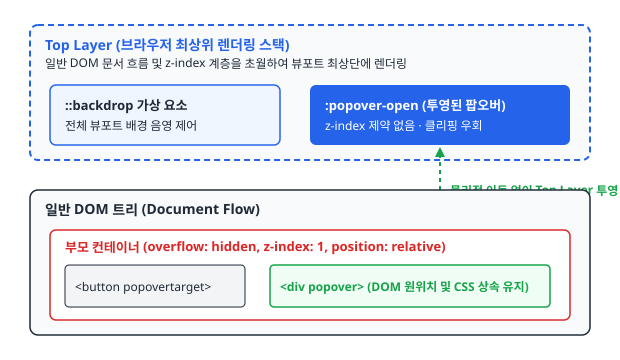

# 261031 Popover API

> 한 줄 요약: DOM 트리 구조와 시맨틱을 유지하면서 요소를 브라우저 엔진의 Top Layer에 렌더링하고, 외부 클릭 및 Escape 닫기와 포커스 복원을 네이티브로 처리하는 웹 표준 오버레이 기술이다 [1, 2]. · 분야: DOM · 렌더링 · Baseline: Newly available (Chrome 114, Safari 17.0, Firefox 125 지원 완료, 2025년 1월 공식 확정 [3, 5, 6]) · 읽는 시간 약 6분

## 1. 왜 쓰는가
웹 애플리케이션에서 드롭다운 메뉴, 툴팁, 커스텀 셀렉트 박스, 팝업 패널과 같은 오버레이 요소를 구현할 때 개발자가 직면했던 가장 고질적인 문제는 CSS 스태킹 컨텍스트(Stacking Context)와 부모 컨테이너의 클리핑(Clipping) 제약이었다 [4]. 오버레이를 트리거 요소 근처의 DOM 계층에 그대로 배치하면, 상위 부모 요소에 `overflow: hidden`, `position: relative`, `transform`, `filter` 등의 속성이 지정되어 있을 때 오버레이의 일부분이 잘려 나가거나 낮은 `z-index` 우선순위로 인해 인접한 다른 레이어 뒤로 숨겨지는 결함이 지속적으로 발생했다 [4].

이러한 레이아웃 파괴 현상을 해결하기 위해 기존 웹 프레임워크와 라이브러리는 자바스크립트를 이용해 DOM 요소를 `document.body` 직하위로 강제 이동시키는 커스텀 자바스크립트 기반의 DOM 재배치(Reparenting)나 React Portals 방식을 고안해 사용했다. 그러나 이 우회 기법은 DOM 트리의 원래 계층 구조를 왜곡하여 여러 부작용을 낳았다. 부모 요소로부터 내려오던 CSS 변수(Custom Properties) 상속이 단절되었고, DOM 구조와 시맨틱에 기반해 계층을 형성하는 접근성 트리(Accessibility Tree)가 파편화되어 스크린 리더 사용자의 탐색 맥락을 훼손했다.

또한 오버레이가 화면에 노출된 상태에서 사용자가 바깥 영역을 클릭했을 때 창을 닫는 외부 클릭 감지(Light Dismiss)와 Escape 키 입력을 통한 닫기 제스처를 지원하기 위해, 개발자는 `document.addEventListener`를 통해 메인 스레드에 전역 `click` 및 `keydown` 이벤트 리스너를 수동으로 등록해야 했다. 여러 컴포넌트가 중첩되어 오버레이를 띄우는 복잡한 UI 환경에서는 전역 이벤트가 의도치 않게 연쇄 전파되거나, 컴포넌트 언마운트 시 리스너가 정상 해제되지 않아 발생하는 메모리 누수와 이벤트 충돌 문제가 잦았다.

Popover API는 이러한 구조적 한계를 브라우저 엔진 수준에서 근본적으로 해결하기 위해 도입된 WHATWG HTML 표준 기술이다 [1]. DOM 트리에서 요소의 물리적 위치와 시맨틱, 스타일 상속 관계를 그대로 유지한 채 브라우저 최상위 렌더링 계층인 Top Layer로 요소를 직접 승격시키며, 외부 클릭 감지, 키보드 Escape 바인딩, 포커스 복귀 및 상호 배타적 중첩 제어를 브라우저 내부 알고리즘으로 처리한다 [1, 2].

## 2. 핵심 개념


- **Top Layer (최상위 레이어)**: 브라우저 렌더링 엔진이 관리하는 특수한 최상위 스택 계층이다 [1]. 일반 문서 흐름(Document Flow)의 최상단에 독립적으로 위치하며, 부모 요소의 `overflow: hidden` 클리핑 영역이나 `z-index`, `transform`으로 인해 생성된 스태킹 컨텍스트의 제약을 완전히 무시하고 뷰포트 최상단에 요소를 투영한다 [1, 4].
- **Light Dismiss (가벼운 닫기)**: 팝오버가 활성화된 상태에서 팝오버 경계 외부의 화면 영역을 클릭하거나 탭했을 때 브라우저 엔진이 이를 즉시 감지하여 팝오버를 자동으로 닫는 메커니즘이다 [2].
- **popover 속성 상태 (auto, manual, hint)**:
  - `popover="auto"`: 기본값으로 작동하는 상태다 [7]. 외부 클릭 시 닫히는 Light Dismiss와 Escape 키를 통한 닫기, 이전 활성 요소로의 포커스 복원이 완전히 활성화된다 [2]. 또한 새로운 auto 팝오버가 열릴 때 부모-자식 조상 관계가 아닌 동일 계층의 다른 auto 팝오버를 브라우저가 자동으로 닫는다 [1].
  - `popover="manual"`: Light Dismiss와 자동 닫기 알고리즘이 적용되지 않는 수동 상태다 [5]. 다른 auto 팝오버를 강제로 닫지 않으며, 개발자가 명시적인 스크립트 메서드 호출이나 선언적 마크업 액션을 통해서만 열고 닫을 수 있다 [5].
  - `popover="hint"`: Chrome 133부터 표준 구현이 시작된 모드다 [7]. 이미 열려 있는 auto 팝오버(예: 활성화된 드롭다운 메뉴)를 강제로 닫지 않으면서, 일시적인 도움말이나 툴팁을 상호작용 중에 공존시켜 표시할 수 있도록 설계되었다 [7].
- **:popover-open (가상 클래스)**: 요소가 화면에 표시되어 Top Layer에 진입한 상태를 식별하는 CSS 가상 클래스다 [2]. 브라우저 UA 스타일은 기본 상태의 팝오버에 `display: none`을 부여하고, `:popover-open` 매칭 시 이를 화면에 렌더링한다.
- **::backdrop (가상 요소)**: Top Layer에 배치된 팝오버 바로 아래, 일반 웹 페이지 바로 위에 생성되는 전역 배경 가상 요소다 [2]. 팝오버가 열렸을 때 페이지 전체 뷰포트를 덮는 반투명 음영이나 블러 효과를 독립적으로 스타일링할 수 있다 [2].
- **CloseWatcher**: 데스크톱의 Escape 키 입력 및 모바일 플랫폼의 뒤로가기 제스처 등 플랫폼 차원에서 발생하는 닫기 신호를 통합 수신하여, 열려 있는 오버레이를 후입선출(LIFO) 순서로 닫는 브라우저 내부 스택 제어 인터페이스다 [1].

## 3. 동작 원리
Popover API의 수명주기는 브라우저 렌더링 엔진, Document의 `CloseWatcher` 스택, 그리고 `ToggleEvent` 인터페이스 간의 상호작용으로 제어된다 [1]. 팝오버의 상태가 닫힘에서 열림, 또는 열림에서 닫힘으로 전이될 때 엔진은 `beforetoggle` 및 `toggle` 이벤트를 순차적으로 발화한다 [1].

```diagram
종류: 시퀀스

[사용자]
[트리거 버튼]
[브라우저 엔진]
[팝오버 요소]

사용자 -> 트리거 버튼 : 클릭 상호작용 발생
트리거 버튼 -> 브라우저 엔진 : popovertarget 액션 전달
브라우저 엔진 -> 팝오버 요소 : beforetoggle 이벤트 발화(cancelable true)
== e.preventDefault 호출 ==
팝오버 요소 --> 브라우저 엔진 : 전이 취소
== 기본 동작 수행 ==
브라우저 엔진 -> 브라우저 엔진 : Top Layer 승격 및 CloseWatcher 스택 등록
브라우저 엔진 -> 팝오버 요소 : toggle 이벤트 발화(cancelable false)
팝오버 요소 --> 사용자 : 화면에 팝오버 렌더링 표시
사용자 -> 브라우저 엔진 : 외부 영역 클릭 또는 Escape 키 입력
브라우저 엔진 -> 팝오버 요소 : beforetoggle 이벤트 발화(cancelable false)
브라우저 엔진 -> 브라우저 엔진 : Top Layer 제거 및 이전 활성 요소 포커스 복원
브라우저 엔진 -> 팝오버 요소 : toggle 이벤트 발화(cancelable false)
팝오버 요소 --> 사용자 : 화면 닫힘 및 기본 스타일 복귀
```

스펙에 따른 세부 수명주기 단계와 계산 시점은 다음과 같다.

1. **열림 요청 및 취소 검사**:
   - 트리거 버튼 클릭이나 `showPopover()` 호출을 통해 열기 요청이 전달되면, 브라우저는 팝오버를 Top Layer로 올리기 직전에 `beforetoggle` 이벤트를 디스패치한다 [1, 2].
   - 이때 전달되는 `ToggleEvent` 객체는 `oldState: 'closed'`, `newState: 'open'` 값을 가지며, 속성 `cancelable: true`로 설정된다 [1].
   - 개발자가 이벤트 핸들러에서 `event.preventDefault()`를 호출하면 상태 전이는 즉각 중단되며, 요소는 Top Layer에 올라가지 않고 닫힌 상태를 유지한다 [1].

2. **Top Layer 승격 및 중첩 계산**:
   - `beforetoggle` 이벤트가 취소되지 않으면 브라우저 엔진은 요소를 Top Layer 스택의 최상단에 배치한다 [1].
   - 대상 팝오버가 `popover="auto"`인 경우, 엔진은 현재 열려 있는 다른 auto 팝오버들과의 트리를 순회한다 [1]. 만약 새로 열린 팝오버가 기존 팝오버의 하위 자손 요소가 아니라면, 동일 계층의 다른 auto 팝오버들을 즉시 닫힘 상태로 전이시킨다 [1].
   - 팝오버 요소는 Document의 `CloseWatcher` 스택에 등록된다 [1].
   - 렌더링 엔진은 요소에 `:popover-open` 가상 클래스를 매칭하고 화면에 표출한 직후, 취소 불가능한 `toggle` 이벤트(`cancelable: false`, `newState: 'open'`)를 비동기로 발화한다 [1, 2].

3. **닫힘 전이 및 포커스 복원 (Light Dismiss & CloseWatcher)**:
   - 사용자가 팝오버 바깥을 클릭(Light Dismiss)하거나 Escape 키를 누르면, `CloseWatcher`가 LIFO(후입선출) 방식으로 스택 최상단 요소를 꺼내 닫기를 개시한다 [1, 2].
   - 닫힘 전이 과정에서 발화되는 `beforetoggle` 이벤트는 `newState: 'closed'` 값을 가지며, 열림 때와 달리 `cancelable: false`로 고정된다 [1]. 즉, 사용자의 닫기 의도를 스크립트에서 임의로 가로채 취소할 수 없다 [1].
   - 브라우저는 팝오버를 Top Layer에서 즉시 제거하고 `display: none`으로 복원하며, 팝오버가 열리기 직전에 포커스를 가지고 있던 트리거 요소로 키보드 포커스를 정확하게 되돌려 놓는다 [1, 2]. 직후 `toggle` 이벤트(`cancelable: false`, `newState: 'closed'`)가 발화된다 [1].

## 4. 기본 사용법
Popover API는 HTML 마크업만으로 작동하는 선언적 방식과 자바스크립트 DOM API를 통한 프로그래밍 제어 방식을 모두 지원한다 [2, 4]. 아래는 두 인터페이스를 함께 구성하여 상태를 제어하고 라이프사이클 이벤트를 관찰하는 코드다.

```js
// 1: 팝오버 트리거 버튼과 팝오버 컨테이너 요소를 DOM에서 탐색한다.
const triggerBtn = document.querySelector("#action-trigger");
const popoverEl = document.querySelector("#action-menu");

// 2: HTMLElement의 popover 속성값을 확인하거나 스크립트로 지정할 수 있다.
popoverEl.popover = "auto";

// 3: 팝오버의 상태가 전환되기 직전에 발생하는 beforetoggle 이벤트를 등록한다.
popoverEl.addEventListener("beforetoggle", (event) => {
  // 4: 전환 목표 상태가 열림('open')인지 확인한다.
  if (event.newState === "open") {
    // 5: 열림 전이 시에는 cancelable 속성이 true로 설정된다.
    console.log("열림 전이 시작. 취소 가능 여부:", event.cancelable);
  }
});

// 6: 팝오버의 상태 전환이 완전히 완료된 후 발생하는 toggle 이벤트를 등록한다.
popoverEl.addEventListener("toggle", (event) => {
  // 7: 전환 완료된 상태가 닫힘('closed')인지 확인한다.
  if (event.newState === "closed") {
    // 8: 닫힘 전이 완료 후에는 브라우저가 이전 활성 요소로 포커스를 복원한다.
    console.log("닫힘 전이 완료. 이전 포커스 위치로 복귀 완료.");
  }
});

// 9: 프로그래밍 방식으로 팝오버를 화면의 Top Layer에 띄운다.
function openMenu() {
  popoverEl.showPopover();
}

// 10: 프로그래밍 방식으로 팝오버를 닫고 Top Layer에서 해제한다.
function closeMenu() {
  popoverEl.hidePopover();
}

// 11: 현재 표시 여부에 따라 열림과 닫힘 상태를 상호 전환한다.
function toggleMenu() {
  popoverEl.togglePopover();
}
```

줄별 설명은 다음과 같다.
- 1행: `document.querySelector`를 사용하여 사용자 인터랙션을 받을 버튼 `#action-trigger`와 오버레이 대상인 `#action-menu` 요소를 DOM에서 가져온다.
- 2행: `popoverEl.popover` 프로퍼티에 `"auto"`를 대입하여 네이티브 Light Dismiss와 Escape 닫기, 중첩 dismiss 알고리즘을 활성화한다 [2].
- 3행: 팝오버 상태 전이 직전에 호출되는 `beforetoggle` 이벤트 리스너를 바인딩한다 [1].
- 4행: 이벤트 객체의 `newState` 속성을 검사하여 현재 닫힌 상태에서 열린 상태(`'open'`)로 전이 중인지 판별한다 [1].
- 5행: 열림 상태 전이 시 `event.cancelable`이 `true`임을 확인한다. 필요한 경우 여기서 `event.preventDefault()`를 호출하여 열기를 차단할 수 있다 [1].
- 6행: 상태 변경 및 렌더링 전환이 완료된 후 발화되는 `toggle` 이벤트 리스너를 등록한다 [1].
- 7행: 전이 완료된 상태가 `'closed'`인지 검사하여 닫힘 처리를 확인한다 [1].
- 8행: 닫힘 전이 완료 시점에는 이미 브라우저가 트리거 요소로 포커스를 복구한 상태임을 콘솔에 기록한다 [2].
- 9행: `HTMLElement.prototype.showPopover()`를 호출하여 자바스크립트로 팝오버를 Top Layer에 진입시킨다 [2].
- 10행: `HTMLElement.prototype.hidePopover()`를 호출하여 요소를 Top Layer에서 제거하고 숨긴다 [2].
- 11행: `HTMLElement.prototype.togglePopover()`를 호출하여 현재 가시성 상태에 맞춰 열림 또는 닫힘을 실행한다 [2].

## 5. 실무 예시

### 예시 1: 선언적 드롭다운 액션 메뉴
- **상황**: 복잡한 자바스크립트 전역 이벤트 리스너 없이 순수 HTML 마크업만으로 외부 클릭 시 닫히고 Escape 키에 반응하는 드롭다운 메뉴를 구현해야 하는 상황 [4].
- **코드**:
```html
<!-- 선언적 트리거 버튼: popovertarget 속성으로 대상 팝오버의 id를 지정 -->
<button type="button" popovertarget="profile-menu" popovertargetaction="toggle">
  프로필 설정
</button>

<!-- 팝오버 컨테이너: popover="auto" 지정을 통해 Top Layer 렌더링 및 Light Dismiss 활성화 -->
<nav id="profile-menu" popover="auto">
  <ul>
    <li><a href="/account">내 정보 수정</a></li>
    <li><a href="/security">보안 설정</a></li>
    <li>
      <!-- 팝오버 내부에서 명시적으로 닫기를 수행하는 선언적 버튼 -->
      <button type="button" popovertarget="profile-menu" popovertargetaction="hide">
        메뉴 닫기
      </button>
    </li>
  </ul>
</nav>
```
- **주의점**: 순수 선언적 마크업을 사용할 때는 브라우저가 버튼과 팝오버의 의미적 연결을 인식하지만, 스크린 리더 환경에 따라 상태 변화를 더 명확히 전달하기 위해 트리거 버튼의 목적에 부합하는 접근성 속성(`aria-haspopup="menu"`)의 병행 설정을 점검해야 한다.

### 예시 2: beforetoggle을 활용한 조건부 열림 차단
- **상황**: 양식 입력 단계가 잠겨 있거나 권한 검증(`isBlocked()`)이 완료되지 않은 상태에서 사용자가 트리거 버튼을 눌렀을 때 팝오버가 열리지 못하도록 차단해야 하는 상황 [1].
- **코드**:
```js
const protectedPopover = document.querySelector("#restricted-panel");

// 팝오버 열림 전이 단계에서 조건부 차단 수행
protectedPopover.addEventListener("beforetoggle", (event) => {
  // 열림 상태로의 진입을 시도하는지 검사
  if (event.newState === "open") {
    // 권한 또는 특정 상태 조건이 충족되지 않은 경우
    if (checkPermissionBlocked()) {
      // 열림 상태 전이를 즉시 중단
      event.preventDefault();
      console.warn("권한이 없어 패널 노출이 차단되었습니다.");
    }
  }
});
```
- **주의점**: `beforetoggle` 이벤트는 열림 상태(`newState === 'open'`)일 때만 `cancelable: true`이다 [1]. 닫힘 상태(`newState === 'closed'`)로 전이될 때는 `cancelable: false`로 설정되므로 사용자의 외부 클릭이나 Escape 키 입력에 의한 닫기 동작은 `preventDefault()`로 취소할 수 없다 [1].

### 예시 3: CSS 퇴장 애니메이션 구현
- **상황**: 팝오버의 기본 UA 스타일이 `display: none`이어서 단순 `transition: opacity`만 지정할 경우 닫힐 때 페이드아웃 효과 없이 즉시 사라지는 문제를 해결하고, 순수 CSS로 진입 및 퇴장 애니메이션을 부드럽게 유지해야 하는 상황 [4].
- **코드**:
```css
/* 팝오버 기본 스타일 및 불연속 속성 트랜지션 선언 */
[popover] {
  opacity: 0;
  transform: translateY(-8px);
  /* display와 overlay 속성을 트랜지션 이산치(allow-discrete)로 허용 */
  transition:
    opacity 0.25s ease-out,
    transform 0.25s ease-out,
    display 0.25s allow-discrete,
    overlay 0.25s allow-discrete;
}

/* 팝오버가 열려 Top Layer에 노출된 상태 */
[popover]:popover-open {
  opacity: 1;
  transform: translateY(0);

  /* 진입 시점의 시작 스타일 정의 */
  @starting-style {
    opacity: 0;
    transform: translateY(-8px);
  }
}
```
- **주의점**: `transition-behavior: allow-discrete`, `@starting-style`, `overlay` 속성은 최신 모던 브라우저 엔진에서 지원되므로 구형 브라우저 엔진과의 호환성을 고려해야 하며, 애니메이션 지속 시간 동안 요소가 Top Layer에 머무르도록 `overlay` 트랜지션을 반드시 함께 명시해야 한다 [4].

## 6. 장점 · 단점
| 장점 | 단점 |
| :--- | :--- |
| **스태킹 컨텍스트 및 클리핑의 근본적 해결**: 부모 요소의 `overflow: hidden`, `transform`, `z-index` 제약과 무관하게 Top Layer에 렌더링되므로 DOM 요소를 `body` 하위로 강제 이동할 필요가 없다 [1, 4]. | **자체 위치 지정(Anchoring) 부재**: 요소를 최상위 레이어에 띄울 뿐, 트리거 버튼 바로 아래나 옆에 고정시키는 좌표 연산 기능이 없어 CSS Anchor Positioning이나 외부 자바스크립트 라이브러리를 결합해야 한다. |
| **순수 HTML 선언적 마크업 지원**: 자바스크립트 코드 작성 없이 `popover`, `popovertarget`, `popovertargetaction` 속성만으로 완전한 오버레이 토글 인터랙션을 구성할 수 있다 [4]. | **포커스 트랩(Focus Trap) 미제공**: 탭(Tab) 키 탐색을 팝오버 내부에 가두지 않는 비모달(non-modal) 방식이므로, 사용자의 전적인 작업 완료가 요구되는 중요 확인창이나 결제 모달에는 부적합하다. |
| **브라우저 네이티브 Light Dismiss 및 포커스 복원**: 외부 클릭 감지, Escape 키 바인딩, 닫힐 때 원래 트리거 요소로의 정확한 포커스 복귀가 플랫폼 엔진 차원에서 무상으로 제공된다 [2]. | **CSS 진입/퇴장 애니메이션의 복잡성**: 기본 UA 스타일이 `display: none`이므로, `@starting-style`, `transition-behavior: allow-discrete`, `overlay` 속성을 조합해야만 닫힘 애니메이션을 구현할 수 있다 [4]. |
| **런타임 성능 및 메모리 최적화**: 개발자가 `document.addEventListener`에 수많은 전역 클릭 및 키다운 리스너를 수동 유지할 필요가 없어 메모리 누수와 메인 스레드 부하가 감소한다. | **auto 모드의 단일 동시 열림 제약**: `popover="auto"`는 동일 계층의 다른 팝오버를 강제로 닫으므로, 여러 개의 독립적인 정보 패널을 동시에 띄워야 하는 UI에는 `manual` 모드를 적용하고 닫기 로직을 직접 구현해야 한다 [5]. |
| **지능적인 계층형 중첩(Nesting) 알고리즘**: 동일 계층의 팝오버는 상호 배타적으로 닫고, 부모-자식 관계의 서브메뉴는 닫지 않고 유지하는 지능적인 dismiss 처리가 엔진에 내장되어 있다 [1]. | |

## 7. 한계와 함정
- **성능 (Style Recalculation 및 Layout Reflow)**: 팝오버가 표시되거나 숨겨질 때 브라우저 엔진은 요소를 Top Layer에 진입시키거나 이탈시키며, 기본 UA 스타일인 `display: none`과 `display: block` 사이를 전환한다. 이로 인해 팝오버 내부에 거대한 DOM 트리가 포함되어 있거나 극도로 빈번한 토글이 발생할 경우, 브라우저의 스타일 재계산(Style Recalculation)과 레이아웃 리플로우(Layout Reflow) 비용이 급증하여 프레임 드랍이 유발될 수 있다.
- **접근성 (A11y 매핑 누락 함정)**: 선언적 속성인 `popovertarget`을 사용하지 않고 자바스크립트의 `showPopover()` 메서드로만 팝오버를 열 경우, 브라우저는 트리거 요소와 팝오버 간의 의미적 관계를 접근성 트리에 자동으로 연결하지 못한다. 이 경우 스크린 리더 사용자는 팝오버의 열림/닫힘 상태를 인지할 수 없으므로, 개발자가 트리거 버튼에 `aria-expanded`, `aria-controls`, `aria-haspopup` 속성을 수동으로 동기화해야 한다.
- **보안 (Overlay Injection 및 Clickjacking 위험)**: Top Layer는 페이지 내의 고정 헤더, 보안 안내 배너, 결제 확정 버튼 등 일반 문서 흐름의 모든 요소를 초월하여 화면 최상단에 렌더링된다. 만약 신뢰할 수 없는 서드파티 스크립트나 검증되지 않은 사용자 입력(XSS 등)을 통해 임의의 팝오버 요소가 Top Layer에 주입될 경우, 시스템의 주요 UI를 가리거나 클릭을 가로채는 UI Redressing 공격에 취약해질 수 있다.
- **경계 사례 및 모바일 플랫폼 차이**: 모바일 브라우저 환경에서 팝오버 내부의 텍스트 입력 필드에 포커스가 맞춰져 가상 키보드가 노출되거나, 뷰포트 크기가 급격히 변할 때 플랫폼별 편차가 존재한다. 특히 초기 iOS Safari 버전 등 일부 엔진에서는 터치 스크롤 제스처나 리사이징 발생 시 Light Dismiss 이벤트가 오작동하여 사용자가 입력을 완료하기 전에 팝오버가 예기치 않게 닫히는 현상이 발생한 바 있다.
- **비모달 특성에 따른 데이터 유실 함정**: 팝오버는 기본적으로 배경 상호작용을 허용하는 비모달(non-modal) 오버레이 기술이다. 따라서 입력 폼이나 확인 절차가 필수적인 작업에 팝오버를 적용할 경우, 사용자가 팝오버 외부 영역을 실수로 탭했을 때 아무런 경고 없이 Light Dismiss가 발생하여 작성 중이던 폼 데이터가 유실될 위험이 있다.

## 8. 다른 방법과 비교
| 방법 | 언제 | 비용 | 한계 |
| :--- | :--- | :--- | :--- |
| **Popover API** | 드롭다운 메뉴, 일시적 툴팁, 알림 패널 등 비모달 보조 UI를 구현할 때 | 브라우저 내장 네이티브 구현 (추가 번들 비용 없음) | 앵커 좌표 계산 기능이 없으며, 포커스를 가두는 모달 기능은 지원하지 않음 |
| **`<dialog>` 요소 (showModal)** | 작업 완료가 강제되어야 하는 결제창, 중요 확인 대화상자 등 모달 UI를 구현할 때 | 브라우저 내장 네이티브 구현 (추가 번들 비용 없음) | 배경 요소를 완전히 비활성화(`inert`)하고 포커스를 가두므로 일시적 메뉴나 보조 툴팁에는 부적합함 |
| **커스텀 JS + React Portals / DOM Reparenting** | Popover API를 지원하지 않는 레거시 브라우저 환경을 필수 지원해야 할 때 | 전역 이벤트 리스너 유지 비용 및 프레임워크 런타임 오버헤드 | DOM 계층 왜곡으로 인한 CSS 변수 상속 및 접근성 트리 단절, 이벤트 리스너 누수 위험 |
| **Floating UI / Popper.js** | 트리거 요소에 대한 정밀한 상대 좌표 배치 및 뷰포트 경계 회피(flip, shift)가 필요할 때 | 자바스크립트 라이브러리 번들 용량 및 런타임 계산 연산 비용 | 순수 위치 계산 라이브러리이므로 Top Layer 승격 및 Light Dismiss 관리는 담당하지 않음 |

### 이것을 고르지 않는 경우
- **포커스 트랩이 강제되어야 하는 경우**: 사용자가 외부 영역을 클릭하여 실수로 창을 닫아서는 안 되며, 탭 키를 통한 키보드 탐색을 오버레이 내부에 완벽히 가두어야 하는 결제창, 회원 탈퇴 확인창, 필수 약관 동의 폼 등에서는 Popover API가 아닌 `<dialog>` 요소의 `showModal()`을 선택해야 한다.
- **단독으로 정밀한 앵커 배치가 필요한 경우**: Popover API는 요소를 화면 최상단에 띄우는 역할만 수행할 뿐 트리거의 좌표를 추적하지 않는다. 따라서 트리거 버튼의 크기와 스크롤 위치에 반응하여 상하좌우 밀착 배치를 수행해야 하는 툴팁이나 메뉴의 경우, 단독 사용을 피하고 CSS Anchor Positioning 표준 또는 Floating UI 라이브러리를 결합해야 한다.

## 9. 대비와 새로운 시도
- **`popover="hint"` 모드 도입**: 기존의 `auto`와 `manual`이라는 이분법적 구조를 보완하기 위해 Chrome 133부터 `hint` 모드가 표준 구현되었다 [7]. 드롭다운 메뉴가 열려 있는 상태에서 메뉴 항목에 마우스를 올렸을 때, 메뉴가 닫히지 않으면서 보조 툴팁이 함께 공존할 수 있는 계층 구조를 제공한다 [7].
- **Invoker Commands API (`command`, `commandfor`)**: Open UI와 WHATWG를 중심으로 `popovertarget` 속성을 일반화한 표준화 작업이 진행 중이다 [8]. `<button commandfor="target-id" command="toggle-popover">`와 같은 문법을 통해 팝오버뿐만 아니라 `<dialog>`의 `show-modal`, `close` 명령까지 단일 선언적 인터페이스로 통합 제어할 수 있도록 확장되고 있다 [8].
- **`interestfor` 선언적 호버 감지 표준**: 클릭 기반 상호작용에 국한된 `popovertarget`을 넘어, 사용자가 마우스를 올리거나 키보드 포커스를 두는 관심(interest) 상태를 브라우저가 선언적으로 감지하여 팝오버를 띄우고 벗어날 때 닫는 차세대 웹 표준 기술이다 [8].
- **CSS Anchor Positioning과의 결합**: 자바스크립트의 `getBoundingClientRect()` 연산 없이 `anchor-name`, `position-anchor`, `position-area` 등의 CSS 표준 속성을 통해 Top Layer에 떠 있는 팝오버를 기준 요소 좌표에 완벽히 정렬시키는 웹 표준화가 진행되고 있다.
- **CloseWatcher API 규격화**: 데스크톱의 Escape 키와 모바일 기기의 뒤로가기 제스처 등 상이한 플랫폼 입력 신호를 브라우저 레벨에서 단일 인터페이스로 추상화하여, Popover와 Dialog의 닫힘 동작을 일관된 LIFO 순서로 조율하는 작업이 정착되었다 [1].

## 10. 다른 사람에게 설명하기
- **세 문장 요약**:
  1. Popover API는 DOM 트리의 원래 위치와 CSS 상속을 보존하면서 브라우저 엔진의 최상위 렌더링 스택인 Top Layer로 요소를 투영해 스태킹 컨텍스트와 클리핑 문제를 해결하는 웹 표준이다 [1, 4].
  2. 외부 클릭 감지(Light Dismiss), Escape 닫기, 트리거로의 포커스 복원, 계층별 자동 닫기 알고리즘을 브라우저 네이티브 차원에서 무상 제공하여 수많은 전역 이벤트 리스너를 제거한다 [1, 2].
  3. 배경 상호작용을 허용하는 비모달 UI에 최적화되어 있으며, 현재 `popover="hint"`, Invoker Commands, CSS Anchor Positioning과의 결합을 통해 순수 웹 표준 오버레이 생태계로 발전하고 있다 [7, 8].

- **스스로 확인할 질문 3개**:
  1. 팝오버의 상태 전환 과정에서 발생하는 `beforetoggle` 이벤트는 열림 전이(`newState === 'open'`)와 닫힘 전이(`newState === 'closed'`)에서 `cancelable` 속성과 `preventDefault()`의 동작이 어떻게 다른가?
  2. DOM 요소를 `document.body` 하위로 옮기는 React Portals / DOM Reparenting 방식과 비교할 때, Popover API가 DOM 트리 위치를 유지하면서 Top Layer에만 투영되는 구조가 CSS 변수 상속과 접근성에 제공하는 기술적 이점은 무엇인가?
  3. 포커스 트랩(Focus Trap)과 배경 비활성화(`inert`)의 관점에서 `<dialog>` 요소의 `showModal()` 방식과 Popover API의 `popover="auto"` 방식은 어떤 상호작용 차이를 가지며, 어떤 상황에서 각각을 선택해야 하는가?

## 참고 자료
1. [WHATWG HTML Living Standard - The popover attribute & Popovers](https://html.spec.whatwg.org/multipage/popover.html)
2. [MDN Web Docs - Popover API](https://developer.mozilla.org/en-US/docs/Web/API/Popover_API)
3. [web.dev - The Popover API is now Baseline Newly available](https://web.dev/blog/popover-api-baseline)
4. [Chrome for Developers - Introducing the popover API](https://developer.chrome.com/blog/introducing-popover-api/)
5. [WebKit Blog - WebKit Features in Safari 17.0](https://webkit.org/blog/14445/webkit-features-in-safari-17-0/)
6. [MDN Web Docs - Firefox 125 for developers](https://developer.mozilla.org/en-US/docs/Mozilla/Firefox/Releases/125)
7. [Chrome for Developers - Popover = hint](https://developer.chrome.com/blog/popover-hint/)
8. [Open UI - Invoker Buttons Explainer (commandfor & interestfor)](https://open-ui.org/components/invokers.explainer/)

조사: 2026-10-31

## 내 리뷰
(읽고 느낀 점 · 궁금한 것을 적는다. 질문은 Q. 로 시작)
