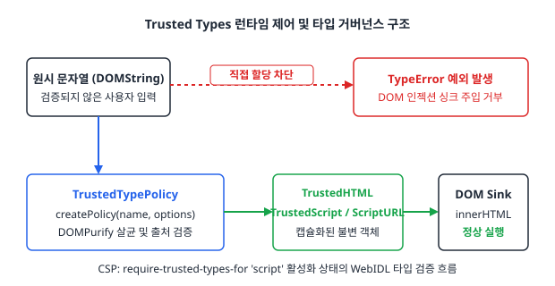
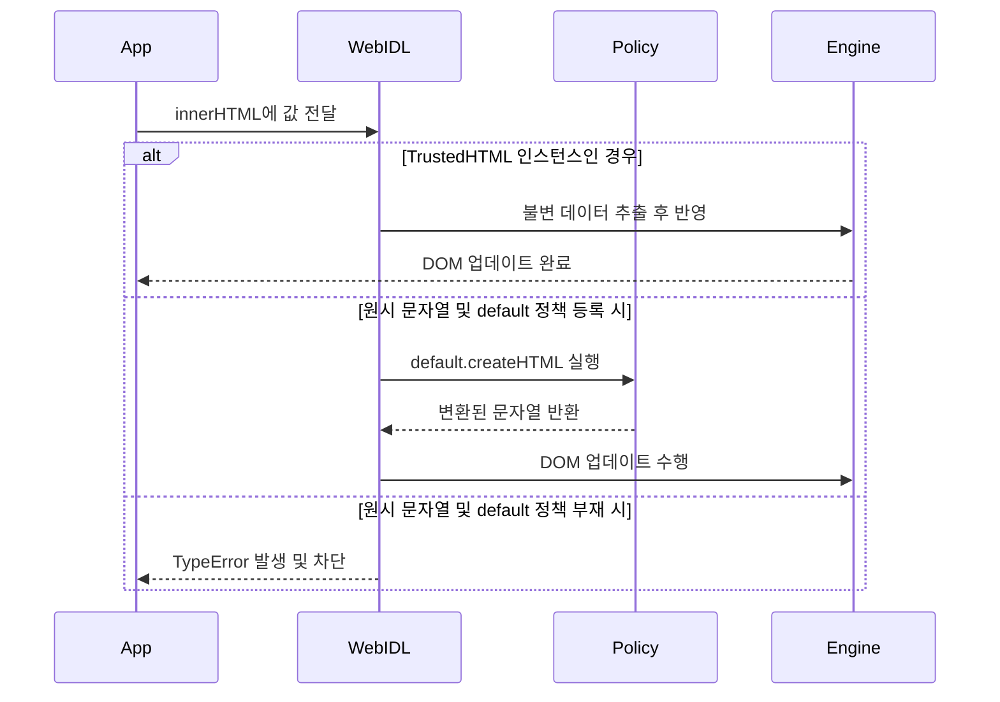

# 261101 Trusted Types API

> 한 줄 요약 · 분야: 보안 · Baseline: Newly available — 2026년 2월 Firefox 148 지원 개시로 Chromium(Chrome 83+), WebKit(Safari 19)에 이어 3대 주요 브라우저 엔진 전반에서 완전 지원됨 · 읽는 시간 약 6분

## 1. 왜 쓰는가
웹 애플리케이션 보안에서 DOM 기반 크로스 사이트 스크립팅(DOM XSS)은 브라우저 엔진의 관대한 기본 동작(permissive default)으로 인해 20년 이상 웹 생태계의 대표적인 고위험 취약점으로 지속되었다 [2] [3].

전통적인 브라우저 실행 환경에서는 Element.prototype.innerHTML, document.write(), eval()과 같은 인젝션 싱크(Injection Sink)가 임의의 원시 문자열(raw string)을 무제한으로 허용했다 [1] [2]. 개발자가 정적 코드 분석 도구나 린터(Linter) 규칙, 정규표현식 기반 살균 함수를 적용하더라도, 복잡한 동적 프론트엔드 환경과 외부 서드파티 라이브러리의 코드 흐름을 완전히 통제하지 못해 DOM XSS 누락을 방지하는 데 구조적 한계가 존재했다 [3] [4]. 살균 라이브러리를 프로젝트에 도입하더라도 개발자가 DOM 싱크를 호출하는 수많은 위치 중 단 한 번이라도 살균 함수 호출을 누락하면 즉시 보안 취약점으로 이어졌다 [3]. 브라우저가 원시 문자열을 싱크에 직접 주입하는 동작을 원천 차단하지 않고서는 이러한 인적 실수를 예방할 수 없었다 [1] [7].

예를 들어 대규모 협업 프로젝트에서 개발자가 사용자 댓글 마크업을 화면에 렌더링할 때, container.innerHTML = rawInput 형태로 검증되지 않은 데이터를 직접 할당하는 실수가 발생할 수 있다 [3]. 정적 분석 도구는 동적으로 계산되거나 서드파티 스크립트를 거쳐 전달되는 문자열의 흐름을 완벽히 감지하지 못하므로, 해당 코드는 런타임에서 그대로 실행되어 악성 스크립트 실행으로 귀결된다 [3] [4]. W3C WebAppSec 워킹 그룹은 이와 같은 근본 문제를 해결하기 위해 브라우저 엔진 차원에서 위험한 싱크에 원시 문자열 할당을 전면 차단하고, 엄격하게 검증된 전용 타입 객체만을 강제하는 Trusted Types 명세를 제정했다 [1] [7].

## 2. 핵심 개념


Trusted Types 아키텍처를 구성하는 핵심 용어와 구조는 다음과 같다 [1] [2].

- **DOM 인젝션 싱크(DOM Injection Sink)**: 브라우저가 전달받은 문자열 데이터를 파싱하여 DOM 트리를 동적으로 조작하거나 스크립트 코드로 실행하는 WebIDL 진입점이다. 대표적인 싱크 프로퍼티로는 Element.prototype.innerHTML, Element.prototype.outerHTML, document.write(), window.eval(), HTMLScriptElement.prototype.src 등이 있다 [1] [2].
- **대상 타입 인스턴스(Trusted Type Instances)**: 인젝션 싱크가 원시 문자열 대신 요구하는 캡슐화된 불변(immutable) 객체다. W3C 명세에 따라 세 가지 타입으로 엄격히 구분된다 [1]:
  - `TrustedHTML`: HTML 마크업으로 파싱되어 DOM에 삽입 가능한 안전한 객체다.
  - `TrustedScript`: eval()이나 이벤트 핸들러 등 자바스크립트 엔진에 전달 가능한 안전한 실행 코드 객체다.
  - `TrustedScriptURL`: `<script src="...">`나 웹 워커 로더에 주입 가능한 검증된 외부 스크립트 리소스 주소 객체다.
- **전역 팩토리(window.trustedTypes)**: 브라우저 전역에 노출되는 객체로, 애플리케이션이 정책을 생성하고 엔진 내장 상수를 참조하는 유일한 표준 진입점이다 [1] [2]. 임의의 자바스크립트 객체를 위조하여 Trusted Type 인스턴스를 만들 수 없으며, 반드시 전역 팩토리를 통해서만 인스턴스가 생성된다 [1].
- **신뢰 정책(TrustedTypePolicy)**: 전역 팩토리의 createPolicy(policyName, policyOptions) 메서드를 통해 등록하는 불변 변환 규칙 집합이다 [1] [2]. createHTML, createScript, createScriptURL 콜백 함수를 구현하여 원시 문자열을 살균하거나 출처를 검증한 후 불변 객체로 포장하여 반환한다 [1].
- **CSP 정책 지시문(Content-Security-Policy Directives)**: HTTP 응답 헤더를 통해 브라우저 엔진에 Trusted Types 검증 규칙을 전달하는 지시문이다 [1] [3]:
  - `require-trusted-types-for 'script'`: 모든 DOM 인젝션 싱크에 원시 문자열의 직접 할당을 전면 차단하고 타입 객체만을 강제한다 [1] [2].
  - `trusted-types <policy-names>`: 애플리케이션 내부에서 생성 가능한 정책 이름을 명시적 화이트리스트로 제한한다 [1] [3]. 허용 목록에 없는 정책 이름을 생성하려 할 경우 런타임 TypeError가 발생한다 [1]. 정책 하이재킹을 방지하기 위해 동일한 정책 이름을 중복 등록하는 행위는 엔진 차원에서 기본 금지되며, 이를 허용하려면 allow-duplicates 키워드를 명시해야 한다 [1].
- **기본 정책(default policy)**: 레거시 코드 호환성 및 점진적 마이그레이션을 지원하기 위해 명세에 정의된 특수 정책이다 [1] [2]. 싱크에 원시 문자열이 전달되었을 때 브라우저 엔진이 자동으로 호출하여 안전한 타입으로 변환하는 폴백 역할을 수행한다 [1].
- **엔진 내장 불변 상수(trustedTypes.emptyHTML, trustedTypes.emptyScript)**: 빈 문자열을 안전하게 주입할 때 불필요한 살균 함수 호출이나 커스텀 정책 생성 없이 엔진 레벨에서 즉시 사용할 수 있도록 제공되는 불변 상수 객체다 [1].

## 3. 동작 원리
HTTP 응답 헤더로 Content-Security-Policy: require-trusted-types-for 'script' 지시문이 활성화되면 브라우저 엔진은 대상 싱크의 WebIDL setter 동작 방식을 변경한다 [1] [2].

명세에 따르면 대상 싱크의 프로퍼티 타입 서명은 일반 DOMString 대신 (DOMString or TrustedHTML) 등으로 매핑되며, 싱크 호출 시 동기적으로 Get Trusted Type compliant string 알고리즘이 실행된다 [1]:

1. 싱크 프로퍼티 setter에 전달된 인자의 타입을 동기적으로 검사한다 [1].
2. 전달된 값이 해당 싱크에 요구되는 대상 타입 인스턴스(TrustedHTML, TrustedScript, TrustedScriptURL)인 경우, 브라우저 엔진은 내부 슬롯에 캡슐화된 불변 문자열 데이터를 추출하여 지연 없이 DOM 파싱 또는 스크립트 실행을 진행한다 [1].
3. 전달된 값이 일반 원시 문자열(DOMString)인 경우, 브라우저 엔진은 현재 실행 컨텍스트에 등록된 default 정책이 존재하는지 탐색한다 [1] [2].
4. 등록된 default 정책이 존재하면 브라우저는 동기적으로 defaultPolicy.createHTML(string, type, sink)(또는 해당 싱크에 매핑된 콜백)을 실행하여 원시 문자열의 변환을 시도한다 [1] [2].
5. 변환 함수가 성공적으로 불변 타입 인스턴스를 반환하면, 해당 객체 내부의 문자열을 추출하여 정상적으로 DOM에 반영한다 [1].
6. default 정책이 존재하지 않거나 변환 처리가 실패하면, 브라우저 엔진은 즉시 런타임 TypeError 예외를 던지고 DOM 주입을 전면 차단하며 securitypolicyviolation 이벤트를 디스패치한다 [1] [2].

또한 애플리케이션 코드가 window.trustedTypes.createPolicy(name, options)를 호출하여 정책을 생성할 때, 브라우저 엔진은 HTTP 응답 헤더의 trusted-types 지시문에 선언된 화이트리스트 목록과 정책 이름을 즉시 대조한다 [1] [3]. 허용 목록에 없는 정책 이름을 생성하려고 시도하거나, 이미 등록된 이름을 allow-duplicates 키워드 없이 중복 등록하려 할 경우 엔진은 즉시 TypeError를 발생시키며 정책 등록을 거부한다 [1] [3].



## 4. 기본 사용법
다음은 Vanilla JS 환경에서 Trusted Types 정책을 생성하고 외부 살균 라이브러리인 DOMPurify와 결합하여 안전하게 DOM 싱크에 주입하는 완전한 예시 코드다 [1] [2] [3].

```js
import DOMPurify from 'dompurify';

let sanitizerPolicy;
if (window.trustedTypes && window.trustedTypes.createPolicy) {
  sanitizerPolicy = window.trustedTypes.createPolicy('dompurify-policy', {
    createHTML: (rawInput) => DOMPurify.sanitize(rawInput),
    createScriptURL: (rawUrl) => {
      const parsed = new URL(rawUrl, window.location.origin);
      if (parsed.origin === window.location.origin) {
        return parsed.href;
      }
      throw new TypeError(`신뢰할 수 없는 스크립트 출처: ${parsed.origin}`);
    }
  });
}

const userComment = ' 안전한 본문';
const container = document.querySelector('#comment-box');

const safeHTML = sanitizerPolicy
  ? sanitizerPolicy.createHTML(userComment)
  : DOMPurify.sanitize(userComment);

if (container) {
  container.innerHTML = safeHTML;
}
```

각 줄의 동작은 다음과 같다:
- 1줄: HTML 마크업 살균 처리를 수행할 dompurify 라이브러리를 모듈 시스템으로부터 가져온다.
- 3줄: 생성된 정책 객체를 할당받을 전역 범위 변수 sanitizerPolicy를 선언한다.
- 4줄: 현재 실행 중인 브라우저 엔진에 window.trustedTypes 및 createPolicy 메서드가 존재하는지 기능 지원 여부를 동기적으로 검사한다.
- 5줄: 전역 팩토리의 createPolicy 메서드를 호출하여 CSP 화이트리스트에 부합하는 dompurify-policy라는 이름의 정책 생성을 요청한다.
- 6줄: HTML 싱크에 원시 문자열이 전달될 때 실행될 createHTML 콜백을 등록하고, 인자로 유입된 rawInput을 DOMPurify.sanitize()로 살균하도록 지정한다.
- 7줄: 스크립트 URL 싱크에 전달될 주소 문자열을 검증하는 createScriptURL 콜백 함수를 정의한다.
- 8줄: new URL() 생성자를 사용하여 전달받은 rawUrl을 현재 웹 애플리케이션의 오리진(window.location.origin) 기준으로 절대 URL로 파싱한다.
- 9줄: 파싱된 URL 객체의 origin 속성이 현재 애플리케이션의 동일 출처와 정확히 일치하는지 비교 검사한다.
- 10줄: 동일 출처 검증을 통과한 경우에 한하여 안전한 절대 URL 문자열(parsed.href)을 반환한다.
- 12줄: 오리진이 일치하지 않는 외부 출처 URL인 경우 즉시 런타임 TypeError를 발생시켜 스크립트 리소스 주입을 거부한다.
- 13줄: 정책 옵션 정의 객체 및 createPolicy 메서드 인자 전달을 종료한다.
- 14줄: 정책 생성 기능 지원 분기문 블록을 종료한다.
- 16줄: 악성 스크립트 인젝션 구문(onerror=alert(1))이 포함된 사용자 입력 원시 문자열 userComment를 선언한다.
- 17줄: 마크업을 동적으로 삽입할 대상 요소(#comment-box)를 DOM 트리에서 탐색하여 변수 container에 할당한다.
- 19줄: 조건부 삼항 연산자를 활용하여 정책 객체가 존재하는 환경에서는 sanitizerPolicy.createHTML()을 호출하여 TrustedHTML 객체를 발행하고, 미지원 브라우저에서는 살균된 원시 문자열을 폴백으로 생성한다.
- 20줄: 정책 객체가 생성되지 않은 구형 브라우저 환경을 대비하여 DOMPurify.sanitize()를 직접 실행하는 폴백 분기를 구성한다.
- 23줄: 마크업을 삽입할 대상 DOM 컨테이너 요소가 실제로 존재하는지 유효성을 확인한다.
- 24줄: 검증을 거쳐 생성된 safeHTML 인스턴스를 인젝션 싱크인 container.innerHTML에 할당하여 안전한 파싱 및 화면 렌더링을 완료한다.

## 5. 실무 예시
실무 웹 애플리케이션 환경에서 적용할 수 있는 대표적인 3가지 패턴은 다음과 같다.

### 예시 1: 마이그레이션을 위한 fallback default 정책 및 위반 로깅
- **상황**: 수백 개 컴포넌트와 서드파티 라이브러리가 산재하여 즉시 모든 innerHTML 호출부를 리팩터링하기 어려운 레거시 코드베이스에서, 프로덕션 중단 없이 원시 문자열 호출부를 모니터링하고 자동으로 살균하여 점진적으로 전환해야 하는 상황.
- **코드**:
```js
// CSP: Content-Security-Policy: require-trusted-types-for 'script'; trusted-types default;
if (window.trustedTypes && window.trustedTypes.createPolicy) {
  window.trustedTypes.createPolicy('default', {
    createHTML: (string, type, sink) => {
      console.warn(`[Trusted Types 경고] 싱크(${sink})에 원시 문자열이 전달되었습니다. 자동 살균을 수행합니다.`, string);
      return DOMPurify.sanitize(string);
    },
    createScript: (string, type, sink) => {
      console.error(`[Trusted Types 차단] 스크립트 싱크(${sink})에 원시 문자열 실행이 시도되어 거부되었습니다.`);
      return ''; // 빈 스크립트로 무력화
    }
  });
}

// default 정책이 활성화되어 있으면 원시 문자열을 전달해도 런타임 오류 대신 default.createHTML이 자동 호출됨
document.getElementById('notice').innerHTML = '<strong>공지사항</strong>';
```
- **주의점**: default 정책은 마이그레이션 과도기를 위한 임시 수단이어야 하며, 모든 문자열을 무조건 허용하거나 s => s 형태로 검증을 생략하면 Trusted Types의 구조적 방어선이 완전히 무력화된다 [1] [2]. 또한 HTTP 응답 헤더의 trusted-types 지시문에 default를 명시하지 않으면 엔진이 정책 등록을 거부한다 [1] [3].

### 예시 2: 브라우저 내장 빈 상수(emptyHTML)를 활용한 안전한 DOM 초기화
- **상황**: 모달 창 닫기, 탭 전환, 동적 목록 리셋 시 컨테이너 DOM 요소를 빈 상태로 초기화해야 하는 빈번한 UI 업데이트 환경.
- **코드**:
```js
// 커스텀 정책 생성 없이 안전하게 DOM 컨테이너를 비우는 패턴
const statusArea = document.querySelector('#status');

if (window.trustedTypes && window.trustedTypes.emptyHTML) {
  // 엔진 내장 불변 객체 사용 (불필요한 살균 함수 호출 및 문자열 파싱 생략)
  statusArea.innerHTML = window.trustedTypes.emptyHTML;
} else {
  statusArea.innerHTML = '';
}
```
- **주의점**: trustedTypes.emptyHTML은 브라우저 엔진에 내장된 불변 객체이므로 살균 라이브러리의 CPU 파싱 오버헤드를 발생시키지 않으나 [1], API를 지원하지 않는 브라우저에서는 window.trustedTypes가 undefined이므로 반드시 기능 감지 분기를 작성해야 한다.

### 예시 3: CSP 보안 위반 이벤트 감지 및 원격 모니터링
- **상황**: Content-Security-Policy-Report-Only 모드 또는 실서비스 환경에서 정책 위반을 사전에 탐지하고, 위반이 발생한 파일명, 라인 번호, 문제가 된 문자열 샘플을 로깅 서버로 비동기 수집하려는 상황.
- **코드**:
```js
// Report-Only 모드 또는 실서비스 에러 추적 연동
document.addEventListener('securitypolicyviolation', (event) => {
  if (event.effectiveDirective === 'require-trusted-types-for' || event.effectiveDirective === 'trusted-types') {
    const reportPayload = {
      violatedDirective: event.effectiveDirective,
      blockedURI: event.blockedURI,
      sourceFile: event.sourceFile,
      lineNumber: event.lineNumber,
      columnNumber: event.columnNumber,
      sample: event.sample // 문제가 된 원시 문자열의 앞부분 샘플
    };
    navigator.sendBeacon('/api/security-reports', JSON.stringify(reportPayload));
  }
});
```
- **주의점**: event.sample 속성에는 싱크에 주입되려던 원시 문자열의 앞부분 일부가 포함되므로, 폼 입력 필드나 URL 파라미터에 포함된 개인정보(이름, 비밀번호, 토큰 등)가 리포팅 서버로 무단 전송될 수 있어 전송 전 필터링이나 마스킹 대책을 수립해야 한다 [1] [2].

## 6. 장점 · 단점
Trusted Types API 도입에 따른 주요 장점과 단점은 다음과 같다.

| 장점 | 단점 |
| :--- | :--- |
| **기본 보안(Secure by Default) 아키텍처 구현**: 브라우저 엔진이 위험한 DOM 싱크에 원시 문자열이 직접 전달되는 것을 차단하므로 개발자의 단순 누락이나 실수를 원천 방어함 [1] [2]. | **높은 초기 마이그레이션 비용**: 레거시 코드베이스나 대규모 웹 애플리케이션의 경우 프로젝트 전반에 흩어져 있는 innerHTML, outerHTML, eval, script.src 등의 호출부를 찾아 정책 래퍼 또는 안전한 DOM API로 일일이 리팩터링해야 하는 높은 공수가 발생함 [1] [3]. |
| **보안 감사 범위의 압도적 축소**: 수만 줄에 달하는 애플리케이션 전체 DOM 조작 코드를 전수 검사할 필요 없이 오직 trustedTypes.createPolicy로 정의된 소수의 정책 함수 구현부만 집중 감사하면 됨 [3] [4]. | **서드파티 라이브러리 호환성 마찰**: 분석 도구(Analytics), 마케팅 추적 스크립트, 광고 SDK, 구형 UI 플러그인 등 외부 의존성이 내부적으로 원시 문자열을 싱크에 주입하면 즉시 런타임 TypeError가 발생하여 웹 애플리케이션 기능이 중단될 수 있음 [3]. |
| **타입 시스템 및 런타임 이중 방어선 구축**: TypeScript의 전용 타입 정의와 결합하여 컴파일 타임에 1차 검증하고, 브라우저 엔진이 런타임에 2차 강제함으로써 빈틈없는 안전망을 제공함 [1] [2]. | **CSP 정책 관리 복잡도 증가**: 애플리케이션 번들러(Webpack, Vite)의 동적 청크 로딩, 서드파티 스크립트, 내부 프레임워크가 요구하는 정책 이름을 CSP trusted-types 지시문에 정확히 화이트리스트로 관리해야 하므로 설정 유지보수 부담이 커짐 [1] [3]. |
| **점진적 도입(Report-Only) 지원**: Content-Security-Policy-Report-Only 헤더를 통해 기존 프로덕션 코드를 중단시키지 않으면서 정책 위반 지점을 수집하고 순차적으로 안전하게 마이그레이션 가능 [2] [3]. | **개발 및 디버깅 경험(DX) 저하**: 개발 단계에서 핫 모듈 교체(HMR)나 디버깅 도구가 문자열 평가(eval)를 사용할 경우 엄격한 정책 하에서 차단될 수 있어 개발 전용과 운영 전용 CSP 헤더를 정교하게 분리해야 함 [1] [3]. |
| **중앙 집중식 위반 탐지**: securitypolicyviolation 이벤트 및 CSP 리포팅 엔드포인트를 통해 프로덕션 환경에서 발생하는 비인가 DOM 인젝션 시도를 실시간으로 모니터링하고 추적할 수 있음 [1] [2]. | |

## 7. 한계와 함정
Trusted Types를 실무에 도입할 때 경계해야 할 기술적 한계와 잠재적 함정은 다음과 같다 [1] [2] [3].

- **보안 및 경계 사례 - 취약한 정책 작성의 함정(The 'Blessing' Trap)**:
  Trusted Types는 싱크로 진입하는 관문만을 통제할 뿐 문자열의 악성 여부를 브라우저 엔진이 스스로 판단하여 제거하지 않는다 [1] [3]. 정책 작성자가 s => s와 같이 원시 문자열을 검증 없이 그대로 반환하거나 취약한 정규표현식을 적용할 경우, 악성 입력이 브라우저가 공인한 안전 객체(TrustedHTML)로 위장하여 싱크에서 그대로 실행되는 치명적인 취약점이 발생한다 [1] [3].
- **보안 및 경계 사례 - 위험한 Default 정책 오남용**:
  레거시 호환성을 확보한다는 명목으로 default 정책을 선언하고 모든 미검증 문자열을 필터링 없이 관대하게 통과시키면, 브라우저 엔진이 제공하는 구조적 타입 검증 방어선이 사실상 전면 무력화된다 [1] [2].
- **보안 경계 - 서버 사이드 XSS 방어 불가**:
  Trusted Types는 클라이언트 측 DOM 조작 싱크 계층만 방어한다 [1] [2]. 따라서 서버 렌더링 HTML에 직접 반사(Reflected)되거나 저장(Stored)되어 브라우저로 내려오는 서버 측 템플릿 인젝션 취약점은 막을 수 없으므로, 서버 측 출력 이스케이프 및 script-src CSP 헤더 적용이 병행되어야 한다 [1] [2].
- **보안 경계 - 스크립트 본문 무결성 미보증**:
  TrustedScriptURL은 로드할 스크립트 파일의 URL 형식과 출처 문자열만 검증할 뿐, 해당 URL 엔드포인트에서 실제로 반환되는 스크립트 코드 내용의 악성 여부는 보증하지 못한다 [1]. 외부 CDN 변조나 중간자 공격을 차단하기 위해서는 Subresource Integrity(SRI) 및 script-src 지시문과의 결합이 필수적이다 [1].
- **성능(Performance) - 정책 내부 살균 연산 비용**:
  Trusted Types의 래핑 및 타입 검사 자체에 드는 비용은 나노초 단위로 극히 미미하다. 그러나 createHTML 콜백 내부에서 DOMPurify와 같이 무거운 파서 기반 살균 로직을 매번 호출할 경우, 대규모 DOM 업데이트나 빈번한 가상 DOM 리렌더링 시 심각한 CPU 연산 병목이 발생할 수 있다 [3].
- **접근성(a11y) - 런타임 예외로 인한 UI 인터랙션 중단 위험**:
  정책 처리 중 발생한 TypeError 예외가 적절히 처리되지 않아 자바스크립트 UI 렌더링 루프가 중단될 경우, 동적 알림 영역(live region) 업데이트나 모달 열기, 포커스 트랩 처리가 멈추어 스크린 리더 및 키보드 사용자의 접근 통로가 전면 마비되는 심각한 접근성 장애를 초래할 수 있다.
- **개인정보(Privacy) - 위반 샘플 수집 시 민감 정보 노출**:
  securitypolicyviolation 이벤트 핸들러가 수집하는 event.sample 속성에는 싱크 할당을 시도한 문자열의 앞부분 샘플이 포함된다 [1] [2]. 입력 필드나 URL 파라미터에 사용자의 개인정보(이름, 이메일, 토큰 등)가 포함되어 있을 경우 외부 리포팅 서버로 무단 전송될 수 있으므로, 페이로드 전송 전 마스킹 처리가 필수적이다 [1] [2].

## 8. 다른 방법과 비교
DOM XSS 방어를 위해 활용되는 주요 대안 기술과의 기술적 비교는 다음과 같다.

| 방법 | 언제 | 비용 | 한계 |
| :--- | :--- | :--- | :--- |
| **DOMPurify 단독 사용** | 신뢰할 수 없는 동적 HTML을 살균하여 innerHTML에 삽입할 때 | 낮음 (라이브러리 번들 용량 및 살균 파싱 연산 비용) | 개발자가 innerHTML 호출 시점에 sanitize() 호출을 단 한 번이라도 누락하면 취약점이 발생함 [3]. |
| **Native HTML Sanitizer API (Element.prototype.setHTML)** | 브라우저 내장 파서로 위험 요소를 선별 제거하며 가볍게 HTML을 삽입할 때 | 매우 낮음 (네이티브 브라우저 파서 활용, 외부 번들 없음) | 살균 실행기일 뿐 문자열의 싱크 전달 자체를 강제하는 거버넌스가 아니므로 개발자의 실수로 다른 싱크를 사용할 때 통제 불가능함. |
| **CSP script-src Nonce/Hash 기반 제어** | 외부 스크립트 파일 로딩 및 인라인 script 블록 실행 출처를 통제할 때 | 중간 (서버 측 논스 생성 및 헤더 구성 비용) | 이미 신뢰를 얻어 실행 중인 스크립트가 innerHTML이나 eval로 동적 문자열을 실행하는 DOM XSS는 제어하지 못함. |
| **안전한 DOM 표준 API (textContent, createElement, append)** | 동적 HTML 파싱이 필요 없는 단순 텍스트 삽입이나 정적 DOM 구조 생성 시 | 없음 (브라우저 기본 API, 추가 오버헤드 전무) | 리치 텍스트, 사용자 작성 마크업, 복잡한 서식 템플릿 렌더링을 처리할 수 없음. |
| **Trusted Types API** | 대규모 프론트엔드 환경에서 모든 인젝션 싱크의 원시 문자열 주입을 엔진 수준에서 원천 차단하고자 할 때 | 높음 (초기 코드베이스 마이그레이션 및 CSP 화이트리스트 관리 공수) | 클라이언트 측 싱크만 방어하며 서버 사이드 XSS나 스크립트 본문 무결성은 보증하지 못함 [1] [2]. |

이것을 고르지 않는 경우는 다음과 같다:
- 동적 HTML 파싱 및 마크업 주입이 필요 없고 정적인 텍스트나 UI 구조만 다루는 애플리케이션의 경우, textContent나 createElement만으로도 DOM XSS가 원천 방지되므로 높은 초기 마이그레이션 공수를 감수하며 Trusted Types를 도입할 필요가 없다.
- 외부 서드파티 분석 스크립트, 광고 SDK, 구형 UI 플러그인 등 수정 권한이 없는 레거시 스크립트 의존성이 지나치게 많은 환경에서는 런타임 기능 중단 위험이 크므로 즉각적인 Trusted Types 강제 모드 적용을 지양하고, DOMPurify 단독 적용이나 Report-Only 모드로 제한적 운영을 선택해야 한다.

## 9. 대비와 새로운 시도
Trusted Types 생태계의 후속 표준화 및 기술적 발전 동향은 다음과 같다 [1] [6] [7].

- **W3C WebAppSec Trusted Types 레벨 2 및 WHATWG HTML 통합**:
  W3C WebAppSec 워킹 그룹과 WHATWG는 HTML 표준 명세의 인젝션 싱크 정의와 Trusted Types의 통합을 심화하고 있다 [1] [7]. 특히 선언적 섀도 돔(Declarative Shadow DOM) 및 스트리밍 HTML 파서와의 상호작용 명세를 정교화하는 표준화 작업이 활발히 진행 중이다.
- **Native HTML Sanitizer API와의 Safe Sink 결합**:
  W3C와 WHATWG는 브라우저 내장 살균 API인 Element.prototype.setHTML() 및 Document.parseHTML()을 Trusted Types 환경에서도 별도 정책 변환 없이 원시 문자열을 안전하게 수용하는 공식 Safe Sink로 규격화하고 있다. 이를 통해 무거운 외부 살균 라이브러리 없이도 네이티브 엔진 레벨에서 살균과 타입 거버넌스가 결합된다.
- **세분화된 eval 전용 제어 제안 (trusted-types-eval)**:
  기존 require-trusted-types-for 'script' 지시문 선언 시 eval, Function, setTimeout(string) 등 문자열 평가 함수가 일괄 포함되던 구조에서 벗어나, 번들러 및 디버깅 도구의 편의성을 위해 eval 계열만 더 엄격하거나 유연하게 분리 격리할 수 있는 trusted-types-eval 세부 지시문 제안이 브라우저 벤더 간에 논의되고 있다.
- **프레임워크 에코시스템의 기본 탑재 확대**:
  기존 Angular의 선도적 지원에 이어 Next.js, React 19+, Svelte 등 최신 모던 프레임워크 진영에서 빌드 타임 청크 로더와 템플릿 컴파일러가 기본적으로 자체 Trusted Types 정책을 생성하고 소비하도록 지원하는 툴링 표준화가 진전되고 있다.
- **브라우저 엔진 지원 현황과 Baseline 달성**:
  Chromium(Chrome/Edge)은 2020년 Chrome 83에서 규격을 최초로 탑재하여 지원을 시작했다 [4] [6]. WebKit은 표준 포지션 논의(Issue #186)와 Safari Technology Preview 215를 거쳐 Safari 19부터 정식 지원을 완료했다 [5] [6]. 이어 Mozilla가 공식 표준 포지션에서 긍정적(Positive) 의견을 확정한 후 2026년 2월 Firefox 148에 구현을 완료함에 따라 [6] [7], Trusted Types는 3대 메이저 브라우저 엔진 전반에서 완전 지원되는 Baseline Newly available 상태에 도달했다.

## 10. 다른 사람에게 설명하기
세 문장 요약은 다음과 같다:
1. Trusted Types API는 브라우저 내 위험한 DOM 인젝션 싱크에 원시 문자열의 직접 할당을 엔진 레벨에서 원천 금지하고, 사전 등록된 정책을 통과한 불변 타입 객체만 허용하는 W3C 웹 보안 표준이다 [1] [2].
2. 개발자의 살균 누락 실수를 런타임 TypeError로 즉시 차단함으로써 보안 감사의 범위를 애플리케이션 전체 코드에서 소수의 정책 함수로 대폭 축소시킨다 [3] [4].
3. 2026년 2월 Firefox 148 지원을 기점으로 3대 주요 브라우저 엔진 전반에서 Baseline Newly available 상태에 도달하여 현대 웹 프론트엔드의 표준 방어선으로 안착했다 [6] [7].

스스로 확인할 질문 3개:
- Q1. require-trusted-types-for 'script' 헤더가 활성화된 환경에서 원시 문자열이 innerHTML에 전달되었을 때, 브라우저 엔진이 default 정책의 유무에 따라 각각 어떻게 분기하여 동작하는가?
- Q2. Trusted Types를 도입하더라도 정책 내부에서 살균 로직을 s => s 형태로 부실하게 작성하거나 서버 사이드 템플릿 인젝션이 발생했을 때 취약점을 방어하지 못하는 이유는 무엇인가?
- Q3. CSP의 trusted-types 화이트리스트 지시문과 allow-duplicates 키워드는 제3자 라이브러리의 임의 정책 생성 및 정책 하이재킹 공격을 어떤 방식으로 방어하는가?

## 참고 자료
1. [W3C Web Application Security Working Group - Trusted Types](https://w3c.github.io/trusted-types/dist/spec/)
2. [MDN Web Docs: Trusted Types API](https://developer.mozilla.org/en-US/docs/Web/API/Trusted_Types_API)
3. [web.dev: Prevent DOM-based cross-site scripting vulnerabilities with Trusted Types](https://web.dev/articles/trusted-types)
4. [Chrome for Developers: Trusted Types: prevent DOM-based XSS](https://developer.chrome.com/docs/capabilities/web-apis/trusted-types)
5. [WebKit Standards Positions: Trusted Types (Issue #186)](https://github.com/WebKit/standards-positions/issues/186)
6. [Can I use: Trusted Types for DOM manipulation](https://caniuse.com/trusted-types)
7. [Mozilla Standards Positions: Trusted Types (Issue #20)](https://github.com/mozilla/standards-positions/issues/20)

조사: 2026-11-01

## 내 리뷰
(읽고 느낀 점 · 궁금한 것을 적는다. 질문은 Q. 로 시작)
