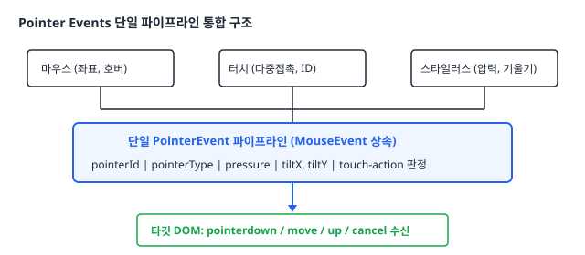
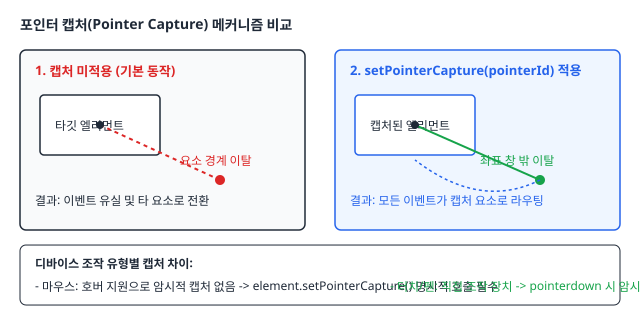

# 261102 Pointer Events API

> 한 줄 요약 · 분야: 이벤트 · Baseline: Widely available (2020년 7월 이후 Safari 13, Chrome 55, Firefox 59 등 주요 모던 브라우저 전반에서 완전 지원됨) · 읽는 시간 약 6분

## 1. 왜 쓰는가
웹 초기 입력 모델은 마우스 중심 환경을 전제로 설계되었다. 이후 스마트폰과 태블릿을 필두로 한 정전식 터치스크린과 고정밀 스타일러스 펜이 보급되면서 웹 플랫폼의 입력 파이프라인은 심각한 구조적 파편화에 직면했다 [4].

Pointer Events 도입 이전 웹 개발 환경에서는 동일한 사용자 상호작용을 처리하기 위해 마우스 이벤트(mousedown, mousemove, mouseup)와 터치스크린 이벤트(touchstart, touchmove, touchend)라는 완전히 분리된 두 세트의 이벤트 핸들러를 중복 구현하고 동기화해야 했다 [4]. 이는 코드베이스의 부피를 불필요하게 증가시켰을 뿐 아니라, 이벤트 상태 불일치 버그를 유발하는 주된 원인이었다 [4].

또한 터치 기반 모바일 브라우저는 데스크톱용 레거시 웹사이트와의 호환성을 유지하기 위해 사용자의 터치 제스처 종료 후 약 300ms 동안 대기한 뒤 에뮬레이션된 마우스 이벤트를 디스패치했다 [4]. 이로 인해 모바일 웹 전반에서 클릭 인터랙션의 반응성이 300ms 지연되었으며, 터치 이벤트와 합성 마우스 이벤트가 연달아 실행되어 의도치 않은 핸들러 중복 호출 버그가 빈번히 발생했다 [4].

하드웨어 특화 데이터의 부재 역시 기술적 한계였다. 디지타이저 펜을 통한 전문 그래픽 작업이나 필기 입력 시 요구되는 압력(pressure), 기울기(tiltX, tiltY), 접촉 면적과 같은 하드웨어 원시 신호를 수집할 표준화된 인터페이스가 존재하지 않았다 [2]. 더불어 요소를 드래그할 때 커서가 요소 경계를 벗어나면 mousemove 추적이 끊기는 문제를 해결하기 위해 window나 document 객체에 임시 전역 리스너를 바인딩하고 해제해야 했으며, 이 과정에서 메모리 누수와 이벤트 관리 복잡도가 가중되었다 [3].

W3C Pointer Events는 이러한 마우스, 터치, 펜 입력을 단일 하드웨어 비의존적 추상 계층으로 통합하여 단일 이벤트 파이프라인에서 직관적이고 고성능으로 제어하기 위해 제정되었다 [1][2].

## 2. 핵심 개념
Pointer Events의 핵심 추상화 단위는 포인터(Pointer)다. 포인터는 마우스 커서, 터치스크린 위의 손가락 접촉점, 스타일러스 펜 끝 등 화면상의 좌표를 가리키는 모든 물리적 입력 장치를 단일하게 추상화한 개념이다 [1][2].



1. pointerId
물리적 접촉점마다 부여되는 고유한 숫자 식별자다 [1][2]. 마우스 포인터는 항상 고정된 식별자를 유지하지만, 다중 터치 환경에서는 화면에 닿는 손가락 접촉점마다 서로 다른 pointerId가 동적으로 할당되어 각 접촉점을 배열 순회 없이 O(1) 수준에서 개별 추적할 수 있다 [1][2].

2. isPrimary
다중 포인터 환경에서 현재 포인터가 주 입력 수단인지 여부를 나타내는 불리언 속성이다 [1][2]. 다중 터치 시 가장 먼저 화면에 닿은 첫 번째 포인터에 true가 설정되며, 레거시 마우스 호환 이벤트를 에뮬레이션할 기준 포인터를 식별하는 데 사용된다 [1][2].

3. pointerType
입력을 발생시킨 물리적 하드웨어 장치의 종류를 식별하는 문자열 속성이다 [1][2]. "mouse", "touch", "pen" 중 하나의 값을 가지며, 디바이스 특성에 맞춘 세부적인 분기 처리를 지원한다 [1][2].

4. 포인터 캡처(Pointer Capture)
포인터 이벤트의 흐름을 특정 DOM 요소로 고정 라우팅하는 메커니즘이다 [1][3]. 캡처가 활성화되면 포인터 좌표가 브라우저 창이나 뷰포트 영역 바깥으로 벗어나더라도 모든 후속 pointermove, pointerup 이벤트가 캡처를 소유한 대상 엘리먼트로 직접 전달된다 [1][3].



- 암시적 포인터 캡처(Implicit Pointer Capture): 터치스크린이나 스타일러스 펜과 같은 직접 조작(Direct Manipulation) 장치에서 pointerdown이 발생하면, 브라우저가 명세에 따라 해당 대상 DOM 요소에 자동으로 포인터 캡처를 활성화한다 [1].
- 명시적 포인터 캡처(Explicit Pointer Capture): 마우스와 같이 호버(hover) 상태가 존재하는 간접 조작 장치는 pointerdown 시 암시적 캡처가 발생하지 않는다 [1][3]. 따라서 드래그 이탈을 방지하려면 개발자가 element.setPointerCapture(pointerId)를 명시적으로 실행해야 한다 [1][3].

5. CSS touch-action
DOM 요소에 선언하여 브라우저의 비동기 컴포지터 스레드가 기본 제스처(스크롤, 핀치 줌)를 처리할지 여부를 결정하는 CSS 속성이다 [1][4]. JavaScript 메인 스레드의 연산이나 preventDefault() 평가를 기다리지 않고 브라우저 렌더링 엔진 수준에서 스크롤 인터셉트를 즉시 차단하거나 허용한다 [1][4].

## 3. 동작 원리
Pointer Events는 W3C 명세에 따라 MouseEvent 인터페이스를 상속하여 구현된다 [1][2]. 따라서 screenX, clientX, ctrlKey 등 기존 마우스 이벤트의 좌표 및 수정자 키 속성을 그대로 포함하면서 하드웨어 확장 속성을 추가로 제공한다 [1][2].

이벤트 생명주기는 물리적 접촉부터 해제까지의 상태 전이를 기반으로 동작한다 [1][2].

```diagram
종류: 시퀀스

[사용자 입력]
[브라우저 컴포지터]
[메인 스레드]
[타깃 엘리먼트]

사용자 입력 -> 브라우저 컴포지터 : 터치 또는 마우스 접촉
브라우저 컴포지터 -> 메인 스레드 : pointerdown 이벤트 전달
메인 스레드 -> 타깃 엘리먼트 : setPointerCapture 호출
타깃 엘리먼트 --> 메인 스레드 : gotpointercapture 발화
사용자 입력 -> 브라우저 컴포지터 : 포인터 이동
브라우저 컴포지터 -> 브라우저 컴포지터 : touch-action 검사
브라우저 컴포지터 -> 메인 스레드 : pointermove 전달
메인 스레드 -> 타깃 엘리먼트 : getCoalescedEvents 좌표 처리
사용자 입력 -> 브라우저 컴포지터 : 접촉 해제
브라우저 컴포지터 -> 메인 스레드 : pointerup 전달
타깃 엘리먼트 --> 메인 스레드 : lostpointercapture 발화
```

1. 이벤트 디스패치 및 컴포지터 판정 단계
포인터가 화면이나 요소에 접촉하면 브라우저는 pointerdown 이벤트를 생성한다 [1]. 터치나 펜 장치의 경우 스펙에 정의된 암시적 포인터 캡처 규격에 따라 접촉 대상 DOM에 즉각 캡처가 설정된다 [1]. 이 시점에서 대상 요소에 설정된 CSS touch-action 속성을 브라우저 컴포지터 스레드가 검사한다 [1][4].

만약 터치 이동 방향이 CSS touch-action에 선언된 허용 방향(예: pan-y 환경에서 수평 스와이프 발생)과 일치하지 않거나 none으로 지정되어 있다면, 컴포지터는 뷰포트 스크롤을 트리거하지 않고 메인 스레드로 지속적인 pointermove 이벤트를 발송한다 [1][4]. 반대로 허용된 제스처 방향과 일치하여 브라우저 컴포지터가 기본 스크롤 동작을 개시하면, 브라우저는 즉시 pointercancel 이벤트를 발송하고 해당 포인터 스트림을 영구 중단한다 [1][12].

2. 포인터 캡처 생명주기
마우스 포인터의 경우 pointerdown 핸들러 내부에서 element.setPointerCapture(pointerId)가 실행되면 비동기적으로 gotpointercapture 이벤트가 대상 요소에서 발생한다 [1][3]. 이후 포인터 좌표가 뷰포트 경계를 완전히 벗어나더라도 이벤트는 다른 DOM 요소로 라우팅되지 않고 캡처된 요소로 집중된다 [1][3]. 포인터 버튼이 해제되거나 접촉이 종료되면 브라우저는 자동으로 캡처를 해제하고 lostpointercapture 이벤트를 발화한다 [1][3][10].

3. 하드웨어 좌표 병합과 복원 (Coalescing & Prediction)
일반적인 디스플레이 주사율은 60Hz 또는 120Hz인 반면, 최신 게이밍 마우스나 고성능 디지타이저는 1000Hz 이상의 빈도로 원시 좌표를 샘플링한다 [1][2]. 브라우저는 렌더링 프레임 단위에 맞춰 중간 좌표들을 하나의 pointermove 이벤트로 뭉뚱그려(coalescing) 전달한다 [1][14]. 고정밀 선 표현이 필요한 경우 event.getCoalescedEvents() 메서드를 호출하여 프레임 사이에 병합되었던 하드웨어 폴링 단위의 모든 미세 좌표 배열을 복원할 수 있다 [1][14]. 또한 event.getPredictedEvents()를 호출하면 브라우저 알고리즘이 이전 속도와 가속도를 기반으로 추정한 다음 프레임의 예상 좌표를 받아 렌더링 입력 지연을 상쇄할 수 있다 [1][5][15].

## 4. 기본 사용법
Pointer Events의 핵심 메서드와 생명주기를 다루는 완전한 자바스크립트 구현 코드다.

```js
const track = document.getElementById('drag-track');
let isTracking = false;

track.style.touchAction = 'none';

track.addEventListener('pointerdown', (event) => {
  isTracking = true;
  track.setPointerCapture(event.pointerId);
});

track.addEventListener('pointermove', (event) => {
  if (!isTracking) return;
  const x = event.clientX;
  const y = event.clientY;
  track.textContent = `X: ${x}, Y: ${y}`;
});

track.addEventListener('pointerup', (event) => {
  if (!isTracking) return;
  isTracking = false;
  track.releasePointerCapture(event.pointerId);
});

track.addEventListener('pointercancel', (event) => {
  if (!isTracking) return;
  isTracking = false;
  track.releasePointerCapture(event.pointerId);
});
```

- 1행: document.getElementById를 통해 포인터 인터랙션을 바인딩할 대상 DOM 엘리먼트를 참조한다.
- 2행: 드래그 상태를 추적하기 위한 불리언 플래그 변수 isTracking을 false로 초기화한다.
- 4행: 조작 대상 요소의 style.touchAction을 none으로 설정하여 브라우저의 기본 스크롤 및 핀치 줌 인터셉트를 완전히 차단한다.
- 6행: 엘리먼트에 pointerdown 이벤트 리스너를 등록하여 마우스 클릭, 화면 터치, 펜 접촉의 시작을 감지한다.
- 7행: 포인터 접촉이 시작되었으므로 추적 상태 플래그 isTracking을 true로 갱신한다.
- 8행: event.pointerId를 전달하여 setPointerCapture를 실행함으로써 포인터가 요소 경계를 이탈해도 이벤트를 독점 수신하도록 캡처를 활성화한다.
- 9행: pointerdown 이벤트 리스너 함수 블록을 닫는다.
- 11행: 엘리먼트에 pointermove 이벤트 리스너를 등록하여 포인터의 연속적인 이동 좌표를 수신한다.
- 12행: isTracking 플래그가 false인 경우 드래그 중이 아니므로 좌표 처리를 즉시 중단하고 반환한다.
- 13행: event.clientX 속성으로부터 뷰포트 기준 포인터의 X축 현재 좌표를 획득한다.
- 14행: event.clientY 속성으로부터 뷰포트 기준 포인터의 Y축 현재 좌표를 획득한다.
- 15행: 추출한 X, Y 좌표값을 대상 엘리먼트의 textContent에 동적으로 출력한다.
- 16행: pointermove 이벤트 리스너 함수 블록을 닫는다.
- 18행: 물리적 접촉이 정상 종료되는 시점을 감지하기 위해 pointerup 이벤트 리스너를 등록한다.
- 19행: 추적 상태가 아니라면 추가 로직을 실행하지 않고 즉시 반환한다.
- 20행: 추적 상태 플래그 isTracking을 false로 되돌려 드래그 종료를 확정한다.
- 21행: releasePointerCapture를 호출하여 활성화되었던 포인터 캡처 상태를 명시적으로 해제한다.
- 22행: pointerup 이벤트 리스너 함수 블록을 닫는다.
- 24행: 시스템 알림 창 발생, 팜 리젝션, 기기 연결 해제 등으로 입력 스트림이 강제 중단되는 pointercancel 이벤트를 감지한다.
- 25행: 추적 상태가 아니라면 아무 작업도 수행하지 않고 종료한다.
- 26행: 비정상 종료 시에도 내부 상태가 고착되지 않도록 isTracking 플래그를 false로 안전하게 복구한다.
- 27행: 요소에 남아 있는 포인터 캡처를 명시적으로 해제하여 메모리 및 이벤트 누수를 차단한다.
- 28행: pointercancel 이벤트 리스너 함수 블록을 닫는다.

## 5. 실무 예시

### 예시 1: 커스텀 드래그 앤 드롭 슬라이더 컴포넌트
- 상황: 슬라이더 손잡이(Thumb)를 마우스나 손가락으로 빠르게 드래그할 때 커서가 컴포넌트 영역을 벗어나더라도 드래그 추적이 끊기지 않고 부드럽게 유지되어야 하는 상황 [3].
- 코드:
```js
const sliderThumb = document.getElementById('slider-thumb');
const sliderBar = document.getElementById('slider-bar');

sliderThumb.style.touchAction = 'none';

sliderThumb.addEventListener('pointerdown', (e) => {
  sliderThumb.setPointerCapture(e.pointerId);
});

sliderThumb.addEventListener('pointermove', (e) => {
  if (!sliderThumb.hasPointerCapture(e.pointerId)) return;
  const rect = sliderBar.getBoundingClientRect();
  const clampedX = Math.max(0, Math.min(e.clientX - rect.left, rect.width));
  const percentage = (clampedX / rect.width) * 100;
  sliderThumb.style.transform = `translateX(${clampedX}px)`;
});

const handleRelease = (e) => {
  if (sliderThumb.hasPointerCapture(e.pointerId)) {
    sliderThumb.releasePointerCapture(e.pointerId);
  }
};

sliderThumb.addEventListener('pointerup', handleRelease);
sliderThumb.addEventListener('pointercancel', handleRelease);
```
- 주의점: CSS touch-action: none을 지정하지 않으면 모바일 기기에서 드래그 동작이 브라우저 수평 스크롤 제스처로 오인되어 pointercancel이 발생한다 [1][12]. 또한 마우스 장치는 터치와 달리 암시적 캡처가 작동하지 않으므로 setPointerCapture 호출을 누락하면 커서 이탈 시 조작이 정지된다 [1][3].

### 예시 2: 캔버스 고정밀 필압 드로잉 패드
- 상황: 전자서명 및 디지털 드로잉 환경에서 60Hz/120Hz 화면 주사율 이상의 원시 하드웨어 폴링 좌표를 복원하고, 펜 압력(pressure) 데이터를 반영해 매끄러운 베지에 곡선을 그려야 하는 상황 [1][2][14].
- 코드:
```js
const canvas = document.getElementById('drawing-pad');
const ctx = canvas.getContext('2d');
canvas.style.touchAction = 'none';

let isDrawing = false;
let lastX = 0;
let lastY = 0;

canvas.addEventListener('pointerdown', (e) => {
  isDrawing = true;
  canvas.setPointerCapture(e.pointerId);
  lastX = e.clientX;
  lastY = e.clientY;
});

canvas.addEventListener('pointermove', (e) => {
  if (!isDrawing) return;
  const events = typeof e.getCoalescedEvents === 'function' 
    ? e.getCoalescedEvents() 
    : [e];

  for (const event of events) {
    ctx.beginPath();
    ctx.moveTo(lastX, lastY);
    ctx.lineTo(event.clientX, event.clientY);
    const strokeWidth = event.pressure > 0 ? event.pressure * 10 : 2;
    ctx.lineWidth = strokeWidth;
    ctx.stroke();
    lastX = event.clientX;
    lastY = event.clientY;
  }
});

const stopDrawing = (e) => {
  if (!isDrawing) return;
  isDrawing = false;
  if (canvas.hasPointerCapture(e.pointerId)) {
    canvas.releasePointerCapture(e.pointerId);
  }
};

canvas.addEventListener('pointerup', stopDrawing);
canvas.addEventListener('pointercancel', stopDrawing);
```
- 주의점: 1000Hz 고주파 입력 기기에서 getCoalescedEvents()로 추출된 대량의 좌표에 무거운 동기 연산을 수행하면 메인 스레드 병목이 유발된다 [14]. 필압을 지원하지 않는 일반 마우스는 event.pressure가 0 또는 0.5로 고정 전달될 수 있으므로 기본 선 굵기 대체 처리를 포함해야 한다 [2].

### 예시 3: 멀티포인터 인터랙션 관리 엔진
- 상황: 다중 터치 환경에서 각 접촉점을 독립적인 생명주기로 추적하고, 동시 터치 좌표 간 거리를 산출하여 핀치 줌 척도를 계산하는 상황 [1][2].
- 코드:
```js
const gestureSurface = document.getElementById('gesture-surface');
gestureSurface.style.touchAction = 'none';

const activePointers = new Map();

gestureSurface.addEventListener('pointerdown', (e) => {
  activePointers.set(e.pointerId, { x: e.clientX, y: e.clientY });
});

gestureSurface.addEventListener('pointermove', (e) => {
  if (!activePointers.has(e.pointerId)) return;
  activePointers.set(e.pointerId, { x: e.clientX, y: e.clientY });

  if (activePointers.size === 2) {
    const points = Array.from(activePointers.values());
    const dx = points[0].x - points[1].x;
    const dy = points[0].y - points[1].y;
    const distance = Math.hypot(dx, dy);
    gestureSurface.dataset.pinchDistance = distance.toFixed(2);
  }
});

const removePointer = (e) => {
  activePointers.delete(e.pointerId);
};

gestureSurface.addEventListener('pointerup', removePointer);
gestureSurface.addEventListener('pointercancel', removePointer);
```
- 주의점: 사용자가 화면에서 손을 뗄 때뿐 아니라 브라우저 모달 창 등으로 인터랙션이 취소되는 pointercancel 상황에서도 Map에서 pointerId를 반드시 삭제해야 하며, 그렇지 않으면 고스트 포인터가 남아 다중 터치 계산이 영구적으로 왜곡된다 [1][12].

## 6. 장점 · 단점
| 장점 | 단점 |
| :--- | :--- |
| **단일 이벤트 모델**: 마우스, 터치스크린, 스타일러스 펜을 분기 없이 동일한 API(pointerdown, pointermove, pointerup)로 통합 제어하여 코드베이스를 획기적으로 경량화 [4] | **스크롤 결합 제약**: 모바일 브라우저의 기본 스크롤 동작과 강하게 결합되어 있어, 커스텀 제스처 구현 시 CSS touch-action 설정을 누락하면 제스처 도중 스크롤이 트리거되어 작업이 일방적으로 중단됨 [1] |
| **pointerId 기반 다중 터치 추적**: 각 포인터마다 독립된 ID가 부여되어 복잡한 터치 목록 배열을 수동 파싱하지 않고도 개별 터치 및 펜 입력을 직관적으로 추적 가능 [1][2] | **플랫폼 간 캡처 동작 차이**: 터치 기기는 pointerdown 시 자동으로 암시적 캡처가 작동하는 반면 마우스 기기는 작동하지 않으므로, 플랫폼 간 차이를 이해하지 못하면 마우스 환경에서 드래그 이탈 버그가 발생함 [1][3] |
| **경계 이탈 추적 표준화**: Element.setPointerCapture를 통해 window/document에 임시 전역 리스너를 부착하고 제거하는 번거롭고 누수 위험이 높은 안티패턴 없이 요소 자체에서 드래그 구현 가능 [3] | **디바이스별 물리 UX 튜닝 필요**: 마우스, 터치, 스타일러스 펜의 물리적 상호작용 방식 차이가 크기 때문에 pointerType 분기를 통한 세부 UX 튜닝 코드가 여전히 필요함 [2] |
| **선언적 성능 최적화**: CSS touch-action을 통해 메인 스레드 스크립트 실행 대기 없이 브라우저 컴포지터 스레드가 기본 스크롤/줌을 직접 분별 처리하여 스크롤 버벅임(jank) 완전 제거 [1][4] | **메인 스레드 프레임 드랍 위험**: 게이밍 마우스나 고주파 디지타이저에서 대량으로 쏟아지는 좌표 이벤트를 적절히 버퍼링하지 않으면 메인 스레드 부하 및 UI 프레임 드랍이 유발됨 [14] |
| **하드웨어 데이터 표준 접근**: 압력(pressure), 접촉 타원(width, height), 기울기 각도(tiltX, tiltY, altitudeAngle, azimuthAngle) 등 전문 드로잉에 필요한 하드웨어 정보를 표준 속성으로 즉시 획득 가능 [1][2][5] | |
| **고정밀 보간 및 지연 완화**: getCoalescedEvents()로 디스플레이 주사율 이상의 원시 샘플을 복원하고 getPredictedEvents()로 미래 궤적을 예측하여 전문 그래픽 툴 수준의 반응성 달성 가능 [1][5][14][15] | |

## 7. 한계와 함정

### 경계 사례 (Edge Cases)
가장 빈번하게 발생하는 결함은 pointercancel 이벤트를 등록하지 않아 발생하는 상태 불일치(Inconsistent State) 버그다 [1][12]. 정전식 터치스크린에서 손바닥이 화면에 닿는 팜 리젝션이 작동하거나, 드래그 도중 브라우저 주소창 스크롤이 개입하거나, 운영체제 시스템 알림 팝업이 뜨면 브라우저는 pointerup을 생략하고 즉시 pointercancel을 디스패치한다 [1][12]. 만약 pointercancel에 상태 초기화 로직을 연결하지 않으면 isDragging 플래그가 true로 영구 고착되어 화면에서 손을 뗀 후에도 드래그가 풀리지 않는 프리징 현상이 발생한다 [1].

또 다른 경계 조건은 장치별 캡처 메커니즘 차이다 [1][3]. 터치 조작은 pointerdown 시 암시적 포인터 캡처가 기본 활성화되므로 setPointerCapture 호출 없이도 경계 밖 추적이 동작하지만, 마우스는 호버 상태를 지원하므로 암시적 캡처가 작동하지 않는다 [1][3]. 따라서 모바일 환경에서만 테스트하고 코드를 배포하면 데스크톱 마우스 환경에서 드래그가 끊어지는 버그가 발생한다 [1][3].

### 성능 (Performance)
1000Hz 이상의 고주파 폴링 레이트를 지원하는 게이밍 마우스나 전문가용 디지타이저 환경에서는 수 밀리초 단위로 pointermove 이벤트가 메인 스레드에 유입된다 [14]. 이벤트 리스너 내부에서 동기 DOM 조작, 스타일 강제 재계산(Reflow), 복잡한 물리 계산을 직접 수행하면 메인 스레드가 정체되어 화면 주사율(60fps/120fps)을 방어하지 못하고 프레임 드랍이 유발된다 [14]. 따라서 이벤트 핸들러에서는 getCoalescedEvents()로 전달된 좌표 데이터를 가벼운 큐에 적재하기만 하고, 실제 렌더링은 requestAnimationFrame 루프를 통해 디스플레이 주사 주기에 맞춰 배치(Batch) 처리하는 아키텍처가 강제된다 [14].

또한 CSS touch-action을 조작 대상 DOM 요소에 사전 선언하지 않은 채 JavaScript 리스너 내부에서 e.preventDefault()를 호출하는 방식은 모바일 브라우저의 비동기 컴포지터 스크롤을 막을 수 없다 [1][4]. 컴포지터 스레드가 스크롤 제스처를 선점하는 순간 포인터 스트림은 즉시 캔슬된다 [1][12].

### 접근성 (Accessibility)
Pointer Events는 마우스, 터치, 스타일러스 펜 등 물리적 포인팅 장치에서만 발화하는 하드웨어 종속적 인터페이스다. 키보드 단독 사용자(Tab, Enter, Space)나 스크린 리더 가상 초점 탐색 사용자는 포인터 이벤트를 전혀 발생시킬 수 없다. 웹 콘텐츠 접근성 지침 WCAG 2.5.1(포인터 제스처 대체 수단 제공) 및 WCAG 2.5.2(포인터 취소 기능 보장)를 준수하기 위해서는 포인터 제스처 기반 인터랙션 구현 시 동등한 기능을 수행하는 키보드 이벤트 핸들러(keydown)를 반드시 병행 제공해야 하며, 포인터 조작을 도중에 안전하게 중단할 수 있는 명시적 수단을 제공해야 한다.

### 보안 및 개인정보 (Security & Privacy)
Pointer Events가 제공하는 고정밀 하드웨어 데이터는 사용자 식별 벡터로 작용할 수 있다 [2][5]. 터치 접촉면의 정밀한 너비와 높이(width, height), 미세 필압(pressure), 펜의 공간적 기울기 각도(tiltX, tiltY, altitudeAngle, azimuthAngle) 및 하드웨어 해상도 정보는 사용자 고유의 물리적 생체 서명(필적 특성, 타이핑 타건 압력)을 구성한다 [2][5]. 악의적인 스크립트가 크로스 사이트 환경에서 이를 수집할 경우 디바이스 및 사용자 핑거프린팅(Browser Fingerprinting)에 악용될 위험이 존재하므로, 브라우저 벤더 간에 수치 정밀도 양자화 및 노이즈 추가 방안이 논의되고 있다.

## 8. 다른 방법과 비교
| 방법 | 언제 | 비용 | 한계 |
| :--- | :--- | :--- | :--- |
| **Pointer Events** | 마우스, 모바일 터치, 스타일러스 펜 입력을 단일 인터페이스로 통합 지원하고 정밀 궤적 및 필압을 다룰 때 [1][2] | 표준 이벤트 모델로 추가 라이브러리 비용 없음. 단, 고주파 이벤트 버퍼링 및 touch-action 선언 관리 필요 [1][14] | 물리적 포인팅 장치 전용이므로 키보드/스크린 리더 접근성을 위한 대체 이벤트 별도 구현 필수 |
| **Mouse Events** (mousedown, mousemove, mouseup) | 오직 데스크톱 전용 레거시 환경을 지원해야 하거나 단순 마우스 인터랙션만 요구될 때 [4] | 저렴하나 터치 지원 시 300ms 지연 및 중복 이벤트 발생, 전역 window 리스너 바인딩 누수 비용 발생 [3][4] | 터치스크린 다중 터치 추적 불가, 압력 및 기울기 등 하드웨어 데이터 부재 [2][4] |
| **Touch Events** (touchstart, touchmove, touchend, touchcancel) | 구형 모바일 웹 환경을 전담 지원해야 하거나 다중 터치 전용 제스처를 격리 구현할 때 [4] | 마우스 이벤트와 분리되어 이중 코드 유지보수 비용 발생, 스크롤 버벅임 방지를 위한 passive 리스너 강제 [4] | 데스크톱 마우스와 통합 불가, changedTouches 및 targetTouches 배열 조작 복잡도 높음 [4] |
| **WebKit GestureEvent** (gesturestart, gesturechange, gestureend) | iOS Safari 전용 레거시 웹뷰 환경에서 두 손가락 제스처를 신속히 감지할 때 [4] | 비표준 사양으로 크로스 브라우징 불가능, 유지보수 비용 극대화 [4] | iOS Safari 독점 비표준으로 Chrome, Firefox 등 타 플랫폼 완전 미지원 [4] |

### 이것을 고르지 않는 경우
Pointer Events를 고르지 않는 경우는 명확하다. 지원 대상 시스템이 모던 브라우저 표준을 지원하지 않는 극단적인 레거시 임베디드 브라우저이거나 구형 웹뷰로 제한되어 있어 Pointer Events 폴리필조차 실행할 수 없는 환경인 경우다. 또한 단순 링크 클릭이나 버튼 활성화처럼 연속적인 제스처 추적 없이 정적 클릭 인터랙션만 필요한 UI 컴포넌트에서는 표준 click 이벤트나 시맨틱 HTML 태그를 사용하는 것이 적절하며, 복잡한 포인터 인터페이스를 도입할 이유가 없다.

## 9. 대비와 새로운 시도
Pointer Events 사양은 2020년 7월 주요 모던 브라우저 전반에서 완전 지원(Baseline: Widely available)을 달성한 이후 지속적으로 확장되고 있다.

1. Pointer Events Level 3 권고안 확정
W3C Recommendation으로 확정된 Pointer Events Level 3에서는 getCoalescedEvents(), getPredictedEvents(), 직접 조작 장치에 대한 암시적 포인터 캡처 규격이 공식 표준화되었다 [1]. 또한 보조 마우스 버튼 클릭을 다루는 auxclick 및 click 이벤트가 PointerEvent 모델로 통합 흡수되어 주요 브라우저 엔진(Blink, Gecko, WebKit)에 구현 완료되었다 [1][5].

2. Safari 18.2 인터롭 완성 (2024년 12월)
2024년 말 릴리스된 Safari 18.2에서 WebKit 엔진은 getCoalescedEvents(), getPredictedEvents(), auxclick에 대한 완전한 지원을 추가했다 [5]. 또한 스타일러스 펜의 3차원 공간 각도를 정밀하게 표현하는 altitudeAngle 및 azimuthAngle 속성을 구현하여, 데스크톱과 모바일 전 플랫폼에 걸쳐 최신 사양의 브라우저 간 완벽한 상호운용성(Interoperability)을 확보했다 [5].

3. Pointer Events Level 4 표준화 진행
현재 W3C 작업 초안(Working Draft)으로 논의 중인 Pointer Events Level 4 규격은 레거시 MouseEvent 및 WheelEvent 사양을 단일 명세로 완전히 흡수 통합하는 작업을 진행 중이다 [7]. 또한 장치 연결이 해제되었다가 다시 연결되거나 다중 브라우저 세션 간에도 특정 하드웨어 기기를 지속적으로 식별할 수 있는 persistentDeviceId 속성의 도입과, touch-action의 세부 제어를 위한 방향값 확장(pan-left, pan-right, pan-up, pan-down)이 제안되어 표준화가 추진되고 있다 [7].

4. WICG Ink API (Delegated Ink Trails)
브라우저 자바스크립트 이벤트 루프와 렌더링 파이프라인은 본질적으로 최소 1프레임(약 8ms~16ms) 이상의 레이턴시를 수반한다 [8]. 이 지연을 극복하기 위해 브라우저 렌더링 파이프라인을 완전히 우회하여 OS 레벨 그래픽 컴포지터에 펜 궤적 렌더링을 직접 위임하는 WICG Ink API가 제안되었다 [8]. 개발자가 navigator.ink.requestPresenter()를 호출하여 포인터 좌표를 위임하면, 운영체제 컴포지터가 메인 스레드 대기 없이 즉각적으로 화면에 잉크 선을 그려 제로 레이턴시 필기감을 달성한다 [8].

## 10. 다른 사람에게 설명하기

### 세 문장 요약
1. Pointer Events API는 마우스, 터치스크린, 스타일러스 펜으로 분리되어 있던 웹 입력 체계를 단일 이벤트 파이프라인으로 통합한 표준 인터페이스다 [1][2][4].
2. 고유한 pointerId와 element.setPointerCapture()를 통해 전역 이벤트 바인딩 누수 없이 요소 경계를 벗어난 드래그를 안정적으로 추적할 수 있다 [1][2][3].
3. CSS touch-action을 통해 브라우저 컴포지터 스레드 수준에서 스크롤 간섭을 제어하며, getCoalescedEvents()로 고주파 하드웨어 원시 좌표를 정밀하게 복원한다 [1][4][14].

### 스스로 확인할 질문
1. 터치스크린 기기와 데스크톱 마우스 기기에서 pointerdown 발생 시 포인터 캡처(Implicit Capture vs Explicit Capture)가 서로 다르게 동작하는 기술적 원인은 무엇인가?
2. 슬라이더 컴포넌트 구현 시 CSS touch-action: none을 선언하지 않고 JavaScript에서 e.preventDefault()만 호출했을 때 모바일 브라우저에서 드래그가 취소되는 메커니즘은 무엇인가?
3. 팜 리젝션이나 시스템 알림 발생 시 브라우저가 발송하는 pointercancel 이벤트를 처리하지 않았을 때 애플리케이션 상태 머신에 어떤 결함이 발생하는가?

## 참고 자료
1. [Pointer Events - W3C Recommendation (Level 3)](https://www.w3.org/TR/pointerevents3/)
2. [Pointer events - Web APIs | MDN](https://developer.mozilla.org/en-US/docs/Web/API/Pointer_events)
3. [Element: setPointerCapture() method - Web APIs | MDN](https://developer.mozilla.org/en-US/docs/Web/API/Element/setPointerCapture)
4. [Pointing the way forward - Chrome for Developers](https://developer.chrome.com/blog/pointing-the-way-forward/)
5. [WebKit Features in Safari 18.2 - WebKit](https://webkit.org/blog/16301/webkit-features-in-safari-18-2/)
6. [Pointer events - Can I use...](https://caniuse.com/pointer)
7. [Pointer Events Level 4 - W3C Working Draft](https://www.w3.org/TR/pointerevents4/)
8. [Ink API - WICG Draft Community Group Report](https://wicg.github.io/ink-enhancement/)

조사: 2026-11-02

## 내 리뷰
(읽고 느낀 점 · 궁금한 것을 적는다. 질문은 Q. 로 시작)
