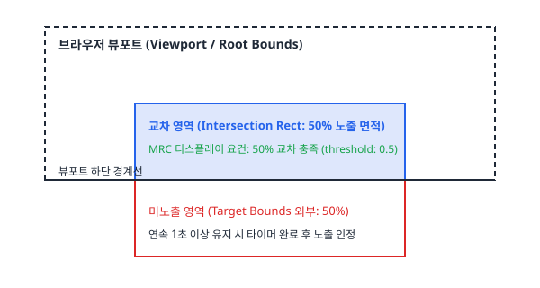
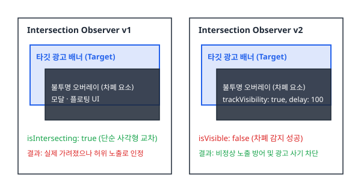

# 261102 TrackImpression

> TrackImpression은 UI 요소의 유효 뷰포트 노출을 계측하는 프론트엔드 아키텍처 패턴이며, Intersection Observer는 과거 동기식 레이아웃 리드백으로 인한 렌더링 병목을 해결하고 브라우저 렌더 파이프라인에서 비동기 교차를 감지하기 위해 W3C 표준으로 제정된 핵심 API다. · 분야: DOM · 렌더링 · Baseline: 해당 없음: TrackImpression은 단일 브라우저 Web API 명세가 아닌 IAB/MRC 광고·분석 표준 규격 및 프론트엔드 노출 계측 아키텍처 패턴이므로 브라우저 기능 호환성(Baseline) 평가 대상이 아님 · 읽는 시간 약 6분

## 1. 왜 쓰는가
TrackImpression과 Intersection Observer는 웹 광고 및 분석의 비즈니스적 요구와 브라우저 렌더링 최적화가 맞물려 탄생한 원인과 결과의 관계다 [1][5][6].

TrackImpression(노출 트래킹)은 웹 페이지 내의 광고 배너, 프로모션, 추천 상품, 콘텐츠 등의 UI 요소가 사용자 뷰포트에 유의미하게 노출되었는지를 감지하고 기록하는 기술이자 프론트엔드 아키텍처 패턴이다 [5]. 과거에는 웹 페이지 내 요소의 노출을 확인하기 위해 `window` 객체의 `scroll` 및 `resize` 이벤트에 리스너를 등록하고, 이벤트가 발생할 때마다 `getBoundingClientRect()`를 반복 호출하는 메인 스레드 폴링 방식을 사용했다 [1][6].

그러나 스크롤 이벤트 발생 시마다 자바스크립트 엔진이 DOM 트리의 최신 기하학적 수치를 조회하면 브라우저는 스타일 재계산과 레이아웃 연산을 강제로 동기 실행한다 [1][6]. 이로 인해 레이아웃 스래싱(Layout Thrashing)과 불필요한 리플로우가 발생하여 렌더링 프레임 드롭(Jank)이 빈번해지고 기기의 배터리 소모가 급증했다 [1][6].

W3C Intersection Observer 명세의 서문(Introduction)에는 수많은 광고 네트워크가 노출 가시성을 측정하기 위해 무분별한 스크롤 핸들러와 동기식 레이아웃 리드백을 남용하면서 웹 성능을 저해한 문제를 해결하는 것이 API 제정의 결정적인 동기였다고 공식 명시되어 있다 [1]. 즉, 메인 스레드를 차단하지 않고 브라우저 엔진 수준에서 비동기적으로 요소의 교차 상태를 감지하여 TrackImpression을 고성능으로 구현할 수 있도록 만든 웹 표준 솔루션이 바로 Intersection Observer다 [1][6].

## 2. 핵심 개념
TrackImpression을 정확하게 구현하기 위해서는 디지털 광고 업계 표준 규격과 브라우저의 교차 계산 메커니즘을 정확히 일치시켜야 한다 [5].

미국 미디어 등급 위원회(MRC)와 IAB 가이드라인에 따르면 디스플레이 광고의 경우 전체 픽셀의 50% 이상이 활성 탭 화면에 최소 1초 이상 연속으로 노출되어야 공식 'Viewable Impression'으로 인정된다 [5]. 비디오 광고의 경우에는 전체 픽셀의 50% 이상이 활성 화면에서 최소 2초 이상 연속으로 재생 및 노출되어야 유효 노출로 인정된다 [5].

이러한 규격을 충족하기 위해 Intersection Observer는 다음과 같은 공간 좌표 및 기하학적 개념을 제공한다 [1][6].

- 루트(Root / Viewport): 타깃 요소의 가시성을 판정하는 기준 경계 상자이며, 기본값은 브라우저 뷰포트다 [1][6].
- 타깃(Target): 노출 여부를 추적하려는 실제 광고 배너 또는 UI DOM 요소다 [1][6].
- 교차 영역(Intersection Rect): 타깃 경계 상자와 루트 경계 상자가 기하학적으로 겹치는 사각형 영역이다 [1][6].
- 교차 비율(intersectionRatio): 타깃 사각형의 전체 면적 대비 교차 영역의 비율(0.0 ~ 1.0)이며, MRC 기준의 50% 노출을 판별하는 수치적 기준이 된다 [1][5].



하지만 Intersection Observer v1의 교차 판정(`isIntersecting`, `intersectionRatio`)은 단순히 축에 정렬된 사각형 경계 상자(Bounding Box)의 겹침만 계산하므로 실제 사용자의 시각적 인지 여부까지는 보장하지 못한다 [2][4]. 타깃 요소에 `opacity: 0`, `filter`, 복잡한 `transform`이 적용되어 있거나, 상단에 다른 불투명한 DOM 요소(모달 다이얼로그, 팝업, 고정 네비게이션 헤더 등)가 덮여 완전히 가려져 있어도(Occlusion) v1에서는 사각형 교차가 성립되어 허위 노출로 오인될 수 있다 [2][4].

이러한 뷰어빌리티 조작 및 클릭재킹과 같은 광고 사기(Impression Fraud)를 방지하기 위해 W3C는 Intersection Observer Level 2 명세를 정의했다 [2][4]. Level 2는 `trackVisibility: true` 옵션과 `entry.isVisible` 속성을 도입하여 실제 시각적으로 가려지지 않고 온전히 렌더링되었는지를 판별한다 [2][4]. 픽셀 차폐와 필터 계산의 성능 부하를 완화하기 위해 최소 100ms 이상의 `delay` 값을 함께 지정해야 하며, 브라우저는 보수적인 직사각형 연산을 수행하므로 실제 보여도 false가 반환될 수 있는 거짓 음성(False Negative)을 허용한다 [2][4].



## 3. 동작 원리
Intersection Observer는 자바스크립트 메인 스레드 루프 안에서 즉각적으로 연산되지 않고 브라우저 렌더링 파이프라인의 내부 갱신 주기에 맞추어 비동기적으로 동작한다 [1][3][6].

WHATWG HTML 표준의 8.1.7.3 'Update the rendering' 명세에 따르면 브라우저는 매 프레임 렌더링 갱신 시 `requestAnimationFrame` 콜백을 실행하고 스타일 및 레이아웃을 계산한 뒤, 실제 화면을 그리는 페인트 직전에 'update intersection observations steps'를 실행하여 교차 상태를 갱신한다 [1][3]. 브라우저 내부 렌더 트리의 최신 기하 구조를 활용하여 비동기 계산하므로 자바스크립트의 동기식 강제 리플로우를 유발하지 않는다 [1][6].

```diagram
종류: 시퀀스
번호: 켬

[사용자]
[이벤트 루프]
[렌더 엔진]
[콜백 함수]

사용자 -> 이벤트 루프 : 스크롤 및 화면 갱신
이벤트 루프 -> 렌더 엔진 : requestAnimationFrame 실행
렌더 엔진 -> 렌더 엔진 : update intersection observations
렌더 엔진 -> 콜백 함수 : 임계치 교차 시 작업 큐 등록
콜백 함수 -> 사용자 : 타이머 개시 및 비콘 전송
```

이벤트 루프 처리 모델에서 교차 임계치(threshold) 통과가 감지되면 브라우저는 관찰자 콜백을 태스크 큐에 등록하여 다음 틱에서 비동기적으로 실행한다 [1][3].

여기서 주의할 기술적 동작은 Intersection Observer 자체는 경계 교차 순간만을 알려줄 뿐 '1초 이상 연속 노출'과 같은 체류 시간(Dwell Time)을 자체 측정하지 않는다는 점이다 [5]. 따라서 프론트엔드 아키텍처는 관찰자 콜백이 트리거되었을 때 타이머(`setTimeout`)를 시작하고, 요소가 뷰포트를 벗어나거나 비활성화될 때 타이머를 취소(`clearTimeout`)하는 상태 머신을 별도로 관리해야 한다 [5]. 측정된 노출 데이터는 사용자가 즉각 탭을 닫거나 이탈할 때도 유실되지 않도록 `navigator.sendBeacon()` 또는 `fetch({ keepalive: true })`를 통해 서버로 안전하게 발송된다 [7].

## 4. 기본 사용법
다음은 50% 이상 뷰포트에 진입한 단일 요소를 감지하여 노출 이벤트를 발송하고 관찰을 해제하는 기본 TrackImpression 자바스크립트 코드다 [1][5][6][7].

```js
const options = {
  root: null,
  rootMargin: '0px',
  threshold: 0.5
};

const handleIntersection = (entries, observer) => {
  entries.forEach((entry) => {
    if (entry.isIntersecting && entry.intersectionRatio >= 0.5) {
      const element = entry.target;
      const impressionId = element.getAttribute('data-impression-id');
      navigator.sendBeacon('/analytics/impression', JSON.stringify({ id: impressionId, timestamp: Date.now() }));
      observer.unobserve(element);
    }
  });
};

const observer = new IntersectionObserver(handleIntersection, options);
const targets = document.querySelectorAll('[data-impression-id]');
targets.forEach((target) => observer.observe(target));
```

줄별 설명:
- 1행: Intersection Observer 생성에 전달할 옵션 객체 선언을 시작한다.
- 2행: `root`에 `null`을 지정하여 브라우저 최상위 뷰포트를 교차 기준 사각형으로 설정한다 [1][6].
- 3행: `rootMargin`을 `'0px'`로 지정하여 뷰포트의 경계 영역을 가감 없이 기본 크기 그대로 유지한다 [1][6].
- 4행: `threshold`를 `0.5`로 지정하여 타깃 요소가 50% 노출되는 임계 시점에 콜백이 발화되도록 설정한다 [1][5].
- 5행: 옵션 객체 선언을 종료한다.
- 7행: 교차 상태 변경 시 실행될 콜백 함수를 정의하며, 인자로 교차 엔트리 목록(`entries`)과 관찰자 인스턴스(`observer`)를 받는다 [1][6].
- 8행: 변경된 상태를 가진 엔트리 배열을 `forEach` 메서드로 순회한다.
- 9행: 엔트리가 뷰포트와 교차 중(`isIntersecting === true`)이고 실제 교차 면적 비율이 50% 이상(`intersectionRatio >= 0.5`)인지 검증한다 [1][5].
- 10행: 노출 조건을 충족한 대상 DOM 노드를 `entry.target`에서 참조한다.
- 11행: 해당 요소의 `data-impression-id` 속성값을 조회하여 고유 노출 식별자를 추출한다.
- 12행: `navigator.sendBeacon()`을 호출하여 노출 식별자와 현재 타임스탬프를 포함한 JSON 데이터를 서버 엔드포인트로 비동기 전송한다 [7].
- 13행: 노출이 유효하게 1회 기록되었으므로 중복 전송과 불필요한 연산 낭비를 막기 위해 `observer.unobserve(element)`를 호출하여 관찰을 해제한다 [1][6].
- 14행: 조건 검증 블록을 종료한다.
- 15행: 배열 순회 블록을 종료한다.
- 16행: 콜백 함수 블록을 종료한다.
- 18행: 정의한 콜백 함수와 옵션을 주입하여 새로운 `IntersectionObserver` 인스턴스를 인스턴스화한다 [1][6].
- 19행: 노출 계측 대상이 되는 속성(`data-impression-id`)을 가진 모든 DOM 요소를 질의하여 선택한다.
- 20행: 선택된 모든 타깃 요소에 대해 `observer.observe(target)`를 호출하여 브라우저 엔진에 교차 관찰 등록을 완료한다 [1][6].

## 5. 실무 예시
실무에서는 단순 교차뿐만 아니라 체류 시간 검증, 차폐 방지, 대규모 네트워크 최적화가 필수적이다 [2][5][7].

### 실무 예제 1: MRC 기준 준수 Viewable TrackImpression 구현
- 상황: 디스플레이 광고가 화면에 스쳐 지나가는 단순 교차가 아니라, 활성 탭 화면에서 50% 이상 영역이 1초 이상 연속 노출되었을 때만 광고 비용을 집계하는 정식 규격을 충족해야 하는 상황 [5].
- 코드:
```js
function createImpressionTracker(onImpression) {
  const timers = new WeakMap();

  const observer = new IntersectionObserver((entries) => {
    entries.forEach((entry) => {
      const target = entry.target;

      // 50% 이상 노출되었고 현재 탭이 활성화된 상태인지 확인
      if (entry.isIntersecting && entry.intersectionRatio >= 0.5 && !document.hidden) {
        if (!timers.has(target)) {
          // MRC 디스플레이 광고 기준: 1초 연속 노출
          const timerId = window.setTimeout(() => {
            onImpression(target.dataset.impressionId, entry);
            observer.unobserve(target); // 노출 인정 즉시 관찰 해제 (중복 방지)
            timers.delete(target);
          }, 1000);
          timers.set(target, timerId);
        }
      } else {
        // 1초를 채우지 못하고 뷰포트를 벗어나면 타이머 취소
        if (timers.has(target)) {
          clearTimeout(timers.get(target));
          timers.delete(target);
        }
      }
    });
  }, {
    threshold: [0, 0.5, 1.0]
  });

  return {
    observe: (el) => observer.observe(el),
    disconnect: () => observer.disconnect()
  };
}

// 사용 예시
const tracker = createImpressionTracker((id) => {
  navigator.sendBeacon('/analytics/impression', JSON.stringify({ id, timestamp: Date.now() }));
});
document.querySelectorAll('[data-impression-id]').forEach(el => tracker.observe(el));
```
- 주의점: 스크롤 도중 1초를 채우지 못하고 뷰포트를 벗어나거나 탭이 백그라운드로 전환될 때 `clearTimeout`을 호출하여 즉시 타이머를 취소해야 한다 [5]. 또한 유효 노출이 확정된 즉시 `unobserve()`를 실행하여 중복 집계와 불필요한 콜백 오버헤드를 차단해야 한다 [1][6].

### 실무 예제 2: Intersection Observer v2를 활용한 차폐(Occlusion) 방지형 사기 방지 트래킹
- 상황: 광고 영역 위에 불투명 모달, 고정 헤더 배너, 또는 투명 레이어가 덮여 사용자가 실제로는 광고를 볼 수 없음에도 뷰포트 사각형 겹침만으로 허위 청구되는 광고 사기(Impression Fraud)를 방지해야 하는 상황 [2][4].
- 코드:
```js
const v2Options = {
  threshold: [0.5],
  trackVisibility: true, // v2: 실제 시각적 가시성 및 렌더링 차폐 추적
  delay: 100             // v2 필수 요건: 최소 100ms 지연
};

const secureObserver = new IntersectionObserver((entries) => {
  entries.forEach((entry) => {
    // entry.isVisible은 지원 브라우저(Chromium)에서 완전한 시각적 노출을 보장
    const isActuallyVisible = entry.isVisible ?? true; // 미지원 브라우저는 fallback 허용

    if (entry.isIntersecting && entry.intersectionRatio >= 0.5 && isActuallyVisible) {
      console.log('차폐되지 않은 안전한 유효 노출:', entry.target.id);
      secureObserver.unobserve(entry.target);
      sendImpressionBeacon(entry.target.id);
    }
  });
}, v2Options);

document.querySelectorAll('.ad-unit').forEach(ad => secureObserver.observe(ad));
```
- 주의점: `trackVisibility: true`를 적용할 때는 픽셀 연산 부하를 제어하기 위해 스펙상 최소 100ms 이상의 `delay`를 강제 설정해야 한다 [2][4]. 또한 v2는 Chromium 기반 브라우저 중심으로 구현되어 있으므로 Safari나 Firefox 환경을 대비해 `entry.isVisible ?? true`와 같은 폴백 처리가 필요하다 [8].

### 실무 예제 3: 큐잉 및 페이지 이탈 대응 일괄 배치(Batch Flush) 전송 패턴
- 상황: 피드나 추천 상품 목록에서 수십 개의 요소가 뷰포트에 동시에 진입할 때 개별 HTTP 요청을 발송하면 네트워크 병목이 발생하고, 사용자가 급격히 페이지를 이탈할 때 데이터가 유실되는 상황 [7].
- 코드:
```js
class BatchImpressionTracker {
  constructor(endpoint, flushInterval = 3000) {
    this.endpoint = endpoint;
    this.queue = new Set();
    this.timer = setInterval(() => this.flush(), flushInterval);

    // 페이지 언로드 및 탭 숨김 시 미전송 데이터 즉시 전송
    document.addEventListener('visibilitychange', () => {
      if (document.visibilityState === 'hidden') this.flush();
    });
    window.addEventListener('pagehide', () => this.flush());
  }

  enqueue(id) {
    this.queue.add({ id, timestamp: Date.now() });
  }

  flush() {
    if (this.queue.size === 0) return;
    const payload = JSON.stringify({ impressions: Array.from(this.queue) });
    this.queue.clear();

    const sent = navigator.sendBeacon(this.endpoint, payload);
    if (!sent) {
      fetch(this.endpoint, {
        method: 'POST',
        body: payload,
        headers: { 'Content-Type': 'application/json' },
        keepalive: true
      }).catch(err => console.error('Beacon 전송 실패:', err));
    }
  }
}
```
- 주의점: 브라우저의 `navigator.sendBeacon()` 큐 크기는 통상 약 64KB로 제한되어 있으므로 대용량 데이터 전송 시 거부될 수 있다 [7]. 전송 실패 반환 시 `fetch(..., { keepalive: true })`로 전환하는 폴백 처리가 필수적이며, 모바일 환경을 고려해 `visibilitychange`와 `pagehide` 이벤트를 모두 구독해야 한다 [7].

## 6. 장점 · 단점

| 장점 | 단점 |
| :--- | :--- |
| **메인 스레드 블로킹 해소**: 스크롤 이벤트 루프 내 동기식 레이아웃 리드백(`getBoundingClientRect`)을 완전히 제거하고 브라우저 렌더 파이프라인에서 비동기 교차 계산을 수행하여 렌더링 프레임 드롭을 방지함 [1][6]. | **체류 시간 직접 측정 불가**: Intersection Observer는 진입/진출 시점에만 반응하므로 MRC 규격인 1초 연속 노출을 충족하기 위해 타이머(`setTimeout` / `clearTimeout`) 상태를 직접 구현해야 함 [5]. |
| **업계 표준 준수 용이성**: `threshold: 0.5` 설정을 통해 50% 픽셀 가시성 요건을 네이티브 수준에서 간결하게 충족할 수 있음 [5]. | **브라우저별 v2 지원 불균형**: 실제 렌더링 차폐(Occlusion)와 불투명도를 판별하는 Level 2(`trackVisibility`)가 Safari, Firefox 등 비-Chromium 브라우저에서 미지원 상태임 [8]. |
| **자원 낭비 최소화**: 유효 노출 달성 즉시 `unobserve()`를 호출하여 불필요한 브라우저 내부 관찰 연산과 네트워크 트래픽을 선제적으로 차단할 수 있음 [1][6]. | **네트워크 요청 누적 및 배치 복잡성**: 뷰포트 내 수많은 요소가 동시에 교차될 때 개별 요청이 폭증하므로, 큐 관리 및 배치 전송 로직을 프론트엔드에서 직접 구현해야 함. |
| **데이터 전송 신뢰성**: `navigator.sendBeacon()` 및 `fetch({ keepalive: true })`와 결합하여 빠른 화면 이탈이나 탭 닫기 시에도 노출 데이터 유실을 방지함 [7]. | **백그라운드 탭 가시성 처리 누락 위험**: 브라우저 탭이 백그라운드로 전환되거나 창이 최소화되어도 기하 교차 상태가 유지될 수 있어 `document.visibilityState` 연동이 필수적임. |
| **사기 방지 대응 가능**: Level 2 지원 환경에서 `trackVisibility: true`를 활용해 투명 배너나 레이어 은폐를 통한 어뷰징 노출을 감지 가능함 [2][4]. | **거짓 음성 발생 가능성**: v2 계산 시 성능 최적화를 위한 보수적 직사각형 연산으로 인해 실제 보여도 `isVisible: false`가 반환될 수 있음 [2][4]. |

## 7. 한계와 함정
TrackImpression을 프로덕션에 적용할 때 고려해야 하는 경계 사례, 성능, 접근성, 보안, 개인정보 측면의 기술적 제약 사항은 다음과 같다.

- 경계 사례 (Edge Cases):
  - 시각적 차폐(Occlusion) 감지의 크로스 브라우징 한계: v1 환경에서는 타깃 광고 위에 고정 네비게이션 헤더, 모달 다이얼로그, 쿠키 배너 등이 덮여 있어도 뷰포트 사각형 교차만 만족하면 유효 노출로 기록되는 허위 집계가 발생한다 [2][4][8].
  - 백그라운드 탭 가시성 누락: 사용자가 다른 브라우저 탭으로 전환하거나 창을 최소화해도 DOM 요소와 뷰포트의 교차 기하 상태 자체는 변하지 않는다. 따라서 `document.hidden`이나 `visibilitychange` 이벤트를 확인하지 않으면 보지 않은 광고가 노출로 기록된다.
- 성능 (Performance):
  - 컴포넌트 라이프사이클 누수 위험: SPA(Single Page Application) 환경에서 컴포넌트가 언마운트되거나 DOM에서 제거될 때 `unobserve()` 및 진행 중인 체류 타이머(`clearTimeout`)를 명시적으로 정리하지 않으면 고스트 노출 및 메모리 누수가 발생한다.
  - Level 2 연산 오버헤드: `trackVisibility: true`를 설정할 때 최소 100ms의 `delay`를 두지 않으면 복잡한 렌더 트리에서 픽셀 차폐를 재계산하느라 메인 스레드 렌더링 성능이 저하된다 [2][4].
- 접근성 (Accessibility):
  - 시각 중심 계측과 보조 공학 도구의 괴리: 뷰포트 교차는 시각적 렌더링에만 의존하므로 스크린 리더 사용자가 해당 콘텐츠에 초점을 맞추고 실제로 음성 안내를 청취했는지 여부와 일치하지 않는다. 스킵 네비게이션이나 키보드 포커스 탐색 시 순식간에 교차 영역을 지나치는 요소에 대한 오탐지 방지 처리가 고려되어야 한다.
- 보안 (Security):
  - 광고 사기(Impression Fraud) 및 클릭재킹: 악의적인 게시자가 투명한 `iframe`이나 `opacity: 0` 레이어로 광고를 감추고 교차 이벤트만 발생시켜 부당한 광고 수익을 취하는 어뷰징에 취약하다 [2][4].
  - 크로스 오리진 IFRAME 정보 은닉 제약: 교차 출처(Cross-Origin) `iframe` 내부에서 타깃을 관찰할 때 브라우저 보안 정책상 타깃의 정확한 절대 좌표나 내부 렌더 트리를 부모 페이지에 노출하지 않고 교차 비율 정보만 제한적으로 제공한다 [1].
- 개인정보 (Privacy):
  - 비콘 페이로드 큐 용량 제약: `navigator.sendBeacon()`은 브라우저 수준에서 큐 크기를 약 64KB로 엄격히 제한하므로, 수집된 노출 데이터를 과도하게 묶어 한 번에 발송할 경우 브라우저에 의해 전송이 거부된다 [7].
  - 무분별한 사용자 식별자 결합 규제: 노출 이벤트에 서드파티 식별자를 결합하여 전송하는 전통적인 트래킹 패턴은 최신 웹 표준 프라이버시 정책에 저촉되므로, 익명화된 집계 모델로의 전환이 요구된다.

## 8. 다른 방법과 비교

| 방법 | 언제 | 비용 | 한계 |
| :--- | :--- | :--- | :--- |
| **`scroll` / `resize` + `getBoundingClientRect()`** | Intersection Observer를 지원하지 않는 극단적인 구형 레거시 브라우저를 지원해야 할 때 [1][6] | 매우 높음 (스크롤 시마다 메인 스레드 강제 리플로우 및 레이아웃 스래싱 유발) [1][5] | 렌더링 프레임 드롭(Jank), 배터리 급소모, 실제 차폐 감지 불가능 [1][6] |
| **Intersection Observer (TrackImpression)** | 일반적인 현대 웹 프론트엔드 환경에서 광고 및 콘텐츠 노출을 성능 저하 없이 측정할 때 [1][5][6] | 낮음 (브라우저 렌더링 파이프라인에서 비동기 교차 계산) [1][6] | 체류 시간 자체 측정 불가(타이머 별도 구현), 비-Chromium 계열 v2 미지원 [5][8] |
| **Privacy Sandbox Attribution Reporting API** | 서드파티 쿠키 없이 브라우저 자체에서 노출(소스)과 전환(트리거)을 기여 분석할 때 | 낮음 (브라우저가 백그라운드에서 암호화 집계 리포트 전송) | 광고 전환 기여 분석에 특화되어 범용 프론트엔드 UI 노출 로깅에는 부적합 |
| **Fenced Frames Ads Reporting API (`reportEvent`)** | Protected Audience 경매를 통해 격리된 `<fencedframe>` 내에서 광고 노출을 보고할 때 | 매우 낮음 (격리 프레임워크 내 브라우저 자체 비콘 발송) | 교차 사이트 데이터 유출 방지를 위한 격리 환경에 한정되어 일반 DOM에 적용 불가 |
| **IAB Open Measurement SDK (OMID)** | 모바일 인앱 및 웹 환경 전반에서 제3자 측정 공급업체(MOAT, IAS 등)에 공인 데이터를 제공할 때 | 중간 (외부 SDK 로드 및 연동 오버헤드) | 독자적인 경량 로깅 시스템에는 오버스펙이며 외부 라이브러리 의존성 발생 |

### 이것을 고르지 않는 경우
- 서드파티 쿠키 차단 환경에서 오직 광고의 전환 기여 분석(Attribution)만을 목적으로 할 때는 독자적인 프론트엔드 TrackImpression 대신 브라우저 네이티브인 Privacy Sandbox Attribution Reporting API를 선택해야 한다.
- 광고 렌더링이 개인정보 격리 프레임워크 내에서 수행되어 부모 페이지로의 스크립트 데이터 유출이 차단되는 환경에서는 Fenced Frames Ads Reporting API를 채택해야 한다.
- 광고주와 매체사 간의 비즈니스 계약 조건상 제3자 측정 기관(MOAT, DoubleVerify, IAS 등)의 공식 뷰어빌리티 감사 인증이 필수적인 엔터프라이즈 환경에서는 자체 Intersection Observer 로직 대신 IAB OMID SDK를 필수적으로 채택해야 한다.
- 반대로 Intersection Observer가 전혀 지원되지 않는 구형 브라우저 환경에서는 성능 페널티를 감수하고 `requestAnimationFrame`과 스로틀링(Throttling)을 적용한 레거시 `scroll` 이벤트 방식을 폴백으로 선택한다 [1][6].

## 9. 대비와 새로운 시도
프론트엔드 노출 계측 분야는 렌더링 차폐 감지의 표준화와 프라이버시 보호형 집계 모델이라는 두 가지 방향으로 진화하고 있다 [2][8].

- W3C Intersection Observer Level 2 표준화 논의:
  `trackVisibility`와 `isVisible`을 통해 실제 렌더링 차폐(Occlusion)와 필터 효과를 판별하는 기능을 Safari(WebKit) 및 Firefox(Gecko) 등 비-Chromium 브라우저 벤더와 조율하여 완전한 크로스 브라우징 웹 표준으로 안착시키기 위한 스펙 보완 작업이 지속되고 있다 [2][8].
- Privacy Sandbox Attribution Reporting API 고도화:
  사용자 식별용 서드파티 쿠키를 완전히 배제하고, 브라우저 내부에서 노출 소스를 등록(`attributionsrc` 속성 또는 `registerSource`)한 뒤 암호화된 요약 리포트(Summary Report)를 생성하여 집계 서비스로 전송하는 프라이버시 보존형 노출 계측 패러다임이 확산되고 있다.
- Fenced Frames 및 Private Aggregation 연계:
  교차 사이트 추적을 원천 격리하는 `<fencedframe>` 환경 내에서 `window.fence.reportEvent()`를 실행하고, 통계적 차등 프라이버시(Differential Privacy) 노이즈를 결합하여 사용자 개인정보를 식별하지 않고도 통계적 집계 노출수를 산출하는 신규 기술 검증이 활발히 진행 중이다.

## 10. 다른 사람에게 설명하기
- 세 문장 요약:
  1. TrackImpression은 UI 요소가 뷰포트에 50% 이상 노출되었는지를 계측하는 프론트엔드 아키텍처 패턴이며, 과거 `scroll` 이벤트와 `getBoundingClientRect()`로 인한 레이아웃 스래싱을 해결하기 위해 W3C에서 브라우저 렌더링 파이프라인 기반의 비동기 교차 관찰 API인 Intersection Observer를 제정하였다 [1][5][6].
  2. Intersection Observer는 매 프레임 렌더링 갱신(Update the rendering) 단계에서 교차를 비동기 계산하여 성능 병목을 제거하지만, MRC 표준인 1초 체류 시간은 직접 측정하지 못하므로 개발자가 타이머 상태를 결합해야 하고, 시각적 차폐(Occlusion)로 인한 노출 사기를 방지하기 위해 Level 2(`trackVisibility`)가 도입되었다 [2][3][4][5].
  3. 측정된 노출 데이터는 브라우저 이탈 시 유실을 방지하기 위해 `navigator.sendBeacon()` 또는 `fetch({ keepalive: true })`로 전송되며, 향후 웹 생태계는 차폐 감지 표준화와 Attribution Reporting API 등 프라이버시 보존형 노출 계측으로 확장되고 있다 [7][8].

- 스스로 확인할 질문:
  1. W3C가 Intersection Observer 명세를 제정하게 된 결정적인 계기와 과거 `getBoundingClientRect()` 폴링 방식의 구조적 문제점은 무엇인가?
  2. MRC 디스플레이 광고의 Viewable Impression 요건(50% 면적, 1초 체류)을 Intersection Observer와 프론트엔드 타이머를 결합하여 구현할 때 어떤 예외 처리가 필요한가?
  3. Intersection Observer v1의 기하학적 교차 판정이 가진 보안상 한계(노출 사기 및 차폐)는 무엇이며, v2의 `trackVisibility`와 `isVisible`은 이를 어떻게 해결하는가?

## 참고 자료
1. [Intersection Observer - W3C Working Draft](https://w3c.github.io/IntersectionObserver/)
2. [Intersection Observer Level 2 - W3C Working Draft](https://w3c.github.io/IntersectionObserver/v2/)
3. [HTML Living Standard: 8.1.7.3 Update the rendering - WHATWG](https://html.spec.whatwg.org/multipage/webappapis.html#update-the-rendering)
4. [Trust is good, observation is best: Intersection Observer v2 - web.dev](https://web.dev/articles/intersectionobserver-v2)
5. [MRC Viewable Ad Impression Measurement Guidelines v2.0 - Media Rating Council](https://www.mediaratingcouncil.org/sites/default/files/Viewable%20Ad%20Impression%20Guideline_v2.0_Final.pdf)
6. [Intersection Observer API - Web APIs | MDN](https://developer.mozilla.org/en-US/docs/Web/API/Intersection_Observer_API)
7. [Navigator: sendBeacon() method - Web APIs | MDN](https://developer.mozilla.org/en-US/docs/Web/API/Navigator/sendBeacon)
8. [IntersectionObserver v2 | Can I use](https://caniuse.com/intersectionobserver-v2)
조사: 2026-11-02

## 내 리뷰
(읽고 느낀 점 · 궁금한 것을 적는다. 질문은 Q. 로 시작)
