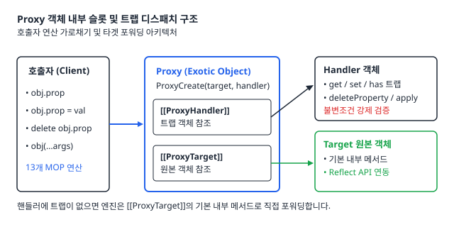
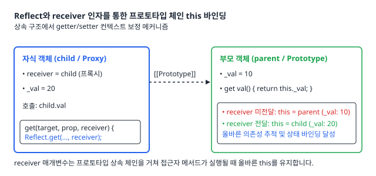
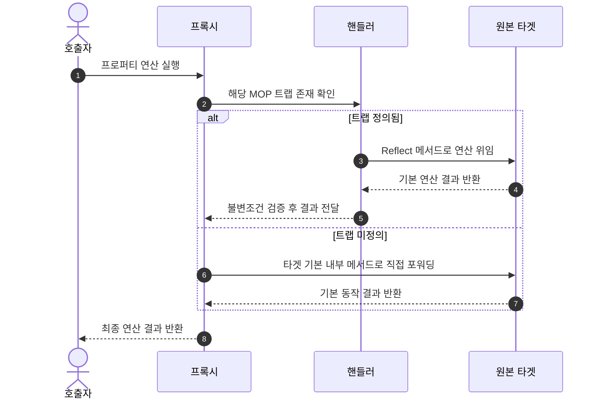

# 261103 Proxy와 Reflect

> 한 줄 요약 · 분야: 언어 기능 · Baseline: Widely available · 읽는 시간 약 12분

## 1. 왜 쓰는가
ECMAScript 2015(ES6) 이전의 자바스크립트는 객체 연산을 가로채기 위해 `Object.defineProperty()`에 전적으로 의존했다 [1][5]. 그러나 `Object.defineProperty()`는 이미 객체에 선언되어 있는 특정 프로퍼티에 대해서만 getter와 setter를 제한적으로 정의하는 방식이었다 [1][5]. 이로 인해 런타임에 동적으로 프로퍼티가 추가되는 동작(`obj.newProp = value`)이나 `delete` 연산자를 통한 프로퍼티 삭제 동작을 언어 차원에서 감지할 수 없었다 [1][5]. 또한 배열의 인덱스 직접 할당(`arr[0] = value`)이나 `length` 프로퍼티 조작, 프로토타입 체인 탐색 연산 역시 가로챌 수 없었다 [1][5]. 당시 라이브러리들은 이러한 결함을 우회하기 위해 배열의 변이 메서드(`push`, `pop`, `splice` 등)를 강제로 덮어쓰거나 객체의 중첩 프로퍼티 전체를 재귀적으로 순회하며 프로퍼티마다 접근자를 등록하는 비효율적인 연산을 수행해야 했다 [1][5].

Proxy는 자바스크립트 엔진의 저수준 객체 모델(Meta-Object Protocol, MOP)에 직접 접근하여 객체에 가해지는 근본적인 연산 13가지를 가로채고 재정의하기 위해 도입되었다 [1][3]. 언어 표준화 초기에는 타겟 객체가 존재하지 않는 완전한 가상 객체 형태의 프록시 모델이 논의되었으나, 객체 식별성 훼손, 보안 누수, 가비지 컬렉터 메모리 관리의 한계가 확인되었다 [3][5]. 이에 따라 Tom Van Cutsem과 Mark S. Miller의 주도로 실제 원본 타겟 객체를 필수적으로 감싸는 Direct Proxies 모델이 최종 표준으로 확립되었다 [3][5]. 이 설계를 통해 자바스크립트는 기존 객체의 참조 무결성을 보존하면서도 동적 프로퍼티 추가, 삭제, 배열 인덱스 접근 등 모든 기본 연산을 투명하게 가로채는 메타프로그래밍 체계를 완성했다 [1][3][5].

## 2. 핵심 개념




Proxy와 Reflect를 구성하는 핵심 개념과 내부 구조는 다음과 같다.

- **특수 객체(Exotic Object)와 ProxyCreate**: Proxy는 ECMA-262 명세에서 일반 객체(Ordinary Object)와 내부 메서드 동작이 다른 특수 객체(Exotic Object)로 분류된다 [3]. 내부적으로 `ProxyCreate(target, handler)` 추상 연산을 통해 생성되며, 반드시 `[[ProxyTarget]]`과 `[[ProxyHandler]]`라는 내부 슬롯을 유지한다 [3]. Proxy는 반드시 `new` 연산자와 함께 호출해야 하며, `new` 없이 함수로 호출하면 엔진에서 `TypeError`를 발생시킨다 [3].
- **타겟(Target)과 핸들러(Handler)**: `[[ProxyTarget]]`은 프록시가 가상화하는 실제 원본 객체이며, `[[ProxyHandler]]`는 연산을 가로챌 트랩 함수들을 보관하는 객체이다 [3]. 호출자가 프록시 인스턴스에 연산을 수행했을 때 핸들러에 해당 트랩이 정의되어 있지 않으면, 엔진은 해당 작업을 `[[ProxyTarget]]`의 기본 내부 메서드로 직접 포워딩한다 [1][3].
- **13가지 필수 내부 메서드(MOP)와 트랩(Trap)**: 자바스크립트 객체의 모든 상호작용은 13가지 필수 내부 메서드로 변환된다 [1][3]. Proxy는 이 13가지 내부 메서드(`[[Get]]`, `[[Set]]`, `[[HasProperty]]`, `[[Delete]]`, `[[OwnPropertyKeys]]`, `[[Apply]]`, `[[Construct]]`, `[[GetPrototypeOf]]`, `[[SetPrototypeOf]]`, `[[IsExtensible]]`, `[[PreventExtensions]]`, `[[GetOwnProperty]]`, `[[DefineOwnProperty]]`)와 1:1로 대응하는 트랩 함수를 핸들러에 정의할 수 있다 [1][3].
- **필수 내부 메서드의 불변조건(Invariants of Essential Internal Methods)**: Proxy 트랩은 명세에 정의된 불변조건을 강제적으로 준수해야 한다 [3]. 대상 객체의 `non-configurable` 프로퍼티를 존재하지 않는다고 보고하거나, `non-extensible` 객체에 새로운 프로퍼티를 추가할 수 있다고 반환하는 등 불변조건을 위반하면 엔진 레벨에서 즉각 `TypeError`를 발생시킨다 [3].
- **Reflect API**: Proxy의 13개 트랩과 1:1로 정확하게 일치하는 정적 메서드를 제공하는 내장 객체이다 [2]. 프로퍼티 정의나 삭제 실패 시 예외를 던지는 대신 `boolean` 값(`true`/`false`)을 반환하여 제어 흐름을 단순화하며, `receiver` 매개변수를 전달받아 프로토타입 상속 관계에서도 getter/setter 내부의 `this` 컨텍스트를 호출자 객체로 온전하게 유지한다 [1][2].
- **Proxy.revocable**: 프록시 인스턴스와 함께 취소 함수 `revoke`를 반환하는 정적 메서드이다 [1][3]. `revoke()` 함수가 실행되면 프록시 내부 슬롯 `[[ProxyTarget]]`과 `[[ProxyHandler]]`가 `null`로 초기화되며, 이후 발생하는 모든 프로퍼티 접근은 `TypeError`를 던지며 즉시 차단된다 [1][3].

## 3. 동작 원리
객체 연산이 프록시를 통과하여 평가되고 핸들러 및 타겟 객체로 디스패치되는 흐름은 다음과 같다.



호출자가 객체에 연산(예: 프로퍼티 조회 `obj.x`)을 가하면 자바스크립트 엔진은 동기적으로 프록시의 내부 슬롯 `[[ProxyHandler]]`를 조회한다 [3]. 핸들러에 해당 연산에 대응하는 트랩(`get`)이 존재하면 해당 트랩 함수를 즉시 호출한다 [1][3]. 핸들러에 트랩이 정의되어 있지 않은 경우, 엔진은 `[[ProxyTarget]]`에 등록된 원본 객체의 기본 내부 메서드를 호출하여 작업을 그대로 포워딩한다 [1][3].

트랩 함수가 실행을 마치고 값을 반환하면, 엔진은 해당 반환값이 ECMA-262 명세의 필수 불변조건(Invariants)을 만족하는지 검증한다 [3]. 예를 들어 원본 객체의 프로퍼티가 `writable: false`, `configurable: false`인 경우, `get` 트랩이 원본 프로퍼티 값과 다른 값을 반환하면 엔진은 불변조건 검증 실패로 판단하고 즉각 `TypeError`를 던진다 [3]. 불변조건 검증을 통과한 경우에만 반환값이 호출자에게 최종 전달된다 [3].

런타임 레벨에서 Proxy의 호출 성능은 V8 엔진 최적화를 거쳐 대폭 개선되었다 [4]. ES2015 도입 초기 V8 구현에서는 프록시 트랩 호출 시 C++ 런타임과 자바스크립트 실행 환경 간에 트랩당 최대 4회의 런타임 경계 전환(점프)이 발생하여 심각한 성능 지연을 유발했다 [4]. V8 팀은 2017년 프록시 생성 및 트랩 디스패치 로직 전체를 플랫폼 독립적인 CodeStubAssembler(CSA) 기반의 자바스크립트 내장 바이트코드로 재작성하여 런타임 점프 횟수를 0회로 제거했다 [4]. 이 최적화와 TurboFan 컴파일러 개선을 통해 V8 엔진에서 프록시 생성 및 호출 속도는 최대 5배, 프로퍼티 조회 속도는 최대 6.5배 향상되었다 [4].

## 4. 기본 사용법
다음은 Proxy와 Reflect, 그리고 `Proxy.revocable`을 활용하여 유효성 검증과 접근 권한 회수를 수행하는 완전한 동작 코드이다.

```js
const target = {
  _value: 10,
  get value() {
    return this._value;
  },
  set value(val) {
    this._value = val;
  }
};

const handler = {
  get(target, prop, receiver) {
    const result = Reflect.get(target, prop, receiver);
    return result;
  },
  set(target, prop, value, receiver) {
    if (prop === '_value' && typeof value !== 'number') {
      return false;
    }
    return Reflect.set(target, prop, value, receiver);
  }
};

const { proxy, revoke } = Proxy.revocable(target, handler);

proxy.value = 20;
console.log(proxy.value);

revoke();

try {
  console.log(proxy.value);
} catch (error) {
  console.log(error.name);
}
```

코드의 줄별 동작 설명은 다음과 같다.

- `1`: `_value` 프로퍼티와 접근자 프로퍼티를 가진 원본 객체 `target`을 선언한다.
- `2`: 내부 상태를 보관하는 숫자형 프로퍼티 `_value`를 10으로 초기화한다.
- `3`: `value` 프로퍼티에 접근할 때 실행될 getter 함수를 정의한다.
- `4`: 현재 인스턴스의 `_value` 값을 반환한다.
- `5`: getter 정의 블록을 닫는다.
- `6`: `value` 프로퍼티에 값을 할당할 때 실행될 setter 함수를 정의한다.
- `7`: 전달된 인자 `val`을 현재 인스턴스의 `_value`에 할당한다.
- `8`: setter 정의 블록을 닫는다.
- `9`: 원본 객체 `target` 선언을 종료한다.
- `11`: 프록시의 연산을 가로챌 메서드들을 포함하는 `handler` 객체를 선언한다.
- `12`: 프로퍼티 조회 연산을 가로채는 `get` 트랩을 정의하며 타겟, 프로퍼티명, 수신자 객체를 매개변수로 받는다.
- `13`: `Reflect.get`을 호출하여 올바른 `receiver` 문맥을 유지한 채 원본 객체의 조회를 실행하고 결과를 저장한다.
- `14`: 조회된 결과 값을 호출자에게 반환한다.
- `15`: `get` 트랩 정의를 종료한다.
- `16`: 프로퍼티 할당 연산을 가로채는 `set` 트랩을 정의하며 타겟, 프로퍼티명, 할당할 값, 수신자 객체를 매개변수로 받는다.
- `17`: 변경하려는 프로퍼티가 `_value`이면서 입력된 값의 타입이 숫자가 아닌지 검증한다.
- `18`: 유효성 검증에 실패하면 할당 실패를 나타내는 `false`를 반환한다.
- `19`: 유효성 검증 조건문 블록을 닫는다.
- `20`: `Reflect.set`을 호출하여 원본 객체에 값을 반영하고 성공 여부(`boolean`)를 반환한다.
- `21`: `set` 트랩 정의를 종료한다.
- `22`: `handler` 객체 선언을 종료한다.
- `24`: `Proxy.revocable`을 호출하여 취소 가능한 `proxy` 인스턴스와 권한 취소 함수 `revoke`를 비구조화 할당으로 생성한다.
- `26`: `proxy.value`에 20을 할당하여 `set` 트랩을 트리거하고 유효성 검증을 거쳐 원본 상태를 갱신한다.
- `27`: `proxy.value`를 조회하여 `get` 트랩을 거쳐 변경된 값인 20을 콘솔에 출력한다.
- `29`: `revoke()`를 호출하여 프록시 내부 슬롯 `[[ProxyTarget]]`과 `[[ProxyHandler]]`를 `null`로 초기화한다.
- `31`: 취소된 프록시 접근 시 발생하는 예외를 포착하기 위해 `try` 블록을 시작한다.
- `32`: 권한이 취소된 `proxy.value` 조회를 시도하여 `TypeError` 발생을 유도한다.
- `33`: 발생한 에러 객체를 `error` 매개변수로 수신하는 `catch` 블록을 선언한다.
- `34`: 에러 객체의 이름인 `TypeError`를 콘솔에 출력하여 접근이 안전하게 차단되었음을 확인한다.
- `35`: `catch` 블록을 종료한다.

## 5. 실무 예시

### 예시 1: Vue 3 반응형 상태 관리(@vue/reactivity)
- **상황**: 상태 객체의 프로퍼티를 조회할 때 현재 실행 중인 활성 이펙트(Effect)를 의존성 그래프에 자동 등록(track)하고, 프로퍼티 값을 변경할 때 연관된 이펙트들을 일괄 트리거(trigger)하여 DOM 렌더링을 갱신해야 하는 상황 [1][5].
- **코드**:
```js
let activeEffect = null;
const targetMap = new WeakMap();

function track(target, key) {
  if (!activeEffect) return;
  let depsMap = targetMap.get(target);
  if (!depsMap) {
    depsMap = new Map();
    targetMap.set(target, depsMap);
  }
  let dep = depsMap.get(key);
  if (!dep) {
    dep = new Set();
    depsMap.set(key, dep);
  }
  dep.add(activeEffect);
}

function trigger(target, key) {
  const depsMap = targetMap.get(target);
  if (!depsMap) return;
  const dep = depsMap.get(key);
  if (dep) {
    dep.forEach((effect) => effect());
  }
}

function reactive(target) {
  return new Proxy(target, {
    get(target, prop, receiver) {
      track(target, prop);
      return Reflect.get(target, prop, receiver);
    },
    set(target, prop, value, receiver) {
      const oldValue = target[prop];
      const result = Reflect.set(target, prop, value, receiver);
      if (oldValue !== value) {
        trigger(target, prop);
      }
      return result;
    }
  });
}
```
- **주의점**: `Reflect.get`과 `Reflect.set`에 `receiver` 인자를 전달하지 않으면 프로토타입 상속 관계의 getter 내부에서 `this`가 프록시가 아닌 원본 타겟을 가리켜 의존성 수집(`track`)이 누락된다 [1][2]. 또한 중첩 객체는 프로퍼티 조회 시점에 재귀적으로 `reactive` 래핑을 적용해야 하위 프로퍼티 변경까지 감지할 수 있다.

### 예시 2: Immer 기반 불변 객체 조작(produce)
- **상황**: 원본 불변 상태를 직접 변형하지 않고 가상의 드래프트 객체에 변경을 가한 뒤, 변경이 발생한 경로만 지연 복사(Copy-on-Write)하여 동결된 불변 상태 트리를 생성해야 하는 상황.
- **코드**:
```js
function produce(baseState, recipe) {
  let modified = false;
  let copy = null;

  const handler = {
    get(target, prop, receiver) {
      if (prop === '__isDraft') return true;
      const current = modified ? copy : target;
      return Reflect.get(current, prop, receiver);
    },
    set(target, prop, value, receiver) {
      if (!modified) {
        modified = true;
        copy = { ...target };
      }
      return Reflect.set(copy, prop, value, receiver);
    }
  };

  const draft = new Proxy(baseState, handler);
  recipe(draft);

  const finalState = modified ? Object.freeze(copy) : baseState;
  return finalState;
}
```
- **주의점**: 프록시 드래프트 객체와 원본 상태 객체는 참조 식별자가 서로 다르므로(`proxy !== target`), `recipe` 함수 내부에서 객체 동일성 검사(`===`)를 수행하거나 컬렉션의 키로 참조를 등록할 때 참조 불일치 버그가 발생할 수 있다 [3].

### 예시 3: Comlink 기반 Web Worker RPC 통신
- **상황**: 메인 스레드에서 무거운 연산을 Web Worker로 오프로딩하면서, 메인 스레드 코드는 원격 워커 메서드를 로컬 객체 함수처럼 호출하고 `Promise`로 결과를 반환받아야 하는 상황 [7].
- **코드**:
```js
function createWorkerRPC(worker) {
  let callId = 0;
  const pendingCalls = new Map();

  worker.onmessage = (event) => {
    const { id, result, error } = event.data;
    const promiseHandler = pendingCalls.get(id);
    if (!promiseHandler) return;

    pendingCalls.delete(id);
    if (error) {
      promiseHandler.reject(new Error(error));
    } else {
      promiseHandler.resolve(result);
    }
  };

  return new Proxy({}, {
    get(target, prop) {
      return (...args) => {
        return new Promise((resolve, reject) => {
          const id = ++callId;
          pendingCalls.set(id, { resolve, reject });
          worker.postMessage({ id, method: prop, args });
        });
      };
    }
  });
}
```
- **주의점**: `postMessage`를 통해 전달되는 모든 매개변수와 반환값은 구조화된 복제(Structured Clone) 알고리즘을 거쳐 직렬화되어야 하므로, 직렬화할 수 없는 DOM 노드나 함수, 내부 슬롯을 가진 특수 객체는 직접 전달할 수 없다 [7].

## 6. 장점 · 단점
| 장점 | 단점 |
| :--- | :--- |
| 객체의 13가지 저수준 필수 내부 메서드(MOP)를 완전하게 가로채고 재정의할 수 있어 JavaScript 언어 차원의 완전한 메타프로그래밍을 지원함 [1][3] | JIT 인라인 캐싱(Inline Caching, IC) 해제 및 런타임 트랩 디스패치 오버헤드로 인해 일반 객체 프로퍼티 접근 대비 성능 비용이 발생함 [4] |
| `Object.defineProperty`로는 불가능했던 동적 프로퍼티 추가, 프로퍼티 삭제(`delete`), 배열 인덱스 직접 변경(`arr[0] = x`), `length` 조작 감지가 가능함 [1][5] | 저수준 언어 런타임 객체 모델(MOP)에 직결되어 있어 ES5 구형 런타임(예: IE11)을 위한 완전한 폴리필(Polyfill) 구현이 불가능함 [6] |
| Reflect API와의 1:1 대응 및 `receiver` 인자 전달을 통해 프로토타입 상속 관계에서도 올바른 `this` 바인딩을 보장하는 안전한 기본 동작 위임이 가능함 [1][2] | 프록시 객체와 원본 타겟 객체의 참조 식별자가 서로 달라(`proxy !== target`) 객체 동일성 검사나 Map/Set의 키 매핑 시 혼선 및 버그를 유발할 수 있음 [3] |
| `Proxy.revocable`을 통해 특정 시점에 객체에 대한 모든 접근 권한을 즉시 무효화할 수 있어 보안 샌드박싱 및 수명 주기 관리에 유리함 [1][3] | 복잡한 트랩 로직 중첩 시 호출 스택이 깊어지고 디버거 콘솔에서 내부 슬롯(`[[Target]]`, `[[Handler]]`)으로 감싸져 출력되므로 디버깅 난이도가 상승함 |
| 원본 객체를 직접 변형하지 않고 외부에 투명한 래퍼를 제공함으로써 반응형 상태 추적, 불변 데이터 구조, RPC 브리징 등 고도화된 아키텍처 패턴 구축이 가능함 [1][5][7] | 프록시가 원본 타겟과 핸들러 객체에 대한 강한 참조(Strong Reference)를 유지하므로 해제되지 않은 프록시로 인한 메모리 누수 위험이 존재함 |

## 7. 한계와 함정
Proxy를 실무에 도입할 때 고려해야 하는 경계 사례, 성능, 접근성, 보안, 개인정보 측면의 제약 사항은 다음과 같다.

- **경계 사례 1: 클래스 프라이빗 필드(`#field`) 비호환성**: ES2022 클래스 private 필드는 일반적인 프로퍼티 조회(`[[Get]]`) 경로를 거치지 않고 자바스크립트 엔진 내부의 브랜드 슬롯(Brand Check) 검증을 거친다 [3]. 프록시 인스턴스를 통해 클래스 메서드를 호출하면 메서드 내부의 `this`가 프록시 인스턴스를 가리키게 되며, 프록시는 브랜드 슬롯을 소유하지 않으므로 엔진은 `TypeError: Cannot read private member from an object whose class did not declare it` 오류를 즉시 발생시킨다 [3].
- **경계 사례 2: 내장 객체 내부 슬롯(`[[Internal Slots]]`) 오류**: `Map`, `Set`, `Date`, `Promise`, `WeakMap` 등 엔진 내부 슬롯에 의존하는 빌트인 객체는 프록시 래핑 후 메서드를 직접 실행하면 슬롯 누락으로 인해 `TypeError: Method called on incompatible receiver`가 발생한다 [1]. 따라서 핸들러의 `get` 트랩에서 조회된 속성이 함수인 경우 `value.bind(target)`을 명시적으로 적용하여 `this`가 프록시가 아닌 원본 타겟을 가리키도록 보정해야 한다 [1].
- **경계 사례 3: 스펙 필수 불변조건(Invariants) 위반 불가**: 대상 객체가 `Object.freeze()`나 `Object.seal()`로 고정되었거나 `configurable: false` 프로퍼티를 보유한 경우, 트랩 함수가 명세의 불변조건과 일치하지 않는 값을 반환하면 엔진 레벨에서 즉각 `TypeError`를 던진다 [3]. 프록시는 대상 객체의 불변성을 임의로 해제할 수 없다 [3].
- **성능(Performance)**: V8의 CodeStubAssembler 최적화로 경계 전환 비용이 제거되었으나, 모노모픽 인라인 캐시(Inline Cache)가 적용되지 않는다 [4]. 따라서 수백만 번 반복 실행되는 고빈도 연산 루프나 대용량 수치 계산 알고리즘에서는 일반 객체 접근 대비 여전히 연산 지연이 누적된다 [4].
- **접근성(Accessibility)**: 프록시 자체는 UI 요소를 렌더링하지 않으나, 반응형 상태 관리 시스템에서 비동기 트랩 연산의 지연이나 상태 트리거 누락이 발생할 경우 스크린 리더와 보조기기가 참조하는 ARIA 라이브 리전(Live Region) 및 DOM 접근성 트리의 갱신 불일치를 유발할 수 있다.
- **보안(Security)**: `Proxy.revocable`을 사용하여 서드파티 스크립트에 일시적 권한을 부여하고 접근을 차단할 수 있다 [1][3]. 그러나 권한 취소 함수 `revoke`를 호출하기 전에 원본 타겟 객체에 대한 직접 참조가 외부 스코프로 노출되면 프록시를 우회한 직접 조작이 가능해지므로 샌드박스 경계가 훼손된다 [1][3].
- **개인정보(Privacy)**: 프록시 트랩을 통해 민감 정보 프로퍼티에 대한 읽기/쓰기 작업을 모니터링하거나 마스킹할 수 있다. 반면 프록시 인스턴스가 원본 타겟 객체와 핸들러에 대해 강한 참조(Strong Reference)를 유지하므로, 사용자 세션 종료 후 프록시 참조가 정리되지 않으면 메모리에 개인정보 데이터가 잔류하는 문제가 발생할 수 있다.

## 8. 다른 방법과 비교
| 방법 | 언제 | 비용 | 한계 |
| :--- | :--- | :--- | :--- |
| **Proxy와 Reflect** | 객체 전반의 동적 프로퍼티 추가·삭제 감지, 투명한 래퍼 구축, RPC 가상화가 필요할 때 [1][5][7] | 인라인 캐싱 미적용 및 트랩 디스패치 오버헤드 발생 [4] | 프라이빗 필드(#) 및 내장 객체 내부 슬롯과의 비호환성, ES5 폴리필 불가 [1][3][6] |
| **Object.defineProperty()** | 기존 객체의 특정 정적 프로퍼티 몇 개에 대해서만 읽기·쓰기 동작을 제한적으로 가로챌 때 [1][5] | 프로퍼티 초기화 시점의 getter/setter 등록 비용 발생 | 동적 프로퍼티 추가·삭제 감지 불가, 배열 인덱스 직접 할당 감지 불가 [1][5] |
| **Wrapper Class 및 접근자 메서드** | 메타프로그래밍 오버헤드를 배제하고 명시적인 메서드(`get()`, `set()`)로 상태를 캡슐화할 때 | 인스턴스 생성 메모리 비용 외 메타프로그래밍 런타임 오버헤드 없음 | 자바스크립트 표준 객체 프로퍼티 접근 문법(`obj.prop`)을 유지할 수 없음 |
| **Signals 및 Explicit Observables** | 원자 단위의 세밀한 반응형 상태를 관리하고 정적 컴파일러 최적화를 극대화할 때 | 초기 원자 생성 비용 및 의존성 그래프 구축 메모리 비용 | 객체 전체를 투명하게 감싸지 못하며, 명시적 원자 래핑 문법이 강제됨 |

### 이것을 고르지 않는 경우
- 수백만 번의 프로퍼티 조회가 반복되어 JIT 인라인 캐싱 최적화가 필수적인 고빈도 수치 연산 환경인 경우 [4].
- IE11 등 ES5 구형 런타임 환경을 반드시 지원해야 하는 레거시 서비스인 경우(완전한 폴리필 구현 불가) [6].
- ES2022 클래스 프라이빗 필드(`#field`)를 핵심 데이터 은닉 수단으로 채택한 도메인 모델을 다루는 경우 [3].
- `Map`, `Set`, `Date` 등 내부 슬롯 의존성이 높은 내장 객체 메서드를 대량으로 호출하여 바인딩 오버헤드가 큰 경우 [1].
- 런타임 가상화 래핑 오버헤드를 없애고 컴파일 타임 최적화와 명시적 원자 추적을 추구하는 Signals 기반 아키텍처를 채택하는 경우.

## 9. 대비와 새로운 시도
Proxy의 한계를 보완하고 메타프로그래밍 기능을 확장하기 위해 진행 중인 TC39 표준 제안 및 대체 기술 현황은 다음과 같다.

- **ShadowRealm API (TC39 Stage 3 추진 제안)**: 독립된 글로벌 환경과 내장 객체를 가지는 동기식 격리 렐름을 제공한다. 렐름 경계를 넘어 객체를 전달하고 안전한 가상화 경계를 형성할 때 프록시와 멤브레인(Membrane) 패턴이 핵심 기반 기술로 채택되어 고도화되고 있다.
- **Symbols as WeakMap Keys (ECMAScript 2023 표준 채택)**: 등록되지 않은 고유 Symbol을 `WeakMap`의 키로 사용할 수 있도록 표준화되었다. 이를 통해 프록시 멤브레인 및 섀도 타겟(Shadow Target)을 관리할 때 메모리 누수 없이 가상화 메타데이터를 객체 수명 주기와 효율적으로 결합할 수 있게 되었다.
- **Compartments 및 SES (Secure ECMAScript)**: 웹 플랫폼에서 서드파티 스크립트의 실행 권한을 제약하고 가상 모듈 로더와 글로벌 환경을 구축하기 위해 프록시 기반의 가상화 프로토콜을 표준화하는 연구가 지속 진행 중이다.
- **Decorators 및 Auto-Accessors (TC39 Stage 3)**: 클래스 요소에 선언적으로 메타프로그래밍 동작을 주입할 수 있는 표준 제안이다. 프록시의 무거운 래핑 오버헤드와 프라이빗 필드(`#`) 비호환 문제를 회피하면서 접근자 단위의 트랩 로직을 정적으로 주입하는 경량 대안으로 주목받고 있다.

## 10. 다른 사람에게 설명하기
- **세 문장 요약**:
  1. Proxy와 Reflect는 객체의 13가지 저수준 필수 내부 메서드(MOP)를 가로채고 위임하여, 기존 `Object.defineProperty`로는 불가능했던 동적 프로퍼티 추가·삭제 및 배열 인덱스 조작을 가능하게 만든 자바스크립트 표준 메타프로그래밍 기능이다 [1][2][5].
  2. V8 엔진의 CodeStubAssembler 최적화를 거쳐 현대 브라우저에서 폭넓게 지원되며, Vue 3 반응형 시스템과 Immer의 불변 상태 관리 등 모던 웹 아키텍처의 중추 역할을 수행한다 [1][4][5][6].
  3. 다만 클래스 프라이빗 필드(`#`) 및 내장 객체 내부 슬롯과의 비호환성, 인라인 캐싱 미적용에 따른 성능 오버헤드, 명세 상의 불변조건(Invariants) 제약이 존재하므로 적용 대상의 특성을 사전에 정확히 검증해야 한다 [1][3][4].
- **스스로 확인할 질문**:
  1. 프로토타입 상속 관계에 놓인 객체에서 프록시의 `get` 트랩이 `Reflect.get(target, prop, receiver)`의 `receiver` 인자를 생략할 경우 `this` 바인딩에 어떤 문제가 발생하는가?
  2. 클래스 내부에서 선언된 프라이빗 필드(`#field`)를 프록시 인스턴스를 통해 호출한 메서드에서 접근할 때 `TypeError`가 발생하는 엔진 내부 원인은 무엇인가?
  3. V8 엔진은 2017년 CodeStubAssembler(CSA) 최적화를 통해 프록시 트랩 호출 시 발생하던 런타임 경계 전환 점프 횟수를 어떻게 개선하였으며, 이로 인해 측정된 성능 수치 향상은 어느 정도인가?

## 참고 자료
1. [MDN Web Docs: Proxy](https://developer.mozilla.org/en-US/docs/Web/JavaScript/Reference/Global_Objects/Proxy)
2. [MDN Web Docs: Reflect](https://developer.mozilla.org/en-US/docs/Web/JavaScript/Reference/Global_Objects/Reflect)
3. [TC39 ECMA-262 Specification: Proxy Objects & Invariants](https://tc39.es/ecma262/#sec-proxy-objects)
4. [V8 Blog: Optimizing ES2015 proxies in V8](https://v8.dev/blog/optimizing-proxies)
5. [Mozilla Hacks: ES6 In Depth: Proxies](https://hacks.mozilla.org/2015/07/es6-in-depth-proxies/)
6. [Can I use: JavaScript Proxy](https://caniuse.com/proxy)
7. [web.dev: Off-the-main-thread: Comlink and Web Workers](https://web.dev/articles/off-main-thread)

조사: 2026-11-03

## 내 리뷰
(읽고 느낀 점 · 궁금한 것을 적는다. 질문은 Q. 로 시작)
