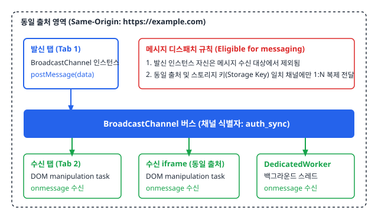
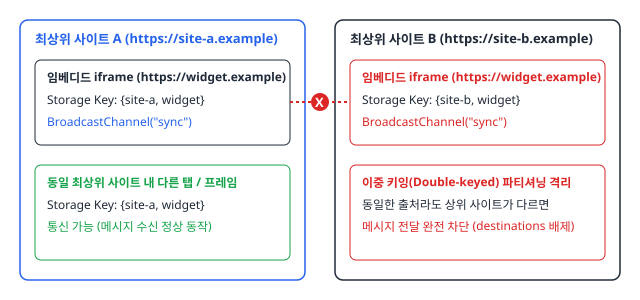
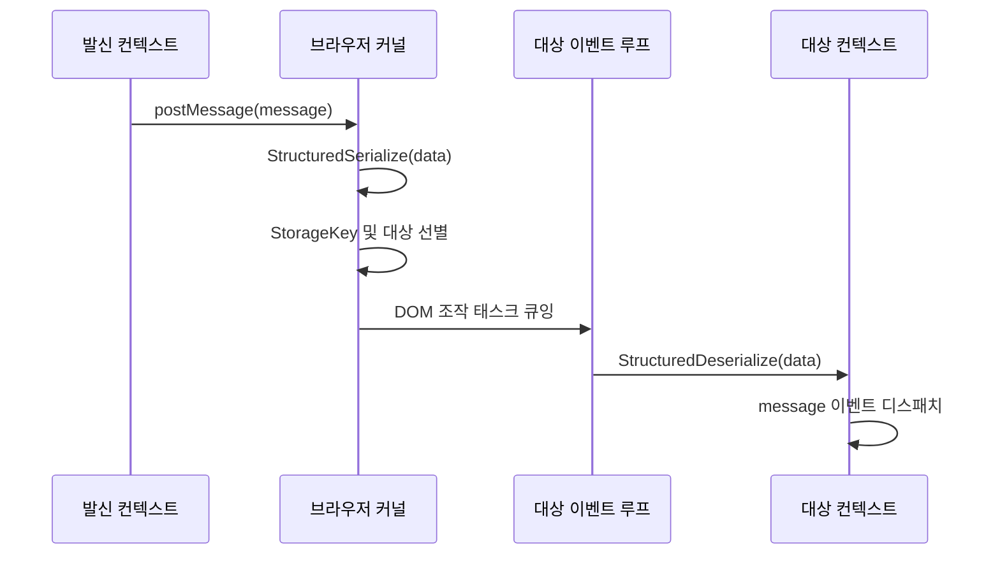

# 261104 BroadcastChannel API

> 한 줄 요약: 동일 출처 내 브라우징 맥락과 워커 간에 구조화된 복제 알고리즘으로 1:N 메시지를 전파하는 웹 표준 발행-구독 메시지 버스 인터페이스다 [1, 2]. · 분야: Web API · Baseline: Widely available · 읽는 시간 약 7분

## 1. 왜 쓰는가
과거 웹 브라우저 환경에서 동일 출처(same-origin) 내의 여러 탭, 창, 또는 워커 간에 실시간으로 상태를 동기화하려면 개발자는 표준화되지 않은 편법이나 제약이 큰 방식에 의존해야 했다 [2, 3].

가장 널리 쓰인 대안은 `localStorage`와 `storage` 이벤트를 조합하는 방식이었다 [2, 3]. 한 탭에서 `localStorage.setItem()`을 실행하면 다른 탭에서 `storage` 이벤트가 유발되는 특성을 메시지 버스처럼 악용했다 [3]. 그러나 `localStorage`는 동기식 디스크 I/O를 수반하므로 메인 스레드를 블로킹하여 화면 렌더링에 프레임 드롭(Jank)을 일으킨다 [3]. 또한 5MB라는 엄격한 스토리지 용량 한계가 존재하고, 모든 데이터가 문자열로 강제되어 `JSON.stringify`와 `JSON.parse`를 통한 직렬화 및 역직렬화 오버헤드가 발생했다. 더욱이 `localStorage`는 `DedicatedWorker`, `SharedWorker`, `ServiceWorker` 등 백그라운드 워커 스레드에서는 접근조차 불가능했다.

또 다른 대안이었던 `window.postMessage`는 서로 다른 창(WindowProxy) 간의 1:1 통신을 지원하지만, 메시지를 전달하려면 대상 창의 명시적인 참조자(예: `window.open`의 반환값 또는 `iframe.contentWindow`)를 반드시 보유하고 유지해야 했다. 사용자가 독립적으로 주소창에 URL을 입력하여 연 탭이나 북마크로 진입한 창들 사이에는 서로를 가리키는 참조자가 존재하지 않으므로, 불특정 다수의 탭을 대상으로 하는 1:N 브로드캐스팅이 구조적으로 불가능했다.

이러한 문제를 네트워크 계층(WebSocket 서버 또는 HTTP 롱 폴링)으로 우회하는 시도 역시 존재했으나, 동일 기기 내부의 로컬 탭 간 단순 상태 동기화를 위해 불필요한 네트워크 트래픽과 서버 리소스를 지속적으로 낭비하고 네트워크 지연 시간(latency)을 감수해야 하는 근본적 한계를 지녔다.

BroadcastChannel API는 이러한 배경에서 탄생했다 [1, 2]. 대상 창의 참조자를 관리하거나 복잡한 포트 핸드셰이크를 거칠 필요 없이, 오직 채널 이름(DOMString) 하나만으로 동일 출처 내의 모든 브라우징 맥락(탭, 윈도우, iframe)과 워커(DedicatedWorker, SharedWorker, ServiceWorker)를 즉각 연결하는 1:N 발행-구독(Pub/Sub) 메시지 버스를 웹 표준 차원에서 제공한다 [1, 2]. 구조화된 복제(Structured Clone) 알고리즘과 브라우저 이벤트 루프의 비동기 태스크 큐를 결합하여 메인 스레드 차단 없이 순수 클라이언트 로컬 메모리 상에서 안전하고 빠른 상태 동기화를 실현한다 [1]. 2022년 3월 Safari 15.4 지원을 기점으로 모든 주요 브라우저 엔진에서 완전 지원되어 Baseline Widely available을 달성했다 [4, 5].

## 2. 핵심 개념
BroadcastChannel API를 정확히 이해하고 다루기 위해서는 플랫폼 규격에 정의된 공간적 위상과 핵심 용어를 파악해야 한다 [1].





1. `BroadcastChannel`: 동일 출처와 채널 식별자 문자열을 공유하는 모든 브라우징 맥락 및 워커 렐름 간에 메시지를 주고받는 이벤트 타깃(EventTarget) 인터페이스다 [1, 2].
2. `동일 출처(Same-Origin)`: 프로토콜(Scheme), 호스트(Host), 포트(Port)가 완전히 일치하는 컨텍스트를 의미한다 [1]. BroadcastChannel은 이 경계를 벗어나는 크로스 오리진 통신을 허용하지 않는다 [1, 2].
3. `스토리지 키(Storage Key)`: 브라우저가 통신 스코프를 식별하기 위해 발신 환경의 설정 객체로부터 `obtain a storage key for non-storage purposes` 알고리즘을 거쳐 도출하는 키다 [1, 6]. 최신 브라우저의 스토리지 파티셔닝(Storage Partitioning) 규칙에 따라 최상위 사이트(Top-Level Site) 단위로 이중 키잉(Double-keyed) 분할된다 [6].
4. `대상 채널 목록(Destinations)`: 동일한 스토리지 키와 채널 이름을 공유하며, 현재 열려 있고 닫히지 않아 메시지 수신 자격(eligible for messaging)을 충족하는 활성 BroadcastChannel 인스턴스들의 집합이다 [1, 6].
5. `메시지 수신 자격(Eligible for messaging)`: 채널 인스턴스가 닫히지 않고 정상 등록되어 있어야 하며, 메시지를 전송한 발신 인스턴스 자신은 이 목록에서 자동으로 제외된다 [1, 3].
6. `구조화된 복제(Structured Clone)`: `StructuredSerialize` 및 `StructuredDeserialize` 알고리즘을 통해 자바스크립트 기본 객체, 배열, TypedArray, Blob, Date, RegExp 등을 원형 그대로 깊은 복사(Deep Copy)하는 메커니즘이다 [1].
7. `DOM 조작 작업 소스(DOM manipulation task source)`: 수신 채널이 속한 렐름의 이벤트 루프에서 메시지 전달 태스크를 스케줄링하는 공식 큐 소스다 [1].

## 3. 동작 원리
BroadcastChannel의 메시지 송수신 흐름은 WHATWG HTML Living Standard Section 9.5 규격에 엄격한 알고리즘 단계로 명시되어 있다 [1].



1. **메시지 발행 호출 및 직렬화**: 발신 컨텍스트에서 `BroadcastChannel.prototype.postMessage(message)`가 호출되면, 브라우저는 인자로 전달된 데이터를 즉시 내부 구조화된 복제 직렬화 알고리즘인 `StructuredSerialize(message)`를 통해 직렬화된 데이터 표현형으로 변환한다 [1]. 이 단계에서 소유권 이전 목록(transfer list)은 지원되지 않으므로 순수 복제만 진행된다 [1, 2].
2. **스토리지 키 도출 및 대상 선별**: 브라우저는 발신 환경의 설정 객체(environment settings object)를 참조하여 `obtain a storage key for non-storage purposes` 알고리즘을 통해 `sourceStorageKey`를 계산한다 [1, 6]. 이어 전역 채널 레지스트리에서 `sourceStorageKey`와 동일한 스토리지 키를 가지며, 채널 이름이 동일하고, 메시지 수신 자격(eligible for messaging)이 있는 활성 대상 채널 목록 `destinations`를 선별한다 [1, 6]. 이때 발신 채널 인스턴스 자신은 대상에서 제외된다 [1, 3].
3. **작업 소스 태스크 큐잉**: 선별된 각각의 대상 채널 인스턴스에 대해, 브라우저는 해당 인스턴스가 속한 렐름(Realm)의 이벤트 루프 내 `DOM 조작 작업 소스(DOM manipulation task source)`에 비동기 태스크를 큐잉한다 [1].
4. **역직렬화 및 이벤트 디스패치**: 각 대상 렐름의 이벤트 루프가 큐에서 해당 태스크를 인출하여 실행할 때, `StructuredDeserialize` 알고리즘을 실행하여 대상 렐름의 메모리 공간에 독립적인 깊은 복사본을 생성한다 [1]. 역직렬화가 성공하면 `MessageEvent` 인터페이스 기반의 신뢰할 수 있는(trusted) `message` 이벤트를 대상 `BroadcastChannel` 인스턴스로 디스패치한다 [1].
5. **에러 격리 메커니즘**: 페이로드의 역직렬화 과정에서 오류가 발생하더라도 전체 프로세스나 다른 수신 탭은 중단되지 않는다 [1]. 역직렬화에 실패한 특정 대상 채널 인스턴스에만 독립적으로 `messageerror` 이벤트가 디스패치된다 [1, 2].

## 4. 기본 사용법
BroadcastChannel 인스턴스를 생성하고, 메시지를 브로드캐스트하며, 수신 및 에러 처리를 수행한 후 자원을 정리하는 완전한 JavaScript 코드다 [1, 2].

```js
const channel = new BroadcastChannel('app_notifications');

channel.onmessage = (event) => {
  const messageData = event.data;
  console.log('수신된 메시지 타입:', messageData.type, messageData.payload);
};

channel.onmessageerror = (event) => {
  console.error('메시지 역직렬화 실패 오류 발생:', event);
};

channel.postMessage({
  type: 'NEW_NOTIFICATION',
  payload: { id: 101, text: '새로운 시스템 공지가 등록되었습니다.' }
});

channel.close();
```

- 1행: `const channel = new BroadcastChannel('app_notifications');` — 'app_notifications'라는 채널 식별자 문자열을 인자로 전달하여 새로운 BroadcastChannel 인스턴스를 생성한다 [1, 2]. 동일 출처 내에서 동일한 이름을 지정한 모든 컨텍스트가 이 채널을 공유한다 [1].
- 3행: `channel.onmessage = (event) => {` — 동일 채널의 다른 활성 컨텍스트에서 전송된 `message` 이벤트를 수신하는 이벤트 리스너 콜백을 등록한다 [1, 2].
- 4행: `const messageData = event.data;` — `MessageEvent` 객체의 `data` 프로퍼티로부터 수신 측 렐름에서 역직렬화(StructuredDeserialize)되어 복제된 순수 데이터 객체를 추출한다 [1].
- 5행: `console.log('수신된 메시지 타입:', messageData.type, messageData.payload);` — 추출된 메시지의 타입과 페이로드 값을 콘솔에 출력하여 수신 상태를 확인한다 [2].
- 6행: `};` — `onmessage` 이벤트 리스너 함수 정의를 종료한다.
- 8행: `channel.onmessageerror = (event) => {` — 페이로드 역직렬화 실패 시 개별 수신 채널 인스턴스로 전달되는 `messageerror` 이벤트를 감지하는 리스너를 등록한다 [1, 2].
- 9행: `console.error('메시지 역직렬화 실패 오류 발생:', event);` — 역직렬화 오류 발생 시 전체 실행 중단 대신 에러 이벤트를 콘솔에 기록하여 디버깅 정보를 남긴다 [1, 2].
- 10행: `};` — `onmessageerror` 이벤트 리스너 함수 정의를 종료한다.
- 12~15행: `channel.postMessage({ ... });` — 전달할 자바스크립트 객체를 인자로 넘겨 `postMessage`를 호출한다 [1, 2]. 브라우저는 이를 구조화된 복제(StructuredSerialize) 알고리즘으로 직렬화한 후 동일 채널의 다른 컨텍스트들로 비동기 브로드캐스트한다 [1]. 발신 인스턴스 자신은 수신하지 않는다 [1, 3].
- 17행: `channel.close();` — 인스턴스 사용이 완료된 후 명시적으로 채널을 닫아 브라우저 내부 채널 레지스트리 참조를 해제하고 가비지 컬렉션을 활성화하여 메모리 누수를 방지한다 [2, 3].

## 5. 실무 예시

### 실무 패턴 1: 멀티 탭 인증 상태(로그아웃) 동기화 및 bfcache 안전 패턴
- **상황**: 사용자가 여러 탭을 열어둔 상태에서 특정 탭에서 로그아웃을 수행했을 때, 다른 모든 탭에서도 즉시 세션을 제거하고 로그인 화면으로 전환해야 한다. 동시에 사용자가 다른 페이지로 이동하여 현재 탭이 bfcache(Back/Forward Cache)에 보관된 상태에서 다른 탭의 로그아웃 메시지를 수신하여 캐시가 강제 퇴출되는 문제를 방지해야 한다 [7].
- **코드**:
```js
class AuthSyncManager {
  #channel = null;
  #channelName = 'auth_state_sync';

  constructor() {
    this.#initChannel();
    this.#bindLifecycle();
  }

  #initChannel() {
    if (this.#channel) return;
    this.#channel = new BroadcastChannel(this.#channelName);
    this.#channel.onmessage = (event) => {
      const { type, payload } = event.data;
      if (type === 'USER_LOGOUT') {
        console.warn('다른 탭에서 로그아웃되었습니다. UI를 초기화하고 로그인 페이지로 전환합니다.');
        this.#handleLogout(payload.redirectUrl);
      }
    };
  }

  broadcastLogout(redirectUrl = '/login') {
    if (!this.#channel) return;
    this.#channel.postMessage({
      type: 'USER_LOGOUT',
      payload: { redirectUrl, timestamp: Date.now() }
    });
  }

  #handleLogout(redirectUrl) {
    sessionStorage.clear();
    window.location.replace(redirectUrl);
  }

  #bindLifecycle() {
    // bfcache 퇴출(broadcastchannel-message) 방지를 위해 페이지 이탈 시 채널을 닫고, 복원 시 재연결
    window.addEventListener('pagehide', () => {
      if (this.#channel) {
        this.#channel.close();
        this.#channel = null;
      }
    });

    window.addEventListener('pageshow', (event) => {
      if (event.persisted) {
        this.#initChannel();
      }
    });
  }
}
```
- **주의점**: 페이지가 bfcache에 동결(frozen)되어 있을 때 열려 있는 채널로 메시지가 유입되면 브라우저는 상태 불일치를 막기 위해 `broadcastchannel-message` 사유로 해당 페이지를 캐시에서 즉시 폐기한다 [7]. 따라서 반드시 `pagehide`에서 `close()`를 호출하고 `pageshow`의 `event.persisted` 플래그를 확인하여 재초기화해야 한다 [7]. 또한 발신 탭 자신은 `onmessage`를 받지 않으므로 `broadcastLogout` 호출 측에서도 로컬 세션 정리와 리다이렉트를 별도로 실행해야 한다 [1, 3].

### 실무 패턴 2: Web Locks API + BroadcastChannel 결합 리더 선출 및 단일 갱신 전파
- **상황**: 다수의 탭이 열려 있을 때 각 탭이 제각각 인증 토큰 갱신 API를 호출하면 중복 요청으로 인해 서버 부하가 가중되고 레이스 컨디션이 발생한다. 여러 탭 중 오직 하나의 탭만 리더(Leader)로 선출되어 토큰을 갱신하고, 결과를 다른 모든 탭에 브로드캐스트해야 한다.
- **코드**:
```js
const syncChannel = new BroadcastChannel('data_sync_channel');

syncChannel.onmessage = (event) => {
  if (event.data.type === 'TOKEN_REFRESHED') {
    console.log('리더 탭으로부터 새 액세스 토큰을 수신하여 갱신합니다:', event.data.accessToken);
    window.__currentAccessToken = event.data.accessToken;
  }
};

async function scheduleTokenRefresh() {
  // Web Locks API를 사용해 여러 탭 중 오직 하나의 탭만 갱신 작업을 수행하도록 리더 선출
  await navigator.locks.request('token_refresh_leader', async () => {
    console.log('이 탭이 리더로 선출되었습니다. 단독으로 토큰 갱신 API를 호출합니다.');
    const response = await fetch('/api/refresh', { method: 'POST' });
    const { accessToken } = await response.json();
    
    window.__currentAccessToken = accessToken;

    // 갱신된 결과를 다른 모든 탭으로 즉각 브로드캐스트
    syncChannel.postMessage({
      type: 'TOKEN_REFRESHED',
      accessToken,
      refreshedAt: Date.now()
    });

    // 갱신 주기 대기 (리더 락 유지)
    await new Promise((resolve) => setTimeout(resolve, 15 * 60 * 1000));
  });
}
```
- **주의점**: BroadcastChannel 자체에는 동시성 제어(Mutual Exclusion) 기능이 없다. 리더 선출은 반드시 상호 배제 락을 보장하는 Web Locks API(`navigator.locks.request`)에 위임해야 한다. 리더 탭이 닫히면 브라우저가 자동으로 대기 중이던 다음 탭에 락을 인계하므로 시스템의 연속성이 유지된다.

### 실무 패턴 3: Dedicated Worker에서 메인 스레드 멀티 탭으로의 진행률 브로드캐스팅
- **상황**: 백그라운드 Dedicated Worker에서 대용량 데이터 연산이나 무거운 처리를 수행할 때, 연산 진행 상황을 특정 단일 창에 국한하지 않고 사용자가 열어둔 동일 출처의 모든 UI 탭에 실시간 브로드캐스트하여 동기화된 진행률을 표시해야 한다.
- **코드**:
```js
// [worker.js]
const workerBroadcast = new BroadcastChannel('heavy_task_channel');

self.onmessage = (e) => {
  if (e.data.action === 'START_PROCESSING') {
    for (let progress = 0; progress <= 100; progress += 25) {
      // 복잡한 연산 시뮬레이션
      workerBroadcast.postMessage({
        taskId: e.data.taskId,
        status: progress === 100 ? 'COMPLETED' : 'IN_PROGRESS',
        progress
      });
    }
  }
};

// [main.js (UI 탭 어느 곳에서나 수신)]
const progressChannel = new BroadcastChannel('heavy_task_channel');
progressChannel.onmessage = (event) => {
  const { taskId, status, progress } = event.data;
  const progressBar = document.getElementById(`task-${taskId}`);
  if (progressBar) {
    progressBar.value = progress;
  }
  if (status === 'COMPLETED') {
    console.log(`태스크 ${taskId} 처리 완료 (모든 탭에서 확인)`);
  }
};
```
- **주의점**: 워커에서 과도하게 짧은 주기로 `postMessage`를 연속 호출하면 각 탭의 이벤트 루프 내 DOM 조작 작업 소스에 수많은 태스크가 밀려들어 UI 렌더링 프레임이 저하될 수 있으므로 전송 주기 스로틀링(throttling)이 필요하다 [1]. 또한 모든 탭에 해당 진행률 표시 DOM 요소가 존재하지 않을 수 있으므로 요소 존재 여부를 반드시 방어적으로 확인해야 한다.

## 6. 장점 · 단점

| 장점 | 단점 |
| :--- | :--- |
| **간결한 1:N 펍섭 아키텍처**: 특정 윈도우 객체나 포트 참조를 관리할 필요 없이 채널 이름 문자열 하나로 동일 출처의 모든 브라우징 맥락과 워커를 즉각 연결한다 [1, 2]. | **휘발성(Fire-and-forget) 메시징**: 메시지 전송 시점에 열려 있지 않은 탭이나 슬립 상태의 컨텍스트는 메시지를 유실하며, 브라우저 차원의 메시지 큐잉이나 이력 저장이 없다. |
| **구조화된 복제(Structured Clone) 지원**: `localStorage`와 달리 JSON 직렬화/역직렬화 과정 없이 자바스크립트 객체, TypedArray, Blob, Date 등을 원형 그대로 고속 복제 전송한다 [1]. | **수신 확인(ACK) 부재**: 단방향 발행 구조이므로 특정 탭이 메시지를 수신하여 처리했는지 확인하려면 애플리케이션 레벨에서 메시지 식별자와 응답 채널 프로토콜을 구현해야 한다. |
| **메인 스레드 비차단 비동기 처리**: 동기식 디스크 I/O 없이 브라우저 이벤트 루프의 DOM 조작 태스크 소스를 통해 비동기로 처리되어 UI 렌더링 프레임 드롭을 방지한다 [1]. | **소유권 이전(Transferable Objects) 미지원**: `postMessage`에 `transfer list` 인자가 없어 ArrayBuffer나 ImageBitmap의 소유권을 이전할 수 없으며 대용량 바이너리 전송 시 복제 오버헤드가 발생한다 [1, 2]. |
| **워커(Web Workers) 환경 완벽 지원**: `localStorage`에 접근할 수 없는 DedicatedWorker, SharedWorker, ServiceWorker에서도 UI 스레드와 동일한 채널명으로 직접 통신할 수 있다. | **크로스 오리진(Cross-Origin) 통신 불가**: 출처(Origin)가 완전히 일치해야만 통신할 수 있어 서로 다른 서브도메인 간 통신에는 `window.postMessage`를 우회 사용해야 한다 [1, 2]. |
| **서버 부하 없는 순수 클라이언트 로컬 통신**: 동일 기기 내부의 데이터 교환을 위해 WebSocket이나 HTTP 폴링 같은 불필요한 네트워크 트래픽과 서버 리소스를 전혀 소모하지 않는다. | **메시지 루프(Ping-Pong) 위험**: 수신 탭이 상태 변경에 반응하여 다시 같은 채널로 재발행하는 순환 구조를 방치할 경우 브라우저 CPU 사용량이 100%까지 치솟을 수 있다. |

## 7. 한계와 함정
BroadcastChannel을 프로덕션 환경에 배포할 때 맞닥뜨리는 경계 사례, 성능, 접근성, 보안, 개인정보 관점의 한계는 다음과 같다 [1, 6, 7].

1. **경계 사례 (Edge Cases)**:
   - **휘발성 메시지 유실**: 메시지 발행 시점에 브라우징 맥락이 활성화되어 있지 않거나 디바이스 슬립 모드에 들어간 탭은 전송된 메시지를 영구히 받지 못한다. 브라우저 내부에는 수신 대기 큐나 재시도 메커니즘이 존재하지 않는다.
   - **무한 메시지 폭풍(Message Storm)**: 탭 A가 메시지를 수신하여 로컬 스토어의 상태를 변경하고, 이 스토어의 변경 리스너가 다시 BroadcastChannel로 메시지를 재발행하는 순환 구조가 형성되면, 열려 있는 모든 탭이 서로에게 메시지를 무한히 반사하며 핑퐁 루프가 발생하여 탭 전체의 CPU 사용량이 100%에 도달한다.

2. **성능 (Performance)**:
   - **메모리 누수와 GC 차단**: SPA(Single Page Application) 환경에서 컴포넌트 마운트 시 `new BroadcastChannel()`을 실행하고 언마운트 시 `channel.close()` 호출을 누락하면, 브라우저 내부 전역 채널 디스패처에 활성 리스너 클로저가 고착되어 가비지 컬렉션(GC)이 차단되고 메모리 누수가 누적된다 [2, 3].
   - **대용량 바이너리 복제 오버헤드**: BroadcastChannel은 1:N 구조적 특성상 단일 소유권 이전을 전제로 하는 전송 가능 객체(Transferable Objects)를 지원하지 않는다 [1]. 수 메가바이트 이상의 `ArrayBuffer`를 전송할 경우 수신 탭 수(N)만큼 메모리 복제가 반복 실행되어 심각한 메모리 사용량 증가와 가비지 컬렉터 부하를 초래한다 [1].

3. **접근성 (Accessibility)**:
   - BroadcastChannel은 시각적 표현이나 DOM 노드를 갖지 않는 순수 백그라운드 데이터 버스이므로 웹 접근성 트리(Accessibility Tree)를 직접 구성하지 않는다 [1, 2].
   - 그러나 이 API를 통해 수신된 데이터로 UI가 갱신될 때(예: 실무 예시 1의 로그아웃 리다이렉트 알림, 실무 예시 3의 진행률 바 수치 변경), 각 수신 탭의 DOM 소비 코드는 변경 사항을 스크린 리더가 인지할 수 있도록 `aria-valuenow` 속성을 갱신하거나 라이브 리전(Live Region)에 공지하는 처리를 별도로 보장해야 한다 [2, 3].

4. **보안 (Security)**:
   - 동일 출처 정책(Same-Origin Policy)이 엄격히 적용되므로 출처가 다른 도메인이나 프로토콜이 다른 환경과는 직접 통신할 수 없다 [1, 2].
   - 반면 동일 출처 내부에서는 모든 스크립트가 임의의 채널 이름을 알면 즉시 채널을 열어 메시지를 도청(sniffing)하거나 위조된 메시지를 주입(spoofing)할 수 있다 [1, 2]. 따라서 사용자 마스터 패스워드나 원시 비밀 키와 같은 민감한 자격 증명을 평문 그대로 채널에 브로드캐스트해서는 안 된다.

5. **개인정보 (Privacy)**:
   - 최신 브라우저(Chrome 115+, Safari, Firefox)의 서드파티 스토리지 파티셔닝(Storage Partitioning) 메커니즘에 따라, 통신 스코프는 최상위 사이트(Top-Level Site) 단위로 이중 키잉(Double-keyed) 분할된다 [6].
   - 서로 다른 상위 사이트(예: site-a.example과 site-b.example)에 임베드된 동일 출처 iframe(widget.example) 간에는 스토리지 키가 서로 다르게 계산되므로 BroadcastChannel 메시지가 완전히 차단된다 [6].

## 8. 다른 방법과 비교

| 방법 | 언제 | 비용 | 한계 |
| :--- | :--- | :--- | :--- |
| **BroadcastChannel** | 동일 출처 내의 불특정 다수 탭·워커 간 1:N 실시간 메시지 브로드캐스팅이 필요할 때 [1, 2] | 낮음 (비동기 구조화된 복제, 브라우저 내부 버스) [1] | 1:N 복제 오버헤드로 인한 Transferable 미지원, 휘발성, 크로스 오리진 불가 [1] |
| **localStorage + storage 이벤트** | 구형 레거시 브라우저 지원 또는 브로드캐스트와 동시에 영속적 디스크 저장이 필요할 때 [2, 3] | 높음 (동기식 디스크 I/O로 인한 메인 스레드 블로킹, 문자열 직렬화 비용) | 5MB 용량 한계, Web Worker 접근 불가, 데이터 덮어쓰기 레이스 컨디션 |
| **SharedWorker** | 동일 출처 탭 간 중앙 집중식 상태 관리 및 단일 WebSocket 커넥션 풀링(Connection Pooling)이 필요할 때 | 중간 (단일 백그라운드 스레드 유지 및 포트 관리 오버헤드) | 모바일 브라우저 환경 지원 제약, 인스턴스 생명주기 및 초기화 복잡도 높음 |
| **window.postMessage** | 서로 다른 출처(Cross-Origin) 간 통신 또는 명확한 1:1 창(부모-자식 창, iframe) 통신이 필요할 때 | 낮음 (비동기 직렬화 및 전송) | 대상 창의 명시적 참조자(WindowProxy)가 필수적이어서 1:N 브로드캐스트 불가능 |
| **MessageChannel** | 두 독립적인 실행 컨텍스트 간에 격리된 전용 1:1 양방향 포트 통신 및 Transferable 전송이 필요할 때 | 매우 낮음 (격리된 포트 간 직접 전달) | 1:N 멀티캐스트 불가, 통신 전 사전 포트 교환(핸드셰이크) 과정 필수 |
| **Web Locks API** | 여러 탭 간에 공유 자원 접근을 제어하고 단일 리더(Leader) 탭을 선출해야 할 때 | 매우 낮음 (브라우저 커널 수준의 락 스케줄러) | 메시지 페이로드 전달 기능이 전무하며 오직 상호 배제(Mutex) 조율만 담당 |

### 이것을 고르지 않는 경우
1. **크로스 오리진(Cross-Origin) 통신이 요구될 때**: 서브도메인이 다르거나 외부 서드파티 도메인과 통신해야 하는 아키텍처에서는 BroadcastChannel을 사용할 수 없으며 `window.postMessage`를 채택해야 한다 [1, 2].
2. **대용량 바이너리의 제로 카피(Zero-copy) 소유권 이전이 필수적일 때**: 수십~수백 메가바이트의 `ArrayBuffer`를 복제 비용 없이 넘겨야 한다면 Transferable 객체를 지원하는 `MessageChannel`이나 `Worker.postMessage`를 사용해야 한다 [1].
3. **단일 WebSocket 연결을 여러 탭이 공유해야 할 때**: 네트워크 소켓을 하나만 유지하며 탭들의 요청을 중앙 집중식으로 멀티플렉싱하려면 백그라운드 인스턴스를 유지하는 `SharedWorker`를 선택해야 한다.
4. **과거 메시지 이력 보존과 오프라인 재생이 필요할 때**: BroadcastChannel은 즉시 수신하지 못한 메시지를 폐기하므로, 이벤트 소싱이나 상태 복원이 필요한 시스템은 `IndexedDB` 등의 영속 저장소를 결합해야 한다.
5. **단순 상호 배제(동시성 제어)가 목적일 때**: 여러 탭이 동시에 DB를 수정하거나 API를 중복 호출하지 못하도록 통제하는 목적이라면 메시지 버스가 아닌 `Web Locks API`를 단독 또는 결합 사용해야 한다.

## 9. 대비와 새로운 시도
BroadcastChannel API의 구조적 한계를 보완하기 위한 최신 웹 표준 및 실무 아키텍처의 진전 사항은 다음과 같다.

1. **Storage Access API(SAA) 및 통신 채널 파티셔닝 보완**: 서드파티 스토리지 파티셔닝으로 인해 서로 다른 최상위 사이트에 임베드된 동일 출처 iframe 간 BroadcastChannel 통신이 차단되는 문제를 완화하기 위해, W3C Privacy CG를 중심으로 표준화가 논의되고 있다 [6]. 사용자의 명시적 권한 승인하에 `document.requestStorageAccess({all: true})`를 호출하여 격리 해제된 스토리지 키와 브로드캐스트 통신 채널을 획득하는 방안이 제안되었다.
2. **Web Locks API 결합 표준 아키텍처의 정립**: BroadcastChannel의 리더 부재 문제를 해결하기 위해, 탭 간 상호 배제 락을 제공하는 Web Locks API로 단일 리더 탭을 선출하여 백그라운드 데이터 갱신을 독점 수행하고, 갱신 결과를 BroadcastChannel로 전파하는 패턴이 웹 플랫폼 실무 아키텍처로 완전히 정립되었다.
3. **NotRestoredReasons API를 통한 bfcache 퇴출 계측**: 크롬 125+ 및 Navigation Timing 표준 규격에 따라 `performance.getEntriesByType('navigation')[0].notRestoredReasons` API가 제공된다 [7]. 이를 활용하면 프로덕션 RUM(Real User Monitoring) 환경에서 페이지가 `broadcastchannel-message` 사유로 bfcache에서 퇴출되었는지 여부를 원격 분석 시스템으로 정밀 추적하고 회귀를 방지할 수 있다 [7].
4. **WHATWG GitHub Issue #7088을 통한 Transferable 미지원 표준 규정**: BroadcastChannel의 1:N 멀티캐스트 모델과 Transferable 객체의 단일 소유권 이전 메커니즘 간의 모순을 공식 표준 논의로 확인하였다. 대용량 버퍼 공유 시 메모리 복제 오버헤드를 회피하려면 `Web Locks API`와 `SharedArrayBuffer`를 결합하거나 `SharedWorker`를 사용하도록 공식 가이드라인이 명문화되었다.

## 10. 다른 사람에게 설명하기

### 세 문장 요약
1. BroadcastChannel API는 동일 출처 내의 서로 다른 탭, 윈도우, iframe 및 Web Worker 간에 대상 창의 참조자 없이 채널 이름 문자열 하나로 1:N 메시지를 전파하는 웹 표준 발행-구독 메시지 버스다 [1, 2].
2. 구조화된 복제(Structured Clone) 알고리즘과 브라우저 이벤트 루프의 비동기 태스크 큐를 기반으로 동작하여 동기식 I/O 블로킹이나 문자열 파싱 오버헤드 없이 순수 로컬 클라이언트 메모리 상에서 안전하게 동작한다 [1].
3. 다만 수신처가 없으면 메시지가 유실되는 휘발성 특성, 소유권 이전(Transferable) 미지원, bfcache 퇴출 함정, 서드파티 스토리지 파티셔닝에 따른 통신 격리 한계를 고려하여 명시적인 생명주기 제어 및 보완 API와의 결합이 요구된다 [1, 6, 7].

### 스스로 확인할 질문 3개
1. BroadcastChannel의 `postMessage`는 왜 `window.postMessage`나 `Worker.postMessage`와 달리 `transfer list`(소유권 이전) 인자를 지원하지 않도록 스펙이 설계되었는가?
2. 페이지가 bfcache에 동결 보관된 상태에서 다른 탭으로부터 BroadcastChannel 메시지가 유입될 때 브라우저는 어떤 메커니즘으로 반응하며, 이를 방지하기 위한 생명주기 코드는 어떻게 작성해야 하는가?
3. 최신 브라우저의 서드파티 스토리지 파티셔닝(Storage Partitioning) 환경에서 서로 다른 최상위 사이트에 삽입된 동일 출처 iframe 간의 BroadcastChannel 통신이 전면 차단되는 구조적 원인은 무엇인가?

## 참고 자료
1. [WHATWG HTML Standard - Section 9.5 Broadcasting to other browsing contexts](https://html.spec.whatwg.org/multipage/web-messaging.html#broadcasting-to-other-browsing-contexts)
2. [MDN Web Docs - BroadcastChannel API](https://developer.mozilla.org/en-US/docs/Web/API/BroadcastChannel)
3. [Chrome for Developers - BroadcastChannel API: A Web Bus for the Same Origin](https://developer.chrome.com/blog/broadcastchannel/)
4. [WebKit - WebKit Features in Safari 15.4](https://webkit.org/blog/12445/new-webkit-features-in-safari-15-4/)
5. [Can I Use - BroadcastChannel](https://caniuse.com/broadcastchannel)
6. [Chrome for Developers - Storage Partitioning](https://developer.chrome.com/docs/web-platform/storage-partitioning)
7. [web.dev - Back/forward cache (bfcache)](https://web.dev/articles/bfcache)
조사: 2026-11-04

## 내 리뷰
(읽고 느낀 점 · 궁금한 것을 적는다. 질문은 Q. 로 시작)
