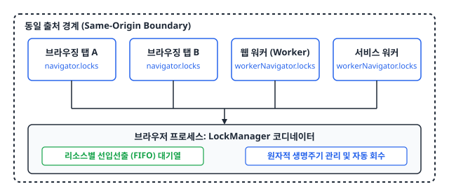
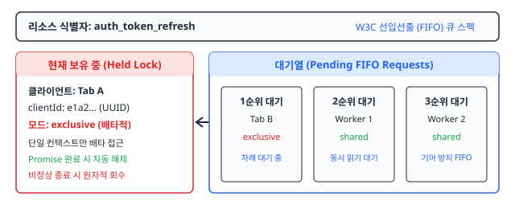

# 261105 Web Locks API

> 한 줄 요약: Web Locks API는 동일 출처(Same-Origin) 내의 여러 탭, 창, iframe, Worker 간 공유 리소스 접근을 선입선출(FIFO) 큐 기반으로 동기화하고 상호 배타적 실행을 보장하는 웹 플랫폼 표준 동시성 기본요소다 [1] [2]. · 분야: 비동기 · 동시성 · Baseline: Widely available (2022년 3월 Safari 15.4 지원 기준) [4] [5] · 읽는 시간 약 6분

## 1. 왜 쓰는가
웹 애플리케이션이 복수의 브라우징 탭, 윈도우, iframe, Worker 환경에서 동시에 구동될 때, 동일 출처(Same-Origin) 내의 공유 자원(IndexedDB, CacheStorage, Origin Private File System 등)에 대한 안전한 상호 배타적 접근 제어가 필수적이다 [1] [2]. 동일한 데이터 스토어에 여러 실행 컨텍스트가 동시에 쓰기 작업을 수행하거나 네트워크 요청을 중복 발생시키면 데이터 정합성 파괴와 리소스 낭비가 발생한다.

Web Locks API가 표준화되기 전에는 이러한 동시성 제어를 위해 여러 우회 기법이 사용되었으나 각각 구조적 한계를 지니고 있었다 [1] [7]:
1. localStorage와 storage 이벤트 폴링: 탭 간 키 값을 변경하고 storage 이벤트를 감지하여 락을 흉내 내는 방식이다. 이벤트 전달 시차로 인한 레이스 컨디션이 빈번하게 발생하며, 락을 보유한 탭이 충돌하거나 강제 종료되면 락 플래그가 지워지지 않아 영구 데드락(Deadlock)에 빠지는 결함이 존재했다 [1] [7]. 또한 동기식 I/O 특성상 Web Worker 및 Service Worker 환경에서는 접근할 수 없었다.
2. BroadcastChannel 기반 리더 선출: 탭 간 메시지를 교환하며 Bully 또는 Raft 유사 합의 알고리즘으로 단일 코디네이터를 선출하는 방식이다. 브라우저 이벤트 루프 지연이나 백그라운드 탭 스로틀링(Throttling) 발생 시 하트비트 누락으로 복수의 리더가 동시에 존재하는 스플릿 브레인(Split-brain) 현상이 발생하기 쉬웠고, 구현 복잡도가 매우 높았다.
3. SharedWorker 중앙 상태 조정: 단일 인스턴스를 공유하는 SharedWorker 메모리 큐로 작업을 제어하는 방식이다. 그러나 Android Chrome 등 모바일 브라우저 환경에서 지원 제약이 존재하고, Service Worker 내부에서 연결할 수 없다는 한계가 있었다.
4. IndexedDB 네이티브 트랜잭션: readwrite 트랜잭션을 통해 동일 오브젝트 스토어 접근을 직렬화할 수 있으나, IndexedDB 내부 데이터 저장 작업에 한정된다. OAuth 리프레시 토큰 교환, 서버 WebSocket 연결, OPFS 파일 조작과 같은 범용 비동기 작업은 트랜잭션 범위로 보호할 수 없었다.

Web Locks API는 브라우저 프로세스 수준에서 리소스 큐와 락 생명주기를 직접 관리함으로써, 비정상적인 탭 종료 시에도 원자적으로 락을 회수하여 영구 데드락을 원천 차단하고 모든 실행 컨텍스트를 아우르는 단일 동시성 표준을 제공하기 위해 제정되었다 [1] [2].

## 2. 핵심 개념


Web Locks API를 구성하는 핵심 인터페이스 및 개념은 다음과 같다:

1. LockManager 인터페이스
전역 객체인 Window의 `navigator.locks` 및 Worker 글로벌 스코프의 `workerNavigator.locks` 속성을 통해 브라우저가 제공하는 `LockManager` 인스턴스에 접근한다 [2] [3]. 이를 통해 Window, Worker, Service Worker 등 컨텍스트 종류와 무관하게 동일한 동시성 제어 메서드를 호출할 수 있다 [2].

2. 리소스 식별자(Resource Name)
조율하려는 대상을 식별하는 문자열이다. 동일 출처 내에서 리소스 이름 단위로 독립된 락 큐가 생성된다 [1] [3]. W3C 스펙상 '-' (U+002D 하이픈) 문자로 시작하는 리소스 이름은 브라우저 내부 및 향후 표준 확장용으로 예약되어 있어, 하이픈 접두사를 사용해 요청할 경우 즉시 예외가 발생한다 [1].



3. 락 모드(Lock Mode)
요청 시 지정할 수 있는 동시성 모드로 두 가지가 존재한다 [1] [2]:
- exclusive(배타적 모드, 기본값): 단 하나의 실행 컨텍스트만 락을 보유할 수 있다. 동일 리소스에 대한 모든 후속 요청은 대기 상태로 전환된다 [1] [2].
- shared(공유 모드): 여러 실행 컨텍스트가 동시에 락을 획득하여 병렬로 읽기 작업을 수행할 수 있다. 단, shared 락이 활성화된 상태에서는 exclusive 락 요청이 승인되지 않으며 대기 큐에서 대기한다 [1] [2].

4. 리소스 선입선출 큐(Resource FIFO Queue)
동일 리소스에 대한 요청은 브라우저 엔진의 리소스 큐에 등록되며 엄격한 선입선출(FIFO) 순서로 처리된다 [1]. 큐의 최우선 순위 요청이 승인될 수 있을 때까지 후속 요청들을 대기시켜 기아(Starvation) 현상을 원천 방지한다 [1].

5. 클라이언트 식별자(clientId)
각 브라우징 컨텍스트나 워커를 식별하기 위해 브라우저가 부여하는 UUID 형식의 식별자다 [1] [2]. `navigator.locks.query()`를 통해 현재 락을 점유 중인 컨텍스트와 대기 중인 컨텍스트의 clientId를 확인할 수 있다 [1] [2].

## 3. 동작 원리
Web Locks API의 실행 수명주기는 콜백 함수가 반환하는 Promise의 상태에 직접 결합되어 동작한다 [1] [3]. 개발자가 `navigator.locks.request(name, [options], callback)`를 호출하면 다음과 같은 순서로 브라우저 엔진 내부에서 처리가 진행된다:

1. 요청 등록 및 큐 삽입: 브라우저 프로세스 레벨의 락 매니저가 지정된 리소스 큐에 요청을 등록한다 [1] [3].
2. 스케줄링 및 락 승인: 선행 락이 모두 해제되고 큐의 최우선 순위에 도달하면, 브라우저가 해당 컨텍스트에 락을 부여하고 비동기 콜백 함수를 실행한다 [1] [3].
3. 작업 수행 및 원자적 해제: 콜백 함수 내부의 비동기 작업이 수행되며, 콜백이 반환한 Promise가 resolve되거나 reject되는 순간 브라우저 엔진이 원자적으로 락을 해제한다 [1] [3]. 락이 해제되면 큐의 다음 요청이 즉시 스케줄링된다.
4. 비정상 종료 시 자동 정리: 락을 보유한 탭이 예기치 않게 종료되거나 사용자가 창을 닫거나 다른 페이지로 탐색(Navigation)하면, 브라우저의 문서 언로드 정리 단계에서 보유 중인 락과 대기 큐의 요청이 즉시 회수 및 중단된다 [1].

```diagram
종류: 시퀀스

[Tab A]
[Tab B]
[LockManager]
[Shared Resource]

Tab A -> LockManager : request auth_lock
LockManager -> LockManager : Register in FIFO Queue
LockManager --> Tab A : Grant Lock and Invoke Callback
Tab A -> Shared Resource : Read and Write Data
Tab B -> LockManager : request auth_lock
LockManager -> LockManager : Wait in FIFO Queue
Tab A --> LockManager : Promise Resolved
LockManager -> LockManager : Release Lock
LockManager --> Tab B : Grant Lock and Invoke Callback
Tab B -> Shared Resource : Read and Write Data
Tab B --> LockManager : Promise Resolved
LockManager -> LockManager : Release Lock
```

옵션 플래그에 따른 특수 동작 원리는 다음과 같다:
- ifAvailable: `{ ifAvailable: true }`를 지정하면 큐에서 대기하지 않는다 [1] [3]. 즉시 락을 획득할 수 없는 경우 콜백에 null을 전달하며 호출 즉시 락 요청이 종료된다 [1] [3].
- steal: `{ steal: true }`를 지정하면 현재 동일 리소스 락을 보유 중인 활성 컨텍스트로부터 락을 강제로 회수해 새 요청에 즉각 부여한다 [1] [3]. 기존 보유자의 비동기 콜백은 AbortError(DOMException)와 함께 reject된다 [1] [3].
- signal: `{ signal: AbortSignal }`을 전달하면 대기 큐에 머무는 동안 취소 이벤트나 타임아웃 신호에 반응하여 대기를 안전하게 중단하고 요청을 취소한다 [1] [3].

또한 `navigator.locks.query()`를 호출하면 현재 출처 내에서 활성화된 락(held)과 대기 중인 요청(pending)의 리소스 이름, 모드, clientId 스냅샷을 실시간으로 조회하여 동시성 상태를 진단할 수 있다 [1] [2].

## 4. 기본 사용법
다음 코드는 `navigator.locks.request`를 사용하여 공유 카운터 리소스에 배타적으로 접근하고 안전하게 값을 갱신하는 기본 예제다.

```js
async function runExclusiveTask() {
  const result = await navigator.locks.request('storage_sync_lock', async (lock) => {
    console.log(`Lock acquired: ${lock.name}, mode: ${lock.mode}`);
    const rawData = localStorage.getItem('sync_counter') || '0';
    const nextCount = Number(rawData) + 1;
    localStorage.setItem('sync_counter', String(nextCount));
    return nextCount;
  });
  return result;
}
```

코드의 줄별 동작 설명은 다음과 같다:
- 1줄: `async function runExclusiveTask() {` - 동시성 제어가 적용된 비동기 함수를 선언한다.
- 2줄: `const result = await navigator.locks.request('storage_sync_lock', async (lock) => {` - 리소스 이름 `storage_sync_lock`에 대해 배타적 락을 요청하고, 브라우저 엔진이 락을 승인할 때까지 대기한 후 실행할 비동기 콜백을 등록한다 [1] [3].
- 3줄: `console.log(\`Lock acquired: ${lock.name}, mode: ${lock.mode}\`);` - 콜백 매개변수로 전달된 `Lock` 객체로부터 승인된 리소스 이름과 기본값인 `exclusive` 모드를 확인한다 [2] [3].
- 4줄: `const rawData = localStorage.getItem('sync_counter') || '0';` - 배타적 락을 점유한 안전한 상태에서 `localStorage`의 기존 카운터 데이터를 조회한다.
- 5줄: `const nextCount = Number(rawData) + 1;` - 조회된 카운터 수치를 1 증가시키는 연산을 수행한다.
- 6줄: `localStorage.setItem('sync_counter', String(nextCount));` - 갱신된 수치를 저장소에 원자적으로 기록하여 다른 탭의 레이스 컨디션을 방지한다.
- 7줄: `return nextCount;` - 증가된 값을 반환한다. 이 시점에 콜백이 반환한 Promise가 resolve되며 브라우저 엔진에 의해 락이 원자적으로 해제된다 [1] [3].
- 8줄: `});` - `navigator.locks.request` 호출을 완료하고 콜백의 반환값을 `result` 변수에 대입한다.
- 9줄: `return result;` - 락 작업이 완전히 완료된 최종 결괏값을 호출자에게 반환한다.
- 10줄: `}` - 함수의 실행 스코프를 마친다.

## 5. 실무 예시
### 사례 1: 멀티 탭 OAuth Access Token 중복 갱신 방지
- 상황: 복수의 탭이 동시에 열려 있을 때 토큰 만료를 여러 탭이 동시에 감지하더라도 단 1개의 탭만 인증 서버로 리프레시 요청을 전송하고, 나머지 탭은 갱신된 토큰을 즉시 재사용해야 한다.
- 코드:
```js
async function getValidAccessToken() {
  return await navigator.locks.request('auth_token_refresh', async () => {
    let token = localStorage.getItem('access_token');
    const expiresAt = Number(localStorage.getItem('token_expires_at') || '0');

    if (Date.now() < expiresAt && token) {
      return token;
    }

    const response = await fetch('/api/auth/refresh', { method: 'POST' });
    const data = await response.json();
    localStorage.setItem('access_token', data.token);
    localStorage.setItem('token_expires_at', String(Date.now() + data.expiresIn * 1000));
    return data.token;
  });
}
```
- 주의점: 락을 획득한 직후 반드시 최신 만료 시각을 재확인하는 이중 검사(Double-checked locking)를 수행해야 한다. 큐에서 대기하던 후속 탭이 선행 탭에서 이미 갱신한 결과를 인식하지 못하고 불필요한 네트워크 요청을 중복 전송하는 문제를 방지하기 위함이다.

### 사례 2: 멀티 탭 환경에서 단일 WebSocket 연결 리더 선출
- 상황: 여러 탭이 열려 있어도 단 1개 탭만 서버와 상시 WebSocket 연결을 유지하고, 수신된 실시간 데이터를 BroadcastChannel을 통해 모든 탭으로 중계해야 한다.
- 코드:
```js
async function startSingletonWebSocket() {
  await navigator.locks.request('socket_leader', async () => {
    const socket = new WebSocket('wss://example.com/live-stream');
    const channel = new BroadcastChannel('socket_data_channel');

    socket.onmessage = (event) => {
      channel.postMessage(event.data);
    };

    await new Promise((resolve) => {
      socket.onclose = () => {
        channel.close();
        resolve();
      };
      window.addEventListener('beforeunload', () => {
        socket.close();
        resolve();
      }, { once: true });
    });
  });
}
```
- 주의점: 콜백 함수 내부의 Promise가 소켓이 닫히거나 창이 닫힐 때까지 resolve되지 않고 유지되므로 활성 탭이 락을 계속 점유한다. 리더 역할을 수행하던 탭이 닫히거나 충돌하면 브라우저 엔진이 락을 즉시 회수하고 대기 중이던 다음 탭의 콜백을 실행하여 단절 없이 새 리더로 승격된다.

### 사례 3: ifAvailable: true를 활용한 비차단(Non-blocking) 백그라운드 동기화
- 상황: 다른 탭이나 워커에서 이미 로컬 데이터 동기화가 실행 중인 경우 대기 큐에서 불필요하게 기다리지 않고 작업을 즉시 건너뛰어야 한다.
- 코드:
```js
async function syncOfflineDataIfIdle() {
  await navigator.locks.request('offline_db_sync', { ifAvailable: true }, async (lock) => {
    if (!lock) {
      console.log('이미 다른 탭이나 워커에서 동기화 작업이 실행 중이므로 건너뜁니다.');
      return;
    }
    await pushLocalChangesToServer();
    console.log('오프라인 데이터 동기화 완료');
  });
}
```
- 주의점: `{ ifAvailable: true }` 옵션을 사용할 경우 락을 획득하지 못하면 콜백 인수로 `null`이 전달된다 [1] [3]. 따라서 콜백 내부 첫 머리에서 `if (!lock)` 분기 처리를 하지 않고 리소스에 접근하면 런타임 오류가 발생하므로 반드시 유효성을 검증해야 한다.

## 6. 장점 · 단점
| 장점 | 단점 |
| :--- | :--- |
| 브라우저 레벨의 생명주기 관리 및 누수 방지: 탭이 강제 종료되거나 충돌, 새로고침되더라도 브라우저 프로세스가 보유 중인 락을 원자적으로 회수하여 영구 데드락 위험이 없다 [1]. | 콜백 스코프 구속: 비동기 콜백 함수의 실행 주기와 락의 생명주기가 결합되어 있어, lock.acquire() 후 임의의 시점에 lock.release()를 명시적으로 분리 호출하는 제어가 기본적으로 불가능하다. |
| 배타/공유(Exclusive/Shared) 동시성 제어: 다중 리더-단일 라이터(Reader-Writer Lock) 패턴을 브라우저 표준 수준에서 기본 제공한다 [1] [2]. | 동일 출처(Same-Origin) 제한: 동일 출처(Protocol, Host, Port) 내의 탭과 워커 간에만 작동하므로 크로스 오리진 간 조율이나 다중 도메인 연합 환경에서는 사용할 수 없다. |
| 선입선출(FIFO) 공정성 보장: 리소스 큐 기반으로 동작하여 특정 탭이 무한정 락을 획득하지 못하는 기아(Starvation) 현상을 원천 방지한다 [1]. | steal 옵션 오용 시의 상태 오염: steal: true로 락을 강탈할 경우 기존 보유 컨텍스트는 AbortError를 받게 되지만, 이미 진행 중이던 비동기 로직 파이프라인이 즉시 중단되지 않고 잔여 작업을 수행하면 공유 데이터 정합성이 깨질 수 있다 [1] [3]. |
| 비차단 검사 및 취소 제어: ifAvailable 옵션을 통한 즉시 실행 여부 판단 및 AbortSignal 결합을 통한 정교한 타임아웃 제어가 가능하다 [1] [3]. | 백그라운드 블로킹 위험: 특정 탭의 락 보유 콜백에서 처리되지 않는 무한 프로미스나 장시간 연산이 발생하면 대기 큐에 쌓인 동일 리소스 요청들이 영구 대기 상태에 빠질 수 있다. |
| 진단 및 모니터링 기능 내장: navigator.locks.query()를 통해 현재 락을 쥐고 있는 클라이언트 UUID(clientId)와 대기열 상태를 실시간 스냅샷으로 확인할 수 있다 [1] [2]. | - |
| 크로스 컨텍스트 및 모던 런타임 표준성: Window, Worker, Service Worker는 물론 Node.js, Deno, Bun까지 동일한 시그니처로 지원된다 [2]. | - |

## 7. 한계와 함정
Web Locks API를 운영 환경에 적용할 때 고려해야 하는 경계 사례, 성능, 접근성, 보안 제약은 다음과 같다:

1. 데드락(교착 상태) 자동 감지 불가
두 개 이상의 리소스(예: Lock A, Lock B)를 둘 이상의 탭이 서로 엇갈린 순서로 획득하려고 할 때 브라우저 엔진은 이를 감지하여 해결하지 못한다. 이로 인해 탭들이 상호 대기 상태에 고착될 수 있으므로, 애플리케이션 아키텍처 수준에서 락 획득 순서를 단방향으로 일원화하거나 `AbortSignal.timeout()`을 결합하여 타임아웃 처리를 강제해야 한다 [1] [3].

2. 하이픈('-') 접두사 예약어 제약
W3C 스펙상 '-' 문자로 시작하는 리소스 식별자는 브라우저 내부 및 향후 표준 확장용 예약어로 지정되어 있다 [1]. 이를 위반하여 식별자를 명명하면 런타임에 즉시 예외가 발생하므로 네이밍 규칙 검증이 필요하다.

3. 백그라운드 블로킹 및 성능 저하
락을 점유한 특정 탭이 네트워크 지연이나 과도한 연산으로 인해 Promise 반환을 지연시키면 동일 리소스 대기 큐에 등록된 모든 작업이 직렬화되어 대기 시간이 누적된다.

4. 간접적 접근성(A11y) 및 UI 반응성 저하
백그라운드 탭에서 락을 잡은 상태로 지연이 발생할 때, 활성 포그라운드 탭의 UI 렌더링이나 데이터 패칭이 차단되어 로딩 스피너 상태로 고착될 수 있다. 이는 스크린 리더와 같은 보조 기술의 정보 전달을 차단하고 사용자의 인터랙션 반응성을 심각하게 저해한다.

5. 스토리지 파티셔닝(Storage Partitioning) 및 교차 격리
스토리지 파티셔닝이 적용된 모던 브라우저 환경에서는 써드파티 iframe 컨텍스트의 Web Locks가 최상위 사이트(Top-level site) 단위로 격리되어 사이트 간 추적 채널로 악용되는 것을 방지한다 [1]. 그러나 동일 도메인의 iframe이라 하더라도 서로 다른 상위 사이트에 임베드되어 있다면 파티션 경계에 묶이므로 락을 공유하거나 조율할 수 없다 [1].

## 8. 다른 방법과 비교
동일 출처 내 동시성 제어 기법들의 특성을 비교하면 다음과 같다:

| 방법 | 언제 | 비용 | 한계 |
| :--- | :--- | :--- | :--- |
| Web Locks API | 동일 출처 내 탭, 워커 간 범용 비동기 작업 및 스토리지 동기화가 필요할 때 | 낮음 (브라우저 내장 프로세스 큐 관리) | 동일 출처 한정, 콜백 스코프 구속 |
| localStorage + storage 이벤트 폴링 | 구형 브라우저 환경을 지원해야 할 때 | 높음 (폴링 CPU 소모, 동기 I/O 오버헤드) | 이벤트 시차 레이스 컨디션, 탭 강제 종료 시 영구 데드락, Worker 사용 불가 |
| BroadcastChannel 기반 리더 선출 | 모든 탭 간 메시지 교환 및 실시간 이벤트 전파가 주 목적일 때 | 중간 (메시지 통신 오버헤드, 합의 알고리즘 복잡도) | 브라우저 이벤트 루프 지연이나 탭 스로틀링 시 스플릿 브레인 발생 위험 |
| SharedWorker 중앙 상태 조정 | 탭 간 공유 메모리 인스턴스에서 중앙 집중 큐를 운영할 때 | 중간 (별도 워커 스레드 유지 비용) | 모바일 브라우저(Android Chrome 등) 지원 제약, Service Worker 내부 연결 불가 |
| IndexedDB 네이티브 트랜잭션 | IndexedDB 내부의 오브젝트 스토어 데이터 변이만 직렬화할 때 | 낮음 (DB 엔진 레벨 직렬화) | 외부 네트워크 요청, WebSocket, OPFS 파일 조작 등 범용 비동기 작업 보호 불가 |

### 이것을 고르지 않는 경우
다음과 같은 요구사항이 존재할 때는 Web Locks API가 적합하지 않다:
1. 크로스 오리진 간 조율이 필요한 다중 도메인 연합 환경: Web Locks API는 동일 출처(Same-Origin) 정책에 엄격히 구속되므로 출처가 다른 도메인 간에는 락을 조율할 수 없다.
2. 외부 비동기 I/O가 없는 순수 IndexedDB 레코드 갱신: 네트워크 통신이나 파일 I/O 없이 순수하게 IndexedDB 레코드만 조작하는 작업은 IndexedDB 자체 readwrite 트랜잭션을 사용하는 것이 적합하다.
3. 함수 스코프 외부에서 임의 시점에 락을 수동 해제해야 하는 아키텍처: 콜백 Promise의 생명주기와 락이 결합되어 있으므로 명시적인 수동 해제 핸들이 필요한 구조에는 부합하지 않는다.

## 9. 대비와 새로운 시도
Web Locks API와 연계된 후속 표준화 및 기술 발전 흐름은 다음과 같다:

1. 함수리스(Function-less) 요청 및 Explicit Resource Management (using) 통합
기존의 콜백 기반 구조에서 탈피하여 TC39 'using' 및 'await using' 구문, 그리고 AsyncDisposable 패턴을 지원할 수 있도록 락 토큰 객체를 반환하는 오버로드 표준화 제안이 진행 중이다 (W3C GitHub Issue #122) [7]. 이를 통해 비동기 스코프를 벗어날 때 락이 자동으로 정리되는 현대적 자원 관리 모델을 구현할 수 있다.

2. TC39 JS Structs (Mutex 및 Condition) 제안과의 정합성 연구
웹 플랫폼 차원의 공유 메모리 멀티스레딩 모델과 Web Locks API의 추상화 계층 간 상호 운용성을 확보하기 위한 표준 논의가 진행되고 있다 (W3C GitHub Issue #123) [7].

3. Chrome 134 Shared Storage 작업렛 내 원자적 연동
Chrome 134에서는 Shared Storage worklet 환경 내에서 cross-site 데이터 변이의 원자성을 보장하기 위해 `sharedStorage.batchUpdate()` 메서드 및 `{ withLock: <resource> }` 옵션과 `navigator.locks.request` 연동 기능이 공식 탑재되었다 [6].

4. AbortSignal.any() 및 AbortSignal.timeout() 연동 표준화
복수 취소 신호 결합 및 표준화된 타임아웃 메커니즘을 `navigator.locks.request`의 `signal` 옵션과 결합하여 안전한 대기 큐 취소 라이프사이클을 완성하는 패턴이 정착되었다 [1] [3].

## 10. 다른 사람에게 설명하기
Web Locks API는 동일 출처 내의 브라우징 탭, 창, iframe, Worker 간에 공유 리소스에 대한 접근을 선입선출(FIFO) 큐 기반으로 직렬화하는 웹 표준 동시성 기본요소다 [1] [2]. 브라우저 엔진이 직접 락의 생명주기를 관리하므로 콜백 Promise가 완료되거나 탭이 비정상 종료될 때 락이 원자적으로 자동 회수되어 영구 데드락이 발생하지 않는다 [1] [3]. exclusive와 shared 모드를 통해 Reader-Writer 동시성을 지원하며 ifAvailable, steal, signal 옵션을 통해 정교한 동시성 제어가 가능하다 [1] [3].

동료 개발자가 스스로 이해도를 확인할 수 있는 질문은 다음과 같다:
1. 락을 보유한 탭이 사용자 강제 종료나 브라우저 충돌로 인해 언로드될 때, 브라우저 엔진은 대기 큐의 후속 요청들을 어떻게 안전하게 스케줄링하는가?
2. `exclusive` 모드와 `shared` 모드가 리소스 FIFO 큐에 교차하여 대기할 때, 기아(Starvation) 현상을 방지하기 위해 스펙은 어떤 순서 규칙을 적용하는가?
3. 비차단 동기화 처리를 위해 `{ ifAvailable: true }` 옵션을 사용할 때, 콜백 함수 내부에서 반드시 수행해야 하는 분기 조건 검증은 무엇인가?

## 참고 자료
1. [W3C Web Locks API Specification](https://w3c.github.io/web-locks/)
2. [Web Locks API - MDN Web Docs](https://developer.mozilla.org/en-US/docs/Web/API/Web_Locks_API)
3. [LockManager: request() method - MDN Web Docs](https://developer.mozilla.org/en-US/docs/Web/API/LockManager/request)
4. [WebKit Features in Safari 15.4 - WebKit Blog](https://webkit.org/blog/12445/new-webkit-features-in-safari-15-4/)
5. [Web Locks API - Can I use](https://caniuse.com/web-locks)
6. [What's new in Chrome 134 - Chrome for Developers](https://developer.chrome.com/blog/new-in-chrome-134)
7. [Issues · w3c/web-locks - GitHub](https://github.com/w3c/web-locks/issues)

조사: 2026-11-05

## 내 리뷰
(읽고 느낀 점 · 궁금한 것을 적는다. 질문은 Q. 로 시작)
