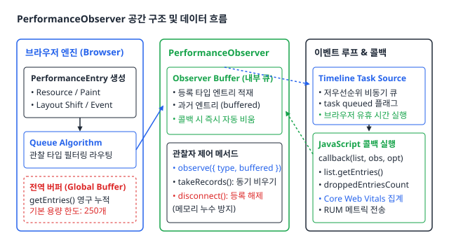
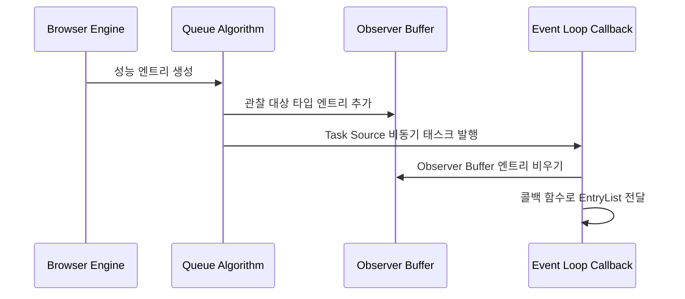

# 261106 PerformanceObserver API

> 한 줄 요약 · 분야: 메모리 · 성능 · Baseline: Widely available (2020년 1월) · 읽는 시간 약 7분

## 1. 왜 쓰는가
웹 애플리케이션의 성능 관측은 브라우저의 렌더링 주기와 메모리를 저해하지 않으면서 실시간으로 메트릭을 수집할 수 있어야 한다.

PerformanceObserver 가 도입되기 전 웹 애플리케이션은 성능 기록을 조회하기 위해 performance.getEntries() 계열 메서드를 주기적으로 폴링(Pull)하거나 window 의 load 이벤트 시점에만 일괄 조회할 수 있었다[1][3]. 이러한 조회 방식은 타이머 폴링으로 인한 CPU 및 배터리 자원 낭비를 유발했고, 중복 처리를 방지하기 위한 복잡한 인덱스 관리 로직을 필요로 했다[3]. 더 심각한 문제는 performance.getEntries() 가 수집된 모든 성능 엔트리를 브라우저의 전역 성능 버퍼에 영구 보관했기 때문에 장기 실행되는 단일 페이지 애플리케이션(SPA)에서 메모리 누수를 일으키는 주원인이었다는 점이다[3][5].

예를 들어 단일 페이지 애플리케이션에서 setInterval 을 사용해 1000ms 주기로 performance.getEntriesByType('resource') 를 호출하여 이전 루프의 마지막 처리 인덱스부터 신규 리소스를 추출하는 방식이 사용되었다. 이 과정에서 지속적인 메인 스레드 연산 틱(Tick)이 발생했고, 수백 개의 비동기 요청이 누적되면서 전역 버퍼의 배열 크기가 계속 팽창하여 브라우저 탭의 메모리 점유율이 지속적으로 상승했다. PerformanceObserver 는 이와 같은 CPU 낭비, 인덱스 추적 부하, 전역 버퍼 누수 문제를 해결하고 브라우저가 생성한 성능 이벤트를 비동기 푸시(Push) 스트림으로 수신하도록 설계되었다[3][4].

## 2. 핵심 개념


PerformanceObserver API를 구성하는 핵심 용어와 공간 구조는 다음과 같다.

- Performance Timeline: 브라우저 런타임에서 문서 탐색, 리소스 다운로드, 페인트, 프레임 지연 등 성능 이벤트를 시간 순서대로 기록하는 네이티브 타임라인 모델이다[3][4].
- PerformanceEntry: 타임라인에 기록되는 개별 측정 단위 객체다[3][4]. name, entryType, startTime, duration 등의 기본 속성을 공유하며 세부 타입에 따라 고유 필드를 확장한다.
- PerformanceObserver: 특정 entryType 의 발생을 구독하고 관찰하는 핵심 인스턴스다[1][2].
- observer buffer: 각 PerformanceObserver 인스턴스가 독립적으로 보유하는 내부 큐(Queue)다[4]. 브라우저가 생성한 엔트리가 필터링을 거쳐 이 버퍼에 임시 적재된다[4].
- 전역 성능 버퍼 대 observer buffer: performance.getEntries() 가 참조하는 전역 버퍼는 엔트리를 영구 보존하여 메모리를 소모하지만, 관찰자의 observer buffer 는 이벤트 루프 콜백이 실행될 때 내부 큐를 자동으로 비워 메모리를 회수한다[3][4][5].
- supportedEntryTypes: 현재 브라우저 엔진이 관찰을 지원하는 엔트리 타입 목록을 담은 정적 배열이다[2][6]. 런타임 기능 감지의 기준이 된다.
- buffered 플래그: observe({ type, buffered: true }) 설정을 활성화하면 observer 가 생성 및 등록되기 이전에 브라우저의 내부 버퍼에 기록되었던 과거 성능 엔트리를 소급하여 콜백으로 전달받을 수 있다[2][5].
- droppedEntriesCount: buffered 옵션을 적용할 때 observer 등록 전 브라우저 버퍼 용량 초과로 버려진 엔트리가 존재하면, 첫 번째 콜백 호출의 세 번째 매개변수인 options 객체의 droppedEntriesCount 속성을 통해 유실 개수가 보고된다[2].

## 3. 동작 원리
브라우저 런타임에서 성능 이벤트가 발생했을 때 데이터가 계산되고 콜백으로 전달되는 과정은 W3C Performance Timeline 명세에 엄격히 규정되어 있다[3][4].

브라우저 렌더링 엔진이나 네트워크 스택이 새로운 성능 엔트리를 생성하면 W3C 명세의 Queue a PerformanceEntry 알고리즘이 호출된다[3][4]. 이 알고리즘은 관찰 조건이 부합하는 각 PerformanceObserver 의 내부 observer buffer 에 엔트리를 추가한다[3][4].

엔트리가 observer buffer 에 추가되면 전역 스코프의 performance observer task queued 플래그가 확인된다[4]. 이 플래그가 false 일 경우 이를 true 로 전환하고 performance timeline task source 에 비동기 태스크를 발행한다[4]. 이 성능 데이터 수집 태스크는 메인 스레드의 핵심 렌더링 파이프라인이나 사용자 입력을 방해하지 않도록 브라우저 유휴(idle) 시간이나 낮은 우선순위 주기로 스케줄링되도록 규정되어 있다[4].

브라우저 이벤트 루프가 performance timeline task source 의 태스크를 실행할 때, 플래그를 false 로 되돌리고 observer buffer 를 비운 뒤 PerformanceObserverEntryList 객체를 생성하여 등록된 콜백 함수에 전달한다[3][4].

동기 제어 및 정리 메서드의 동작은 다음과 같다.
- takeRecords(): 이벤트 루프의 태스크 큐 처리를 기다리지 않고 현재 observer buffer 에 대기 중인 모든 성능 엔트리를 동기적으로 비워내며 배열로 즉시 반환한다[1][4].
- disconnect(): 해당 PerformanceObserver 를 전역 관찰자 레지스트리에서 완전히 제거하고 observer buffer 내부 큐를 초기화하여 메모리를 정리한다[1][4].



## 4. 기본 사용법
다음은 PerformanceObserver 를 안전하게 등록하고, 과거 데이터를 소급 조회하며, 버퍼를 동기적으로 비우고 정리하는 기본 코드다.

```js
if ('PerformanceObserver' in window) {
  const observer = new PerformanceObserver((entryList, obs, options) => {
    if (options && options.droppedEntriesCount > 0) {
      console.warn(`버퍼 용량 초과로 ${options.droppedEntriesCount}개의 엔트리가 유실되었습니다.`);
    }

    const entries = entryList.getEntries();
    for (const entry of entries) {
      console.log(`[수집] 타입: ${entry.entryType}, 이름: ${entry.name}, 시작: ${entry.startTime}ms, 소요: ${entry.duration}ms`);
    }
  });

  if (PerformanceObserver.supportedEntryTypes.includes('paint')) {
    observer.observe({ type: 'paint', buffered: true });
  }

  if (PerformanceObserver.supportedEntryTypes.includes('resource')) {
    observer.observe({ type: 'resource', buffered: true });
  }

  const pendingEntries = observer.takeRecords();
  if (pendingEntries.length > 0) {
    console.log(`동기 비우기로 회수한 엔트리 수: ${pendingEntries.length}`);
  }

  observer.disconnect();
}
```

줄별 설명은 다음과 같다.
- 1줄: 브라우저 전역 스코프에 PerformanceObserver 생성자가 지원되는지 확인하는 기능 감지를 수행한다[1].
- 2줄: new PerformanceObserver() 생성자를 호출하여 인스턴스를 생성하고 entryList, observer 인스턴스, options 객체를 매개변수로 받는 콜백 함수를 등록한다[2].
- 3줄: 세 번째 매개변수인 options 객체를 검사하여 droppedEntriesCount 속성이 0보다 큰지 확인한다[2].
- 4줄: 옵저버 등록 전 브라우저 버퍼 한도 초과로 인해 누락된 엔트리 개수를 경고 로그로 출력한다[2].
- 6줄: entryList.getEntries() 를 호출하여 observer buffer 에서 비워져 전달된 PerformanceEntry 객체 배열을 가져온다[3].
- 7줄: 가져온 엔트리 배열을 루프로 순회한다[3].
- 8줄: 개별 엔트리의 entryType, name, startTime, duration 표준 속성 값을 출력한다[3].
- 11줄: PerformanceObserver.supportedEntryTypes 배열에 paint 문자열이 포함되어 있는지 확인하여 브라우저 지원 여부를 검증한다[2][6].
- 12줄: observe({ type: 'paint', buffered: true }) 를 호출하여 관찰자 등록 이전에 발생한 과거 페인트 엔트리까지 소급하여 콜백으로 전달받도록 등록한다[2][5].
- 15줄: 추가로 관찰할 resource 타입의 브라우저 지원 여부를 검증한다[2].
- 16줄: 단일 type 옵션을 사용해 observe() 를 다시 호출하여 기존의 paint 관찰 목록을 유지한 채 resource 타입을 누적(stack) 등록한다[2][4]. 이때 entryTypes 배열 옵션과 buffered 옵션을 동시에 지정하면 TypeError 가 발생하므로 개별 type 호출을 사용한다[2].
- 19줄: takeRecords() 메서드를 호출하여 이벤트 루프 비동기 큐 처리를 기다리지 않고 현재 observer buffer 에 대기 중인 잔여 엔트리를 동기적으로 비워 배열로 반환받는다[1][4].
- 20줄: 동기적으로 반환받은 엔트리 배열의 길이를 확인한다[1].
- 21줄: 회수된 잔여 엔트리 개수를 출력한다.
- 24줄: disconnect() 메서드를 호출하여 전역 관찰자 레지스트리에서 인스턴스를 제거하고 observer buffer 내부 큐를 초기화하여 메모리를 정리한다[1][4].

## 5. 실무 예시

### 예시 1: Core Web Vitals (LCP, CLS, INP) 실무 수집 패턴
- 상황: 웹 서비스의 사용자 경험 핵심 지표인 최대 콘텐츠풀 페인트(LCP), 누적 레이아웃 이동(CLS), 다음 페인트와의 상호작용(INP)을 실시간으로 수집하여 모니터링 시스템으로 전송해야 하는 환경이다.
- 코드:
```js
if ('PerformanceObserver' in window) {
  // LCP (Largest Contentful Paint) 관찰
  if (PerformanceObserver.supportedEntryTypes.includes('largest-contentful-paint')) {
    const lcpObserver = new PerformanceObserver((entryList) => {
      const entries = entryList.getEntries();
      const lastEntry = entries[entries.length - 1];
      console.log('LCP Candidates:', lastEntry.startTime, lastEntry.element);
    });
    lcpObserver.observe({ type: 'largest-contentful-paint', buffered: true });
  }

  // CLS (Cumulative Layout Shift) 세션 윈도우 집계
  if (PerformanceObserver.supportedEntryTypes.includes('layout-shift')) {
    let clsValue = 0;
    const clsObserver = new PerformanceObserver((entryList) => {
      for (const entry of entryList.getEntries()) {
        // 사용자 인터랙션 후 500ms 이내에 발생한 레이아웃 이동은 제외
        if (!entry.hadRecentInput) {
          clsValue += entry.value;
          console.log('Current CLS:', clsValue);
        }
      }
    });
    clsObserver.observe({ type: 'layout-shift', buffered: true });
  }

  // INP (Interaction to Next Paint) 관찰 (durationThreshold 활용)
  if (PerformanceObserver.supportedEntryTypes.includes('event')) {
    const inpObserver = new PerformanceObserver((entryList) => {
      for (const entry of entryList.getEntries()) {
        console.log(`Slow Event [${entry.name}]: duration=${entry.duration}ms, interactionId=${entry.interactionId}`);
      }
    });
    inpObserver.observe({ type: 'event', durationThreshold: 16, buffered: true });
  }
}
```
- 주의점: LCP 는 페이지 로드 진행에 따라 최대 요소가 계속 갱신되므로 배열의 마지막 엔트리가 최종 후보가 된다[2]. CLS 는 사용자 입력 직후 500ms 이내에 발생한 이동을 제외해야 하므로 hadRecentInput 속성을 확인해야 한다. INP 는 불필요한 이벤트 노출을 줄이기 위해 durationThreshold 를 설정해야 하며 16ms 단위 및 8ms 배수 반올림 제약이 적용된다.

### 예시 2: Long Animation Frames (LoAF)를 통한 메인 스레드 지연 및 스크립트 귀속 분석
- 상황: 메인 스레드에서 50ms 를 초과하는 긴 프레임 지연이 발생했을 때 지연을 유발한 구체적인 원인 스크립트 파일 URL, 라인 번호, 실행 함수 및 스타일 재계산 비용을 역추적해야 하는 환경이다[6].
- 코드:
```js
if ('PerformanceObserver' in window && PerformanceObserver.supportedEntryTypes.includes('long-animation-frame')) {
  const loafObserver = new PerformanceObserver((entryList) => {
    for (const entry of entryList.getEntries()) {
      console.warn(`[LoAF 감지] 전체 프레임 지연: ${entry.duration.toFixed(2)}ms (차단 시간: ${entry.blockingDuration.toFixed(2)}ms)`);
      console.log(`강제 스타일/레이아웃 소요: ${entry.forcedStyleAndLayoutDuration.toFixed(2)}ms`);

      // 지연을 유발한 스크립트 실행 분석
      for (const script of entry.scripts) {
        console.log(` - 스크립트 출처: ${script.sourceURL}:${script.sourceCharPosition}`);
        console.log(` - 실행 함수명: ${script.invoker}, 실행 시간: ${script.executionDuration.toFixed(2)}ms`);
      }
    }
  });
  loafObserver.observe({ type: 'long-animation-frame', buffered: true });
}
```
- 주의점: long-animation-frame 타입은 Chromium 123+ 이상에서 지원되므로 PerformanceObserver.supportedEntryTypes.includes('long-animation-frame') 로 기능 감지를 거쳐야 한다[6]. 스크립트 출처를 분석할 때 서드파티 스크립트의 CORS 격리 여부에 따라 상세 정보 노출 범위가 달라질 수 있으며 forcedStyleAndLayoutDuration 을 통해 강제 동기식 레이아웃 발생 여부를 함께 확인해야 한다[6].

### 예시 3: SPA 페이지 전환 및 언마운트 시점의 안전한 버퍼 비우기(takeRecords) 및 정리(disconnect)
- 상황: 단일 페이지 애플리케이션(SPA)에서 페이지 전환이나 사용자의 탭 이탈 시 비동기 큐에 대기 중이던 마지막 성능 지표의 유실을 방지하고 메모리 누수를 방지해야 하는 환경이다[1][4].
- 코드:
```js
const resourceObserver = new PerformanceObserver((entryList, observer, options) => {
  if (options && options.droppedEntriesCount > 0) {
    console.warn(`초기 버퍼 초과로 ${options.droppedEntriesCount}개의 리소스 엔트리가 유실되었습니다.`);
  }
  for (const entry of entryList.getEntries()) {
    reportMetric('resource', { name: entry.name, duration: entry.duration });
  }
});

resourceObserver.observe({ type: 'resource', buffered: true });

// 페이지 언로드 또는 SPA 라우트 이탈 시 잔여 엔트리를 동기적으로 비우고 전송
window.addEventListener('visibilitychange', () => {
  if (document.visibilityState === 'hidden') {
    const pendingEntries = resourceObserver.takeRecords();
    if (pendingEntries.length > 0) {
      navigator.sendBeacon('/analytics', JSON.stringify(pendingEntries));
    }
    resourceObserver.disconnect();
  }
});
```
- 주의점: visibilitychange 이벤트 발생 시 document.visibilityState === 'hidden' 상태에서 takeRecords() 를 호출하여 observer buffer 내부의 잔여 데이터를 즉시 비워야 한다[1][4]. 지표를 비동기로 전송할 때는 페이지 언로드 시에도 전송이 보장되는 navigator.sendBeacon() 을 사용하며, 사용이 끝난 관찰자는 disconnect() 로 등록을 해제해야 메모리 누수가 발생하지 않는다[1][4].

## 6. 장점 · 단점

| 장점 | 단점 |
| :--- | :--- |
| 비동기 푸시 기반 알림: 브라우저 이벤트 루프의 저우선순위 태스크 큐(performance timeline task source)를 통해 비동기 통지되므로 메인 스레드의 프레임 렌더링이나 사용자 입력을 방해하지 않는다[4]. | 수동적(Passive) 관찰 제약: 비동기 콜백 특성상 동기적 가로채기(Intercepting)나 렌더링 직전 실시간 제어가 불가능하고 발생한 측정 데이터를 사후 분석하는 관찰만 가능하다. |
| 폴링 및 수동 중복 제거 불필요: 새로운 성능 이벤트가 발생할 때마다 묶음(Batch)으로 콜백에 전달되므로 setInterval 이나 복잡한 인덱스 추적 로직을 완전히 제거할 수 있다[3]. | observe() 문법의 엄격성: entryTypes 배열과 buffered 플래그를 동시에 사용할 수 없으며(TypeError 발생), 버퍼링이 필요한 여러 타입을 관찰하려면 observe({ type, buffered: true })를 개별 호출해야 한다[2]. |
| 메모리 효율성 및 자동 비우기: 콜백이 트리거될 때마다 관찰자의 내부 observer buffer 가 자동으로 비워지므로 performance.getEntries() 와 달리 엔트리 누적으로 인한 메모리 팽창이 발생하지 않는다[3][5]. | 원시 데이터(Raw Entry) 가공 부하: 원시 엔트리만 제공하므로 누적 레이아웃 이동(CLS) 세션 합산이나 상호작용 지연(INP) 백분위수 집계 등 최종 메트릭 도출 알고리즘을 개발자가 직접 작성해야 한다. |
| 과거 데이터 소급 관찰 (buffered: true): 분석 스크립트를 비동기 지연 로딩(Lazy Loading)하더라도 초기 페이지 로드 시점의 LCP, TTFB, 리소스 메트릭을 유실 없이 확보할 수 있다[2][5]. | 브라우저 엔진별 지원 편차: supportedEntryTypes 목록에 브라우저별 편차가 존재하여 최신 타입(long-animation-frame, soft-navigation 등)을 다룰 때 방어적 기능 감지가 필수적이다[1][6]. |
| 정밀한 관찰 조건 필터링: supportedEntryTypes 를 통한 기능 감지와 durationThreshold 지정을 통해 유의미한 병목 이벤트만 선별 수집할 수 있다[2][6]. | - |
| 다양한 실행 컨텍스트 지원: 메인 스레드(Window)뿐 아니라 Dedicated Worker, Shared Worker 환경에서도 동일한 인터페이스로 성능을 관찰할 수 있다[3]. | - |

## 7. 한계와 함정
- 경계 사례: 브라우저의 리소스 타이밍 버퍼는 기본 용량이 통상 250개로 고정되어 있다[9]. 한도 도달 시 새로운 리소스 기록이 누락되므로 performance.setResourceTimingBufferSize() 와 resourcetimingbufferfull 이벤트를 조합해 관리해야 한다[9]. 늦게 로딩되는 분석 스크립트에서 buffered: true 를 쓰더라도 초기 데이터의 일부가 버퍼 초과로 버려지면 droppedEntriesCount 로만 확인되고 실제 내용은 복구할 수 없다[2]. 또한 event 엔트리 수집 시 설정 가능한 최소 지속 임계값은 16ms 이며 8ms 의 배수로 강제 반올림되므로 16ms 미만의 미세한 렌더링 간격은 추적할 수 없다.
- 성능: PerformanceObserver 의 스케줄링 자체는 저우선순위 태스크 큐를 따르지만, 콜백 함수 내부에서 무거운 동기 연산이나 복잡한 계산을 수행하면 메인 스레드를 점유하여 프레임 드롭을 유발할 수 있다[4]. 또한 SPA 환경에서 페이지 전환이나 컴포넌트 언마운트 시점에 disconnect() 를 명시적으로 호출하지 않으면 클로저에 묶인 DOM 참조와 메모리가 해제되지 않고 계속 남아 메모리 누수가 발생한다[3][5].
- 접근성: 성능 수집 코드의 메인 스레드 점유 시간이 길어질 경우 스크린 리더 및 보조 공학 기기의 사용자 인터랙션 처리에 응답 지연이 간접적으로 전달될 수 있다.
- 보안: 마이크로아키텍처 수준의 캐시 부채널 공격(Spectre 등)을 방지하기 위해 브라우저는 DOMHighResTimeStamp 해상도를 수 마이크로초 단위로 거칠게 클램핑(Coarsening)한다. Cross-Origin-Opener-Policy(COOP) 및 Cross-Origin-Embedder-Policy(COEP) 기반 격리가 적용되지 않으면 타임스탬프 정밀도가 더욱 제한된다.
- 개인정보: 타사 CDN, 폰트, 서드파티 스크립트 등 교차 출처(Cross-Origin) 리소스의 경우 서버 응답 헤더에 Timing-Allow-Origin(TAO)이 존재하지 않으면 DNS, TCP, TLS, 요청/응답 시작 시간 등의 상세 네트워크 타임스탬프가 모두 0으로 마스킹된다[8].

## 8. 다른 방법과 비교

| 방법 | 언제 | 비용 | 한계 |
| :--- | :--- | :--- | :--- |
| PerformanceObserver | 성능 이벤트를 실시간 비동기 스트림으로 지속 관찰할 때 | 브라우저 저우선순위 스케줄링으로 메인 스레드 부하 최소화[4] | 사후 수동 관찰만 가능, 원시 데이터 통계 집계 직접 구현 필요 |
| performance.getEntriesByType() | 특정 시점의 정적 성능 데이터를 일회성으로 조회할 때 | 동기 폴링 시 CPU 및 배터리 낭비, 전역 버퍼 누적으로 메모리 누수 발생(높음)[3][5] | 실시간 스트리밍 불가, SPA 메모리 팽창, 수동 인덱스 오프셋 관리 필요[3][5] |
| XMLHttpRequest / fetch 래핑 (Monkey Patching) | 애플리케이션 레벨에서 네트워크 요청 전후 시간을 가로채야 할 때 | 프록시 래퍼 실행 오버헤드 발생(중간) | DNS, TCP, TLS, 캐시 히트, 서비스 워커 등 하위 네트워크 스택 지표 획득 불가, 서드파티 충돌 위험 |
| requestAnimationFrame / setInterval 루프 | 메인 스레드 렌더링 프레임 간격을 수동 추정할 때 | 주기적 CPU 틱 발생으로 배터리와 연산 자원 낭비(높음) | 레이아웃 이동(CLS), 페인트(LCP), 개별 네트워크 지연을 직접 관측할 수 없음 |

이것을 고르지 않는 경우:
- 발생한 네트워크 요청이나 사용자 입력을 사후에 관찰하는 것이 아니라, 동기적으로 가로채서(Intercepting) 취소하거나 변경해야 하는 환경에서는 PerformanceObserver 를 사용할 수 없다.
- 지속적인 스트리밍 관찰이 필요 없고 특정 시점에 단일 리소스의 로드 여부만 1회성으로 단순 확인하는 정적 디버깅 환경에서는 getEntriesByName() 과 같은 일회성 조회가 더 적합할 수 있다.

## 9. 대비와 새로운 시도
- Long Animation Frames API (LoAF): W3C 작업 초안 및 Chromium 123+ 탑재 사양이다[6]. 기존 Long Tasks API의 불투명성을 극복하여 50ms를 초과하는 애니메이션 프레임 전체에 대해 실행된 스크립트 파일명, 함수 식별자(invoker), 레이아웃 스래싱(forcedStyleAndLayoutDuration)을 세밀하게 분해 분석할 수 있도록 PerformanceObserver entryType(long-animation-frame)으로 확장되었다[6].
- Event Timing API & Interaction to Next Paint (INP): 2024년 3월부터 First Input Delay(FID)를 대체하여 정식 Core Web Vital 로 승격되었다. PerformanceObserver 의 type: 'event' 관찰을 통해 사용자의 모든 탭, 클릭, 키 입력 반응성을 전 생명주기에 걸쳐 측정한다.
- Soft Navigation Heuristics (Soft Navigation Timing): W3C Web Performance Working Group 에서 표준화 진행 중인 사양이다. 브라우저 네이티브 History API 및 Navigation API 기반의 SPA 클라이언트 사이드 라우팅을 브라우저가 스스로 감지하여 가상 페이지뷰별 LCP/CLS 및 소프트 내비게이션 소요 시간을 PerformanceObserver 로 통지하는 실험적 기능이다.
- Performance Timeline Level 3: W3C 작업 초안으로, HTML 이벤트 루프와의 결합 모델을 더욱 정밀하게 정의하고 Dedicated Worker 및 Shared Worker 간의 성능 타임라인 통합 및 메모리 관리 규격을 지속적으로 고도화하고 있다[4].

## 10. 다른 사람에게 설명하기
- 세 문장 요약:
  1. PerformanceObserver API는 브라우저 성능 타임라인에 기록되는 성능 이벤트를 비동기 푸시 방식으로 구독·관찰하는 웹 표준 인터페이스다[3][4].
  2. 과거 performance.getEntries() 의 동기 폴링이 유발하던 CPU 낭비와 전역 버퍼 누적으로 인한 메모리 누수를 해결하고, 콜백 시점마다 내부 버퍼를 자동으로 비워 메모리 효율성을 보장한다[3][5].
  3. buffered: true 설정을 통해 지연 로딩된 스크립트에서도 초기 렌더링 지표를 소급 수집할 수 있어 현대 실사용자 모니터링(RUM)과 Core Web Vitals 수집 체계의 핵심 기반으로 동작한다[2][5].
- 스스로 확인할 질문 3개:
  - Q. observe() 메서드를 호출할 때 entryTypes 배열 옵션과 buffered: true 플래그를 동시에 지정하면 왜 TypeError 가 발생하는가?
  - Q. 브라우저 이벤트 루프의 performance timeline task source 는 메인 스레드의 렌더링 파이프라인 및 사용자 입력과 어떤 우선순위 관계로 스케줄링되는가?
  - Q. 단일 페이지 애플리케이션(SPA)에서 페이지 전환이나 컴포넌트 언마운트 시점에 takeRecords() 와 disconnect() 를 순서대로 호출해야 하는 기술적 이유는 무엇인가?

## 참고 자료
1. [MDN Web Docs: PerformanceObserver](https://developer.mozilla.org/en-US/docs/Web/API/PerformanceObserver)
2. [MDN Web Docs: PerformanceObserver: observe() method](https://developer.mozilla.org/en-US/docs/Web/API/PerformanceObserver/observe)
3. [W3C Recommendation: Performance Timeline Level 2](https://www.w3.org/TR/performance-timeline-2/)
4. [W3C Working Draft: Performance Timeline (Editor's Draft)](https://w3c.github.io/performance-timeline/)
5. [web.dev: Custom metrics and PerformanceObserver](https://web.dev/articles/custom-metrics)
6. [Chrome for Developers: Long Animation Frames API (LoAF)](https://developer.chrome.com/docs/web-platform/long-animation-frames)
7. [Can I use: PerformanceObserver](https://caniuse.com/performanceobserver)
8. [MDN Web Docs: Timing-Allow-Origin HTTP Header](https://developer.mozilla.org/en-US/docs/Web/HTTP/Headers/Timing-Allow-Origin)
9. [MDN Web Docs: Performance.setResourceTimingBufferSize()](https://developer.mozilla.org/en-US/docs/Web/API/Performance/setResourceTimingBufferSize)
조사: 2026-11-06

## 내 리뷰
(읽고 느낀 점 · 궁금한 것을 적는다. 질문은 Q. 로 시작)
