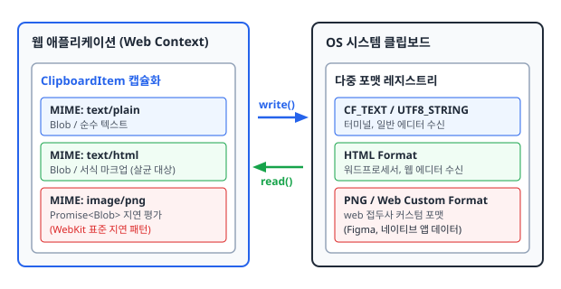
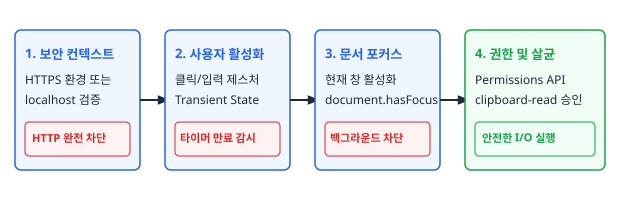
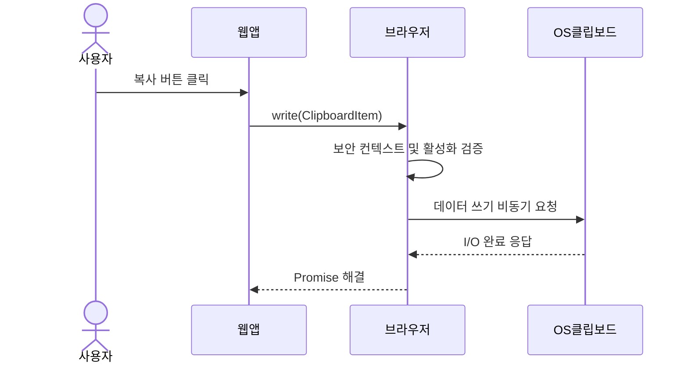

# 261107 Async Clipboard API

> 한 줄 요약: 운영체제 시스템 클립보드에 비동기 Promise 기반으로 접근하여 다양한 MIME 타입 데이터를 안전하게 읽고 쓰는 웹 표준 API다. · 분야: Web API · Baseline: Widely available (핵심 기능인 writeText와 readText는 2020년 3월부터 모든 주요 브라우저에서 상호 운용 가능해졌으며, ClipboardItem 기반 임의 데이터 입출력도 Safari 13.1, Chromium 76, Firefox 127을 거쳐 모든 주요 브라우저에서 공식 지원됨) · 읽는 시간 약 6분

## 1. 왜 쓰는가
과거 웹 애플리케이션에서 클립보드 상호작용은 주로 `document.execCommand('copy')` 및 `document.execCommand('paste')` 메서드에 의존하였다 [3]. 그러나 이 방식은 다음과 같은 치명적인 구조적 한계와 문제를 내포하고 있었다.

첫째, 메인 스레드 블로킹으로 인한 렌더링 성능 저하다. `document.execCommand`는 동기(Synchronous) 방식으로 동작한다 [3]. 시스템 클립보드와 대용량 텍스트 또는 고해상도 이미지를 주고받을 때 I/O 작업이 완료될 때까지 브라우저의 메인 스레드가 멈추며, 이로 인해 UI 렌더링이 지연되고 화면 버벅임(Jank)이 발생하였다 [3].

둘째, DOM 선택 영역(Selection)에 의존하는 해킹성 우회 구현의 강제다. `document.execCommand`는 오직 현재 포커스된 DOM 내 텍스트 선택 영역만을 대상으로 동작한다 [3]. 따라서 애플리케이션의 임의 텍스트나 연산 결과를 클립보드에 복사하려면 화면에 보이지 않는 위치(예: `position: fixed; left: -9999px`)에 임시 `<textarea>` 엘리먼트를 동적으로 생성하고, DOM 트리에 추가한 뒤, 값을 주입하고, `select()` 메서드로 영역을 선택한 후 `execCommand('copy')`를 실행하고, 마지막으로 엘리먼트를 DOM에서 삭제하는 비정상적인 우회 기법이 필수적이었다 [3]. 또한 작업 결과도 단순 `boolean` 값으로만 반환되어 실패 시 구체적인 에러 원인을 추적할 수 없었다.

셋째, 보안 컨텍스트 통제 부재와 프로그래밍 방식 제어의 한계다. 과거의 클립보드 명령은 비보안 HTTP 환경에서도 동작하여 악의적인 스크립트에 의한 클립보드 도청이나 임의 데이터 탈취 위험이 상존하였다 [2]. 또한 이벤트 기반 `clipboardData` 방식(`copy`, `cut`, `paste` 이벤트의 `event.clipboardData`)은 사용자가 단축키(Ctrl+C, Ctrl+V)나 컨텍스트 메뉴를 직접 실행했을 때 발생하는 이벤트를 가로채는 용도에 한정되어, UI 상의 '복사하기' 버튼 클릭 등 애플리케이션의 특정 인터랙션을 트리거로 동작해야 하는 프로그래밍 방식의 클립보드 접근 요구를 단독으로 해결할 수 없었다.

Async Clipboard API는 이러한 메인 스레드 블로킹, 임시 DOM 조작, 보안 취약점을 해결하기 위해 W3C 'Clipboard API and Events' 표준으로 제정되었다 [1], [3]. 비동기 `Promise` 기반으로 설계되어 UI 렌더링 지연 없이 시스템 클립보드에 직접 접근하며, HTTPS 보안 컨텍스트, 일시적 사용자 활성화(Transient User Activation), Permissions API 기반 권한 모델을 통해 안전한 클립보드 입출력 파이프라인을 제공한다 [1], [2].

## 2. 핵심 개념



Async Clipboard API를 구성하는 핵심 인터페이스와 보안 개념은 다음과 같다.

1. `navigator.clipboard`: 시스템 클립보드 작업을 실행하는 전역 인터페이스다 [1]. 텍스트 데이터를 빠르게 다루는 `writeText()` 및 `readText()`와, 임의의 바이너리 및 마크업 포맷을 제어하는 `write()` 및 `read()` 메서드를 제공한다 [1].

2. `ClipboardItem`: 클립보드에 기록되거나 클립보드로부터 읽어온 개별 데이터 단위를 캡슐화하는 표준 인터페이스다 [1]. 단일 `ClipboardItem`은 하나의 페이로드에 대해 여러 MIME 타입(예: `text/plain`, `text/html`, `image/png`)의 표현(Representations)을 동시에 담을 수 있다 [1]. 이를 통해 데이터를 붙여넣는 대상 애플리케이션이 텍스트 편집기인지, 워드프로세서인지, 그래픽 소프트웨어인지에 따라 최적의 포맷을 선택하도록 지원한다 [1].

3. 일시적 사용자 활성화(Transient User Activation): 사용자가 버튼을 클릭하거나 키를 입력하는 등 명시적인 제스처를 취했을 때 브라우저가 일시적으로 부여하는 보안 권한 상태다 [1]. 클립보드 읽기 및 쓰기 API는 스크립트가 임의로 호출할 수 없으며, 반드시 이 활성화 상태가 유지되는 제한된 시간 범위 안에서 실행되어야 한다 [1].

4. 보안 컨텍스트(Secure Context): HTTPS 프로토콜 또는 로컬호스트(`localhost`) 환경에서만 API가 노출되고 동작하도록 제한하는 격리 환경이다 [2]. 비보안 HTTP 환경에서는 `navigator.clipboard` 객체 자체가 제공되지 않거나 호출 시 즉시 차단된다 [2].

5. Permissions API 연동: 사용자의 민감한 정보(비밀번호, 보안 토큰 등)가 무단 유출되는 것을 차단하기 위한 권한 관리 체계다 [2]. 클립보드 읽기 작업(`read`, `readText`)은 `clipboard-read` 권한을 요구하며, 브라우저는 사용자에게 권한 허용 프롬프트를 표시하여 명시적 동의를 받는다 [2].

6. 데이터 살균(Data Sanitization): 클립보드로부터 `text/html` 데이터를 읽을 때 크로스 사이트 스크립팅(XSS) 공격을 차단하기 위해 브라우저 엔진이 위험한 `<script>` 태그와 인라인 이벤트 핸들러를 제거하는 기본 보안 정제 파이프라인이다 [5].

7. Web Custom Formats: 복잡한 웹 애플리케이션(Figma, Google Docs 등)이 자체 데이터 모델을 브라우저의 기본 살균기로 인한 마크업 유실 없이 네이티브 데스크톱 애플리케이션과 상호 교환할 수 있도록 `web ` 접두사가 붙은 MIME 타입을 OS 클립보드에 등록하는 표준 확장 규격이다 [5].

## 3. 동작 원리
Async Clipboard API는 운영체제의 클립보드 하위 시스템과 브라우저 보안 계층 사이에서 비동기 검증 파이프라인을 거쳐 실행된다 [1].



동작 과정은 다음 단계로 진행된다.

1. 실행 조건 검증:
사용자의 입력 인터랙션이 발생하면 브라우저는 실행 컨텍스트에 일시적 사용자 활성화(Transient User Activation) 플래그를 설정한다 [1]. API 호출 시 브라우저는 보안 컨텍스트(`window.isSecureContext === true`) 여부, 현재 문서의 활성 포커스(`document.hasFocus() === true`), 그리고 사용자 활성화의 유효성을 검증한다 [1], [2]. 이 중 하나라도 위반되면 `NotAllowedError` 예외가 발생한다.

2. 데이터 쓰기(`write`, `writeText`):
- `writeText(text)`는 전달된 문자열을 내부적으로 `text/plain` MIME 타입의 `Blob`으로 변환한 뒤 시스템 클립보드로 전송한다.
- `write([clipboardItem])`는 `ClipboardItem`에 바인딩된 여러 MIME 포맷을 OS 클립보드 레지스트리에 등록한다 [1].
- WebKit(Safari)의 지연 평가: WebKit 엔진은 비동기 작업(네트워크 요청이나 캔버스 변환 등)을 `await`하는 동안 사용자 활성화 상태가 만료되는 문제를 해결하기 위해, `ClipboardItem` 생성자에 `Blob` 대신 `Promise<Blob>`을 전달받아 지연 해석(Lazy Evaluation)하는 구조를 도입했다 [4]. 이 방식은 W3C 명세 표준으로 공식 흡수되었다 [1], [4].

3. 데이터 읽기(`read`, `readText`):
- 읽기 메서드는 Permissions API의 `clipboard-read` 권한 상태를 확인한다 [2]. 권한이 부여되지 않은 경우 사용자에게 시스템 프롬프트를 표시한다 [2].
- Chromium의 지연 조회: Chromium 엔진은 대용량 클립보드 읽기 성능을 최적화하기 위해, `read()` 호출 시점에는 메타데이터인 MIME 타입 목록(`types`)만을 포함한 경량 `ClipboardItem` 배열을 우선 반환한다 [3]. 실제 대용량 페이로드는 애플리케이션이 `item.getType(type)`을 호출하는 시점에 OS 클립보드로부터 비동기 스트림으로 조회된다 [3].

4. 마크업 살균:
클립보드로부터 `text/html` 데이터를 읽을 때, 브라우저 엔진은 보안을 위해 위험한 스크립트 태그와 인라인 자바스크립트 실행 속성을 제거하는 살균 파이프라인을 통과시킨다 [5].

## 4. 기본 사용법
Async Clipboard API를 사용하여 텍스트 및 다중 MIME 포맷 데이터를 입출력하는 표준 JavaScript 코드와 줄별 설명은 다음과 같다.

```js
async function executeClipboardOperations() {
  const plainText = "Async Clipboard API 기본 텍스트";
  await navigator.clipboard.writeText(plainText);
  const readString = await navigator.clipboard.readText();

  const textBlob = new Blob([plainText], { type: "text/plain" });
  const htmlBlob = new Blob([`<strong>${plainText}</strong>`], { type: "text/html" });
  const clipboardItem = new ClipboardItem({
    "text/plain": textBlob,
    "text/html": htmlBlob
  });

  await navigator.clipboard.write([clipboardItem]);
  const clipboardItems = await navigator.clipboard.read();

  for (const item of clipboardItems) {
    if (item.types.includes("text/html")) {
      const blob = await item.getType("text/html");
      const htmlContent = await blob.text();
      return htmlContent;
    }
  }
  return readString;
}
```

줄별 동작 설명:
- 1줄: 비동기 클립보드 작업을 실행하기 위한 `executeClipboardOperations` 함수를 선언한다.
- 2줄: 클립보드에 기록할 기본 텍스트 문자열을 변수에 할당한다.
- 3줄: `navigator.clipboard.writeText`를 호출하여 시스템 클립보드에 순수 텍스트를 비동기 방식으로 쓴다.
- 4줄: `navigator.clipboard.readText`를 호출하여 시스템 클립보드로부터 문자열을 비동기 조회하여 `readString`에 저장한다.
- 6줄: `text/plain` MIME 타입을 지정한 `Blob` 객체를 생성하여 문자열 데이터를 래핑한다.
- 7줄: `text/html` MIME 타입을 지정한 `Blob` 객체를 생성하여 서식이 적용된 마크업 데이터를 래핑한다.
- 8~11줄: 텍스트 및 HTML 두 가지 MIME 타입을 매핑하여 단일 `ClipboardItem` 인스턴스를 생성한다.
- 13줄: `navigator.clipboard.write`에 `ClipboardItem` 배열을 전달하여 다중 MIME 표현을 시스템 클립보드에 기록한다.
- 14줄: `navigator.clipboard.read`를 호출하여 클립보드에 저장된 모든 `ClipboardItem` 배열을 비동기로 수신한다.
- 16줄: 수신된 `ClipboardItem` 배열을 순차적으로 순회한다.
- 17줄: 개별 아이템의 `types` 배열을 검사하여 `text/html` MIME 타입이 존재하는지 확인한다.
- 18줄: `item.getType("text/html")`을 호출하여 해당 타입의 실제 데이터가 담긴 `Blob`을 지연 로드 방식으로 비동기 획득한다.
- 19줄: 수신된 `Blob`의 `text()` 메서드를 비동기 실행하여 바이너리 데이터를 문자열 마크업으로 디코딩한다.
- 20줄: 디코딩된 HTML 문자열을 반환한다.
- 23줄: HTML 포맷이 없을 경우 이전에 읽어온 순수 텍스트 문자열을 반환한다.

## 5. 실무 예시
조사 결과에 따른 실무 구현 예시 3가지는 다음과 같다.

### 예시 1: 일시적 사용자 활성화를 보장하며 레거시 폴백을 지원하는 안전한 텍스트 복사 유틸리티
- 상황: 프로덕션 환경에서 보안 컨텍스트 여부 및 브라우저 호환성을 판별하여 최신 Async Clipboard API를 우선 적용하고, 비보안 HTTP 환경이거나 구형 브라우저일 때 `document.execCommand('copy')`로 안전하게 폴백해야 하는 상황.
- 코드:
```js
async function copyTextToClipboard(text) {
  if (navigator.clipboard && window.isSecureContext) {
    try {
      await navigator.clipboard.writeText(text);
      return true;
    } catch (err) {
      console.warn('Async Clipboard API 복사 실패, 폴백 시도:', err);
    }
  }

  // 레거시 브라우저 및 비보안 컨텍스트용 fallback
  const textArea = document.createElement('textarea');
  textArea.value = text;
  textArea.style.position = 'fixed';
  textArea.style.left = '-9999px';
  textArea.style.top = '-9999px';
  textArea.setAttribute('readonly', '');
  document.body.appendChild(textArea);
  textArea.select();

  try {
    const success = document.execCommand('copy');
    return success;
  } catch (err) {
    console.error('클립보드 복사 최종 실패:', err);
    return false;
  } finally {
    document.body.removeChild(textArea);
  }
}
```
- 주의점: `window.isSecureContext` 검사를 누락하면 HTTP 환경에서 `navigator.clipboard` 접근 시 런타임 예외가 발생한다 [2]. 폴백 시 생성하는 `<textarea>`는 레이아웃 왜곡을 방지하기 위해 화면 밖 좌표(`-9999px`)로 고정해야 하며, 모바일 환경에서 가상 키보드가 팝업되는 것을 방지하기 위해 `readonly` 속성을 부여해야 한다.

### 예시 2: Safari의 User Activation 만료를 방지하기 위해 ClipboardItem에 Promise<Blob>을 넘겨 캔버스 이미지를 복사하는 패턴
- 상황: `<canvas>` 요소에 렌더링된 그래픽 데이터를 PNG 바이너리로 클립보드에 복사할 때, 비동기 Blob 변환 처리로 인해 Safari에서 일시적 사용자 활성화가 만료되어 `NotAllowedError`가 발생하는 문제를 해결해야 하는 상황.
- 코드:
```js
function copyCanvasToClipboard(canvasElement) {
  // 클릭 이벤트 핸들러의 동기 호출 스택 안에서 navigator.clipboard.write를 즉시 실행하고,
  // 비동기 Blob 변환 처리는 ClipboardItem 생성자에 Promise로 전달한다.
  const blobPromise = new Promise((resolve, reject) => {
    canvasElement.toBlob((blob) => {
      if (blob) resolve(blob);
      else reject(new Error('Canvas to Blob 변환 실패'));
    }, 'image/png');
  });

  return navigator.clipboard.write([
    new ClipboardItem({ 'image/png': blobPromise })
  ]);
}
```
- 주의점: 클릭 이벤트 콜백 내에서 `toBlob` 완료를 `await`한 후 `write()`를 호출하면 Safari에서 사용자 활성화 만료로 인한 권한 거부 오류가 발생한다 [4]. 반드시 클릭 이벤트의 동기 실행 흐름 안에서 `navigator.clipboard.write()`를 호출하고, 비동기 데이터는 `ClipboardItem`에 `Promise<Blob>` 형태로 넘겨 지연 평가되도록 해야 한다 [4].

### 예시 3: 텍스트와 서식 있는 HTML을 동시에 복사하여 붙여넣는 애플리케이션에 따라 최적의 포맷을 선택하도록 지원하는 패턴
- 상황: 리치 텍스트 에디터에서 서식 있는 문서를 복사할 때, 일반 텍스트 편집기에는 마크업이 제거된 순수 텍스트로, 워드프로세서나 이메일 작성기에는 서식 있는 HTML로 붙여넣어지도록 다중 표현을 동시에 클립보드에 등록해야 하는 상황.
- 코드:
```js
async function copyRichAndPlainText(htmlSnippet, plainText) {
  if (!navigator.clipboard?.write) {
    throw new Error('현재 환경에서 navigator.clipboard.write를 지원하지 않습니다.');
  }

  const item = new ClipboardItem({
    'text/html': new Blob([htmlSnippet], { type: 'text/html' }),
    'text/plain': new Blob([plainText], { type: 'text/plain' })
  });

  await navigator.clipboard.write([item]);
}
```
- 주의점: 브라우저 환경에 따라 `navigator.clipboard.write` 메서드가 미구현되었을 수 있으므로 실행 전 지원 여부를 검증해야 한다. 또한 대상 애플리케이션이 `text/html`을 수신할 때 브라우저 엔진의 기본 살균 파이프라인을 거치면서 인라인 스타일이나 커스텀 어트리뷰트가 정제될 수 있음을 감안해야 한다 [5].

## 6. 장점 · 단점
Async Clipboard API의 주요 장점과 단점을 비교하면 다음과 같다.

| 장점 | 단점 |
| :--- | :--- |
| 완전한 비동기 Promise 기반 구조로 설계되어 대용량 텍스트나 바이너리 이미지 처리 시에도 메인 스레드 렌더링 블로킹 및 버벅임(Jank)이 발생하지 않는다 [3]. | 보안 컨텍스트(HTTPS) 강제로 인해 로컬 개발 환경(IP 기반 접속 등)이나 비보안 HTTP 환경에서는 API 자체가 완전히 차단되어 별도의 폴백 코드가 요구된다 [2]. |
| 가짜 `<textarea>` 요소를 화면 밖 DOM 트리에 강제로 생성하고 선택(select) 및 삭제하던 레거시 해킹성 DOM 조작 코드를 완전히 제거할 수 있다 [3]. | 클립보드 읽기(read, readText) 시 브라우저별(Chromium, Safari, Firefox) 권한 요청 UI와 정책이 달라 크로스 브라우저 환경에서 완전히 일관된 UX를 제공하기 어렵다 [6]. |
| ClipboardItem 인터페이스를 통해 단일 복사 작업에서 텍스트(text/plain), 마크업(text/html), 바이너리 이미지(image/png) 등 다양한 표현을 동시에 제공할 수 있다 [1]. | 브라우저가 보안을 위해 수행하는 기본 HTML 살균(Sanitization) 과정에서 리치 텍스트 에디터나 특수 서식에 필요한 인라인 스타일 및 커스텀 어트리뷰트가 임의로 제거될 위험이 있다 [5]. |
| 보안 컨텍스트(HTTPS) 강제 및 Permissions API 연동을 통해 백그라운드 악성 스크립트의 무단 클립보드 데이터 도청(스누핑)을 차단한다 [2]. | 운영체제별(Windows, macOS, Linux, Android, iOS) 클립보드 아키텍처 및 지원 MIME 타입의 근본적인 차이로 인해, 복잡한 커스텀 바이너리 데이터의 안정적 교환에 제약이 따른다. |
| Web Custom Formats를 지원하여 브라우저 샌드박스를 넘어 네이티브 데스크톱 애플리케이션과 전용 데이터 구조를 손실 없이 교환할 수 있다 [5]. | 버튼 클릭 이벤트 콜백에서 네트워크 비동기 작업(fetch) 등을 await하면 일시적 사용자 활성화가 만료되어 NotAllowedError가 발생하는 타이밍 제약이 존재한다 [4]. |

## 7. 한계와 함정
실무에서 Async Clipboard API를 운용할 때 마주치는 한계와 주의해야 할 함정은 다음과 같다.

1. 일시적 사용자 활성화(Transient User Activation) 만료 함정:
사용자가 버튼을 클릭했더라도 네트워크 요청(`fetch`)이나 지연 타이머(`setTimeout`)를 `await`한 뒤 `writeText`나 `write`를 호출하면 일시적 사용자 활성화 상태가 만료되어 `NotAllowedError`가 발생한다 [4]. 비동기 처리가 수반될 경우 클릭 동기 스택 안에서 `write`를 즉시 실행하고 `ClipboardItem`에 `Promise<Blob>`을 전달하는 지연 평가 방식을 취해야 한다 [4].

2. Safari와 Chromium 간 구현 차이:
Safari는 `navigator.clipboard.write()`를 클릭 이벤트 콜백 내에서 즉시 동기 실행하고 `ClipboardItem` 내부에 `Promise<Blob>`을 전달해야 정상 동작하며, 비동기 완료 후 `write`를 호출하는 Chromium 스타일 코드는 Safari에서 권한 거부 오류를 일으킨다 [4].

3. 문서 포커스 유실 오류:
브라우저 창이나 탭이 백그라운드에 있거나 개발자 도구 조작 등으로 포커스를 잃은 상태(`document.hasFocus() === false`)에서는 클립보드 읽기 및 쓰기 작업이 모두 거부된다 [1].

4. iframe 격리 제약:
서드파티 iframe 내부에서 클립보드에 접근하려면 부모 문서에서 Permissions Policy 헤더나 `allow="clipboard-read; clipboard-write"` iframe 속성을 명시적으로 허용해야 한다.

5. 클립보드 하이재킹(Clipboard Hijacking) 보안 위협:
악의적인 스크립트가 사용자가 복사한 내용에 악성 터미널 명령어(예: `curl | sh`)나 가상자산 지갑 주소를 은밀히 바꿔치기할 위험이 존재하므로, 사용자 인지 없는 배경 복사를 엄격히 감시해야 한다.

6. 변이 XSS(Mutation XSS, mXSS) 위험:
클립보드에서 읽어온 HTML을 브라우저가 1차 살균하더라도 [5], 이를 DOM의 `innerHTML`에 삽입하는 과정에서 브라우저 파서 불일치로 인한 mXSS가 발생할 수 있으므로 애플리케이션 레벨의 추가 검증(DOMPurify 등)이 필수적이다.

7. 브라우저별 권한 UX 불일치:
Chromium은 표준 Permissions API 프롬프트를 띄우지만, Firefox는 데스크톱 웹 환경에서 권한 제어 이슈로 오랫동안 제한하다가 명시적 컨텍스트 메뉴 확인 및 프롬프트 방식을 도입하여 Firefox 127부터 공식 지원하기 시작했다 [6]. 브라우저 간 UI 차이로 인해 통일된 사용자 경험 제공에 제약이 따른다 [6].

## 8. 다른 방법과 비교
클립보드 접근 및 데이터 전송 방식 간의 기술 비교는 다음과 같다.

| 방법 | 언제 | 비용 | 한계 |
| :--- | :--- | :--- | :--- |
| Async Clipboard API | 최신 웹 애플리케이션에서 버튼 클릭 등 프로그래밍 방식으로 텍스트, 이미지, HTML 데이터를 비동기 입출력할 때 | Promise 비동기 처리, HTTPS 보안 컨텍스트 검증 비용 | 비보안 HTTP 미지원, 브라우저별 권한 UI 상이, 사용자 활성화 만료 제약 [2], [4] |
| document.execCommand('copy' / 'paste') | HTTPS가 적용되지 않은 구형 HTTP 환경이나 레거시 브라우저 호환성을 위한 폴백이 필요할 때 | 동기 실행으로 인한 메인 스레드 블로킹, 임시 `<textarea>` 생성 및 DOM 조작 오버헤드 [3] | 공식 폐기(Deprecated)됨, DOM 선택 영역만 조작 가능, 실패 원인 추적 불가(단순 boolean 반환) [3] |
| 이벤트 기반 clipboardData (`copy`, `cut`, `paste`) | 사용자가 직접 단축키(Ctrl+C, Ctrl+V)나 컨텍스트 메뉴를 실행한 순간의 데이터를 가로채 동기적으로 가공할 때 | 이벤트 핸들러 동기 실행 비용, DataTransfer 객체 조작 비용 | 사용자 단축키 입력 외에 '복사하기' 버튼 클릭 등 프로그래밍 방식 임의 시점 클립보드 접근 불가 |
| DataTransfer API (HTML Drag and Drop) | 사용자가 요소를 마우스로 끌어서 놓는 드래그 앤 드롭 동작 간에 MIME 타입별 데이터를 전달할 때 | 드래그 라이프사이클 이벤트 리스너 오버헤드 | 시스템 클립보드 영구 저장 불가, 드래그 라이프사이클 내에서만 한시적으로 유효 |

이것을 고르지 않는 경우:
- 사내 폐쇄망이나 로컬 IP 접속 등 HTTPS 인증서 적용이 불가능한 비보안 HTTP 환경에서 단순 텍스트 복사를 지원해야 할 때는 Async Clipboard API를 사용할 수 없으므로 `document.execCommand('copy')` 폴백을 선택해야 한다 [2].
- UI 버튼 클릭이 아닌, 사용자가 에디터 내에서 누른 키보드 단축키(Ctrl+C, Ctrl+V) 입력에 즉각 반응하여 데이터를 치환하거나 가공해야 할 때는 `event.clipboardData`를 사용하는 것이 적합하다.
- 시스템 클립보드를 변경하지 않고 화면 내 요소 간 드래그 동작을 통한 일시적인 데이터 이동만 처리하려는 경우에는 `DataTransfer API`를 활용하는 것이 맞다.

## 9. 대비와 새로운 시도
Async Clipboard API의 제약을 극복하고 데이터 상호운용성을 확장하기 위한 후속 표준화 및 시도는 다음과 같다.

1. Web Custom Formats (`web ` 접두사):
W3C Editing 워킹 그룹에서 표준화 중이며 Chromium 기반 브라우저(Chrome 104+)에 도입되었다 [5]. 운영체제 클립보드에 `web ` 접두사가 붙은 커스텀 MIME 타입을 등록하여 복잡한 웹 애플리케이션(Figma, Google Docs 등)이 자체 데이터 모델을 손상 없이 안전하게 복사/붙여넣기할 수 있도록 지원한다 [5]. 이를 통해 브라우저 살균기로 인한 마크업 유실 없이 네이티브 데스크톱 애플리케이션과 고충실도 데이터를 교환할 수 있다 [5].

2. 비살균 HTML 읽기 옵션 (`{ unsanitized: ['text/html'] }`):
브라우저 기본 살균기로 인해 에디터의 고유 스타일 및 속성이 제거되는 문제를 방지하기 위해, 웹 애플리케이션이 직접 XSS 방어를 책임지는 조건으로 원본 HTML 스트림을 읽을 수 있도록 허용하는 옵션이 제안 및 구현 중이다 [5].

3. `ClipboardItem.supports(type)` 정적 메서드:
특정 MIME 타입(예: `image/svg+xml`, `web custom format`)이 현재 브라우저 및 OS 클립보드에서 쓰기 지원되는지 런타임에 사전 검사할 수 있는 표준 API로, 2024~2025년에 걸쳐 Baseline에 도달하며 전 브라우저로 확산되고 있다.

4. 지연 평가 `Promise<Blob>` 지원의 W3C 표준 명세 통합:
Safari가 선도했던 `ClipboardItem` 생성자 내 지연 Promise 전달 패턴이 W3C 명세 표준으로 흡수되어, 비동기 리소스 생성 후 클립보드에 쓰는 패턴이 일관된 표준 방식으로 정착되었다 [1], [4].

## 10. 다른 사람에게 설명하기
세 문장 요약:
1. Async Clipboard API는 보안 컨텍스트(HTTPS) 환경에서 메인 스레드를 차단하지 않고 Promise 기반으로 시스템 클립보드에 접근하여 다양한 MIME 타입 데이터를 안전하게 입출력하는 웹 표준 인터페이스다 [1], [2], [3].
2. 과거 `document.execCommand`의 메인 스레드 정지 및 임시 `<textarea>` 삽입 같은 해킹성 구현을 제거하고, 일시적 사용자 활성화와 Permissions API를 결합하여 무단 클립보드 탈취 위험을 원천 차단한다 [1], [2], [3].
3. `ClipboardItem`을 통한 다중 포맷 동시 캡슐화와 `Promise<Blob>` 지연 평가, 최신 Web Custom Formats 확장을 바탕으로 웹과 네이티브 간의 고충실도 데이터 교환을 완성한다 [1], [4], [5].

스스로 확인할 질문 3개:
Q. 네트워크 요청이나 비동기 타이머를 await한 뒤 navigator.clipboard.write를 호출하면 NotAllowedError가 발생하는 근본적인 원인은 무엇이며, 이를 방지하기 위한 ClipboardItem의 Promise 지연 평가 패턴은 어떻게 동작하는가?
Q. 과거 동기식 document.execCommand 방식과 비교할 때 Async Clipboard API가 렌더링 성능, DOM 조작, 에러 핸들링 관점에서 제공하는 구체적인 기술적 차이는 무엇인가?
Q. 브라우저가 클립보드의 text/html 데이터를 읽을 때 기본 살균(Sanitization)을 수행하는 보안상 이유는 무엇이며, 이로 인한 에디터 서식 손실을 극복하기 위해 제안된 Web Custom Formats와 비살균 옵션은 각각 어떤 문제를 해결하는가?

## 참고 자료
1. [W3C Working Draft: Clipboard API and Events](https://www.w3.org/TR/clipboard-apis/)
2. [MDN Web Docs: Clipboard API](https://developer.mozilla.org/en-US/docs/Web/API/Clipboard_API)
3. [web.dev: Unblocking clipboard access](https://web.dev/articles/async-clipboard)
4. [WebKit Blog: Async Clipboard API](https://webkit.org/blog/10855/async-clipboard-api/)
5. [Chrome for Developers: Web custom formats for the Async Clipboard API](https://developer.chrome.com/blog/web-custom-formats-for-the-async-clipboard-api/)
6. [MDN Web Docs: Firefox 127 for developers](https://developer.mozilla.org/en-US/docs/Mozilla/Firefox/Releases/127)
조사: 2026-11-07

## 내 리뷰
(읽고 느낀 점 · 궁금한 것을 적는다. 질문은 Q. 로 시작)
