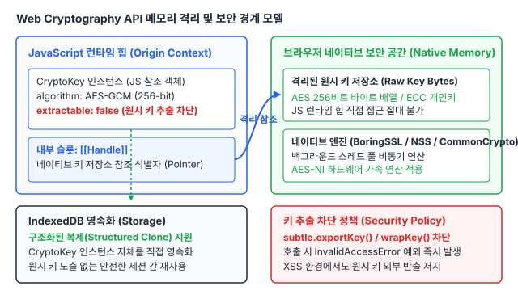

# 261108 Web Cryptography API

> 한 줄 요약 · 분야: 보안 · Baseline: Widely available (2017년 9월) · 읽는 시간 약 6분

## 1. 왜 쓰는가
웹 애플리케이션의 복잡도가 증가하면서 브라우저 환경에서 민감한 데이터를 암호화하거나 디지털 서명을 검증해야 하는 요구가 지속해서 발생했다. 과거 웹 개발자들은 CryptoJS, SJCL(Stanford Javascript Crypto Library), forge와 같은 순수 JavaScript 암호화 라이브러리에 의존했다 [5]. 그러나 순수 JavaScript 기반 암호화는 브라우저 실행 환경의 태생적 한계로 인해 세 가지 치명적인 결함을 안고 있었다 [1][5].

첫째, 타이밍 부채널 공격(Timing Side-channel Attack)에 취약했다. 암호 알고리즘은 입력값이나 키의 비트 패턴에 관계없이 연산 수행 시간이 일정해야 하는 상수 시간(Constant-time) 실행이 보장되어야 한다 [5]. 하지만 JavaScript 엔진(V8, JavaScriptCore 등)의 JIT(Just-In-Time) 컴파일러 최적화와 가비지 컬렉션(GC) 동작은 연산 실행 시간에 비결정론적 편차를 발생시켜 원시 키 바이트가 타이밍 분석을 통해 역추적될 위험을 초래했다 [5].

둘째, 런타임 힙 메모리상의 원시 키(Raw Key) 노출 문제다. 순수 JavaScript 라이브러리 환경에서는 비밀키나 개인키가 일반 문자열 또는 TypedArray 바이트 배열 형태로 JavaScript 힙 메모리에 상주했다 [1]. 이는 애플리케이션 내에 크로스 사이트 스크립팅(XSS) 취약점이 단 하나라도 존재하거나 메모리 덤프가 발생할 경우 공격자가 원시 키를 평문 상태 그대로 탈취할 수 있음을 의미했다 [1].

셋째, 메인 스레드 블로킹으로 인한 성능 저하다. RSA나 ECC 같은 비대칭키 연산 또는 대용량 데이터 해싱은 수억 번의 부동소수점 및 정수 연산을 요구한다. 이를 단일 스레드로 동작하는 JavaScript 메인 스레드에서 실행하면 UI 렌더링 프레임이 급락하고 브라우저 화면이 멈추는 현상이 발생했다 [5]. 아울러 수십에서 수백 킬로바이트에 달하는 외부 암호화 라이브러리를 번들에 포함해야 하므로 초기 네트워크 다운로드 크기도 증가했다.

W3C Web Cryptography Working Group은 이러한 한계를 극복하고 웹 플랫폼에 네이티브 수준의 보안성과 하드웨어 가속 성능을 제공하기 위해 2017년 1월 26일 Web Cryptography API를 공식 W3C 권고안(Recommendation)으로 제정했다 [1]. 이어 WebKit이 Safari 11(macOS High Sierra 및 iOS 11)에서 기존 벤더 접두사 window.crypto.webkitSubtle을 폐기하고 W3C 표준 window.crypto.subtle 인터페이스로 전면 전환하면서, 2017년 9월 모든 주요 모던 브라우저(Chrome, Firefox, Safari, Edge)에서 Baseline Widely available을 달성했다 [5][7].

## 2. 핵심 개념
Web Cryptography API는 브라우저 네이티브 암호화 계층과 JavaScript 실행 환경을 엄격히 분리하도록 설계되었다.



Web Cryptography API를 구성하는 핵심 개념과 용어는 다음과 같다.

1. CryptoKey
암호화 키를 직접적인 바이트 배열이 아닌 브라우저 내부 불투명(Opaque) 객체로 캡슐화한 인터페이스다 [1]. JavaScript 코드에는 내부 슬롯 [[Handle]]을 가리키는 객체 참조만 전달되며, 실제 256비트 대칭키나 비대칭 개인키의 원시 바이트(Raw Key Material)는 브라우저 네이티브 C++/Rust 메모리 공간에 격리 보관된다 [1].

2. extractable 속성
키 생성(generateKey) 또는 임포트(importKey) 시 지정하는 불리언(Boolean) 값이다 [1]. 이 값을 false로 설정하면 해당 CryptoKey 인스턴스에 대해 subtle.exportKey() 또는 subtle.wrapKey()를 호출했을 때 브라우저 엔진이 InvalidAccessError 예외를 발생시키며 원시 키 바이트의 스크립트 공간 유출을 원천 차단한다 [1].

3. key usages
키 생성 시점에 명시적으로 지정하는 허용 작업 배열이다 [3]. 예를 들어 usages를 ["encrypt", "decrypt"]로 지정한 대칭키는 subtle.sign() 호출에 사용할 수 없으며, 브라우저 엔진 레벨에서 선제적으로 연산 수행을 거부한다 [3].

4. SubtleCrypto (crypto.subtle)
암호화(encrypt), 복호화(decrypt), 전자서명(sign), 서명 검증(verify), 해시 다이제스트(digest), 키 파생(deriveKey, deriveBits), 키 임포트 및 익스포트(importKey, exportKey) 등 암호학적 기본 요소를 제공하는 핵심 비동기 인터페이스다 [2][3].

5. Crypto 상위 인터페이스
전역 window.crypto 객체로 노출되며, 운영체제(OS)의 엔트로피 풀과 직접 연계된 암호학적으로 안전한 의사 난수를 버퍼에 채우는 crypto.getRandomValues()와 고유 식별자를 생성하는 crypto.randomUUID() 유틸리티를 제공한다 [2].

6. 보안 컨텍스트 ([SecureContext])
Web Cryptography API의 subtle 인터페이스는 전송 구간 도청 및 중간자 공격을 방지하기 위해 HTTPS 또는 localhost 환경에서만 인스턴스화된다 [2]. 일반 HTTP 환경에서는 window.crypto.subtle 속성이 undefined로 평가된다 [2].

7. 구조화된 복제(Structured Clone) 알고리즘 지원
CryptoKey 객체는 W3C 구조화된 복제 알고리즘을 지원한다 [2]. 따라서 extractable: false로 설정된 비추출 키라 할지라도 원시 키 바이트를 스크립트에 노출하지 않고 IndexedDB에 인스턴스 자체를 직접 저장하고 페이지 재방문 시 온전하게 복원할 수 있다 [2].

## 3. 동작 원리
crypto.subtle의 모든 암호화 메서드는 호출 즉시 메인 스레드를 차단하지 않고 Promise 객체를 반환한다 [3]. 실제 연산은 브라우저 하위의 C++/Rust 네이티브 암호화 엔진(Chromium 계열의 BoringSSL, Firefox의 NSS, WebKit의 CommonCrypto)이 관리하는 백그라운드 스레드 풀에서 비동기로 실행된다 [3].

```diagram
종류: 시퀀스

[JavaScript]
[crypto.subtle]
[Thread Pool]
[Native Engine]

JavaScript -> crypto.subtle : encrypt(params, key, data)
crypto.subtle -> Thread Pool : dispatch task
crypto.subtle --> JavaScript : return Promise
Thread Pool -> Native Engine : execute AES-GCM
Native Engine --> Thread Pool : return ciphertext
Thread Pool -> JavaScript : resolve Promise (microtask)
```

연산 수행 절차와 브라우저 내부 스케줄링 흐름은 다음과 같다.

1. 호출 검증 및 작업 분기
JavaScript 메인 스레드에서 subtle.encrypt() 등의 API를 호출하면, 브라우저 엔진은 전달된 CryptoKey의 [[Handle]] 유효성, 알고리즘 파라미터 딕셔너리 규격, 그리고 key usages 배열에 해당 연산이 허용되어 있는지를 동기적으로 검증한다 [1][3]. 검증에 통과하면 미결(Pending) 상태의 Promise를 즉시 메인 스레드에 반환하고 실제 암호 연산 작업을 브라우저 백그라운드 I/O 또는 워커 스레드 풀로 디스패치한다 [3].

2. 네이티브 엔진 실행 및 하드웨어 가속
백그라운드 스레드로 전달된 작업은 OS 및 네이티브 라이브러리(BoringSSL, NSS, CommonCrypto)에 의해 실행된다 [3]. 이때 CPU의 AES-NI(Advanced Encryption Standard New Instructions)나 타원곡선 전용 어셈블리 루틴이 호출되어 나노초 및 마이크로초 단위의 하드웨어 가속 연산이 적용된다. 연산이 수행되는 동안 메인 스레드는 레이아웃, 스타일 계산, 사용자 이벤트 처리를 지연 없이 지속한다 [3].

3. 마이크로태스크 큐 등록 및 결과 반환
네이티브 암호 연산이 완료되면 백그라운드 스레드는 결과 버퍼(암호문 또는 서명 바이트)를 생성하고 브라우저 이벤트 루프에 완료 신호를 보낸다 [3]. 이벤트 루프는 현재 실행 중인 매크로태스크가 끝난 직후 도달하는 마이크로태스크 체크포인트(Microtask Checkpoint)에서 해당 Promise를 이행(Resolve) 상태로 변경하여 then 콜백 또는 await 재개 지점으로 결과 ArrayBuffer를 전달한다 [3].

## 4. 기본 사용법
AES-GCM 알고리즘을 사용하여 비추출 대칭키를 생성하고, 12바이트 난수 초기화 벡터(IV)를 적용하여 문자열을 암호화 및 복호화하는 표준 구현 코드다.

```js
async function runWebCryptoAesGcm() {
  const plaintext = "실무에서 보호해야 할 민감한 사용자 데이터";
  const encoder = new TextEncoder();
  const encodedData = encoder.encode(plaintext);

  const key = await window.crypto.subtle.generateKey(
    { name: "AES-GCM", length: 256 },
    false,
    ["encrypt", "decrypt"]
  );

  const iv = window.crypto.getRandomValues(new Uint8Array(12));

  const ciphertextBuffer = await window.crypto.subtle.encrypt(
    { name: "AES-GCM", iv: iv },
    key,
    encodedData
  );

  const decryptedBuffer = await window.crypto.subtle.decrypt(
    { name: "AES-GCM", iv: iv },
    key,
    ciphertextBuffer
  );

  const decoder = new TextDecoder();
  const decryptedText = decoder.decode(decryptedBuffer);

  return decryptedText;
}
```

줄별 동작 설명은 다음과 같다.
- 1행: 비동기 Web Crypto API 메서드를 await 키워드로 순차 제어하기 위해 async 함수를 선언한다.
- 2행: 암호화 대상이 되는 원본 평문 문자열을 정의한다.
- 3행: 문자열을 UTF-8 바이트 스트림으로 인코딩하기 위해 TextEncoder 객체를 생성한다.
- 4행: 평문 문자열을 Web Crypto API의 입력 버퍼 규격인 Uint8Array 바이너리 배열로 변환한다.
- 5행: subtle.generateKey 메서드를 비동기 호출하여 대칭키 생성을 요청한다 [1].
- 6행: 첫 번째 인수로 256비트 키 길이를 가지는 AES-GCM 알고리즘 사양 객체를 전달한다 [1].
- 7행: 두 번째 인수로 false를 지정하여 키를 extractable: false 상태로 생성함으로써 JavaScript 런타임 힙으로의 원시 키 유출을 차단한다 [1].
- 8행: 세 번째 인수로 허용 작업 배열을 ["encrypt", "decrypt"]로 엄격히 한정한다 [3].
- 9행: 네이티브 키 생성이 완료될 때까지 비동기 대기하여 CryptoKey 객체를 key 변수에 할당한다.
- 10행: crypto.getRandomValues를 호출하여 AES-GCM 권장 규격인 12바이트(96비트) 암호학적 난수 초기화 벡터(IV)를 생성한다 [2][3].
- 11행: subtle.encrypt 메서드를 호출하여 비동기 암호화 작업을 시작한다 [3].
- 12행: 암호화 파라미터 객체에 알고리즘 이름(AES-GCM)과 방금 생성한 12바이트 iv를 전달한다 [3].
- 13행: 9행에서 생성한 비추출 CryptoKey 인스턴스를 전달한다.
- 14행: 4행에서 UTF-8 바이트로 인코딩한 평문 Uint8Array 버퍼를 전달한다.
- 15행: 백그라운드 스레드의 AES-GCM 암호화 및 128비트 인증 태그 부착이 완료되면 암호문 ArrayBuffer를 반환받는다 [3].
- 16행: subtle.decrypt 메서드를 호출하여 비동기 복호화 작업을 요청한다 [3].
- 17행: 암호화 시 사용했던 동일한 알고리즘 사양 및 12바이트 iv를 전달한다 [3].
- 18행: 동일한 CryptoKey 인스턴스를 복호화 키로 전달한다.
- 19행: 복호화할 암호문 ArrayBuffer를 전달한다.
- 20행: 네이티브 엔진의 복호화 및 인증 태그 검증이 성공하면 복원된 평문 ArrayBuffer를 반환받는다 [3].
- 21행: 바이너리 버퍼를 UTF-8 문자열로 변환하기 위해 TextDecoder 객체를 생성한다.
- 22행: 복호화된 ArrayBuffer를 디코딩하여 원본 문자열을 복원한다.
- 23행: 복원된 평문 문자열을 반환한다.
- 24행: 함수의 블록을 종료한다.

## 5. 실무 예시

### 실무 예시 1: SHA-256을 활용한 데이터 무결성 체크섬(해시) 계산
- 상황: 클라이언트 측에서 대용량 텍스트 설정값이나 사용자 전송 데이터의 무결성을 검증하고, 네트워크 전송 전 데이터 변조 여부를 판별하기 위해 16진수 체크섬 문자열을 생성해야 하는 상황이다.
- 코드:
```js
async function computeSha256Hex(message) {
  const msgUint8 = new TextEncoder().encode(message);
  const hashBuffer = await window.crypto.subtle.digest("SHA-256", msgUint8);
  
  const hashArray = Array.from(new Uint8Array(hashBuffer));
  const hashHex = hashArray.map(b => b.toString(16).padStart(2, "0")).join("");
  return hashHex;
}
```
- 주의점: crypto.subtle.digest()는 단발성(One-shot) 방식으로 동작하므로 전체 입력 데이터를 메모리 버퍼(ArrayBuffer 또는 TypedArray) 형태로 한 번에 전달해야 한다 [3]. 따라서 수 기가바이트 크기의 데이터를 처리할 경우 힙 메모리 부족으로 OOM(Out of Memory) 크래시가 발생할 수 있음에 주의해야 한다 [3].

### 실무 예시 2: ECDSA 디지털 서명 생성 및 위변조 검증
- 상황: 금융 거래 승인 요청, 전자 계약 동의서 등 데이터의 송신 출처를 증명하고 전송 중 위변조를 방지하기 위해 클라이언트 타원곡선 비대칭키 쌍으로 전자서명을 발행하고 검증하는 상황이다.
- 코드:
```js
async function digitalSignatureExample() {
  const message = new TextEncoder().encode("거래 승인 요청 데이터: 100,000 KRW");

  const keyPair = await window.crypto.subtle.generateKey(
    { name: "ECDSA", namedCurve: "P-256" },
    false,
    ["sign", "verify"]
  );

  const signature = await window.crypto.subtle.sign(
    { name: "ECDSA", hash: { name: "SHA-256" } },
    keyPair.privateKey,
    message
  );

  const isValid = await window.crypto.subtle.verify(
    { name: "ECDSA", hash: { name: "SHA-256" } },
    keyPair.publicKey,
    signature,
    message
  );

  return isValid;
}
```
- 주의점: 비대칭키 쌍 생성 시 개인키(privateKey)는 서명(sign) 작업에만 사용하고 공개키(publicKey)는 검증(verify) 작업에만 매핑되도록 usages를 엄격히 분리해야 한다 [3]. verify() 메서드는 서명이 유효하면 불리언 true를 반환하고, 데이터가 1비트라도 변조되었거나 서명이 일치하지 않으면 false를 반환하므로 조건 분기를 명확히 구성해야 한다 [3].

### 실무 예시 3: 비추출 키(CryptoKey)의 IndexedDB 영속화 및 재사용
- 상황: 웹 애플리케이션을 새로고침하거나 브라우저를 재시작하더라도 로컬에 저장된 암호화 데이터를 지속적으로 복호화할 수 있도록, 생성된 암호화 키를 안전하게 보관해야 하는 상황이다.
- 코드:
```js
async function persistKeyToIndexedDB(keyName, cryptoKey) {
  return new Promise((resolve, reject) => {
    const request = indexedDB.open("SecureKeyStore", 1);
    request.onupgradeneeded = (e) => {
      e.target.result.createObjectStore("keys");
    };
    request.onsuccess = (e) => {
      const db = e.target.result;
      const tx = db.transaction("keys", "readwrite");
      const store = tx.objectStore("keys");
      store.put(cryptoKey, keyName);
      tx.oncomplete = () => resolve(true);
      tx.onerror = () => reject(tx.error);
    };
    request.onerror = () => reject(request.error);
  });
}
```
- 주의점: localStorage나 sessionStorage는 오직 문자열 형태만 저장할 수 있으므로, 키를 저장하기 위해 raw 바이트로 추출(exportKey)해야 하는 치명적인 보안 결함을 유발한다. 반면 IndexedDB는 구조화된 복제(Structured Clone)를 완벽히 지원하므로 extractable: false로 설정된 CryptoKey 객체 인스턴스 자체를 원시 바이트 노출 없이 직렬화하여 영속화해야 한다 [2].

## 6. 장점 · 단점

| 장점 | 단점 |
| :--- | :--- |
| OS 및 네이티브 암호화 엔진(BoringSSL, NSS, CommonCrypto)과 CPU 하드웨어 가속(AES-NI 등)을 직접 활용하여 순수 JavaScript 대비 수배에서 수십 배 이상의 처리 속도를 제공한다 [3][5]. | 스트리밍 API가 부재하여 digest(), encrypt(), decrypt() 호출 시 전체 데이터를 단일 ArrayBuffer로 메모리에 올려야 하는 단발성(One-shot) 연산으로 제한되어 수 기가바이트 처리 시 OOM 오류를 일으킨다 [3]. |
| Promise 기반 비동기 백그라운드 스레드 풀 실행 방식을 채택하여 고부하 암호 연산 중에도 메인 스레드 UI 렌더링 및 프레임 드롭을 유발하지 않는다 [3][5]. | 문자열과 이진 버퍼 간 변환을 위해 항상 TextEncoder/TextDecoder를 거쳐야 하며, 알고리즘별 파라미터 딕셔너리 구성이 까다로워 보일러플레이트 코드가 증가한다 [3]. |
| 비추출 키(extractable: false) 기능을 통해 원시 키(Raw Key) 바이트가 JavaScript 런타임 힙 메모리에 상주하지 않고 브라우저 네이티브 보안 공간에 격리된다 [1]. | W3C 초기 권고안에 NIST 표준 위주로 수록되어 실무에서 널리 쓰이는 Ed25519, X25519, ChaCha20-Poly1305, Argon2 등의 현대적 알고리즘 도입에 오랜 시간이 소요되었다 [6]. |
| CryptoJS, forge 등 수십~수백 KB에 달하는 외부 암호화 라이브러리를 웹 번들에 포함하지 않아도 되므로 네트워크 대역폭과 초기 번들 크기를 최적화할 수 있다. | 엄격한 보안 컨텍스트([SecureContext]) 제약으로 인해 HTTPS 또는 localhost가 아닌 일반 HTTP 환경에서는 window.crypto.subtle이 undefined로 평가되어 완전히 비활성화된다 [2]. |
| OS 엔트로피 풀과 연계된 암호학적으로 안전한 의사 난수 생성기(crypto.getRandomValues, crypto.randomUUID)를 네이티브로 제공하여 예측 가능한 난수 취약점을 방지한다 [2]. | JavaScript 가비지 컬렉터(GC)의 비결정론적 특성으로 인해 평문이 담겼던 버퍼 메모리를 C 언어처럼 즉시 0으로 채우는(Zeroing) 네이티브 제어 메커니즘을 명세 차원에서 제공하지 않는다 [3]. |
| 구조화된 복제(Structured Clone)를 지원하여 비추출 키(CryptoKey)를 원시 키 노출 없이 IndexedDB에 영속화하고 세션 간 안전하게 재사용할 수 있다 [2]. | 웹 애플리케이션 출처(Origin) 내에 XSS 취약점이 발생하면 공격자가 세션 내 subtle 메서드를 직접 호출하여 임의 서명 및 복호화를 수행하는 것을 자체적으로 방어하지 못한다 [1]. |

## 7. 한계와 함정
Web Cryptography API를 실무에 도입할 때 반드시 고려해야 할 다섯 가지 한계와 함정은 다음과 같다.

1. 보안 함정: XSS 공격에 대한 본질적 방어 한계
extractable: false 설정을 통해 원시 키 바이트가 스크립트 공간으로 추출되는 것을 막을 수 있지만, 이는 키 데이터 유출을 방어할 뿐 키 오용을 막지는 못한다 [1]. W3C 명세의 보안 고려사항(Security Considerations)에 명시되어 있듯이, Web Crypto API는 동일 출처 정책(SOP)을 기반으로 격리된다 [1]. 따라서 동일 출처 내에 XSS 취약점이 존재할 경우 공격자의 악의적 스크립트는 메모리상에 유지되는 CryptoKey 객체 참조를 사용하여 crypto.subtle.sign()이나 crypto.subtle.decrypt()를 직접 호출할 수 있다 [1]. Web Crypto API 단독으로는 XSS를 방어할 수 없으므로 강력한 콘텐츠 보안 정책(CSP)과 Trusted Types의 적용이 선행되어야 한다.

2. 암호학적 경계 사례: AES-GCM 초기화 벡터(IV) 재사용의 치명성
AES-GCM 알고리즘 사용 시 동일한 대칭키로 동일한 12바이트(96비트) IV를 두 번 이상 재사용하면 인증 태그 검증이 무력화되고 평문이 복원되는 심각한 암호학적 결함(Nonce Reuse Attack)이 발생한다 [3]. 정적 IV나 단순 증가 카운터를 JavaScript 상태로 관리하면 브라우저 탭 복제나 상태 불일치로 인해 중복 IV가 사용될 위험이 높다. 반드시 crypto.getRandomValues()를 호출하여 매 암호화마다 충돌 가능성이 배제된 고유 12바이트 IV를 새로 생성해야 한다 [3].

3. 성능 함정: 스트리밍 API 부재로 인한 OOM(Out of Memory) 충돌
crypto.subtle의 digest(), encrypt(), decrypt() 메서드는 전체 입력 데이터를 단일 ArrayBuffer 형태로 한 번에 전달해야 하는 단발성(One-shot) 방식으로만 동작한다 [3]. 수 기가바이트 크기의 대용량 동영상이나 아카이브 파일을 처리할 때 전체 파일 크기만큼의 연속된 메모리를 힙에 할당해야 하므로 메모리 부족으로 탭 크래시가 발생한다 [3].

4. 접근성 및 환경 제약: 비보안 컨텍스트([SecureContext]) 비활성화
Web Cryptography API의 subtle 속성은 사내 레거시 인트라넷 시스템 등 일반 HTTP 환경에서는 undefined로 평가된다 [2]. 코드베이스에서 if (window.crypto?.subtle)과 같은 기능 감지(Feature Detection) 없이 subtle 메서드를 직접 호출하면 런타임 TypeError가 발생하여 전체 서비스 실행이 중단된다 [2].

5. 개인정보 및 메모리 관리: 비결정론적 가비지 컬렉션(GC) 잔존 위험
JavaScript 엔진의 가비지 컬렉터는 비결정론적으로 동작한다 [3]. 평문 암호화나 복호화 과정에서 생성된 ArrayBuffer 및 Uint8Array는 가비지 컬렉터가 수거하기 전까지 브라우저 물리 메모리에 평문 상태 그대로 잔존할 수 있다. C 언어의 memset_s나 explicit_bzero처럼 민감한 메모리를 사용 즉시 0으로 채우는(Zeroing) 메커니즘을 명세 차원에서 직접 제어할 수 없다 [3].

## 8. 다른 방법과 비교

| 방법 | 언제 | 비용 | 한계 |
| :--- | :--- | :--- | :--- |
| Web Cryptography API (crypto.subtle) | 모던 브라우저 환경에서 표준 대칭/비대칭 암호화, 전자서명, 해싱을 하드웨어 가속 성능과 키 격리로 구현할 때 [1][3] | 번들 크기 0KB (브라우저 내장), 비동기 스레드 풀 실행으로 메인 스레드 부하 없음 [3] | 스트리밍 미지원으로 대용량 데이터 처리 시 OOM 발생 [3], HTTPS 보안 컨텍스트 필수 [2], NIST 표준 알고리즘 위주 구성 [6] |
| 순수 JavaScript 암호화 라이브러리 (CryptoJS, SJCL, forge 등) | 구형 브라우저 지원이 필수적이거나 HTTPS 적용이 불가능한 레거시 사내망 HTTP 환경일 때 | 수십~수백 KB의 번들 크기 증가, 메인 스레드 연산으로 UI 블로킹 발생 | JIT 최적화로 상수 시간 연산 불가(타이밍 공격 노출) [5], 힙 메모리에 원시 키 평문 노출 [1] |
| WebAssembly 컴파일 라이브러리 (Wasm 기반 Libsodium, OpenSSL 등) | Web Crypto 표준에 아직 없는 최신 알고리즘(Argon2, BLAKE3 등)을 C/Rust 속도로 즉시 써야 할 때 | 수백 KB 이상의 Wasm 바이너리 네트워크 다운로드 및 컴파일 오버헤드 | Wasm 선형 메모리에 원시 키가 상주하여 메모리 덤프에 노출, 비동기 키 캡슐화 제약 |
| Web Workers + 순수 JS / Wasm | 대용량 암호화 연산 시 메인 스레드 UI 블로킹을 방지하면서 커스텀 알고리즘을 구동할 때 | 워커 스레드 생성 비용, Transferable ArrayBuffer 미사용 시 메모리 복사 및 이중 점유 발생 | 여전히 JS/Wasm 힙 메모리상의 원시 키 유출 취약성 잔존, 스레드 간 직렬화 통신 오버헤드 |
| Node.js 전용 node:crypto 모듈 | 서버 사이드 백엔드 환경에서 고성능 동기/비동기 암호화 및 스트리밍 파이프라인을 구축할 때 | Node.js 런타임 기본 내장 (브라우저 번들링 불가) | 브라우저 환경에서 직접 실행 불가(폴리필 필요), Web Crypto 표준 API(crypto.subtle)와 메서드 시그니처 상이 |

이것을 고르지 않는 경우:
수 기가바이트 이상의 대용량 파일을 청크 단위로 스트리밍 암호화해야 할 때는 단발성 ArrayBuffer 할당으로 인한 OOM을 피하기 위해 Wasm 청크 처리 라이브러리나 백그라운드 Web Worker를 고려해야 한다 [3]. 또한 표준에 아직 정식 반영되지 않은 최신 해시 알고리즘(Argon2, BLAKE3 등)이 즉각 요구되거나, HTTPS 구성을 적용할 수 없는 레거시 HTTP 환경에서는 Web Cryptography API 대신 Wasm 기반 대안이나 서버 사이드 암호화 처리를 선택해야 한다.

## 9. 대비와 새로운 시도
Web Cryptography API는 초기 W3C 권고안의 제약을 극복하고 현대 암호학의 요구를 수용하기 위해 지속적인 표준 확장과 스펙 갱신을 진행하고 있다 [6][8].

1. WICG Secure Curves 표준 편입
전통적인 NIST 타원곡선(P-256 등)의 한계를 보완하기 위해 RFC 8032 기반의 현대 에드워즈 곡선 전자서명 Ed25519(Ed448) 및 RFC 7748 기반의 몽고메리 곡선 키 교환 X25519(X448)가 WICG Secure Curves in the Web Cryptography API 확장을 통해 표준으로 편입되었으며, 주요 모던 브라우저 엔진에 배포 완료되었다 [6].

2. WICG Modern Algorithms 및 포스트 양자 암호(PQC) 도입
양자 컴퓨터 환경에서의 암호 해독 위협에 대응하기 위해 NIST 표준 양자 내성 암호(PQC) 알고리즘을 Web Crypto에 편입하는 WICG webcrypto-modern-algos 표준화 작업이 활발히 진행 중이다 [6][8].
- ML-KEM(FIPS 203): 격자 기반 키 캡슐화 메커니즘
- ML-DSA(FIPS 204) 및 SLH-DSA(FIPS 205): 양자 내성 디지털 서명 알고리즘
- X-Wing: 고전 암호(X25519)와 양자 내성 암호(ML-KEM-768)를 결합한 하이브리드 KEM
- ChaCha20-Poly1305 및 Argon2: 고성능 대칭 암호와 메모리 하드 패스워드 해싱 알고리즘의 네이티브 지원 [6][8]

3. SubtleCrypto KEM 전용 인터페이스 신설
기존 공개키 암호화 방식과 다른 양자 내성 키 캡슐화 메커니즘을 지원하기 위해 SubtleCrypto 인터페이스에 encapsulateKey() 및 decapsulateKey() 메서드가 신설 제안되어 엔진 구현이 진행되고 있다 [8].

4. Streams API와의 통합 논의 (WebCrypto Streams)
단발성 ArrayBuffer 할당으로 인한 대용량 파일 OOM 문제를 해결하기 위해, 암호화 연산을 WHATWG Streams API(ReadableStream, WritableStream)와 파이프라인 형태로 결합하는 W3C 명세화 논의(GitHub issue #73, #250)가 지속적으로 이어지고 있다 [3].

5. SubtleCrypto.supports() 경량 기능 감지 제안
기존에 특정 알고리즘의 지원 여부를 확인하기 위해 generateKey를 호출하고 try-catch 블록으로 예외를 잡던 무거운 방식 대신, 브라우저가 특정 암호 파라미터를 지원하는지 가볍게 사전 질의할 수 있는 SubtleCrypto.supports() 헬퍼 메서드가 제안되었다.

## 10. 다른 사람에게 설명하기

Web Cryptography API는 브라우저 내부의 네이티브 암호화 엔진과 비동기 백그라운드 스레드를 활용하여 UI 멈춤 없이 고성능 암복호화, 전자서명, 해싱 연산을 수행하는 W3C 표준 API다 [1][3].
암호화 키는 extractable: false 속성을 통해 JavaScript 런타임 힙 메모리가 아닌 브라우저 네이티브 보안 공간에 격리 관리되며, 원시 바이트 노출 없이 IndexedDB에 영속화할 수 있다 [1][2].
다만 스트리밍 인터페이스 부재로 인한 대용량 데이터 처리 한계와 출처 내 XSS 취약점 발생 시 키 오용 위험이 존재하므로, CSP 적용과 고유한 12바이트 IV 난수 관리가 반드시 병행되어야 한다 [1][3].

스스로 확인할 질문:
1. extractable: false로 생성된 CryptoKey 객체가 JavaScript 런타임 힙 메모리에서 원시 바이트(Raw Key)로 추출되지 않는 구조적 원리는 무엇인가?
2. AES-GCM 대칭 암호화 수행 시 동일한 암호화 키에 대해 동일한 12바이트 초기화 벡터(IV)를 재사용했을 때 발생하는 암호학적 결함은 무엇인가?
3. Web Cryptography API가 단발성(One-shot) 버퍼 할당 방식을 채택함으로써 발생하는 대용량 데이터 처리 한계와 이를 극복하기 위해 논의 중인 차세대 스펙은 무엇인가?

## 참고 자료
1. [W3C Web Cryptography API Recommendation](https://www.w3.org/TR/WebCryptoAPI/)
2. [MDN Web Docs: Web Crypto API](https://developer.mozilla.org/en-US/docs/Web/API/Web_Crypto_API)
3. [MDN Web Docs: SubtleCrypto](https://developer.mozilla.org/en-US/docs/Web/API/SubtleCrypto)
4. [web.dev: Learn Privacy - Encryption strategies](https://web.dev/learn/privacy/encryption-strategies/)
5. [WebKit Blog: Update on Web Cryptography](https://webkit.org/blog/7791/update-on-web-cryptography/)
6. [Chrome Platform Status: Modern Algorithms in Web Crypto](https://chromestatus.com/feature/5144883906379776)
7. [Can I use: Web Cryptography](https://caniuse.com/cryptography)
8. [WICG Draft: Modern Algorithms in the Web Cryptography API](https://wicg.github.io/webcrypto-modern-algos/)

조사: 2026-11-08

## 내 리뷰
(읽고 느낀 점 · 궁금한 것을 적는다. 질문은 Q. 로 시작)
