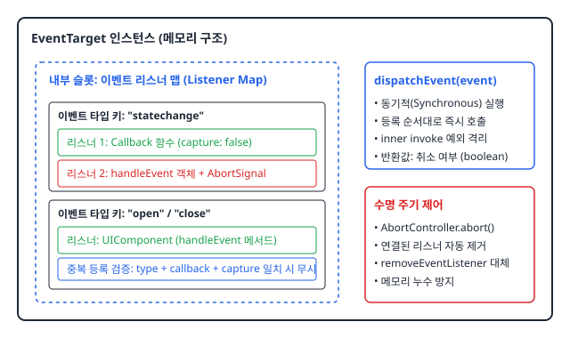
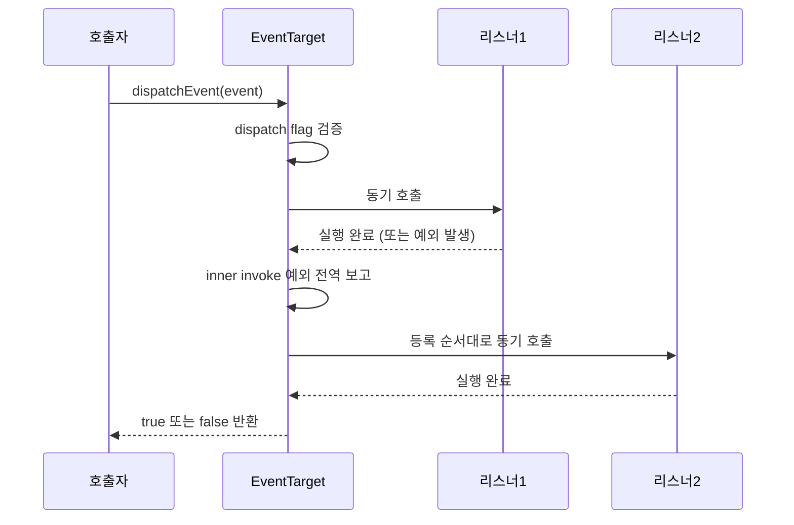

# 261109 EventTarget API

> 한 줄 요약 · 분야: 이벤트 · Baseline: Widely available (Safari 14, Chrome 64, Firefox 59 전역 생성자 지원) · 읽는 시간 약 6분

## 1. 왜 쓰는가
과거 웹 플랫폼 사양에서 EventTarget 인터페이스는 Node, Element, Document, Window 등 브라우저 내부 DOM 계층 구조에 속한 객체들만 암묵적으로 구현하는 추상 인터페이스에 불과했다 [2][3]. 독립적인 생성자 함수 `new EventTarget()`이 제공되지 않았기 때문에 개발자가 이를 직접 인스턴스화할 수 없었다 [2][3].

이로 인해 브라우저 DOM 트리와 직접 결합하지 않는 순수 JavaScript 비즈니스 로직, 상태 저장소, 독립 데이터 모델에서 이벤트 기반 발행-구독(Pub/Sub) 아키텍처를 구현하려면 심각한 구조적 비효율을 감수해야 했다 [3][6]. DOM과 무관한 클래스에서 표준 이벤트 시스템을 재사용하기 위해 보이지 않는 더미 `document.createDocumentFragment()` 노드를 메모리에 생성해 우회하거나, `EventEmitter` 또는 서드파티 발행-구독 라이브러리를 외부 번들에 추가해야만 했다 [3][6]. 이는 런타임 번들 크기를 증가시키고 플랫폼 표준과의 단절을 초래했다.

WHATWG DOM 표준은 이러한 한계를 해소하기 위해 `EventTarget()` 생성자를 공식 규격으로 제정했다 [1][3]. 이로써 순수 JavaScript 클래스에서도 DOM 노드 생성 우회나 외부 패키지 도입 없이 플랫폼 표준 인터페이스를 직접 상속하거나 인스턴스화하여 표준 이벤트 디스패치 파이프라인을 구축할 수 있게 되었다 [1][3].

## 2. 핵심 개념


EventTarget 인터페이스를 구성하는 핵심 용어와 구조적 사양은 다음과 같다.

- **EventTarget**: 이벤트를 수신할 수 있으며 등록된 리스너 목록을 관리하고 디스패치할 수 있는 인터페이스다 [1][2]. Web IDL 정의에서 `[Exposed=*]` 속성이 부여되어 있어 `Window`, `Worker`, `ServiceWorker` 등 모든 웹 전역 실행 스코프에 노출된다 [1].
- **EventListener**: 특정 이벤트가 디스패치되었을 때 호출되는 콜백 인터페이스다 [1][4]. 매개변수로 전달되는 `callback`은 일반 JavaScript 함수 형태뿐만 아니라 `handleEvent()` 메서드를 구현한 객체 참조를 지원한다 [4].
- **Event / CustomEvent**: 이벤트 디스패치 시 대상 객체에 전달되는 표준 이벤트 객체다 [1][5]. `EventTarget`의 기본 인스턴스는 임의의 문자열 인자를 직접 넘길 수 없으므로 부가 데이터를 전달할 때는 `CustomEvent`의 `detail` 프로퍼티를 활용한다.
- **내부 리스너 목록(Listener List)**: 각 EventTarget 인스턴스는 내부 슬롯에 이벤트 타입별 리스너 레코드를 배열 형태로 유지한다 [1]. 각 레코드는 `type`, `callback`, `capture`, `passive`, `once`, `signal` 플래그로 구성된다 [1][4].
- **AbortSignal / AbortController**: 이벤트 리스너 등록 시 `options.signal` 속성을 통해 연결되며, `AbortController.abort()` 호출 시 해당 리스너를 내부 목록에서 즉시 자동 제거하는 표준 수명 주기 제어 프리미티브다 [1][4].

## 3. 동작 원리
EventTarget의 이벤트 처리는 등록(Registration), 제거(Removal), 디스패치(Dispatching)의 3단계로 동작하며 WHATWG DOM 스펙의 정밀한 규칙에 따라 제어된다 [1].



### 1) 리스너 등록 및 중복 제거 규칙
`addEventListener(type, callback, options)`가 호출되면 브라우저는 대상 인스턴스의 내부 리스너 목록을 탐색한다 [1][4].
- `type`, `callback`, `capture` 플래그가 모두 일치하는 리스너가 목록에 이미 존재하면 중복 등록으로 간주하여 등록 동작을 완전히 무시한다 [1][4].
- 이때 `passive`, `once`, `signal` 옵션의 값이 기존 리스너와 다르더라도 앞선 세 가지 식별 속성이 일치하면 새 리스너는 추가되지 않는다 [1][4].

### 2) 리스너 제거 규칙
`removeEventListener(type, callback, options)` 호출 시 일치 여부 판별에는 오직 `type`, `callback`, `capture` 플래그만 사용된다 [1][4].
- `options` 객체에 전달된 `passive`, `once`, `signal`의 차이는 리스너 탐색 및 제거에 아무런 영향을 주지 않는다 [1][4].
- `capture` 플래그가 일치하지 않으면 제거되지 않고 목록에 그대로 유지된다 [1][4].

### 3) 동기 디스패치 및 inner invoke 예외 격리
`dispatchEvent(event)` 호출은 등록된 리스너들을 동기적(synchronously)으로 등록 순서에 맞춰 즉시 호출한다 [1][5].
- **dispatch flag 검증**: 전달된 이벤트 객체의 `dispatch flag`가 이미 설정되어 있거나 초기화되지 않은 상태라면 스펙에 따라 `InvalidStateError` DOMException이 발생하며 디스패치가 중단된다 [1][5].
- **inner invoke 단계의 예외 격리**: 특정 리스너 실행 도중 런타임 예외(throw)가 발생하더라도 브라우저는 WHATWG DOM 사양의 inner invoke 단계 규정에 따라 이를 잡아 전역 오류(report the exception)로 보고할 뿐, 후속 리스너들의 실행 흐름을 중단하지 않는다 [1].
- **취소 가능성 및 반환값**: 이벤트 리스너 내부에서 `event.preventDefault()`가 호출되면 `dispatchEvent()`는 최종적으로 `false`를 반환하고, 호출되지 않거나 이벤트가 취소 불가능(`cancelable: false`)하면 `true`를 반환한다 [1][5].

## 4. 기본 사용법
다음은 순수 `EventTarget` 인스턴스를 생성하고 `CustomEvent` 발송, `handleEvent` 객체 연동, `AbortSignal` 수명 주기 해제를 수행하는 실행 코드다.

```js
// 1. 독립적인 EventTarget 인스턴스를 생성한다.
const target = new EventTarget();

// 2. 리스너 수명 주기를 제어할 AbortController 인스턴스를 생성한다.
const controller = new AbortController();

// 3. 수신된 이벤트 데이터를 처리할 리스너 함수를 정의한다.
function handleCustomNotification(event) {
  console.log(event.detail.payload);
}

// 4. signal 옵션을 포함하여 custom-notification 이벤트 리스너를 등록한다.
target.addEventListener('custom-notification', handleCustomNotification, {
  signal: controller.signal
});

// 5. 전달할 데이터와 취소 가능 옵션을 명시하여 CustomEvent 인스턴스를 생성한다.
const notificationEvent = new CustomEvent('custom-notification', {
  detail: { payload: 100 },
  cancelable: true
});

// 6. 이벤트를 동기 디스패치하고 preventDefault 호출 여부에 따른 불리언 결과를 수신한다.
const isDispatched = target.dispatchEvent(notificationEvent);

// 7. 컨트롤러의 abort 메서드를 호출해 연결된 리스너를 즉시 일괄 제거한다.
controller.abort();
```

- **1행**: DOM 노드가 아닌 메모리 상의 독립 `EventTarget` 인스턴스를 생성하여 이벤트 발행-구독 대상으로 지정한다 [3].
- **4행**: 리스너 수명 주기를 외부에서 중단할 수 있도록 `AbortController`를 초기화한다 [4].
- **7~9행**: 디스패치된 `CustomEvent`의 `detail` 프로퍼티에서 페이로드 데이터를 추출해 처리하는 핸들러 함수를 정의한다 [5].
- **12~14행**: 대상 인스턴스에 `custom-notification` 이벤트 리스너를 등록하며, `options` 매개변수에 `controller.signal`을 넘겨 등록 레코드와 신호를 결속한다 [1][4].
- **17~20행**: 전달할 데이터를 담는 `detail` 객체와 리스너 내부에서 취소할 수 있도록 `cancelable: true` 플래그를 설정하여 `CustomEvent`를 초기화한다 [1][5].
- **23행**: `dispatchEvent()`를 실행하여 등록 순서대로 리스너를 동기 호출하고, `preventDefault()` 실행 여부에 따른 결과값(`true` 또는 `false`)을 `isDispatched` 변수에 할당한다 [1][5].
- **26행**: `controller.abort()`를 실행하여 대상 객체의 내부 슬롯에서 해당 리스너를 즉시 자동 제거함으로써 메모리 누수를 방지한다 [1][4].

## 5. 실무 예시

### 실무 예시 1: EventTarget을 상속한 Vanilla JS 경량 상태 관리 스토어
- **상황**: 외부 상태 관리 패키지(Redux, Zustand 등) 의존성 없이 순수 브라우저 표준 기능만으로 상태 변경을 감지하고 통지하는 단일 상태 저장소가 필요한 상황.
- **코드**:
```js
class StateStore extends EventTarget {
  #state;

  constructor(initialState = {}) {
    super();
    this.#state = initialState;
  }

  get state() {
    return Object.freeze({ ...this.#state });
  }

  setState(updates) {
    this.#state = { ...this.#state, ...updates };
    this.dispatchEvent(new CustomEvent('statechange', {
      detail: this.state
    }));
  }
}

const store = new StateStore({ count: 0 });
store.addEventListener('statechange', (e) => {
  console.log('상태 변경 감지:', e.detail.count);
});
store.setState({ count: 1 });
```
- **주의점**: `dispatchEvent()`는 동기적으로 모든 리스너를 즉시 실행한다 [1][5]. 따라서 `statechange` 리스너 콜백 내부에서 다시 `store.setState()`를 동기 호출할 경우 재진입(Re-entrancy)으로 인한 무한 재귀 호출이 발생하여 콜스택 초과(`RangeError`)가 일어난다. 또한 상태 객체의 불변성을 유지하지 않고 리스너 내부에서 직접 변조할 위험이 있으므로 `Object.freeze` 등으로 참조 데이터를 보호해야 한다.

### 실무 예시 2: handleEvent 패턴 및 AbortSignal을 결합한 컴포넌트 수명 주기 제어
- **상황**: 복수의 이벤트를 처리하는 클래스 컴포넌트에서 `bind(this)` 함수 래핑으로 인한 가비지 생성과 컨텍스트 손실을 없애고, 언마운트 시점에 모든 리스너를 단 한 번의 호출로 일괄 해제해야 하는 상황.
- **코드**:
```js
class UIComponent {
  #controller = new AbortController();
  #target;

  constructor(target) {
    this.#target = target;
    const { signal } = this.#controller;

    // 함수 클로저나 .bind(this) 없이 객체 자체를 리스너로 등록
    this.#target.addEventListener('open', this, { signal });
    this.#target.addEventListener('close', this, { signal });
  }

  handleEvent(event) {
    switch (event.type) {
      case 'open':
        this.#onOpen(event);
        break;
      case 'close':
        this.#onClose(event);
        break;
    }
  }

  #onOpen(e) { console.log('열림 처리:', e); }
  #onClose(e) { console.log('닫힘 처리:', e); }

  destroy() {
    // 단 한 번의 abort() 호출로 등록된 모든 리스너 일괄 해제
    this.#controller.abort();
  }
}
```
- **주의점**: `handleEvent` 객체 인터페이스 등록은 컴포넌트 인스턴스 참조 자체를 EventTarget 내부 슬롯에 유지시킨다 [4]. 대상 `target` 인스턴스가 장기 존속하는 경우 `destroy()`를 통한 `abort()` 신호 전달을 누락하면 컴포넌트 객체 전체가 가비지 컬렉터의 수거 대상에서 제외되어 영구 메모리 누수가 발생한다 [1][4].

## 6. 장점 · 단점

| 장점 | 단점 |
| :--- | :--- |
| **제로 번들 사이즈**: 브라우저 및 WinterCG 런타임 엔진에 기본 내장되어 별도 외부 패키지(`EventEmitter` 등) 추가 없이 완전한 발행-구독 시스템을 구축할 수 있다 [8]. | **문법적 보일러플레이트**: Node.js `EventEmitter`의 `emit(type, ...args)`과 달리 매번 `new CustomEvent(type, { detail })` 인스턴스를 별도 생성해 전달해야 하므로 코드가 장황해진다. |
| **웹 표준 비동기 프리미티브 통합**: `Event`, `CustomEvent`, `AbortController`/`AbortSignal` 등 웹 플랫폼의 핵심 표준 프리미티브와 네이티브하게 결합된다 [1][4]. | **와일드카드 및 패턴 구독 미지원**: 와일드카드(`*`) 이벤트 청취나 정규식 매칭을 통한 다중 이벤트 일괄 구독 기능이 표준 스펙에 존재하지 않는다. |
| **안전한 예외 격리**: WHATWG DOM 스펙의 inner invoke 정의에 따라 특정 리스너에서 예외가 발생하더라도 후속 리스너 실행이 중단되지 않고 안정적으로 완수된다 [1]. | **동기 디스패치 모델의 제약**: 기본 디스패치 모델이 동기 방식이므로, 비동기 리스너의 완료를 대기하거나 Promise 체인과 직접 결합하려면 별도 비동기 래핑 레이어가 필요하다 [1][5]. |
| **`handleEvent` 인터페이스 지원**: 함수 클로저 생성이나 명시적인 `.bind(this)` 없이 클래스 인스턴스 단일 참조로 다중 이벤트를 라우팅하고 깔끔하게 해제할 수 있다 [4]. | **리스너 우선순위 제어 불가**: 리스너 우선순위(Priority) 부여 기능이나 목록 맨 앞 삽입(`prependListener`) 같은 미세 리스너 제어 메커니즘을 지원하지 않는다. |
| **크로스 런타임 호환성**: WinterCG 사양에 채택되어 브라우저뿐만 아니라 Node.js, Deno, Bun, Cloudflare Workers 전반에서 동일한 코드를 재사용할 수 있다 [8]. | |

## 7. 한계와 함정
EventTarget을 실무에서 운용할 때 마주하는 구조적 한계와 잠재적 함정은 다음과 같다.

- **동기적 실행 블로킹 (성능)**: `dispatchEvent()`는 등록된 모든 리스너를 동기적으로 순회 호출하여 완료될 때까지 실행 흐름을 블로킹한다 [1][5]. 특정 리스너 콜백에서 무거운 동기 연산이 수행되면 이벤트 발송 지점에서 UI 렌더링 스레드가 즉시 중단되어 심각한 프레임 드롭이 발생한다.
- **재진입(Re-entrancy) 무한 루프 (경계 사례)**: 이벤트 리스너 실행 도중 동일한 상태 변경이나 이벤트를 다시 `dispatchEvent()`하면 콜스택 초과(`RangeError`)가 발생하거나 상태 역전 현상이 일어난다.
- **DOM 계층 트리 부재 (경계 사례)**: `new EventTarget()`으로 직접 생성한 독립 인스턴스는 DOM 트리에 배치되지 않는다. 따라서 `CustomEvent` 생성 시 `bubbles: true` 옵션을 명시하더라도 부모 노드로의 캡처링(Capturing) 및 버블링(Bubbling) 전파 단계가 전혀 동작하지 않는다.
- **이벤트 객체 재사용 불가 (경계 사례)**: 이미 디스패치 중이거나 디스패치가 완료된 단일 `Event` 객체를 다른 `dispatchEvent()` 호출에 재사용하려고 시도하면 `InvalidStateError` DOMException이 발생하므로 매 디스패치마다 반드시 새로운 이벤트 인스턴스를 생성해야 한다 [1][5].
- **참조 유지로 인한 메모리 누수 (경계 사례)**: 장기 존속하는 전역 객체나 서비스 인스턴스에 단기 수명 주기를 갖는 컴포넌트의 리스너를 등록한 뒤 `removeEventListener`나 `AbortSignal`로 해제하지 않으면 해당 컴포넌트가 가비지 컬렉션(GC)되지 않고 메모리에 영구 잔존한다 [1][4].
- **보안 및 데이터 노출 (보안 · 개인정보)**: EventTarget은 `[Exposed=*]` 속성으로 인해 전역 스코프 어디서나 접근 가능하다 [1]. `CustomEvent`의 `detail` 프로퍼티에 민감한 사용자 개인정보나 인가 토큰을 객체 참조 형태로 직접 노출할 경우, 동일 런타임 내의 의도치 않은 서드파티 스크립트나 리스너에 의해 데이터가 변조되거나 탈취될 위험이 있다.
- **접근성 연계 한계 (접근성)**: 순수 `EventTarget` 인스턴스는 화면에 렌더링되는 DOM 노드가 아니므로 스크린 리더와 같은 보조 기술(AT)에 접근성 트리 변경 사항을 직접 전달하지 못한다. 상태 변경 통지가 UI에 반영될 때는 반드시 관련 DOM 요소의 ARIA 라이브 영역(aria-live) 갱신 등 표준 DOM 접근성 속성과 연동되어야 한다.

## 8. 다른 방법과 비교

| 방법 | 언제 | 비용 | 한계 |
| :--- | :--- | :--- | :--- |
| **EventTarget** | 브라우저 및 엣지 런타임에서 제로 번들로 표준 비동기 프리미티브(`AbortSignal` 등)와 결합된 발행-구독 시스템이 필요할 때 [1][4][8] | 번들 크기 0KB (내장 API) | `CustomEvent` 생성 보일러플레이트 존재, 와일드카드 구독 및 우선순위 제어 불가, 비동기 디스패치 미지원 [1][5] |
| **Node.js EventEmitter** | Node.js 환경에서 가변 인자(`emit('event', ...args)`)를 간결하게 전달하고 `prependListener` 등 풍부한 리스너 제어가 필요할 때 | Node.js 내장 (브라우저 도입 시 폴리필 번들 오버헤드 발생) | 브라우저 표준 DOM 이벤트 객체 규격이나 `AbortSignal`과의 네이티브 연동이 제한적임 |
| **초경량 Pub/Sub (mitt, nanoevents)** | 수백 바이트 단위의 극소 번들 크기와 함수형 간결성을 갖춘 인메모리 이벤트 버스가 필요할 때 | 수백 바이트 번들 추가 | 외부 의존성이 추가되며 표준 `handleEvent` 객체 패턴이나 `AbortSignal` 옵션 연동을 자체 지원하지 않음 |
| **RxJS / Observable** | 이벤트 스트림에 대한 필터링, 매핑, 디바운스(`debounceTime`) 등 복잡한 반응형 연산자 합성이 필수적일 때 | 큰 런타임 번들 크기 추가 및 높은 학습 곡선 | 단순 모듈 간 이벤트 전달 용도로는 런타임 메모리 및 번들 오버헤드가 과도함 |
| **BroadcastChannel API** | 동일 출처(origin) 내 서로 다른 탭, 창, iframe, 웹 워커 간 브로드캐스트 메시징이 필요할 때 | 브라우저 내장 0KB (프로세스 간 통신 비용) | 구조화 복제(Structured Clone) 알고리즘 오버헤드가 발생하여 단일 런타임 내 모듈 간 통신에는 비효율적임 |

### 이것을 고르지 않는 경우
- 이벤트 발행 시 임의의 가변 인자들을 배열이나 단일 객체 래핑 없이 `emit('type', arg1, arg2)` 형태로 간결하게 넘기고자 하거나 리스너 실행 순서를 인위적으로 조정해야 하는 경우 Node.js `EventEmitter`를 선택하는 것이 적합하다.
- 이벤트 흐름 제어에 `debounceTime`, `switchMap`, `filter` 등 고도화된 선언적 리액티브 스트림 조작이 필수적인 대규모 비동기 데이터 파이프라인의 경우 `RxJS`가 적합하다.
- 동일 런타임 스레드 내부가 아니라 여러 브라우저 탭이나 서비스 워커 간에 프로세스 경계를 넘는 데이터 동기화가 주 목적인 경우 구조화 복제를 기본 제공하는 `BroadcastChannel API`를 사용해야 한다.

## 9. 대비와 새로운 시도
웹 플랫폼 사양 그룹에서는 EventTarget의 한계를 보완하고 현대적 비동기 패러다임과 결합하기 위한 표준화 작업을 지속하고 있다.

- **Observable API (WICG / WHATWG DOM)**: `EventTarget.prototype.when()` 메서드 등을 도입하여 DOM 및 커스텀 이벤트를 다중 비동기 스트림(Observable)으로 변환할 수 있는 차세대 웹 플랫폼 표준이다 [7]. 이를 통해 외부 라이브러리(RxJS) 없이도 브라우저 네이티브 환경에서 선언적 조합, 변형, 구독 해제가 가능해지며, 현재 Chromium 엔진을 중심으로 프로토타입 구현 및 표준화 절차가 진행되고 있다 [7].
- **AbortSignal.any() 표준화 (Baseline Widely available)**: 여러 개의 `AbortSignal` 조건을 하나로 결합할 수 있는 표준 정적 메서드가 모든 메이저 브라우저에 정식 배포되었다 [1][4]. 컴포넌트 언마운트 신호와 타임아웃 신호 등 복수의 중단 조건을 단일 신호로 합성하여 `addEventListener`의 수명 주기를 정밀하게 일괄 정리할 수 있다 [1][4].
- **WinterCG Common Minimum API 사양 고도화**: WinterCG(Web-interoperable Runtimes Community Group)는 브라우저뿐만 아니라 Cloudflare Workers, Node.js, Deno, Bun 등 비-브라우저 자바스크립트 런타임 간에 `EventTarget` 및 `CustomEvent` 동작 사양을 완벽히 일치시키기 위한 공통 최소 웹 플랫폼 사양을 지속적으로 확장하고 있다 [8].

## 10. 다른 사람에게 설명하기

### 세 문장 요약
1. EventTarget API는 과거 DOM 노드에서만 배타적으로 구현되던 추상 인터페이스를 확장하여, 독립 생성자 `new EventTarget()`을 통해 순수 JavaScript 객체에서도 브라우저 및 런타임 표준 이벤트 발행-구독 메커니즘을 제로 번들로 구축할 수 있게 만든 핵심 플랫폼 규격이다 [1][3][8].
2. `addEventListener`, `removeEventListener`, 그리고 동기적으로 실행되는 `dispatchEvent`를 축으로 동작하며, `handleEvent` 객체 인터페이스와 `AbortSignal` 기반 수명 주기 제어, 그리고 WHATWG DOM 사양에 명시된 inner invoke 예외 격리 메커니즘을 제공한다 [1][4][5].
3. Chrome 64, Firefox 59, Safari 14에 걸쳐 Baseline Widely available 상태를 충족하고 WinterCG를 통해 서버 및 엣지 런타임 전반으로 통일되었으며, 향후 이벤트 스트림을 네이티브로 다루는 Observable API와의 결합으로 진화하고 있다 [2][6][7][8].

### 스스로 확인할 질문
- Q1. `addEventListener`에 동일한 이벤트 타입과 콜백 함수를 등록할 때, 어떤 `options` 조건이 일치해야 중복 등록으로 판별되어 무시되는가?
- Q2. `dispatchEvent()` 호출 시 특정 리스너에서 런타임 예외가 발생하거나 `preventDefault()`가 호출되었을 때, 각각 후속 리스너들의 실행 흐름과 메서드 반환값에는 어떤 차이가 발생하는가?
- Q3. `new EventTarget()`으로 생성한 독립 인스턴스에서 디스패치된 `CustomEvent`의 `bubbles: true` 설정이 DOM 트리 계층 구조와 달리 상위로 전파되지 않는 구조적 원인은 무엇인가?

## 참고 자료
1. [WHATWG DOM Standard: Interface EventTarget & Dispatching Events](https://dom.spec.whatwg.org/#interface-eventtarget)
2. [MDN Web Docs: EventTarget](https://developer.mozilla.org/en-US/docs/Web/API/EventTarget)
3. [MDN Web Docs: EventTarget() constructor](https://developer.mozilla.org/en-US/docs/Web/API/EventTarget/EventTarget)
4. [MDN Web Docs: EventTarget.addEventListener()](https://developer.mozilla.org/en-US/docs/Web/API/EventTarget/addEventListener)
5. [MDN Web Docs: EventTarget.dispatchEvent()](https://developer.mozilla.org/en-US/docs/Web/API/EventTarget/dispatchEvent)
6. [WebKit Blog: New WebKit Features in Safari 14](https://webkit.org/blog/11340/new-webkit-features-in-safari-14/)
7. [Chrome Platform Status: Observable API](https://chromestatus.com/feature/5154593776599040)
8. [WinterCG: Common Minimum Web Platform API](https://github.com/wintercg/proposal-common-minimum-api)
조사: 2026-11-09

## 내 리뷰
(읽고 느낀 점 · 궁금한 것을 적는다. 질문은 Q. 로 시작)
