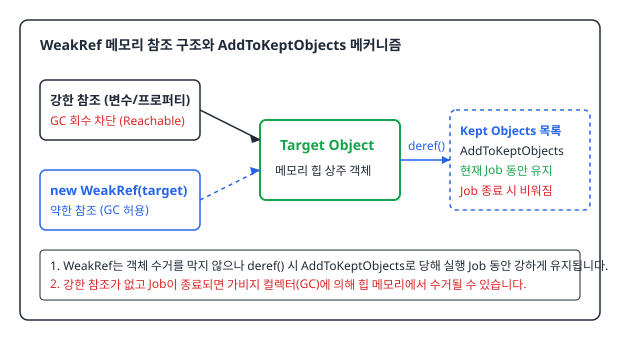
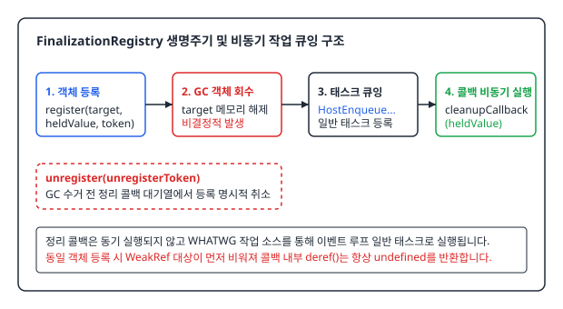

# 261110 WeakRef와 FinalizationRegistry

> 한 줄 요약 · 분야: 언어 기능 · Baseline: Widely available — Chrome 84+, Firefox 79+, Safari 14.1+ 및 Node.js 14.6+에서 2021년 4월 이후 전면 지원되어 30개월 이상 안정적으로 정착된 Baseline Widely available 상태임 · 읽는 시간 약 8분

## 1. 왜 쓰는가
기존 JavaScript의 모든 변수와 객체 프로퍼티는 강한 참조(Strong Reference)로 동작한다. 강한 참조가 유지되는 한, 가비지 컬렉터(GC)는 해당 객체가 루트(Root)로부터 도달 가능한(reachable) 상태라고 판단하여 메모리에서 회수하지 않는다 [4]. 이로 인해 캐시나 부수 데이터 구조에 객체를 등록해 두고 명시적으로 참조를 제거하지 않으면 메모리 누수(Memory Leak)가 필연적으로 발생했다 [4].

ES2015에서 도입된 WeakMap과 WeakSet은 키(Key)에 대해서만 약한 참조를 지원하며 열거(Enumeration)가 불가능하다 [1]. 따라서 WeakMap과 WeakSet은 독립된 단일 객체 자체에 직접 약한 참조를 걸 수 없으며, 객체가 가비지 컬렉터에 의해 수거되는 시점에 연계된 외부 리소스를 정리하는 작업도 수행할 수 없었다 [1].

이러한 제약은 대규모 그래픽 및 비트맵 캐시 관리, WebAssembly 네이티브 메모리 바인딩 해제, DOM 요소와 결합된 부수 인스턴스 정리 등 저수준 시스템 설계에서 심각한 한계로 작용했다 [4]. 대상 객체의 메모리 회수를 방해하지 않으면서도 필요 시점에 안전하게 역참조하고, 객체가 실제로 회수된 직후 후속 정리 작업을 비동기로 트리거할 수 있는 표준 규격의 필요성이 대두되었다 [4]. WeakRef와 FinalizationRegistry는 이 문제를 해결하기 위해 ECMAScript 2021(ES12) 언어 표준 규격으로 도입되었다.

## 2. 핵심 개념
WeakRef와 FinalizationRegistry는 힙 메모리 관리의 유연성을 확보하기 위해 다음 핵심 용어와 구조를 정의한다.



1. 강한 참조(Strong Reference)와 약한 참조(Weak Reference): 강한 참조는 런타임이 객체의 생존을 보장하도록 만드는 참조다 [4]. 반면 약한 참조는 대상 객체(target)를 가리키지만 가비지 컬렉터의 수거를 방해하지 않는다 [2].
2. WeakRef와 deref(): `new WeakRef(target)` 생성자로 인스턴스를 생성한다 [2]. 내부 메서드 `deref()`를 호출하면 대상 객체가 아직 가비지 컬렉터에 의해 수거되지 않은 경우 해당 객체의 실제 참조를 반환하고, 이미 수거된 경우 `undefined`를 반환한다 [2].
3. 읽기 일관성(Read Consistency)과 AddToKeptObjects(target): 코드 실행 도중 동일 턴 내에서 객체가 갑작스럽게 수거되어 참조가 소멸하는 문제를 방지하기 위한 사양 수준의 내부 추상 연산이다 [1]. WeakRef를 생성하거나 `deref()`를 호출하여 객체를 성공적으로 획득하는 순간, 해당 객체는 ECMAScript 내부 목록인 KeptObjects에 등록되어 현재 실행 Job(이벤트 루프 턴) 동안 강하게 유지된다 [1].



4. FinalizationRegistry: `new FinalizationRegistry(cleanupCallback)` 생성자로 인스턴스화한다 [3]. 등록된 대상 객체가 가비지 컬렉션된 후 호출될 정리 콜백을 관리한다 [3].
5. heldValue: `register(target, heldValue, unregisterToken)` 메서드로 객체를 등록할 때 전달하는 정리 메타데이터다 [3]. target이 가비지 컬렉터에 의해 수거된 후 `cleanupCallback(heldValue)` 형태로 전달된다 [3]. 이때 heldValue는 target 객체 자체를 참조해서는 안 된다 [3].
6. unregisterToken: 등록된 객체가 수거되기 전에 `unregister(unregisterToken)` 메서드를 호출하여 정리 콜백 대기열에서 해당 등록을 명시적으로 취소할 수 있도록 식별하는 토큰이다 [3].

## 3. 동작 원리
WeakRef와 FinalizationRegistry의 동작은 ECMAScript 언어 사양과 WHATWG HTML 이벤트 루프 사양의 명확한 연동 규칙을 기반으로 실행된다.

```diagram
종류: 시퀀스

[애플리케이션]
[WeakRef 및 FR]
[가비지 컬렉터]
[이벤트 루프 태스크 큐]

애플리케이션 -> WeakRef 및 FR : deref 호출
WeakRef 및 FR -> 애플리케이션 : AddToKeptObjects 등록 후 객체 반환
== 현재 Job 동안 수거 방지 ==
가비지 컬렉터 -> 가비지 컬렉터 : Job 종료 후 객체 메모리 회수
가비지 컬렉터 -> 이벤트 루프 태스크 큐 : HostEnqueueFinalizationRegistryCleanupJob 호출
이벤트 루프 태스크 큐 -> 애플리케이션 : cleanupCallback 비동기 실행 및 heldValue 전달
```

ECMAScript 사양은 읽기 일관성(Read Consistency)을 보장하기 위해 WeakRef 생성 및 `deref()` 실행 시 추상 연산 `AddToKeptObjects(target)`를 호출하도록 규정한다 [1]. `AddToKeptObjects`에 등록된 객체는 현재 마이크로태스크 체크포인트 또는 Job이 완료될 때까지 가비지 컬렉터에 의해 수거되지 않는다 [1]. 해당 Job이 완전히 종료되는 시점에 엔진은 Kept Objects 목록을 비워 다음 턴부터 객체가 정상적으로 GC 대상이 되도록 만든다 [1].

가비지 컬렉터가 강한 참조가 사라진 target 객체를 메모리에서 회수하면, FinalizationRegistry의 콜백 호출 단계로 진입한다. WHATWG HTML 표준은 TC39 사양의 `HostEnqueueFinalizationRegistryCleanupJob` 훅을 구현한다 [5]. 브라우저는 객체가 수거되었다고 해서 정리 콜백을 그 즉시 동기적으로 실행하지 않는다 [5]. 대신 연관된 글로벌 객체의 JavaScript 엔진 작업 소스(Task Source)에 일반 태스크로 큐잉하여 이벤트 루프에서 비동기로 안전하게 실행한다 [5]. 이를 통해 정리 콜백 실행 도중 메인 스레드 실행 상태가 오염되거나 락이 발생하는 현상을 방지한다 [5].

동일한 객체에 WeakRef와 FinalizationRegistry가 모두 등록된 경우, 객체 회수 시점에 WeakRef의 대상 포인터가 먼저 또는 동시에 비워진다 [3]. 따라서 FinalizationRegistry의 정리 콜백 내부에서 해당 WeakRef에 대해 `deref()`를 호출하면 항상 `undefined`가 반환된다 [3].

## 4. 기본 사용법
다음은 WeakRef와 FinalizationRegistry의 기본 API를 사용하여 객체를 등록하고, 참조를 확인하며, 등록을 취소하는 완전한 JavaScript 코드다.

```js
// 1. 관찰 대상 객체 및 등록 취소 토큰 생성
let cacheTarget = { id: "res-001", data: "heavy-payload" };
const unregisterToken = { tokenKey: "token-res-001" };

// 2. WeakRef 인스턴스 생성
const targetWeakRef = new WeakRef(cacheTarget);

// 3. FinalizationRegistry 인스턴스 생성
const registry = new FinalizationRegistry((heldValue) => {
  console.log("객체 수거 후 정리 실행, heldValue:", heldValue);
});

// 4. 대상 객체, 정리 인자(heldValue), 등록 취소 토큰 등록
registry.register(cacheTarget, cacheTarget.id, unregisterToken);

// 5. deref()를 통한 대상 객체 접근
const resolvedObject = targetWeakRef.deref();

// 6. 객체 생존 여부 분기 처리
if (resolvedObject !== undefined) {
  console.log("객체 접근 성공:", resolvedObject.data);
} else {
  console.log("객체가 이미 가비지 컬렉터에 의해 수거됨");
}

// 7. 조건부 등록 취소 예시 (필요 시 주석 해제하여 취소 가능)
// registry.unregister(unregisterToken);

// 8. 외부 강한 참조 해제
cacheTarget = null;
```

줄별 동작 설명:
- 1행: 힙 메모리에 할당될 실제 대상 객체 `cacheTarget`과 등록 취소에 사용할 고유 참조 객체 `unregisterToken`을 생성한다.
- 4행: `new WeakRef(cacheTarget)`를 호출하여 대상 객체를 가리키는 약한 참조 인스턴스 `targetWeakRef`를 생성한다 [2].
- 7~9행: `new FinalizationRegistry`를 통해 정리 콜백을 정의한 레지스트리 인스턴스를 생성한다. 콜백은 전달받은 `heldValue`를 인자로 소비한다 [3].
- 12행: `registry.register()`를 호출하여 `cacheTarget`을 감시 대상으로 등록하고, 소멸 시 전달할 원시 식별자(`cacheTarget.id`)와 등록 취소용 토큰(`unregisterToken`)을 바인딩한다 [3].
- 15행: `targetWeakRef.deref()`를 호출하여 대상 객체의 도달 가능성을 확인한다. 이때 객체가 존재하면 `AddToKeptObjects`가 실행되어 현재 실행 Job 동안 객체가 보존된다 [1, 2].
- 18~22행: 반환값이 `undefined`가 아닌 경우 정상적으로 비즈니스 로직을 수행하고, `undefined`인 경우 재생성 또는 캐시 미스 로직으로 분기한다 [2].
- 25행: 객체가 수거되기 전에 `registry.unregister(unregisterToken)`을 호출하면 등록된 정리 콜백 대기열에서 해당 항목이 명시적으로 제거된다 [3].
- 28행: 원본 변수에 `null`을 대입하여 루트 도달 가능성을 끊고, 가비지 컬렉터가 객체를 회수할 수 있는 상태로 전환한다 [4].

## 5. 실무 예시

### 예시 1: 대규모 이미지 및 그래픽 LRU 캐시
- **상황**: 고해상도 비트맵이나 디코딩된 이미지 객체를 메모리에 캐싱하되, LRU 큐의 강한 참조 한도를 초과해 밀려나더라도 메모리 여유가 있는 동안에는 `deref()`로 재사용하고 메모리 압박 시 GC가 자동 수거하도록 설계한다.
- **코드**:
```js
class ImageLruCache {
  constructor(strongLimit = 2) {
    this.strongLimit = strongLimit;
    this.strongCache = new Map();
    this.weakCache = new Map();
  }

  set(key, imageBitmap) {
    this.weakCache.set(key, new WeakRef(imageBitmap));
    this.strongCache.set(key, imageBitmap);

    if (this.strongCache.size > this.strongLimit) {
      const oldestKey = this.strongCache.keys().next().value;
      this.strongCache.delete(oldestKey);
    }
  }

  get(key) {
    if (this.strongCache.has(key)) {
      const hit = this.strongCache.get(key);
      this.strongCache.delete(key);
      this.strongCache.set(key, hit);
      return hit;
    }

    const ref = this.weakCache.get(key);
    if (!ref) {
      return null;
    }

    const cachedImage = ref.deref();
    if (cachedImage !== undefined) {
      this.strongCache.set(key, cachedImage);
      return cachedImage;
    }

    this.weakCache.delete(key);
    return null;
  }
}
```
- **주의점**: `deref()`의 반환값은 항상 `undefined` 검사를 거쳐야 한다 [2]. 또한 `deref()`를 호출한 순간 `AddToKeptObjects`에 의해 해당 객체는 현재 이벤트 루프 Job 동안 강하게 유지되므로 즉각적인 메모리 해제가 다음 틱 이후로 지연된다 [1].

### 예시 2: WebAssembly 네이티브 메모리 자동 해제
- **상황**: Emscripten 및 Wasm 바인딩 라이브러리에서 JavaScript 래퍼 객체가 GC될 때 FinalizationRegistry 콜백을 통해 WebAssembly 인스턴스의 C/C++ 네이티브 힙 메모리(`_free`)를 자동으로 정리한다.
- **코드**:
```js
class WasmBufferWrapper {
  static registry = new FinalizationRegistry((nativePointer) => {
    Module._free(nativePointer);
  });

  constructor(byteSize) {
    this.pointer = Module._malloc(byteSize);
    this.size = byteSize;
    WasmBufferWrapper.registry.register(this, this.pointer, this);
  }

  dispose() {
    if (this.pointer !== null) {
      WasmBufferWrapper.registry.unregister(this);
      Module._free(this.pointer);
      this.pointer = null;
    }
  }
}
```
- **주의점**: `FinalizationRegistry`의 콜백이나 `heldValue`가 대상 객체(`this`)를 클로저 등으로 직접 혹은 간접 참조하면 강한 참조가 유지되어 객체가 영원히 가비지 컬렉션되지 않고 콜백도 실행되지 않는 메모리 누수가 발생한다 [3]. 반드시 `heldValue`에는 원시 포인터 주소(number)만 전달해야 한다 [3].

### 예시 3: 메모리 누수 진단 도구
- **상황**: Meta의 Memlab이나 프레임워크 성능 측정기에서 페이지 전환 또는 컴포넌트 언마운트 후 잔존 객체를 WeakRef로 보관하고, 강제 GC 이후에도 `deref()`가 객체를 반환하는지 검사하여 메모리 누수를 자동으로 감지한다.
- **코드**:
```js
class LeakDetector {
  constructor() {
    this.trackedObjects = new Map();
  }

  track(id, instance) {
    this.trackedObjects.set(id, new WeakRef(instance));
  }

  verifyLeaks() {
    const leakReports = [];
    for (const [id, ref] of this.trackedObjects.entries()) {
      const aliveInstance = ref.deref();
      if (aliveInstance !== undefined) {
        leakReports.push({ id, status: "LEAK_DETECTED" });
      } else {
        this.trackedObjects.delete(id);
      }
    }
    return leakReports;
  }
}
```
- **주의점**: 브라우저 엔진(V8, JavaScriptCore, SpiderMonkey)마다 가비지 컬렉션 주기와 메모리 임계치가 다르므로, 단 한 번의 검사로 메모리 누수를 단정할 수 없다 [4]. GC는 완전히 비결정적으로 동작하므로 관찰 주기를 분리하여 검증해야 한다 [4].

## 6. 장점 · 단점

| 장점 | 단점 |
| :--- | :--- |
| 가비지 컬렉터의 메모리 회수를 방해하지 않으면서도 필요 시점에 객체를 안전하게 참조할 수 있어 불필요한 메모리 누수를 원천 차단한다. [2] | 가비지 컬렉터(GC)의 수거 시점과 주기가 완전히 비결정적(non-deterministic)이어서 정리 콜백의 실행 시점이나 deref()의 반환값을 예측할 수 없다. [4] |
| 객체가 실제로 수거된 이후에만 외부 리소스(Wasm 힙 메모리, 네이티브 버퍼 등)를 정리하는 안전한 공식 표준 경로를 제공한다. [3] | 브라우저 엔진(V8, JavaScriptCore, SpiderMonkey)마다 가비지 컬렉션 최적화 휴리스틱, 세대별 GC 주기, 메모리 임계치 동작 방식이 달라 실행 환경에 따른 동작 편차가 크다. [4] |
| 기존 WeakMap과 WeakSet과 달리 개별 객체 자체를 단독으로 약하게 참조할 수 있으며 객체의 소멸 여부를 관찰할 수 있다. [1] | 정리 콜백 호출이 한참 지연되거나 프로세스/페이지 종료 시점까지 아예 실행되지 않을 수도 있어 필수적인 핵심 자원 정리에 사용할 수 없다. [3] |
| 브라우저 메모리 압박 상황에서 덜 중요한 캐시 데이터를 엔진이 자체적으로 수거할 수 있도록 협력적인 메모리 관리를 구현할 수 있다. | GC 내부 동작에 의존하는 코드가 늘어날수록 로컬 환경과 프로덕션 환경 사이의 불일치 및 재현하기 어려운 타이밍 버그가 발생하기 쉽다. [4] |

## 7. 한계와 함정
WeakRef와 FinalizationRegistry를 다룰 때에는 다음과 같은 시스템적 한계와 함정을 필히 숙지해야 한다.

1. 성능 및 즉각 회수 지연: `deref()`가 호출되는 순간 ECMAScript 내부 메커니즘인 `AddToKeptObjects`에 의해 대상 객체는 현재 실행 Job 동안 강하게 유지된다 [1]. 이로 인해 실제 메모리 해제가 다음 이벤트 루프 틱 이후로 지연되는 오버헤드가 발생한다 [1].
2. 보안 및 타이밍 공격(사이드 채널): 가비지 컬렉션의 수거 타이밍을 세밀하게 관찰할 수 있게 되면 메모리 레이아웃 추론이나 크로스 오리진 리소스 크기 파악 등 사이드 채널 공격의 경로로 악용될 위험이 존재한다 [5]. 이러한 보안 취약점을 차단하기 위해 WHATWG HTML 사양은 정리 콜백 실행을 동기 호출이 아닌 비동기 일반 태스크로 분리하여 관찰 해상도를 낮추도록 제한했다 [5].
3. 클로저로 인한 순환 참조 함정: `FinalizationRegistry`의 정리 콜백 또는 `heldValue`가 관찰 대상 객체(`target`)를 클로저 등으로 직접 혹은 간접 참조하면 강한 참조가 생성된다 [3]. 이 경우 가비지 컬렉터가 객체를 절대 수거할 수 없게 되어 정리 콜백도 영원히 실행되지 않는 치명적인 메모리 누수가 발생한다 [3].
4. 동일 객체 등록 시 deref() 반환 한계: 동일한 객체에 WeakRef와 FinalizationRegistry를 모두 등록한 경우, 객체 회수 시점에 WeakRef 대상이 먼저 또는 동시에 비워진다 [3]. 따라서 FinalizationRegistry 정리 콜백 내부에서 해당 WeakRef에 대해 `deref()`를 호출하면 객체를 복구할 수 없으며 항상 `undefined`가 반환된다 [3].
5. 접근성 및 핵심 비즈니스 로직 의존 금지: 화면 상태 업데이트, 폼 데이터 커밋, 접근성 트리 동기화, 사용자 인증 토큰 관리 등 프로그램의 정확성과 사용자 경험에 직결되는 핵심 로직을 비결정적인 GC 타이밍에 의존시키는 것은 엄격히 금지된다. GC 최적화 휴리스틱과 세대별 주기는 엔진마다 상이하며, 프로세스나 탭이 종료되는 시점에는 정리 콜백이 아예 호출되지 않을 수 있다 [3, 4].

## 8. 다른 방법과 비교

| 방법 | 언제 | 비용 | 한계 |
| :--- | :--- | :--- | :--- |
| **WeakRef & FinalizationRegistry** | 단일 객체의 생명주기 관찰, 협력적 캐시 데이터 관리, Wasm 네이티브 메모리 자동 해제 시 [3, 4] | 엔진 내부 KeptObjects 관리 오버헤드 및 비동기 작업 큐잉 비용 발생 [1, 5] | GC 수거 시점의 비결정성, 런타임 간 동작 편차, 프로세스 종료 시 미실행 가능성 [3, 4] |
| **WeakMap & WeakSet** | 객체 외부로 메타데이터를 노출하지 않고 프라이빗 데이터를 안전하게 연결 및 캡슐화할 때 | 내부적인 약한 해시 테이블 참조 오버헤드 (상대적으로 매우 낮음) | 키에 대해서만 약한 참조를 지원하며, 객체 열거 및 GC 소멸 시점 관찰 불가 [1] |
| **명시적 자원 관리 (using & Symbol.dispose)** | 파일 디스크립터, 소켓, 락(Lock) 등 즉각적인 결정론적 회수가 필수적인 자원 정리 시 | 블록 스코프 탈출 시 즉각적인 Dispose 메서드 동기 실행 비용 | 스코프 블록 기반(RAII)이므로 비동기 분산 수명주기에는 직접 적용 불가 |
| **AbortController 및 수동 이벤트 핸들러 해제** | 컴포넌트 마운트/언마운트와 직결된 이벤트 리스너 취소 및 네트워크 작업 중단 시 | AbortSignal 생성 및 이벤트 디스패치 관리 오버헤드 | 개발자가 명시적으로 abort() 메서드를 호출해야 하며 누락 시 자원 누수 잔존 |

이것을 고르지 않는 경우:
- 객체 외부로 데이터를 안전하게 은닉하거나 프라이빗 상태를 연결할 때는 WeakRef보다 버그 발생 가능성이 없고 메모리 누수 위험이 없는 WeakMap을 선택해야 한다.
- 파일 디스크립터, 네트워크 소켓, 동기화 잠금 등 즉각적이고 결정론적인 자원 회수가 요구되는 경우에는 비결정적인 FinalizationRegistry 대신 명시적 자원 관리(`using`)를 사용해야 한다.
- UI 생명주기와 결합된 DOM 이벤트 리스너나 비동기 요청 취소 작업에는 GC 수거를 기다리지 않고 `AbortController`를 통해 즉시 해제해야 한다.

## 9. 대비와 새로운 시도
ECMAScript 표준 위원회는 약한 참조와 자원 관리의 한계를 극복하기 위해 지속적인 표준 확장을 진행하고 있다.

1. Symbols as WeakMap keys (ECMAScript 2023 / Stage 4 완료): 기존에 객체(Object)로만 한정되었던 WeakRef와 FinalizationRegistry의 대상 및 WeakMap/WeakSet의 키로 고유한(non-registered) Symbol을 사용할 수 있도록 사양이 전면 확장되었다. 이를 통해 심볼 기반의 고유 식별자에 대해서도 약한 참조 메커니즘을 적용할 수 있게 되었다.
2. Explicit Resource Management (ECMAScript Stage 3 / 4 진행 중): `using` 및 `await using` 선언, 그리고 `Symbol.dispose`와 `Symbol.asyncDispose`를 도입하는 제안이다. 가비지 컬렉터의 비결정적인 수거에 의존하는 FinalizationRegistry와 달리, 코드 블록을 벗어나는 즉시 결정론적으로 리소스를 회수할 수 있는 RAII 패턴을 언어 표준 수준에서 제공한다.
3. AsyncContext 제안 (ECMAScript Stage 2 진행 중): 복잡한 비동기 실행 흐름 전반에 걸쳐 실행 컨텍스트를 전파하는 공식 메커니즘이다. 비동기 경계를 넘나드는 리소스의 생명주기와 스토리지 추적을 보다 안전하고 일관성 있게 관리할 수 있도록 지원하는 표준화 작업이 지속되고 있다.

## 10. 다른 사람에게 설명하기
- **세 문장 요약**:
  1. WeakRef는 가비지 컬렉터의 수거를 차단하지 않고 객체를 가리키는 약한 참조 인스턴스이며, FinalizationRegistry는 객체가 메모리에서 수거된 직후 비동기로 후속 정리를 수행하는 표준 콜백 등록기다.
  2. `deref()` 호출 시 ECMAScript의 `AddToKeptObjects` 추상 연산에 의해 현재 실행 Job 동안 객체가 강하게 유지되며, 정리 콜백은 WHATWG의 `HostEnqueueFinalizationRegistryCleanupJob`을 통해 일반 태스크로 큐잉되어 안전하게 비동기 실행된다.
  3. 가비지 컬렉션의 동작 시점과 주기는 완전히 비결정적이므로, 인증 토큰 관리나 즉각적인 파일 해제 같은 핵심 로직에 사용해서는 안 되며 캐시 보조나 Wasm 네이티브 메모리 해제 보조 수단으로만 한정해야 한다.

- **스스로 확인할 질문 3개**:
  - Q1. WeakRef의 `deref()`를 호출했을 때 ECMAScript 사양의 `AddToKeptObjects` 추상 연산이 해당 실행 Job 내에서 객체 수명주기와 가비지 컬렉션에 미치는 구체적인 영향은 무엇인가?
  - Q2. FinalizationRegistry의 `cleanupCallback`이나 `heldValue`가 등록 대상인 `target` 객체를 클로저로 직접 또는 간접 참조할 때 왜 치명적인 메모리 누수가 발생하는가?
  - Q3. 동일한 객체에 WeakRef와 FinalizationRegistry를 동시에 등록한 상태에서 객체가 회수될 때, 정리 콜백 내부에서 해당 WeakRef에 대해 `deref()`를 호출하면 왜 항상 `undefined`가 반환되는가?

## 참고 자료
1. [tc39/proposal-weakrefs: ECMAScript proposal for WeakReferences and FinalizationRegistries](https://github.com/tc39/proposal-weakrefs)
2. [MDN Web Docs: WeakRef](https://developer.mozilla.org/en-US/docs/Web/JavaScript/Reference/Global_Objects/WeakRef)
3. [MDN Web Docs: FinalizationRegistry](https://developer.mozilla.org/en-US/docs/Web/JavaScript/Reference/Global_Objects/FinalizationRegistry)
4. [V8 Dev Blog: Weak references and finalizers](https://v8.dev/features/weak-references)
5. [WHATWG HTML Living Standard: HostEnqueueFinalizationRegistryCleanupJob](https://html.spec.whatwg.org/multipage/webappapis.html#hostenqueuefinalizationregistrycleanupjob)
6. [Can I use: JavaScript built-in: WeakRef & FinalizationRegistry](https://caniuse.com/weakrefs)

조사: 2026-11-10

## 내 리뷰
(읽고 느낀 점 · 궁금한 것을 적는다. 질문은 Q. 로 시작)
