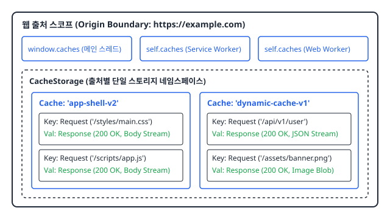
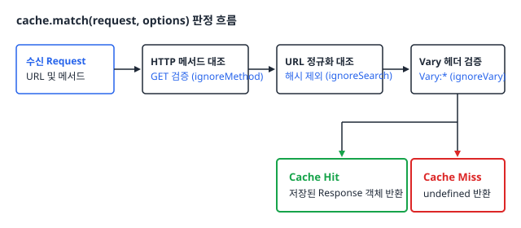

# 261111 Cache API

> Cache API는 웹 출처 단위로 Request와 Response 객체 쌍을 영속적으로 저장하고 프로그래밍 방식으로 제어하는 완전 비동기 표준 스토리지 API이다. · 분야: 네트워크 · 저장 · Baseline: Widely available (2018년 4월 주요 4대 모던 브라우저 Chrome 43+, Firefox 41+, Safari 11.1+, Edge 16+ 기본 탑재) · 읽는 시간 약 7분

## 1. 왜 쓰는가
전통적인 브라우저 환경에서 네트워크 자산의 캐싱은 전적으로 서버가 전달하는 HTTP 응답 헤더(Cache-Control, ETag, Last-Modified)와 브라우저 내부 휴리스틱 알고리즘에 의해서만 결정되는 블랙박스 구조였다 [4]. 자바스크립트 런타임 계층에서는 캐시 저장소를 프로그래밍 방식으로 직접 읽고 쓰거나, 특정 리소스를 선택적으로 갱신하고 무효화할 수 있는 제어권이 전무했다 [4]. 이로 인해 네트워크 연결이 불안정하거나 완전히 단절된 오프라인 환경에서 네트워크 실패를 감지하여 캐시된 자산으로 즉각 폴백(Fallback)하는 애플리케이션 아키텍처를 구현하는 것이 불가능했다.

기존에 제공되던 클라이언트 저장소 인터페이스 역시 네트워크 통신 계층의 페이로드를 처리하기에는 구조적 한계가 명확했다. Web Storage(localStorage, sessionStorage)는 모든 읽기 및 쓰기 작업이 동기식(Synchronous) API로 설계되어 있어, I/O 작업이 진행되는 동안 브라우저 메인 스레드의 렌더링 파이프라인을 직접 차단(Blocking)하는 심각한 성능 저하를 야기했다 [4]. 더욱이 도메인당 저장 용량이 약 5MB 수준으로 극히 제한적이었으며, 오직 문자열(DOMString) 타입만 직렬화하여 저장할 수 있어 대용량 네트워크 응답 데이터나 바이너리 파일(이미지, 웹폰트, WebAssembly 모듈 등)을 적재하기에 적합하지 않았다 [4].

IndexedDB의 경우 비동기 트랜잭션과 대용량 구조화 객체 저장을 지원하지만, 네트워크 통신의 기본 단위인 HTTP Request와 Response 객체 쌍을 저장하고 대조하기에는 지나치게 많은 상용구(Boilerplate) 코드가 요구되었다 [4]. 요청 URL의 정규화, 쿼리 스트링 매칭, HTTP 헤더 보존 및 직렬화, HTTP Vary 헤더의 유효성 검증과 같은 네트워크 계층 고유의 복잡한 매칭 로직을 자바스크립트로 직접 작성해야 하는 유지보수 부담이 존재했다 [4].

Cache API는 이러한 결함을 해소하고 오프라인 우선(Offline-First) 환경의 PWA(Progressive Web Apps) 및 Service Worker 명세를 완성하기 위해 탄생했다 [3][4]. 웹 표준 규격인 Request 및 Response 스트림 객체를 원형 손실 없이 원자적으로 보관하고 고속으로 조회할 수 있는 전용 비동기 스토리지 시스템을 제공하여, 웹 애플리케이션이 네트워크 캐싱 정책을 직접 프로그래밍할 수 있도록 지원한다 [3][4].

## 2. 핵심 개념


Cache API의 객체 모델과 동작 범위를 규정하는 핵심 용어 및 구조적 개념은 다음과 같다.

- **웹 출처(Origin) 단위 격리**: Cache API의 모든 저장소는 W3C 명세에 따라 프로토콜, 도메인, 포트 번호가 결합된 웹 출처(Origin) 단위로 엄격히 분리된다 [1][3]. 서로 다른 출처 간에는 저장된 캐시 인스턴스에 상호 접근할 수 없다.
- **CacheStorage 인터페이스**: 출처 내에서 생성된 복수의 Cache 인스턴스를 관리하는 최상위 디렉터리 역할을 수행한다 [1][3]. 문자열 형태의 고유 이름(예: 'app-shell-v2', 'dynamic-cache-v1')을 키로 사용하여 독립된 캐시 버킷을 생성 및 개방(open), 삭제(delete), 순회(keys)하는 네임스페이스 관리 기능을 담당한다 [1][3].
- **Cache 인터페이스**: 단일 캐시 버킷 내부에서 Request 객체(또는 URL 문자열)를 검색 키로 매핑하고, 이에 대응하는 Response 객체를 값으로 보관하는 요청-응답 저장소 인스턴스이다 [1][2][3].
- **Request 및 Response 객체 모델**: Fetch API 표준 명세의 Request 및 Response 인스턴스를 그대로 입출력 단위로 사용한다 [2][3]. HTTP 요청 메서드, URL, 헤더 정보뿐만 아니라 응답 상태 코드(status), 상태 텍스트, 바이너리 본문 스트림(ReadableStream)이 원형 그대로 디스크에 영속화된다 [2][3].
- **전역 스코프 접근성**: Cache API는 Service Worker 백그라운드 스레드(self.caches)에만 국한되지 않고, 브라우저 메인 윈도우 스레드(window.caches) 및 전용 웹 워커(WorkerGlobalScope.caches) 전역 스코프에 모두 노출된다 [1][4]. 따라서 Service Worker를 등록하지 않은 일반 단일 페이지 애플리케이션(SPA)에서도 전역 객체를 통해 대용량 자산을 자유롭게 캐싱할 수 있다 [1][4].
- **보안 컨텍스트(Secure Context) 강제**: 중간자 공격(MITM)을 통한 캐시 오염 및 악성 스크립트 주입을 방지하기 위해, Cache API 인터페이스는 오직 HTTPS 암호화 통신 환경에서만 노출된다 [1][2]. 단, 로컬 개발 환경의 편의를 위해 localhost 도메인은 예외적으로 허용된다 [1][2].



## 3. 동작 원리
Cache API는 브라우저 내부 I/O 스레드와 비동기 프로미스(Promise) 파이프라인을 통해 디스크에 접근한다. 주요 메서드가 계산되고 실행되는 명세상의 단계와 원리는 다음과 같다.

```diagram
종류: 시퀀스

[Client]
[ServiceWorker]
[Cache]
[Network]

Client -> ServiceWorker : fetch 이벤트 발생
ServiceWorker -> Cache : match(request)
== 캐시 존재 ==
Cache --> ServiceWorker : cachedResponse 반환
ServiceWorker --> Client : respondWith(cachedResponse)
== 캐시 없음 ==
Cache --> ServiceWorker : undefined 반환
ServiceWorker -> Network : fetch(request)
Network --> ServiceWorker : networkResponse 반환
ServiceWorker -> Cache : put(request, clone)
ServiceWorker --> Client : respondWith(networkResponse)
```

### 1) 캐시 버킷 열기 (caches.open)
`caches.open(cacheName)`이 호출되면 CacheStorage는 해당 출처에 `cacheName`과 일치하는 저장소가 존재하는지 확인한다 [1][3]. 저장소가 이미 존재하면 기존 `Cache` 객체를 반환하고, 존재하지 않으면 디스크에 빈 저장소 인스턴스를 새롭게 초기화하여 반환하는 프로미스를 이행한다 [1][3].

### 2) 캐시 저장 알고리즘 (cache.put)
W3C Service Workers 명세에 규정된 알고리즘에 따라 `cache.put(request, response)` 호출 시 엄격한 유효성 검증이 실행된다 [2][3]:
- **HTTP 메서드 검증**: 요청 객체의 HTTP 메서드가 `GET`이 아닌 경우(POST, PUT, DELETE 등) 즉시 `TypeError`를 발생시키며 프로미스가 거부된다 [2][3].
- **상태 코드 검증**: 응답 객체의 HTTP 상태 코드가 `206 Partial Content`인 경우 저장을 허용하지 않고 즉시 `TypeError`를 발생시킨다 [2][3].
- **URL 스킴 검증**: 요청 URL의 프로토콜 스킴이 `http` 또는 `https`가 아닌 경우(예: `chrome-extension://`, `data:`, `file:`) 저장이 거부되며 `TypeError`가 발생한다 [2][3].
- **단일 소비 스트림(bodyUsed) 잠금**: Response 객체의 본문은 `ReadableStream`이므로, `cache.put()`의 인자로 전달되는 순간 브라우저 내부 파이프라인이 스트림을 디스크로 소비한다 [2][3]. 이 과정에서 `response.bodyUsed` 속성이 `true`로 변경되어 본문이 영구히 잠긴다 [2][3]. 따라서 동일한 Response 객체를 호출자에게 반환하거나 추가로 읽기 위해서는 반드시 사전에 `response.clone()`을 실행하여 분리된 스트림 인스턴스를 생성해야 한다 [2][3].

### 3) 캐시 검색 및 일치 판정 (cache.match)
W3C 명세의 'Query Cache' 및 'Request Matches Cached Item' 알고리즘에 기반하여 캐시 항목을 탐색한다 [3]:
- **기본 대조 규칙**: 요청 URL에서 해시 프래그먼트(`#...`)를 제외한 전체 URL 문자열과 HTTP 메서드(`GET`)가 일치하는 항목을 검색한다 [3].
- **CacheQueryOptions 플래그**:
  - `ignoreSearch: true`: URL의 쿼리 파라미터(`?key=value`)를 무시하고 리소스 경로(Path)만 대조한다 [2][3].
  - `ignoreMethod: true`: HTTP 메서드 일치 검사를 생략하고 URL만으로 일치 여부를 판정한다 [2][3].
  - `ignoreVary: true`: 원본 응답에 기록된 `Vary` 헤더 검증 단계를 건너뛴다 [2][3].
- **Vary: * 헤더 처리 규칙**: 저장된 Response 객체의 헤더에 `Vary: *`가 명시되어 있는 경우, 명세 규칙에 따라 수신된 어떠한 Request와도 일치하지 않는 것으로 판정되어 조회가 무조건 실패(`undefined` 반환)한다 [3]. 이 경우 `ignoreVary: true`를 전달해야만 캐시 히트가 성립한다 [3].

### 4) 고수준 네트워크 일괄 저장 (cache.add / cache.addAll)
`cache.add(request)`는 내부적으로 `fetch(request)`를 실행한 뒤, 수신된 HTTP 응답의 상태 코드가 200번대 성공(`200–299`) 범위에 속하는 경우에만 `cache.put()`을 연계 호출한다 [2][4]. 404 Not Found나 500 Internal Server Error와 같은 비정상 상태 코드를 수신하면 즉시 `TypeError`로 프로미스를 거부한다 [2][4]. 특히 `cache.addAll()`은 원자적(Atomic)으로 동작하여, 목록 중 단 하나의 리소스라도 다운로드 실패나 비정상 응답을 반환하면 전체 작업이 롤백되며 어떠한 항목도 캐시에 저장되지 않는다 [cons].

### 5) 수명 주기와 영속성
Cache API는 서버의 `Cache-Control` 헤더나 내장 만료 시간(TTL)을 일체 참조하지 않는다 [3][4]. 저장된 항목은 애플리케이션 코드가 명시적으로 `caches.delete()` 또는 `cache.delete()`를 호출하여 제거하기 전까지 사용자 디스크에 영구히 잔류한다 [3][4].

## 4. 기본 사용법
다음은 Service Worker 없이 일반 웹 페이지(Window 스코프)에서 Cache API를 활용하여 대용량 API 응답을 캐싱하고 반환하는 완전한 자바스크립트 코드이다.

```js
async function fetchWithApiCache(url, cacheName = 'api-runtime-v1') {
  const cache = await window.caches.open(cacheName);
  const cachedResponse = await cache.match(url);

  if (cachedResponse) {
    return cachedResponse.json();
  }

  const networkResponse = await fetch(url);
  if (networkResponse.ok) {
    await cache.put(url, networkResponse.clone());
  }
  return networkResponse.json();
}
```

- **1행**: 요청할 대상 리소스의 `url`과 저장할 캐시 버킷의 이름을 식별하는 `cacheName`을 인자로 받는 비동기 함수 `fetchWithApiCache`를 선언한다.
- **2행**: 전역 `window.caches` 객체의 `open()` 메서드를 호출하여 지정된 이름의 `Cache` 인스턴스를 비동기로 가져온다. 저장소가 존재하지 않으면 새로 생성된다.
- **3행**: 열린 `Cache` 인스턴스에서 `match(url)`을 실행하여 해당 URL을 키로 갖는 이전 캐시 응답이 디스크에 존재하는지 조회한다.
- **4행**: 캐시 검색 결과인 `cachedResponse`가 존재하는지(Cache Hit 여부) 조건문으로 검사한다.
- **5행**: 캐시 히트 시, 디스크에서 읽어온 `Response` 객체의 본문 스트림을 JSON으로 파싱하여 호출자에게 즉시 반환하고 함수 실행을 종료한다.
- **6행**: 캐시 히트 처리 블록을 종료한다. 캐시 미스(Cache Miss)인 경우 아래 7행으로 이동한다.
- **7행**: 캐시된 데이터가 없으므로 `fetch(url)`을 실행하여 원격 서버로 실제 네트워크 HTTP 요청을 전송하고 `networkResponse`를 수신한다.
- **8행**: 수신된 응답의 HTTP 상태 코드가 200번대 성공 응답인지(`networkResponse.ok === true`) 검증한다.
- **9행**: `networkResponse.clone()`을 호출하여 독립된 응답 스트림 복제본을 생성한 뒤, `cache.put()`을 통해 URL 키와 함께 캐시 디스크에 비동기 저장한다. 원본 스트림의 `bodyUsed` 잠금을 회피하기 위한 필수 단계이다.
- **10행**: 네트워크 응답 유효성 검사 및 캐시 저장 블록을 종료한다.
- **11행**: 원본 `networkResponse`의 본문 스트림을 JSON으로 파싱하여 비동기 프로미스로 최종 호출자에게 반환한다.
- **12행**: 함수 정의 블록을 닫는다.

## 5. 실무 예시

### 예시 1: Service Worker install 단계에서의 핵심 정적 자산 원자적 프리캐싱
- **상황**: PWA 애플리케이션이 최초 설치되거나 업데이트될 때, 네트워크 단절 상태에서도 화면 골격(App Shell)을 즉시 렌더링할 수 있도록 핵심 HTML, CSS, JavaScript 및 SVG 그래픽 에셋을 디스크에 사전에 일괄 저장해야 하는 상황.
- **코드**:
```js
const STATIC_CACHE_NAME = 'app-shell-v2';
const STATIC_ASSETS = [
  '/',
  '/index.html',
  '/styles/main.css',
  '/scripts/app.js',
  '/assets/logo.svg'
];

self.addEventListener('install', (event) => {
  event.waitUntil(
    caches.open(STATIC_CACHE_NAME).then((cache) => {
      return cache.addAll(STATIC_ASSETS);
    })
  );
});
```
- **주의점**: `cache.addAll()`은 원자적(Atomic) 트랜잭션으로 동작하므로, 배열에 지정된 파일 경로 중 단 하나라도 404 Not Found나 네트워크 타임아웃 오류를 일으키면 전체 프로미스가 즉시 거부(Reject)된다 [cons]. 이 경우 Service Worker 설치 단계 전체가 실패하여 워커 활성화가 중단되므로 자산 경로 목록의 정확성을 철저히 보장해야 한다.

### 예시 2: Service Worker activate 단계에서의 구버전 캐시 버킷 일괄 무효화
- **상황**: 애플리케이션의 새로운 버전('app-shell-v2')이 배포되어 활성화될 때, 사용자 디스크에 잔류하여 용량을 차지하고 버전 충돌을 일으키는 구버전 캐시 버킷('app-shell-v1' 등)을 일괄 감지하여 정리해야 하는 상황.
- **코드**:
```js
self.addEventListener('activate', (event) => {
  event.waitUntil(
    caches.keys().then((cacheNames) => {
      return Promise.all(
        cacheNames.map((name) => {
          if (name !== STATIC_CACHE_NAME) {
            return caches.delete(name);
          }
        })
      );
    })
  );
});
```
- **주의점**: `caches.keys()`가 반환하는 모든 캐시 버킷 이름 목록 중 현재 활성 버전(`STATIC_CACHE_NAME`)을 제외한 나머지 버킷만 삭제하도록 엄격한 화이트리스트 조건을 적용해야 한다 [1][3][4]. 비동기 삭제 작업이 완료되기 전에 브라우저가 워커를 조기 종료하지 못하도록 반드시 `event.waitUntil()`에 `Promise.all()`을 전달해야 한다 [1][4].

### 예시 3: Stale-While-Revalidate 전략 및 비지원 프로토콜·비-GET 가드 패턴
- **상황**: 사용자가 페이지를 탐색할 때 캐시된 응답이 존재하면 지연 없이 즉각 화면에 표출하고, 백그라운드에서 네트워크 요청을 병행 실행하여 캐시를 최신 상태로 갱신하는 런타임 캐싱 상황.
- **코드**:
```js
self.addEventListener('fetch', (event) => {
  const request = event.request;

  if (!request.url.startsWith('http') || request.method !== 'GET') {
    return;
  }

  event.respondWith(
    caches.open('dynamic-cache-v1').then(async (cache) => {
      const cachedResponse = await cache.match(request);

      const fetchPromise = fetch(request).then((networkResponse) => {
        if (networkResponse && networkResponse.status === 200) {
          cache.put(request, networkResponse.clone());
        }
        return networkResponse;
      }).catch((err) => {
        if (cachedResponse) return cachedResponse;
        throw err;
      });

      return cachedResponse || fetchPromise;
    })
  );
});
```
- **주의점**: 브라우저 확장 프로그램 요청(`chrome-extension://`)이나 `POST`, `PUT` 요청이 `cache.put()`으로 전달되면 W3C 명세 규칙에 의해 즉시 `TypeError`가 발생한다 [2][3]. 따라서 진입부에서 URL 스킴과 메서드를 사전에 검사하여 필터링해야 한다 [2][3]. 또한 서버 응답 코드가 정확히 `200`인 성공 상태에서만 `clone()`을 수행하여 저장해야 데이터 오염을 방지할 수 있다.

## 6. 장점 · 단점
| 장점 | 단점 |
| :--- | :--- |
| **표준 Request 및 Response 객체 기반 직관성**: 번거로운 직렬화 및 역직렬화 과정 없이 웹 표준 fetch 통신 객체를 입출력 인터페이스로 직접 사용하므로 코드 응집도가 매우 높다. | **내장 만료(TTL) 메커니즘 부재**: 캐시에 저장된 항목은 명시적으로 삭제하지 않는 한 디스크에 영구 잔류하므로, 자체적인 만료 검증 로직이 없으면 구버전 데이터가 지속 반환될 위험이 있다. |
| **완전 비동기 프로미스 아키텍처**: 모든 읽기·쓰기·삭제 작업이 비동기 프로미스로 수행되어 대용량 바이너리나 수백 개의 파일을 다루더라도 메인 스레드 UI 렌더링을 차단하지 않는다. | **HTTP 메서드 지원의 제한성**: W3C 명세상 오직 GET 요청만 저장을 허용하며, POST·PUT·DELETE 등 상태 변경 요청을 캐싱하려 할 경우 TypeError가 발생하므로 IndexedDB 등을 병행해야 한다. |
| **스코프 제약 없는 전역 접근성**: Service Worker 환경(self.caches)뿐 아니라 일반 윈도우 스레드(window.caches), 웹 워커(WorkerGlobalScope) 어디서나 동일한 API로 접근 가능하다. | **단일 스트림 소비(bodyUsed) 주의**: Response 본문은 단일 소비 스트림(ReadableStream)이므로 cache.put() 전달 시 소비되어 잠기며, 재사용을 위해서는 사전에 response.clone() 호출이 강제된다. |
| **클라이언트 측의 완벽한 프로그래밍 제어권**: 서버의 HTTP 헤더 설정에 얽매이지 않고 네트워크 연결 상태, 비즈니스 규칙, 버전 번호에 따라 저장 및 반환 로직을 정밀하게 제어할 수 있다. | **cache.addAll()의 원자적 실패 특성**: 프리캐싱 자산 목록 중 단 하나의 리소스라도 404, 500 오류나 네트워크 장애로 실패하면 전체 작업이 즉시 거부(Reject)되어 아무것도 캐시되지 않는다. |
| **스토리지 쿼터 및 StorageManager 연동**: 브라우저 디스크 할당량 시스템과 완전히 통합되어 navigator.storage.estimate()를 통한 정밀한 용량 진단 및 persist()를 통한 영구 보존이 가능하다. | |

## 7. 한계와 함정

### 1) 경계 사례 (Edge Cases)
- **HTTP 206 Partial Content 미지원**: 비디오 및 오디오 스트리밍 재생이나 대용량 파일 분할 전송에 사용되는 HTTP Range 헤더 응답(206 Partial Content)을 `cache.put()`에 전달하면 명세상 즉각 `TypeError`가 발생하여 저장이 거부된다 [3]. 미디어 스트리밍 자산을 캐싱할 때는 전체 리소스(200 OK)로 요청하여 저장하거나 클라이언트 계층에서 별도의 데이터 조립 파이프라인을 구축해야 한다 [3].
- **Vary: * 헤더 매칭 실패**: 서버가 전달한 응답에 `Vary: *` 헤더가 포함되어 있으면 W3C 명세 규칙에 따라 어떠한 수신 요청과도 일치하지 않는 것으로 판정되어 캐시 히트가 항상 실패한다 [3]. 이를 재사용하려면 `cache.match(request, { ignoreVary: true })` 옵션을 반드시 지정해야 한다 [3].
- **HTTP 메서드 제약**: `POST`, `PUT`, `DELETE` 요청-응답 쌍을 Cache API에 저장하려 하면 명세 위반으로 `TypeError`가 발생하므로, 해당 데이터는 IndexedDB 등 다른 저장소를 활용하여 모델링해야 한다 [2][3].

### 2) 성능 및 저장소 한계 (Performance & Quota)
- **불투명 응답(Opaque Response)의 7MB 패딩 함정**: `mode: 'no-cors'`로 페치한 서드파티 CDN 리소스(외부 이미지, 서드파티 스크립트 등)는 헤더와 본문이 가려진 불투명 응답으로 반환된다. 브라우저는 리소스의 실제 파일 크기 차이를 이용한 사이드채널 정보 유출 공격(XS-Leaks)을 원천 차단하기 위해, Chromium 계열 브라우저 기준으로 실제 파일 크기와 무관하게 항목당 최소 약 7MB의 가상 패딩을 스토리지 할당량에 가산한다 [5]. 수십 개의 외부 이미지를 무심코 캐싱하면 수백 MB의 쿼터가 급격히 소진되어 `QuotaExceededError`가 발생하므로, 외부 리소스는 서버에 CORS 설정을 적용하고 `mode: 'cors'`로 페치하여 실제 바이트 크기대로 캐싱해야 한다 [5].
- **HTTP Cache-Control 헤더 무시**: Cache API는 서버가 `Cache-Control: no-store`, `no-cache`, `max-age=0`을 명시하더라도 `cache.put()` 호출 시 이를 무시하고 디스크에 영구 보관한다 [4]. HTTP 캐시 헤더가 Cache API의 수명까지 자동으로 제어해줄 것으로 가정하면 데이터 갱신 누락 및 심각한 데이터 오염 버그가 발생한다 [4].

### 3) 접근성 (Accessibility & Reliability)
오프라인 환경에서 네트워크 단절 시 캐시 미스가 발생하면 사용자에게 빈 화면이나 동작 불능 상태가 노출되어 웹 접근성과 사용성이 심각하게 저하된다. 따라서 캐시 조회 실패 시 사전에 캐싱된 오프라인 전용 안내 페이지(Fallback UI)나 기본 정적 에셋을 반환하도록 예외 처리 흐름을 설계해야 한다.

### 4) 보안 (Security)
- **HTTPS 보안 컨텍스트 강제**: Cache API는 평문 HTTP 환경에서는 노출되지 않으며 오직 HTTPS 보안 환경에서만 동작한다 [1][2].
- **Clear-Site-Data 헤더 필요성**: 로그아웃, 세션 파기, 치명적인 보안 패치 배포 시 사용자의 디스크에 영구 보관된 캐시 데이터를 서버 주도로 강제 소멸시키기 위해서는 서버 응답에 `Clear-Site-Data: "cache"` 또는 `Clear-Site-Data: "storage"` 헤더를 명시적으로 내려보내야 한다 [7].

### 5) 개인정보 보호 (Privacy & Partitioning)
사용자 식별 및 사이트 간 추적을 방지하기 위해 모던 브라우저에 스토리지 파티셔닝(Storage Partitioning) 및 더블 키잉(Double-Keying) 정책이 전면 적용되었다 [8]. 최상위 사이트(Top-Level Site)와 요청 출처(Origin)가 결합되어 파티션 키가 구성되므로, 서로 다른 최상위 웹사이트에 임베드된 서드파티 iframe 간에는 동일한 출처라 하더라도 Cache Storage 인스턴스를 공유할 수 없다 [8].

## 8. 다른 방법과 비교
| 방법 | 언제 | 비용 | 한계 |
| :--- | :--- | :--- | :--- |
| **Cache API** | Request/Response 쌍 보관, 오프라인 PWA App Shell 및 런타임 네트워크 응답 제어 시 [3][4] | 비동기 디스크 I/O 비용, 수동 라이프사이클 관리 코드 필요 [3][4] | GET 메서드만 지원 [2][3], 206 미지원 [3], 내장 TTL 부재 [4], no-cors 캐싱 시 7MB 패딩 [5] |
| **HTTP 브라우저 캐시** | 서버 헤더 기반의 표준 정적 에셋 투명 캐싱이 필요하고 자바스크립트 제어가 불필요할 때 [4] | 추가 자바스크립트 작성 비용 없음 (브라우저 네트워크 계층 자동 처리) [4] | 브라우저 휴리스틱 기반 블랙박스 [4], 오프라인 시 프로그래밍적 조작 불가 [4], 세밀한 수동 무효화 불가 |
| **IndexedDB** | 복합 쿼리, B-Tree 인덱싱, 트랜잭션, POST 요청 페이로드 등 구조화된 데이터 모델링 시 [4] | 스키마 마이그레이션 및 트랜잭션 관리 오버헤드, 직렬화 비용 [4] | Request/Response 스트림 매칭, URL 정규화, 헤더 처리에 과도한 상용구 코드 수반 [4] |
| **Origin Private File System (OPFS)** | 대용량 비디오 청크, WASM 기반 로컬 SQLite 엔진 등 파일 시스템 수준의 초고속 바이너리 입출력 시 | FileSystemSyncAccessHandle 관리 비용, 워커 스레드 분리 필요 | HTTP 요청-응답 매칭 추상화 계층 부재, URL 기반 인덱싱 미지원 |
| **Web Storage (localStorage / sessionStorage)** | 5MB 미만의 단순 UI 상태 플래그나 사용자 설정 문자열을 동기식으로 읽고 쓸 때 [4] | 메인 스레드 렌더링 블로킹 비용 발생 [4] | 약 5MB의 극소 용량 [4], 문자열 타입만 지원 [4], 비동기 I/O 및 바이너리 네트워크 응답 저장 불가 [4] |

### 이것을 고르지 않는 경우
- 구조화된 복합 객체에 대해 B-Tree 다중 인덱스를 적용하여 검색 쿼리를 실행하거나, `POST` 요청의 페이로드를 저장해야 하는 경우에는 `GET` 요청만 지원하는 Cache API 대신 IndexedDB를 선택해야 한다.
- 대용량 바이너리 파일을 바이트 단위로 임의 접근(Random Access)하여 수정하거나 WASM 기반 로컬 관계형 데이터베이스를 구동해야 하는 경우에는 HTTP 추상화 오버헤드가 배제된 OPFS를 선택해야 한다.
- 자바스크립트 개입 없이 브라우저 네트워크 계층이 서버 응답 헤더(`Cache-Control: max-age`)에 따라 자동으로 관리하는 기본 정적 에셋은 HTTP 브라우저 캐시를 활용하는 것이 유지보수 측면에서 적합하다.
- 메인 스레드 실행 즉시 동기식으로 확인해야 하는 5MB 미만의 단순 설정 문자열(예: 다크 모드 활성화 여부)은 Web Storage를 사용하는 것이 간결하다.

## 9. 대비와 새로운 시도
Cache API의 단일 풀 제약과 파티셔닝 환경에 대응하기 위해 다음과 같은 후속 스펙 및 표준 기능이 확장되고 있다.

- **WICG Storage Buckets API**: 기존 웹 출처(Origin) 단위의 단일 스토리지 풀 구조를 개선하여, 애플리케이션 목적에 따라 복수의 독립된 스토리지 버킷을 프로그래밍 방식으로 생성할 수 있는 차세대 명세이다 [6]. 각 버킷마다 독립적인 `CacheStorage`와 `IndexedDB` 인스턴스를 매핑할 수 있으며, 버킷별로 영구 보존 정책(`persisted`), 만료 시점(`expires`), 쓰기 내구성(`durability: 'strict' | 'relaxed'`)을 개별 지정할 수 있는 기능이 모던 브라우저에 탑재되고 있다 [6].
- **클라이언트 스토리지 파티셔닝(Storage Partitioning)의 전면 배포**: 개인정보 보호 샌드박스(Privacy Sandbox) 정책에 따라 최상위 사이트(Top-Level Site)와 요청 출처(Origin)를 결합하는 파티션 키가 Cache Storage에 기본 적용되었다 [8]. 이를 통해 교차 사이트 간 타이밍 공격(Timing Attack)과 캐시 스니핑(Cache Sniffing)을 통한 사용자 추적이 원천 차단되었다 [8].
- **StorageManager 세부 진단 기능 고도화**: `navigator.storage.estimate()`의 `usageDetails` 객체를 통해 `caches`, `indexedDB`, `serviceWorkerRegistrations` 등 각 스토리지 인터페이스가 점유하고 있는 실제 바이트 용량을 실시간으로 세부 프로파일링하는 진단 기능이 브라우저 표준으로 안착되었다 [4][5].
- **Clear-Site-Data 헤더 표준 준수 확대**: 엔터프라이즈 및 금융 웹 애플리케이션에서 사용자 로그아웃이나 인증 세션 만료 시 서버 응답 헤더 `Clear-Site-Data: "cache"`를 전송하여 클라이언트 디스크에 저장된 Cache API 데이터를 즉각 초기화하는 보안 관행이 표준 규격으로 확립되었다 [7].

## 10. 다른 사람에게 설명하기

### 세 문장 요약
1. Cache API는 웹 출처 단위로 네트워크 Request와 Response 객체 쌍을 원형 그대로 디스크에 영속화하고 프로그래밍 방식으로 제어하는 완전 비동기 표준 스토리지이다 [1][3][4].
2. 서버 HTTP 캐시 헤더나 내장 만료 시간에 종속되지 않고 오프라인 PWA 및 고성능 런타임 캐싱을 구현할 수 있으나, 명시적인 수동 라이프사이클 관리와 GET 메서드 준수 및 `response.clone()` 호출이 필수적이다 [2][3][4].
3. 교차 출처 리소스의 `no-cors` 불투명 응답 저장 시 7MB 패딩에 따른 쿼터 급증, HTTP 206 부분 응답 미지원, 스토리지 파티셔닝에 따른 서드파티 iframe 격리 등 명세상의 제약을 엄격히 고려해야 한다 [3][5][8].

### 스스로 확인할 질문 3개
- Q1. `cache.put()`을 호출할 때 왜 반드시 `response.clone()`을 먼저 실행해야 하며, 이를 생략했을 때 발생하는 런타임 오류의 원인은 무엇인가?
- Q2. 서드파티 CDN 이미지를 `mode: 'no-cors'`로 가져와 Cache API에 저장할 때 브라우저 스토리지 쿼터가 급격히 소진되는 기술적 메커니즘과 이를 방지하기 위한 해결책은 무엇인가?
- Q3. 저장된 응답에 `Vary: *` 헤더가 포함되어 있을 때 `cache.match()`가 기본적으로 캐시 히트에 실패하는 명세상의 이유와 이를 해결하기 위한 옵션은 무엇인가?

## 참고 자료
1. [MDN Web Docs - CacheStorage](https://developer.mozilla.org/en-US/docs/Web/API/CacheStorage)
2. [MDN Web Docs - Cache](https://developer.mozilla.org/en-US/docs/Web/API/Cache)
3. [W3C Service Workers Specification - Cache Objects & Query Cache](https://w3c.github.io/ServiceWorker/#cache-objects)
4. [web.dev - The Cache API: A quick guide](https://web.dev/articles/cache-api-quick-guide)
5. [Chrome for Developers - What is storage quota and how does it work with opaque responses?](https://developer.chrome.com/blog/opaque-responses-and-the-cache-storage-api)
6. [Chrome for Developers - Storage Buckets API](https://developer.chrome.com/docs/capabilities/web-apis/storage-buckets)
7. [MDN Web Docs - Clear-Site-Data](https://developer.mozilla.org/en-US/docs/Web/HTTP/Headers/Clear-Site-Data)
8. [Chrome for Developers - Storage Partitioning](https://developer.chrome.com/docs/privacy-sandbox/storage-partitioning)

조사: 2026-11-11

## 내 리뷰
(읽고 느낀 점 · 궁금한 것을 적는다. 질문은 Q. 로 시작)
