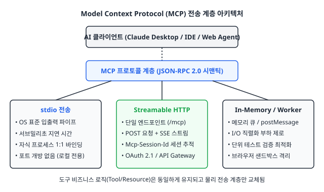
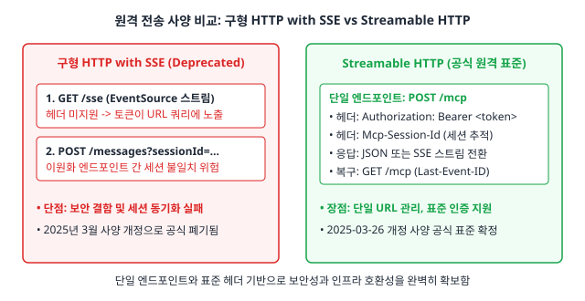

# 261112 MCP 전송 계층

> 한 줄 요약: MCP 전송 계층은 AI 클라이언트와 도구 서버 간의 물리적 통신을 추상화하여, 로컬 단일 환경에는 지연 시간이 극소화된 stdio를, 분산 클라우드 환경에는 보안과 확장이 용이한 Streamable HTTP를 제공한다. · 분야: 네트워크 · 저장 · Baseline: 해당 없음 (W3C/WHATWG 웹 브라우저 엔진 표준이 아닌 Anthropic 주도의 오픈 프로토콜 규격이므로 웹 플랫폼 Baseline 집계 대상이 아님) · 읽는 시간 약 6분

## 1. 왜 쓰는가
모델 컨텍스트 프로토콜(Model Context Protocol, 이하 MCP)이 등장하기 전, AI 모델과 외부 도구 및 리소스 간의 연동은 시스템마다 개별적인 전용 인터페이스로 구현되었다 [4]. 이러한 방식은 도구의 비즈니스 로직이 특정 실행 환경이나 통신 라이브러리에 강하게 결합되어 재사용성을 저해하는 문제를 야기했다 [1]. MCP는 JSON-RPC 2.0 기반의 프로토콜 시맨틱스와 물리적 데이터 교환을 담당하는 전송 계층(Transport Layer)을 엄격히 분리함으로써, 개발자가 작성한 도구 로직을 변경하지 않고 로컬 프로세스와 원격 네트워크 환경 모두에 그대로 재사용할 수 있도록 설계되었다 [1].

실무 환경에서는 실행 주체와 보안 경계에 따라 상이한 통신 제약이 발생한다 [1], [6]. 개인용 개발 환경(예: Claude Desktop, 로컬 IDE 확장)에서는 네트워크 포트 개방이나 복잡한 인증 설정 없이 운영체제 수준의 격리와 서브밀리초 단위의 초저지연 실행이 요구되므로 표준 입출력(stdio) 방식이 필요하다 [2], [6]. 반면, 엔터프라이즈 환경이나 다중 사용자 SaaS 플랫폼에서는 중앙 집중식 도구 서버에 여러 사용자가 동시에 접속하고, OAuth 2.1 또는 Bearer 토큰 기반의 인가와 API 게이트웨이 라우팅을 거쳐야 하므로 HTTP 인프라와 호환되는 전송 방식이 필수적이다 [1], [3]. 초기 2024년 사양의 구형 HTTP with SSE 방식은 인증 토큰 노출과 다중 엔드포인트 세션 동기화 결함을 안고 있었으나, 2025년 3월 공식 사양 개정을 통해 단일 엔드포인트 기반의 Streamable HTTP로 표준화되어 이러한 실무 요구를 온전히 해결한다 [1], [3].

## 2. 핵심 개념
MCP 전송 계층은 AI 클라이언트와 MCP 서버 간에 JSON-RPC 2.0 프레임을 물리적으로 운반하는 매체와 규칙을 정의한다 [1]. 공식 사양에는 로컬용 `stdio`와 원격용 `Streamable HTTP` 두 가지가 핵심 표준으로 규정되어 있으며, 환경에 따라 메모리 내부 큐나 브라우저 워커 등을 활용하는 대안 전송 방식이 공존한다 [1], [5].



전송 계층을 구성하는 핵심 용어와 기술 정의는 다음과 같다.
- **전송 계층(Transport Layer)**: 상위 JSON-RPC 2.0 메시지 규약과 하위 물리 매체를 중개하는 계층으로, 메시지 직렬화, 프레이밍, 스트림 생명주기 관리를 담당한다 [1].
- **stdio 전송**: 호스트 클라이언트가 서버를 자식 프로세스(subprocess)로 포크(fork)하여 표준 입력(stdin)과 표준 출력(stdout) 파이프를 통해 1:1로 통신하는 로컬 전용 방식이다 [2].
- **Streamable HTTP 전송**: 단일 HTTP 엔드포인트(예: `/mcp`)를 통해 클라이언트의 POST 요청을 수신하고 단일 JSON 응답 또는 Server-Sent Events(SSE) 스트림으로 데이터를 반환하는 공식 원격 전송 규격이다 [3].
- **Mcp-Session-Id**: 무상태(stateless) HTTP 요청 간에 클라이언트의 세션 상태를 추적하고 서버 측 트랜스포트 인스턴스를 바인딩하기 위해 사용하는 표준 HTTP 헤더다 [3].
- **HTTP with SSE (Deprecated)**: 2024년 초기 사양에 정의되었던 구형 원격 전송 방식으로, 이벤트 수신용 GET(`/sse`)과 메시지 송신용 POST(`/messages`)로 엔드포인트가 분리되어 있었으나 보안 및 복구 한계로 공식 폐기되었다 [1], [4].
- **In-Memory 전송**: 소켓이나 프로세스 I/O 없이 단일 런타임 메모리 큐를 통해 메시지를 즉시 전달하는 초고속 내부 전송 방식이다 [5].
- **WebSocket (SEP-1288)**: 단일 지속 TCP 커넥션 기반의 전이중(Full-duplex) 실시간 스트리밍을 제공하기 위해 커뮤니티에서 제안하여 표준화를 논의 중인 확장 전송 계층이다 [4], [5].



## 3. 동작 원리
전송 방식에 따라 데이터 프레이밍, 호출 타이밍, 세션 수명주기 제어 원리가 다르게 동작한다 [2], [3].

```diagram
종류: 시퀀스

[AI Client]
[Stdio Server]
[Streamable HTTP]
[Tool Service]

AI Client -> Stdio Server : spawn child process
AI Client -> Stdio Server : stdin newline JSON-RPC
Stdio Server --> AI Client : stdout newline JSON-RPC
AI Client -> Streamable HTTP : POST /mcp with Accept header
Streamable HTTP -> Tool Service : execute tool logic
Tool Service --> Streamable HTTP : tool execution result
Streamable HTTP --> AI Client : 200 OK SSE event stream
```

### stdio 전송 방식의 세부 동작 규칙
1. **프로세스 생성 및 파이프 바인딩**: 클라이언트는 로컬 실행 명령어를 바탕으로 서버를 자식 프로세스로 생성하고, 표준 입력(stdin), 표준 출력(stdout), 표준 에러(stderr) 스트림 파이프를 결합한다 [2].
2. **UTF-8 행 구분 프레이밍**: 모든 JSON-RPC 요청과 응답은 UTF-8 인코딩의 단일 행이어야 하며, 메시지 구분자는 줄바꿈 문자(`\n`)다 [2]. 개별 JSON 메시지 본문 내부에는 임베디드 개행 문자가 허용되지 않는다 [2].
3. **stdout 보호 및 stderr 격리**: 표준 출력(stdout)은 오직 유효한 JSON-RPC 메시지만을 전달하는 단일 채널로 격리된다 [2]. 일반 디버그 출력이나 라이브러리 로깅이 stdout에 1바이트라도 유입되면 JSON 파서 에러가 발생하여 세션이 즉시 단절되므로, 모든 진단 로그는 표준 에러(stderr)로만 기록되어야 한다 [2].
4. **취소 제어**: 클라이언트가 장기 실행 중인 도구 작업을 중단할 때는 서버를 강제 종료하지 않고 `notifications/cancelled` 알림 메시지를 stdin 파이프로 전송하여 협조적 취소를 수행한다 [2].

### Streamable HTTP 전송 방식의 세부 동작 규칙
1. **단일 엔드포인트 협상**: 클라이언트는 단일 엔드포인트(예: `/mcp`)로 POST 요청을 보내며, 이때 `Accept: application/json, text/event-stream` 헤더를 필수로 동봉한다 [3].
2. **응답 스트리밍 전환**: 단일 결과 응답은 `application/json` 콘텐츠 타입으로 즉시 반환되며, 작업이 장시간 소요되거나 다중 이벤트를 연속 전달해야 할 때는 본문을 `text/event-stream` (SSE) 형식으로 전환하여 스트리밍한다 [3].
3. **세션 추적 및 해제**: 다중 요청 간 상태 식별을 위해 서버는 `Mcp-Session-Id` 헤더를 발급하고, 클라이언트는 후속 POST 및 GET 요청에 이 헤더를 포함한다 [3]. 세션을 명시적으로 종료할 때는 클라이언트가 동일 엔드포인트로 HTTP DELETE 요청을 전송한다 [3].
4. **유실 이벤트 복구**: 네트워크 일시 단절 후 재접속 시, 클라이언트는 HTTP GET 요청에 직전에 수신한 이벤트 ID를 담은 `Last-Event-ID` 헤더를 전달하여 유실된 SSE 이벤트를 재생(replay)받아 복원한다 [3].

### 구형 HTTP with SSE 방식의 폐기 배경
구형 방식은 GET `/sse`로 영구 스트림을 개방한 후 POST `/messages`로 명령을 전송하는 이원화 구조였다 [1], [4]. 이 방식은 웹 브라우저의 `EventSource` 표준 API가 요청 헤더(`Authorization`) 설정을 지원하지 않아 URL 쿼리 파라미터(`?token=...`)로 민감한 인증 정보를 전달해야 하는 보안 취약점을 유발했다 [1], [4]. 또한 두 엔드포인트 간의 네트워크 단절 시 세션 동기화 복구가 복잡하여 2025년 3월 공식 사양 개정에서 완전히 폐기(Deprecated)되었다 [1], [4].

## 4. 기본 사용법
가장 널리 쓰이는 stdio 기반의 로컬 MCP 서버는 `@modelcontextprotocol/sdk`를 사용하여 다음과 같이 구현한다 [5].

```js
import { McpServer } from "@modelcontextprotocol/sdk/server/mcp.js";
import { StdioServerTransport } from "@modelcontextprotocol/sdk/server/stdio.js";
import { z } from "zod";

const server = new McpServer({
  name: "local-calculator",
  version: "1.0.0"
});

server.tool(
  "calculate",
  "간단한 덧셈 계산 수행",
  { a: z.number(), b: z.number() },
  async ({ a, b }) => ({
    content: [{ type: "text", text: String(a + b) }]
  })
);

async function main() {
  const transport = new StdioServerTransport();
  await server.connect(transport);
  console.error("stdio MCP 서버 가동 완료 (진단 로그는 stderr로만 출력)");
}

main().catch((err) => {
  console.error("서버 구동 에러:", err);
  process.exit(1);
});
```

위 코드의 줄별 상세 동작 설명은 다음과 같다.
- 1행: SDK의 서버 코어 모듈에서 고수준 MCP 서버 추상화 클래스 `McpServer`를 가져온다 [5].
- 2행: SDK의 stdio 모듈에서 프로세스 표준 스트림 기반 전송 계층인 `StdioServerTransport`를 가져온다 [5].
- 3행: 파라미터 타입 및 제약 조건의 런타임 유효성 검증을 위해 `zod` 라이브러리의 `z` 객체를 가져온다.
- 4행: 코드 가독성을 위한 빈 줄이다.
- 5행: 서버 인스턴스를 초기화하기 위해 생성자에 메타데이터 설정 객체를 전달한다 [5].
- 6행: AI 클라이언트에 노출할 서버 고유 식별 명칭을 `local-calculator`로 선언한다 [5].
- 7행: 도구 서버의 시맨틱 버전 번호를 `1.0.0`으로 지정한다 [5].
- 8행: `McpServer` 설정 객체 선언을 종료한다.
- 9행: 빈 줄이다.
- 10행: AI 모델이 호출할 수 있는 함수형 인터페이스를 등록하기 위해 `server.tool` 메서드를 호출한다 [5].
- 11행: 등록할 도구의 고유 이름을 `calculate`로 지정한다 [5].
- 12행: 모델이 도구의 사용 목적과 파라미터를 추론할 수 있도록 기능 설명 문자열을 제공한다 [5].
- 13행: Zod 스키마를 사용하여 숫자형 파라미터 `a`와 `b`를 필수 입력 인자로 정의한다.
- 14행: 클라이언트가 도구를 호출했을 때 실행되는 비동기 비즈니스 로직 함수를 선언한다 [5].
- 15행: 프로토콜 응답 규격에 맞추어 텍스트 타입과 계산 결과 문자열(`String(a + b)`)을 담은 객체를 반환한다 [5].
- 16행: 도구 실행 비동기 함수의 본문 블록을 닫는다.
- 17행: `server.tool` 메서드 호출을 종료한다.
- 18행: 빈 줄이다.
- 19행: 서버 전송 계층을 초기화하고 실행을 제어하는 비동기 진입점 함수 `main`을 선언한다.
- 20행: OS 표준 스트림(stdin, stdout)을 바인딩하는 `StdioServerTransport` 인스턴스를 생성한다 [2], [5].
- 21행: `server.connect(transport)`를 호출하여 서버 코어와 전송 계층을 결합하고 JSON-RPC 메시지 수신 대기 상태로 진입한다 [5].
- 22행: stdout 오염을 방지하기 위해 `console.error`를 사용하여 진단 안내 로그를 stderr 채널로만 출력한다 [2].
- 23행: `main` 함수의 본문 블록을 닫는다.
- 24행: 빈 줄이다.
- 25행: 진입점 함수를 호출하고 실행 중 발생한 예외를 포획하기 위한 `.catch` 체인을 설정한다.
- 26행: 서버 구동 실패 시 오류 세부 사항을 stderr 스트림으로 기록한다 [2].
- 27행: 비정상 종료 상태 코드 `1`을 운영체제에 반환하여 프로세스를 완전히 종료한다.
- 28행: 예외 처리 핸들러 및 실행 구문을 마친다.

## 5. 실무 예시

### 예시 1: Streamable HTTP 기반 원격 엔터프라이즈 도구 서버
- **상황**: 사내 여러 개발자와 원격 AI 에이전트가 공유할 수 있도록 클라우드 환경에 단일 HTTP 엔드포인트 기반의 상태 유지 도구 서버를 배포하는 상황.
- **코드**:
```js
import express from "express";
import { randomUUID } from "node:crypto";
import { McpServer } from "@modelcontextprotocol/sdk/server/mcp.js";
import { StreamableHTTPServerTransport } from "@modelcontextprotocol/sdk/server/streamableHttp.js";
import { z } from "zod";

const app = express();
app.use(express.json());

const transports = {};

app.all("/mcp", async (req, res) => {
  const sessionId = req.headers["mcp-session-id"];
  let transport;

  if (sessionId && transports[sessionId]) {
    transport = transports[sessionId];
  } else if (req.method === "POST") {
    transport = new StreamableHTTPServerTransport({
      sessionIdGenerator: () => randomUUID()
    });

    const server = new McpServer({ name: "remote-enterprise-tools", version: "1.0.0" });
    server.tool("status", "시스템 상태 확인", {}, async () => ({
      content: [{ type: "text", text: "Healthy" }]
    }));

    await server.connect(transport);

    transport.onclose = () => {
      if (transport.sessionId) delete transports[transport.sessionId];
    };

    if (transport.sessionId) transports[transport.sessionId] = transport;
  } else {
    res.status(400).json({ error: "Invalid session or missing initialization request" });
    return;
  }

  await transport.handleRequest(req, res);
});

app.listen(3000, () => {
  console.log("Streamable HTTP MCP 서버가 http://localhost:3000/mcp 에서 대기 중입니다.");
});
```
- **주의점**: `Mcp-Session-Id` 헤더를 통해 세션을 추적해야 하며, 연결 종료 시 메모리 누수를 방지하기 위해 `transport.onclose` 콜백에서 세션 맵의 인스턴스를 반드시 제거해야 한다 [3]. 서버를 다중 컨테이너로 수평 확장할 때는 로드 밸런서의 스티키 세션(Sticky Session)이나 분산 세션 저장소 구성이 요구된다 [3].

### 예시 2: AI 클라이언트의 로컬 및 원격 혼합 구성
- **상황**: Claude Desktop 등의 AI 클라이언트 환경에서 로컬 파일시스템 작업은 stdio로 빠르게 처리하고, 사내 중앙 인프라는 Bearer 인증 헤더를 갖춘 원격 Streamable HTTP로 연결하는 복합 설정 상황.
- **코드**:
```json
{
  "mcpServers": {
    "local-fs": {
      "command": "node",
      "args": ["/path/to/local-stdio-server.js"],
      "env": {
        "DEBUG": "false"
      }
    },
    "remote-cloud": {
      "url": "https://api.internal.example.com/mcp",
      "headers": {
        "Authorization": "Bearer eyJhbGciOi..."
      }
    }
  }
}
```
- **주의점**: stdio 서버 등록 시 내부 라이브러리가 디버그 텍스트를 stdout으로 방출하지 않도록 `DEBUG: "false"` 등의 환경 변수를 명시적으로 격리해야 한다 [2]. 원격 서버 URL 등록 시에는 인증 토큰이 설정 파일에 평문으로 남지 않도록 환경 변수 주입 및 만료 관리에 유의해야 한다 [1], [6].

### 예시 3: 인프로세스 단위 테스트를 위한 In-Memory 전송
- **상황**: CI/CD 파이프라인에서 실제 OS 서브프로세스를 생성하거나 네트워크 포트를 바인딩하지 않고, 도구 비즈니스 로직과 프로토콜 연결을 밀리초 미만의 속도로 자동 검증하는 상황 [5].
- **코드**:
```js
import { McpServer } from "@modelcontextprotocol/sdk/server/mcp.js";
import { InMemoryTransport } from "@modelcontextprotocol/sdk/inMemory.js";
import { z } from "zod";

const server = new McpServer({ name: "test-server", version: "1.0.0" });
server.tool("echo", "메시지 반환", { message: z.string() }, async ({ message }) => ({
  content: [{ type: "text", text: message }]
}));

// 단일 프로세스 내 클라이언트와 서버 트랜스포트 쌍 생성
const [clientTransport, serverTransport] = InMemoryTransport.createLinkedPair();
await server.connect(serverTransport);
```
- **주의점**: In-Memory 전송은 소켓 직렬화나 네트워크 I/O 부하가 없어 단위 테스트에 최적화되어 있으나, 단일 런타임 메모리 경계 내부에 국한되므로 분리된 외부 프로세스나 원격 환경과의 통신에는 사용할 수 없다 [5].

## 6. 장점 · 단점

| 장점 | 단점 |
| :--- | :--- |
| **stdio**: 네트워크 포트 개방이나 CORS 설정이 불필요하며, OS 파이프를 통해 직접 통신하므로 서브밀리초(sub-millisecond) 단위의 극히 낮은 지연 시간을 보장한다 [2], [6]. | **stdio**: 단일 클라이언트와 단일 서버 간의 1:1 자식 프로세스 관계에 한정되어 다중 사용자 동시 접속이나 네트워크를 통한 자원 공유가 불가능하다 [2]. |
| **stdio**: 호스트 사용자의 로컬 권한 범위 내에서 자식 프로세스로 격리 실행되므로 추가적인 네트워크 인증 레이어 구축 비용이 발생하지 않는다 [2], [6]. | **stdio**: stdout 채널에 `console.log`나 서드파티 라이브러리의 임의 출력 텍스트가 1바이트라도 혼입되면 JSON-RPC 스트림이 즉시 파손된다 [2]. |
| **Streamable HTTP**: 단일 엔드포인트 기반으로 표준 `Authorization` 헤더(Bearer, OAuth 2.1)를 지원하여 기업용 보안 인프라 및 API Gateway 연동이 자연스럽다 [3]. | **stdio**: 호스트 클라이언트가 비정상 종료될 경우 자식 프로세스가 고아(Orphan)나 좀비 프로세스로 시스템에 잔존할 수 있어 엄격한 수명주기 감시가 요구된다 [2]. |
| **Streamable HTTP**: AWS Lambda, Cloud Run, Kubernetes 등 클라우드 인프라와 호환되며 다중 사용자 동시 접속 및 수평 확장(Horizontal Scaling)이 용이하다 [3]. | **Streamable HTTP**: stdio 대비 네트워크 프로토콜 스택 통과, TLS 암호화 연산, HTTP 헤더 처리로 인한 추가 지연 시간과 오버헤드가 발생한다 [3]. |
| **Streamable HTTP**: 단일 JSON 응답과 Server-Sent Events(SSE) 스트리밍을 유연하게 전환할 수 있어 장기 실행 작업 처리와 진행률 표시에 적합하다 [3]. | **Streamable HTTP**: 분산 서버 환경에서 상태 유지 세션(`Mcp-Session-Id`)을 처리할 때 로드 밸런서의 스티키 세션이나 분산 세션 저장소(Redis 등) 관리가 필요하다 [3]. |
| **In-Memory Transport**: 직렬화/역직렬화 및 소켓 I/O 부하가 전혀 없어 단위 테스트 실행 및 동일 프로세스 내부 초고속 에이전트 파이프라인 구축에 최적화된다 [5]. | **구형 HTTP with SSE**: 브라우저 `EventSource` API의 커스텀 HTTP 헤더 미지원으로 인해 토큰이 URL에 노출되고 세션 단절 시 동기화 복구가 복잡하다 [1], [4]. |

## 7. 한계와 함정
전송 계층 구현 및 운영 시 마주하는 구조적 한계와 보안 함정은 다음과 같다.

1. **OS 파이프 버퍼 데드락(Deadlock)**: stdio 통신 환경에서 서버가 stdout 또는 stderr 채널로 대용량 데이터(예: 거대 파일 내용, 대규모 로그)를 급격히 출력할 때, 클라이언트가 이를 실시간으로 소비(drain)하지 않으면 OS 커널 파이프 버퍼(통상 64KB 수준)가 가득 차 서버 프로세스의 쓰기 작업이 영구 블로킹되는 데드락이 발생한다 [2].
2. **로컬 HTTP 서버의 DNS Rebinding 취약성**: 로컬 머신에서 HTTP 기반 MCP 서버를 운영할 경우, 사용자가 웹 브라우저로 악성 웹사이트를 방문했을 때 브라우저 스크립트가 루프백 IP(`127.0.0.1`)로 요청을 위조하여 전송할 수 있다 [6]. 이를 방어하기 위해 서버는 반드시 들어오는 요청의 `Origin` 헤더를 검증하고 로컬 루프백 인터페이스에 엄격히 바인딩해야 한다 [6].
3. **과도한 로컬 실행 권한과 프롬프트 인젝션**: stdio 서버가 호스트 머신의 루트 파일시스템 접근권이나 셸 명령 실행 권한을 가진 상태에서 LLM에 악의적인 프롬프트 인젝션이 발생하면, 로컬 시스템 탈취 및 민감 정보 유출로 직결될 위험이 있다 [6].
4. **분산 환경의 세션 및 이벤트 복원 구현 부담**: Streamable HTTP에서 `Last-Event-ID` 기반의 이벤트 유실 복구를 온전히 지원하려면 서버 측에 발행된 이벤트를 임시 보관하는 버퍼링 인프라가 갖추어져야 하므로, 무상태(Stateless) 서버리스 환경에서 시스템 복잡도가 가중된다 [3].
5. **순수 웹 브라우저 런타임의 stdio 사용 불가**: 웹 브라우저 보안 샌드박스는 운영체제 프로세스를 직접 생성(spawn)할 수 있는 API를 제공하지 않으므로 stdio 전송을 직접 구동할 수 없으며, HTTP/WebSocket 중계 프록시나 Web Worker 전송 방식을 우회 채택해야 한다 [1].

## 8. 다른 방법과 비교

| 방법 | 언제 | 비용 | 한계 |
| :--- | :--- | :--- | :--- |
| **stdio** | 로컬 단일 사용자 환경 (Claude Desktop, 로컬 IDE 확장) [1] | 낮음 (네트워크 오버헤드 0, 설정 비용 없음) [2], [6] | 1:1 프로세스 통신 한정, 네트워크 공유 불가, stdout 오염 취약성 [2] |
| **Streamable HTTP** | 다중 테넌트 SaaS, 클라우드 중앙 도구 서버, 마이크로서비스 [1], [3] | 중간 (네트워크 스택, TLS 암호화, HTTP 헤더 오버헤드) [3] | 분산 세션 관리(`Mcp-Session-Id`) 및 이벤트 버퍼 인프라 구축 부담 [3] |
| **구형 HTTP with SSE** | 과거 2024년 초기 사양 호환 시스템 [1], [4] | 높음 (GET/POST 이원화 엔드포인트 유지 비용) [1] | 공식 폐기(Deprecated), `EventSource` 헤더 미지원으로 인증 토큰 URL 노출 [1], [4] |
| **WebSocket (SEP-1288)** | 전이중 실시간 스트리밍, 빈번한 양방향 데이터 푸시 환경 [4], [5] | 중간~높음 (지속 TCP 커넥션 관리 및 상태 유지 부하) [4] | 공식 코어 표준 미반영(제안 단계), API 게이트웨이 및 서버리스 연동 제약 [4], [5] |
| **In-Memory** | 동일 런타임 프로세스 내부, 단위 테스트, 초고속 에이전트 루프 [5] | 최저 (I/O 직렬화 및 소켓 통신 오버헤드 제로) [5] | 단일 프로세스 메모리 격리 범위 한정, 외부 시스템 연동 불가 [5] |
| **Web Worker / postMessage** | 브라우저 샌드박스 (WebContainer, 확장 프로그램) 내 메인 스레드 비차단 [1] | 낮음 (브라우저 내부 메시징 처리 비용) [1] | 웹 브라우저 환경 종속, 호스트 OS 자원 직접 제어 불가 [1] |

### 이것을 고르지 않는 경우
- 로컬 단일 사용자 도구를 구축하면서 Streamable HTTP를 선택하면 불필요한 포트 충돌, 방화벽 차단, Origin 검증 오버헤드가 발생하므로 stdio를 선택해야 한다 [2], [6].
- 반대로 중앙 집중형 클라우드 도구 서버를 구축하면서 stdio를 선택하면 네트워크를 통한 다중 사용자 접속과 OAuth 기반 접근 제어가 완전히 차단되므로 Streamable HTTP를 채택해야 한다 [1], [3].
- 전이중 실시간 스트리밍이 필수적인 특수 환경이 아니라면, 인프라 관리 부담이 큰 WebSocket보다는 표준 웹 인프라(CDN, API Gateway, 로드 밸런서)와 즉각 호환되는 Streamable HTTP를 우선 채택한다 [3], [4].

## 9. 대비와 새로운 시도
MCP 생태계의 전송 계층은 프로토콜 표준화와 개발자 경험 개선을 목표로 빠르게 진화하고 있다.

1. **Streamable HTTP 공식 표준 확정**: 2025년 3월 26일 사양 개정(2025-03-26)을 통해 과거의 HTTP+SSE 다중 엔드포인트 방식을 공식 폐기(Deprecated) 처리하고, 단일 엔드포인트 기반의 Streamable HTTP를 공식 원격 전송 규격으로 확정하였다 [1], [3].
2. **SEP-1288 WebSocket 전송 표준화 논의**: 전이중(Full-duplex) 양방향 스트리밍과 네트워크 단절 복원력을 코어 규격 차원에서 보장하기 위해 커뮤니티 표준 제안(SEP-1288)을 바탕으로 WebSocket 전송 계층 사양화가 활발히 진행 중이다 [4], [5].
3. **subscriptions/listen 기반 알림 체계 고도화**: 서버 측의 리소스나 도구 목록 변경 알림을 전체 전송 스트림에 무차별 브로드캐스트하지 않고, 클라이언트의 명시적인 구독 필터에 기반하여 전용 이벤트 스트림으로 선별 전달하는 패턴이 정립되고 있다 [3].
4. **엔터프라이즈 게이트웨이 및 프록시 생태계 확장**: 로컬 머신에서 구동되는 기존 stdio 도구 서버를 소스 코드 수정 없이 원격 네트워크에서 안전하게 호출할 수 있도록 중계해주는 `mcp-proxy`, `supergateway` 및 엔터프라이즈 인가 프록시 솔루션이 활발히 도입되고 있다 [4].
5. **TypeScript SDK v2 모듈화 및 웹 표준 채택**: `@modelcontextprotocol/sdk` 단일 패키지가 `@modelcontextprotocol/server`, `@modelcontextprotocol/client` 등으로 모듈화 분리되었으며, 런타임 종속성을 탈피하여 Fetch API 웹 표준(`Request`, `Response`, `ReadableStream`)을 직접 소비하는 구조로 고도화되고 있다 [5].

## 10. 다른 사람에게 설명하기

### 세 문장 요약
1. MCP 전송 계층은 AI 모델과 도구 간의 상호작용 규약(JSON-RPC 2.0)을 물리적 매체로부터 분리하여, 비즈니스 로직 수정 없이 다양한 환경에 도구를 배포할 수 있도록 지원하는 추상화 계층이다 [1], [4].
2. 단일 사용자 로컬 환경(Claude Desktop, IDE)에서는 네트워크 설정 없이 OS 파이프로 서브밀리초 지연 시간을 제공하는 stdio를 사용하고, 중앙 집중형 클라우드 및 다중 사용자 SaaS 환경에서는 표준 인증(Bearer/OAuth)과 단일 엔드포인트 SSE 스트리밍을 지원하는 Streamable HTTP를 채택한다 [1], [2], [3].
3. 보안 결함이 있던 구형 HTTP with SSE 방식은 공식 폐기되었으며, 실무에서는 프로세스 내부 테스트용 In-Memory, 브라우저 샌드박스용 Worker, 실시간 전이중용 WebSocket(SEP-1288) 등 제약 조건에 맞추어 최적의 전송 계층을 선별해야 한다 [1], [3], [4], [5].

### 스스로 확인할 질문 3개
1. stdio 전송 방식에서 서버 측의 디버그 출력이나 외부 라이브러리 로깅이 stdout 스트림으로 1바이트라도 혼입되었을 때 전체 통신 세션이 즉시 파괴되는 이유는 무엇인가?
2. 구형 HTTP with SSE 사양이 공식 폐기되고 단일 엔드포인트 기반의 Streamable HTTP로 대체된 핵심 보안 및 프로토콜 취약점은 무엇인가?
3. 로컬 머신에서 HTTP 기반 MCP 서버를 운영할 때 발생할 수 있는 DNS Rebinding 공격을 차단하기 위해 구현해야 하는 필수 방어 메커니즘은 무엇인가?

## 참고 자료
1. [Model Context Protocol Specification - Transports](https://modelcontextprotocol.io/specification/transports)
2. [Model Context Protocol Specification - Stdio Transport](https://modelcontextprotocol.io/specification/2025-03-26/transports/stdio/)
3. [Model Context Protocol Specification - Streamable HTTP Transport](https://modelcontextprotocol.io/specification/2025-03-26/transports/streamable-http/)
4. [Model Context Protocol - GitHub Specification Repository](https://github.com/modelcontextprotocol/specification)
5. [Model Context Protocol - TypeScript SDK Repository](https://github.com/modelcontextprotocol/typescript-sdk)
6. [Model Context Protocol Security Guidelines](https://modelcontextprotocol.io/specification/security)

조사: 2026-11-12

## 내 리뷰
(읽고 느낀 점 · 궁금한 것을 적는다. 질문은 Q. 로 시작)
