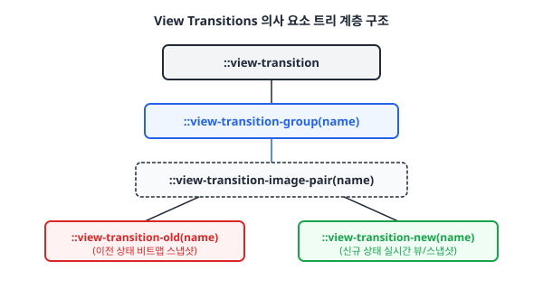
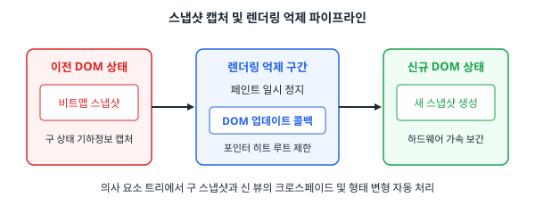
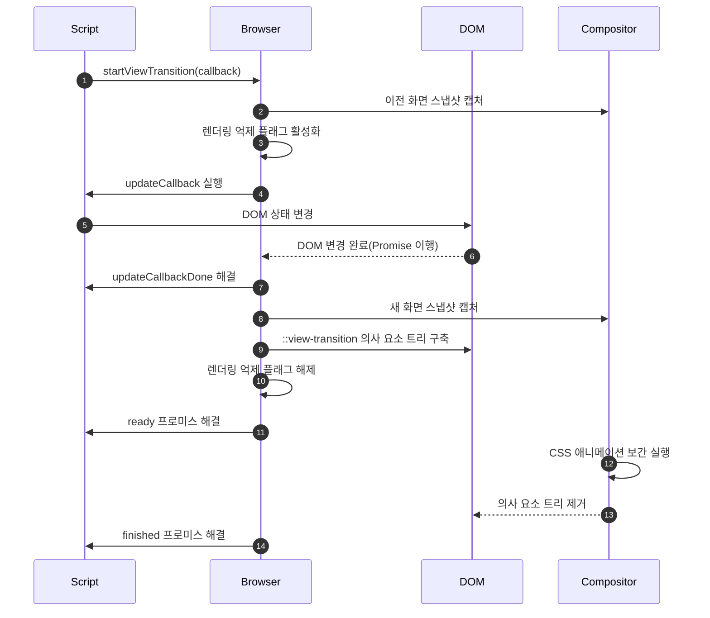

# 261112 View Transitions API

> 한 줄 요약: 브라우저 렌더링 파이프라인에서 이전 및 신규 화면의 비트맵 스냅샷을 캡처하고 의사 요소 트리를 구축하여 하드웨어 가속 CSS 애니메이션으로 형태 변형과 크로스페이드를 자동 보간하는 웹 플랫폼 표준 기능이다. · 분야: DOM · 렌더링 · Baseline: Newly available (동일 문서/SPA 전이는 Chrome 111, Safari 18.0, Firefox 144 지원으로 2025년 10월 Baseline Newly available 달성; 교차 문서/MPA 전이는 Chrome 126 및 Safari 18.2 지원으로 현재 Limited availability) · 읽는 시간 약 14분

## 1. 왜 쓰는가
전통적인 웹 애플리케이션 환경에서 두 개의 서로 다른 DOM 상태 간 전환을 시각적으로 매끄럽게 연결하는 작업은 브라우저 렌더링 엔진의 구조적 제약으로 인해 매우 높은 구현 비용과 성능 결함을 동반했다 [5]. 

기존 개발자들은 시각적 연속성을 보장하기 위해 FLIP(First, Last, Invert, Play) 기법을 수동으로 구현해야 했다 [5]. 이 방식은 대상 요소의 시작 위치(First)와 최종 위치(Last)를 `getBoundingClientRect()` 메서드를 통해 직접 읽어낸 뒤, 두 위치 사이의 좌표 및 크기 차이를 계산하여 `transform(translate, scale)` 속성으로 반전(Invert)시키고, 다음 렌더링 프레임(`requestAnimationFrame`)에서 원래 상태로 복원(Play)하는 과정을 거친다 [5]. 그러나 메인 스레드에서 `getBoundingClientRect()`와 같은 기하학적 수치 조회 API를 연속적으로 호출하면 브라우저가 보류 중이던 스타일 재계산과 레이아웃 연산을 강제로 동기 실행하는 레이아웃 강제 동기화(Layout Thrashing)가 발생한다 [5]. 이로 인해 연산 부하가 급증하여 화면 갱신 주기를 놓치고 심각한 프레임 드롭(Jank)이 야기되었다 [5].

또한 요소의 생명주기와 계층 구조에 따른 기술적 한계가 존재했다 [3] [5]. 표준 CSS Transitions 및 Keyframe Animations는 이미 DOM 트리에 계속 마운트되어 있는 단일 요소의 CSS 속성 변화를 보간하는 데 한정되어 있다. 따라서 라우팅 이동이나 상태 변경으로 인해 기존 요소가 DOM에서 완전히 제거(Unmount)되거나 새로운 요소가 삽입(Mount)되는 상황, 혹은 서로 다른 부모 DOM 계층 간을 넘나드는 시각적 전이를 처리할 수 없었다 [5]. 이를 우회하기 위해 개발자들은 사라지는 요소를 DOM에 임시 복제(Cloning)하거나, `position: absolute`와 고유 `z-index`를 부여한 오버레이 레이어를 생성하는 등 불안정하고 취약한 스크립트 트릭을 사용해야 했다 [3] [5].

서드파티 JavaScript 애니메이션 및 라우팅 라이브러리(Framer Motion, GSAP, Barba.js, Swup 등) 역시 DOM을 직접 복제하거나 가상 오버레이를 주입하는 방식을 취한다 [3] [5]. 이들 라이브러리는 정밀한 타임라인 제어를 지원하지만, 수십~수백 KB에 달하는 스크립트 번들 크기 증가, 특정 프레임워크 런타임에 대한 강한 결합도, 가상 DOM과의 라이프사이클 동기화 충돌 위험을 유발한다.

View Transitions API는 이러한 문제를 해결하기 위해 도입되었다 [1] [5]. 이 API는 외부 자바스크립트 라이브러리 없이 브라우저 자체 렌더링 파이프라인 수준에서 화면 전환을 제어한다 [1] [5]. 브라우저 엔진이 상태 변경 전후의 시각적 화면을 비트맵 스냅샷으로 캡처하고, 문서 최상위에 의사 요소 트리를 자동 생성하여 합성기(Compositor) 수준의 하드웨어 가속 CSS 애니메이션으로 형태 변형(Morphing) 및 크로스페이드를 처리함으로써 레이아웃 강제 동기화를 원천 차단한다 [1] [5].

## 2. 핵심 개념
View Transitions API를 이해하기 위한 핵심 개념은 브라우저 렌더링 엔진 내부의 억제 메커니즘과 최상위 오버레이 레이어에 구축되는 의사 요소 계층 구조이다 [1] [3].





1. `document.startViewTransition(updateCallback)`: 뷰 트랜지션 라이프사이클을 생성하고 실행하는 표준 메서드다 [1] [4]. 상태 변경 로직을 담은 콜백 함수를 인자로 받아 전환 프로세스를 개시한다 [1] [4].
2. 렌더링 억제(Rendering Suppression): 스냅샷 캡처 시점과 새 DOM 상태가 준비되는 시점 사이에 불완전하게 변경된 중간 DOM 상태가 사용자 화면에 노출되는 것을 방지하는 브라우저 내부 제어 플래그(`rendering suppression for view transitions`)다 [1] [4]. 플래그가 활성화되어 있는 동안 브라우저는 화면 페인트를 일시 정지하고 포인터 히트 테스팅을 문서 루트로 제한한다 [1] [4].
3. 의사 요소 트리(Pseudo-element Tree): 전환 애니메이션을 표현하기 위해 브라우저가 문서 최상위 오버레이에 자동으로 빌드하는 임시 의사 요소 계층이다 [1] [3].
   - `::view-transition`: 뷰포트 전체를 덮는 최상위 컨테이너 의사 요소다 [1] [3].
   - `::view-transition-group(name)`: `view-transition-name` 식별자 단위로 생성되며, 이전 상태와 신규 상태 간의 위치(transform) 및 크기(width, height) 기하 보간을 전담한다 [1] [3].
   - `::view-transition-image-pair(name)`: 이전 뷰와 새 뷰의 블렌딩 모드를 격리하는 내부 컨테이너다 [1] [3].
   - `::view-transition-old(name)`: 상태 변경 이전 화면을 캡처한 비트맵 스냅샷이다 [1] [3]. 기본적으로 불투명도가 1에서 0으로 페이드아웃된다 [1] [5].
   - `::view-transition-new(name)`: 상태 변경 이후의 화면을 담은 실시간 뷰/스냅샷이다 [1] [3]. 기본적으로 불투명도가 0에서 1로 페이드인된다 [1] [5].
4. `view-transition-name`: 특정 DOM 요소를 독립적인 전환 레이어로 분리하여 개별 `::view-transition-group`으로 승격시키는 CSS 속성이다 [1] [5]. 기본값은 `none`이며, 최상위 문서 루트(`html`)에는 암묵적으로 `view-transition-name: root`가 할당된다 [1] [5].
5. 비트맵 스냅샷 래스터화: 브라우저는 전환 대상 요소를 실시간 벡터나 라이브 DOM 노드가 아닌 래스터화된 비트맵 그래픽 이미지로 캡처하여 애니메이션에 활용한다 [1].
6. 세분화된 프로미스 라이프사이클: ViewTransition 인스턴스는 전환의 각 단계를 추적할 수 있도록 `updateCallbackDone`, `ready`, `finished` 프로미스를 제공한다 [1] [4].

## 3. 동작 원리
View Transitions API는 자바스크립트 메인 스레드와 브라우저 엔진의 렌더링 파이프라인, 그리고 그래픽 합성기(Compositor) 스레드가 상호 동기화되며 순차적으로 실행된다 [1] [3] [4].



1. **초기 호출 및 상태 캡처**: 개발자 스크립트가 `document.startViewTransition(updateCallback)`을 호출하면 브라우저 엔진은 전환 라이프사이클을 생성한다 [1] [4]. 브라우저는 현재 화면의 시각적 상태를 래스터 비트맵 스냅샷으로 즉시 캡처한다 [1] [4].
2. **렌더링 억제(Rendering Suppression) 활성화**: 브라우저는 문서의 내부 플래그인 `rendering suppression for view transitions`를 `true`로 설정한다 [1] [4]. 이 플래그가 켜지면 화면에 대한 페인트 파이프라인이 즉시 중단되며, 사용자의 포인터 입력 히트 테스팅이 문서 루트로 제한되어 중간 변형 상태의 요소에 클릭이 발생하는 문제를 차단한다 [1] [4].
3. **DOM 변경 콜백 실행**: 브라우저는 인수로 전달받은 `updateCallback`을 실행한다 [1] [4]. 콜백이 Promise를 반환하는 경우, 브라우저는 해당 Promise가 이행(Fulfill)될 때까지 대기하며 렌더링 억제 상태를 유지한다 [1] [4].
4. **`updateCallbackDone` 프로미스 해결**: DOM 업데이트 작업이 완료되고 `updateCallback`의 Promise가 성공적으로 이행되면 `ViewTransition.updateCallbackDone` 프로미스가 즉시 해결된다 [1] [4].
5. **신규 상태 캡처 및 의사 요소 트리 생성**: DOM 상태가 안정화되면 브라우저는 새로운 상태의 스타일과 레이아웃을 계산하고 신규 뷰 스냅샷을 캡처한다 [1] [3]. 이후 문서 최상위에 `::view-transition` 의사 요소 트리를 구축하고, 렌더링 억제 플래그를 `false`로 해제하여 페인트를 재개한다 [1] [3].
6. **`ready` 프로미스 이행**: 의사 요소 트리가 준비되고 CSS 애니메이션이 시작될 준비를 마치면 `ViewTransition.ready` 프로미스가 해결된다 [1] [3] [4]. 개발자는 이 시점에 커스텀 웹 애니메이션 API(WAAPI)를 연결할 수 있다.
7. **하드웨어 가속 합성 보간**: 브라우저 엔진은 이전 상태(`::view-transition-old`)와 신규 상태(`::view-transition-new`)의 기하학적 차이(좌표 및 크기)를 하드웨어 가속 기반 CSS 애니메이션으로 자동 보간(Morphing)하며 동시에 투명도를 교차(Crossfade)한다 [1] [5].
8. **종료 및 `finished` 프로미스 해결**: 정의된 모든 CSS 애니메이션이 완료되면 브라우저는 문서 최상위의 의사 요소 트리를 완전히 제거한다 [1] [3] [4]. 트리가 파괴되면 `ViewTransition.finished` 프로미스가 이행되며 전체 전환 라이프사이클이 종료된다 [1] [3] [4].

## 4. 기본 사용법
다음은 단일 페이지 애플리케이션(SPA)에서 View Transitions API를 점진적 향상(Progressive Enhancement) 기법과 결합하여 안전하게 적용하고 라이프사이클 프로미스를 처리하는 완전한 예제 코드다.

```js
function updateContentWithTransition(updateDOMCallback) {
  if (!document.startViewTransition) {
    updateDOMCallback();
    return;
  }

  const transition = document.startViewTransition(() => {
    updateDOMCallback();
  });

  transition.ready.then(() => {
    console.log("뷰 트랜지션 의사 요소 트리가 준비되어 애니메이션이 시작됩니다.");
  });

  transition.finished.then(() => {
    console.log("뷰 트랜지션 애니메이션이 완전히 종료되었습니다.");
  });
}
```

- **1행**: DOM 변경 로직을 담은 함수 `updateDOMCallback`을 인자로 전달받는 함수 `updateContentWithTransition`을 선언한다.
- **2행**: 실행 환경의 `document` 객체에 `startViewTransition` 메서드가 구현되어 있는지 확인하는 기능 탐지(Feature Detection) 조건문이다.
- **3행**: 브라우저가 View Transitions API를 지원하지 않는 레거시 환경인 경우, 시각 전환 효과 없이 인자로 전달된 DOM 변경 콜백을 동기적으로 직접 실행한다.
- **4행**: 레거시 폴백 처리를 완료한 후 함수의 실행을 즉시 중단하고 반환한다.
- **5행**: 기능 탐지 조건문 블록을 닫는다.
- **6행**: 가독성을 위한 빈 줄이다.
- **7행**: 브라우저 표준 `document.startViewTransition` 메서드를 호출하고 반환된 `ViewTransition` 인스턴스를 변수 `transition`에 할당한다.
- **8행**: 렌더링 억제 구간 내에서 실행될 DOM 갱신 로직 콜백인 `updateDOMCallback`을 실행한다.
- **9행**: `document.startViewTransition` 메서드에 전달한 콜백 함수와 메서드 호출을 종료한다.
- **10행**: 가독성을 위한 빈 줄이다.
- **11행**: 의사 요소 트리가 문서 최상위에 구성되어 애니메이션이 시작될 준비를 마쳤을 때 해결되는 `transition.ready` 프로미스에 후속 처리 핸들러를 등록한다.
- **12행**: 의사 요소 트리가 준비되었음을 알리는 메시지를 브라우저 개발자 도구 콘솔에 출력한다.
- **13행**: `transition.ready.then` 핸들러 블록을 닫는다.
- **14행**: 가독성을 위한 빈 줄이다.
- **15행**: 모든 의사 요소 애니메이션이 종료되고 의사 요소 트리가 문서에서 완전히 제거되었을 때 해결되는 `transition.finished` 프로미스에 후속 처리 핸들러를 등록한다.
- **16행**: 화면 전환 애니메이션이 완전히 종료되었음을 알리는 메시지를 콘솔에 출력한다.
- **17행**: `transition.finished.then` 핸들러 블록을 닫는다.
- **18행**: `updateContentWithTransition` 함수 정의 블록을 닫는다.

## 5. 실무 예시

### 실무 예시 1: 상품 목록-상세 공유 요소 전이(Shared Element Transition) 및 종횡비 왜곡 방지
- **상황**: 상품 목록 페이지의 썸네일 카드를 클릭하여 상세 페이지의 대형 히어로 이미지로 화면이 전환될 때, 두 이미지 간 시각적 연속성을 부여하기 위해 동일한 식별자를 부여하고 종횡비 불일치로 인한 이미지 찌그러짐을 방지해야 하는 상황이다 [5].
- **코드**:
```css
/* 1. 공유 전환 대상 요소에 고유 전환 식별자 부여 */
.product-thumbnail {
  view-transition-name: product-hero;
}

/* 2. 이전 뷰와 신규 뷰의 가로세로 종횡비 불일치에 따른 왜곡 보정 */
::view-transition-old(product-hero),
::view-transition-new(product-hero) {
  height: 100%;
  width: 100%;
  object-fit: cover;
}
```
- **주의점**: 목록의 썸네일과 상세 페이지 히어로 이미지의 가로세로 비율이 다를 경우, 기본 애니메이션 동작은 캡처된 비트맵 이미지를 새로운 기하학적 박스 크기에 맞춰 강제로 늘리므로 심각한 이미지 왜곡이 발생한다. 따라서 `::view-transition-old`와 `::view-transition-new` 의사 요소에 `width: 100%`, `height: 100%`, `object-fit: cover`를 명시하여 이미지 비율을 유지해야 한다.

### 실무 예시 2: 비동기 데이터 패치 분리를 통한 INP 및 렌더링 억제 방지
- **상황**: 원격 서버 API로부터 상품 상세 데이터를 비동기로 불러온 뒤 상세 뷰를 마운트해야 하는 라우팅 이동 상황이다 [1] [4].
- **코드**:
```js
async function navigateToProductDetail(productId) {
  // 네트워크 요청은 반드시 startViewTransition 외부에서 먼저 완료한다.
  const productData = await fetchProductData(productId);

  if (!document.startViewTransition) {
    renderProductView(productData);
    return;
  }

  // 실제 DOM을 변경하는 시점에만 startViewTransition을 호출한다.
  document.startViewTransition(() => {
    renderProductView(productData);
  });
}
```
- **주의점**: `document.startViewTransition` 콜백 내부에서 `fetchProductData`를 `await`하면 서버 응답이 도착할 때까지 브라우저의 렌더링 억제 플래그가 유지된다. 이로 인해 전체 화면 다시 그리기가 정지되고 사용자 입력 인터랙션이 동결되어 핵심 성능 지표인 INP(Interaction to Next Paint)가 파괴된다. 네트워크 통신은 반드시 콜백 외부에서 사전 완료하고, 순수 DOM 변경 작업만 콜백 내부로 전달해야 한다 [1] [4].

### 실무 예시 3: 전정기관 장애 대응(접근성) 및 Transition Types 기반 분기
- **상황**: 뒤로 가기와 앞으로 가기 등 탐색 방향에 맞춰 슬라이드 애니메이션을 분기하고, 모션 민감 사용자를 위해 애니메이션을 무효화해야 하는 상황이다 [2] [5] [7].
- **코드**:
```js
// 1. Level 2 Transition Type을 지정하여 뒤로 가기 전환 실행
document.startViewTransition({
  update: () => updatePageContent(),
  types: ['slide-backwards']
});
```
```css
/* 2. CSS active-view-transition-type 의사 클래스로 방향별 애니메이션 분기 */
html:active-view-transition-type(slide-backwards) {
  &::view-transition-old(root) {
    animation-name: slide-out-to-right;
  }
  &::view-transition-new(root) {
    animation-name: slide-in-from-left;
  }
}

/* 3. 전정기관 질환 및 모션 민감 사용자를 위한 전환 애니메이션 무효화 */
@media (prefers-reduced-motion: reduce) {
  ::view-transition-group(*),
  ::view-transition-old(*),
  ::view-transition-new(*) {
    animation: none !important;
  }
}
```
- **주의점**: 급격한 화면 이동 모션은 전정기관 질환자에게 심각한 어지러움을 유발할 수 있으므로 미디어 쿼리 `@media (prefers-reduced-motion: reduce)`를 통해 애니메이션을 강제 무효화해야 한다. 또한 Level 2 Transition Types 구문은 이를 지원하지 않는 구형 브라우저에서 무시될 수 있으므로 기본 전환 효과를 기본값으로 유지해야 한다 [2] [7].

## 6. 장점 · 단점

| 장점 | 단점 |
| :--- | :--- |
| **외부 번들 오버헤드 0**: Framer Motion, GSAP 등 수십~수백 KB에 달하는 외부 애니메이션 라이브러리 없이 순수 Vanilla JS 및 표준 CSS만으로 고성능 네이티브 전환을 구현할 수 있다 [5]. | **화면 렌더링 동결 위험**: 렌더링 억제(Rendering Suppression) 구간 동안 화면 다시 그리기가 일시 정지되므로, 콜백 내 비동기 작업 지연 시 화면이 멈추고 사용자 인터랙션이 동결될 수 있다 [1] [4]. |
| **레이아웃 강제 동기화 방지**: 브라우저 합성기(Compositor) 수준에서 하드웨어 가속을 활용하므로, 수동 DOM 조작 시 반복 호출되던 `getBoundingClientRect()`로 인한 Layout Thrashing을 원천 차단한다 [1] [5]. | **비트맵 래스터 확대 왜곡**: 전환에 사용되는 시각적 상태가 래스터화된 비트맵 스냅샷이므로, 텍스트나 벡터 그래픽을 크게 확대/축소하는 변형 과정에서 일시적인 번짐이나 픽셀 왜곡이 나타날 수 있다. |
| **세분화된 비동기 제어**: `updateCallbackDone`, `ready`, `finished` 등 단계별 프로미스 인터페이스를 제공하여 DOM 갱신, 애니메이션 시작, 완료 시점을 정밀하게 제어할 수 있다 [1] [4]. | **브라우저 엔진 간 파편화**: 단일 문서(SPA) 전이와 달리 교차 문서(MPA) 전이는 브라우저 엔진 간 구현 진행 속도에 편차가 있어 크로스 브라우징 환경에서 단일 스펙으로 동일하게 취급하기 어렵다 [6]. |
| **직관적인 점진적 향상**: 기존 DOM 조작 로직을 `document.startViewTransition` 조건 분기로 감싸기만 하면 되므로 미지원 브라우저를 위한 폴백 구현이 매우 단순하다. | **사용자 입력 인터랙션 가로채기**: 전환 도중 문서 최상위 레이어에 생성되는 의사 요소 트리가 전환 진행 중에 사용자의 클릭 및 터치 인터랙션을 가로채거나 블로킹할 수 있다 [1] [4]. |
| **선언적 표준 CSS 재사용**: 새로운 자바스크립트 문법 대신 표준 CSS 의사 요소 트리(`::view-transition-*`)와 CSS 키프레임을 사용하여 전환 스타일을 자유롭게 커스터마이징할 수 있다 [1] [3]. | - |

## 7. 한계와 함정
1. **성능 및 INP 악화 함정 (네트워크 패치 혼합 금지)**: `document.startViewTransition`의 콜백 함수 내부에서 `fetch()` 등의 네트워크 요청을 `await`할 경우, 원격 데이터가 반환될 때까지 브라우저의 렌더링 억제 플래그가 활성화 상태를 유지한다 [1] [4]. 이로 인해 브라우저의 전체 화면 페인트가 멈추고 포인터 이벤트 입력이 전면 차단되어 INP(Interaction to Next Paint) 지표가 극도로 악화되는 치명적인 성능 저하가 발생한다. 네트워크 통신은 반드시 콜백 외부에서 사전에 완료해야 한다.
2. **이름 고유성 제약 (`view-transition-name` 충돌)**: 하나의 활성 전환 범위 내에서 동일한 `view-transition-name` 식별자가 두 개 이상의 DOM 요소에 동시에 부여되면 브라우저는 스냅샷 매칭 대상을 특정할 수 없다 [1]. 이 경우 이름 충돌 오류가 발생하여 전환 파이프라인이 즉시 스킵(Skip)되고 `ready` 프로미스가 거부(Reject)된다.
3. **가로세로 비율(Aspect Ratio) 왜곡**: 전환 대상 요소의 시작 크기와 최종 크기의 가로세로 종횡비가 다른 경우, 기본 보간 동작은 캡처된 비트맵 이미지를 강제로 늘리거나 줄여 화면이 찌그러지는 현상을 유발한다. 이를 해결하려면 `::view-transition-old` 및 `::view-transition-new` 의사 요소에 `object-fit: cover`를 지정하여 비트맵의 비율을 고정해야 한다.
4. **쌓임 맥락(Stacking Context) 및 최상위 레이어 간섭**: `::view-transition` 의사 요소 트리는 일반 DOM 트리 최상위의 오버레이 레이어로 렌더링된다 [1] [3]. 따라서 페이지 내의 `position: fixed` 고정 헤더나 최상위 레이어로 승격된 HTML `<dialog>`, Popover 요소와 `z-index` 및 뷰포트 클리핑 간섭을 일으킬 수 있다.
5. **접근성 및 전정기관 장애 위험**: 화면 전체가 급격하게 슬라이드되거나 거대하게 확대되는 모션 효과는 전정기관 질환이 있는 사용자에게 어지러움과 구토를 유발할 수 있다 [5]. 따라서 미디어 쿼리 `@media (prefers-reduced-motion: reduce)`를 사용하여 애니메이션을 완전히 비활성화(`animation: none !important`)하거나 미세한 크로스페이드로 전환해야 한다.
6. **보안 및 개인정보**: 렌더링 억제 플래그가 활성화되어 있는 동안 포인터 히트 테스팅이 문서 루트로 제한되므로, DOM 변경 도중 불완전한 UI 요소를 사용자가 잘못 클릭하여 발생하는 의도치 않은 조작이나 클릭재킹(Clickjacking) 형태의 위험은 브라우저 수준에서 원천 방어된다 [1] [4]. 그러나 콜백 내에 무한 루프나 해결되지 않는 비동기 프로미스를 주입할 경우 사용자 입력이 영구 정지되는 UI 서비스 거부(DoS) 상태가 초래될 수 있으므로 비동기 로직 관리에 주의해야 한다.

## 8. 다른 방법과 비교

| 방법 | 언제 | 비용 | 한계 |
| :--- | :--- | :--- | :--- |
| **수동 FLIP 기법** | 단순 요소의 위치/크기 변경 좌표 보간 시 [5] | 수십~수백 줄의 복잡한 수동 계산 코드 및 상태 관리 [5] | `getBoundingClientRect()` 반복 호출로 인한 Layout Thrashing 유발, 프레임 드롭 발생 [5] |
| **전통적 CSS Transitions / Keyframes** | 이미 DOM에 존재하는 단일 요소의 CSS 속성 변경 시 | 매우 낮음 (브라우저 내장 기능) | DOM에서 제거(Unmount)되거나 새로 추가(Mount)되는 요소 간 전이 불가, 서로 다른 부모 계층 간 연속성 부여 불가 [5] |
| **서드파티 JS 라이브러리 (Framer Motion, GSAP 등)** | 복잡한 다단계 타임라인 제어 및 스프링 물리 시뮬레이션 필요 시 | 수십~수백 KB 번들 크기 증가, 런타임 오버헤드 [5] | 프레임워크 강결합, 가상 DOM 동기화 충돌, DOM 임시 복제 트릭으로 인한 메모리 부담 [3] [5] |
| **View Transitions API** | SPA 라우팅 전환, 공유 요소 전이, 다크모드 토글, MPA 이동 [3] [5] | 번들 오버헤드 0 (웹 플랫폼 표준 기능) [5] | 텍스트/벡터 그래픽 확대 시 비트맵 래스터 번짐, MPA 브라우저 엔진 간 구현 편차, 콜백 지연 시 화면 동결 [1] [4] [6] |

### 이것을 고르지 않는 경우
- **초고해상도 실시간 벡터 렌더링이 필수적인 경우**: 브라우저가 화면을 래스터화된 비트맵 스냅샷으로 캡처하므로, 텍스트나 정밀한 SVG 그래픽을 수십 배 이상 거대하게 확대 변형하는 인터랙션에서는 비트맵의 픽셀 번짐이 발생한다. 이러한 그래픽은 실시간 SVG 경로 보간 엔진을 사용하는 편이 적합하다.
- **물리 기반 스프링 시뮬레이션 및 실시간 제스처 연동이 필요한 경우**: 사용자의 터치 드래그 위치에 즉각 반응하여 관성 및 탄성 물리 연산을 실시간으로 적용해야 하는 제스처 인터랙션에는 타임라인 기반 상태 스냅샷 전환보다 전용 물리 엔진 라이브러리가 적합하다.
- **구형 브라우저 환경을 필수 지원해야 하는 교차 문서(MPA) 환경**: 단일 문서(SPA) 전이는 2025년 10월 Baseline Newly available을 달성했으나, 교차 문서(MPA) 전이는 Chrome 126 및 Safari 18.2에 한정된 Limited availability 상태이므로 구형 엔진 지원이 필수인 환경에서는 도입을 유보해야 한다 [6].

## 9. 대비와 새로운 시도
View Transitions 명세는 초기 Level 1 단계를 넘어 복잡한 실무 요구사항을 수용하기 위해 CSS View Transitions Module Level 2 표준화와 브라우저 엔진 고도화가 진행되고 있다 [2].

1. **CSS View Transitions Module Level 2 스펙 표준화**:
   - `view-transition-class` 속성: Level 1에서는 모든 공유 대상 요소에 고유한 `view-transition-name`을 부여해야 했으나, Level 2에서는 여러 요소에 공통 클래스를 지정할 수 있는 `view-transition-class`가 도입되었다 [2] [7]. 이를 통해 `::view-transition-group(.card)` 형태로 다수의 전환 요소를 일괄적으로 선택하고 공통 애니메이션 스타일을 선언할 수 있다 [2] [7].
2. **Transition Types 및 `:active-view-transition-type()`**:
   - 자바스크립트로 전환을 개시할 때 `types: ['slide-backwards']`와 같이 임의의 타입 문자열 배열을 전달할 수 있다 [2] [7]. CSS에서는 새로 도입된 `:active-view-transition-type()` 의사 클래스를 통해 탐색 방향(앞으로 가기, 뒤로 가기)이나 UI 문맥에 따라 애니메이션을 선언적으로 분기할 수 있다 [2] [7].
3. **`view-transition-name: match-element` 제안**:
   - 수동으로 고유한 문자열 이름을 생성하여 DOM에 부여하고 제거하던 번거로움을 해결하기 위해, 브라우저가 내부 DOM 요소 참조를 기반으로 전환 전후 대상을 자동 매칭하는 `match-element` 메커니즘이 표준 그룹에서 논의되고 있다.
4. **Element-Scoped View Transitions (요소 범위 지정 전이)**:
   - 현재의 `document.startViewTransition()`은 문서 전체의 렌더링을 억제하고 최상위 레이어에서 전체 화면 전환을 수행한다 [1] [4]. 이에 대비하여 특정 DOM 컨테이너 하위 트리만 국소적으로 격리 전환하는 `element.startViewTransition()` 스펙이 제안되어 Chrome 147 등에서 도입되고 있다. 이를 통해 문서 전체의 동결 없이 독립된 위젯이나 컴포넌트 단위의 병렬 전환이 가능해진다.
5. **교차 문서(Cross-Document / MPA) 뷰 트랜지션 지원 확장**:
   - 별도의 SPA 라우터나 스크립트 없이 일반 HTML 하이퍼링크 기반의 멀티 페이지 탐색 환경에서도 `@view-transition { navigation: auto; }` CSS 선언만으로 페이지 간 전환 효과를 적용할 수 있는 기능이 Chrome 126+ 및 Safari 18.2+를 중심으로 탑재되며 생태계가 확장되고 있다.

## 10. 다른 사람에게 설명하기
- **세 문장 요약**:
  1. View Transitions API는 브라우저가 DOM 상태 변경 전후 화면을 비트맵 스냅샷으로 캡처하고 최상위 의사 요소 트리를 구축하여 하드웨어 가속 CSS 애니메이션으로 형태 변형과 크로스페이드를 자동 보간하는 웹 표준 기술이다 [1] [3] [5].
  2. 기존 수동 FLIP 기법의 복잡한 수동 좌표 연산과 레이아웃 강제 동기화(Layout Thrashing), 서드파티 라이브러리의 번들 크기 부담을 완전히 제거하고 세분화된 프로미스 라이프사이클을 통해 안전한 점진적 향상을 지원한다 [1] [4] [5].
  3. 렌더링 억제 구간 동안 화면 다시 그리기가 일시 중단되므로 비동기 데이터 패치는 콜백 외부로 격리해야 하며, 고유 식별자 충돌 방지와 prefers-reduced-motion 미디어 쿼리를 통한 접근성 보장이 필수적이다 [1] [4] [5].

- **스스로 확인할 질문**:
  1. `startViewTransition` 콜백 내부에서 `fetch()`와 같은 비동기 네트워크 통신을 실행했을 때 브라우저 렌더링 억제 플래그와 INP 지표에 어떤 부정적 영향이 발생하는가?
  2. 단일 전환 범위 내에서 동일한 `view-transition-name` 식별자가 두 개 이상의 서로 다른 DOM 요소에 동시에 부여되었을 때 브라우저는 전환을 어떻게 처리하는가?
  3. 의사 요소 트리 구조에서 `::view-transition-group`, `::view-transition-old`, `::view-transition-new`가 각각 담당하는 애니메이션 및 그래픽 보간 역할의 차이는 무엇인가?

## 참고 자료
1. [CSS View Transitions Module Level 1 (W3C Working Draft / Candidate Recommendation)](https://drafts.csswg.org/css-view-transitions-1/)
2. [CSS View Transitions Module Level 2 (W3C Editor's Draft)](https://drafts.csswg.org/css-view-transitions-2/)
3. [MDN Web Docs - View Transition API](https://developer.mozilla.org/en-US/docs/Web/API/View_Transition_API)
4. [MDN Web Docs - Document: startViewTransition() method](https://developer.mozilla.org/en-US/docs/Web/API/Document/startViewTransition)
5. [Chrome for Developers - Smooth transitions with the View Transition API](https://developer.chrome.com/docs/web-platform/view-transitions/same-document)
6. [WebKit Blog - News from WWDC24: WebKit in Safari 18.0 (View Transitions)](https://webkit.org/blog/15444/news-from-wwdc24-webkit-in-safari-18-0/)
7. [Chrome for Developers - View transition types & view-transition-class](https://developer.chrome.com/docs/web-platform/view-transitions/types-and-classes)
조사: 2026-11-12

## 내 리뷰
(읽고 느낀 점 · 궁금한 것을 적는다. 질문은 Q. 로 시작)
