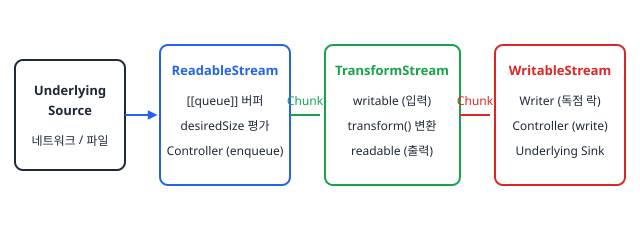
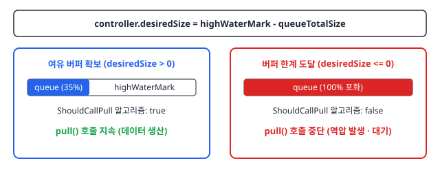
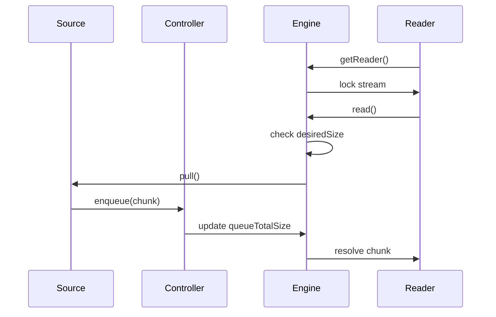

# 261114 Streams API

> 한 줄 요약: 네트워크, 파일, 또는 메모리 상의 대용량 데이터를 전체 버퍼링 없이 청크(Chunk) 단위로 점진적 처리·변환·소비할 수 있도록 규격화한 웹 표준 비동기 데이터 파이프라인이다. · 분야: 비동기 · 동시성 · Baseline: Widely available · 읽는 시간 약 6분

## 1. 왜 쓰는가
전통적인 웹 플랫폼의 I/O 처리 방식인 XMLHttpRequest, 초기 fetch, FileReader는 네트워크나 파일 시스템으로부터 전달되는 전체 페이로드가 브라우저 메모리에 온전히 적재될 때까지 완료를 기다려야 했다 [2]. 수백 메가바이트 이상의 대용량 파일 다운로드, 비디오 스트리밍, 대규모 데이터셋 처리 환경에서는 전체 데이터가 메모리(Blob 또는 ArrayBuffer)에 한꺼번에 적재되는 동안 메모리 사용량이 급증하는 메모리 스파이크(Memory Spike) 현상이 발생했다 [2]. 메모리 자원이 제한적인 모바일 기기나 저사양 환경에서는 브라우저 탭의 가용 메모리 한계를 초과하여 OOM(Out of Memory) 비정상 종료(크래시)가 빈번하게 유발되었다 [2]. 또한 첫 번째 바이트가 수신되어도 전체 데이터가 모두 도착할 때까지 파싱이나 화면 렌더링을 시작하지 못하여 사용자가 체감하는 대기 시간(TTFB, TTFI)이 길어지는 구조적 한계가 존재했다 [2].

WHATWG Streams 명세는 이러한 메모리 고갈과 처리 지연 문제를 해결하기 위해 고안되었다 [1]. 데이터를 임의의 크기를 가진 작은 단위인 청크(Chunk)로 분할하여, 전체 데이터가 도착하기 전이라도 첫 번째 청크가 도착하는 즉시 순차적으로 처리, 변환, 소비할 수 있는 표준화된 데이터 추상화 계층을 제공한다 [1]. 특히 빠른 생산자(Producer)와 느린 소비자(Consumer) 사이의 속도 불균형으로 인해 발생하는 내부 버퍼 오버플로우를 런타임 수준에서 억제하기 위해 네이티브 역압(Backpressure) 제어 메커니즘을 규격화했다 [1]. 이를 통해 웹 애플리케이션은 메모리 스파이크 없이 대규모 비동기 데이터 파이프라인을 안정적으로 유지할 수 있게 되었으며, Firefox가 2019년 1월 배포한 65 버전에서 ReadableStream을 기본 활성화한 이래 2022년 Safari 15.4와 Firefox 102 지원을 거쳐 전 세계 97% 이상의 브라우저에서 상호운용성을 확보한 Baseline Widely available 상태에 도달했다 [5], [6].

## 2. 핵심 개념


WHATWG Streams 명세는 데이터 스트리밍을 구성하는 컴포넌트를 명확한 역할에 따라 분리하여 정의한다 [1].

1. 기저 소스(Underlying Source)와 기저 싱크(Underlying Sink):
스트림의 실제 I/O를 담당하는 하부 시스템이다. 네트워크 소켓, 파일 시스템, 동적 데이터 제너레이터 등이 기저 소스로 동작하며, 화면 렌더러, 파일 스토리지, 서버 HTTP 업로드 요청 등이 기저 싱크로 동작한다 [1].

2. 세 가지 기본 인터페이스(ReadableStream, WritableStream, TransformStream):
명세는 데이터 파이프라인의 입구, 출구, 중간 가공 단계를 각각 독립된 인터페이스로 정의한다 [1].
- ReadableStream: 청크 단위로 데이터를 외부로 방출하는 읽기 가능한 스트림이다 [1].
- WritableStream: 청크 단위로 데이터를 수신하여 기저 싱크에 순차 기록하는 쓰기 가능한 스트림이다 [1].
- TransformStream: 쓰기 인터페이스(writable)와 읽기 인터페이스(readable)의 쌍으로 구성되며, 입력을 받아 내부 변환 로직(transform)을 거쳐 가공된 출력을 방출하는 파이프라인 변환기다 [1].

3. 청크(Chunk):
스트림 파이프라인을 따라 흐르는 개별 데이터 조각이다 [1]. 단일 바이트, TypedArray(Uint8Array 등), 문자열, 파싱된 JSON 객체 등 임의의 데이터 타입을 가질 수 있다 [1].

4. 컨트롤러(Controller):
스트림의 내부 상태와 큐를 직접 조작하는 내부 객체다 [1]. ReadableStreamDefaultController는 청크를 큐에 삽입하는 enqueue(), 스트림의 정상 종료를 알리는 close(), 실패 상태를 전달하는 error() 메서드를 제공한다 [1]. 바이트 스트림(type: 'bytes') 환경에서는 ReadableByteStreamController가 제공되며, 소비자가 전달한 버퍼에 직접 기록할 수 있는 byobRequest 속성을 노출한다 [1].

5. 리더(Reader)와 독점 잠금(Locking):
ReadableStream의 청크를 순차적으로 읽어들이는 소비자 객체(ReadableStreamDefaultReader 또는 ReadableStreamBYOBReader)다 [1]. getReader()를 호출하면 스트림은 독점적으로 잠금(stream.locked === true)되며, 이 락이 해제되기 전까지 다른 리더를 생성하거나 스트림을 파이핑하려 하면 TypeError가 발생한다 [1], [2].

6. 내부 슬롯(Internal Slots):
ReadableStream은 내부 슬롯으로 청크를 임시 보관하는 큐([[queue]]), 큐에 누적된 청크들의 총 크기([[queueTotalSize]]), 리더가 호출했으나 아직 데이터가 도착하지 않아 대기 중인 읽기 요청 목록([[readRequests]])을 유지한다 [1].



7. 큐잉 전략(QueuingStrategy)과 역압(Backpressure):
큐의 임계 수용량을 결정하는 highWaterMark를 기준으로 동작한다 [1]. 현재 큐가 추가로 수용할 수 있는 용량은 desiredSize = highWaterMark - queueTotalSize 계산식으로 실시간 평가된다 [1].

8. BYOB(Bring Your Own Buffer):
바이트 스트림(type: 'bytes') 환경에서 소비자가 직접 할당한 ArrayBufferView 메모리를 스트림에 전달하여, 새로운 TypedArray 힙 할당 없이 제로카피(Zero-copy) 방식으로 데이터를 기록(respond())받는 고성능 읽기 메커니즘이다 [1].

## 3. 동작 원리
스트림의 실행 흐름은 큐잉 전략과 리더의 읽기 요청에 따라 엄격하게 제어된다 [1].



스트림 엔진의 내부 동작과 수명 주기는 다음 명세 규칙을 따른다 [1].

1. desiredSize 계산과 pull() 호출 시점:
스트림 컨트롤러의 desiredSize는 highWaterMark에서 [[queueTotalSize]]를 차감하여 실시간으로 도출된다 [1]. 명세상의 ReadableStreamDefaultControllerShouldCallPull 알고리즘에 따라, desiredSize가 0보다 큰 양수(desiredSize > 0)일 때만 엔진이 기저 소스의 pull() 훅을 비동기로 실행하여 추가 청크 생산을 유도한다 [1].

2. 역압(Backpressure) 형성 및 해제:
소비자의 처리 속도가 생산자의 방출 속도를 따라가지 못해 [[queueTotalSize]]가 증가하여 highWaterMark에 도달하거나 초과하면, desiredSize는 0 이하(desiredSize <= 0)가 된다 [1]. 이때 ReadableStreamDefaultControllerShouldCallPull 알고리즘은 false를 반환하므로 엔진은 pull() 호출을 중단한다 [1]. 생산자는 추가 호출을 받지 못하므로 데이터 읽기 및 인큐 작업을 자연스럽게 일시 정지하게 되며, 이것이 역압의 동작 방식이다 [1]. 이후 소비자가 reader.read()를 호출하여 큐에서 청크를 꺼내가면 [[queueTotalSize]]가 감소하고 desiredSize가 다시 양수로 복귀하면서 pull() 호출이 재개된다 [1].

3. 파이프 연결과 오류 상향 전파:
pipeThrough() 및 pipeTo() 메서드는 읽기 가능한 스트림과 쓰기 가능한 대상을 연결한다 [3]. 파이프 연결 도중 목적지 싱크의 버퍼가 가득 차면 상류(Upstream) 스트림으로 역압이 자동으로 상향 전파된다 [3]. 반대로 파이프 연결 중 목적지 싱크에서 쓰기 오류가 발생하면 기본적으로 원본 소스에 cancel()이 자동 호출되어 네트워크 연결 해제 및 리소스 정리가 수행된다 [1]. 만약 리소스 유출을 방지하거나 원본 스트림을 유지하려면 preventClose, preventAbort, preventCancel 옵션을 명시적으로 지정해야 한다 [1].

4. 제로카피 바이트 읽기:
바이트 스트림(type: 'bytes')에서는 ReadableByteStreamController의 byobRequest 속성을 통해 소비자가 전달한 ArrayBufferView 버퍼 메모리에 접근한다 [1]. 기저 소스가 byobRequest.view에 바이트를 직접 쓰고 byobRequest.respond(bytesRead)를 호출하면, 런타임 추가 메모리 할당 없이 소비자의 버퍼로 데이터가 즉시 전달된다 [1].

## 4. 기본 사용법
다음은 역압(Backpressure)과 highWaterMark 버퍼 임계치를 반영하여 데이터를 생성하고 소비하는 완전한 JavaScript 예제다 [1].

```js
const readable = new ReadableStream({
  start(controller) {
    this.dataSource = {
      cursor: 0,
      limit: 3,
      async readNextChunk() {
        if (this.cursor >= this.limit) return null;
        this.cursor += 1;
        return new Uint8Array([this.cursor]);
      },
      destroy() {
        this.cursor = 0;
      }
    };
  },
  async pull(controller) {
    const chunk = await this.dataSource.readNextChunk();
    if (chunk === null) {
      controller.close();
    } else {
      controller.enqueue(chunk);
    }
  },
  cancel(reason) {
    this.dataSource.destroy();
  }
}, new ByteLengthQueuingStrategy({ highWaterMark: 1024 * 64 }));

(async () => {
  const reader = readable.getReader();
  while (true) {
    const { done, value } = await reader.read();
    if (done) break;
    console.log(value);
  }
  reader.releaseLock();
})();
```

줄별 설명:
- 1: ReadableStream 생성자를 호출하여 읽기 가능한 새로운 스트림 인스턴스를 초기화한다.
- 2: 스트림이 인스턴스화되는 즉시 실행되는 start 훅을 정의한다.
- 3-14: 스트림에 순차적으로 청크를 공급할 기저 데이터 소스 객체를 구성하고 내부 커서, 청크 생성 로직, 리소스 해제 메서드를 정의한다.
- 15: start 훅의 선언을 닫는다.
- 16: 스트림 내부 큐의 desiredSize가 양수일 때 브라우저 스트림 엔진에 의해 호출되는 비동기 pull 훅을 선언한다.
- 17: 데이터 소스로부터 다음 데이터 청크를 비동기로 읽어온다.
- 18: 데이터 소스에서 더 이상 방출할 데이터가 없는지(종단 상태인지) 검사한다.
- 19: 데이터 공급이 완료되었으므로 controller.close()를 호출하여 스트림을 정상 종료 상태로 전이시킨다.
- 20: 방출할 청크가 존재하는 경우의 조건문 분기다.
- 21: controller.enqueue(chunk)를 호출하여 획득한 청크를 내부 큐에 삽입하고 desiredSize를 갱신한다.
- 22: 조건 분기 블록을 닫는다.
- 23: pull 훅의 선언을 닫는다.
- 24: 소비자가 스트림을 취소하거나 파이프가 중단되었을 때 실행되는 cancel 훅을 선언한다.
- 25: 데이터 소스의 destroy()를 호출하여 내부 리소스를 즉시 해제한다.
- 26: cancel 훅의 선언을 닫는다.
- 27: 바이트 크기 기반의 큐잉 전략(ByteLengthQueuingStrategy)을 적용하여 highWaterMark 임계치를 64KB(65,536바이트)로 설정하고 생성자 호출을 마친다.
- 28: 스트림 소비를 수행하기 위한 비동기 즉시 실행 함수를 선언한다.
- 29: readable.getReader()를 호출하여 스트림에 독점 락을 걸고 기본 리더(ReadableStreamDefaultReader)를 획득한다.
- 30: 스트림의 모든 청크를 순차적으로 소비하기 위한 무한 루프를 시작한다.
- 31: reader.read()를 비동기 호출하여 청크의 수신 상태({ done, value })를 대기한다.
- 32: done 속성이 true로 평가되면 스트림이 종료된 것이므로 루프를 즉시 탈출한다.
- 33: 수신된 청크(Uint8Array) 값을 콘솔에 출력한다.
- 34: while 루프 블록을 닫는다.
- 35: reader.releaseLock()을 호출하여 스트림의 독점 잠금을 해제하고 스트림을 잠금 해제 상태로 복원한다.
- 36: 비동기 즉시 실행 함수를 닫고 호출한다.

## 5. 실무 예시

### 실무 예시 1: Fetch 응답 스트리밍과 TransformStream을 활용한 NDJSON 실시간 파싱
- 상황: 서버로부터 줄바꿈으로 구분된 대용량 JSON(NDJSON) 스트림을 fetch 응답으로 받아, 전체 페이로드가 다운로드될 때까지 기다리지 않고 줄 단위로 즉시 파싱하여 화면에 점진적으로 렌더링해야 하는 환경 [1], [3].
- 코드:
```js
const response = await fetch('/api/stream-data');
const lineStream = response.body
  .pipeThrough(new TextDecoderStream())
  .pipeThrough(new TransformStream({
    buffer: '',
    transform(chunk, controller) {
      this.buffer += chunk;
      const lines = this.buffer.split('\n');
      this.buffer = lines.pop(); // 미완성 줄 유지
      for (const line of lines) {
        if (line.trim()) controller.enqueue(JSON.parse(line));
      }
    },
    flush(controller) {
      if (this.buffer && this.buffer.trim()) {
        controller.enqueue(JSON.parse(this.buffer));
      }
    }
  }));

for await (const record of lineStream) {
  renderRecord(record);
}
```
- 주의점:
  1. 네트워크 패킷 단위 청크의 경계는 줄바꿈 문자(\n)와 일치하지 않으므로, 완성되지 않은 마지막 문자열 조각을 this.buffer에 보관하지 않고 즉시 JSON.parse()를 실행하면 구문 오류(SyntaxError)가 발생한다.
  2. 스트림이 정상 종료될 때 마지막 줄에 줄바꿈 문자가 없을 수 있으므로, flush() 콜백에서 버퍼에 남은 잔여 문자열을 반드시 처리하여 인큐해야 한다 [1].
  3. pipeThrough()를 호출하는 순간 response.body는 독점 잠금되므로, 다른 코드 영역에서 response.body를 직접 읽거나 중복 파이핑하려 하면 TypeError가 발생한다 [2].

### 실무 예시 2: Fetch 요청 본문 스트리밍 업로드 (half-duplex)
- 상황: 클라이언트 메모리에 대용량 데이터를 한꺼번에 버퍼링하지 않고, 백그라운드에서 청크 단위로 생성되는 바이너리 데이터를 HTTP POST 요청 본문(body)을 통해 서버로 직접 스트리밍 업로드해야 하는 환경 [4].
- 코드:
```js
const { readable, writable } = new TransformStream();
const writer = writable.getWriter();

// 백그라운드에서 데이터를 스트림에 작성
(async () => {
  const encoder = new TextEncoder();
  for (let i = 0; i < 100; i++) {
    await writer.write(encoder.encode(`chunk-${i}\n`));
  }
  await writer.close();
})();

// duplex: 'half' 옵션을 필수 지정하여 스트리밍 업로드 요청
const uploadRes = await fetch('/upload-stream', {
  method: 'POST',
  headers: { 'Content-Type': 'application/octet-stream' },
  body: readable,
  duplex: 'half'
});
const result = await uploadRes.text();
```
- 주의점:
  1. fetch() 요청 본문에 ReadableStream을 주입할 때 브라우저는 반이중(Half-duplex) 전송 방식을 명시하기 위해 duplex: 'half' 옵션을 필수로 요구한다 [4].
  2. duplex: 'half' 옵션을 지정하지 않으면 브라우저 런타임에서 TypeError가 발생하여 요청 자체가 실패한다 [4].
  3. 백그라운드 데이터 작성이 완료된 후 writer.close()를 명시적으로 호출하지 않으면 스트림 종단 신호가 서버로 전달되지 않아 업로드 요청이 무한 대기 상태에 빠질 수 있다.

## 6. 장점 · 단점

| 장점 | 단점 |
| :--- | :--- |
| highWaterMark와 desiredSize 기반의 네이티브 역압(Backpressure) 제어를 통해 빠른 생산자와 느린 소비자 간 큐 오버플로우 및 메모리 폭발을 런타임에서 차단함 [1] | 컨트롤러(Controller), 리더(Reader), 독점 잠금(Lock), 큐잉 전략(QueuingStrategy) 등 명세의 추상화 계층이 다층적이라 초기 학습 비용이 높음 |
| 전체 페이로드 수신 대기 없이 첫 번째 청크 도착 즉시 점진적으로 파싱 및 화면 렌더링이 가능하여 체감 지연 시간(TTFB/TTFI)을 대폭 단축함 [2] | 청크 단위 비동기 실행 흐름과 내부 큐 상태([[queue]])가 런타임에 은닉되어 일반 브라우저 디버거 및 네트워크 패널에서 병목 지점이나 누수 원인 추적이 어려움 |
| TransformStream 체이닝(pipeThrough)을 통해 텍스트 디코딩, 줄 단위 분할, 압축 등 데이터 가공 로직을 모듈형 파이프라인으로 재사용할 수 있음 [1], [3] | Fetch 업로드 스트리밍 등 진보된 연계 기능에서 duplex: 'half' 명시 요구 등 브라우저 벤더 간 세부 옵션 및 런타임 지원 시점의 파편화가 존재함 [4] |
| 바이트 스트림(type: 'bytes')과 BYOB 리더를 통해 불필요한 힙 메모리 할당 없는 제로카피(Zero-copy) 입출력 최적화를 달성할 수 있음 [1] | 기본 스트림 사용 시 청크마다 TypedArray가 동적 할당되어 대용량·초고속 처리 시 가비지 컬렉션 부하를 유발할 수 있음 [1] |

## 7. 한계와 함정

1. 경계 사례 (Edge Cases):
- tee() 분기의 비대칭 소비 함정: ReadableStream.prototype.tee()는 단일 스트림을 동일한 두 개의 독립 분기(branch)로 복제한다 [7]. 그러나 두 분기 중 한쪽 분기만 데이터를 활발히 소비하고 다른 쪽 분기가 데이터를 소비하지 않고 방치될 경우, 원본 스트림은 계속해서 pull()을 호출하여 데이터를 생산한다 [7]. 소비되지 않은 분기의 내부 큐에는 미소비 청크가 무제한 누적되어 브라우저 탭 전체의 힙 메모리가 고갈되고 OOM 크래시가 발생한다 [7].
- 잠금 충돌(Lock Contention): 스트림이 이미 getReader()나 파이프라인에 의해 잠겨 있는 상태(stream.locked === true)에서 다른 리더를 생성하려 하거나 중복 파이핑을 시도하면 런타임에 즉각 TypeError가 발생한다 [2].

2. 성능 (Performance):
- 기본 스트림의 가비지 컬렉션(GC) 부하: type: 'bytes' 및 BYOB 리더를 사용하지 않는 기본 스트림은 네트워크 청크를 수신할 때마다 새로운 TypedArray 객체를 힙 메모리에 동적 할당한다 [1]. 초당 수천 개의 청크가 유입되는 고속 데이터 파이프라인에서는 지속적인 단기 객체 생성으로 인해 심각한 가비지 컬렉션 스터터링(GC Pauses)과 메인 스레드 프레임 드랍이 유발된다 [1].

3. 접근성 (Accessibility):
- 스트리밍 방식으로 수신된 데이터를 화면에 점진적으로 렌더링할 때, DOM 노드가 과도하게 잦은 빈도로 추가되면 스크린 리더가 실시간 라이브 리전(Live Region) 갱신 음성을 끊임없이 반복 출력하여 사용자 혼란을 초래할 수 있으므로 렌더링 배치 주기 관리가 필요하다.

4. 보안 (Security):
- CORS 및 Opaque 응답 차단: 크로스 오리진 요청에서 mode: 'no-cors' 옵션으로 가져온 불투명(Opaque) 응답은 브라우저 보안 및 사이드채널 정보 유출 방지 정책에 의해 response.body가 null로 처리되어 스트림 읽기가 원천적으로 차단된다.

5. 개인정보 (Privacy):
- 교차 출처 데이터의 청크 크기나 도착 타이밍 등 사이드채널 타이밍 정보를 통해 사용자의 비공개 네트워크 활동이나 데이터 크기가 유출되는 것을 방지하기 위해 불투명 응답의 본문 접근이 철저히 차단된다.

## 8. 다른 방법과 비교

| 방법 | 언제 | 비용 | 한계 |
| :--- | :--- | :--- | :--- |
| Streams API (ReadableStream / TransformStream) | 수십~수백 MB 이상의 대용량 네트워크 페이로드, 실시간 점진적 파싱 및 가공, 제로카피 입출력이 필요할 때 [1], [2] | 다층적 추상화 계층 학습 비용, 리더 잠금 제어 코드 필요 | 디버깅 복잡성, 불투명(Opaque) CORS 응답 본문 차단 |
| Response.blob() / Response.arrayBuffer() / Response.text() | 페이로드 전체 크기가 작고 단순하여 전체 데이터를 한 번에 메모리에 로드해도 무방할 때 | 낮은 코드 복잡도, 즉각적인 프로미스 처리 | 전체 페이로드 완료까지 대기 필요, 대용량 데이터 처리 시 메모리 스파이크 및 OOM 유발 [2] |
| Node.js Streams (EventEmitter 기반 stream) | 전통적인 Node.js 런타임 환경에서 파일 시스템이나 네트워크 소켓을 이벤트 기반으로 다룰 때 | EventEmitter 패턴의 친숙함, 풍부한 서버 생태계 | 브라우저 네이티브 표준이 아니며, Promise 및 Reader 독점 락 기반의 통합 모델이 아님 |
| WebSocket / Server-Sent Events (SSE) | 클라이언트와 서버 간 전이중 실시간 양방향 통신이나 서버 푸시 이벤트 채널이 필요할 때 | 연결 유지 프로토콜 오버헤드, 전용 서버 인프라 필요 | 단일 HTTP 요청/응답 내부의 바이트 수준 청크 분할 및 로컬 파이프라인(Blob 변환 등) 제어 추상화 계층이 아님 |

### 이것을 고르지 않는 경우
수 킬로바이트 수준의 정적 메타데이터나 단순한 단일 JSON 설정 파일을 수신할 때는 Streams API의 리더 잠금, 큐잉 전략, 변환 스트림 파이프라인을 구축하는 것이 코드 복잡도만 증가시키므로 단순 response.json() 또는 response.text()를 사용하는 것이 효율적이다. 또한 실시간 양방향 통신이 필수적인 다중 사용자 상호작용 환경에서는 단일 HTTP 스트림이 아닌 WebSocket 프로토콜을 선택해야 한다.

## 9. 대비와 새로운 시도

1. ReadableStream.from(iterable) 표준 메서드:
비동기 제너레이터나 동기/비동기 이터러블 컬렉션을 단 한 줄의 코드로 웹 표준 ReadableStream 인스턴스로 변환할 수 있는 정적 메서드가 도입되었다 [8]. Firefox 117+, Chrome, Safari에 탑재되어 외부 데이터 소스와의 상호운용성을 크게 개선했다 [8].

2. Fetch Request Upload Streaming (duplex: 'half'):
fetch() 요청의 body 속성에 ReadableStream을 직접 주입하여 클라이언트 데이터를 서버로 스트리밍 업로드하는 표준 스펙이 정착되었으며, Chromium 계열 브라우저에 기본 탑재되어 대용량 업로드 시 메모리 사용량을 대폭 절감하고 있다 [4].

3. 전송 가능 스트림(Transferable Streams):
postMessage() 및 structuredClone()의 전송 가능 객체 목록에 ReadableStream, WritableStream, TransformStream이 포함되었다. 이를 통해 웹 워커(Web Worker)와 메인 스레드 간에 스트림의 락 소유권을 직접 이전하여, 데이터 복사 오버헤드 없는 스레드 간 고성능 비동기 파이프라인 구축을 지원한다.

4. ReadableStream.prototype[Symbol.asyncIterator]():
별도의 getReader() 호출과 read() 반복 루프 없이 for await...of 문법을 통해 스트림의 청크를 직접 순회할 수 있는 표준 비동기 이터레이터 지원이 확립되었다.

## 10. 다른 사람에게 설명하기

### 세 문장 요약
1. Streams API는 대용량 네트워크 및 파일 데이터를 메모리에 전부 버퍼링하지 않고 청크(Chunk) 단위로 점진적 처리·변환·소비할 수 있도록 규격화한 웹 표준 비동기 데이터 파이프라인이다 [1], [2].
2. highWaterMark와 desiredSize에 기반한 네이티브 역압(Backpressure)과 독점 잠금(Locking) 메커니즘을 통해 빠른 생산자와 느린 소비자 간의 메모리 오버플로우와 OOM 크래시를 런타임에서 방지한다 [1], [2].
3. 바이트 스트림의 BYOB 제로카피 읽기와 TransformStream 파이프라인 체이닝을 지원하며, 2022년 이후 주요 브라우저 전반에서 상호운용성을 확보한 Baseline Widely available 기술이다 [1], [6].

### 스스로 확인할 질문
1. ReadableStream 내부 큐의 controller.desiredSize가 0 이하로 떨어졌을 때 브라우저 스트림 엔진은 기저 소스의 어떤 훅 호출을 중단하여 역압을 형성하는가?
2. ReadableStream.prototype.tee()로 분기한 두 브랜치 중 한쪽 브랜치만 데이터를 소비하고 다른 쪽 브랜치를 방치했을 때 탭 전체의 OOM 크래시가 유발되는 구체적인 이유는 무엇인가?
3. fetch() 요청 본문(body)에 ReadableStream을 주입하여 업로드 스트리밍을 수행할 때 브라우저가 필수로 요구하는 옵션 속성과 설정값은 무엇인가?

## 참고 자료
1. [WHATWG Streams Standard](https://streams.spec.whatwg.org/)
2. [MDN Web Docs - Streams API](https://developer.mozilla.org/en-US/docs/Web/API/Streams_API)
3. [web.dev - Streams: The definitive guide](https://web.dev/articles/streams)
4. [Chrome for Developers - Streaming requests with the fetch API](https://developer.chrome.com/docs/capabilities/web-apis/fetch-streaming-requests)
5. [Mozilla Hacks - Firefox 65: WebP support, Flexbox Inspector, new tooling & platform updates](https://hacks.mozilla.org/2019/01/firefox-65-web-p-support-flexbox-inspector-new-tooling-platform-updates/)
6. [Can I use - Streams](https://caniuse.com/streams)
7. [MDN Web Docs - ReadableStream: tee() method](https://developer.mozilla.org/en-US/docs/Web/API/ReadableStream/tee)
8. [MDN Web Docs - ReadableStream.from() static method](https://developer.mozilla.org/en-US/docs/Web/API/ReadableStream/from_static)
조사: 2026-11-14

## 내 리뷰
(읽고 느낀 점 · 궁금한 것을 적는다. 질문은 Q. 로 시작)
