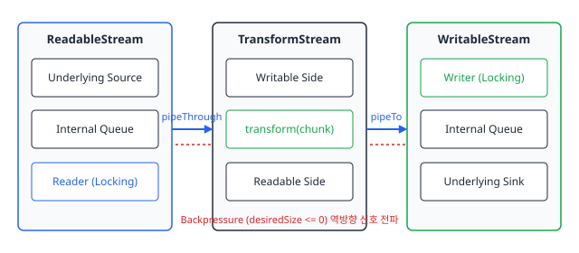
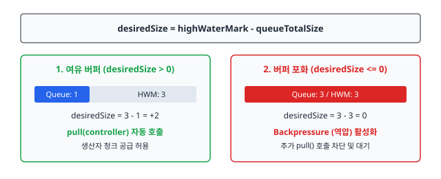
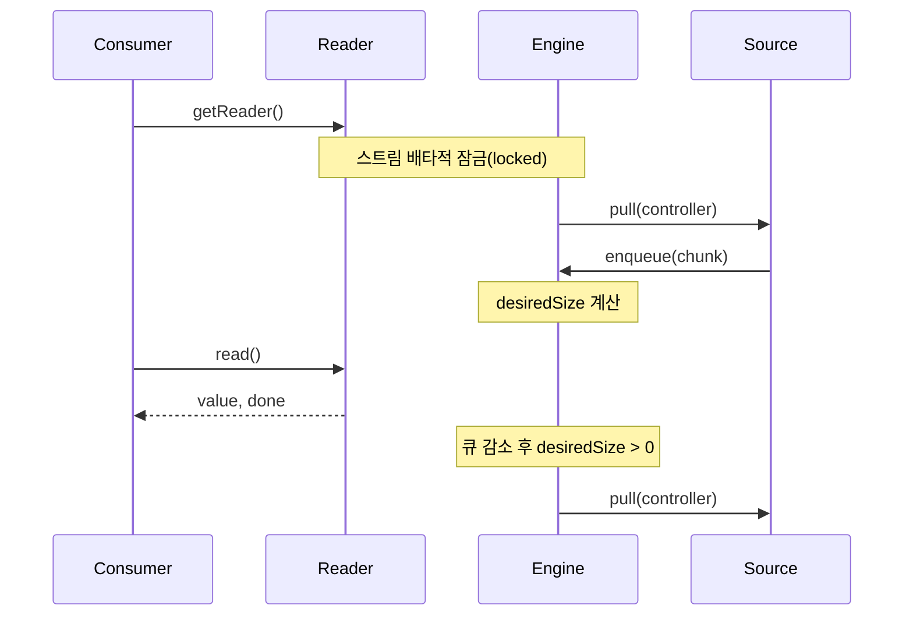

# 261114 Streams API

> 한 줄 요약: Streams API는 대용량 네트워크 리소스와 파일 데이터를 메모리 전체에 버퍼링하지 않고 청크 단위로 점진적 생성·가공·소비하며 내장된 백프레셔로 메모리를 제어하는 웹 표준 비동기 데이터 스트리밍 프리미티브다. · 분야: 비동기 · 동시성 · Baseline: Widely available (ReadableStream, WritableStream, TransformStream 등 핵심 웹 스트림 인터페이스는 주요 브라우저 엔진 전반에서 2019~2022년에 걸쳐 완전한 상호운용성을 확보하여 30개월 이상 Baseline Widely available 상태를 유지함) · 읽는 시간 약 14분

## 1. 왜 쓰는가
전통적인 웹 플랫폼 환경에서 네트워크 리소스와 파일 데이터를 다룰 때 가장 큰 기술적 문제는 전체 데이터를 메모리에 모두 버퍼링한 후에야 연산을 시작할 수 있었다는 점이다 [1][2]. Streams API 등장 이전에는 XMLHttpRequest, response.blob(), response.text(), FileReader API 등을 사용하여 서버의 응답이나 로컬 디스크의 바이너리 데이터를 메모리로 읽어 들였다 [1][2]. 이 방식에서는 수백 메가바이트(MB)에서 수 기가바이트(GB)에 이르는 대용량 동영상, 로그 파일, 대규모 CSV 데이터를 처리할 때 전체 리소스 크기만큼의 메모리가 브라우저 탭에 일시에 할당되어 Out of Memory(OOM) 크래시를 빈번하게 유발했다 [2][3].

또한 데이터가 네트워크 패킷 단위로 순차 도착하고 있음에도 불구하고, 브라우저 런타임이 전체 다운로드 완료를 대기하므로 파싱 및 렌더링 작업을 중간에 개시할 수 없었다 [3][4]. 이로 인해 첫 청크 수신 후 화면에 유의미한 정보를 표시하기까지 걸리는 첫 응답 표시 시간(Time to First Byte/Meaningful Render)과 최종 사용자 체감 지연 시간이 기하급수적으로 증가하는 문제가 존재했다 [3][4].

서버 진영의 Node.js 환경에는 EventEmitter 기반의 stream.Readable과 stream.Writable이 초기부터 존재했으나, 웹 브라우저 환경에는 표준화된 스트림 프리미티브가 부재하여 런타임 간 코드 재사용이 불가능했다 [1][3]. 더욱이 데이터 생산자의 유입 속도와 소비자의 처리 속도 불균형을 브라우저 런타임 엔진 차원에서 조율할 수 있는 표준 역압(Backpressure) 제어 메커니즘이 전혀 제공되지 않았다 [1][3].

WHATWG(Web Hypertext Application Technology Working Group)는 이러한 구조적 결함을 해결하기 위해 Streams 표준을 제정했다 [1][2]. Streams API는 메모리 상한선 내에서 청크(chunk) 단위로 데이터를 순차 생산, 변환, 소비할 수 있는 표준 규격을 정의하여 OOM 크래시를 원천 차단하고 첫 응답 렌더링 지연을 단축한다 [1][2][3].

## 2. 핵심 개념
Streams API는 데이터를 다루는 역할과 메모리 큐의 상태에 따라 세 가지 핵심 인터페이스와 세부 제어 컴포넌트로 구성된다 [1][2].





- **ReadableStream**: 데이터를 청크 단위로 제공하는 생산자 인터페이스다. 내부 상태 슬롯([[state]]: 'readable', 'closed', 'errored')과 청크를 보관하는 내부 큐, 그리고 읽기 전용 락([[reader]])을 관리한다 [1][5].
- **Underlying Source**: ReadableStream에 실제 데이터를 공급하는 소스 객체다. start(controller), pull(controller), cancel(reason) 메서드를 구현하여 스트림 엔진과 통신한다 [1][3].
- **ReadableStreamDefaultController**: Underlying Source와 내부 큐 사이의 인터페이스다. controller.enqueue(chunk)로 청크를 큐에 넣고, controller.close()로 정상 종료를 알리며, controller.error(e)로 오류 상태로 전이시킨다 [1][3].
- **QueuingStrategy**: 내부 큐의 상한 임계치를 나타내는 highWaterMark와 청크 단위 크기를 반환하는 size(chunk) 함수를 포함하는 객체다 [1][3].
- **desiredSize**: 현재 큐에 추가로 적재할 수 있는 버퍼 용량 여유분을 의미하는 정량적 수치이며, desiredSize = highWaterMark - queueTotalSize 로 계산된다 [1][3].
- **Backpressure (역압)**: 소비자의 소비 속도가 생산자의 속도보다 느려 내부 큐가 가득 찼을 때(desiredSize <= 0), 생산자 방향으로 추가 데이터 유입을 일시 중단하도록 전파하는 제어 신호다 [1][3].
- **Locking (배타적 잠금)**: getReader() 호출 시 스트림이 특정 리더 인스턴스에 배타적으로 고정되는 메커니즘이다(stream.locked === true). 잠금 상태에서는 다른 리더의 생성이나 pipeTo() 호출이 런타임에서 차단된다 [1][5].
- **ReadableStreamDefaultReader / ReadableStreamBYOBReader**: 스트림으로부터 청크를 순차 추출하는 리더 객체다. BYOB(Bring Your Own Buffer) 리더는 type: 'bytes' 바이트 스트림에서 소비자가 직접 전달한 ArrayBufferView 메모리에 데이터를 직접 기록하여 제로 카피(Zero-copy) 읽기를 수행한다 [1][6].
- **WritableStream**: 청크를 최종 목적지(네트워크 소켓, 파일, 스토리지)에 기록하는 소비 인터페이스다. Underlying Sink의 write(chunk, controller), close(), abort(reason) 메서드를 기반으로 동작한다 [1][2].
- **TransformStream**: 입력 WritableStream과 출력 ReadableStream의 쌍으로 구성되어, 유입된 청크를 가공·변환한 후 출력 스트림으로 내보내는 양방향 파이프라인 인터페이스다 [1][2].
- **pipeThrough / pipeTo**: ReadableStream을 TransformStream 또는 WritableStream에 결합하는 체이닝 메서드다. 데이터의 순방향 전달뿐만 아니라 역압, 에러, 취소 신호를 양방향으로 자동 전파한다 [1][3].
- **stream.tee()**: 단일 ReadableStream을 배타적으로 잠그고, 원본 데이터를 동일하게 읽을 수 있는 두 개의 독립된 ReadableStream 분기 인스턴스를 반환하는 복제 메서드다 [1][3].
- **Transferable Streams**: postMessage()의 transfer 목록에 스트림 인스턴스를 포함하여 메인 스레드와 Web Worker 또는 Service Worker 사이로 메모리 복사 없이 소유권을 이전하는 기능이다 [1][3].

## 3. 동작 원리
Streams API의 핵심 실행 메커니즘은 내부 큐의 desiredSize 연산에 따른 pull(controller) 호출 주기와 백프레셔(Backpressure) 제어다 [1][3].

스트림이 초기화되면 Underlying Source의 start(controller) 메서드가 1회 즉시 실행된다 [1][3]. 이후 소비자가 데이터를 요청하거나 내부 큐가 비어 desiredSize > 0 조건을 만족하면, 스트림 내부 엔진은 Underlying Source에 선언된 pull(controller) 메서드를 자동으로 트리거한다 [1][3].

생산자가 controller.enqueue(chunk)를 호출하면 전달된 청크의 size()만큼 내부 큐의 queueTotalSize가 누적 증가하며, 이에 비례하여 desiredSize가 감소한다 [1][3]. 만약 소비자의 처리 속도가 지연되어 queueTotalSize가 highWaterMark에 도달하면 desiredSize <= 0 상태가 된다 [1][3]. 이 시점에서 백프레셔 신호가 활성화되어 스트림 엔진은 추가적인 pull(controller) 호출을 차단하고 생산을 억제한다 [1][3].

소비자가 reader.read()를 호출하면 큐의 선두에서 청크가 추출되어 프로미스로 반환된다 [1][5]. 이 추출 동작에 의해 queueTotalSize가 감소하고 desiredSize > 0 상태로 회복되면, 엔진은 억제했던 pull(controller) 호출을 다시 재개하여 큐에 새로운 청크를 채운다 [1][3].



스펙상 ReadableStream은 세 가지 내부 상태 슬롯([[state]])을 갖는다 [1][5].
1. 'readable': 데이터가 유입 중이거나 큐에 잔류 청크가 존재하는 상태.
2. 'closed': controller.close()가 호출되어 더 이상 유입될 데이터가 없으며 모든 큐가 소비된 상태.
3. 'errored': controller.error(e) 호출 또는 파이프라인 내부 예외로 인해 스트림이 즉시 중단된 상태 [1][5].

getReader()가 호출되는 순간 스트림의 [[reader]] 슬롯에 해당 리더 객체가 할당되어 stream.locked는 true로 전환된다 [1][5]. 이미 잠긴 스트림에 중복 getReader()를 호출하거나 pipeTo()를 연결하면 스펙에 정의된 알고리즘에 의해 TypeError가 발생한다 [1][5].

## 4. 기본 사용법
자바스크립트 환경에서 커스텀 Underlying Source와 QueuingStrategy를 정의하여 ReadableStream을 생성하고 소비하는 표준 코드다 [1][3][5].

```js
const stream = new ReadableStream({
  start(controller) {
    this.count = 0;
  },
  pull(controller) {
    this.count += 1;
    if (this.count <= 3) {
      controller.enqueue(`Chunk #${this.count}`);
    } else {
      controller.close();
    }
  },
  cancel(reason) {
    console.log('Stream cancelled:', reason);
  }
}, {
  highWaterMark: 1,
  size() { return 1; }
});

(async () => {
  const reader = stream.getReader();
  try {
    while (true) {
      const { done, value } = await reader.read();
      if (done) break;
      console.log('Consumed:', value);
    }
  } finally {
    reader.releaseLock();
  }
})();
```

- Line 1: `new ReadableStream(underlyingSource, queuingStrategy)` 문법을 통해 새로운 읽기 스트림 인스턴스를 초기화한다 [1][5].
- Line 2: 스트림이 구축되는 시점에 엔진에 의해 1회 호출되는 `start(controller)` 라이프사이클 메서드를 정의한다 [1][3].
- Line 3: 생산에 사용할 카운터 변수 `this.count`를 0으로 초기화한다.
- Line 4: `start` 메서드 블록을 종료한다.
- Line 5: 내부 큐의 `desiredSize > 0`일 때 엔진에 의해 청크 생성을 요청받는 `pull(controller)` 메서드를 정의한다 [1][3].
- Line 6: 호출 시점마다 카운터 값을 1씩 증가시킨다.
- Line 7: 카운터 값이 3 이하인지 확인하는 분기 조건을 평가한다.
- Line 8: `controller.enqueue()`를 호출하여 문자열 청크 데이터를 내부 큐에 삽입하고 `desiredSize`를 갱신한다 [1][3].
- Line 9: 생산 종료 조건에 도달했을 때 실행되는 `else` 블록을 선언한다.
- Line 10: `controller.close()`를 호출하여 스트림의 내부 슬롯 `[[state]]`를 'closed' 상태로 전환한다 [1][5].
- Line 11: 조건문 분기를 종료한다.
- Line 12: `pull` 메서드 블록을 종료한다.
- Line 13: 소비자가 `reader.cancel()`을 호출했을 때 자원을 해제하기 위한 `cancel(reason)` 콜백을 정의한다 [1][3].
- Line 14: 취소 전달 사유인 `reason`을 콘솔에 출력한다.
- Line 15: `cancel` 메서드 블록 및 Underlying Source 정의를 종료한다.
- Line 16: 두 번째 인자로 전달할 QueuingStrategy 전략 객체를 시작한다 [1][3].
- Line 17: 내부 큐의 최대 허용 크기를 나타내는 `highWaterMark`를 1로 지정한다 [1][3].
- Line 18: 각 청크가 차지하는 큐 단위 크기를 1로 산출하는 `size()` 함수를 정의한다 [1][3].
- Line 19: ReadableStream 생성자 호출을 마친다.
- Line 21: 비동기 스트림 소비 루틴을 실행하기 위해 즉시 실행 비동기 함수(IIFE)를 선언한다.
- Line 22: `stream.getReader()`를 호출하여 배타적 기본 리더를 획득하고 스트림을 `locked === true` 상태로 잠근다 [1][5].
- Line 23: 예외 발생 시에도 안전한 리더 잠금 해제를 보장하기 위해 `try` 블록을 시작한다.
- Line 24: 스트림이 종료될 때까지 청크를 순차 수신하는 `while (true)` 무한 루프를 구성한다.
- Line 25: `await reader.read()`를 호출하여 프로미스로부터 `{ done, value }` 객체를 역구조화 할당한다 [1][5].
- Line 26: `done`이 `true`이면 스트림 끝에 도달한 것이므로 루프를 중단(`break`)한다 [1][5].
- Line 27: 전달받은 `value` 청크 데이터를 콘솔에 출력한다.
- Line 28: `while` 루프 블록을 종료한다.
- Line 29: 자원 정리 루틴을 정의하는 `finally` 블록을 시작한다.
- Line 30: `reader.releaseLock()`을 명시적으로 호출하여 스트림의 배타적 잠금을 해제하고 스트림 인스턴스를 재사용 가능한 상태로 복원한다 [1][5].
- Line 31: `finally` 블록을 종료한다.
- Line 32: 비동기 함수를 즉시 실행하고 종료한다.

## 5. 실무 예시

### 실무 예시 1: LLM / SSE 스트리밍 응답 실시간 파싱 (TextDecoderStream + for await...of)
- **상황**: 생성형 인공지능 모델(LLM)의 텍스트 응답이나 Server-Sent Events(SSE) 스트림을 fetch()로 수신하면서, 네트워크 청크 단위로 UTF-8 바이트를 실시간 디코딩하고 줄바꿈(`\n`) 단위로 라인을 분할하여 지연 없이 출력해야 하는 상황이다 [1][2][5].
- **코드**:
```js
async function streamLLMResponse(prompt) {
  const response = await fetch('/api/chat', {
    method: 'POST',
    headers: { 'Content-Type': 'application/json' },
    body: JSON.stringify({ prompt })
  });

  if (!response.ok || !response.body) {
    throw new Error(`HTTP error! status: ${response.status}`);
  }

  // 바이트 스트림을 UTF-8 텍스트 스트림으로 자동 디코딩 파이핑
  const textStream = response.body.pipeThrough(new TextDecoderStream());
  let buffer = '';

  for await (const chunk of textStream) {
    buffer += chunk;
    const lines = buffer.split('\n');
    buffer = lines.pop() ?? ''; // 잘린 마지막 미완성 라인은 버퍼에 유지

    for (const line of lines) {
      if (line.startsWith('data: ')) {
        const data = line.slice(6).trim();
        if (data === '[DONE]') return;
        const json = JSON.parse(data);
        process.stdout.write(json.choices?.[0]?.delta?.content ?? '');
      }
    }
  }
}
```
- **주의점**: 네트워크 청크의 경계는 멀티바이트 UTF-8 문자의 경계나 SSE 데이터 라인의 끝(`\n`)과 정확히 일치하지 않는다 [2]. 단순 버퍼링 없이 JSON.parse()를 호출하면 문법 파싱 오류가 발생하므로, `TextDecoderStream`을 통해 멀티바이트 쪼개짐을 방지하고 `buffer` 변수에 미완성된 마지막 줄(`lines.pop()`)을 보관하여 다음 청크와 결합해야 한다.

### 실무 예시 2: Fetch 요청 본문 스트리밍 업로드 (duplex: 'half' 및 TransformStream)
- **상황**: 대용량 클라이언트 로그 데이터나 센서 측정값을 브라우저 메모리에 전부 누적하지 않고, 데이터가 생성되는 즉시 HTTP 요청 본문으로 서버에 점진적으로 스트리밍 업로드해야 하는 상황이다 [4].
- **코드**:
```js
async function uploadStreamData() {
  const { readable, writable } = new TransformStream();
  const writer = writable.getWriter();
  const encoder = new TextEncoder();

  // 비동기 백그라운드 데이터 생산
  (async () => {
    try {
      for (let i = 1; i <= 10; i++) {
        await new Promise((resolve) => setTimeout(resolve, 500));
        await writer.write(encoder.encode(`Log entry #${i} at ${Date.now()}\n`));
      }
    } finally {
      await writer.close();
    }
  })();

  // HTTP/2, HTTP/3 환경에서 요청 본문을 점진적으로 전송
  const response = await fetch('/api/logs/stream', {
    method: 'POST',
    headers: { 'Content-Type': 'text/plain' },
    body: readable,
    duplex: 'half' // ReadableStream을 fetch 요청 본문으로 사용할 때 필수
  });

  console.log('Upload completed:', response.status);
}
```
- **주의점**: `fetch()`의 `body` 속성에 ReadableStream을 전달할 경우 명세 및 Chromium 구현 규칙에 따라 반드시 `duplex: 'half'` 옵션을 선언해야 한다 [4]. 이 기능은 HTTP/1.x 환경에서는 동작하지 않으며 HTTP/2 또는 HTTP/3 연결과 CORS preflight 요청이 강제된다 [4].

### 실무 예시 3: CompressionStream을 활용한 클라이언트 측 Gzip 실시간 압축 파이프라인
- **상황**: 브라우저에서 로컬 파일(File 객체)을 업로드할 때, 외부 압축 라이브러리 없이 웹 표준 내장 인터페이스만으로 실시간 Gzip 압축을 거쳐 네트워크 대역폭을 절감하며 전송해야 하는 상황이다 [2][10].
- **코드**:
```js
async function compressAndSendFile(file) {
  const compressedStream = file.stream()
    .pipeThrough(new CompressionStream('gzip'));

  const response = await fetch('/api/upload-compressed', {
    method: 'PUT',
    headers: { 'Content-Encoding': 'gzip' },
    body: compressedStream,
    duplex: 'half'
  });

  return response.ok;
}
```
- **주의점**: 파일이 이미 압축된 포맷(JPEG, PNG, ZIP 등)일 경우 압축 파이프라인 통과 시 용량 절감 효과 없이 브라우저 CPU 연산 자원만 소모된다 [10]. 또한 서버 측 웹 서버나 애플리케이션 계층이 `Content-Encoding: gzip` 요청 헤더를 해석하여 압축을 해제할 수 있도록 백엔드 환경이 사전에 구성되어 있어야 한다.

## 6. 장점 · 단점

| 장점 | 단점 |
| :--- | :--- |
| 청크(chunk) 단위의 점진적 처리를 통해 대용량 리소스나 무한 스트림도 낮은 메모리 점유율을 유지하며 처리할 수 있다 [1][2][3]. | 기존 콜백이나 단발성 프로미스 I/O에 비해 스트림 생명주기, 컨트롤러, 내부 큐 관리 등 개념적 학습 곡선이 가파르다 [1][3]. |
| 전체 다운로드 완료를 대기하지 않고 첫 청크 도착 즉시 렌더링 및 처리를 시작하여 체감 응답 속도(TTFB/TTFR)를 극대화한다 [3][4]. | 배타적 잠금(Locking) 메커니즘으로 인해 이미 잠긴(locked) 스트림에 중복 getReader()나 pipeTo() 호출 시 런타임 TypeError가 발생한다 [1][5]. |
| 명세 수준에 내장된 역압(Backpressure) 메커니즘을 통해 빠른 생산자가 느린 소비자의 메모리를 고갈시키는 현상을 자동으로 방지한다 [1][3]. | 파이프라인 단계별 에러 발생 시 기본 설정에서 전체 스트림이 중단되므로 오류 격리 및 자원 해제 로직을 수동으로 구성해야 한다 [1][2]. |
| pipeThrough()와 pipeTo()를 기반으로 디코딩, 압축, 변환 등의 I/O 처리 단계를 모듈식으로 체이닝할 수 있다 [1][2][10]. | 저수준 바이트 스트림(BYOB) 및 커스텀 Underlying Source 구현 시 큐 크기 계산과 desiredSize 제어 로직이 복잡해진다 [1][6]. |
| postMessage()의 transfer 목록을 통해 메인 스레드와 Web Worker 간에 제로 카피로 스트림 소유권을 이전할 수 있다 [1][3]. | - |

## 7. 한계와 함정
- **성능 및 메모리 함정 (stream.tee() 비대칭 소비)**: `stream.tee()`를 호출하여 스트림을 두 개로 분기했을 때, 두 분기 스트림의 소비 속도가 다르면 느린 분기가 읽지 않은 청크가 내부 메모리 버퍼에 계속해서 누적된다 [1][3]. 이로 인해 전체 버퍼링을 피하려던 의도와 달리 브라우저 탭의 메모리가 급격히 팽창(Memory Bloat)하여 프로세스가 강제 종료될 수 있다 [1][3].
- **파이프라인 중단 및 자원 해제 함정 (pipeTo() 기본 옵션)**: `pipeTo()`는 기본 설정상 원본 ReadableStream에 에러가 발생하면 목적지 WritableStream을 즉시 `abort`시키고, 목적지에서 쓰기 에러가 발생하면 원본 소스를 `cancel`시킨다 [1][2]. 만약 목적지 스트림을 재사용하거나 독자적인 에러 정리가 필요하다면 `{ preventAbort: true, preventCancel: true, preventClose: true }` 옵션을 명시적으로 전달해야 한다 [1][2].
- **보안 함정 (DecompressionStream 폭탄 공격)**: 클라이언트 환경에서 `DecompressionStream`을 사용하여 외부 압축 해제 스트림을 처리할 때 적은 크기의 압축 청크가 기가바이트 단위로 급격히 팽창하는 Decompression Bomb(Zip bomb) 공격에 노출될 수 있다 [10]. 따라서 스트림 파이프라인 중간에 청크 크기 및 누적 압축 해제 바이트 상한을 지속적으로 검증하는 가드 로직을 두어야 한다 [10].
- **접근성(a11y) 함정 (실시간 텍스트 갱신 빈도)**: 스트리밍으로 유입되는 텍스트 청크를 실시간으로 DOM에 직접 추가할 때, 변경 사항을 지나치게 잦은 빈도로 DOM 트리에 반영하면 보조 공학 기기(스크린 리더)가 음성 출력을 계속 중단하고 포커스를 재계산하여 콘텐츠 파악을 불가능하게 만든다. 따라서 화면 출력 시 단어 또는 문장 단위로 버퍼링하여 DOM 갱신 빈도를 제한하고, 실시간 알림 컨테이너에 `aria-live="polite"` 속성을 부여해야 한다.
- **네트워크 제약 (Request Body Streaming)**: `fetch()`의 요청 본문 스트리밍(`duplex: 'half'`)은 HTTP/1.x 환경에서는 전송 계층 구조상 동작하지 않으며, HTTP/2 또는 HTTP/3 프로토콜과 CORS preflight가 강제된다 [4]. 또한 브라우저 엔진별로 지원 상태에 격차가 존재하므로 런타임 감지와 대체 폴백 전략이 요구된다 [4].

## 8. 다른 방법과 비교

| 방법 | 언제 | 비용 | 한계 |
| :--- | :--- | :--- | :--- |
| **전체 버퍼링** (`response.json()`, `Blob`, `ArrayBuffer`) | 데이터 크기가 수 KB 미만으로 작고 일괄 무결성 검증이 필요할 때 [2] | 구현 비용이 가장 낮고 코드가 직관적임 | 리소스 전체 크기만큼 메모리를 점유하여 대용량 처리 시 OOM을 유발하고 첫 렌더링이 지연됨 [2][3] |
| **Node.js 레거시 스트림** (`stream.Readable`) | 순수 Node.js 서버 환경에서 기존 방대한 npm 패키지 생태계를 활용할 때 | Node.js 내장으로 추가 번들 비용 없음 | 웹 브라우저 환경에서 동작하지 않으며 웹 표준 프로미스/비동기 이터레이터 모델과의 통합이 분리되어 있음 [1][3] |
| **EventSource API** | GET 기반의 단순한 단방향 서버 푸시 알림 및 자동 재연결이 필요할 때 | 내장 API로 이벤트 파싱 구현 비용 낮음 | HTTP GET 메서드만 지원하며 요청 본문(body)이나 커스텀 HTTP 인증 헤더(Authorization)를 전달할 수 없음 [4] |
| **WebSocket API** | 단일 TCP 커넥션 기반의 완전한 실시간 양방향 전이중(Full-duplex) 통신이 필요할 때 | 전용 서버 아키텍처 및 핸드셰이크 오버헤드 발생 | HTTP 기반 캐싱, CDN, 프록시 인프라를 활용하기 어렵고 표준 역압 제어 메커니즘이 부재함 [1][3] |
| **Streams API (Web Streams)** | 대용량 네트워크/파일 I/O, 실시간 청크 전송, 역압 제어가 요구되는 전 환경 [1][2] | 스트림 생명주기 및 락 관리로 인한 구현 복잡도 | 배타적 잠금(Locking) 관리 필요 및 HTTP/1.x 환경에서 요청 스트리밍 불가 [4][5] |

### 이것을 고르지 않는 경우
데이터 크기가 수 킬로바이트(KB) 이하로 매우 작고 단발성으로 완료되는 일반적인 REST API 호출 환경에서는 전체 버퍼링(`response.json()`)이 스트림 제어 오버헤드를 줄이고 구현 복잡도를 낮추는 데 유리하다 [2]. 또한 데이터 전체의 SHA-256 해시값이나 전자서명을 일괄 검증한 후에만 파싱을 허용해야 하는 보안 파이프라인에서는 청크 단위 점진 처리가 불가능하므로 전체 버퍼링을 사용해야 한다. 실시간 다자간 게임이나 실시간 캔버스 협업과 같이 양방향 전이중 통신이 필수적인 환경에서는 Streams API 기반 HTTP 요청보다 WebSocket API를 채택하는 것이 적합하다.

## 9. 대비와 새로운 시도
Streams API 생태계는 인터페이스의 사용성을 개선하고 저수준 통신 프로토콜과의 통합을 강화하는 방향으로 발전하고 있다 [1][7].

- **ReadableStream.from() 정적 팩토리 메서드**: 배열, Set, 이터러블, 비동기 이터러블(AsyncIterable) 객체를 별도의 Underlying Source 보일러플레이트 없이 ReadableStream 인스턴스로 즉시 변환하는 `ReadableStream.from()` 정적 메서드가 WHATWG 스펙에 추가되었다 [1][7]. Firefox 117 및 Node.js 등에 우선 도입되었으며 점진적으로 브라우저 엔진 전반으로 지원이 확장되고 있다 [1][7].
- **ReadableStream 비동기 이터레이터 안정화**: `for await (const chunk of stream)` 구문을 가능하게 하는 `ReadableStream.prototype[Symbol.asyncIterator]` ��현이 WebKit Bug 194379 해결을 통해 Safari 18에 탑재됨으로써, Chrome 124, Firefox 110과 함께 모든 모던 브라우저 엔진에서 배타적 리더 획득 및 해제 코드 없이 표준 루프로 스트림을 순회할 수 있게 되었다 [5][9].
- **WebSocketStream (WICG 제안)**: 기존 WebSocket API가 지녔던 역압 제어 부재 문제를 극복하기 위해, 웹소켓의 송신 및 수신 채널을 WritableStream과 ReadableStream에 각각 결합하여 배압 제어가 가능한 차세대 표준 규격 제안이 논의 중이다.
- **WebTransport 스트림 통합**: 차세대 전송 계층 프로토콜인 WebTransport 규격에서 단방향(unidirectional) 및 양방향(bidirectional) 데이터 스트림을 다루는 기본 핵심 프리미티브로 Web Streams API 인터페이스가 채택되어 활용되고 있다.

## 10. 다른 사람에게 설명하기
Streams API는 대용량 네트워크 데이터와 파일을 메모리에 일괄 적재하지 않고 청크 단위로 점진적 생성, 변환, 소비할 수 있도록 하는 웹 플랫폼 표준 비동기 데이터 처리 프리미티브다 [1][2].
ReadableStream, WritableStream, TransformStream의 세 가지 핵심 인터페이스와 고정된 큐 용량(highWaterMark, desiredSize) 기반의 자동 백프레셔 메커니즘을 제공하여 생산자와 소비자 간의 속도 차이로 인한 메모리 고갈(OOM)을 방지한다 [1][3].
현재 모든 주요 브라우저 엔진에서 Baseline Widely available 상태이며, for await...of 비동기 순회 및 fetch 요청 본문 스트리밍(duplex: 'half')을 지원하여 웹 전반의 고성능 I/O 파이프라인을 단일 표준으로 구축할 수 있다 [4][5][8].

### 스스로 확인할 질문
1. 스트림의 highWaterMark와 queueTotalSize가 같아져 desiredSize가 0 이하가 되었을 때, Underlying Source의 pull() 메서드 호출과 데이터 생산 흐름은 어떻게 변화하는가?
2. stream.getReader()를 호출하여 스트림이 잠긴(locked) 상태에서 다른 컨텍스트가 해당 스트림에 pipeTo()를 호출하면 브라우저 런타임에서 어떤 에러가 발생하며, 복수의 소비자가 동일한 데이터를 읽기 위해서는 어떤 메서드를 호출해야 하는가?
3. stream.tee()를 사용하여 생성한 두 개의 분기 스트림 중 하나의 분기에서만 데이터를 빠르게 소비하고 다른 분기는 소비를 지연시킬 경우, 브라우저 내부 메모리에서 어떤 문제가 발생하며 그 이유는 무엇인가?

## 참고 자료
1. [Streams Standard - WHATWG Living Standard](https://streams.spec.whatwg.org/)
2. [Streams API - MDN Web Docs](https://developer.mozilla.org/en-US/docs/Web/API/Streams_API)
3. [Streams — The definitive guide - web.dev](https://web.dev/articles/streams)
4. [Streaming requests with the fetch API - Chrome for Developers](https://developer.chrome.com/docs/capabilities/web-apis/fetch-streaming-requests)
5. [ReadableStream - MDN Web Docs](https://developer.mozilla.org/en-US/docs/Web/API/ReadableStream)
6. [ReadableStreamBYOBReader - MDN Web Docs](https://developer.mozilla.org/en-US/docs/Web/API/ReadableStreamBYOBReader)
7. [ReadableStream.from() static method - MDN Web Docs](https://developer.mozilla.org/en-US/docs/Web/API/ReadableStream/from_static)
8. [Streams API Browser Support - Can I use](https://caniuse.com/streams)
9. [WebKit Bug 194379 - Implement ReadableStream async iterator](https://bugs.webkit.org/show_bug.cgi?id=194379)
10. [Compression Streams API - MDN Web Docs](https://developer.mozilla.org/en-US/docs/Web/API/Compression_Streams_API)

조사: 2026-11-14

## 내 리뷰
(읽고 느낀 점 · 궁금한 것을 적는다. 질문은 Q. 로 시작)
