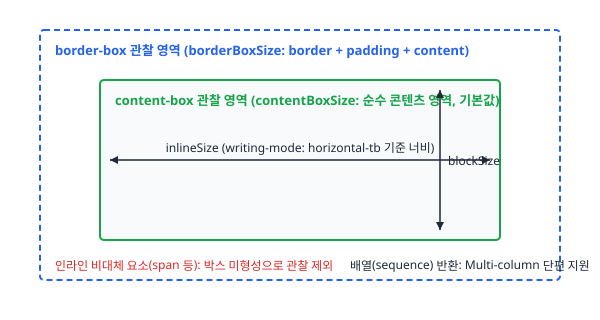
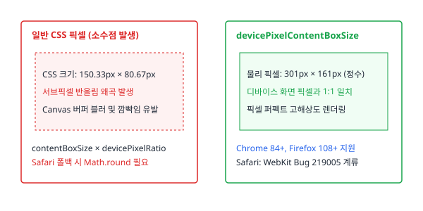

# 261115 ResizeObserver API

> 개별 DOM 및 SVG 요소의 크기 변화를 렌더링 파이프라인에서 깜빡임 없이 네이티브로 감지하는 Web API · 분야: Web API · Baseline: Widely available (2020년 3월 Safari 13.1 출시로 주요 브라우저 전반에 탑재되어 Baseline Widely available 달성) · 읽는 시간 약 6분

## 1. 왜 쓰는가
과거 웹 플랫폼에서는 브라우저 뷰포트 전체의 크기 변화를 감지하는 `window.onresize` 이벤트만 존재했을 뿐, 개별 DOM 요소 단위의 크기 변화를 감지하는 공식 표준 API가 존재하지 않았다 [3]. 그러나 현대 컴포넌트 기반 UI 구조에서는 전체 뷰포트 크기가 변하지 않더라도 사이드바 접힘/펼침, 아코디언 토글, 웹 폰트 다운로드 완료, 비동기 데이터 로딩에 따른 렌더링, CSS flexbox 및 grid 레이아웃 재배치 등 다양한 요인으로 개별 컴포넌트의 기하학적 수치가 동적으로 변경된다 [3][4]. `window.onresize`는 이러한 요소 단위의 국소적 크기 변화를 전혀 포착하지 못하여 컴포넌트 주도 아키텍처 구현에 근본적 한계를 드러냈다 [3].

이러한 한계를 우회하기 위해 개발자들은 `requestAnimationFrame`이나 `setInterval` 타이머를 통해 `getBoundingClientRect()` 또는 `offsetWidth`/`offsetHeight`를 반복 폴링(Polling)하는 방식을 사용했다 [3]. 하지만 폴링 방식은 요소 크기 변화가 없는 유휴 상태에서도 불필요하게 메인 스레드 연산과 CPU 및 배터리를 소모시켰으며, 브라우저가 화면을 그리는 도중 동기적으로 레이아웃 계산을 강제하는 심각한 Layout Thrashing(강제 동기식 레이아웃)을 지속적으로 유발했다 [3]. 또 다른 우회책으로 관찰 대상 요소 내부에 너비와 높이가 100%인 숨겨진 `<iframe>`이나 `<object>` 태그를 절대 위치로 삽입해 해당 서브 프레임의 `window.onresize`를 감지하거나 중첩 스크롤 박스를 이용해 스크롤 이벤트를 유도하는 센서 해킹 기법이 동원되었으나, 이는 과도한 DOM 트리 오버헤드와 창 컨텍스트 생성으로 극심한 메모리 누수를 야기했다 [3][4].

W3C CSS 작업 그룹과 브라우저 엔진 개발자들은 이러한 폴링 연산 낭비, Layout Thrashing, 메모리 누수를 근본적으로 해결하기 위해 개별 DOM 및 SVG 요소의 크기 변화를 브라우저 네이티브 엔진 수준에서 효율적으로 관찰할 수 있는 ResizeObserver API를 제정했다 [1][4]. ResizeObserver는 2018년 Chrome 64를 시작으로 Firefox 69(2019년), Safari 13.1(2020년 3월)에 차례로 도입되었으며, 2020년 3월 공식적으로 Baseline Widely available 상태를 달성하여 주요 브라우저 전반에서 안정적으로 활용되고 있다 [2][7].

## 2. 핵심 개념
ResizeObserver는 요소의 기하학적 크기 변화를 감지하기 위해 CSS 박스 모델 영역, 다중 단편(Fragmentation) 배열, CSS 논리적 크기 체계, 그리고 물리 픽셀 옵션을 제공한다 [1][2].





관찰 대상 등록 메서드인 `observe(target, options)`는 `options`의 `box` 속성을 통해 다음 3가지 CSS 박스 모델 영역 중 하나를 지정할 수 있다 [1][2].
- `content-box`: 기본 설정값으로, 패딩(padding)과 테두리(border)를 제외한 순수 콘텐츠 영역의 크기를 관찰한다 [1][2].
- `border-box`: 콘텐츠 영역에 패딩과 테두리를 모두 합산한 전체 외곽 박스 영역의 크기를 관찰한다 [1][2].
- `device-pixel-content-box`: 고해상도(Retina/HiDPI) 디스플레이에서 디바이스 물리 픽셀 단위의 정수 크기를 관찰한다 [1][2][6].

관찰 콜백으로 전달되는 `ResizeObserverEntry` 객체는 초기 인큐베이션 시절의 레거시 호환용 속성인 `contentRect`(DOMRectReadOnly) 외에, `contentBoxSize`, `borderBoxSize`, `devicePixelContentBoxSize`를 제공한다 [1][2]. 이 속성들은 단일 객체가 아닌 `ResizeObserverSize` 객체의 배열(sequence) 형태로 반환되는데, 이는 CSS Multi-column 레이아웃이나 페이지 인쇄(Paged Media) 환경처럼 단일 요소가 여러 조각으로 쪼개지는 박스 분할(Fragmentation) 구조를 온전히 지원하기 위한 설계다 [1][2]. 일반적인 단일 박스 요소의 경우 배열의 첫 번째 요소인 `[0]` 인덱스를 참조하여 크기 수치를 얻는다 [1][2].

`ResizeObserverSize`는 물리적 좌표계의 `width`와 `height` 대신 CSS 논리적 크기 체계인 `inlineSize`와 `blockSize`를 제공한다 [2][1]. 가로 쓰기 환경(`writing-mode: horizontal-tb`)에서는 `inlineSize`가 너비(width)를, `blockSize`가 높이(height)를 나타내며, 세로 쓰기 환경(`writing-mode: vertical-rl` 등)에서는 `inlineSize`가 높이를, `blockSize`가 너비를 나타내어 글로벌 타이포그래피 환경에서도 일관된 인터페이스를 유지한다 [2][1].

`devicePixelContentBoxSize`는 브라우저 배율 확대나 고해상도 화면에서 CSS 픽셀이 소수점으로 분할될 때 발생하는 서브픽셀 렌더링 왜곡을 방지하고 실제 화면의 물리적 하드웨어 픽셀과 1:1로 일치하는 정수 크기를 제공한다 [6]. 이를 통해 `<canvas>`, WebGL, WebGPU의 렌더링 버퍼 크기를 블러 현상 없이 정확히 일치시킬 수 있다 [6]. 이 속성은 Chrome 84+ 및 Firefox 108+에서 지원되고 있으나, Safari(WebKit Bug 219005)에서는 정식 지원되지 않고 있다 [2][6].

특수 요소의 경우 CSS 박스 모델 대신 `SVGGraphicsElement`의 바운딩 박스(Bounding Box)를 기준으로 크기가 측정된다 [1][2]. 또한 `display: none` 상태인 요소는 렌더링 트리에 기하 구조가 생성되지 않으므로 크기가 0으로 보고되며, `<span>`과 같이 렌더링 박스를 형성하지 않는 인라인 비대체(inline non-replaced) 요소는 관찰 대상에서 배제되거나 유효하게 동작하지 않는다 [1][2].

## 3. 동작 원리
ResizeObserver의 콜백 실행 시점은 WHATWG HTML 이벤트 루프의 'Update the rendering(렌더링 업데이트)' 파이프라인 내부에서 엄격하게 규정되어 있다 [5][1].

브라우저가 렌더링을 갱신할 때 `requestAnimationFrame` 콜백 실행, CSS 스타일 재계산(Style recalculation), 레이아웃(Layout) 계산 단계가 순차적으로 완료된 직후, 픽셀을 화면에 출력하는 Paint 단계 직전에 ResizeObserver 콜백이 동기적으로 호출된다 [5][1]. 스타일과 레이아웃 연산이 완전히 완료된 직후이자 실제 화면 페인팅 직전에 콜백이 실행되므로, 관찰 콜백 내부에서 수행하는 기하학적 계산이나 추가 변경사항이 별도의 프레임 지연이나 화면 깜빡임(Flicker) 없이 동일 프레임 안에 반영된다 [3][5].

콜백 내부에서 DOM 요소를 조작하여 새로운 레이아웃 변경이 유발될 때 브라우저 렌더링 엔진이 무한 루프에 빠지는 것을 방지하기 위해, W3C 스펙은 DOM 트리 깊이(depth)를 기준으로 관찰 대상을 필터링하는 'gather active observations at depth' 알고리즘을 규정하고 있다 [1].

한 렌더링 주기 내에서 탐색 깊이(depth)는 0(최상위 노드)부터 시작하여 트리의 얕은 요소에서 깊은 요소 순으로 브로드캐스트를 진행한다 [1]. 콜백 실행으로 인해 레이아웃 재계산이 발생하면, 브라우저는 직전 패스에서 처리된 가장 얕은 대상의 깊이보다 더 깊은 노드(`targetDepth > minDepth`)만 다음 패스에서 수집하여 콜백을 실행한다 [1].

만약 콜백이 상위 조상 노드나 동일 깊이의 형제 노드 크기를 변경시켜 해당 렌더링 주기 내에서 처리할 수 없는 관찰 대상이 남게 되면(`skippedTargets`), 브라우저는 무한 루프와 탭 프리징을 방지하기 위해 해당 통지를 다음 렌더링 프레임으로 이월한다 [1][2]. 이와 동시에 `window` 객체에 `'ResizeObserver loop completed with undelivered notifications'`(또는 `'ResizeObserver loop limit exceeded'`) 에러 이벤트를 발생시킨다 [1][2].

```diagram
종류: 시퀀스

[EventLoop]
[LayoutEngine]
[ResizeObserver]
[PaintEngine]

EventLoop -> LayoutEngine : Style 및 Layout 완료
LayoutEngine -> ResizeObserver : active observations 전달
ResizeObserver -> ResizeObserver : gather active observations at depth
ResizeObserver -> LayoutEngine : targetDepth 초과 노드 콜백 처리
ResizeObserver -> EventLoop : skippedTargets 발생 시 에러 알림 및 이월
ResizeObserver -> PaintEngine : Paint 단계 진입
```

## 4. 기본 사용법
다음은 ResizeObserver 인스턴스를 생성하고, 대상 요소를 등록하여 크기 변화를 수신한 뒤 관찰을 해제하는 기본 동작 코드다 [1][2].

```js
const targetElement = document.querySelector('#monitored-box');

const observer = new ResizeObserver((entries, observerInstance) => {
  for (const entry of entries) {
    const boxSize = entry.borderBoxSize && entry.borderBoxSize[0];
    const width = boxSize ? boxSize.inlineSize : entry.contentRect.width;
    const height = boxSize ? boxSize.blockSize : entry.contentRect.height;
    targetElement.textContent = `W: ${width}px, H: ${height}px`;
  }
});

observer.observe(targetElement, { box: 'border-box' });

// observer.unobserve(targetElement);
// observer.disconnect();
```

줄별 설명:
- 1행: `document.querySelector`를 사용하여 크기 변화를 관찰할 대상 DOM 요소를 선택한다.
- 2행: 코드 가독성을 위한 빈 줄이다.
- 3행: `ResizeObserver` 생성자를 호출하여 새 관찰자 인스턴스를 생성하고 콜백 함수를 등록한다 [1][2].
- 4행: 관찰 대상들의 크기 변경 정보를 담고 있는 `entries` 배열을 `for...of` 루프로 순회한다 [1][2].
- 5행: 박스 분할 구조를 지원하는 `borderBoxSize` 배열에서 첫 번째 조각(`[0]`) 객체를 안전하게 추출한다 [1][2].
- 6행: `borderBoxSize`가 존재하면 논리적 가로 크기인 `inlineSize`를 취득하고, 미지원 브라우저 환경을 위해 `entry.contentRect.width`로 폴백한다 [2][1].
- 7행: `borderBoxSize`가 존재하면 논리적 세로 크기인 `blockSize`를 취득하고, 미지원 브라우저 환경을 위해 `entry.contentRect.height`로 폴백한다 [2][1].
- 8행: 측정된 너비와 높이 수치를 대상 요소의 텍스트 콘텐츠로 동기화하여 화면에 출력한다.
- 9행: `entries` 순회 루프 블록을 닫는다.
- 10행: 옵저버 콜백 함수 블록을 닫는다.
- 11행: 코드 가독성을 위한 빈 줄이다.
- 12행: `observer.observe()` 메서드를 실행하여 대상 요소를 등록하고, 옵션 객체의 `box` 속성을 `'border-box'`로 지정하여 패딩과 테두리를 포함한 크기를 관찰한다 [1][2].
- 13행: 코드 가독성을 위한 빈 줄이다.
- 14행: 특정 단일 대상 요소의 관찰을 중단할 때 사용하는 `unobserve()` 메서드 주석이다 [2].
- 15행: 해당 옵저버에 연결된 모든 대상의 관찰을 완전히 해제하는 `disconnect()` 메서드 주석이다 [2].

## 5. 실무 예시

### 실무 예시 1: Canvas 고해상도(HiDPI) 픽셀 퍼펙트 렌더링
- 상황: 고해상도(Retina/HiDPI) 디스플레이나 브라우저 확대 시 캔버스 요소가 흐려지는 블러 현상을 방지하고, 물리 디바이스 화면 픽셀과 1:1로 일치하는 그래픽 버퍼 해상도를 유지해야 하는 상황이다 [6].
- 코드:
```js
const canvas = document.querySelector('#render-canvas');
const ctx = canvas.getContext('2d');

const canvasObserver = new ResizeObserver((entries) => {
  for (const entry of entries) {
    let width, height;

    // 1. Chrome 84+, Firefox 108+의 devicePixelContentBoxSize 우선 사용 (정수 물리 픽셀)
    if (entry.devicePixelContentBoxSize && entry.devicePixelContentBoxSize.length > 0) {
      width = entry.devicePixelContentBoxSize[0].inlineSize;
      height = entry.devicePixelContentBoxSize[0].blockSize;
    } else {
      // 2. Safari 등 미지원 브라우저용 폴백: contentBoxSize와 window.devicePixelRatio 곱연산
      const fallbackBox = (entry.contentBoxSize && entry.contentBoxSize[0]) || entry.contentRect;
      const dpr = window.devicePixelRatio || 1;
      width = Math.round((fallbackBox.inlineSize || fallbackBox.width) * dpr);
      height = Math.round((fallbackBox.blockSize || fallbackBox.height) * dpr);
    }

    // 캔버스 버퍼 해상도 동기화 (블러 현상 및 서브픽셀 아티팩트 방지)
    if (canvas.width !== width || canvas.height !== height) {
      canvas.width = width;
      canvas.height = height;
      drawVisuals(ctx, width, height);
    }
  }
});

try {
  canvasObserver.observe(canvas, { box: 'device-pixel-content-box' });
} catch (err) {
  // Safari 등 옵션 지원 미비 시 기본 옵션으로 폴백
  canvasObserver.observe(canvas, { box: 'content-box' });
}

function drawVisuals(context, w, h) {
  context.clearRect(0, 0, w, h);
  context.fillStyle = '#0f172a';
  context.fillRect(0, 0, w, h);
  context.strokeStyle = '#38bdf8';
  context.lineWidth = 2;
  context.strokeRect(10, 10, w - 20, h - 20);
}
```
- 주의점: `device-pixel-content-box` 옵션은 Safari(WebKit)에서 지원되지 않으므로 `try-catch` 블록으로 감싸 `'content-box'`로 폴백해야 하며, 콜백 내부에서도 `window.devicePixelRatio`와 `Math.round()`를 사용한 계산 폴백을 구성해야 한다 [2][6]. 또한 캔버스의 너비와 높이 버퍼 수치가 실제로 달라졌을 때만 리드로우를 실행해야 불필요한 GPU 연산을 방지할 수 있다.

### 실무 예시 2: 가상 스크롤(Virtual List) 동적 높이 측정 및 루프 에러 방지 패턴
- 상황: 각 항목의 콘텐츠 길이에 따라 높이가 동적으로 변하는 대규모 가상 스크롤 목록에서 항목별 높이를 정확히 측정하고, 동일 프레임 레이아웃 재계산으로 인한 루프 에러를 차단해야 하는 상황이다.
- 코드:
```js
class DynamicVirtualList {
  constructor(container) {
    this.container = container;
    this.itemHeights = new Map(); // id -> height

    // 무한 루프 에러를 방지하기 위해 단일 ResizeObserver 인스턴스를 유지하고
    // 콜백 내 DOM 변경 대신 맵 업데이트 후 requestAnimationFrame으로 렌더링 분리
    this.resizeObserver = new ResizeObserver((entries) => {
      let hasChanges = false;

      for (const entry of entries) {
        const id = entry.target.dataset.itemId;
        if (!id) continue;

        // 논리적 blockSize(세로 크기) 취득
        const newHeight = entry.borderBoxSize && entry.borderBoxSize[0]
          ? entry.borderBoxSize[0].blockSize
          : entry.contentRect.height;

        if (this.itemHeights.get(id) !== newHeight) {
          this.itemHeights.set(id, newHeight);
          hasChanges = true;
        }
      }

      // 동일 프레임 내 동기적 DOM 수정을 피해 loop limit exceeded 경고 차단
      if (hasChanges) {
        requestAnimationFrame(() => this.recalculateOffsets());
      }
    });
  }

  observeItem(element) {
    this.resizeObserver.observe(element, { box: 'border-box' });
  }

  unobserveItem(element) {
    this.resizeObserver.unobserve(element);
    this.itemHeights.delete(element.dataset.itemId);
  }

  recalculateOffsets() {
    // 가상 스크롤러의 총 높이 및 개별 위치 오프셋 업데이트
  }

  destroy() {
    this.resizeObserver.disconnect();
    this.itemHeights.clear();
  }
}
```
- 주의점: 관찰 콜백 내부에서 DOM의 높이나 스크롤 컨테이너의 오프셋을 동기적으로 직접 수정하면 브라우저의 DOM 깊이 필터링에 걸려 `ResizeObserver loop limit exceeded` 오류가 발생한다 [1][2]. 높이 정보만 Map에 기록한 후 실제 렌더링과 오프셋 갱신은 `requestAnimationFrame`을 통해 다음 프레임으로 분리해야 한다.

### 실무 예시 3: 단일 ResizeObserver를 이용한 다중 요소 관찰 및 메모리 누수 방지 클린업 패턴
- 상황: 대시보드 내 여러 위젯 요소의 너비를 관찰할 때 개별 인스턴스 남발로 인한 스케줄링 비용을 억제하고, 컴포넌트 마운트 해제 시 누수를 방지해야 하는 상황이다.
- 코드:
```js
const cleanupMap = new WeakMap();

// 여러 위젯이 각각 인스턴스를 생성하지 않고 공유하는 중앙 집중식 옵저버
const sharedResizeObserver = new ResizeObserver((entries) => {
  for (const entry of entries) {
    const handler = cleanupMap.get(entry.target);
    if (typeof handler === 'function') {
      const inlineSize = entry.borderBoxSize && entry.borderBoxSize[0]
        ? entry.borderBoxSize[0].inlineSize
        : entry.contentRect.width;

      handler(inlineSize, entry);
    }
  }
});

export function observeElementWidth(element, onWidthChange) {
  cleanupMap.set(element, onWidthChange);
  sharedResizeObserver.observe(element, { box: 'border-box' });

  // 클린업 함수 반환 (컴포넌트 unmount 시 필수 호출)
  return () => {
    sharedResizeObserver.unobserve(element);
    cleanupMap.delete(element);
  };
}
```
- 주의점: `WeakMap`을 사용하여 DOM 요소와 콜백 함수 간의 맵핑을 관리함으로써 요소가 DOM에서 제거될 때 가비지 컬렉션을 돕는다 [2]. 하지만 콜백 클로저가 외부 상태나 컴포넌트 인스턴스를 캡처하고 있는 경우, 명시적으로 `unobserve()`를 호출하지 않으면 가비지 컬렉션이 차단되어 메모리 누수가 발생하므로 반환된 클린업 함수를 언마운트 시점에 반드시 호출해야 한다 [2].

## 6. 장점 · 단점

| 장점 | 단점 |
| :--- | :--- |
| 뷰포트 전체가 아닌 개별 DOM/SVG 요소 단위의 세밀하고 즉각적인 크기 변화 감지가 가능하다 [3]. | 콜백 내부에서 관찰 대상의 상위/형제 요소 레이아웃을 동기적으로 변경할 경우 loop 경고가 발생하고 처리가 다음 프레임으로 지연될 수 있다 [1][2]. |
| 폴링이나 iframe 해킹 방식과 달리 유휴 상태에서 CPU와 배터리 소모가 없으며 브라우저 C++ 레이아웃 파이프라인과 직접 통합되어 높은 성능을 보장한다 [3]. | 콜백 함수가 외부 컴포넌트나 상태를 클로저로 캡처한 상태에서 unobserve() 또는 disconnect()를 제때 호출하지 않으면 메모리 누수(Memory Leak)가 발생한다 [2]. |
| HTML 이벤트 루프의 Update the rendering 파이프라인에서 Layout 직후, Paint 직전에 콜백이 실행되어 렌더링 깜빡임(Flicker) 없는 동기화가 가능하다 [5][1]. | 순수 스타일링(레이아웃 분기, 폰트 조절 등) 목적으로 사용할 경우 브라우저 레이아웃 엔진 내에서 선언적으로 처리되는 CSS Container Queries(@container)에 비해 JS 파싱 및 실행 비용이 든다. |
| 스펙에 내장된 DOM 깊이(depth) 기반 탐색 알고리즘을 통해 자식-부모 간 상호 크기 변경 시 발생할 수 있는 무한 레이아웃 루프와 브라우저 탭 프리징을 원천 차단한다 [1]. | 고해상도 디스플레이용 물리 픽셀 크기를 보고하는 device-pixel-content-box 옵션이 Safari(WebKit)에서 지원되지 않아 크로스 브라우징 예외 처리가 필요하다 [2][6]. |
| CSS 논리적 속성 체계인 inlineSize와 blockSize를 지원하여 다양한 writing-mode(세로 쓰기 등)와 글로벌 타이포그래피 환경에 자연스럽게 대응한다 [2][1]. | display: none 상태인 요소는 크기가 0으로 측정되고, 인라인 비대체 요소(span 등)는 박스 모델이 형성되지 않아 관찰 대상에서 유효하게 동작하지 않는다 [1][2]. |
| device-pixel-content-box 옵션을 통해 고해상도(Retina/HiDPI) 화면에서도 canvas의 물리 픽셀 해상도를 1:1로 일치시켜 블러 없는 선명한 렌더링을 구현할 수 있다 [6]. | 수백~수천 개의 요소를 개별 인스턴스로 분리 관찰할 경우 브라우저 내부 스케줄링 비용이 급증하므로 중앙 집중식 단일 인스턴스 관리가 요구된다. |

## 7. 한계와 함정
경계 사례 관점에서, `display: none`이 선언된 요소는 브라우저 렌더 트리에 박스 기하 구조가 형성되지 않아 크기가 너비 0, 높이 0으로 보고된다 [1][2]. 또한 `<span>`과 같은 인라인 비대체(inline non-replaced) 요소는 블록 서식에 참여하는 CSS 박스를 생성하지 않으므로 관찰 대상에 등록하더라도 크기 변화가 유효하게 보고되지 않는다 [1][2]. 아울러 고해상도 픽셀 측정을 위한 `device-pixel-content-box`는 Safari(WebKit) 미지원 상태이므로 브라우저 환경별 예외 처리가 수반되어야 한다 [2][6].

성능 측면에서는 수백에서 수천 개의 DOM 요소를 개별 ResizeObserver 인스턴스로 분리하여 관찰할 경우 브라우저의 내부 스케줄링 및 관찰자 관리 오버헤드가 급증한다. 또한 콜백 내부에서 `getBoundingClientRect()`나 `offsetHeight`와 같은 레이아웃 동기 읽기 API를 호출한 직후 DOM 스타일을 변경하는 쓰기 연산을 교차 실행하면 심각한 Layout Thrashing이 유발된다 [3]. 따라서 애플리케이션 레벨에서는 단일 ResizeObserver 인스턴스로 다중 요소를 통합 관찰하고, DOM 쓰기 작업은 `requestAnimationFrame`을 통해 렌더링을 분리해야 한다.

에러 트랩으로는 Sentry, Datadog 등 모니터링 도구에 자주 기록되는 `'ResizeObserver loop limit exceeded'`(또는 `'ResizeObserver loop completed with undelivered notifications'`) 오류가 있다 [1][2]. 이는 애플리케이션의 치명적인 스크립트 중단 에러가 아니라 브라우저가 무한 루프를 방지하기 위해 후속 프레임으로 작업을 넘겼다는 내부 방어 기제 알림이다 [1][2]. 그러나 프로덕션 환경에서는 unhandled error로 집계되므로, 전역 에러 핸들러에서 명시적으로 해당 에러 메시지를 무시하도록 필터링하거나 콜백 내부 로직을 디바운스 및 rAF로 래핑해야 한다.

접근성(a11y) 함정은 자바스크립트로 요소 크기를 감지하여 텍스트를 축약하거나 특정 컴포넌트를 접을 때 발생한다. 시각적으로는 요소가 축소되거나 숨김 처리되었더라도 스크린 리더 트리(Accessibility Tree)나 키보드 포커스 링(`aria-hidden`, `tabindex="-1"`)을 갱신하지 않으면, 시각적 UI와 보조 공학 기기를 사용하는 사용자 간의 인터페이스 불일치가 발생한다.

보안 및 개인정보 측면에서는 `devicePixelContentBoxSize`가 노출하는 서브픽셀 및 화면 정밀 물리 해상도 정보, 그리고 폰트 렌더링에 따른 미세한 박스 크기 차이가 교차 출처 프레임이나 웹페이지 전반에서 사용자의 OS 스케일링 설정, 모니터 특성, 로컬 폰트 설치 목록을 정밀하게 프로파일링하는 브라우저 핑거프린팅(Fingerprinting) 벡터로 악용될 잠재적 위험이 존재한다.

## 8. 다른 방법과 비교

| 방법 | 언제 | 비용 | 한계 |
| :--- | :--- | :--- | :--- |
| ResizeObserver API | 개별 DOM/SVG 요소의 크기 변화 감지 및 Canvas/가상 스크롤 등 JS 기하 연산 연동 시 | 중간 (단일 인스턴스 사용 시 최적화) | Safari의 device-pixel-content-box 미지원, 루프 발생 시 지연 처리 [1][2] |
| CSS Container Queries (@container) | 컨테이너 크기에 따라 순수 CSS로 반응형 컴포넌트 스타일 및 타이포그래피 전환 시 | 매우 낮음 (브라우저 레이아웃 엔진 내 처리) | Canvas 버퍼 크기 조절, 가상 스크롤 높이 측정 등 JS 수치 계산 불가 |
| window.onresize / matchMedia() | 브라우저 창 전체(뷰포트)의 크기 변화만 전역적으로 감지할 때 | 낮음 (뷰포트 단위 이벤트) | 사이드바, 모달, 패널 등 개별 컴포넌트의 크기 변화 감지 불가 [3] |
| IntersectionObserver API | 뷰포트나 상위 컨테이너와 대상 요소 간의 교차(노출) 비율 및 가시성 감지 시 | 낮음 (비동기 렌더링 검사) | 요소 자체의 너비/높이 픽셀 수치 변화 측정 불가 |
| rAF Polling 및 Iframe 센서 | 과거 ResizeObserver 미지원 레거시 브라우저 지원 시 사용되던 우회책 | 매우 높음 (지속적인 CPU/배터리 소모, Layout Thrashing) | 심각한 성능 저하, 메모리 누수 발생, 현대 웹에서는 완전 퇴출 대상 [3][4] |

이것을 고르지 않는 경우:
- 단순한 UI 컴포넌트 반응형 스타일링이나 타이포그래피 조절: CSS Container Queries(`@container`)가 메인 스레드 자바스크립트 실행 오버헤드 없이 순수 스타일 엔진 내에서 처리되므로 훨씬 우수하다.
- 요소가 화면에 진입하거나 빠져나가는 가시성 판별: `IntersectionObserver`가 비동기 교차 검사에 특화되어 있으므로 ResizeObserver를 선택하지 않는다.
- 브라우저 창 전체 크기 변화에만 대응하는 전역 레이아웃 처리: `window.onresize` 또는 `matchMedia()`로 충분하다.

## 9. 대비와 새로운 시도
`device-pixel-content-box` 속성의 사파리(WebKit) 표준화 작업이 진척되고 있다 [2][6]. Chrome과 Firefox에 이어 Safari(WebKit Bug 219005)에서도 WebGPU 및 정밀 2D/3D 웹 그래픽 수요 증가에 발맞추어 물리 픽셀 크기 속성 구현에 대한 논의와 상호운용성(Interoperability) 개선 작업이 진행 중이다 [2][6].

CSS Container Queries(`@container`)가 Baseline Widely available을 달성함에 따라 기술 간 역할 재편이 확립되었다. 단순한 컴포넌트 반응형 레이아웃과 폰트 크기 조절은 CSS Container Queries로 위임되고, ResizeObserver는 Canvas 및 WebGL 뷰포트 버퍼 동기화, TanStack Virtual 등 가상 스크롤 동적 높이 측정, D3 및 ECharts 같은 인터랙티브 차트 리드로우 등 순수 자바스크립트 연산 엔진 연동으로 고유 영역이 정립되었다.

아울러 CSS 박스 다중 조각(Fragmentation) 인터페이스 구체화 논의가 지속되고 있다 [1][2]. `ResizeObserverEntry`의 `contentBoxSize` 및 `borderBoxSize`가 배열(sequence) 형태로 정의된 스펙적 근거에 맞추어, CSS Multi-column 및 페이지 인쇄(Paged Media) 환경에서 분할된 각 조각(Fragment)별 크기를 온전히 반환하기 위한 브라우저 엔진별 구현 및 스펙 상세화 작업이 진행되고 있다 [1][2].

## 10. 다른 사람에게 설명하기
- 세 문장 요약:
  1. ResizeObserver API는 브라우저 창 전체가 아닌 개별 DOM 및 SVG 요소의 크기 변화를 브라우저 네이티브 수준에서 효율적으로 관찰할 수 있는 Web API다 [1][3].
  2. WHATWG 렌더링 파이프라인에서 Layout 직후이자 Paint 직전에 콜백이 실행되어 화면 깜빡임 없는 기하 동기화를 보장하며, DOM 트리 깊이 기반 알고리즘을 통해 무한 루프를 차단한다 [5][1].
  3. 순수 컴포넌트 반응형 스타일링은 CSS Container Queries로 위임하고, Canvas 및 WebGL 버퍼 동기화나 가상 스크롤 높이 측정처럼 정밀한 자바스크립트 계산이 필요한 영역에 핵심적으로 활용된다 [6].

- 스스로 확인할 질문:
  1. Q1. ResizeObserver 콜백 내부에서 관찰 대상의 상위 노드 크기를 동기적으로 변경할 때 `ResizeObserver loop limit exceeded` 오류가 발생하는 원리와 브라우저의 DOM 깊이 필터링 규칙은 무엇인가?
  2. Q2. `ResizeObserverEntry`의 `borderBoxSize`와 `contentBoxSize`가 단일 객체가 아닌 배열(sequence) 형태로 반환되는 스펙적 이유는 무엇인가?
  3. Q3. 고해상도(HiDPI) 디스플레이에서 `<canvas>` 버퍼를 픽셀 퍼펙트하게 동기화하기 위해 `devicePixelContentBoxSize`를 사용할 때 Safari 브라우저에서 발생하는 문제와 이에 대응하는 폴백 구현 방식은 무엇인가?

## 참고 자료
1. [W3C CSS Working Group: Resize Observer 1 (Editor's Draft)](https://drafts.csswg.org/resize-observer/)
2. [MDN Web Docs: ResizeObserver API](https://developer.mozilla.org/en-US/docs/Web/API/ResizeObserver)
3. [web.dev: ResizeObserver: it's like window.onresize, but for elements](https://web.dev/articles/resize-observer)
4. [WebKit Blog: ResizeObserver in WebKit](https://webkit.org/blog/9924/resizeobserver-in-web-kit/)
5. [WHATWG: HTML Living Standard - Event loops: Update the rendering](https://html.spec.whatwg.org/multipage/webappapis.html#event-loop-processing-model)
6. [web.dev: Pixel-perfect rendering with devicePixelContentBox](https://web.dev/articles/device-pixel-content-box)
7. [Can I use: ResizeObserver](https://caniuse.com/resizeobserver)
조사: 2026-11-15

## 내 리뷰
(읽고 느낀 점 · 궁금한 것을 적는다. 질문은 Q. 로 시작)
