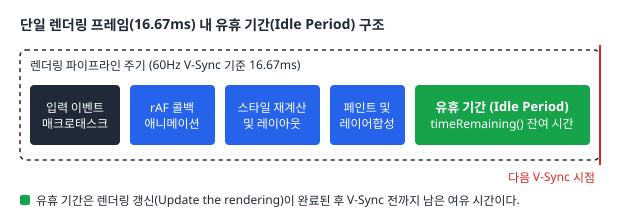
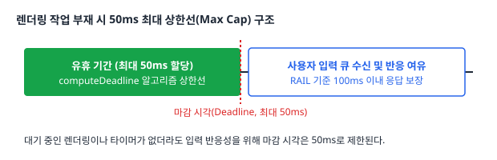
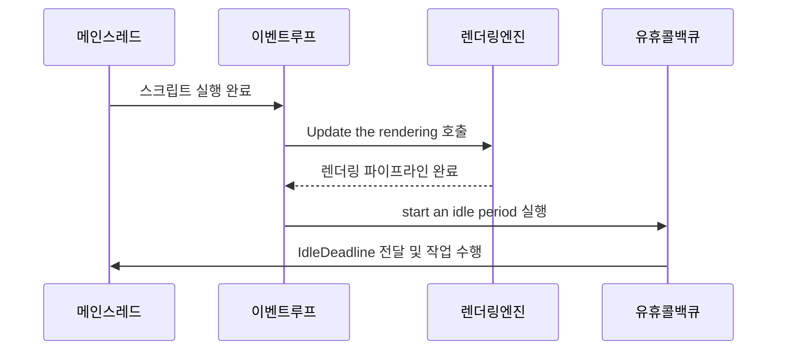

# 261115 requestIdleCallback

> 브라우저 렌더링 파이프라인의 프레임 업데이트 완료 후 남는 유휴 시간(Idle Period)에 비필수 백그라운드 작업을 협조적으로 스케줄링하여 메인 스레드 블로킹과 프레임 드롭을 방지하는 Web API · 분야: 메모리 · 성능 · Baseline: Limited availability (Chrome 47+, Firefox 55+ 등 Chromium/Gecko 계열은 기본 지원하나, Safari/WebKit 환경에서 기본 활성화가 보류되어 웹 플랫폼 전역 Baseline에 미달함) · 읽는 시간 약 6분

## 1. 왜 쓰는가

브라우저 메인 스레드는 단일 스레드로 동작하며 자바스크립트 코드 실행, 스타일 재계산, 레이아웃, 페인트, 사용자 입력 처리를 모두 직렬화하여 순차적으로 처리한다 [1][2]. 단일 스레드 구조에서는 특정 스크립트 태스크가 긴 시간을 점유할 경우 화면 갱신과 사용자 인터랙션 처리가 지연될 수밖에 없다 [1][4].

requestIdleCallback 도입 이전에는 비필수적인 백그라운드 작업을 실행하기 위해 주로 `setTimeout(fn, 0)`이나 `setInterval`과 같은 타이머 기반 방식을 사용했다 [3][4]. 그러나 타이머 기반 스케줄링은 브라우저의 내부 렌더링 주기(하드웨어 V-Sync 60Hz 기준 16.67ms)나 사용자 입력 큐 상태를 전혀 인지하지 못한다 [1][4]. 타이머에 등록된 매크로태스크는 브라우저가 프레임을 준비하거나 렌더링을 갱신하는 도중에 무작위로 끼어들어 실행된다 [1][4]. 그 결과 프레임 드롭(Jank)이 발생하고 사용자 입력 지연 시간이 급증하는 문제가 초래되었다 [1][4].

이러한 문제를 해결하기 위해 등장한 표준이 `requestIdleCallback`이다 [1][3]. 이 API는 브라우저 렌더링 파이프라인의 프레임 업데이트(Update the rendering)가 완료된 후 다음 프레임이나 입력 이벤트 처리까지 남는 여유 시간(Idle Period)을 감지한다 [1][2]. 개발자는 이를 통해 메인 스레드의 시각적 렌더링을 방해하지 않고 저우선순위 백그라운드 콜백을 안전하게 스케줄링할 수 있다 [1][3].

## 2. 핵심 개념





`requestIdleCallback`을 올바르게 제어하기 위해 이해해야 하는 핵심 용어와 구조적 개념은 다음과 같다.

- **유휴 기간 (Idle Period)**: WHATWG HTML 이벤트 루프 처리 모델에 정의된 구간으로, 태스크 큐에 즉시 실행해야 할 태스크가 없고 화면 렌더링 갱신(Update the rendering)이 완료된 후 다음 프레임이나 작업 시작 전까지 발생하는 여유 구간이다 [2].
- **IdleDeadline**: 유휴 콜백 함수가 실행될 때 브라우저 런타임에 의해 첫 번째 인자로 전달되는 인터페이스 객체이다 [1][3]. 현재 할당된 유휴 기간의 마감 정보와 상태를 제공한다 [1].
- **`deadline.timeRemaining()`**: 현재 유휴 기간이 종료되기까지 남은 유효 실행 시간을 밀리초(ms) 단위의 부동소수점 수치로 반환하는 메서드이다 [1][3]. 브라우저 내부 타이머나 V-Sync 마감 시각에 맞춰 동적으로 감소한다 [1][2].
- **`deadline.didTimeout`**: `options` 객체에 설정된 `timeout` 시간이 경과하여 콜백이 유휴 상태의 발생 여부와 상관없이 태스크 큐에 강제로 스케줄링되었는지를 나타내는 불리언 속성이다 [1][3].
- **`options.timeout`**: 브라우저 메인 스레드가 지속적으로 과부하 상태에 놓여 유휴 기간이 오랫동안 발생하지 않을 때, 백그라운드 작업이 영구히 대기하는 기아 현상(Starvation)을 방지하기 위해 지정하는 최대 허용 대기 시간(ms)이다 [1][3].
- **FIFO 유휴 콜백 큐 (First-In, First-Out Queue)**: 등록된 콜백 함수들이 선입선출 방식으로 대기하는 내부 큐이다 [1]. 유휴 기간이 시작되기 전에 큐에 등록되어 있던 작업들만 해당 유휴 기간 내의 실행 후보가 된다 [1].

## 3. 동작 원리

`requestIdleCallback`은 브라우저 이벤트 루프의 렌더링 파이프라인 수명 주기와 결합되어 동작한다 [1][2].



WHATWG HTML 이벤트 루프 사양 및 W3C 스펙에 명시된 실행 절차와 근거는 다음과 같다.

1. **유휴 기간 시작 탐지**: 이벤트 루프는 태스크 큐에 실행 가능한 매크로태스크가 없고 렌더링 갱신 단계(Update the rendering)가 완료되면 `start an idle period algorithm`을 실행한다 [2].
2. **마감 시각 산출 (computeDeadline)**: 브라우저는 내부 `computeDeadline` 알고리즘을 호출하여 현재 유휴 기간의 마감 시각을 계산한다 [1][2]. 사용자의 입력 반응성(RAIL 성능 모델 기준 100ms 이내 반응 필요)을 보장하기 위해 유휴 기간의 마감 시간은 최대 50ms를 초과할 수 없도록 엄격한 상한선(Max Cap)이 적용된다 [1][2]. 만약 50ms 이내에 예약된 타이머(`setTimeout`, `setInterval`)나 다음 렌더링 프레임(V-Sync)이 예정되어 있다면, 브라우저는 해당 시점에 맞춰 유휴 마감 시각을 50ms보다 앞당겨 동적으로 축소한다 [1][2].
3. **보안 부채널 방어 (Time Coarsening)**: Spectre 등 마이크로아키텍처 타이밍 부채널 공격을 방어하기 위해, `deadline.timeRemaining()`이 반환하는 시간 해상도는 실행 컨텍스트의 격리 상태(`cross-origin isolated`)에 따라 거칠게 완화(Time Coarsening)된다 [2].
4. **콜백 선입선출 실행**: 브라우저는 유휴 기간이 시작되기 전 큐에 적재된 콜백들을 FIFO 방식으로 순차 꺼내어 실행한다 [1]. 콜백 실행 도중 `deadline.timeRemaining() > 0` 조건을 확인하여 남은 시간이 존재할 때만 작업을 이어가야 한다 [1][3].
5. **재귀 등록의 다음 프레임 격리 이월**: 콜백 함수 내부에서 다시 `requestIdleCallback`을 호출하여 작업을 연속 예약할 경우, 새로 등록된 콜백은 현재 진행 중인 유휴 기간에 포함되지 않고 반드시 다음 유휴 기간으로 이월된다 [1]. 이 메커니즘을 통해 단일 유휴 프레임 내에서 콜백이 무한 루프를 돌며 메인 스레드를 독점하는 상황을 원천 차단한다 [1].
6. **작업 취소**: 등록된 콜백은 브라우저가 발급한 정수형 고유 식별자를 `cancelIdleCallback(id)`에 전달하여 실행 전에 등록을 취소할 수 있다 [1][3].

## 4. 기본 사용법

다음은 대기 중인 작업 큐에서 태스크를 꺼내어 브라우저 유휴 시간 동안 안전하게 소비하는 기본 구현 코드이다.

```js
let taskQueue = [
  () => console.log('Task 1'),
  () => console.log('Task 2'),
  () => console.log('Task 3')
];

function processIdleTasks(deadline) {
  while ((deadline.timeRemaining() > 0 || deadline.didTimeout) && taskQueue.length > 0) {
    const currentTask = taskQueue.shift();
    currentTask();
  }

  if (taskQueue.length > 0) {
    scheduledId = requestIdleCallback(processIdleTasks, { timeout: 2000 });
  }
}

let scheduledId = requestIdleCallback(processIdleTasks, { timeout: 2000 });
```

위 코드의 줄별 동작 설명은 다음과 같다.

- 1~5번 줄: 유휴 시간에 순차적으로 처리할 단위 작업 함수들을 담은 `taskQueue` 배열을 선언하고 3개의 작업을 정의한다.
- 7번 줄: 브라우저가 유휴 기간에 진입할 때 실행할 콜백 함수 `processIdleTasks`를 정의하며, 브라우저로부터 `IdleDeadline` 객체인 `deadline`을 전달받는다.
- 8번 줄: 현재 유휴 기간에 잔여 시간이 0보다 크거나(`deadline.timeRemaining() > 0`) 타임아웃이 초과되어 강제 실행 상태인 경우(`deadline.didTimeout`), 그리고 `taskQueue`에 작업이 존재하는 동안 실행을 지속하는 루프를 시작한다.
- 9번 줄: 작업 큐의 맨 앞에서 작업 함수 하나를 꺼내어 `currentTask` 상수에 할당한다.
- 10번 줄: 꺼내온 단위 작업 함수를 호출하여 메인 스레드에서 실행한다.
- 11번 줄: 반복 조건 검사 블록을 종료한다.
- 13번 줄: 유휴 시간이 모두 소진된 후에도 작업 큐에 아직 처리하지 못한 작업이 남아 있는지 검사한다.
- 14번 줄: 남은 작업을 처리하기 위해 `requestIdleCallback`을 재귀 호출하여 다음 유휴 기간으로 작업을 이월 예약하고, 2000ms 동안 유휴 상태가 오지 않을 경우 강제 실행되도록 `timeout` 옵션을 지정한다.
- 15번 줄: 조건문 블록을 종료한다.
- 16번 줄: `processIdleTasks` 함수 본문 블록을 종료한다.
- 18번 줄: 최초 실행을 위해 `requestIdleCallback`에 콜백 함수와 2000ms의 `timeout` 옵션을 전달하여 스케줄링하고 반환된 고유 식별자를 `scheduledId` 변수에 저장한다.

## 5. 실무 예시

### 예시 1: 사용자 행동 추적 및 성능 메트릭 로그 배치 전송
- **상황**: 사용자의 실시간 스크롤 및 버튼 클릭 인터랙션을 차단하지 않고, 누적된 애널리틱스 로그 배열을 브라우저 유휴 시간에 서버로 일괄 전송해야 하는 상황이다.
- **코드**:
```js
const analyticsQueue = [];

function trackEvent(eventData) {
  analyticsQueue.push(eventData);
  scheduleLogFlush();
}

let isFlushScheduled = false;

function scheduleLogFlush() {
  if (isFlushScheduled) return;
  isFlushScheduled = true;

  requestIdleCallback((deadline) => {
    isFlushScheduled = false;
    const batch = [];

    while ((deadline.timeRemaining() > 0 || deadline.didTimeout) && analyticsQueue.length > 0) {
      batch.push(analyticsQueue.shift());
    }

    if (batch.length > 0) {
      const payload = JSON.stringify(batch);
      navigator.sendBeacon('/analytics', payload);
    }

    if (analyticsQueue.length > 0) {
      scheduleLogFlush();
    }
  }, { timeout: 3000 });
}
```
- **주의점**: 유휴 콜백 내부에서 `fetch`와 같은 비동기 Promise 기반 네트워크 통신을 남발하면 마이크로태스크가 누적되어 유휴 예산을 초과할 위험이 있으므로, 백그라운드 전송에 특화되고 페이지 언로드 시에도 안전한 `navigator.sendBeacon`을 조합하는 것이 적합하다 [1][4].

### 예시 2: 대규모 데이터 청크 분할 처리 (Time Slicing)
- **상황**: 수천 개 이상의 대규모 JSON 데이터 배열을 파싱하거나 정렬할 때 메인 스레드를 장시간 점유(Long Tasks)하여 화면이 멈추는 것을 방지하기 위해 여러 유휴 프레임으로 분산 처리하는 상황이다.
- **코드**:
```js
function processLargeDataSet(items, processItem, onComplete) {
  let currentIndex = 0;
  const totalCount = items.length;

  function chunkProcessor(deadline) {
    while ((deadline.timeRemaining() > 0 || deadline.didTimeout) && currentIndex < totalCount) {
      processItem(items[currentIndex]);
      currentIndex++;
    }

    if (currentIndex < totalCount) {
      requestIdleCallback(chunkProcessor, { timeout: 1000 });
    } else {
      onComplete();
    }
  }

  requestIdleCallback(chunkProcessor, { timeout: 1000 });
}
```
- **주의점**: 콜백 루프 내부에서 `deadline.timeRemaining()`을 지속적으로 검사하지 않고 무거운 동기 연산을 통째로 실행하면 협조적 스케줄링 모델이 무력화되어 메인 스레드가 블로킹된다. 또한 동일 콜백 내에서 재귀 등록된 `requestIdleCallback`은 다음 유휴 기간으로 이월되므로 한 프레임의 유휴 시간을 독점하지 않도록 적절한 단위 작업 크기를 유지해야 한다 [1].

### 예시 3: 클라이언트 사이드 인메모리 검색 인덱싱 구축
- **상황**: 초기 페이지 로드 후 사용자가 검색창에 키워드를 입력하기 전까지 주어지는 유휴 시간을 활용하여 FlexSearch, Lunr.js 등의 역색인(Inverted Index)을 점진적으로 빌드해야 하는 상황이다.
- **코드**:
```js
class BackgroundSearchIndexer {
  constructor(documents) {
    this.documents = documents;
    this.index = new Map();
    this.cursor = 0;
  }

  startIndexing() {
    requestIdleCallback((deadline) => this.buildIndexChunk(deadline));
  }

  buildIndexChunk(deadline) {
    while (deadline.timeRemaining() > 0 && this.cursor < this.documents.length) {
      const doc = this.documents[this.cursor];
      const tokens = doc.text.toLowerCase().split(/\s+/);
      for (const token of tokens) {
        if (!this.index.has(token)) {
          this.index.set(token, new Set());
        }
        this.index.get(token).add(doc.id);
      }
      this.cursor++;
    }

    if (this.cursor < this.documents.length) {
      requestIdleCallback((deadline) => this.buildIndexChunk(deadline));
    }
  }
}
```
- **주의점**: 인덱싱 결과를 화면에 반영하기 위해 DOM을 조작해야 하는 경우, 유휴 콜백 내부에서 직접 DOM을 변경해서는 안 된다 [1][4]. 유휴 상태에서 발생한 DOM 조작은 이미 완료된 레이아웃 결과를 무효화(Dirty Layout)하여 다음 프레임의 강제 동기식 레이아웃(Forced Synchronous Layout)과 프레임 드롭을 유발하므로, DOM 쓰기는 반드시 `requestAnimationFrame`을 통해 다음 렌더링 사이클로 위임해야 한다 [1][4].

## 6. 장점 · 단점

| 장점 | 단점 |
| :--- | :--- |
| 메인 스레드의 프레임 레이트(60Hz/120Hz)와 애니메이션 렌더링에 영향을 주지 않고 안전하게 저우선순위 백그라운드 작업을 실행할 수 있다 [1][4]. | 콜백 루프 내에서 `timeRemaining()`을 수동 점검하고 제어권을 양보해야 하는 협조적(Cooperative) 모델이므로, 양보 누락 시 메인 스레드를 여전히 블로킹한다. |
| 브라우저 렌더링 엔진이 Style, Layout, Paint 완료 여부와 하드웨어 주사율을 파악하여 정확한 유휴 여유 시간(`timeRemaining()`)을 제공한다 [1][2]. | 유휴 시간 발생 시점이 불규칙하고 예측하기 어려워 지연 시간에 민감한 작업이나 즉각적인 사용자 입력 응답 처리에는 부적합하다. |
| `options.timeout` 옵션을 통해 브라우저가 지속적으로 과부하 상태에 놓여도 태스크가 영구히 실행되지 못하는 기아 현상(Starvation)을 방지한다 [1][3]. | `timeout` 만료 시 브라우저 유휴 여부와 무관하게 즉시 메인 스레드에 끼어들어 프레임 드롭이나 입력 반응 지연을 다시 유발할 수 있다 [1][3]. |
| 대규모 배열 순회나 계산 집약적 작업을 여러 프레임의 유휴 시간으로 자연스럽게 분할(Time Slicing)하여 긴 태스크(Long Tasks)와 메인 스레드 블로킹을 차단한다. | 콜백 내부에서 DOM을 변경할 경우 직전 렌더링 결과를 무효화(Dirty Layout)하여 다음 프레임의 스타일 및 레이아웃 재계산 비용을 가중시킨다 [1][4]. |
| 동일 유휴 기간 내 재귀 등록된 콜백을 다음 유휴 기간으로 격리 이월함으로써 단일 유휴 창의 과도한 독점과 무한 루프를 원천 방지한다 [1]. | 백그라운드 탭(`hidden`)이나 절전 모드에서는 유휴 기간 발생 빈도가 극도로 줄어들어 태스크 처리가 장시간 지연될 수 있다 [1][2]. |

## 7. 한계와 함정

`requestIdleCallback`을 실무에 적용할 때 직면하는 구조적 한계와 주의해야 할 함정은 다음과 같다.

- **경계 사례 (Edge Cases)**:
  - **`timeout` 만료에 따른 강제 실행 부작용**: 브라우저 메인 스레드가 과부하 상태일 때 `options.timeout`이 초과되면, 브라우저는 유휴 여부와 상관없이 해당 콜백을 일반 매크로태스크 큐에 강제로 스케줄링한다 [1][3]. 이 시점에는 `deadline.didTimeout`이 `true`가 되며, V-Sync 주기나 렌더링 파이프라인 중간에 콜백이 끼어들어 다시 프레임 드롭(Jank)과 입력 지연을 유발한다 [1][3].
  - **백그라운드 탭 스로틀링**: 문서가 비활성화되거나 사용자가 다른 탭으로 전환(`document.hidden === true`)하면 브라우저는 전력 소비를 줄이기 위해 유휴 기간 발생 빈도를 대폭 스로틀링(예: 수 초에 1회)한다 [1][2]. 따라서 세션 갱신 등 주기적인 실행이 보장되어야 하는 로직을 `requestIdleCallback`에 의존하면 처리가 극단적으로 지체된다.
- **성능 (Performance)**:
  - **DOM 변경 시 강제 리플로우(Layout Thrashing) 함정**: 스펙 및 브라우저 엔진 가이드는 유휴 콜백 내부에서 DOM을 직접 조작하지 말 것을 강력히 권고한다 [1][4]. 유휴 기간은 렌더링 파이프라인(Style, Layout, Paint)이 이미 완료된 직후 시작되므로, 여기서 DOM을 수정하면 레이아웃이 무효화(Dirty Layout)되어 다음 프레임에서 대규모 스타일 재계산과 강제 동기식 레이아웃(Forced Synchronous Layout)이 유발된다 [1][4]. DOM 조작은 반드시 `requestAnimationFrame`으로 분리 위임해야 한다 [1][4].
  - **마이크로태스크 큐 상호작용 함정**: 유휴 콜백 내부에서 수많은 Promise resolve나 `queueMicrotask`를 발생시키면, 브라우저는 해당 마이크로태스크 체크포인트가 모두 소진될 때까지 제어권을 양보하지 않고 메인 스레드를 붙잡아 둔다. 이로 인해 브라우저가 산출한 유휴 예산을 초과하여 프레임 지연이 발생한다.
  - **50ms 최대 상한선(Max Cap) 제약**: 브라우저 렌더링 큐에 대기 작업이 전혀 없더라도 사용자 입력(100ms 이내 응답 필요)을 수신하기 위해 `computeDeadline`은 `timeRemaining()`을 최대 50ms로 엄격히 제한한다 [1][2]. 따라서 장시간 연속 연산이 필요한 작업의 경우 50ms마다 지속적인 문맥 교환 오버헤드가 발생한다.
- **접근성 (Accessibility)**:
  - 스크린 리더나 키보드 탐색을 사용하는 환경에서 `timeout` 만료로 인해 무거운 유휴 콜백이 메인 스레드에 강제 난입하면, 포커스 이동 처리나 보조 기술의 접근성 트리 동기화 응답이 지연되어 인터랙션 장애를 초래할 수 있다.
- **보안 (Security)**:
  - Spectre 등 마이크로아키텍처 타이밍 부채널 공격을 방지하기 위해 마감 시간 계산 결과는 실행 컨텍스트의 교차 출처 격리(`cross-origin isolated`) 상태에 따라 시간 해상도가 거칠게 완화(Time Coarsening)된다 [2]. 이로 인해 서브 밀리초 단위의 미세한 성능 측정이나 정밀한 시간 계산이 제한된다 [2].
- **개인정보 및 플랫폼 호환성**:
  - Chrome 47 및 Firefox 55부터 지원되었으나, Safari(WebKit)에서는 이벤트 루프 통합 버그 및 전력/스케줄링 설계 이유로 장기간 기본 활성화가 보류되어 웹 플랫폼 Baseline 상태가 'Limited availability'로 분류된다 [6][7]. 따라서 실무 프로덕션 환경에서 단독 사용이 불가능하며 폴리필(MessageChannel 또는 setTimeout)이 필수적이다 [4][5][7].

## 8. 다른 방법과 비교

| 방법 | 언제 | 비용 | 한계 |
| :--- | :--- | :--- | :--- |
| `setTimeout(fn, 0)` / `setInterval` | V-Sync와 무관하게 단순 지연 후 매크로태스크를 생성할 때 [3][4] | 최소 4ms 클램핑 지연 및 불필요한 이벤트 루프 턴 소모 | 렌더링 주기와 사용자 입력 큐 상태를 알지 못해 렌더링 프레임 도중 끼어들어 버벅임(Jank) 유발 [1][4] |
| `requestAnimationFrame` | 다음 화면을 그리기 직전(스타일 및 레이아웃 이전) 시각적 DOM 애니메이션을 처리할 때 [1][4] | 렌더링 파이프라인 직전 동기 실행에 따른 메인 스레드 점유 | 무거운 백그라운드 작업을 실행하면 즉각적인 프레임 드롭(Jank)으로 직결됨 [1][4] |
| `Web Workers` | 메인 스레드와 완전히 분리되어 순수 CPU 연산량이 큰 백그라운드 작업을 병렬 처리할 때 | 워커 스레드 생성 비용 및 데이터 전달 시 Structured Clone(구조화된 복제) 오버헤드 | DOM에 직접 접근할 수 없으며 직렬화가 불가능한 객체 공유 불가 |
| `MessageChannel` (React Scheduler 방식) | 크로스 브라우저 호환성을 유지하며 최소 지연(0ms 수렴)으로 매크로태스크를 분할할 때 [4][5] | 포트 생성 및 메시지 이벤트 디스패치 오버헤드 | 브라우저 엔진 차원의 유휴 시간 계산이 불가능하여 자체 타임 슬라이싱 휴리스틱 필요 [4] |
| `scheduler.postTask({ priority: 'background' })` | W3C 표준 명시적 우선순위 큐와 TaskController/AbortSignal 제어가 필요할 때 [5] | 표준 스케줄러 큐 등록 및 컨트롤러 객체 관리 비용 | 브라우저별 지원 현황 확인 필요 [5] |
| `scheduler.yield()` | 긴 루프 실행 도중 메인 스레드에 렌더링/입력을 양보하고 최우선으로 재개할 때 [5] | async/await 프로미스 생성 및 마이크로/매크로태스크 전환 비용 | 최신 표준 API로 구형 브라우저 미지원 및 폴리필 구현 필요 [5] |

### 이것을 고르지 않는 경우
다음과 같은 개발 요구사항이 있을 때는 `requestIdleCallback`을 선택하지 않는 것이 적합하다.

1. **시각적 UI 업데이트 및 DOM 조작**: 화면 렌더링 직전에 동기화되어야 하거나 직접적인 DOM 변경이 수반되는 작업은 `requestAnimationFrame`을 사용해야 한다 [1][4].
2. **CPU 집약적인 대규모 독립 연산**: 암호화, 대용량 파일 압축, 이미지 바이너리 처리 등 DOM 접근이 불필요한 고부하 연산은 메인 스레드를 떠나 `Web Workers`로 격리 처리해야 한다.
3. **Safari/WebKit을 포함한 전역 크로스 브라우저 동시성 제어**: WebKit의 미지원 환경에서 브라우저 파편화 없는 일관된 협조적 스케줄링을 구현하려면 `MessageChannel` 기반 스케줄러(React Scheduler 패턴)를 채택해야 한다 [4][5].
4. **즉각적인 입력 반응성(INP) 개선과 우선 재개**: 긴 태스크를 잘게 분할한 뒤 브라우저가 사용자 입력을 처리하자마자 가장 높은 우선순위로 작업을 즉시 이어받아야 하는 흐름에서는 `scheduler.yield()`를 사용하는 것이 우월하다 [5].
5. **정교한 우선순위 제어 및 작업 취소 파이프라인**: 태스크 간 명시적 우선순위(user-blocking, user-visible, background) 설정과 `AbortSignal` 연동 취소가 필요한 경우 `scheduler.postTask()`를 선택해야 한다 [5].

## 9. 대비와 새로운 시도

`requestIdleCallback`의 호환성 한계와 스케줄링 제약을 극복하기 위해 웹 플랫폼과 라이브러리 생태계는 다음과 같은 기술적 진화를 이루어내고 있다.

- **`scheduler.yield()` 표준 도입**: W3C/WICG Scheduling APIs의 `scheduler.yield()`는 긴 작업 루프 실행 도중 메인 스레드에 제어권을 일시 양보하고, 브라우저가 입력과 렌더링을 처리한 직후 최우선 순위로 재개(Prioritized Continuation)되도록 보장하는 최신 표준 API이다 [5]. Chrome 129에서 정식 출시되었으며 Firefox 및 WebKit 진영과 표준화 논의가 진행되고 있다 [5].
- **Prioritized Task Scheduling API (`scheduler.postTask`)**: W3C Web Performance Working Group 주도로 표준화되어 Chromium 브라우저에 정식 탑재되었다 [5]. `user-blocking`, `user-visible`, `background`의 명시적 우선순위 큐를 제공하며, `TaskController`와 `AbortSignal`을 통해 작업의 취소 및 우선순위 동적 변경을 지원하여 `requestIdleCallback`의 역할을 대체한다 [5].
- **WebKit 엔진의 `requestIdleCallback` 안정화 작업**: WebKit Bugzilla(Bug 164193 등)를 통해 Safari Technology Preview에서 실험적 구현과 이벤트 루프 통합 결함에 대한 수정 작업이 지속적으로 시도되고 있다 [6].
- **React Scheduler의 독립 스케줄링 구축**: React 팀은 `requestIdleCallback`의 Safari 미지원, 50ms 상한에 따른 간헐적 지연, UI 업데이트가 백그라운드 유휴 작업이 아니라는 시맨틱 불일치 문제로 인해 네이티브 API 대신 `MessageChannel` 기반의 독자적인 협조적 스케줄러(React Scheduler)를 구축하였다 [4][5].
- **Core Web Vitals의 INP(Interaction to Next Paint) 도입**: 2024년 정식 성능 지표로 채택된 INP 최적화를 위해 메인 스레드 분할 기법으로 `requestIdleCallback`보다 즉각적 재개가 보장되는 `scheduler.yield()` 패턴 채택이 웹 생태계 전반에서 가속화되고 있다 [5].

## 10. 다른 사람에게 설명하기

### 세 문장 요약
1. `requestIdleCallback`은 브라우저 이벤트 루프가 프레임 렌더링과 사용자 입력 처리를 마친 뒤 남는 유휴 시간(Idle Period)에 저우선순위 작업을 실행하도록 등록하는 W3C 협조적 스케줄링 Web API이다.
2. 브라우저가 직접 계산한 `deadline.timeRemaining()`을 통해 작업을 자율적으로 분할(Time Slicing)할 수 있어 애니메이션 프레임 드롭(Jank)과 메인 스레드 블로킹을 방지한다.
3. 그러나 Safari의 미지원(Limited availability), 50ms 최대 상한선, DOM 수정 시 동기식 리플로우 위험이 존재하여 현대 웹 환경에서는 React Scheduler와 같은 매크로태스크 기법이나 후속 표준인 `scheduler.yield()` 및 `scheduler.postTask`로 진화하고 있다.

### 스스로 확인할 질문
- Q1. 브라우저 이벤트 루프가 `computeDeadline` 알고리즘을 통해 유휴 마감 시간을 산출할 때, 남은 프레임 여유와 무관하게 상한선을 최대 50ms로 제한하는 이유는 무엇인가?
- Q2. `requestIdleCallback` 콜백 함수 내부에서 DOM 트리를 직접 수정하는 작업이 브라우저 렌더링 파이프라인에 왜 심각한 성능 저하(Dirty Layout)를 초래하는가?
- Q3. 유휴 콜백 내부에서 `requestIdleCallback`을 다시 호출하여 작업을 연속 예약했을 때, 단일 유휴 프레임의 무한 루프 독점을 방지하기 위해 브라우저 스케줄러는 이를 어떻게 처리하는가?

## 참고 자료
1. [W3C Candidate Recommendation: Cooperative Scheduling of Background Tasks](https://www.w3.org/TR/requestidlecallback/)
2. [WHATWG HTML Living Standard: Section 8.1.7 Event loops](https://html.spec.whatwg.org/multipage/webappapis.html#event-loops)
3. [MDN Web Docs: Background Tasks API](https://developer.mozilla.org/en-US/docs/Web/API/Background_Tasks_API)
4. [Chrome for Developers: Using requestIdleCallback](https://developer.chrome.com/blog/using-requestidlecallback)
5. [web.dev: Optimize long tasks with scheduler.yield()](https://web.dev/articles/optimize-long-tasks-with-scheduler-yield)
6. [WebKit Bugzilla: Bug 164193 - Implement requestIdleCallback](https://bugs.webkit.org/show_bug.cgi?id=164193)
7. [Can I use: Cooperative Scheduling of Background Tasks: requestIdleCallback](https://caniuse.com/requestidlecallback)

조사: 2026-11-15

## 내 리뷰
(읽고 느낀 점 · 궁금한 것을 적는다. 질문은 Q. 로 시작)
