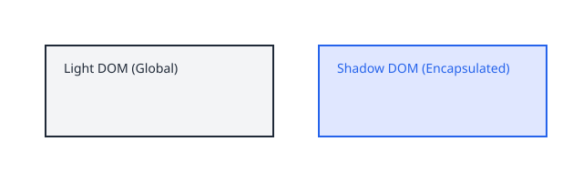
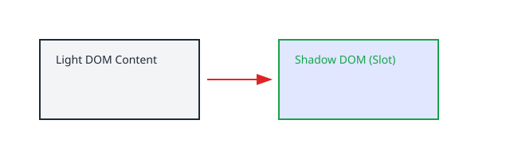
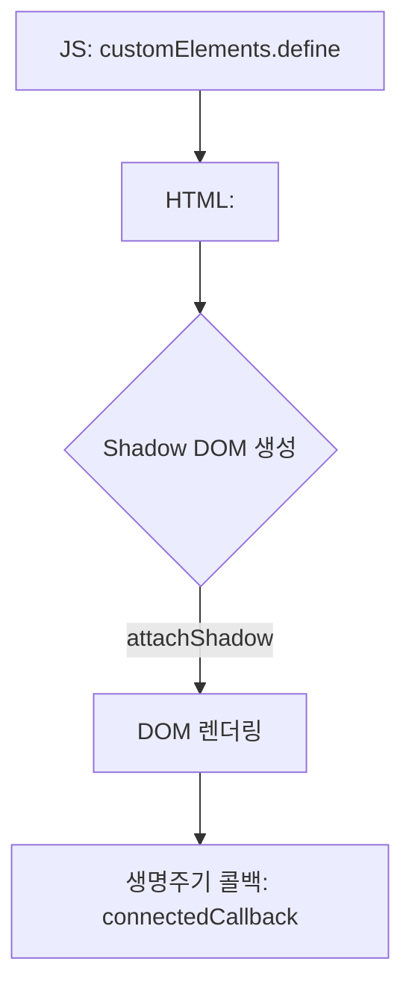

# 261118 Web Components (Custom Elements & Shadow DOM) 기술 해설

> 한 줄 요약 · 분야: DOM · 렌더링 · Baseline: Widely available. All modern browsers (Chrome, Edge, Firefox, Safari) support the core APIs, though older IE versions do not. Declarative Shadow DOM has high support but check caniuse for exact versions. · 읽는 시간 약 10분

## 1. 왜 쓰는가
전통적인 프론트엔드 개발 환경에서 스타일과 마크업의 의도치 않은 충돌은 흔한 문제입니다. 특정 컴포넌트의 CSS 스타일이 전역 스타일과 겹치거나, 반대로 전역 스타일이 컴포넌트 내부로 침투하여 레이아웃을 깨뜨리는 일이 빈번합니다. 기존의 프레임워크 기반 컴포넌트들은 각자의 방식으로 이를 해결해왔으나, 프레임워크가 달라지면 컴포넌트 재사용이 불가능했습니다. Web Components는 브라우저 네이티브 기술로, 외부의 간섭을 완전히 차단하는 캡슐화된 커스텀 요소를 정의하여 이러한 문제를 원천적으로 해결하고자 등장했습니다[1].

## 2. 핵심 개념
Web Components는 세 가지 핵심 표준 기술의 조합으로 이루어집니다.

- **Custom Elements**: `customElements.define`을 사용하여 새로운 HTML 태그를 정의하고 동작을 구현합니다[1].
- **Shadow DOM**: DOM 트리의 하위 요소를 메인 문서의 DOM 트리와 분리하여 스타일과 구조의 캡슐화를 제공합니다[1][2].
- **HTML Templates & Slots**: `<template>` 태그로 재사용 가능한 구조를 정의하고, `<slot>`을 통해 컴포넌트 내부로 외부 콘텐츠를 주입합니다[1][2].




## 3. 동작 원리

Web Components의 생명주기는 브라우저가 커스텀 요소를 파싱하고 연결하는 과정에서 결정됩니다.



브라우저는 정의된 Custom Element를 만나면 Shadow DOM을 생성하고 내부 스타일과 구조를 분리합니다. 이 과정에서 외부 CSS가 내부로 침투하지 못하고, 내부 스타일이 외부로 유출되지 않도록 표준 스펙에 따라 강력하게 격리됩니다[1].

## 4. 기본 사용법

```js
// 1. 커스텀 요소 클래스 정의
class MyElement extends HTMLElement {
  constructor() {
    super();
    // 2. Shadow DOM 연결
    this.attachShadow({ mode: 'open' });
  }
  // 3. 요소가 DOM에 삽입될 때 호출
  connectedCallback() {
    this.shadowRoot.innerHTML = `
      <style>p { color: #2563eb; }</style>
      <p>Hello Web Components!</p>
      <slot></slot>
    `;
  }
}
// 4. 브라우저에 요소 등록
customElements.define('my-element', MyElement);
```

- `HTMLElement`를 상속받아 컴포넌트 클래스를 작성합니다.
- `attachShadow({ mode: 'open' })`으로 캡슐화된 DOM 영역을 생성합니다.
- `connectedCallback`은 커스텀 요소가 문서에 처음 연결될 때 실행되며 내부 구조와 스타일을 정의합니다.
- `customElements.define`은 브라우저가 `<my-element>` 태그를 인식하도록 등록합니다.

## 5. 실무 예시

### 디자인 시스템 구축
다양한 기술 스택(React, Vue, Plain HTML)이 혼재된 환경에서 동일한 UI 컴포넌트를 제공해야 할 때 사용합니다.
- **상황**: 사내 디자인 시스템 컴포넌트를 모든 프로젝트에서 사용하고자 함.
- **코드**: 위 4절의 방식대로 컴포넌트 작성 후 배포.
- **주의점**: 프레임워크와 결합 시 데이터 바인딩 처리에 주의해야 합니다.

### 마이크로 프론트엔드
팀별로 사용하는 프레임워크가 다를 때 통합하기 위한 규격으로 사용합니다.
- **상황**: A팀은 React, B팀은 Vue로 마이크로 프론트엔드를 구성.
- **코드**: Web Components로 감싼 컴포넌트를 공용 라이브러리로 제공.
- **주의점**: 컴포넌트 간 통신 규약을 명확히 정의해야 합니다.

## 6. 장점 · 단점

| 장점 | 단점 |
| :--- | :--- |
| 완벽한 캡슐화로 무결성 보장[1] | 전역 테마 적용이 어려움 |
| 프레임워크에 독립적(agnostic) | 내장 데이터 바인딩 부재 |
| 추가 런타임 라이브러리 없음(네이티브) | 과도한 사용 시 성능 저하 |
| 표준 기술로 미래 지향적 | 접근성 구현(ARIA) 복잡 |

## 7. 한계와 함정

- **스타일 격리**: 전역 스타일이 침투하지 않으므로 디자인 시스템의 전역 테마(폰트, 컬러)를 적용하기 위해 CSS 변수(Custom Properties) 사용이 필수적입니다.
- **JS 의존성**: 컴포넌트 등록을 위해 JavaScript 실행이 필수적이므로, JS가 차단된 환경에서는 컴포넌트가 렌더링되지 않습니다.
- **테스트**: Shadow DOM 내부 요소에 접근하기 위해 테스트 프레임워크 설정을 조정해야 할 수 있습니다.

## 8. 다른 방법과 비교

| 방법 | 언제 | 비용 | 한계 |
| :--- | :--- | :--- | :--- |
| 프레임워크 컴포넌트 | 특정 프레임워크 중심 개발 | 낮음(빠른 개발) | 프레임워크 의존성 높음 |
| Web Components | 프레임워크 독립적 설계 | 높음(네이티브 구현) | 접근성 및 상태 관리 복잡 |

프레임워크를 이미 사용 중이고 타 프레임워크와 컴포넌트를 공유할 필요가 없다면 Web Components보다는 프레임워크 자체의 컴포넌트 방식을 고수하는 것이 효율적입니다.

## 9. 대비와 새로운 시도

현재 Declarative Shadow DOM (DSD) 표준이 도입되어 서버 측 렌더링(SSR) 시 JS 없이도 Shadow DOM을 정적으로 렌더링할 수 있게 되었습니다[3]. 이를 통해 초기 로딩 성능과 접근성 문제를 크게 개선하고 있으며, 프레임워크 의존성을 줄이는 방향으로 기술이 진화하고 있습니다.

## 10. 다른 사람에게 설명하기

Web Components는 브라우저가 지원하는 네이티브 표준 기술을 사용하여 재사용 가능하고 격리된 컴포넌트를 만드는 기술입니다. 프레임워크에 종속되지 않으므로 디자인 시스템이나 마이크로 프론트엔드 환경에서 유리합니다. 다만, 스타일 캡슐화나 데이터 바인딩 등 프레임워크가 기본으로 제공하던 기능을 직접 관리해야 하는 복잡함이 있습니다.

- Q. Web Components의 Shadow DOM은 스타일의 외부 유출을 어떻게 막는가?
- Q. Custom Elements는 어떤 생명주기 콜백을 가지는가?
- Q. Declarative Shadow DOM이 왜 필요한가?

## 참고 자료
1. [MDN Web Components Guide](https://developer.mozilla.org/ko/docs/Web/API/Web_components)
2. [Shadow DOM Deep Dive](https://medium.com/)
3. [Web Components Overview](https://velog.io/)

조사: 2026-11-18

## 내 리뷰
(읽고 느낀 점 · 궁금한 것을 적는다. 질문은 Q. 로 시작)
