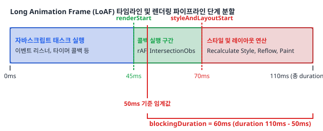
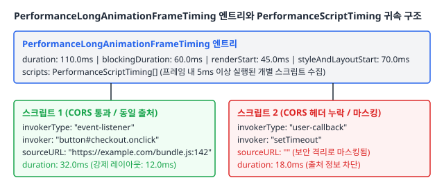

# 261120 Long Animation Frames API

> Long Animation Frames API(LoAF)는 50ms를 초과하여 브라우저 메인 스레드를 차단(main-thread blocking)하고 사용자 인터랙션 응답성을 해치는 긴 애니메이션 프레임을 감지·진단하는 최신 웹 성능 관측 API이다 · 분야: 성능(rAF · 스케줄링 · Core Web Vitals) · Baseline: Newly available (Chromium 계열 브라우저인 Chrome/Edge 123+에서 정식 지원하며, Firefox와 Safari는 표준화 검토 및 개발 단계에 있어 글로벌 가용성은 약 70~74% 수준) · 읽는 시간 약 7분

## 1. 왜 쓰는가
웹 애플리케이션의 실사용자 응답성을 개선하려면 메인 스레드를 점유하는 지연 요소를 프레임 단위로 측정해야 한다.

기존의 Long Tasks API는 단일 태스크의 실행 시간이 50ms를 초과하는 경우만 감지할 수 있었다 [2] [3]. 그러나 브라우저 렌더링 파이프라인에서는 15ms 태스크 4개와 requestAnimationFrame 콜백, 스타일 재계산, 레이아웃 리플로우가 누적되어 단일 프레임 갱신이 지연되는 현상(Death by a thousand cuts)이 빈번하게 일어난다 [3]. 기존 API 체계에서는 이 복합적인 지연을 하나의 단위로 묶어 포착하지 못했고, 지연을 유발한 스크립트의 소스 파일이나 함수명 등 귀속(attribution) 정보가 극히 빈약했다 [2] [3].

또한 실제 운영 환경(RUM)에서 Core Web Vitals의 핵심 지표인 INP(Interaction to Next Paint) 수치가 저하되어도, web-vitals 기본 빌드만으로는 어떤 자바스크립트 함수나 서드파티 스크립트가 메인 스레드를 차단(main-thread blocking)했는지 원인을 특정할 수 없었다 [3] [5]. 로컬 환경의 Chrome DevTools Performance 패널은 정밀한 타임라인 프로파일링을 제공하지만 전 세계 사용자들의 이질적인 저사양 기기와 네트워크에서 발생하는 실시간 병목 데이터를 수집하지 못하며, User Timing API(performance.mark / performance.measure)는 개발자가 수동으로 마크를 심지 않은 미지의 서드파티 스크립트나 예기치 못한 레이아웃 병목을 선제 탐지하지 못한다 [3] [6].

Long Animation Frames API(LoAF)는 이러한 구조적 결손을 해결하기 위해 등장했다 [1] [3]. 브라우저의 렌더링 업데이트 주기 중 50ms를 초과하여 메인 스레드를 차단하는 느린 프레임을 종합 관측하고, 해당 프레임에 관여한 스크립트와 렌더링 파이프라인 각 단계의 소요 시간을 세부적으로 분해하여 제공한다 [1] [2] [3].

## 2. 핵심 개념
LoAF는 프레임의 전체 수명 주기를 자바스크립트 태스크 실행, 렌더링 콜백, 브라우저 스타일·레이아웃 연산으로 세분화하고 개별 스크립트에 지연 책임을 귀속시킨다 [1] [2].



LoAF 타임라인을 구성하는 핵심 타이밍 속성과 개념은 다음과 같다.
- `blockingDuration`: 전체 애니메이션 프레임 지속 시간(duration) 중 50ms 임계값을 초과하여 사용자 입력 등 우선순위 작업을 메인 스레드가 처리하지 못한 차단 시간의 합계(ms)이다 [1] [3]. 이는 Core Web Vitals의 INP 지표 악화와 직접 직결된다 [1] [3].
- `renderStart`: requestAnimationFrame 콜백, ResizeObserver, 그리고 뷰포트 교차를 감지하는 IntersectionObserver 콜백이 실행되는 브라우저 렌더링 파이프라인 주기의 시작 시점이다 [1] [2].
- `styleAndLayoutStart`: 렌더링 주기 내에서 브라우저 엔진이 스타일 재계산(Recalculate Style)과 레이아웃(Reflow) 연산을 본격적으로 시작한 시점이다 [1] [2].
- `main-thread blocking`: 무거운 자바스크립트 실행이나 렌더링 연산으로 인해 브라우저 메인 스레드가 사용자 입력이나 화면 갱신을 처리하지 못하고 멈추는 현상이다 [1] [3].
- `entries`: PerformanceObserver 콜백에 비동기로 전달되는 관찰 결과 레코드 목록이다. 센티널이나 누적 카운터가 아니며, 해당 이벤트 루프 턴에서 발생하거나 버퍼링된 PerformanceLongAnimationFrameTiming 객체들의 배열이다 [2] [3].



- `PerformanceScriptTiming`: 느린 프레임 내부에서 5ms 이상 실행된 개별 스크립트의 소스 위치, 함수명, 호출자 유형, 실행 시간을 담은 세부 타이밍 객체이다 [1] [3].
- `invokerType`: 해당 스크립트가 어떤 계기로 실행되었는지를 나타내는 식별자로, `event-listener`(DOM 이벤트), `user-callback`(setTimeout, rAF, IntersectionObserver 등), `resolve-promise`(비동기 프로미스 해결), `module-script`(모듈 로드) 등이 명시된다 [1] [2].

## 3. 동작 원리
LoAF는 WHATWG HTML Living Standard가 규정하는 브라우저 이벤트 루프와 렌더링 갱신 단계(Update the rendering)에 기반하여 동작하며, W3C Web Performance Working Group에서 표준화 작업을 주도하고 있다 [1] [2].

브라우저 메인 스레드는 매 주기마다 태스크 큐에서 작업을 꺼내 실행한 뒤, 화면 갱신이 필요한 프레임 주기에 도달하면 렌더링 갱신 단계에 진입한다 [1] [2].
1. 브라우저가 사용자 입력(클릭, 키 입력) 이벤트 리스너나 타이머 태스크를 실행한다.
2. 렌더링 갱신 단계에 돌입하면 `renderStart` 타임스탬프가 기록되며 requestAnimationFrame, ResizeObserver, IntersectionObserver 콜백이 순차적으로 실행된다 [1] [2].
3. 콜백 실행이 완료되면 브라우저는 `styleAndLayoutStart` 타임스탬프를 기록하고 스타일 재계산 및 레이아웃 리플로우 연산을 수행한다 [1] [2].
4. 페인트와 레이어 컴포지팅이 완료되면 한 프레임의 라이프사이클이 종료된다.
5. 이 전체 프레임 소요 시간이 50ms를 초과하면 브라우저는 이를 긴 애니메이션 프레임으로 판정하고, 프레임 내 5ms 이상 실행된 스크립트들을 추출하여 PerformanceLongAnimationFrameTiming 엔트리를 생성한다 [1] [3].
6. 생성된 엔트리는 PerformanceObserver 콜백을 통해 비동기 전달된다 [2] [3].

호출 차례는 아래 시퀀스 다이어그램과 같다.

```diagram
종류: 시퀀스
[User]
[MainThread]
[BrowserEngine]
[Observer]
User -> MainThread : 입력 이벤트 발생
MainThread -> MainThread : 이벤트 리스너 실행
== 렌더링 갱신 단계 (Update the rendering) ==
BrowserEngine -> MainThread : renderStart 콜백 실행 (rAF, IntersectionObserver)
BrowserEngine -> BrowserEngine : styleAndLayoutStart 연산 (스타일 및 레이아웃)
BrowserEngine -> BrowserEngine : 페인트 및 프레임 완료
== 프레임 지연 50ms 초과 판정 ==
BrowserEngine --> Observer : LoAF 엔트리 비동기 전달 (entries)
```

스펙 근거:
W3C Web Performance Working Group의 Long Animation Frames API 명세서에 따르면, 프레임의 총 지속 시간(duration)은 렌더링 작업이 끝난 시점까지 계산되며, blockingDuration은 50ms 초과분만 메인 스레드 차단 시간으로 합산된다 [1] [3].

## 4. 기본 사용법
LoAF는 표준 PerformanceObserver 인터페이스를 통해 별도 외부 라이브러리 없이 브라우저 내장 인터페이스만으로 관찰할 수 있다 [2] [3].

다음 코드는 브라우저 환경에서 LoAF를 관찰하고 프레임 메트릭 및 원인 스크립트를 추출하는 실제 동작 예시이다 [1] [2] [3].

```js
// PerformanceObserver를 통한 LoAF 기본 감지 및 스크립트 귀속 분석
const observer = new PerformanceObserver((entryList) => {
  for (const entry of entryList.getEntries()) {
    console.log(`[LoAF 감지] 프레임 총 소요: ${entry.duration.toFixed(1)}ms, 차단 시간: ${entry.blockingDuration.toFixed(1)}ms`);
    console.log(`  렌더링 시작: ${entry.renderStart.toFixed(1)}ms, 스타일/레이아웃: ${entry.styleAndLayoutStart.toFixed(1)}ms`);

    for (const script of entry.scripts) {
      console.log(`    -> 실행 계기: ${script.invokerType} (${script.invoker})`);
      console.log(`       소스 위치: ${script.sourceURL || '(Cross-Origin 마스킹)'}:${script.sourceLine}`);
      console.log(`       실행 시간: ${script.duration.toFixed(1)}ms, 강제 레이아웃 시간: ${script.forcedStyleAndLayoutDuration.toFixed(1)}ms`);
    }
  }
});

observer.observe({ type: 'long-animation-frame', buffered: true });
```

줄별 설명:
- 1행: 성능 엔트리 관찰을 위한 주석이다.
- 2행: 브라우저 성능 타임라인에 새로운 타이밍 레코드가 기록될 때 비동기로 호출되는 PerformanceObserver 인스턴스를 생성한다 [2].
- 3행: 콜백에 인자로 넘어온 entryList에서 관찰 대상 PerformanceLongAnimationFrameTiming 엔트리 목록(entries)을 순회한다 [2] [3].
- 4행: 프레임의 전체 소요 시간(entry.duration)과 50ms를 초과하여 입력을 차단한 시간(entry.blockingDuration)을 밀리초(ms) 단위로 출력한다 [1] [3].
- 5행: 렌더링 파이프라인 콜백이 시작된 시점(entry.renderStart)과 스타일/레이아웃 연산이 시작된 시점(entry.styleAndLayoutStart)을 출력한다 [1] [2].
- 7행: 해당 느린 프레임 내부에서 5ms 이상 실행되어 지연을 유발한 PerformanceScriptTiming 객체 배열(entry.scripts)을 순회한다 [1] [3].
- 8행: 스크립트의 실행 계기(invokerType)와 호출자 식별자(invoker)를 출력한다 [1] [2].
- 9행: 스크립트 파일의 경로(sourceURL)와 실행 줄 번호(sourceLine)를 출력하며, CORS 제약으로 비어 있을 경우 마스킹 상태를 표기한다 [1] [3].
- 10행: 스크립트의 순수 실행 소요 시간(duration)과 DOM/CSSOM 동기 접근으로 발생한 강제 동기 레이아웃 시간(forcedStyleAndLayoutDuration)을 출력한다 [1] [3].
- 14행: 관찰 타입을 long-animation-frame으로 지정하고, 옵저버 등록 이전에 발생한 과거 프레임까지 수집하도록 buffered 옵션을 true로 설정하여 관찰을 시작한다 [2] [3].

## 5. 실무 예시
LoAF는 Core Web Vitals의 INP 디버깅 및 엔터프라이즈 모니터링 도구의 핵심 데이터 소스로 실무 프로덕션에 적용되어 있다 [3] [5] [6].

실증 사례 1: web-vitals v4 어트리뷰션 빌드를 활용한 INP 병목 스크립트 실무 수집
- 상황: 프로덕션 환경에서 실사용자의 버튼 클릭이나 탭 입력 시 발생하는 응답 지연(INP)을 측정하고, 프레임을 지연시킨 원인 스크립트를 식별해야 하는 상황 [3] [5].
- 코드:
```js
import { onINP } from 'web-vitals/attribution';

onINP((metric) => {
  const { attribution } = metric;
  console.log(`INP 발생: ${metric.value}ms (타깃 엘리먼트: ${attribution.interactionTarget})`);
  console.log(`세부 단계: 입력 지연 ${attribution.inputDelay}ms | 처리 ${attribution.processingDuration}ms | 표시 지연 ${attribution.presentationDelay}ms`);

  // 사용자의 인터랙션과 맞물려 프레임을 지연시킨 LoAF 목록과 문제 스크립트 추출
  if (attribution.longAnimationFramesEntries?.length > 0) {
    attribution.longAnimationFramesEntries.forEach((loaf) => {
      loaf.scripts.forEach((script) => {
        // 사내 RUM 수집 파이프라인으로 전송
        analytics.sendEvent('INP_SCRIPT_BOTTLENECK', {
          scriptUrl: script.sourceURL,
          invoker: script.invoker,
          duration: script.duration,
          forcedLayoutDuration: script.forcedStyleAndLayoutDuration,
        });
      });
    });
  }
});
```
- 결과: 사용자의 인터랙션 지연이 발생할 때 단순 수치 외에 `attribution.longAnimationFramesEntries`를 통해 프레임을 지연시킨 특정 스크립트 URL, 호출자(invoker), 실행 시간(duration), 강제 동기 레이아웃 발생 시간(forcedStyleAndLayoutDuration)을 사내 RUM 파이프라인으로 전송하여 원인 코드를 즉시 격리한다 [3] [5].
- 주의점: 지연 프레임이 빈번한 대규모 페이지에서는 수집되는 LoAF 엔트리와 스크립트 레코드가 급증하므로 네트워크 비콘 페이로드 낭비를 막기 위해 샘플링 처리가 필요하다 [3].

실증 사례 2: Sentry JavaScript SDK 및 Datadog RUM 프로덕션 실증
- 상황: 번들링 및 난독화된 프로덕션 빌드 환경에서 메인 스레드를 50ms 이상 잠그는 서드파티 스크립트나 컴포넌트 렌더 함수를 원본 소스 단위로 추적해야 하는 상황 [3] [6].
- 구조 및 동작:
  - Sentry JavaScript SDK (@sentry/browser v8+): 브라우저의 LoAF API를 자동 감지하여 메인 스레드가 50ms 이상 잠긴 프레임 구간을 성능 트레이싱의 하위 스팬(Span)으로 자동 등록하고, 어떤 컴포넌트 렌더 함수나 서드파티 태그가 원인이었는지 성능 타임라인에 시각화한다 [6].
  - Datadog RUM: 프로덕션 실사용자 모니터링에서 LoAF의 스크립트 귀속 정보를 소스맵(Source Maps)과 연결하여, 난독화된 프로덕션 빌드에서도 실제 프로젝트의 원본 TypeScript 소스 라인으로 지연 유발 코드를 역추적한다.
- 결과: 메인 스레드 차단 지점을 로컬 환경 재현 없이 프로덕션 RUM 대시보드에서 소스 라인 단위로 특정하여 디버깅 소요 시간을 단축한다 [6].
- 주의점: 교차 출처 스크립트의 CORS 헤더 누락 시 sourceURL과 함수명이 마스킹되어 원본 소스맵 매핑이 불가능해진다 [1] [3].

## 6. 장점 · 단점
LoAF는 프레임 단위의 포괄적 가시성과 정밀한 스크립트 귀속을 제공하지만, 브라우저 엔진 간 지원 격차와 데이터 오버헤드라는 단점을 가진다 [1] [3] [4].

| 장점 | 단점 |
| :--- | :--- |
| 프레임 단위의 종합 관측: 단일 태스크뿐 아니라 15ms 태스크 4개와 렌더링 단계가 합쳐져 50ms를 초과하는 Death by a thousand cuts 병목을 정확히 탐지 [3] | 크로스 브라우저 지원 한계: Chromium(Chrome, Edge 123+) 기반 브라우저에서만 완전히 지원되며, Safari와 Firefox는 표준화 검토 단계로 전 세계 사용자의 약 70~74%만 측정 가능함 [4] |
| 강력한 스크립트 귀속(Attribution): 지연을 일으킨 서드파티 스크립트, 이벤트 리스너, rAF 콜백의 함수명과 소스 위치(sourceURL, sourceCharPosition)까지 특정 가능 [1] [3] | CORS 및 보안 제한: 교차 출처(Cross-Origin) 스크립트에 Timing-Allow-Origin 등 적절한 CORS 헤더가 없으면 소스 URL과 함수명이 마스킹됨 [1] [3] |
| INP 디버깅에 최적화: 사용자 상호작용 지연이 자바스크립트 실행 지연인지, 렌더링/레이아웃 지연인지 원인 구간을 즉시 분리 진단 가능 [1] [3] [5] | 50ms 고정 임계값: 60fps(16.6ms)나 120fps(8.3ms)의 미세한 버벅임(micro-jank)은 기본 50ms 임계값에 잡히지 않아 초고주사율 애니메이션 최적화에는 부적합 [3] |
| 렌더링 파이프라인 단계별 시간 세분화: 콜백 구간(renderStart ~ styleAndLayoutStart)과 브라우저의 스타일/레이아웃 연산 구간을 명확히 구분 [1] [2] | RUM 전송 데이터 오버헤드: 지연 프레임이 빈번한 복잡한 웹 앱의 경우 PerformanceScriptTiming 엔트리가 급증하여 네트워크 비콘 페이로드가 커질 수 있음 [3] |
| 표준 PerformanceObserver 재사용: 기존 APM 및 웹 성능 수집 인프라에서 별도 무거운 SDK 없이 브라우저 내장 인터페이스만으로 가볍게 수집 가능 [2] [3] | 최소 스크립트 수집 임계값: 브라우저 내부 모니터링 부하를 줄이기 위해 프레임 내에서 5ms 미만으로 실행된 스크립트 단위는 scripts 배열에서 제외됨 [1] [3] |

## 7. 한계와 함정
LoAF를 실무에 도입할 때는 브라우저 보안 격리, 임계값 제약, 실행 환경 특성에 따른 한계를 고려해야 한다 [1] [3].

- 경계 사례 (Edge cases):
  1. 50ms 고정 임계값: 60fps 환경의 프레임 버짓인 16.6ms나 120fps 환경의 8.3ms를 초과하지만 50ms에는 미치지 못하는 미세 버벅임(micro-jank)은 기본 임계값에 잡히지 않는다 [3].
  2. 최소 스크립트 수집 임계값: 브라우저 내부 모니터링 부하를 줄이기 위해 프레임 내에서 5ms 미만으로 실행된 매우 짧은 스크립트 단위는 scripts 배열에서 제외된다 [1] [3].
  3. 백그라운드 탭 비활성화: 탭이 백그라운드로 전환되면 브라우저는 배터리 절약을 위해 rAF와 렌더링 루프를 스로틀링하거나 중단하므로 활성 전경 탭의 렌더링 지연만 실질적인 분석 대상이 된다 [1].
- 성능 (Performance):
  복잡한 웹 애플리케이션에서 지연 프레임이 빈번하게 발생하면 수집되는 PerformanceScriptTiming 엔트리가 급증하여 네트워크 비콘 페이로드가 비대해진다. 따라서 원격 수집 시 샘플링 처리가 필수적이다 [3].
- 접근성 (Accessibility):
  화면 낭독기나 키보드 내비게이션을 사용하는 사용자 환경에서 메인 스레드가 50ms 이상 차단(main-thread blocking)되면 포커스 이동이나 보조 기술 반응이 지연된다. LoAF를 통해 blockingDuration을 파악하고 단축하지 못하면 인터랙션 접근성에 직접적인 지장을 초래한다.
- 보안 및 개인정보 (Security & Privacy):
  스펙터(Spectre) 유사 타이밍 사이드 채널 공격을 방어하기 위해 교차 출처(Cross-Origin) 스크립트는 crossorigin="anonymous" 속성과 올바른 CORS 및 Timing-Allow-Origin 헤더가 누락되어 있을 경우 sourceURL, 함수명, 소스 위치 정보가 빈 문자열로 마스킹된다 [1] [3].

## 8. 다른 방법과 비교
웹 성능 관측 기술마다 측정 대상과 스코프가 다르므로 모니터링 목적에 따라 적절한 도구를 선택해야 한다 [2] [3] [5] [6].

| 방법 | 언제 | 비용 | 한계 |
| :--- | :--- | :--- | :--- |
| Long Animation Frames API (LoAF) | 프로덕션 실사용자(RUM) 환경에서 프레임 지연 및 INP 병목 스크립트를 원본 소스 라인 단위로 진단할 때 [1] [3] | 낮음 (브라우저 내장 PerformanceObserver 활용, 필요시 비콘 샘플링) | Safari 및 Firefox 미지원으로 글로벌 커버리지가 약 70~74%에 한정됨 [4] |
| Long Tasks API | 단일 태스크 기준 50ms 초과 메인 스레드 점유 여부만 단순 감지할 때 [2] [3] | 낮음 (브라우저 내장 API) | 렌더링 단계(rAF, 레이아웃) 지연을 보지 못하며 스크립트 귀속 정보가 극히 빈약함 [2] [3] |
| web-vitals 라이브러리 (기본 빌드) | RUM 환경에서 LCP, INP 수치 점수 현황만 대시보드에 집계할 때 [3] [5] | 매우 낮음 (경량 라이브러리) | 점수 수치만 제공할 뿐 메인 스레드를 막은 구체적인 JS 함수나 서드파티 스크립트를 특정하지 못함 [3] [5] |
| Chrome DevTools Performance 패널 | 로컬 개발 환경에서 정밀한 콜 스택, CPU 프로파일링, 타임라인을 시각적으로 디버깅할 때 [3] | 높음 (로컬 수동 프로파일링 필요, 메모리 오버헤드 수반) | 실제 프로덕션 환경의 다양한 단말기 및 네트워크 환경의 실사용자 병목 데이터를 수집할 수 없음 [3] |
| User Timing API (performance.mark / measure) | 특정 비즈니스 로직이나 모듈의 실행 구간 시간을 수동으로 명시적 측정할 때 [3] | 중간 (코드 전후에 수동 마크 삽입 필요, 유지보수 비용 발생) | 개발자가 미리 마크를 심지 않은 미지의 서드파티 스크립트나 예기치 못한 레이아웃 병목을 선제 탐지하지 못함 [3] [6] |

이것을 고르지 않는 경우:
- Safari(WebKit) 및 Firefox 사용자가 대다수를 차지하는 서비스 환경에서는 글로벌 가용성이 70~74% 수준에 머무르므로 단독 모니터링 지표로 채택하기 어렵다 [4].
- 60fps/120fps 애니메이션의 초미세 쟁크(8.3ms~16.6ms 수준)를 튜닝할 때는 50ms 임계값을 가진 LoAF로 감지할 수 없으므로 Chrome DevTools 로컬 프로파일러를 사용해야 한다 [3].

## 9. 대비와 새로운 시도
LoAF는 브라우저 스케줄링 API 및 AI 기반 APM 인프라와 결합하여 성능 최적화 생태계로 확장되고 있다 [1] [3] [5] [6].

- 표준화 및 크로스 브라우저 로드맵:
  W3C Web Performance Working Group에서 LoAF 명세를 공식 Recommendation 표준 트랙으로 지속 추진하고 있으며, Firefox 및 WebKit 엔진 팀과의 크로스 브라우저 호환성 표준화 논의가 이어지고 있다 [1] [4].
- `scheduler.yield()` 연계 최적화 패턴:
  LoAF로 찾아낸 긴 스크립트 실행 구간을 브라우저의 협업적 멀티태스킹 API인 `scheduler.yield()`로 잘게 분할하여 메인 스레드 제어권을 양보함으로써 INP를 개선하는 실무 설계 패턴이 확산되고 있다.
- `web-vitals` v4+ 어트리뷰션 고도화:
  사용자 인터랙션 타깃 엘리먼트와 LoAF 엔트리를 자동 상관 분석하여 가장 느린 인터랙션과 지연 유발 코드를 실시간으로 대시보드화하는 기법이 발전하고 있다 [3] [5].
- 강제 동기 리플로우 감지 고도화:
  PerformanceScriptTiming의 `forcedStyleAndLayoutDuration` 메트릭을 통해 스크립트 내부의 DOM/CSSOM 동기 접근 병목(Layout Thrashing)을 더욱 세부적으로 계측하는 제안이 발전하고 있다 [1] [3].
- 프론트엔드와 AI 결합 흐름:
  프로덕션 RUM 모니터링 파이프라인에 수집된 LoAF 스크립트 귀속 데이터(sourceURL, sourceLine, invoker)와 에러/성능 트레이싱 스팬을 소스맵과 연결한 뒤 대규모 언어 모델(LLM) 및 AI 에이전트에 공급하는 자동화 파이프라인이 등장하고 있다 [6]. AI는 메인 스레드 차단 코드를 분석하여 DOM 조작 일괄 처리나 `scheduler.yield()` 삽입 분할 지점을 자동 추천하는 방향으로 발전하고 있다.

## 10. 다른 사람에게 설명하기
세 문장 요약:
1. Long Animation Frames API(LoAF)는 50ms를 초과하여 브라우저 메인 스레드를 차단하고 화면 갱신을 지연시키는 느린 프레임을 감지하는 최신 웹 성능 관측 API이다 [1] [3].
2. 기존 Long Tasks API와 달리 자바스크립트 실행뿐 아니라 rAF, IntersectionObserver, 스타일 재계산, 레이아웃 등 렌더링 파이프라인 전체를 포괄 관측하며 지연 유발 스크립트의 소스 위치와 함수명을 정확히 귀속한다 [1] [2] [3].
3. 실사용자(RUM) 환경에서 Core Web Vitals의 핵심 지표인 INP를 유발한 코드 병목을 격리하고 최적화하는 데 필수적인 표준 도구이다 [3] [5] [6].

스스로 확인할 질문 3개:
1. Long Tasks API에서는 포착되지 않는 단일 15ms 태스크 4개와 레이아웃 리플로우의 합산 지연을 LoAF가 감지할 수 있는 구조적 이유는 무엇인가?
2. LoAF 타임라인에서 `renderStart`와 `styleAndLayoutStart` 타임스탬프는 브라우저 렌더링 파이프라인의 어떤 단계 구분을 나타내는가?
3. 교차 출처(Cross-Origin) 서드파티 스크립트가 프레임을 지연시켰을 때 LoAF에서 소스 URL과 함수명이 마스킹되지 않도록 하려면 어떤 보안 설정이 필요한가?

## 핵심 낱말
- `blockingDuration` — 애니메이션 프레임 중 50ms를 초과하여 사용자 입력 등 우선순위 작업을 메인 스레드가 처리하지 못한 차단 시간(ms)
- `renderStart` — requestAnimationFrame, ResizeObserver, IntersectionObserver 콜백이 실행되는 브라우저 렌더링 파이프라인 주기의 시작 시점
- `styleAndLayoutStart` — 렌더링 주기 내에서 스타일 재계산(Recalculate Style)과 레이아웃(Reflow) 연산이 본격적으로 시작된 시점
- `PerformanceScriptTiming` — 긴 애니메이션 프레임을 유발한 개별 스크립트의 소스 위치, 함수명, 호출자 유형, 실행 시간을 담은 세부 타이밍 객체
- `invokerType` — 스크립트가 실행된 계기(event-listener, user-callback, resolve-promise, module-script 등)를 나타내는 식별자
- `main-thread blocking` — 긴 자바스크립트 실행이나 무거운 렌더링 연산으로 인해 브라우저 메인 스레드가 사용자 입력이나 화면 갱신을 처리하지 못하고 멈추는 현상 (다시)
- `IntersectionObserver` — 뷰포트와 대상 요소의 교차 여부를 비동기로 감지하며, 렌더링 갱신 단계의 renderStart 구간에서 콜백이 실행되는 웹 표준 관찰자 API (다시)
- `entries` — 웹 관찰자(Observer) 콜백에 전달되는 관찰 결과 목록으로, 센티널이나 누적 카운터가 아닌 해당 턴에 발생하거나 버퍼링된 이벤트 및 타이밍 레코드 배열

## 참고 자료
1. [Long Animation Frames API - W3C Editor's Draft](https://w3c.github.io/long-animation-frames/)
2. [PerformanceLongAnimationFrameTiming - Web APIs | MDN](https://developer.mozilla.org/en-US/docs/Web/API/PerformanceLongAnimationFrameTiming)
3. [Long Animation Frames API | web.dev](https://web.dev/articles/long-animation-frames)
4. [Can I use... Support tables for Long animation frames](https://caniuse.com/mdn-api_performancelonganimationframetiming)
5. [Debug Web Vitals in the field with web-vitals v4 attribution | web.dev](https://web.dev/articles/debug-cwv-with-web-vitals)
6. [Sentry: Pinpointing Main-Thread Delays with the Long Animation Frames API](https://blog.sentry.io/long-animation-frames/)
조사: 2026-11-20

## 내 리뷰
(읽고 느낀 점 · 궁금한 것을 적는다. 질문은 Q. 로 시작)
