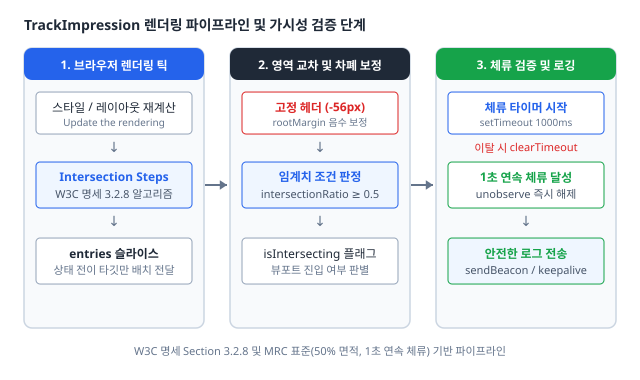

# 261122 TrackImpression - 실무 함정과 디버깅

> 다시 보기 · 관점: 실무 함정과 디버깅 · 처음 글: 261102 TrackImpression · 분야: DOM · 렌더링 · 읽는 시간 약 8분

## 1. 지난번 핵심
TrackImpression은 광고 및 커머스 영역에서 특정 UI 컴포넌트가 사용자의 뷰포트에 실제로 노출되었는지 계측하는 핵심 기술 패턴이다. 미국 미디어 등급 위원회(MRC)와 IAB 표준은 타깃 영역의 최소 50% 이상 픽셀이 1초 이상(비디오는 2초 이상) 연속 노출되어야 공식 'Viewable Impression'으로 규정한다. 과거의 `window.onscroll` 이벤트와 `getBoundingClientRect()` 조합은 매 스크롤마다 메인 스레드를 점유하고 동기적 레이아웃 리플로우(Layout Thrashing)를 유발하였다. W3C는 브라우저 내부 렌더링 파이프라인과 결합하여 비동기 배치로 교차 상태를 계산하는 Intersection Observer API를 표준화하여 메인 스레드 부하를 해결하였다. 그러나 실무에서 이 API를 실제 프로덕션 서비스에 단순 적용하면 고속 스크롤 왜곡, 상단 차폐, 수명주기 타이머 결합 오류 등 다양한 데이터 정합성 결함이 발생한다.

## 2. 이번 관점: 실무 함정과 디버깅
Intersection Observer는 메인 스레드 부하를 크게 낮추지만, 내부 동작 모델과 브라우저 수명주기를 정확히 이해하지 못하면 심각한 측정 왜곡을 초래한다 [1], [2].

W3C 명세(Section 3.2.8)에 따르면 브라우저는 이벤트 루프의 'Update the rendering' 단계에서 스타일 및 레이아웃 재계산 직후 'Run the update intersection observations steps' 알고리즘을 실행하여 교차 상태를 연산한다 [1]. 이때 옵저버 콜백으로 전달되는 `entries` 인자는 등록된 전체 관찰 대상(`[[ObservationTargets]]`) 목록이 아니다 [1], [2]. 이번 렌더링 프레임에서 설정된 `threshold` 경계를 가로질러 가시성 상태 전이가 발생한 대상들의 `IntersectionObserverEntry` 레코드만 담긴 배치(Batch) 슬라이스다 [1], [2]. 이를 전체 상태 목록으로 오인하여 배열 인덱스로 상태를 덮어쓰거나 동기화하면 갱신되지 않은 다른 타깃의 노출이 누락되는 치명적인 버그가 발생한다 [2].

또한 기본 Intersection Observer v1은 사각형 바운딩 박스의 기하학적 교차 좌표만 연산한다 [1], [3]. 상단에 `position: sticky` 헤더가 화면을 덮고 있거나, 요소 위에 모달 팝업이 뜨거나, CSS `opacity: 0`, `visibility: hidden`이 적용된 상태에서도 뷰포트 사각형 안에 위치하면 `isIntersecting: true`로 판정한다 [1], [3]. 화면 높이보다 더 긴 상세 카드나 배너에 `threshold: 1.0`을 지정하면 100% 면적이 뷰포트에 동시에 들어올 수 없어 콜백이 영구히 실행되지 않는 문제도 발생한다 [2]. 따라서 정밀한 계측을 위해서는 고정 UI 영역을 제외하는 음수 `rootMargin` 보정, 임계치 배열 세분화, 1초 체류 시간(`dwellTime`) 타이머의 결합이 필수적이다 [1], [2], [3].



## 3. 실증 사례
실무 서비스와 오픈소스 생태계에서는 단순 좌표 감지의 한계를 극복하기 위해 다음과 같은 아키텍처 패턴을 적용하였다.

첫째, 고속 스크롤 왜곡 방지 및 MRC 표준 준수 타이머 패턴이다 [2], [3].
- 상황: 모바일 환경에서 사용자가 3000px/s 이상의 속도로 플링(Fling) 스크롤할 때 요소가 16ms(1프레임) 미만으로 스쳐 지나가도 `isIntersecting: true`가 발생하여 허위 노출(False Positive) 데이터가 집계되었다 [2], [3].
- 한 일: `threshold: [0, 0.5, 1.0]`과 1000ms `setTimeout`을 결합하고, 요소가 뷰포트를 벗어나거나(`isIntersecting === false`) 탭이 비활성화될 때(`visibilitychange`) 타이머를 즉시 `clearTimeout`하는 로직을 구축하였다 [2], [4].
- 결과: 스침 스크롤로 인한 허위 노출 데이터를 완전히 배제하고, 50% 이상 영역이 1초 이상 온전히 체류한 유효 노출만 정확히 기록하였다 [2], [3].
- 출처: web.dev Intersection Observer v2 및 Page Lifecycle API [3], [4].

둘째, 상단 고정 헤더 차폐 보정 패턴이다 [1], [2].
- 상황: 높이 56px의 상단 고정 헤더(`position: sticky`)가 존재하는 화면에서 기본 뷰포트(`root: null`)를 감시할 때, 헤더 뒷면으로 스크롤되어 가려진 요소가 뷰포트 상단 영역과 교차된 것으로 판정되어 보이지 않는 요소가 노출로 잘못 기록되었다 [1], [2].
- 한 일: 옵저버 초기화 옵션에 `rootMargin: '-56px 0px 0px 0px'`를 지정하여 뷰포트 상단 감시 경계를 헤더 높이만큼 아래로 오프셋시켰다 [1], [2].
- 결과: 상단 56px 사각지대에서 발생하는 허위 노출을 0건으로 차단하였다 [1], [2].
- 출처: W3C Intersection Observer Specification 및 MDN Web Docs [1], [2].

셋째, 토스(Toss) Slash의 선언적 `ImpressionArea` 패턴이다 [6].
- 상황: 피드 및 추천 목록에서 비즈니스 컴포넌트 내부에 노출 로깅 로직이 뒤섞여 유지보수성이 저하되고, 노출이 이미 완료된 후에도 옵저버 타깃이 해제되지 않아 불필요한 메인 스레드 연산 낭비가 지속되었다 [2], [6].
- 한 일: 비즈니스 UI 컴포넌트를 선언적으로 감싸는 `<ImpressionArea>` 래퍼를 설계하고, 50% 1초 노출이 충족되면 즉시 `observer.unobserve(target)`을 실행하도록 구성하였다 [6].
- 결과: 비즈니스 로직과 분석 계측의 관심사를 완전히 격리하였으며, 1회 노출 달성 즉시 타깃 관찰을 종료하여 내부 관찰 대상(`[[ObservationTargets]]`) 목록 유지 비용과 중복 트리거를 차단하였다 [1], [6].
- 출처: Toss Tech 실무에서 바로 쓰는 프론트엔드 선언적 컴포넌트 설계 [6].

## 4. 코드로 확인하기
다음은 MRC 표준(50% 면적, 1초 체류)과 고정 헤더 오프셋, 탭 비활성화 방어, 페이지 이탈 시 비동기 전송을 구현한 프로덕션 수준의 TrackImpression 클래스 예시다.

```js
class TrackImpression {
  constructor(options = {}) {
    this.dwellTime = options.dwellTime || 1000;
    this.dwellTimers = new Map();
    this.recordedTargets = new WeakSet();
    this.pendingQueue = [];

    this.observer = new IntersectionObserver(
      this.handleIntersections.bind(this),
      {
        root: options.root || null,
        rootMargin: options.rootMargin || '-56px 0px 0px 0px',
        threshold: [0, 0.5, 1.0],
      }
    );

    this.handleVisibilityChange = this.handleVisibilityChange.bind(this);
    this.flush = this.flush.bind(this);

    document.addEventListener('visibilitychange', this.handleVisibilityChange);
    window.addEventListener('pagehide', this.flush);
  }

  observe(element, metadata) {
    if (!element || this.recordedTargets.has(element)) return;
    element.__impressionMeta = metadata;
    this.observer.observe(element);
  }

  handleIntersections(entries) {
    for (const entry of entries) {
      const target = entry.target;
      if (this.recordedTargets.has(target)) continue;

      const isViewable = entry.isIntersecting && entry.intersectionRatio >= 0.5;

      if (isViewable) {
        if (!this.dwellTimers.has(target)) {
          const timerId = window.setTimeout(() => {
            this.recordImpression(target);
          }, this.dwellTime);
          this.dwellTimers.set(target, timerId);
        }
      } else {
        this.clearDwellTimer(target);
      }
    }
  }

  clearDwellTimer(target) {
    if (this.dwellTimers.has(target)) {
      window.clearTimeout(this.dwellTimers.get(target));
      this.dwellTimers.delete(target);
    }
  }

  recordImpression(target) {
    this.clearDwellTimer(target);
    this.recordedTargets.add(target);
    this.observer.unobserve(target);

    const payload = {
      id: target.__impressionMeta?.id,
      timestamp: Date.now(),
    };
    this.pendingQueue.push(payload);

    if (this.pendingQueue.length >= 10) {
      this.flush();
    }
  }

  handleVisibilityChange() {
    if (document.visibilityState === 'hidden') {
      for (const [target] of this.dwellTimers) {
        this.clearDwellTimer(target);
      }
      this.flush();
    }
  }

  flush() {
    if (this.pendingQueue.length === 0) return;
    const body = JSON.stringify(this.pendingQueue);
    this.pendingQueue = [];

    if (navigator.sendBeacon) {
      const blob = new Blob([body], { type: 'application/json' });
      const success = navigator.sendBeacon('/api/impressions', blob);
      if (!success) {
        fetch('/api/impressions', { method: 'POST', body, keepalive: true });
      }
    } else {
      fetch('/api/impressions', { method: 'POST', body, keepalive: true });
    }
  }

  destroy() {
    for (const [target] of this.dwellTimers) {
      this.clearDwellTimer(target);
    }
    this.observer.disconnect();
    document.removeEventListener('visibilitychange', this.handleVisibilityChange);
    window.removeEventListener('pagehide', this.flush);
    this.flush();
  }
}
```

줄별 동작 설명:
- 1~7행: 클래스 생성자에서 체류 시간 기본값을 1000ms로 설정하고, 개별 타깃별 타이머 관리를 위한 `Map`, 중복 로깅 방지를 위한 `WeakSet`, 전송 대기 큐 배열을 초기화한다.
- 9~17행: Intersection Observer 인스턴스를 생성한다. 상단 56px 고정 헤더를 보정하도록 `rootMargin: '-56px 0px 0px 0px'`를 지정하고, 교차율 진입과 이탈을 감지하도록 `threshold`에 0, 0.5, 1.0을 전달한다.
- 19~24행: 이벤트 핸들러의 `this` 컨텍스트를 바인딩하고, 탭 전환을 감지하는 `visibilitychange`와 세션 종료를 감지하는 `pagehide` 리스너를 등록한다.
- 26~30행: 관찰 대상 DOM 노드와 메타데이터를 수신한다. 이미 노출 완료된 타깃(`recordedTargets`)은 즉시 제외하고 `observer.observe`를 호출한다.
- 32~48행: 상태 전이가 발생한 `entries` 슬라이스를 순회한다. `entry.isIntersecting`이 참이고 `entry.intersectionRatio >= 0.5`인 경우에만 1000ms 타이머를 시작한다. 뷰포트를 벗어나거나 교차율이 0.5 미만으로 떨어지면 `clearDwellTimer`를 호출하여 고속 스크롤 왜곡을 방지한다.
- 50~55행: 실행 중인 타이머를 `clearTimeout`으로 취소하고 맵에서 타깃 참조를 안전하게 제거한다.
- 57~71행: 1초 연속 노출 조건을 통과하면 타이머를 정리하고 타깃을 기록 완료 세트에 추가한 뒤, 즉시 `observer.unobserve(target)`을 실행하여 관찰을 해제한다. 수집된 로그를 큐에 적재하고 배치 임계치(10건) 도달 시 `flush`를 트리거한다.
- 73~80행: 사용자가 탭을 전환하여 `document.visibilityState === 'hidden'`이 되면 화면을 보고 있지 않은 상태이므로 진행 중이던 모든 타이머를 즉시 취소하고, 대기 큐의 데이터를 전송한다.
- 82~96행: 큐에 쌓인 노출 로그를 전송한다. 비동기 백그라운드 전송이 보장되는 `navigator.sendBeacon`을 우선 호출하고, 전송 큐 버퍼 초과 등으로 실패하거나 미지원 브라우저인 경우 `fetch`의 `keepalive: true` 옵션으로 폴백 처리한다.
- 98~106행: 인스턴스 파괴 시 활성 타이머 정리, `observer.disconnect()` 호출, 글로벌 이벤트 리스너 제거, 잔여 로그 플러시를 수행하여 메모리 누수를 방지한다.

## 5. 실무에서 걸리는 곳
프로덕션 환경에서 TrackImpression을 운영할 때 자주 마주치는 경계 사례와 해결책은 다음과 같다.

1. 가상화 리스트(Virtual List)의 DOM 노드 재활용:
React Virtual, TanStack Virtual 등 가상 스크롤 라이브러리는 뷰포트 내 수십 개의 DOM 노드만을 생성한 뒤 스크롤 위치에 따라 데이터만 갈아 끼우며 재활용한다. 단순 컴포넌트 마운트 시점에 `observer.observe`를 걸면 이전 아이템의 인덱스나 클로저가 남아 오판독되거나 새 아이템의 노출이 누락된다. 노출 여부를 DOM 노드가 아닌 고유 엔티티 ID 기반의 Set으로 격리하고, DOM에 바인딩되는 데이터 키가 교체될 때 콜백 ref를 통해 옵저버 대상을 명시적으로 재등록해야 한다 [2].

2. 이미지 높이 미지정으로 인한 Cumulative Layout Shift:
이미지 태그에 `aspect-ratio`나 명시적 `width`/`height`가 지정되지 않으면 이미지가 네트워크에서 로드되기 전 카드 높이가 0px로 렌더링된다. 높이가 0px인 카드가 뷰포트 상단에 한꺼번에 진입하면 `threshold` 연산이 비정상적으로 스킵되거나, 이미지 로드 후 급격한 레이아웃 이동(CLS)이 발생하며 중복 트리거된다 [2].

3. 뷰포트보다 큰 타깃에 `threshold: 1.0` 지정:
화면 세로 길이(예: 800px)보다 긴 상세 콘텐츠(예: 1200px)에 `threshold: 1.0`을 지정하면 요소의 100% 면적이 뷰포트 안에 동시에 들어올 수 없다 [2]. 이 경우 `intersectionRatio`는 최대 0.6~0.7에 머물며 1.0을 넘지 못하므로 노출 콜백이 영구히 실행되지 않는다 [2].

4. 차폐(Occlusion) 및 CSS 가시성 속성 한계:
Intersection Observer v1은 기하학적 교차만 연산하므로 CSS `opacity: 0`, `visibility: hidden`, 투명 필터, z-index 팝업 뒤에 가려진 요소를 감지하지 못한다 [3], [5]. 진정한 가시성을 판별하려면 Chromium 계열에서 지원하는 Intersection Observer v2의 `trackVisibility: true` 및 `delay` 옵션을 설정하고 `entry.isVisible` 속성을 확인해야 한다 [3], [5]. Safari와 Firefox에서는 v2 미지원 상태이므로 교차 브라우징 설계 시 주의가 필요하다 [5].

5. 무한 스크롤 센티넬(Sentinel)과의 구조적 혼동:
무한 스크롤은 목록 끝에 1px 크기의 더미 DOM(`sentinel`) 하나를 두고 뷰포트 진입 시 다음 페이지를 페칭한다 [2]. 반면 노출 추적은 개별 카드와 배너 엘리먼트 각각을 개별 타깃으로 등록(`observer.observe(target)`)하고 각각의 수명주기를 격리 관리해야 하므로 센티넬 패턴과 완전히 구분하여 설계해야 한다 [2], [6].

측정 방법:
- Chrome DevTools Performance 패널에서 이벤트 루프의 'Update the rendering' 단계 및 Intersection Observer 콜백 실행 시점을 프로파일링한다.
- Network 패널에서 백그라운드 전환 시 `sendBeacon` 또는 `fetch` (`keepalive: true`) 요청이 정상 발송되는지 검증한다.
- 콘솔에서 `document.visibilityState === 'hidden'` 진입 시 타이머 취소 로그가 정상 출력되는지 확인한다.

디버깅 순서:
1. 1단계: 타깃 등록 확인 — 관찰 대상 DOM 노드가 정상 전달되었는지, 가상화 환경에서 노드 재활용에 따른 엔티티 ID 매핑이 일치하는지 확인한다.
2. 2단계: 교차 임계치 및 마진 검증 — 타깃 높이가 뷰포트보다 큰지 확인하여 `threshold: 1.0` 오류를 방지하고, 상단 고정 헤더 높이만큼 음수 `rootMargin`이 적용되었는지 확인한다.
3. 3단계: 체류 시간 타이머 수명주기 추적 — `isIntersecting === true` 진입 시 타이머가 정상 생성되고, 16ms 미만 스침 스크롤 시 `clearTimeout`이 정상 동작하는지 검증한다.
4. 4단계: 세션 이탈 및 백그라운드 전송 점검 — 탭 전환 시 타이머 취소 여부를 점검하고, 페이지 종료 시 `unload`가 아닌 `visibilitychange` 시점에 `navigator.sendBeacon`으로 잔여 큐가 전송되는지 확인한다.

## 6. 다른 사람에게 설명하기
- TrackImpression은 Intersection Observer를 활용해 브라우저 렌더링 파이프라인의 레이아웃 단계 이후 비동기 배치로 요소의 가시성을 판정하는 패턴이다 [1].
- 단순 영역 교차만으로는 고속 스크롤 스침, 고정 헤더 가림, 탭 비활성화에 따른 왜곡이 발생하므로 음수 `rootMargin`, 임계치 배열, 체류 시간 타이머의 유기적 제어가 필수적이다 [2], [4].
- 1회 노출 달성 즉시 타깃 관찰을 해제하고, 페이지 이탈 시에는 `unload` 대신 `visibilitychange` 시점에 `navigator.sendBeacon`을 활용해 로그 유실을 방지해야 한다 [4], [6].

스스로 확인할 질문:
- Q1. 세로 길이가 뷰포트 높이보다 긴 배너에 `threshold: 1.0`을 설정했을 때 노출 콜백이 실행되지 않는 원인은 무엇인가?
- Q2. 상단 고정 헤더가 뷰포트 일부를 가리고 있을 때 발생할 수 있는 허위 노출을 방지하기 위해 `rootMargin`을 어떻게 설정해야 하는가?
- Q3. 사용자가 화면을 빠르게 스크롤(플링)하거나 다른 탭으로 전환할 때 MRC 노출 기준(1초 체류) 왜곡을 방어하는 타이머 관리 방식은 무엇인가?

## 핵심 낱말
- `rootMargin` — 교차 판정 시 루트 컨테이너(또는 뷰포트)의 바운딩 박스를 확장하거나 축소하는 CSS margin 형식 문자열 (다시)
- `intersectionRatio` — 타깃 엘리먼트의 전체 면적 대비 루트 영역과 실제로 교차하는 영역의 비율 (다시)
- `threshold` — 옵저버 콜백이 실행되는 intersectionRatio의 경계 임계치 목록 또는 단일 숫자 (다시)
- `isIntersecting` — 타깃 엘리먼트가 설정된 임계치를 교차하여 루트 영역 내에 들어와 있는지 나타내는 불리언 플래그 (다시)
- `entries` — 콜백 호출 시 전달되는 변경된 타깃들의 IntersectionObserverEntry 목록으로, 전체 관찰 목록이 아닌 이번 틱에 상태가 바뀐 항목만 포함됨
- `sentinel` — 무한 스크롤 등에서 다음 데이터 페칭을 트리거하기 위해 배치하는 더미 경계 DOM 노드
- `navigator.sendBeacon` — 페이지 언로드 또는 백그라운드 전환 시에도 브라우저가 비동기 백그라운드 큐를 통해 안전하게 전송을 보장하는 분석용 API
- `dwellTime` — 단순 스침(Fling)과 실제 시각적 노출을 구분하기 위해 요소가 뷰포트 내에 머물러야 하는 최소 체류 시간

## 참고 자료
1. [W3C Intersection Observer Specification](https://www.w3.org/TR/intersection-observer/)
2. [MDN Web Docs: Intersection Observer API](https://developer.mozilla.org/en-US/docs/Web/API/Intersection_Observer_API)
3. [web.dev: Trust is good, observation is best: Intersection Observer v2](https://web.dev/articles/intersectionobserver-v2)
4. [web.dev: Page Lifecycle API - Lifecycle states and events](https://web.dev/articles/page-lifecycle-api)
5. [Can I use: IntersectionObserver & trackVisibility](https://caniuse.com/intersectionobserver)
6. [Toss Tech: 실무에서 바로 쓰는 프론트엔드 선언적 컴포넌트 설계 (ImpressionArea)](https://toss.tech/)
조사: 2026-11-22

## 내 리뷰
(읽고 느낀 점 · 궁금한 것을 적는다. 질문은 Q. 로 시작)
