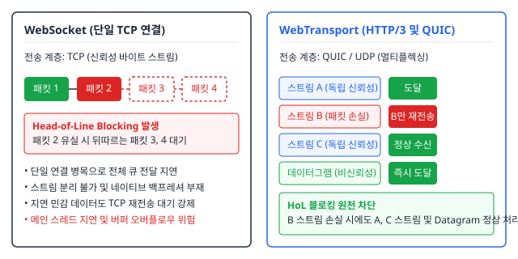
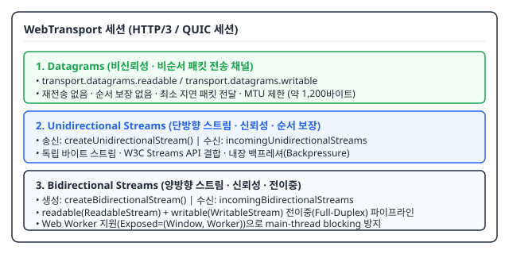

# 261123 WebTransport API

> WebTransport는 HTTP/3 및 QUIC를 기반으로 TCP Head-of-Line 블로킹을 해결하고 양방향 스트림과 초저지연 데이터그램을 제공하는 차세대 웹 전송 표준이다. · 분야: 네트워크 · 전송 계층 · Baseline: Newly available · 읽는 시간 약 6분

## 1. 왜 쓰는가
웹 프론트엔드 환경에서 실시간 양방향 통신을 구현할 때 표준 규격으로 널리 사용되어 온 기술은 WebSocket이다 [3]. 그러나 WebSocket은 단일 TCP 연결 위에서 동작하므로 전송 계층의 구조적 한계를 그대로 갖는다 [3]. TCP는 패킷의 엄격한 순차적 전달을 보장하므로, 네트워크 전송 중 단 하나의 패킷만 유실되어도 뒤따르는 모든 패킷이 운영체제 수신 버퍼에 묶여 대기하는 Head-of-Line(HoL) 블로킹이 발생한다 [3]. 이 현상은 실시간 좌표 동기화, 오디오/비디오 스트리밍, 대규모 데이터 교환 환경에서 일시적인 렌더링 중단과 지연 시간 급증을 초래한다 [3].

또한 WebSocket은 애플리케이션 레벨의 네이티브 백프레셔(Backpressure)를 제공하지 않는다 [1]. 수신 측의 처리 속도가 송신 측의 데이터 유입 속도를 따라가지 못하면 메모리 버퍼 팽창과 지연이 누적된다 [1]. 대안으로 활용되던 WebRTC DataChannel은 UDP/SCTP 기반으로 비순서·비신뢰성 전송을 지원하지만, P2P 통신을 전제로 설계되어 SDP 교환, STUN/TURN 서버 등 시그널링 인프라 구축 비용이 지나치게 높고 일반적인 클라이언트-서버 모델에 적용하기에는 구조적 오버헤드가 크다 [alternatives]. Server-Sent Events(SSE)와 Streams 기반 Fetch API는 단방향 전송에 국한되거나 실시간 양방향 다중 세션 제어에 한계가 있다 [alternatives].

WebTransport는 이러한 기존 통신 프로토콜의 병목을 해결하기 위해 W3C와 IETF가 공동으로 표준화한 차세대 웹 전송 API다 [1]. 전송 계층에서 HTTP/3와 QUIC(UDP 기반) 프로토콜을 사용하여 단일 연결 세션 위에서 독립적인 다중 스트림 멀티플렉싱과 패킷 유실을 감수하는 초저지연 데이터그램(Datagram) 전송을 동시에 제공한다 [2, 4]. 2026년 3월 Safari 26.4에 공식 지원이 탑재됨으로써 Chrome/Edge 97+, Firefox 114+에 이어 모든 주요 모던 브라우저 엔진에서 웹 표준 상호운용성을 달성한 Baseline(Newly available) 상태에 진입하였다 [5, 6].

## 2. 핵심 개념
WebTransport를 정확히 이해하기 위해서는 네트워크 전송 계층의 다중화 구조와 세션 내부 채널 분리 방식을 파악해야 한다.





- **QUIC**: UDP 위에서 TLS 1.3 기반 암호화와 독립 스트림 멀티플렉싱을 전송 계층에 직접 구현한 IETF 표준 프로토콜이다 [2]. 패킷 손실 복구와 혼잡 제어가 개별 스트림 단위로 격리된다 [2].
- **Head-of-Line Blocking 해소**: 단일 물리 연결 위에서 복수의 스트림이 독립적으로 전송되므로, 특정 스트림의 패킷이 유실되어도 다른 독립 스트림이나 데이터그램 전달이 차단되지 않는다 [3].
- **Datagrams**: 재전송이나 순서 보장을 제공하지 않는 비신뢰성 패킷 전송 채널이다 [4]. 패킷 손실을 허용하는 대신 네트워크 지연을 극소화하며, 네트워크 경로 MTU(`maxDatagramSize`, 통상 1,200바이트 내외) 이하의 데이터 전송에 사용된다 [4, cons].
- **Streams**: 엄격한 전송 순서와 신뢰성을 보장하는 양방향(Bidirectional) 및 단방향(Unidirectional) 바이트 스트림이다 [1]. 단일 WebTransport 세션 내에서 필요에 따라 동적으로 여러 개를 생성할 수 있다 [1].
- **Backpressure**: W3C Streams API(`ReadableStream`, `WritableStream`)와의 네이티브 결합을 통해 소비 측의 읽기 처리 속도에 맞춰 송신 흐름을 제어함으로써 버퍼 오버플로우를 원천 방지한다 [1].
- **세션 상태 Promise**: 연결 수립을 알리는 `ready`, 세션 완전 종료를 나타내는 `closed`, 서버의 연결 정리 신호를 감지하는 `draining` Promise를 명시적으로 제공한다 [1].
- **serverCertificateHashes**: 공인 CA 서명이 없는 로컬 개발 환경이나 사설망 테스트 환경에서 지정한 SHA-256 인증서 지문 검증을 통해 보안 연결을 수립할 수 있도록 지원하는 옵션이다 [1].

## 3. 동작 원리
WebTransport는 HTTP/3 세션 수립 단계와 데이터 송수신 단계, 세션 종료 단계로 구분되어 동작한다 [1, 2].

```diagram
종류: 시퀀스
[Client]
[WebWorker]
[BrowserNetwork]
[Server]
Client -> WebWorker : Worker 초기화 및 실행
WebWorker -> BrowserNetwork : new WebTransport(url, options)
BrowserNetwork -> Server : QUIC / HTTP/3 CONNECT 핸드셰이크
Server --> BrowserNetwork : 200 OK 세션 수립
BrowserNetwork --> WebWorker : transport.ready 해결
== 데이터그램 전송 (비신뢰성 · 최소 지연) ==
WebWorker -> BrowserNetwork : datagrams.writable.write(packet)
BrowserNetwork -> Server : UDP Datagram 즉시 전송
Server --> BrowserNetwork : UDP Datagram 수신
BrowserNetwork --> WebWorker : datagrams.readable.read() 청크 전달
== 독립 스트림 전송 (신뢰성 · 멀티플렉싱) ==
WebWorker -> BrowserNetwork : createBidirectionalStream()
WebWorker -> BrowserNetwork : stream.writable.write(chunk)
BrowserNetwork -> Server : QUIC Stream 프레임 전송
Server --> BrowserNetwork : Stream 응답 프레임 수신
BrowserNetwork --> WebWorker : stream.readable.read() 청크 전달
== 세션 종료 (Draining 및 Closed) ==
Server -> BrowserNetwork : DRAINING 신호 전송
BrowserNetwork --> WebWorker : transport.draining 해결
WebWorker -> BrowserNetwork : transport.close()
BrowserNetwork --> WebWorker : transport.closed 해결
WebWorker --> Client : postMessage(종료 상태 통보)
```

1. **연결 및 핸드셰이크 계산 시점**: 클라이언트에서 `new WebTransport(url)`를 호출하면 브라우저 네트워크 스택은 UDP 443 포트를 통해 대상 원격 서버와 QUIC 및 TLS 1.3 핸드셰이크를 시작한다 [1, 2]. 이어 HTTP/3 CONNECT 메서드를 통해 WebTransport 세션 확장을 협상한다 [2]. 서버가 200 응답을 반환하면 `transport.ready` Promise가 이행(resolve)된다 [1].
2. **Datagram 전송 및 수신 시점**: `transport.datagrams.writable`을 통해 바이트 데이터를 쓰면 브라우저는 이를 QUIC DATAGRAM 프레임으로 캡슐화하여 즉시 전송한다 [1, 4]. 수신 확인(ACK)이나 재전송 큐를 거치지 않으므로 전송 지연이 가장 낮다 [4]. 반대로 원격지에서 전송된 데이터그램은 수신 즉시 `transport.datagrams.readable` 스트림 큐에 삽입되어 이벤트 루프에 소비된다 [1].
3. **독립 스트림 멀티플렉싱 시점**: `createBidirectionalStream()` 또는 `createUnidirectionalStream()`을 호출할 때마다 새로운 QUIC Stream ID가 할당된다 [1, 2]. 각 스트림은 독립적인 흐름 제어 창(Flow Control Window)을 가지며, 특정 스트림에서 패킷 손실이 일어나 재전송이 수행되는 동안에도 다른 스트림의 데이터 읽기 작업은 즉시 처리된다 [3].
4. **스레드 분리와 렌더링 보호**: WebTransport API는 `Exposed=(Window, Worker)` 인터페이스로 정의되어 Web Worker 내부에서 완벽하게 구동된다 [3]. 고주파수 바이너리 패킷 파싱과 직렬화 로직을 백그라운드 스레드로 격리할 수 있어 메인 스레드 점유(main-thread blocking)를 방지하며, 브라우저 렌더링 파이프라인의 `renderStart` 및 `styleAndLayoutStart` 단계가 프레임 드롭 없이 안정적인 60/120fps를 유지하도록 보장한다 [3].

## 4. 기본 사용법
다음은 WebTransport 세션을 생성하고 데이터그램 송수신 및 양방향 스트림 제어를 수행하는 완전한 코드 예시이다.

```js
// 1. WebTransport 세션 생성
const url = 'https://example.com:4433/wt';
const transport = new WebTransport(url);

// 2. 연결 수립 완료 대기
await transport.ready;

// 3. 비신뢰성 데이터그램(Datagram) 송신 라이터 획득
const datagramWriter = transport.datagrams.writable.getWriter();

// 4. 전송할 텔레메트리 바이너리 데이터 준비
const telemetry = new Uint8Array([0x01, 0x02, 0x03, 0x04]);

// 5. 데이터그램 전송 (ACK 대기 없이 즉각 송신)
await datagramWriter.write(telemetry);

// 6. 데이터그램 라이터 락 해제
datagramWriter.releaseLock();

// 7. 비신뢰성 데이터그램 수신 루프 실행
(async () => {
  const datagramReader = transport.datagrams.readable.getReader();
  try {
    while (true) {
      const { value, done } = await datagramReader.read();
      if (done) break;
      console.log('Datagram 수신 완료:', value);
    }
  } finally {
    datagramReader.releaseLock();
  }
})();

// 8. 독립 양방향 스트림(Bidirectional Stream) 생성
const stream = await transport.createBidirectionalStream();

// 9. 스트림 송신용 WritableStreamDefaultWriter 획득
const streamWriter = stream.writable.getWriter();

// 10. 스트림 수신용 ReadableStreamDefaultReader 획득
const streamReader = stream.readable.getReader();

// 11. 문자열 데이터를 UTF-8 바이트로 인코딩하여 스트림에 쓰기
const payload = new TextEncoder().encode('WebTransport Stream Message');
await streamWriter.write(payload);

// 12. 송신 스트림 닫기 (원격지에 스트림 종료 플래그 전달)
await streamWriter.close();

// 13. 스트림 응답 데이터 수신 루프 실행
while (true) {
  const { value, done } = await streamReader.read();
  if (done) break;
  console.log('Stream 수신 청크:', new TextDecoder().decode(value));
}

// 14. 스트림 리더 락 해제
streamReader.releaseLock();

// 15. 세션 종료 요청
await transport.close();

// 16. 세션 완전 종료 상태 대기
await transport.closed;
```

줄별 설명:
- 1~2: 원격 엔드포인트 URL을 전달하여 `WebTransport` 인스턴스를 초기화하고, QUIC 핸드셰이크가 완료될 때까지 `transport.ready`를 대기한다 [1].
- 3~6: 데이터그램 쓰기 스트림에서 `getWriter()`로 전용 라이터를 획득하고, 준비된 `Uint8Array` 패킷을 전송한 뒤 락을 반환한다 [1].
- 7: 별도 비동기 IIFE 루프를 열어 `datagrams.readable`의 리더를 통해 수신되는 데이터그램 바이트 청크를 지속해서 읽는다 [1].
- 8~10: `createBidirectionalStream()`을 호출하여 독립 양방향 스트림을 생성하고, 스트림의 송수신 파이프라인 각각에 대해 라이터와 리더를 분리 획득한다 [1].
- 11~12: 텍스트를 인코딩하여 스트림으로 전송한 후 `streamWriter.close()`를 호출해 송신 스트림을 안전하게 종료한다 [1].
- 13~14: 원격 서버가 반환하는 스트림 데이터를 `done` 플래그가 참이 될 때까지 청크 단위로 순차 수신하고 리더 락을 해제한다 [1].
- 15~16: `transport.close()`를 실행하여 세션을 정리하고, `transport.closed` Promise가 해결될 때까지 대기하여 연결 리소스를 완전히 소멸시킨다 [1].

## 5. 실무 예시

### 사례 1: 클라우드 게이밍 및 실시간 가상 공간 좌표 동기화
- **상황**: 60fps로 발생하는 가상 아바타의 위치 좌표 및 카메라 시야각 같은 초저지연 휘발성 데이터와, 채팅 메시지 및 인벤토리 아이템 획득 같은 신뢰성 보장 트랜잭션을 단일 연결에서 분리 전송해야 하는 상황 [examples].
- **코드**:
```js
// 1. 휘발성 위치 좌표 전송 (Datagram 활용)
function sendPlayerPosition(transport, x, y, z, yaw, pitch) {
  const buffer = new ArrayBuffer(20);
  const view = new DataView(buffer);
  view.setFloat32(0, x, true);
  view.setFloat32(4, y, true);
  view.setFloat32(8, z, true);
  view.setFloat32(12, yaw, true);
  view.setFloat32(16, pitch, true);

  const writer = transport.datagrams.writable.getWriter();
  writer.write(new Uint8Array(buffer));
  writer.releaseLock();
}

// 2. 신뢰성 인벤토리 변경 트랜잭션 전송 (Stream 활용)
async function sendInventoryUpdate(transport, itemId, action) {
  const stream = await transport.createBidirectionalStream();
  const writer = stream.writable.getWriter();
  const payload = JSON.stringify({ itemId, action, timestamp: Date.now() });
  await writer.write(new TextEncoder().encode(payload));
  await writer.close();
  
  const reader = stream.readable.getReader();
  const { value } = await reader.read();
  reader.releaseLock();
  return JSON.parse(new TextDecoder().decode(value));
}
```
- **결과**: 위치 데이터는 네트워크 MTU(1,200바이트 내외) 내에서 즉각 발송되어 전송 지연이 극소화되었으며, 일시적 패킷 손실이 발생해도 뒤이어 도착하는 최신 좌표가 반영되어 화면 버벅임이 사라졌다 [4]. 동시에 인벤토리 트랜잭션은 독립 스트림으로 전송되어 상호 간섭이나 지연 전파가 발생하지 않았다 [3].
- **주의점**: Datagram 패킷은 유실되거나 순서가 뒤바뀌어 도착할 수 있으므로, 프론트엔드 수신부에서 패킷 시퀀스 번호 검증과 데드 레커닝(Dead Reckoning) 좌표 보간 로직을 직접 구현해야 한다 [cons].

### 사례 2: IETF Media over QUIC (MoQ) 기반 서브세컨드 라이브 미디어 스트리밍
- **상황**: 기존 HLS나 DASH 같은 HTTP 기반 미디어 스트리밍 프로토콜은 세그먼트 생성과 다운로드 지연으로 인해 2초에서 수십 초에 이르는 레이턴시를 갖는다 [facts]. 이를 해결하기 위해 IETF MoQ 규격에 맞춰 WebCodecs 디코더와 WebTransport 단방향 스트림을 결합하여 1초 미만(Sub-second) 초저지연 방송을 시청자에게 전달하는 시스템을 구축한다 [2, facts].
- **코드**:
```js
// WebTransport 단방향 스트림을 통한 비디오 청크 수신 파이프라인
async function consumeMediaStream(transport, videoDecoder) {
  const incomingStreams = transport.incomingUnidirectionalStreams;
  const streamReader = incomingStreams.getReader();

  while (true) {
    const { value: stream, done } = await streamReader.read();
    if (done) break;

    (async () => {
      const chunkReader = stream.getReader();
      while (true) {
        const { value: chunk, done: chunkDone } = await chunkReader.read();
        if (chunkDone) break;
        // WebCodecs EncodedVideoChunk 생성 및 디코딩 파이프라인으로 전달
        const encodedChunk = new EncodedVideoChunk({
          type: (chunk[0] === 1) ? 'key' : 'delta',
          timestamp: new DataView(chunk.buffer).getBigInt64(1, true),
          data: chunk.subarray(9)
        });
        videoDecoder.decode(encodedChunk);
      }
      chunkReader.releaseLock();
    })();
  }
}
```
- **결과**: 복수의 프레임 청크가 독립적인 단방향 스트림으로 병렬 수신되어 네트워크 패킷 손실 시에도 전체 비디오 버퍼가 정지하지 않았으며, 엔드투엔드 지연 시간을 1초 미만으로 단축하였다 [2, facts].
- **주의점**: UDP(포트 443) 트래픽이 원천 차단된 기업 내부망 환경에서는 WebTransport 연결이 실패하므로, 서비스 구동 시 WebSocket 또는 HTTP 스트리밍으로 전환되는 전송 계층 폴백(Fallback)을 준비해야 한다 [cons].

### 사례 3: Web Worker 기반 실시간 멀티모달 AI 음성 스트리밍
- **상황**: 마이크로 입력된 사용자 음성 PCM 오디오 버퍼를 실시간으로 서버 대규모 언어 모델(LLM)에 전달하고, 모델이 생성하는 음성 스트림을 끊김 없이 재생해야 하는 환경이다 [examples]. 메인 스레드에서 바이너리 인코딩과 네트워크 처리를 병행하면 UI 렌더링에 병목이 발생하므로 이를 전담 Web Worker로 분리한다 [3].
- **코드**:
```js
// audio-transport.worker.js
let transport;
let audioWriter;

self.onmessage = async (event) => {
  const { type, payload } = event.data;

  if (type === 'CONNECT') {
    transport = new WebTransport(payload.url);
    await transport.ready;
    const stream = await transport.createBidirectionalStream();
    audioWriter = stream.writable.getWriter();

    // 서버 LLM 생성 오디오 응답 수신
    (async () => {
      const reader = stream.readable.getReader();
      while (true) {
        const { value, done } = await reader.read();
        if (done) break;
        self.postMessage({ type: 'AUDIO_CHUNK', buffer: value.buffer }, [value.buffer]);
      }
    })();
  } else if (type === 'SEND_AUDIO' && audioWriter) {
    await audioWriter.write(new Uint8Array(payload.buffer));
  }
};
```
- **결과**: 음성 청크의 전송과 수신 파싱이 백그라운드 스레드에서 격리 실행되어 메인 스레드의 긴 작업(Long Task) 실행 시간이 0ms로 억제되었으며, main-thread blocking 없이 음성 스트리밍과 복잡한 프론트엔드 애니메이션이 동시에 매끄럽게 동작하였다 [3, pros].
- **주의점**: 고주파수 오디오 버퍼를 전송할 때 가비지 컬렉션(GC) 압박이 증가할 수 있으므로, 고정 크기 ArrayBuffer 풀을 사전에 할당하여 재사용하는 메모리 버퍼 관리가 필요하다 [limits].

## 6. 장점 · 단점

| 장점 | 단점 |
| :--- | :--- |
| **Head-of-Line 블로킹 원천 차단**: QUIC 기반 독립 스트림 멀티플렉싱을 통해 특정 스트림 패킷 손실이 다른 스트림이나 전체 연결의 전송 지연으로 번지지 않음 [3]. | **UDP 차단 환경 취약성**: 보수적인 기업 방화벽이나 레거시 사내망 프록시에서 UDP(포트 443)를 차단하는 경우가 있어 프로덕션 적용 시 WebSocket/HTTP 폴백 계층 구현이 필수적임 [cons]. |
| **스트림과 데이터그램의 유연한 결합**: 단일 세션 안에서 신뢰성이 보장되는 양방향/단방향 스트림과 초저지연 비신뢰성 데이터그램을 용도에 따라 자유롭게 혼합 사용 가능 [4]. | **서버 인프라 구축 복잡도**: 일반적인 Node.js TCP 소켓과 달리 HTTP/3 및 QUIC를 네이티브로 다룰 수 있는 전용 전송 엔진(aioquic, quinn, quiche, Envoy 등) 구축이 요구됨 [cons]. |
| **W3C Streams API 결합 및 백프레셔**: ReadableStream, WritableStream 규격과 직접 연동되어 getReader/getWriter 기반의 정밀한 흐름 제어를 제공하고 메모리 팽창을 방지함 [1]. | **Datagram 패킷 크기(MTU) 제한**: 데이터그램 메시지 크기는 네트워크 경로 MTU(약 1,200바이트 내외)를 초과할 수 없어 큰 페이로드는 스트림으로 분할 전송해야 함 [cons]. |
| **Web Worker 완전 지원**: Window뿐만 아니라 Web Worker 환경에 완전히 노출되어 고빈도 바이너리 직렬화/역직렬화 작업을 백그라운드로 격리하여 main-thread blocking을 해소함 [3]. | **비신뢰성 전송의 클라이언트 책임**: Datagram 모드 사용 시 패킷 유실, 순서 뒤바뀜, 중복 수신이 일어날 수 있으므로 프론트엔드에서 시퀀스 추적 로직을 구현해야 함 [cons]. |
| **간결한 연결 인프라**: WebRTC와 달리 SDP 시그널링, STUN, TURN 서버 등 복잡한 P2P 설정 없이 단일 HTTPS 엔드포인트 URL로 직관적인 클라이언트-서버 세션을 수립함 [pros]. | **엄격한 TLS 1.3 요구**: 모든 통신은 암호화된 HTTPS 보안 컨텍스트 환경에서만 동작하며 일반 평문 통신은 허용되지 않음 [limits]. |

## 7. 한계와 함정
- **경계 사례 (MTU 제한과 패킷 분할)**: `transport.datagrams`를 사용할 때 전송 가능한 최대 데이터 크기는 `transport.datagrams.maxDatagramSize` 속성으로 결정되며 대개 1,200바이트 내외다 [cons]. 이를 초과하는 크기의 버퍼를 `write()`로 전달하면 즉시 에러가 발생하므로, 가변 길이 데이터는 사전에 크기를 검사하여 초과 시 스트림으로 우회하거나 애플리케이션 레벨에서 청크를 분할해야 한다 [cons].
- **성능 (이벤트 루프와 GC 압박)**: 초당 수백 회 이상의 고주파수 Datagram 패킷을 수신하는 경우, 매 패킷마다 새로운 TypedArray나 ArrayBuffer 객체를 인스턴스화하면 극심한 가비지 컬렉션(GC) 부하가 발생하여 브라우저 프레임 드롭이 일어날 수 있다 [limits]. 따라서 Web Worker 내부에서 버퍼 풀링(Buffer Pooling) 기법을 적용해 메모리를 재사용하고, 불필요한 메인 스레드 간 객체 복사를 줄이기 위해 Transferable Objects 구조로 데이터를 전달해야 한다 [limits].
- **접근성 (실시간 상태 반영 제어)**: WebTransport를 통해 수신되는 초저지연 데이터가 화면에 밀리초 단위로 반영될 때, 이를 실시간 스크린 리더 라이브 리전(`aria-live="assertive"`)에 직접 연결하면 보조 공학 기기의 음성 출력이 마비된다. 따라서 고빈도 변경 사항은 시각적 렌더링에만 즉시 반영하고, 보조 기술 사용자에게는 의미 있는 이벤트 단위로 디바운스(Debounce)하여 안내해야 한다.
- **보안과 개인정보 보호**:
  - WebTransport는 TLS 1.3 암호화를 필수로 요구하며 평문 전송을 지원하지 않는다 [limits].
  - 로컬 테스트 환경을 위해 제공되는 `serverCertificateHashes` 옵션을 사용할 경우 보안상 커넥션 풀링(`allowPooling: true`)이 엄격하게 금지되며, 이를 위반하여 생성자를 호출하면 `NotSupportedError` 예외가 발생한다 [limits].
  - 세션 통계(`getStats()`) 및 세부 네트워크 메트릭에 접근할 때는 사용자의 교차 출처 추적(Cross-origin fingerprinting)을 방지하기 위한 브라우저 보안 샌드박스 정책을 엄격히 준수해야 한다 [limits].

## 8. 다른 방법과 비교

| 방법 | 언제 | 비용 | 한계 |
| :--- | :--- | :--- | :--- |
| **WebTransport** | 클라이언트-서버 간 초저지연 양방향 통신, 신뢰성 스트림과 비신뢰성 데이터그램 혼합 사용 시 [4] | QUIC/HTTP/3 서버 인프라 구축 및 UDP 차단 대비 폴백 비용 [cons] | 레거시 방화벽의 UDP 443 차단 환경 취약성 및 MTU 제약 [cons] |
| **WebSocket** | 단순 양방향 메시지 교환, 100% 브라우저 호환성이 필요한 일반적인 웹소켓 서비스 [alternatives] | TCP 단일 연결 유지 비용, 비교적 낮은 서버 인프라 구축 비용 [alternatives] | TCP Head-of-Line 블로킹으로 인한 지연 전파 및 백프레셔 부재 [alternatives] |
| **WebRTC DataChannel** | P2P 기반 직접 데이터 전송, 서버를 거치지 않는 브라우저 간 초저지연 통신 [alternatives] | SDP 시그널링 서버, STUN/TURN NAT 순회 인프라 운영 비용 [alternatives] | 중앙 서버-클라이언트 모델에 적용 시 과도한 아키텍처 복잡도와 연결 오버헤드 [alternatives] |
| **Server-Sent Events (SSE)** | 서버에서 클라이언트로의 단방향 텍스트 이벤트 푸시, 실시간 알림 피드 [alternatives] | 표준 HTTP 인프라 재사용으로 매우 낮은 구현 및 배포 비용 [alternatives] | 단방향 전송에 한정되며 바이너리 데이터나 초저지연 패킷 전송 불가 [alternatives] |
| **Fetch API with Streams** | RESTful 요청/응답 본문의 단방향 스트리밍, 대용량 파일 다운로드/업로드 [alternatives] | 기본 브라우저 내장 API 및 표준 HTTP 서버로 비용 최소 [alternatives] | 실시간 양방향 다중 세션 제어나 데이터그램 전송 미지원 [alternatives] |

이것을 고르지 않는 경우:
- 엄격한 사내 보안 정책으로 인해 외부 UDP 포트 443 연결이 전면 차단된 엔터프라이즈 사내망 환경 [cons].
- 중앙 집중식 서버 없이 브라우저 간 직접 통신(P2P)으로 오디오·비디오·데이터를 교환해야 하는 환경(WebRTC DataChannel 권장) [alternatives].
- 단순 텍스트 기반 서버 공지나 알림 피드처럼 단방향 통신만으로 충분한 환경(Server-Sent Events 권장) [alternatives].
- 구형 브라우저 엔진 지원이 필수적이며 폴백 계층을 별도로 개발·운영할 여력이 부족한 프로젝트 [cons].

## 9. 대비와 새로운 시도
WebTransport 표준화와 함께 이를 기반으로 한 웹 네트워크 생태계의 확장이 빠르게 이루어지고 있다.

- **IETF Media over QUIC (MoQ / MOQT)**: WebTransport를 핵심 전송 계층으로 활용하여 방송급 대규모 시청자에게 서브세컨드(Sub-second) 라이브 미디어를 전달하는 차세대 인터넷 표준 규격 제정이 진행 중이다 [2, newWork]. 기존 CDN 아키텍처의 대규모 확장성과 QUIC의 초저지연 전송을 결합하여 HLS/DASH를 대체하는 규격으로 자리잡고 있다 [newWork].
- **WebTransport Application Protocol Negotiation (WT-APN)**: 세션 연결 핸드셰이크 시점에 애플리케이션 레벨의 서브프로토콜을 협상할 수 있는 확장 기능 사양화가 진행되고 있다 [newWork]. 이를 통해 클라이언트와 서버가 사전에 정의된 애플리케이션 프로토콜 규격을 검증하고 통신을 개시할 수 있다 [newWork].
- **Stream Prioritization & Send Order**: 대역폭 경합이 발생하는 네트워크 환경에서 중요한 데이터 스트림에 더 높은 전송 우선순위와 가중치를 부여하는 세부 스케줄링 API가 고도화되고 있다 [newWork].
- **WebTransport over HTTP/2 대체 사양**: UDP 트래픽이 원천 차단된 제한적 방화벽 환경을 지원하기 위해, HTTP/2 멀티플렉싱 위에서 WebTransport 세션을 투명하게 에뮬레이션할 수 있는 예비 사양이 논의되고 있다 [newWork].
- **프론트엔드와 실시간 멀티모달 AI 결합**: 브라우저 마이크·카메라 스트림을 실시간으로 서버 AI 모델에 전송하고, 생성되는 토큰과 음성 버퍼를 스트림으로 즉각 수신하는 멀티모달 대화형 인터페이스에서 WebTransport가 핵심 전송 파이프라인으로 채택되고 있다 [examples].

## 10. 다른 사람에게 설명하기

WebTransport는 HTTP/3와 QUIC 프로토콜을 기반으로 기존 WebSocket의 단일 TCP Head-of-Line 블로킹을 해소한 차세대 웹 전송 표준입니다.
단일 연결 세션 내에서 W3C Streams API와 결합된 신뢰성 보장 스트림과 패킷 손실을 허용하는 초저지연 데이터그램을 필요에 따라 자유롭게 혼합하여 사용할 수 있습니다.
Web Worker 환경을 완전히 지원하여 대용량 패킷 처리 시에도 main-thread blocking 없이 부드러운 UI 렌더링을 보장하며, 2026년 3월 Safari 26.4 지원으로 모든 주요 모던 브라우저 엔진에서 웹 표준 상호운용성을 달성했습니다.

스스로 확인할 질문:
1. TCP 기반 WebSocket에서 발생하는 Head-of-Line 블로킹이 WebTransport의 QUIC 멀티플렉싱 구조에서는 왜 발생하지 않는가?
2. 초저지연 상태 동기화에 Datagram 모드를 선택할 때 프론트엔드 애플리케이션 계층에서 반드시 직접 처리해야 하는 통신 제약은 무엇인가?
3. WebTransport 스트림이 W3C Streams API의 ReadableStream 및 WritableStream과 결합하여 백프레셔(Backpressure)를 구현하는 방식은 무엇인가?

## 핵심 낱말
- `Head-of-Line Blocking` — 단일 TCP 연결에서 앞선 패킷 손실 시 뒤따르는 모든 데이터 전달이 지연되는 병목 현상.
- `Datagram` — 재전송이나 순서 보장 없이 패킷 유실을 감수하고 최소 지연으로 전송하는 독립된 패킷 데이터 단위.
- `Multiplexing` — 단일 물리적 연결 위에서 상호 간섭 없이 여러 독립적인 데이터 스트림을 동시에 병렬 전송하는 기법.
- `Backpressure` — 소비 측 처리 속도에 맞춰 송신 측의 데이터 전송량을 제어함으로써 버퍼 오버플로우와 지연을 막는 흐름 제어 메커니즘.
- `QUIC` — UDP 위에서 TLS 1.3 암호화와 독립 스트림 멀티플렉싱을 구현한 IETF 표준 고성능 전송 프로토콜.
- `serverCertificateHashes` — 로컬 및 테스트 환경에서 공인 CA 검증을 대체하여 지정한 SHA-256 인증서 지문으로 세션을 신뢰하게 하는 옵션.
- `Media over QUIC (MoQ)` — QUIC과 WebTransport 기반으로 초저지연과 CDN 대규모 확장성을 결합한 IETF 차세대 미디어 전송 프레임워크.
- `main-thread blocking` — 브라우저 메인 스레드가 긴 자바스크립트 실행으로 점유되어 UI 렌더링과 사용자 입력 처리가 지연되는 현상. (다시)

## 참고 자료
1. [W3C WebTransport Specification](https://w3c.github.io/webtransport/)
2. [IETF WebTransport over HTTP/3 (draft-ietf-webtrans-http3)](https://datatracker.ietf.org/doc/draft-ietf-webtrans-http3/)
3. [MDN Web Docs - WebTransport API](https://developer.mozilla.org/en-US/docs/Web/API/WebTransport_API)
4. [Chrome for Developers - Experimenting with WebTransport](https://developer.chrome.com/docs/capabilities/web-apis/webtransport)
5. [Can I use - WebTransport](https://caniuse.com/webtransport)
6. [WebKit Release Notes](https://webkit.org/blog/)
조사: 2026-11-23

## 내 리뷰
(읽고 느낀 점 · 궁금한 것을 적는다. 질문은 Q. 로 시작)
