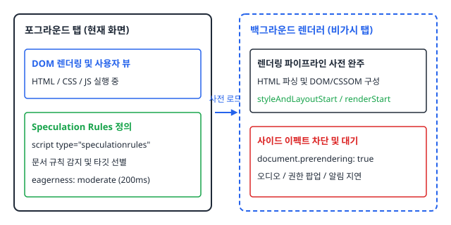
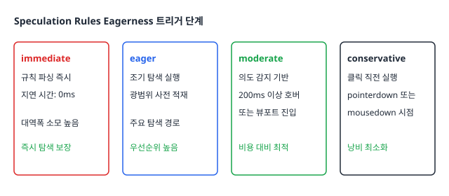

# 261124 Speculation Rules API

> 한 줄 요약 · 분야: 프레임워크 · 렌더링 전략 · Baseline: Limited availability / Chromium 계열(Chrome, Edge 109+)에서 기본 지원되며, WebKit(Safari)과 Mozilla(Firefox)는 표준 제안을 검토 및 논의 중인 상태임 · 읽는 시간 약 14분

## 1. 왜 쓰는가

전통적인 웹 브라우징 환경에서 사용자가 하이퍼링크를 클릭하면 화면 전환이 완료될 때까지 여러 단계의 직렬화된 지연이 발생한다. 브라우저는 클릭 이벤트가 발생한 이후에야 목적지 서버로 HTTP GET 요청을 보내고, HTML 문서를 스트리밍으로 수신하며 파싱을 시작한다. 이어서 외부 CSS 및 자바스크립트 리소스를 네트워크로부터 다운로드한 뒤 DOM(Document Object Model)과 CSSOM(CSS Object Model) 트리를 구축하고, 스타일 및 레이아웃 연산 단계(styleAndLayoutStart)를 거쳐 화면에 첫 픽셀을 그리는 렌더링 시작(renderStart) 단계에 도달한다. [3] 이 파이프라인 과정에서 메인 스레드를 장시간 점유하는 스크립트 실행으로 인해 긴 작업 차단 시간(blockingDuration)이 필연적으로 발생하며, 핵심 웹 바이탈(Core Web Vitals)의 최대 콘텐츠풀 페인트(LCP, Largest Contentful Paint) 지표가 수백 밀리초에서 수 초까지 지연되는 결과를 낳았다. [3]

이러한 탐색 지연을 줄이기 위해 기존에도 리소스 힌트(Resource Hints) 기술이 사용되었으나 뚜렷한 한계가 존재했다. [1]
첫째, `<link rel="prefetch">`는 브라우저의 HTTP 캐시에 다음 페이지에 필요한 HTML 문서나 하위 리소스 파일을 사전에 다운로드해 두는 방식이다. [1] 하지만 이는 네트워크 전송 계층의 페치만 미리 수행할 뿐, 브라우저의 렌더링 파이프라인인 HTML 파싱, DOM/CSSOM 구성, 스크립트 실행, 레이아웃 연산을 전혀 처리하지 못하므로 사용자가 링크를 클릭했을 때 발생하는 연산 지연을 해소하지 못했다. [1]
둘째, `<link rel="prerender">`는 과거 크롬 브라우저에서 페이지 전체를 백그라운드에서 렌더링하려는 목적으로 도입되었다. [1] 그러나 과도한 메모리 사용, 백그라운드에서의 예기치 않은 오디오 재생 및 분석 스크립트 실행 같은 부작용(Side Effects), 정밀한 조건 제어의 부재로 인해 Chrome 63 버전에서 리소스만 내려받는 NoState Prefetch 방식으로 격하되었고 현재는 공식적으로 지원이 중단(deprecated)되었다. [1]
셋째, Next.js Link, Quicklink, InstantClick 같은 최신 SPA(Single Page Application) 클라이언트 라우터 기반의 프리페칭 라이브러리들은 Intersection Observer를 통해 뷰포트 내 <a> 태그를 감지하여 번들 청크와 JSON 데이터를 미리 받아오는 방식을 사용한다. 하지만 이 기법은 메인 스레드에서 자바스크립트 런타임 번들을 파싱하고 실행하는 부하를 지속적으로 유발하며, 서로 다른 서버 템플릿으로 구동되는 전통적인 MPA(Multi-Page Application) 간의 문서 이동에는 구조적으로 적용할 수 없다.

Speculation Rules API는 이러한 문제를 플랫폼 네이티브 수준에서 해결하기 위해 설계된 웹 표준 기술이다. [1] 브라우저 내부의 독립된 백그라운드 렌더러 프로세스를 활용하여 HTML 파싱, 스타일 및 레이아웃 연산, 자바스크립트 실행까지 모두 사전에 완료해 둔다. [3] 사용자가 실제로 링크를 클릭하는 순간, 이미 렌더링이 완료된 백그라운드 페이지를 즉시 포그라운드로 활성화(activation)하여 체감 LCP를 거의 0ms에 가깝게 단축한다. [3] 또한 정규화된 JSON 구조를 도입하여 문서 내 링크 패턴을 선언적으로 일치시키거나 제외할 수 있는 제어력과 사용자 인터랙션 신호에 따른 로딩 적극성 제어 기능을 제공한다. [1]

## 2. 핵심 개념

Speculation Rules API의 핵심은 브라우저가 사용자의 다음 행동을 추측(speculation)하여 보이지 않는 백그라운드 환경에서 탐색 파이프라인 전체를 사전에 완주하도록 제어하는 아키텍처에 있다. [1], [3]



위 도식은 포그라운드 탭과 백그라운드 렌더러 프로세스의 상호작용 구조를 나타낸다. 사용자가 현재 머무르고 있는 포그라운드 탭에서 `<script type="speculationrules">` 선언을 파싱하면, 브라우저의 추측 로딩 매니저는 지정된 대상 URL에 대해 백그라운드 렌더러를 초기화한다. [1], [3] 백그라운드 렌더러는 DOM 구축, 레이아웃 연산, 스크립트 실행을 완료한 상태로 대기하며, `document.prerendering` 상태를 유지하여 화면에 노출되지 않도록 보호된다. [1], [3] 사용자가 실제 링크를 클릭하면 브라우저는 새로운 문서를 처음부터 로딩하는 대신 백그라운드 프로세스를 즉시 포그라운드로 전환하여 0ms 수준의 즉각 전환을 완성한다. [3]



두 번째 도식은 리소스 소비와 즉각성 사이의 균형을 맞추기 위한 로딩 적극성(eagerness) 제어 구조다. [1] 개발자는 규칙에 따라 즉시 로딩을 시작할지, 아니면 마우스 호버나 포인터다운 같은 사용자 의도 신호가 감지되었을 때 백그라운드 로딩을 촉발할지 단계별로 명시할 수 있다. [1]

핵심 용어의 기술적 정의는 다음과 같다.
- `prerender`: 대상 페이지를 백그라운드의 보이지 않는 탭에 띄워 HTML 파싱, DOM/CSSOM 구축, 스타일 및 레이아웃 연산, 스크립트 실행까지 포함한 렌더링 파이프라인 전체를 미리 완주해 두는 기술이다. [1], [3]
- `document rules`: 개별 URL 목록을 정적으로 나열하지 않고, href 패턴 매칭이나 CSS 선택자 조건을 기반으로 DOM 내에 존재하는 <a> 태그 링크를 브라우저가 실시간 감지하도록 지시하는 선언적 규칙이다. [1]
- `eagerness`: 브라우저가 추측 로딩을 시작하는 적극성 기준을 정의하는 속성으로 immediate, eager, moderate, conservative의 4단계로 구성된다. [1]
- `activationStart`: 사전 렌더링된 문서가 사용자의 실제 클릭을 통해 화면에 포그라운드로 활성화된 시점을 나타내는 성능 타임스탬프다. [3]
- `Supports-Loading-Mode`: 동일 사이트 교차 출처(Same-Site Cross-Origin) 환경에서 자격 증명을 포함한 사전 렌더링을 허용할지 대상 서버가 명시하는 HTTP 응답 헤더다. [3]
- `Sec-Purpose`: 브라우저가 발생시킨 백그라운드 요청이 사전 페치인지 사전 렌더링인지를 웹 서버에 명시적으로 통보하는 HTTP 요청 헤더다. [3]
- `document.prerendering`: 현재 실행 중인 페이지가 화면에 표시되지 않은 채 백그라운드에서 사전 렌더링되는 과정에 있는지를 나타내는 읽기 전용 불리언 프로퍼티다. [1]

## 3. 동작 원리

Speculation Rules API는 WICG(Web Incubator Community Group) 제안으로 시작하여 현재 WHATWG HTML Living Standard 내 Speculative Loading 항목으로 정식 통합되어 표준화가 진행 중이다. [2] 이 명세에 따른 세부 실행 단계는 다음과 같다.

첫째, 규칙 등록 단계다. 브라우저의 HTML 파서가 문서 내의 `<script type="speculationrules">` 요소를 파싱하거나 Speculation-Rules HTTP 응답 헤더를 수신하면, JSON 포맷으로 기술된 규칙 목록을 브라우저 커널의 Speculative Loading 매니저에 등록한다. [1] 이때 API를 지원하지 않는 브라우저는 정의되지 않은 스크립트 MIME 타입으로 인식하여 내부 텍스트를 실행하지 않고 건너뛰므로 파싱 에러 없이 점진적 향상이 보장된다. [1]

둘째, 타깃 선별 및 Eagerness 트리거 단계다. 규칙 유형이 `source: "list"`인 경우 선언된 URL 배열을 즉각 처리 큐에 적재한다. [1] 반면 `source: "document"`인 문서 규칙의 경우, 브라우저는 DOM 트리의 앵커 요소를 탐색하며 `where` 절에 정의된 `href_matches` 패턴과 `selector_matches` 선택자를 대조한다. [1] 조건에 부합하는 링크가 식별되면 `eagerness` 설정값에 따라 동작 시점이 결정된다:
1. `immediate`: 규칙이 파싱되는 즉시 네트워크 요청 및 백그라운드 렌더링을 개시한다. [1]
2. `eager`: 가능한 한 조기에 광범위한 사전 로딩을 수행한다. [1]
3. `moderate`: 사용자가 링크 위에 마우스 커서를 200ms 이상 올려두는 호버(hover) 인터랙션을 발생시키거나 링크가 화면 뷰포트 내로 진입했을 때 시작한다. [1]
4. `conservative`: 사용자가 링크를 클릭하기 직전 포인터를 누르는 `pointerdown` 또는 `mousedown` 이벤트 발생 시점에 최소한의 지연 시간으로 로딩을 시작한다. [1]

셋째, 백그라운드 렌더링 파이프라인 구축 단계다. 백그라운드 렌더러 프로세스가 할당되면 브라우저는 `Sec-Purpose: prefetch;prerender` 헤더를 포함하여 대상 서버로 GET 요청을 전송한다. [3] 수신된 문서는 일반 탭과 동일하게 파싱되어 DOM과 CSSOM을 구축하고, 스타일 및 레이아웃 연산(styleAndLayoutStart)과 렌더링 파이프라인(renderStart)을 태운다. [3] 이때 사용자 환경을 방해하지 않도록 Geolocation, Web Notification 권한 요청, `window.alert()` 대화상자 호출, 비디오/오디오 자동 재생 등의 동작은 일시 보류(defer)되거나 즉시 차단된다. [1]

넷째, 활성화(Activation) 단계다. 사용자가 해당 링크를 클릭하면 브라우저는 신규 프로세스를 띄우지 않고 백그라운드 렌더러 프로세스를 화면 전면으로 즉시 승격시킨다. [3] 이 시점에 `document.prerendering` 프로퍼티는 true에서 false로 변경되며, 문서에 `prerenderingchange` 이벤트가 발생한다. [1] 시스템은 `performance.getEntriesByType('navigation')[0].activationStart`에 활성화 기준 타임스탬프를 기록하여 성능 측정이 왜곡되지 않도록 보장한다. [3]

```diagram
종류: 시퀀스
[사용자]
[메인 탭 브라우저]
[백그라운드 렌더러]
[오리진 서버]
메인 탭 브라우저 -> 메인 탭 브라우저 : speculationrules JSON 규칙 파싱 및 등록
사용자 -> 메인 탭 브라우저 : 앵커 링크 200ms 호버 인터랙션 발생
메인 탭 브라우저 -> 오리진 서버 : 백그라운드 GET 요청 (Sec-Purpose: prefetch;prerender)
오리진 서버 --> 백그라운드 렌더러 : HTML 및 종속 하위 리소스 전송
백그라운드 렌더러 -> 백그라운드 렌더러 : DOM 및 CSSOM 트리 구성 완료
백그라운드 렌더러 -> 백그라운드 렌더러 : 레이아웃 연산 및 스크립트 실행 (사이드 이펙트 보류)
== 사용자 링크 클릭 (활성화 단계) ==
사용자 -> 메인 탭 브라우저 : 마우스 클릭으로 대상 링크 탐색 실행
메인 탭 브라우저 -> 백그라운드 렌더러 : 백그라운드 렌더러 포그라운드 활성화(activation)
백그라운드 렌더러 -> 백그라운드 렌더러 : prerenderingchange 이벤트 디스패치
백그라운드 렌더러 --> 사용자 : 0ms 지연으로 완성된 화면 즉시 노출
```

## 4. 기본 사용법

Speculation Rules API는 선언적 HTML 태그 방식과 자바스크립트를 통한 동적 주입 방식을 모두 지원한다. [1], [3] 아래 코드는 자바스크립트로 브라우저의 지원 여부를 런타임에 안전하게 검사하고, 제외 조건이 포함된 문서 규칙(Document Rules)을 생성하여 DOM에 주입하는 완전한 예제다. [1], [3]

```js
// 1. 브라우저 엔진의 Speculation Rules API 지원 여부를 런타임에 안전하게 검사
if (HTMLScriptElement.supports && HTMLScriptElement.supports('speculationrules')) {
  // 2. 브라우저가 해석할 스크립트 엘리먼트 생성
  const specScript = document.createElement('script');
  
  // 3. 브라우저가 추측 로딩 규칙으로 인식할 수 있도록 고유 MIME 타입 명시
  specScript.type = 'speculationrules';
  
  // 4. 사전 렌더링 규칙을 담은 JSON 객체 정의
  const rules = {
    prerender: [
      {
        // 5. DOM 내의 모든 <a> 링크를 자동 감지하는 문서 규칙 모드 선언
        source: 'document',
        where: {
          and: [
            // 6. 사이트 내 모든 내부 경로 링크를 추측 로딩 대상 후보로 지정
            { href_matches: '/*' },
            // 7. 세션 변경, 장바구니 수정, 내부 API 등 파괴적 엔드포인트는 엄격히 제외
            { not: { href_matches: ['/logout', '/cart/*', '/api/*'] } },
            // 8. 명시적 no-prerender 클래스나 nofollow 속성을 가진 앵커 태그 제외
            { not: { selector_matches: '.no-prerender, [rel~=nofollow]' } }
          ]
        },
        // 9. 200ms 이상 호버하거나 뷰포트 내 진입 시점에만 실행되도록 적극성 설정
        eagerness: 'moderate'
      }
    ]
  };

  // 10. 정의된 규칙 객체를 직렬화하여 스크립트 본문에 할당
  specScript.textContent = JSON.stringify(rules);
  
  // 11. 문서 헤드에 요소를 주입하여 브라우저 Speculative Loading 엔진에 즉각 등록
  document.head.appendChild(specScript);
}
```

줄별 동작 설명은 다음과 같다:
- 1줄: `HTMLScriptElement.supports('speculationrules')`를 실행하여 해당 브라우저가 해당 명세를 지원하는지 확인한다. [3] 미지원 브라우저에서는 이 조건문이 거짓이 되어 이후 로직을 건너뛴다.
- 2~3줄: DOM 요소 `<script>`를 생성하고 `type` 속성을 표준 명세 규격인 `'speculationrules'`로 지정한다. [1]
- 4~5줄: `prerender` 배열 내에 객체를 선언하고 `source: 'document'`를 지정하여 HTML 내의 링크 요소를 동적으로 감지하도록 지시한다. [1]
- 6~8줄: `where` 조건절 내에서 `and`와 `not` 연산자를 결합하여 모든 내부 경로(`/*`)를 대상으로 삼되, 서버 상태를 변경하는 `/logout`, `/cart/*`, `/api/*` 경로 및 마크업 수준에서 지정한 `.no-prerender` 요소를 사전 렌더링 대상에서 원천 배제한다. [1]
- 9줄: `eagerness: 'moderate'`를 지정함으로써 불필요한 네트워크 대역폭 소모를 방지하고, 사용자가 200ms 이상 마우스를 머무르거나 뷰포트에 도달한 링크에 대해서만 선별적으로 백그라운드 렌더러를 초기화한다. [1]
- 10~11줄: 구성된 JSON 문자열을 스크립트 요소에 담아 `<head>`에 추가함으로써 브라우저 렌더러 엔진이 즉각 앵커 요소를 관찰하도록 활성화한다. [1]

## 5. 실무 예시

실제 대규모 상용 서비스 및 글로벌 오픈소스 생태계에서 적용된 실증 사례는 다음과 같다.

### 사례 1. Cloudflare Speed Brain 글로벌 엣지 자동 적용
- 상황: 전 세계 수백만 웹사이트의 로딩 성능을 최적화하기 위해 개별 사이트 개발자가 소스 코드를 직접 수정하지 않고도 CDN 엣지 레벨에서 페이지 전환 속도를 극대화해야 하는 기술적 과제가 존재했다. [6]
- 코드 및 구조: Cloudflare는 2024년 글로벌 엣지 네트워크에 'Speed Brain' 기능을 탑재했다. [6] 엣지 프록시 서버는 HTML 응답을 전달할 때 브라우저가 동일 출처의 캐시된 HTML 문서를 사전에 불러올 수 있도록 다음과 같은 HTTP 응답 헤더를 자동으로 추가한다. [1], [6]
```http
Speculation-Rules: "/cdn-cgi/speculation-rules.json"
```
해당 JSON 파일은 안전하게 캐싱된 정적 문서 경로에 대해 moderate 적극성으로 prerender를 수행하도록 지시한다. [1], [6]
- 결과: Cloudflare의 공식 실증 측정 결과, Speed Brain이 적용된 지원 페이지의 전반적인 웹페이지 로딩 성능 지표가 최대 45% 향상되었다. [6]
- 주의점: CDN 계층에서 사전 렌더링 규칙을 주입할 경우 사용자 세션별 동적 콘텐츠나 캐시되지 않은 동적 엔드포인트가 규칙에 포함되지 않도록 캐시 제어 헤더(Cache-Control)와의 철저한 연동 설계가 요구된다. [6]

### 사례 2. WordPress 코어 Speculative Loading 플러그인
- 상황: 전 세계 웹의 40% 이상을 점유하는 WordPress 생태계에서 테마나 PHP 코드를 직접 수정하기 어려운 일반 운영자 환경에 MPA 즉각 탐색 기능을 보급할 필요가 있었다. [3]
- 코드: WordPress 코어 성능 팀(Core Performance Team)은 공식 Speculative Loading 플러그인을 개발하여 wp_head 훅에 아래와 같은 표준 스크립트를 인라인으로 자동 주입하도록 구현했다. [1], [3]
```html
<script type="speculationrules">
{
  "prerender": [
    {
      "source": "document",
      "where": {
        "and": [
          { "href_matches": "/*" },
          { "not": { "href_matches": ["/wp-admin/*", "/wp-login.php*", "/*?add-to-cart=*"] } },
          { "not": { "selector_matches": ".no-prerender, [rel~=nofollow]" } }
        ]
      },
      "eagerness": "moderate"
    }
  ]
}
</script>
```
- 결과: 수동 라우터 설정 없이도 워드프레스 기반 사이트 전반에서 글과 페이지 이동 시 0ms 수준의 즉각적인 화면 전환을 구현했다. [3]
- 주의점: 다양한 서드파티 플러그인이 생성하는 커스텀 동적 URL(장바구니 담기, 위시리스트 추가 파라미터 등)이 누락되지 않도록 제외 규칙(where not) 목록을 지속적으로 점검해야 한다. [1]

### 사례 3. 분석 트래커 지연 실행 및 activationStart 기반 LCP 측정
- 상황: 백그라운드 사전 렌더링 중 분석 트래커(GA, 내부 로깅)가 즉시 실행될 경우 실제 사용자가 방문하지 않은 페이지의 조회수가 과대 집계되는 문제가 발생한다. [1] 또한 사전 렌더링된 페이지의 LCP를 기존 방식으로 측정하면 백그라운드 적재 시간까지 포함되어 성능 지표가 왜곡된다. [3]
- 코드:
```js
// 1. 분석 트래커 발송 함수 정의
function dispatchPageView() {
  window.analytics?.track('page_view', { path: window.location.pathname });
}

// 2. 현재 문서가 백그라운드 사전 렌더링 상태인지 검사
if (document.prerendering) {
  // 실제 사용자가 링크를 클릭해 활성화되는 순간 단 한 번만 트래커 실행
  document.addEventListener('prerenderingchange', () => {
    dispatchPageView();
  }, { once: true });
} else {
  // 일반적인 즉각 탐색인 경우 바로 전송
  dispatchPageView();
}

// 3. PerformanceNavigationTiming.activationStart를 활용한 실제 체감 LCP 산출
const [navEntry] = performance.getEntriesByType('navigation');

if (navEntry && navEntry.activationStart > 0) {
  new PerformanceObserver((entryList) => {
    for (const entry of entryList.getEntries()) {
      if (entry.entryType === 'largest-contentful-paint') {
        // 활성화 시점을 차감하여 사용자가 실제 클릭한 시점부터의 체감 LCP 계산
        const perceivedLcp = Math.max(0, entry.startTime - navEntry.activationStart);
        console.log(`사전 렌더링 활성화 기준 실제 체감 LCP: ${perceivedLcp}ms`);
      }
    }
  }).observe({ type: 'largest-contentful-paint', buffered: true });
}
```
- 결과: 미방문 링크에 대한 허위 분석 트래픽 발생률을 0%로 통제했으며, 사전 렌더링 페이지의 실제 체감 LCP를 정밀하게 분리 수집하여 성능 모니터링 정확도를 확보했다. [1], [3]
- 주의점: `prerenderingchange` 이벤트 리스너 등록 시 `{ once: true }` 옵션을 반드시 지정하여 중복 실행을 방지해야 한다. [1]

## 6. 장점 · 단점

Speculation Rules API 도입 시 평가되는 장점과 단점은 다음과 같다.

| 장점 | 단점 |
| :--- | :--- |
| MPA 아키텍처에서도 무거운 SPA 자바스크립트 라우터를 도입하지 않고 브라우저 네이티브 차원에서 0ms 수준의 즉각적인 페이지 전환(Instant Navigation)을 달성할 수 있다. [3] | 백그라운드에서 전체 DOM 구축과 자바스크립트를 미리 실행하므로 사용자가 실제로 방문하지 않는 페이지를 과도하게 로딩할 경우 모바일 기기의 배터리, 메모리, 대역폭 소모가 증가한다. |
| HTML 파싱, 레이아웃 연산, 메인 스레드 스크립트 실행이 백그라운드에서 완료되어 탐색 시점의 렌더링 지연(renderStart)과 긴 작업 차단(blockingDuration)을 근본적으로 제거하여 LCP와 INP 점수를 극대화한다. [3] | 조회수 측정기, 광고 노출 트래커, 결제 세션 등 사이드 이펙트를 유발하는 스크립트가 `document.prerendering` 체크 없이 실행되면 통계 데이터 오염 및 원치 않는 서버 상태 변이가 발생할 위험이 있다. |
| 정규화된 JSON 선언과 문서 규칙(document rules)을 통해 <a> 태그의 패턴 매칭 및 예외 제외 처리가 가능하여 유지보수성과 선언적 제어력이 뛰어나다. [1] | Chromium 계열 외의 브라우저(Safari, Firefox)에서는 아직 기본 동작하지 않으므로 크로스 브라우징을 고려한 점진적 향상(Progressive Enhancement) 및 폴백 설계가 필수적이다. [5], [7] |
| HTTP 요청 헤더(`Sec-Purpose`)와 브라우저 이벤트(`prerenderingchange`, `activationStart`)가 명세로 보장되어 안전한 부작용 격리 및 정확한 성능 관측이 가능하다. [1], [3] | POST 요청 엔드포인트나 비동기 상태 변경 엔드포인트(`/logout`, `/cart/add` 등)가 문서 규칙에 잘못 포함될 경우 심각한 비즈니스 로직 결함으로 이어질 수 있다. |

## 7. 한계와 함정

실무 환경에서 Speculation Rules API를 적용할 때 직면하는 기술적 한계와 주의해야 할 함정은 다음과 같다.

첫째, 보안 및 교차 출처(Cross-Origin) 격리 한계다. 기본적으로 API는 동일 출처(Same-Origin) 내의 페이지만 사전 렌더링을 허용한다. [3] 만약 동일 사이트 내의 다른 서브도메인(Same-Site Cross-Origin) 페이지를 사전 렌더링하려면 대상 서버가 HTTP 응답 헤더로 `Supports-Loading-Mode: credentialed-prerender`를 명시적으로 내려주어야 한다. [3] 이 헤더가 누락되면 브라우저는 보안 위협을 방지하기 위해 백그라운드 사전 렌더링을 즉각 중단하고 프로세스를 파기한다. [3]

둘째, 사용자 인터랙션 및 권한 기반 API 실행 보류(Deferral)다. 백그라운드 사전 렌더링 중에는 사용자 경험을 해치거나 보안 경계를 침범할 수 있는 기능들이 차단된다. [1] 웹 알림(Notifications) 권한 요청, Geolocation 위치 정보 요청, `window.alert()` 및 `window.prompt()` 대화상자, 비디오 및 오디오의 자동 재생(Autoplay)은 실행이 강제로 유예되거나 차단된다. [1] 따라서 초기 로딩 시점에 대화상자나 즉각적인 권한 동의를 전제로 작성된 레거시 스크립트는 비정상 동작을 일으킬 수 있다. [1]

셋째, 시스템 리소스 보호를 위한 브라우저 내부 제한(Throttling)이다. Chromium 엔진은 시스템 성능 저하를 방지하기 위해 moderate 적극성 모드 기준으로 최대 2개까지의 선입선출(FIFO) 사전 렌더링 프로세스 풀만 유지한다. [3] 사용자가 여러 링크 위를 빠르게 지나치면 오래된 백그라운드 렌더러는 메모리에서 즉시 강제 종료된다. [3] 또한 사용자의 기기가 데이터 절약(Save-Data) 모드이거나 배터리 잔량이 부족한 저전력 모드일 경우 브라우저는 등록된 추측 규칙의 실행을 자동으로 전면 차단한다. [3]

넷째, 분석 지표 및 사이드 이펙트 오염 함정이다. 마케팅 픽셀이나 서버 로그 기반의 조회수 집계기가 `Sec-Purpose` 헤더나 `document.prerendering` 프로퍼티를 인지하지 못하면, 실제 사용자가 1초도 보지 않고 지나친 백그라운드 요청이 실제 방문으로 집계되어 비즈니스 지표가 왜곡된다. [1], [3] 아울러 GET 요청임에도 내부적으로 사용자 로그아웃이나 데이터 삭제를 유발하는 안티패턴 URL이 존재할 경우, 브라우저가 링크를 탐색하는 과정에서 사용자 세션이 끊기는 치명적인 결함이 발생할 수 있다. [1]

## 8. 다른 방법과 비교

웹 페이지 로딩 성능을 최적화하기 위해 사용되는 주요 대체 기술들과의 기술적 비교는 다음과 같다.

| 방법 | 언제 | 비용 | 한계 |
| :--- | :--- | :--- | :--- |
| **Speculation Rules API (prerender)** | MPA 전반에서 0ms LCP 달성 및 사용자 탐색 즉시 전환이 요구될 때 [3] | 백그라운드 렌더러 프로세스 점유(메모리·CPU·네트워크 발생) [3] | Chromium 위주 지원(Chrome 109+), Safari/Firefox 미지원, 최대 슬롯 2개 제한 [3], [5] |
| `<link rel="prefetch">` | 다음 페이지에 필요한 대용량 CSS/JS 파일이나 개별 리소스를 미리 캐싱할 때 [1] | 단순 HTTP 다운로드 및 캐시 저장 비용 [1] | 렌더링 파이프라인(DOM/CSSOM/JS)을 실행하지 않으므로 클릭 시 파싱 지연 지속 [1] |
| `<link rel="prerender">` (NoState Prefetch) | 과거 전체 렌더링을 시도했으나 현재는 사용하지 않는 레거시 방식 [1] | 단순 리소스 페치 비용에 불과함 [1] | 사전 렌더링이 공식 중단(deprecated)되어 NoState 페치로만 동작하며 미세 제어 불가 [1] |
| **SPA 클라이언트 프리페칭** (Next.js Link 등) | 단일 자바스크립트 번들 기반의 SPA 내부 라우팅 전환 시 | 메인 스레드 JS 연산 비용, JSON 파싱 및 메모리 캐시 적재 | MPA 간 이동 적용 불가, 초기 번들 다운로드 및 런타임 하이드레이션 비용 상존 |
| **Service Worker Cache Storage** | PWA 오프라인 지원 및 정적 자산의 네트워크 우회 즉각 반환 시 | 서비스 워커 설치, 캐시 스토리지 디스크 I/O 및 백그라운드 스레드 | HTML 문서를 캐시에서 즉시 반환하더라도 메인 스레드 렌더링 트리 구축 지연은 발생함 |

Speculation Rules API를 선택하지 않는 경우는 다음과 같다:
1. 대상 서비스의 주 사용자층이 Safari(WebKit) 또는 Firefox(Mozilla) 환경에 편중되어 있어 점진적 향상에 따른 이점을 누리기 어렵고 단일 렌더링 코드베이스 유지보수가 더 중요한 경우. [5], [7]
2. 페이지 탐색 시마다 대규모 상태 쓰기 트랜잭션이 동반되거나 정적 캐싱이 불가능한 보안 토큰 기반의 금융 결제 화면.
3. 클라이언트 디바이스의 하드웨어 스펙이 매우 낮거나 메모리 제약이 심하여 백그라운드 다중 프로세스 구동이 시스템 스래싱(Thrashing)을 유발할 우려가 있는 환경.

## 9. 대비와 새로운 시도

Speculation Rules 기술은 단순한 클라이언트 스펙에 머무르지 않고 웹 표준 및 인프라 계층 전반으로 진화를 거듭하고 있다.

첫째, 공식 표준화의 진척이다. 본 API는 WICG 인큐베이션 과정을 성공적으로 마치고 WHATWG의 HTML Living Standard 명세 내 Speculative Loading 섹션으로 공식 통합되어 표준 규격으로 정립되고 있다. [2] WebKit과 Mozilla 역시 명세의 프라이버시 모델과 리소스 소모 제어 장치를 면밀히 검토하며 표준 논의를 지속하고 있다. [5], [7]

둘째, 엣지(Edge) 네트워크 및 CDN 계층과의 융합이다. HTML 문서 내에 `<script>` 태그를 직접 삽입하지 않고도, 웹 서버나 CDN 프록시가 `Speculation-Rules` HTTP 응답 헤더를 통해 외부 규칙 JSON 파일 경로(`src` 속성 또는 외부 URI)를 동적으로 내려주는 기법이 확대되고 있다. [1] 이를 활용하면 정적 템플릿의 수정 배포 없이도 인프라 레벨에서 사이트 전반의 사전 적재 정책을 일괄 통제할 수 있다. [1]

셋째, Cloudflare Speed Brain과 같은 엣지 인프라 자동화다. 2024년 상용화된 Speed Brain은 CDN 엣지에 캐시된 정적 HTML 문서를 지능적으로 분석하여 지원 브라우저를 대상으로 Speculation Rules를 즉시 적용한다. [6] 캐시 적중률과 결합된 사전 렌더링을 통해 서버 추가 부하 없이 최대 45%의 체감 성능 개선을 글로벌 스케일에서 실현하고 있다. [6]

넷째, 정밀 제어를 위한 후속 규격 제안이다. CDN 및 프록시 계층에서 특정 사용자 그룹이나 콘텐츠 변경 시 추측 로딩된 문서를 선택적으로 무효화하고 트래픽을 제어할 수 있도록 돕는 `Sec-Speculation-Tags` 명세 제안이 활발히 논의 중이다. [3] 개발자는 Chrome DevTools의 Application 패널 내 Speculative loads 탭을 통해 백그라운드 렌더러의 성공 여부, 실패 사유, 콘솔 로그를 직접 모니터링하며 운영 파이프라인을 정밀하게 통제할 수 있다. [4]

## 10. 다른 사람에게 설명하기

Speculation Rules API는 브라우저에게 사용자가 다음에 이동할 페이지를 백그라운드 탭에서 미리 렌더링(DOM 파싱, 스타일 및 레이아웃, JS 실행)하도록 지시하는 최신 웹 표준 기술이다. [1], [3] JSON 구조의 선언적 규칙을 통해 링크 패턴과 호버 등의 인터랙션 적극성(eagerness)을 정밀하게 제어함으로써 과거 prerender 기술의 자원 낭비와 사이드 이펙트 문제를 극복했다. [1] 이를 통해 MPA 환경에서도 복잡한 SPA 프레임워크 없이 클릭 즉시 화면이 전환되는 0ms 수준의 극단적인 LCP 최적화를 달성할 수 있다. [3]

동료 개발자에게 설명할 때 스스로 확인해야 할 3가지 질문은 다음과 같다:
1. 백그라운드 사전 렌더링 중인 문서에서 마케팅 분석 스크립트나 결제 세션 API가 오작동하지 않도록 격리하는 프로퍼티와 이벤트는 무엇인가?
2. 문서 규칙(document rules)에서 eagerness 속성을 moderate로 설정했을 때 브라우저가 사전 로딩을 촉발하는 두 가지 조건은 무엇인가?
3. 사전 렌더링된 페이지가 실제 화면에 활성화되었을 때, 기존의 왜곡된 LCP 대신 실제 사용자 체감 LCP를 구하기 위해 차감해야 하는 타임스탬프 속성은 무엇인가?

## 핵심 낱말
- `prerender` — 대상 페이지를 백그라운드 보이지 않는 탭에 띄워 렌더링 파이프라인(DOM, 스타일, 스크립트)까지 미리 완료해 두는 기술
- `document rules` — 개별 URL 대신 href 패턴이나 CSS 선택자를 통해 DOM 내 링크를 브라우저가 자동 감지하도록 지정하는 규칙
- `eagerness` — 추측 로딩을 즉시 시작할지, 호버나 포인터다운 같은 사용자 의도 신호에 따라 지연할지 결정하는 적극성 설정
- `activationStart` — 사전 렌더링된 문서가 사용자의 실제 클릭으로 화면에 활성화된 시점을 나타내는 성능 타임스탬프
- `Supports-Loading-Mode` — 동일 사이트 내 교차 출처(Cross-Origin) 환경에서 자격 증명을 포함한 사전 렌더링을 허용할지 서버가 명시하는 응답 헤더
- `Sec-Purpose` — 브라우저가 사전 페치 또는 사전 렌더링 목적으로 발생시킨 백그라운드 요청임을 서버에 알리는 HTTP 헤더
- `document.prerendering` — 현재 페이지가 백그라운드에서 사전 렌더링 중인지 여부를 나타내는 읽기 전용 불리언 프로퍼티
- `renderStart` — 브라우저가 화면에 첫 시각적 픽셀을 그리기 시작하는 시점으로 사전 렌더링을 통해 탐색 즉시 완료 상태가 됨 (다시)

## 참고 자료
1. [MDN Web Docs: Speculation Rules API](https://developer.mozilla.org/en-US/docs/Web/API/Speculation_Rules_API)
2. [WHATWG HTML Living Standard: Speculative Loading](https://html.spec.whatwg.org/multipage/browsing-the-web.html#speculative-loading)
3. [Chrome for Developers: Prerender pages in Chrome for instant page navigations](https://developer.chrome.com/docs/web-platform/prerender-pages)
4. [Chrome for Developers: Debugging speculation rules in DevTools](https://developer.chrome.com/docs/devtools/speculative-loads)
5. [Can I use: Speculation Rules](https://caniuse.com/speculation-rules)
6. [Cloudflare Blog: Speed Brain: making the web faster with Speculation Rules](https://blog.cloudflare.com/speed-brain-instant-page-loads/)
7. [WebKit Standards Positions: Navigational prefetching and prerendering / Speculation Rules](https://github.com/WebKit/standards-positions/issues/54)
조사: 2026-11-24

## 내 리뷰
(읽고 느낀 점 · 궁금한 것을 적는다. 질문은 Q. 로 시작)
