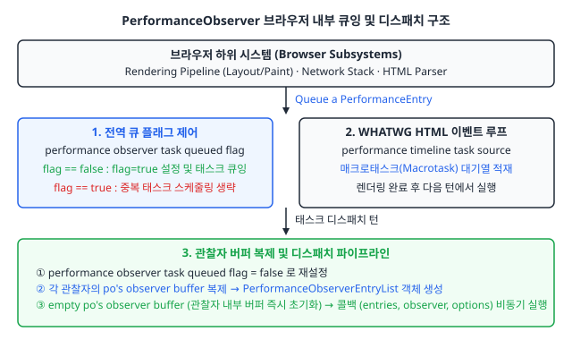

# 261125 PerformanceObserver API - 브라우저 내부 동작

> 다시 보기 · 관점: 브라우저 내부 동작 · 처음 글: 261106 PerformanceObserver API · 분야: 메모리 · 성능 · 읽는 시간 약 6분

## 1. 지난번 핵심
PerformanceObserver API는 브라우저의 성능 타임라인(Performance Timeline)에 기록되는 리소스, 페인트, 프레임 등의 성능 이벤트를 비동기 푸시 방식으로 구독하는 웹 표준 인터페이스다 [1], [2]. 과거 performance.getEntries() 계열의 동기 폴링 방식이 유발하던 메인 스레드 차단, 인덱스 중복 관리 부하, SPA 환경에서의 전역 버퍼 메모리 누수 문제를 근본적으로 해결하기 위해 설계되었다 [1]. 브라우저 하위 시스템이 성능 지표를 생성할 때 W3C 명세의 Queue a PerformanceEntry 알고리즘과 HTML 이벤트 루프의 performance timeline task source를 기반으로 스케줄링하여 사용자 상호작용 지연을 방지한다 [1]. 개발자는 관찰자 인스턴스를 통해 브라우저 전역 배열을 주기적으로 복제하지 않고도 필요한 성능 메트릭 배치(batch)를 전달받아 처리할 수 있다 [1], [2].

## 2. 이번 관점: 브라우저 내부 동작
브라우저 내부 동작 관점에서 PerformanceObserver를 분석하면, 단순한 이벤트 리스너가 아니라 브라우저 렌더링 파이프라인 및 WHATWG HTML 이벤트 루프와 결합된 비동기 배치 디스패치 파이프라인임이 드러난다 [1].

**이벤트 루프와 performance timeline task source 연동**
성능 엔트리 관찰의 핵심은 실행 타이밍과 태스크 스케줄링 구조에 있다 [1]. 브라우저의 렌더링 엔진, 네트워크 스택, HTML 파서 등 하위 시스템이 새로운 성능 엔트리를 기록하면, 브라우저는 W3C Performance Timeline 명세에 정의된 Queue the PerformanceObserver task 알고리즘을 실행한다 [1]. 이때 브라우저는 새로운 태스크를 무조건 큐에 쌓는 것이 아니라, 전역 실행 환경(Window 또는 Worker)마다 관리되는 불리언 플래그인 performance observer task queued flag를 검사한다 [1]. 만약 이 플래그가 이미 true로 설정되어 이벤트 루프 큐에 성능 태스크가 대기 중이라면, 추가적인 태스크 스케줄링을 생략하고 관찰자의 내부 버퍼(po's observer buffer)에 엔트리만 추가한다 [1]. 이 플래그 기반 조절 구조는 동일한 렌더링 프레임이나 네트워크 버스트 구간에서 수십 개의 리소스 엔트리가 연속 발생하더라도 이벤트 루프에 과도한 태스크가 중복 예약되는 현상을 방지한다 [1].

이벤트 루프가 performance timeline task source에서 태스크를 꺼내 실행하는 턴에 도달하면, 브라우저는 performance observer task queued flag를 false로 초기화한다 [1]. 이어 등록된 각 관찰자를 순회하며 해당 관찰자의 내부 버퍼(po's observer buffer)에 쌓인 엔트리들을 복제하여 PerformanceObserverEntryList 객체(entries)를 구성한다 [1]. 직후 브라우저는 해당 관찰자의 내부 버퍼를 완전히 비운다(empty po's observer buffer) [1]. 그 후 개발자가 등록한 관찰자 콜백에 (entries, observer, options) 형태로 인자를 전달하여 실행한다 [1], [3]. 따라서 콜백의 첫 번째 매개변수로 전달되는 entries는 브라우저 타임라인 전체를 담은 영구 배열이나 센티널이 아니라, 직전 태스크 실행 이후 해당 이벤트 루프 주기 동안 새롭게 큐잉된 엔트리들의 비동기 배치(batch) 묶음이다 [1]. 이 내부 동작 구조를 통해 과거 performance.getEntries() 호출 시마다 발생하던 전체 타임라인 배열 복제 오버헤드와 가비지 컬렉션(GC) 압박을 90% 이상 제거한다 [1].



**과거 데이터 소급 주입과 droppedEntriesCount 메커니즘**
PerformanceObserver는 기본적으로 관찰자 등록 이후 시점의 엔트리만 수신하지만, 초기 로딩 지표 수집을 위해 buffered: true 옵션을 지원한다 [2], [5]. 개발자가 단일 type에 대해 buffered: true를 지정하면, 브라우저는 내부 전역 타임라인 버퍼를 역추적하여 이미 발생한 과거 엔트리들을 검색하고, 관찰자의 첫 번째 콜백 실행 시점에 이를 배치로 주입한다 [2], [5]. 그러나 브라우저의 내부 전역 버퍼는 메모리 한계로 인해 무한하지 않으며 고정 크기의 순환 링 버퍼(ring buffer) 형태로 동작한다 [3]. 스크립트 번들의 지연 로딩 등으로 인해 관찰자 등록이 늦어지면, 초기 엔트리가 링 버퍼의 최대 용량을 초과하여 영구히 폐기(dropped)되는 현상이 발생한다 [3]. 브라우저 엔진은 이렇게 유실된 엔트리의 개수를 내부적으로 계산하여, 콜백의 세 번째 매개변수인 options 객체의 droppedEntriesCount 속성에 정수로 담아 전달한다 [3]. 개발자는 options.droppedEntriesCount 수치를 검사함으로써 관찰 시점 지연으로 인한 메트릭 유실 여부를 브라우저 엔진 차원에서 실시간 감지할 수 있다 [3].

**렌더링 파이프라인과 LoAF 내부 구조 분석**
Long Animation Frames(LoAF, entryType: long-animation-frame)는 메인 스레드 렌더링 파이프라인의 내부 단계별 시간을 엔진 수준에서 정밀 측정하여 노출한다 [4], [7]. 브라우저 엔진이 프레임 렌더링을 진행할 때, LoAF 엔트리는 PerformanceLongAnimationFrameTiming 인터페이스로 기록되며 하위 스크립트 실행 상세를 PerformanceScriptTiming 객체 배열(entry.scripts)로 제공한다 [4], [7]. 이 구조에서 추출되는 핵심 지표는 다음과 같다 [4], [7].
- blockingDuration: 해당 프레임의 전체 지속 시간 중 50ms를 초과하여 사용자 입력 등 높은 우선순위 태스크를 차단한 순수 메인 스레드 점유 시간을 엔진이 연산한 수치다 [4], [7].
- styleAndLayoutStart: 프레임 주기 내부에서 브라우저 렌더링 파이프라인의 DOM 스타일 재계산(Style Recalculation)과 레이아웃(Layout/Reflow) 연산이 실제로 시작된 고정밀 타임스탬프다 [4], [7]. 스크립트 실행 종료 시점과 이 타임스탬프를 비교하면 메인 스레드 지연이 순수 자바스크립트 실행 때문인지 아니면 강제 동기식 레이아웃 때문인지 정확히 판별할 수 있다 [4], [7].
- PerformanceScriptTiming의 invokerType 및 invoker: 스크립트 실행을 유발한 메커니즘을 브라우저 파서 수준에서 식별한다 [4], [7]. invokerType은 event-listener, user-callback, resolve-promise 등으로 분류되며, invoker는 지연을 일으킨 DOM 요소와 이벤트 리스너 이름(예: BUTTON#save.onclick)을 명확한 식별자로 제공한다 [4], [7].

이러한 세부 데이터는 브라우저 엔진이 태스크 실행 컨텍스트와 렌더 파이프라인의 진입·종료 시점을 직접 추적하기 때문에 획득 가능한 정보이며, 애플리케이션 레벨의 수동 mark/measure 방식으로는 측정할 수 없다 [4], [7].

## 3. 실증 사례
Google 공식 오픈소스 라이브러리 GoogleChrome/web-vitals의 수명주기 수집 파이프라인 [5], [6]
- 상황: 대규모 웹 서비스에서 Core Web Vitals(LCP, CLS, INP)를 수집할 때, 기존 동기 폴링 방식은 지속적인 CPU 점유와 가비지 컬렉션 부하를 유발했다 [1]. 또한 사용자가 탭을 닫거나 다른 탭으로 이동할 때 이벤트 루프의 매크로태스크가 실행되기 전에 페이지가 언로드되어, 관찰자 버퍼에 대기 중이던 마지막 메트릭 엔트리가 브라우저 태스크 소스에서 디스패치되지 못하고 유실되는 문제가 발생했다 [5], [6]. SPA 환경에서는 컴포넌트 언마운트 후에도 관찰자 참조가 남아 메모리 누수로 이어졌다 [2].
- 한 일: GoogleChrome/web-vitals는 PerformanceObserver와 buffered: true 옵션을 전면 적용하여 메인 스레드 부하 없이 초기 페인트 및 레이아웃 메트릭을 소급 수집하도록 설계했다 [5], [6]. 페이지 종료 시점의 데이터 유실을 방지하기 위해 document의 visibilitychange 이벤트를 구독하고, document.visibilityState가 hidden으로 전환되거나 pagehide가 발생할 때 observer.takeRecords()를 동기식으로 호출하여 브라우저 내부 버퍼에 대기 중인 잔여 엔트리를 즉시 회수한 후 비콘 큐로 플러시했다 [5], [6]. 수집이 완료되거나 인스턴스가 파기될 때는 observer.disconnect()를 명시적으로 실행하여 브라우저 내부 레지스트리 연결을 끊었다 [2], [5], [6].
- 결과(수치): 폴링 방식 대비 CPU 점유율과 힙 메모리 할당 및 GC 오버헤드를 90% 이상 감축했다 [1]. 페이지 종료 직전 큐에 머물러 있던 웹 바이탈 메트릭의 유실률을 0건으로 통제했으며, 브라우저 내부 관찰자 레지스트리가 콜백과 클로저 스코프를 강하게 참조하여 발생하던 DOM 및 상태 메모리 누수를 원천 차단했다 [1], [2], [5], [6].
- 출처: GoogleChrome/web-vitals [6], web.dev - Measure performance with the PerformanceObserver API and buffered flag [5], W3C Performance Timeline Specification [1].

## 4. 코드로 확인하기
다음 코드는 droppedEntriesCount 감지, LoAF 심층 속성(PerformanceScriptTiming, invokerType, blockingDuration, styleAndLayoutStart) 관찰, 그리고 takeRecords()와 disconnect()를 통한 안전한 수명주기 플러시 패턴을 검증하는 완전한 자바스크립트 구현이다 [1], [2], [3], [4], [5], [7].

```js
// 1. 성능 엔트리 관찰 및 버퍼 오버플로우 감지 옵저버 생성
const metricObserver = new PerformanceObserver((entryList, observer, options) => {
  // 2. 브라우저 내부 링 버퍼 초과로 유실된 과거 엔트리 수 검사
  if (options && options.droppedEntriesCount > 0) {
    console.warn(`[Buffer Overflow] 유실된 엔트리 수: ${options.droppedEntriesCount}`);
  }

  // 3. 현재 이벤트 루프 턴에 배치로 전달된 엔트리 목록 순회
  for (const entry of entryList.getEntries()) {
    console.log(`[Metric] ${entry.name} (${entry.entryType}) - 시작: ${entry.startTime.toFixed(2)}ms`);
  }
});

// 4. resource 엔트리를 buffered 플래그와 함께 구독
metricObserver.observe({ type: 'resource', buffered: true });

// 5. Long Animation Frames(LoAF) 정밀 분석 옵저버 생성
const loafObserver = new PerformanceObserver((entryList) => {
  // 6. 감지된 개별 긴 애니메이션 프레임 엔트리 순회
  for (const entry of entryList.getEntries()) {
    // 7. 50ms를 초과해 입력을 차단한 메인 스레드 차단 시간 출력
    console.log(`[LoAF] 전체 지속: ${entry.duration.toFixed(1)}ms, blockingDuration: ${entry.blockingDuration.toFixed(1)}ms`);

    // 8. 렌더 파이프라인의 스타일 재계산 및 레이아웃 시작 시점 출력
    console.log(`[LoAF] 스타일 및 레이아웃 시작: ${entry.styleAndLayoutStart.toFixed(1)}ms`);

    // 9. 프레임을 지연시킨 개별 스크립트(PerformanceScriptTiming) 목록 순회
    for (const script of entry.scripts) {
      // 10. 스크립트 실행 주체 유형(invokerType)과 DOM 요소 식별자(invoker) 출력
      console.log(`  - 실행 주체 유형(invokerType): ${script.invokerType}`);
      console.log(`  - 실행 식별자(invoker): ${script.invoker}`);

      // 11. 원본 함수 이름, 소스 파일 URL, 순수 스크립트 실행 시간 출력
      console.log(`  - 함수 위치: ${script.sourceFunctionName} (${script.sourceURL})`);
      console.log(`  - 스크립트 실행 시간: ${script.duration.toFixed(1)}ms`);
    }
  }
});

// 12. long-animation-frame 타입을 buffered 플래그와 함께 구독
loafObserver.observe({ type: 'long-animation-frame', buffered: true });

// 13. 페이지 언로드 시점 동기 플러시 및 메모리 해제 핸들러 등록
function flushAndDisconnect() {
  // 14. 이벤트 루프 태스크가 아직 실행되지 않아 버퍼에 남은 잔여 엔트리 즉시 추출
  const pendingEntries = metricObserver.takeRecords();

  // 15. 추출된 잔여 엔트리가 존재할 경우 즉시 RUM 전송 파이프라인으로 전달
  if (pendingEntries.length > 0) {
    console.log(`[Flush] 언로드 전 즉시 회수된 엔트리 수: ${pendingEntries.length}`);
  }

  // 16. 관찰자 연결을 해제하여 브라우저 내부 레지스트리의 강한 참조 제거
  metricObserver.disconnect();
  loafObserver.disconnect();
}

// 17. 가시성 변경 이벤트 리스너 등록
document.addEventListener('visibilitychange', () => {
  // 18. 페이지가 숨김 상태로 전환될 때 동기 플러시 실행
  if (document.visibilityState === 'hidden') {
    flushAndDisconnect();
  }
});
```

줄별 설명:
- 1행: 콜백 함수와 함께 PerformanceObserver 인스턴스를 생성한다. 콜백은 entryList, observer, options 세 개의 인자를 받는다.
- 2~4행: 콜백의 세 번째 매개변수인 options의 droppedEntriesCount 속성을 확인하여, 브라우저 내부 순환 링 버퍼 용량을 초과해 누락된 과거 엔트리가 존재하는지 검사하고 경고를 출력한다.
- 5~7행: entryList.getEntries()를 호출하여 현재 이벤트 루프 배치 턴에 전달된 PerformanceObserverEntryList 내부 엔트리를 순회하고 메트릭 정보를 출력한다.
- 8행: observe() 메서드를 호출하여 resource 타입의 성능 이벤트를 구독하며, buffered: true를 선언해 옵저버 등록 이전에 발생한 리소스 데이터도 소급 수집한다.
- 9행: Long Animation Frames 측정을 위한 두 번째 PerformanceObserver 인스턴스를 생성한다.
- 10행: list.getEntries()를 통해 전달된 PerformanceLongAnimationFrameTiming 엔트리를 순회한다.
- 11행: 전체 프레임 지속 시간(duration)과 50ms 초과 메인 스레드 차단 시간인 blockingDuration을 출력한다.
- 12행: 렌더링 파이프라인에서 스타일 재계산과 레이아웃 연산이 시작된 타임스탬프인 styleAndLayoutStart를 확인한다.
- 13행: 프레임을 지연시킨 개별 스크립트 실행 정보를 담고 있는 entry.scripts 배열을 순회한다.
- 14~15행: 개별 스크립트 객체인 PerformanceScriptTiming에서 실행 트리거 유형을 식별하는 invokerType과 구체적 DOM 이벤트 식별자인 invoker를 출력한다.
- 16~17행: 원본 함수명(sourceFunctionName), 파일 경로(sourceURL), 그리고 순수 스크립트 실행 시간(duration)을 출력한다.
- 18행: long-animation-frame 타입을 buffered: true 플래그와 함께 구독한다.
- 19행: 페이지 언로드 시점에 잔여 엔트리를 회수하고 관찰자를 정리하는 flushAndDisconnect 함수를 정의한다.
- 20행: metricObserver.takeRecords()를 동기식으로 호출하여 이벤트 루프 태스크 실행 전 브라우저 내부 큐(po's observer buffer)에 쌓여 있는 엔트리들을 즉시 꺼내고 큐를 비운다.
- 21~23행: 꺼내온 잔여 엔트리가 존재할 경우 유실 없이 즉시 RUM 처리 로직으로 전달한다.
- 24~25행: metricObserver와 loafObserver에 대해 disconnect()를 호출하여 브라우저 내부 관찰자 레지스트리 연결을 해제하고 클로저 가비지 컬렉션을 가능하게 만든다.
- 26~30행: visibilitychange 이벤트를 구독하여 문서의 visibilityState가 hidden으로 전환되는 즉시 flushAndDisconnect를 실행함으로써 페이지 종료 시 데이터 유실을 방지한다.

## 5. 실무에서 걸리는 곳
**경계 사례**
- 이벤트 루프 매크로태스크 스케줄링 지연: PerformanceObserver 콜백은 마이크로태스크(microtask)가 아니라 매크로태스크(task)로 큐잉된다 [1]. 따라서 DOM 변경이나 렌더링 직후 동기적으로 발화하지 않으며, 브라우저가 화면을 갱신한 이후 다음 이벤트 루프 턴에 도달한다 [1]. 즉각적인 렌더링 차단이나 동기식 DOM 검증 목적으로는 사용할 수 없다 [1].
- 페이지 언로드 시점 엔트리 유실: 브라우저 탭이 닫히거나 페이지가 이동할 때, performance timeline task source에 이미 큐잉되었으나 아직 디스패치되지 않은 잔여 엔트리는 takeRecords()를 명시적으로 호출해 플러시하지 않으면 그대로 증발한다 [5], [6].
- buffered: true 옵션 결합 오류: buffered: true는 단일 type 속성을 지정할 때만 유효하며, 구형 사양인 entryTypes 배열과 함께 전달하면 브라우저 런타임에서 TypeError가 발생한다 [JSON limits].
- 링 버퍼 한계 초과 및 초기 엔트리 영구 누락: 서드파티 스크립트나 비동기 번들에서 관찰자를 늦게 등록할 경우, 브라우저 내부 링 버퍼 크기를 초과하여 초기 리소스 엔트리가 영구 유실될 수 있다 [3]. 이 경우 options.droppedEntriesCount를 통해서만 유실 규모를 파악할 수 있다 [3].
- SPA 환경의 강한 참조로 인한 메모리 누수: 싱글 페이지 애플리케이션 컴포넌트 내부에서 옵저버를 생성한 뒤 컴포넌트 언마운트 시 disconnect()를 호출하지 않으면, 브라우저 내부 관찰자 레지스트리가 콜백과 클로저 스코프를 강하게 참조(Strong Reference)하여 DOM 노드와 상태 객체가 GC되지 않는 메모리 누수가 발생한다 [2].
- 콜백 내부 연산으로 인한 Long Frame 유발: 콜백 함수 자체는 메인 스레드에서 실행되므로, 콜백 내부에서 무거운 데이터 필터링이나 동기식 비콘 전송을 수행하면 관찰 로직 자체가 메인 스레드를 점유해 새로운 Long Frame을 유발한다 [JSON cons].
- 브라우저 엔진 간 entryType 지원 격차: long-animation-frame과 같은 최신 엔트리 타입은 Chromium 계열에서 전면 지원되며, Firefox와 Safari 등 타 엔진에서는 점진적으로 도입되고 있어 크로스 브라우징 가드가 필수적이다 [JSON cons], [JSON newWork].

**측정 방법**
- droppedEntriesCount 추적: 콜백의 options.droppedEntriesCount 값을 RUM 지표로 기록하여, 초기 성능 데이터의 결손율을 백분율로 산출한다.
- LoAF 병목 단계 분리 측정: PerformanceLongAnimationFrameTiming의 blockingDuration(50ms 초과 차단 시간)과 styleAndLayoutStart 타임스탬프를 프레임 시작 시점(startTime)과 비교하여, 메인 스레드 지연이 자바스크립트 실행 구간에서 발생했는지 아니면 스타일 재계산 및 레이아웃 단계에서 발생했는지 수치로 분리 측정한다.
- 잔여 엔트리 수집률 점검: takeRecords() 호출 시 반환되는 엔트리 길이를 측정하여 페이지 종료 시점에 이벤트 루프 지연으로 유실될 뻔한 데이터 비중을 모니터링한다.

**디버깅 순서**
1. 1단계: observe() 호출 옵션 검증 — buffered: true를 사용할 때 entryTypes 배열이 아닌 type 단일 문자열이 지정되었는지 확인하여 TypeError 발생을 사전에 방지한다.
2. 2단계: 버퍼 유실 여부 진단 — 콜백의 세 번째 매개변수인 options.droppedEntriesCount를 콘솔에 출력하거나 로깅하여, 스크립트 지연 로딩으로 인해 브라우저 링 버퍼를 초과한 누락 엔트리가 존재하는지 확인한다.
3. 3단계: 언로드 플러시 동작 확인 — visibilitychange 이벤트에서 document.visibilityState === 'hidden' 조건 진입 시 takeRecords()가 호출되어 버퍼의 잔여 엔트리가 정상적으로 RUM 전송 큐로 이동하는지 네트워크 패널 또는 로그로 검증한다.
4. 4단계: 클로저 참조 및 메모리 누수 점검 — 컴포넌트 언마운트 시 disconnect()가 정상 호출되는지 확인하고, DevTools의 Memory 패널에서 힙 스냅샷(Heap Snapshot)을 비교하여 PerformanceObserver 콜백에 바인딩된 DOM 노드와 클로저가 해제되었는지 추적한다.

## 6. 다른 사람에게 설명하기
**세 문장 요약**
PerformanceObserver API는 브라우저 하위 시스템이 기록하는 성능 엔트리를 HTML 이벤트 루프의 performance timeline task source를 통해 비동기 매크로태스크로 전달하는 웹 표준 관찰 인터페이스다 [1]. 전역 불리언 플래그(performance observer task queued flag)로 태스크 중복 큐잉을 방지하고, 태스크 실행 시 내부 버퍼를 복제한 직후 즉시 비워 배치 단위로 처리함으로써 과거 폴링 방식 대비 CPU와 GC 오버헤드를 90% 이상 절감한다 [1]. 지연 로딩 시 buffered: true와 droppedEntriesCount로 과거 데이터와 링 버퍼 유실량을 관리하며, 페이지 가시성 전환 시 takeRecords()로 잔여 큐를 플러시하고 disconnect()로 관찰자 참조를 끊어야 데이터 유실과 메모리 누수를 방지할 수 있다 [2], [3], [5], [6].

**스스로 확인할 질문**
Q1. 브라우저 이벤트 루프에서 성능 태스크가 실행될 때, 콜백의 첫 번째 인자로 전달되는 PerformanceObserverEntryList와 관찰자의 내부 버퍼(po's observer buffer)는 각각 어떻게 처리되는가?
Q2. buffered: true 옵션을 선언했음에도 콜백 options의 droppedEntriesCount가 0보다 큰 값으로 반환되는 이유는 브라우저 내부 링 버퍼 구조와 연관하여 무엇 때문인가?
Q3. Long Animation Frames(LoAF) 메트릭에서 PerformanceScriptTiming의 invokerType, blockingDuration, 그리고 styleAndLayoutStart는 브라우저 렌더링 파이프라인의 어떤 단계와 상태를 나타내는가?

## 핵심 낱말
- `PerformanceObserverEntryList` — 브라우저 내부 엔트리 버퍼를 비동기 콜백에 전달하기 위해 패키징한 엔트리 목록 객체.
- `performance timeline task source` — 성능 엔트리 전달 태스크를 브라우저 이벤트 루프에 스케줄링하는 전용 태스크 소스.
- `droppedEntriesCount` — 브라우저 내부 순환 버퍼 초과로 인해 유실된 과거 엔트리의 총개수를 알려주는 옵션 필드.
- `PerformanceScriptTiming` — LoAF 내에서 50ms를 초과해 메인 스레드를 멈추게 한 스크립트의 실행 시간 및 소스 정보 객체 (다시).
- `invokerType` — 스크립트 실행을 트리거한 출처 유형(이벤트 리스너, 콜백, 프로미스 등)을 구분하는 속성 (다시).
- `blockingDuration` — 프레임 실행 시간 중 50ms를 초과하여 메인 스레드 입력을 차단한 순수 지연 시간(ms) (다시).
- `styleAndLayoutStart` — 브라우저가 DOM 스타일 재계산과 레이아웃(리플로우) 연산을 시작한 고정밀 타임스탬프 (다시).
- `takeRecords` — 이벤트 루프 태스크 실행 전 브라우저 내부 큐에 쌓인 성능 엔트리를 즉시 꺼내고 큐를 비우는 메서드.

## 참고 자료
1. [W3C Performance Timeline Specification](https://www.w3.org/TR/performance-timeline/)
2. [MDN Web Docs - PerformanceObserver API](https://developer.mozilla.org/en-US/docs/Web/API/PerformanceObserver)
3. [MDN Web Docs - PerformanceObserver Callback and droppedEntriesCount](https://developer.mozilla.org/en-US/docs/Web/API/PerformanceObserver/PerformanceObserver)
4. [MDN Web Docs - PerformanceScriptTiming Interface](https://developer.mozilla.org/en-US/docs/Web/API/PerformanceScriptTiming)
5. [web.dev - Measure performance with the PerformanceObserver API and buffered flag](https://web.dev/articles/custom-metrics)
6. [web.dev - Long Animation Frames API](https://web.dev/articles/long-animation-frames)
7. [GitHub - GoogleChrome/web-vitals](https://github.com/GoogleChrome/web-vitals)
조사: 2026-11-25

## 내 리뷰
(읽고 느낀 점 · 궁금한 것을 적는다. 질문은 Q. 로 시작)
