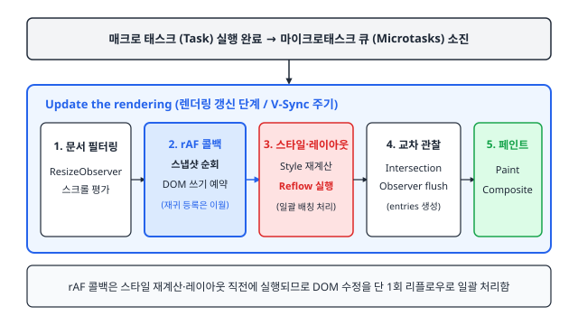
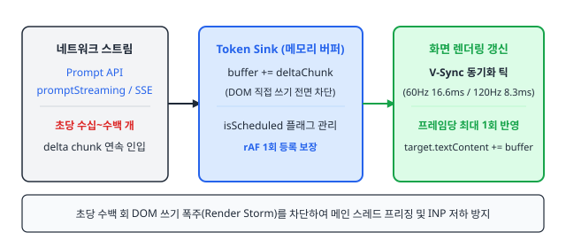

# 261126 requestAnimationFrame

> 한 줄 요약: 브라우저가 화면을 새로 그리기 직전 최적의 시점에 콜백을 단 1회 실행하여 V-Sync 동기화와 DOM 일괄 처리를 보장하는 웹 표준 API · 분야: 브라우저 동작(렌더링 · 이벤트 루프) · Baseline: Widely available (2015년 7월 주요 브라우저 표준 지원 확립, 2023년 3월 DedicatedWorkerGlobalScope 지원 완료) · 읽는 시간 약 7분

## 1. 왜 쓰는가
과거 웹 환경에서는 화면 애니메이션과 시각적 상태 갱신을 구현하기 위해 `setTimeout(fn, 16)`이나 `setInterval(fn, 16)` 같은 범용 타이머 함수에 전적으로 의존했다 [2]. 60Hz 주사율 디스플레이는 약 16.6ms, 120Hz 고주사율 디스플레이는 약 8.3ms마다 물리적 화면을 새로 갱신하지만, 범용 타이머는 디스플레이 하드웨어의 수직 동기화(V-Sync) 신호와 아무런 연동 없이 자바스크립트 엔진의 매크로 태스크 큐 상황에 따라 무작위 시점에 콜백을 실행했다 [1][2][3].

이로 인해 브라우저가 화면을 그리는 프레임 주기와 자바스크립트 실행 시점이 어긋나면서 프레임 누락(Tearing)과 화면 끊김(Jank)이 빈번하게 발생했다 [2][3]. 프레임이 갱신되기 직전에 연산이 끝나지 못하면 이전 프레임이 그대로 유지되다가 다음 주기에 급격히 건너뛰었고, 한 프레임 주기 안에 타이머가 불필요하게 두 번 이상 실행되어 중복 렌더링이 유발되기도 했다 [2][3]. 또한 `setTimeout`과 `setInterval`은 사용자가 브라우저 탭을 백그라운드로 전환하거나 창을 최소화하여 화면이 전혀 보이지 않는 상태에서도 지정된 간격마다 쉬지 않고 콜백을 실행했다 [2]. 이는 모바일 기기와 랩톱 환경에서 심각한 CPU 점유율 낭비와 배터리 소모를 초래했다 [2].

`requestAnimationFrame`은 이러한 렌더링 결함을 해결하기 위해 등장한 브라우저 표준 Web API다 [1]. 개발자가 임의의 타이머 주기를 계산하여 호출하는 대신, 브라우저 렌더링 엔진이 다음 리페인트(Repaint) 직전 최적의 시점을 스스로 결정하여 콜백을 정확히 단 1회 실행하도록 예약한다 [1][2]. 디스플레이의 V-Sync 주기에 맞춰 동기화되므로 티어링과 프레임 드롭을 방지하며, 동일 프레임 주기 내에 요청된 여러 DOM 스타일 변경 작업을 렌더링 직전에 모아서 일괄 처리(Batching)한다 [1][2]. 아울러 브라우저 탭이 백그라운드로 이동하면 스케줄링을 자동으로 중단하거나 1Hz 이하로 낮추어 시스템 자원 낭비를 원천 차단한다 [2].

## 2. 핵심 개념


`requestAnimationFrame`의 핵심 개념은 화면 갱신 파이프라인과의 구조적 결합이다. 브라우저 이벤트 루프와 렌더링 단계에서 다루어지는 핵심 개념과 기술 용어는 다음과 같다.

1. `Update the rendering`: WHATWG HTML Living Standard 사양에 규정된 이벤트 루프의 화면 갱신 단계다 [1]. 매크로 태스크 실행과 마이크로태스크 큐 비우기가 완료된 후, 디스플레이 주사율에 맞춰 rAF 콜백 실행, 스타일 재계산, 레이아웃(Reflow), Observer 통지, 페인트(Paint) 및 컴포지팅이 한 묶음으로 처리되는 표준 파이프라인이다 [1].
2. `DOMHighResTimeStamp`: `requestAnimationFrame` 콜백 함수에 첫 번째 인자로 전달되는 time origin 기준의 고정밀 타임스탬프다 [1][2]. 밀리초 단위 부동소수점 값으로 제공되며 `document.timeline.currentTime`과 동일한 시점을 가리킨다 [1]. 일반 `Date.now()`와 달리 마이크로초 단위의 정밀도를 지녀 60Hz, 120Hz ProMotion 등 가변 주사율 디스플레이에서도 일관된 물리 이동(Delta time)을 계산하는 기준이 된다 [1][2].
3. `Layout Thrashing`: 콜백 또는 자바스크립트 실행 중 DOM 스타일을 변경(Write)한 직후 기하 속성(Read)을 연속 조회할 때, 브라우저가 최신 값을 반환하기 위해 강제 동기식 레이아웃(Forced Synchronous Layout)을 반복 수행하여 렌더링 성능을 급격히 저하시키는 현상이다 [5][6].
4. `V-Sync 동기화`: 디스플레이 하드웨어의 프레임 버퍼 스왑 신호에 맞추어 브라우저가 렌더링 파이프라인을 구동하는 동기화 메커니즘이다 [1][2][3]. 60Hz 환경에서는 약 16.6ms, 120Hz 환경에서는 약 8.3ms의 물리 주기와 정확히 일치한다 [1][3].
5. `Token Sink Batching`: 생성형 AI 연동 환경에서 `promptStreaming`이나 SSE로 초당 수십~수백 개씩 인입되는 텍스트 조각인 `delta chunk`를 메모리 버퍼에 임시 저장하고, rAF 주기에 맞춰 프레임당 최대 1회만 DOM에 반영하여 렌더 스톰(Render Storm)과 메인 스레드 프리징을 방지하는 최적화 패턴이다 [2][3].



## 3. 동작 원리
`requestAnimationFrame`은 WHATWG HTML Living Standard의 '8.1.7.3 Processing model: Update the rendering' 사양에 근거하여 동작한다 [1]. 웹 표준화 체계에서 브라우저 이벤트 루프, DOM 규격, 렌더링 파이프라인은 WHATWG가 제정하며, ECMAScript 언어 문법과 Promise 마이크로태스크 큐(PromiseJobs)는 TC39가 독립적으로 제정한다 [1].

브라우저 이벤트 루프는 하나의 매크로 태스크(Task)를 처리한 직후 대기 중인 마이크로태스크 큐(Microtask Queue)를 완전히 비운다 [1]. 이후 디스플레이의 V-Sync 주기에 도달하면 브라우저는 화면 갱신을 위해 'Update the rendering' 단계를 실행한다 [1][3]. WHATWG 사양에 명시된 렌더링 갱신 파이프라인의 엄격한 순서는 다음과 같다 [1].

1. 문서 필터링 (Filter documents)
2. `ResizeObserver` 통지 flush
3. 스크롤 및 미디어 쿼리 평가
4. run the animation frame callbacks (`requestAnimationFrame` 콜백 실행)
5. 스타일 재계산 및 레이아웃 (Reflow)
6. `IntersectionObserver` 통지 flush (`entries` 생성)
7. 페인트(Paint) 및 컴포지팅 (GPU 래스터화 및 합성)

사양상 rAF 콜백은 스타일 재계산과 레이아웃 연산 바로 직전에 실행된다 [1]. 따라서 콜백 내부에서 DOM 스타일 클래스를 수정하거나 인라인 스타일을 변경하면, 브라우저는 즉시 화면을 다시 그리지 않고 파이프라인의 다음 단계인 5단계(스타일 재계산 및 레이아웃)에서 변경 사항을 한 번에 모아 일괄 처리한다 [1].

rAF 콜백 실행 알고리즘에는 중요한 핸들 스냅샷 구조가 존재한다 [1]. 브라우저는 4단계에서 콜백 맵에 등록된 핸들 목록을 먼저 스냅샷(`callbackHandles`)으로 복사한 뒤 순회한다 [1]. 순회 도중 콜백 함수 내부에서 재귀적으로 새로운 `requestAnimationFrame`을 등록하더라도, 이 새 콜백은 이미 스냅샷된 목록에 포함되지 않으므로 현재 프레임에서 실행되지 않고 무조건 다음 프레임의 Update the rendering 단계로 이월된다 [1].

또한 6단계의 `IntersectionObserver` 통지는 rAF 콜백 실행과 브라우저의 스타일·레이아웃 계산이 완료된 이후에 발생한다 [1]. `IntersectionObserver`와 `ResizeObserver` 콜백으로 전달되는 `entries`는 최신 레이아웃이 확정된 뒤 타깃 요소의 기하학적 교차 상태 변화를 감지하여 생성되는 관찰 스냅샷 객체 배열이다 [1].

```diagram
종류: 시퀀스
[이벤트루프]
[rAF큐]
[렌더엔진]
[디스플레이]
이벤트루프 -> rAF큐 : 콜백 핸들 스냅샷 복사
rAF큐 -> 렌더엔진 : rAF 콜백 순회 실행
== 렌더링 갱신 단계 ==
렌더엔진 -> 렌더엔진 : 스타일 재계산 및 레이아웃
렌더엔진 -> 렌더엔진 : IntersectionObserver 통지 flush
렌더엔진 -> 디스플레이 : 페인트 및 컴포지팅
디스플레이 --> 이벤트루프 : V-Sync 신호 동기화 완료
```

## 4. 기본 사용법
`requestAnimationFrame`의 기본 사용 패턴은 단발성 호출 등록, 콜백 타임스탬프 기반 델타 시간 계산, 재귀 호출을 통한 루프 형성, 그리고 리소스 해제 시 `cancelAnimationFrame` 정리로 구성된다.

```js
// 1. 애니메이션 제어 변수 선언
let animationFrameId = null;
let previousTimestamp = null;
const targetElement = document.getElementById("box");
let currentPosition = 0;
const speedPerSecond = 100; // 초당 100px 이동

// 2. rAF 콜백 함수 정의 (인자로 DOMHighResTimeStamp 수신)
function renderStep(currentTimestamp) {
  // 이전 타임스탬프가 없으면 현재 타임스탬프로 초기화
  if (previousTimestamp === null) {
    previousTimestamp = currentTimestamp;
  }

  // 이전 프레임과의 시간 차이(deltaTime)를 밀리초 단위로 계산
  const deltaTime = (currentTimestamp - previousTimestamp) / 1000;
  previousTimestamp = currentTimestamp;

  // 가변 주사율(60Hz, 120Hz)에 영향받지 않도록 시간 비례 이동 거리 계산
  currentPosition += speedPerSecond * deltaTime;
  targetElement.style.transform = `translateX(${currentPosition}px)`;

  // 애니메이션 종료 조건 (500px 미만일 때 루프 지속)
  if (currentPosition < 500) {
    // 3. 재귀적으로 다음 프레임 갱신 예약
    animationFrameId = requestAnimationFrame(renderStep);
  }
}

// 4. 최초 1회 rAF 스케줄링 등록
animationFrameId = requestAnimationFrame(renderStep);

// 5. 컴포넌트 언마운트 또는 중단 시 핸들 해제
function stopAnimation() {
  if (animationFrameId !== null) {
    cancelAnimationFrame(animationFrameId);
    animationFrameId = null;
    previousTimestamp = null;
  }
}
```

- 1~6행: 애니메이션 식별자 `animationFrameId`, 이전 프레임의 타임스탬프 `previousTimestamp`, 조작할 DOM 요소, 이동 속도를 선언한다.
- 9행: rAF 콜백 함수 `renderStep`을 정의한다. 브라우저 엔진은 콜백의 첫 번째 인자로 time origin 기준의 고정밀 타임스탬프 `currentTimestamp`(`DOMHighResTimeStamp`)를 전달한다 [1][2].
- 11~13행: 루프의 첫 진입 시점인 경우 기준 시각을 현재 시각으로 설정한다.
- 16~17행: `currentTimestamp - previousTimestamp` 연산을 수행하여 프레임 간 경과 시간(`deltaTime`)을 초 단위로 환산하고, 기준 시각을 갱신한다.
- 20~21행: 프레임당 고정 픽셀이 아닌 `speedPerSecond * deltaTime`으로 이동 거리를 누적하여, 60Hz(16.6ms)나 120Hz(8.3ms) 등 화면 주사율이 달라져도 일정한 물리 속도를 보장한다 [1][2]. GPU 컴포지터 레이어에서 처리되도록 `transform` 속성을 수정한다.
- 24~27행: 종료 조건에 도달하지 않은 경우 `requestAnimationFrame(renderStep)`을 재귀 호출하여 다음 프레임의 Update the rendering 단계에 콜백을 예약한다 [1].
- 31행: 최초 애니메이션 루프를 시작하기 위해 `requestAnimationFrame`을 1회 호출하고 반환된 핸들 정수값을 보관한다 [2].
- 34~40행: 애니메이션 중단 또는 컴포넌트 정리 시 `cancelAnimationFrame(animationFrameId)`을 호출하여 큐에 대기 중인 콜백을 명시적으로 취소한다 [2].

## 5. 실무 예시
### 실증 사례 1: LLM 스트리밍 텍스트 렌더링 배칭 (Prompt API promptStreaming / SSE)
- 상황: 브라우저 내장 Prompt API의 `promptStreaming` 또는 서버 전송 이벤트(SSE)를 통해 대규모 언어 모델(LLM)의 텍스트 응답을 수신할 때, 네트워크 스트림에서 초당 수십~수백 개의 텍스트 조각인 `delta chunk`가 연속 인입된다 [2][3]. 들어오는 청크마다 즉시 DOM이나 React 상태를 갱신하면 심각한 렌더 스톰(Render Storm)이 발생하여 메인 스레드가 블로킹되고 INP 지표가 500ms 이상 치솟는 프리징이 발생한다 [2][3].
- 코드:
```js
class LlmTokenSink {
  constructor(renderTarget) {
    this.target = renderTarget;
    this.buffer = ""; // 텍스트 임시 버퍼 (Token Sink)
    this.rafId = null;
    this.isScheduled = false;
  }

  // 스트리밍 네트워크 이벤트에서 delta chunk 수신 시 호출
  onChunkReceived(deltaChunk) {
    this.buffer += deltaChunk; // 메모리 버퍼에만 누적

    if (!this.isScheduled) {
      this.isScheduled = true;
      // 다음 리페인트 직전에 1회만 화면에 반영하도록 예약
      this.rafId = requestAnimationFrame(() => this.flushToDom());
    }
  }

  flushToDom() {
    this.isScheduled = false;
    if (this.buffer.length > 0) {
      // 누적된 텍스트 청크를 일괄 반영
      this.target.textContent += this.buffer;
      this.buffer = "";
    }
  }

  cleanup() {
    if (this.rafId !== null) {
      cancelAnimationFrame(this.rafId);
      this.rafId = null;
    }
    this.flushToDom(); // 잔여 버퍼 즉시 flush
  }
}
```
- 결과: 초당 수백 회 발생하는 텍스트 청크 인입을 디스플레이 주사율(60Hz 기준 약 16.6ms, 120Hz 기준 약 8.3ms)당 최대 1회의 DOM 쓰기로 압축(Token Sink Batching)하여 메인 스레드 렌더링 폭주를 차단하고 부드러운 텍스트 출력을 보장한다 [2][3].
- 주의점: 스트리밍이 종료될 때 메모리 버퍼에 마지막 `delta chunk`가 잔류할 수 있으므로, 스트림 완료 이벤트에서 동기적 flush 또는 cleanup 메서드를 반드시 호출해야 한다.

### 실증 사례 2: 가상화 스크롤 리스트 오프셋 동기화 (TanStack Virtual, react-window)
- 상황: 고속 터치 스크롤이나 마우스 휠 조작 시 브라우저의 `scroll` 이벤트는 초당 60~120회 이상 발생한다. 스크롤 이벤트 콜백마다 매번 가상 DOM 윈도우 인덱스를 재계산하고 자식 컴포넌트 노드를 재배치하면 프레임 드롭(Jank)이 발생한다.
- 코드:
```js
class VirtualListScroller {
  constructor(viewportElement, onWindowUpdate) {
    this.viewport = viewportElement;
    this.onWindowUpdate = onWindowUpdate;
    this.latestScrollTop = 0;
    this.rafId = null;

    this.onScroll = this.onScroll.bind(this);
    this.updateWindow = this.updateWindow.bind(this);
    this.viewport.addEventListener("scroll", this.onScroll, { passive: true });
  }

  onScroll() {
    // 1. 스크롤 이벤트에서는 순수 좌표값만 스냅샷
    this.latestScrollTop = this.viewport.scrollTop;

    // 2. rAF가 이미 예약되어 있다면 추가 스케줄링 생략 (스로틀링)
    if (this.rafId === null) {
      this.rafId = requestAnimationFrame(this.updateWindow);
    }
  }

  updateWindow() {
    this.rafId = null;
    // 3. 렌더링 파이프라인 직전에 최신 오프셋 기준 가상 윈도우 1회 갱신
    this.onWindowUpdate(this.latestScrollTop);
  }

  destroy() {
    this.viewport.removeEventListener("scroll", this.onScroll);
    if (this.rafId !== null) {
      cancelAnimationFrame(this.rafId);
      this.rafId = null;
    }
  }
}
```
- 결과: 불필요한 중간 스크롤 렌더링 연산을 억제하고 렌더링 갱신 단계 직전에 최종 스크롤 좌표만을 기준으로 가상 윈도우 범위를 계산하여 60fps/120fps의 안정적인 프레임 레이트를 달성한다.
- 주의점: 스크롤 이벤트 리스너에는 `{ passive: true }`를 적용하여 브라우저의 기본 스크롤 스레드 블로킹을 방지해야 하며, 컴포넌트 제거 시 `cancelAnimationFrame`으로 핸들을 정리해야 한다.

### 실증 사례 3: FastDOM 기반 읽기/쓰기 큐 분리를 통한 레이아웃 쓰레싱 방지 (FastDOM 오픈소스)
- 상황: 다수의 UI 위젯이나 드래그 앤 드롭 요소가 스타일을 변경(Write)한 직후 다른 요소의 기하 속성(Read)을 조회할 경우, 브라우저 엔진이 최신 기하 정보를 얻기 위해 강제 동기식 레이아웃(Layout Thrashing)을 반복 실행하여 렌더링 병목을 초래한다 [5][6].
- 코드:
```js
class LayoutScheduler {
  constructor() {
    this.reads = [];
    this.writes = [];
    this.rafScheduled = false;
  }

  read(fn) {
    this.reads.push(fn);
    this.scheduleFlush();
  }

  write(fn) {
    this.writes.push(fn);
    this.scheduleFlush();
  }

  scheduleFlush() {
    if (!this.rafScheduled) {
      this.rafScheduled = true;
      requestAnimationFrame(() => this.flush());
    }
  }

  flush() {
    this.rafScheduled = false;
    // 1. 모든 읽기(Read) 작업을 먼저 일괄 실행하여 기존 레이아웃 캐시 활용
    const currentReads = this.reads.splice(0, this.reads.length);
    for (const readFn of currentReads) {
      readFn();
    }

    // 2. 모든 쓰기(Write) 작업을 한 번에 실행하여 리플로우 횟수를 1회로 제한
    const currentWrites = this.writes.splice(0, this.writes.length);
    for (const writeFn of currentWrites) {
      writeFn();
    }
  }
}
```
- 결과: 스타일 수정과 기하 조회가 교차하며 발생하던 수십 회의 동기 리플로우를 단 1회의 레이아웃 연산으로 통합하여 프레임 실행 시간을 16.6ms 이내로 단축한다 [6].
- 주의점: `read` 작업 내부에서 다시 DOM 쓰기 코드를 실행하면 분리 큐 규약이 깨지므로 읽기 작업과 쓰기 작업의 순수성을 엄격히 유지해야 한다.

## 6. 장점 · 단점
| 장점 | 단점 |
| :--- | :--- |
| 디스플레이 하드웨어의 재생률(60Hz, 120Hz 등) 및 V-Sync 신호와 완벽히 동기화되어 티어링과 끊김(Jank) 없는 시각적 전환을 보장함 [2][3] | 단발성(One-shot) 호출 방식으로 동작하므로 연속 애니메이션을 위해 콜백 내부에서 재귀 호출해야 하며, `cancelAnimationFrame`으로 직접 정리해야 하는 보일러플레이트가 존재함 [2] |
| 브라우저 탭이 백그라운드로 전환되거나 숨겨지면 실행이 자동으로 일시 중지되어 불필요한 CPU·GPU 점유와 배터리 소모를 방지함 [2] | 메인 스레드의 렌더링 파이프라인 안에서 직접 실행되므로 콜백 연산이 길어지면 16.6ms(또는 8.3ms)의 프레임 예산을 초과하여 렌더링을 지연시키고 LoAF 및 INP 지표 악화를 유발함 [1][3][4] |
| 동일 프레임 주기 내에 요청된 여러 DOM 스타일 수정 작업을 브라우저 렌더링 파이프라인 직전에 모아서 일괄 처리(Batching)함으로써 중복 레이아웃과 리페인트를 억제함 [1] | 순수 자바스크립트 엔진 스레드 종속적이어서 메인 스레드가 무거운 다른 태스크로 블로킹되어 있으면 콜백 자체가 제때 호출되지 못하고 프레임 드롭(Jank)이 발생함 [3] |
| 콜백에 time origin 기준의 고정밀 타임스탬프(`DOMHighResTimeStamp`)가 전달되어 가변 주사율 환경에서도 프레임률에 독립적인 시간 기반 보간(Delta time)이 가능함 [1][2] | 콜백 내부에서 DOM 쓰기(Write)와 기하 속성 읽기(Read)가 교차 발생할 경우 브라우저 엔진이 강제 동기식 레이아웃(Layout Thrashing)을 자동으로 방어해주지 못함 [5][6] |
| 모든 현대 웹 브라우저 및 전용 웹 워커 환경에서 폴리필 없이 즉시 안전하게 사용할 수 있는 검증된 상호운용성(Baseline Widely available)을 제공함 | 화면 렌더링 주기와 무관한 백그라운드 데이터 연산이나 상태 동기화 작업에는 스케줄링이 중단되므로 활용할 수 없음 [2] |

## 7. 한계와 함정
- 경계 사례 (Edge Cases):
  - 중첩 rAF 호출 시 동일 프레임 실행 불가: WHATWG 사양상 브라우저는 콜백 순회 전 등록된 핸들 목록을 스냅샷(`callbackHandles`)으로 복사한다 [1]. 콜백 내부에서 다시 `requestAnimationFrame`을 호출하면 동일 프레임에서 실행되지 않고 무조건 다음 프레임의 렌더링 갱신 단계로 지연 예약된다 [1]. 동일 틱 내 즉각적인 연속 연산이 필요한 경우에는 적합하지 않다.
  - 백그라운드 탭 스케줄링 중단: 브라우저 탭이 비활성화되거나 최소화되면 콜백 실행이 완전히 중단되거나 1Hz 이하로 스로틀링된다 [2]. 따라서 화면에 렌더링되지 않는 비동기 데이터 동기화, 분석 데이터 전송, 오디오 재생 연산 등에 rAF를 사용하면 탭 전환 시 작업이 멈추는 함정에 빠진다 [2].
- 성능 (Performance):
  - 극도로 짧은 프레임 예산(Frame Budget): 60Hz 환경에서는 약 16.6ms, 120Hz ProMotion 환경에서는 단 8.3ms 안에 rAF 콜백 연산, 스타일 재계산, 레이아웃(Reflow), 페인트(Paint)가 모두 완료되어야 한다 [1][3].
  - 긴 애니메이션 프레임(LoAF) 및 INP 저하: 콜백 내부의 자바스크립트 실행 시간이 길어져 프레임 예산을 초과하면 렌더링 갱신이 50ms 이상 지연되어 Long Animation Frame(LoAF)을 발생시키고 사용자의 다음 인터랙션 반응 속도(INP)를 심각하게 악화시킨다 [3][4].
  - 강제 동기식 레이아웃(Layout Thrashing): rAF 콜백 내부에서 DOM 인라인 스타일이나 클래스를 수정한 직후 `offsetWidth`, `clientHeight`, `getBoundingClientRect()` 같은 기하 속성을 조회하면, 브라우저가 최신 값을 계산하기 위해 파이프라인 순서를 깨고 즉시 동기식 리플로우를 수행하여 프레임 드롭을 유발한다 [5][6].
  - 메인 스레드 블로킹 취약성: GPU 컴포지터 스레드에서 독립 구동되는 CSS 애니메이션과 달리 rAF는 메인 스레드에서 실행되므로, 다른 무거운 매크로 태스크가 실행 중이면 콜백 호출 자체가 뒤로 밀리는 구조적 한계를 갖는다 [3].
- 접근성 (Accessibility):
  - `requestAnimationFrame` 자체는 운영체제 수준의 `prefers-reduced-motion(움직임 감소)` 설정을 감지하거나 애니메이션 속도를 자동으로 감속·차단하는 메커니즘을 제공하지 않는다. 따라서 개발자가 `window.matchMedia('(prefers-reduced-motion: reduce)').matches` 조건을 수동으로 검사하여 움직임을 최소화하는 분기 로직을 직접 구현해야 한다.
- 보안 · 개인정보 (Security & Privacy):
  - 콜백으로 전달되는 `DOMHighResTimeStamp`는 마이크로초 단위의 고정밀 타임스탬프를 제공하므로, 브라우저 구현체는 마이크로아키텍처 기반의 부채널 공격(Spectre 등)을 완화하기 위해 타임스탬프 해상도를 일정 단위(예: 5µs~100µs)로 제한(Clamping)하거나 노이즈를 추가하는 완화책을 적용한다 [1][2]. 아울러 백그라운드 탭에서 rAF 실행을 차단하는 동작은 불필요한 시스템 자원 낭비 방지와 더불어 탭 비활성 상태에서의 비인가 행위 관측을 억제한다 [2].

## 8. 다른 방법과 비교
| 방법 | 언제 | 비용 | 한계 |
| :--- | :--- | :--- | :--- |
| `requestAnimationFrame` | V-Sync 주기에 맞춘 DOM 스타일 변경, LLM 스트리밍 텍스트 배칭, 캔버스 그래픽 렌더 루프 [1][2][3] | 메인 스레드 연산 비용 발생 (프레임 예산 16.6ms / 8.3ms 준수 필요) | 메인 스레드 블로킹 시 프레임 드롭 발생, 백그라운드 탭에서 실행 중단 [2][3] |
| `Web Animations API (WAAPI) / CSS Transitions & Animations` | `transform`, `opacity` 등 합성 레이어(Compositor) 속성 기반의 연속 시각 애니메이션 | GPU 및 컴포지터 스레드 처리로 메인 스레드 비용이 거의 없음 | 복잡한 런타임 물리 연산이나 실시간 데이터(LLM 청크 등) 결합 제어가 제한적임 |
| `Prioritized Task Scheduling API (scheduler.postTask, scheduler.yield)` | 메인 스레드를 장시간 점유하는 긴 작업을 쪼개어 제어권을 브라우저에 양보(yield)할 때 | 스케줄러 태스크 큐 관리 오버헤드 | 화면 리페인트 타이밍과 직접 결합되지 않아 즉각적인 렌더링 프레임 보장에는 부적합함 |
| `requestIdleCallback API` | 다음 프레임까지 남는 유휴 시간(Idle Period)에 비핵심 데이터 수집, 로그 전송, 캐시 정리 [2] | 시스템 유휴 자원만 사용하여 렌더링 성능 영향 최소 | 화면 갱신 주기를 예측할 수 없어 프레임 동기화 렌더링에는 사용 불가 |
| `FastDOM` | 전역 애플리케이션 차원에서 DOM 읽기와 쓰기가 교차하여 레이아웃 쓰레싱이 빈번한 환경 [6] | rAF 큐 관리 및 함수 클로저 적재 메모리 비용 | 모든 팀원이 라이브러리 규약을 엄격히 지켜야 하며 외부 서드파티 스크립트 강제 리플로우 방어 불가 [6] |
| `queueMicrotask / setTimeout(fn, 0)` | 화면 렌더링 파이프라인과 무관하게 순수 비동기 작업 순서를 조정하거나 마이크로태스크 상태를 동기화할 때 [1] | 마이크로태스크 또는 매크로 태스크 큐 스케줄링 비용 | V-Sync와 무관하게 임의 시점에 실행되어 티어링 및 중복 렌더링을 유발함 [2][3] |

### 이것을 고르지 않는 경우
- `transform`이나 `opacity` 같은 하드웨어 가속 가능 속성만을 이용한 단순 전환 효과를 구현할 때는 `requestAnimationFrame`을 고르지 않는다. rAF는 메인 스레드를 거치므로 자바스크립트 연산 부하 시 프레임 드롭이 발생하지만, CSS Transitions/Animations나 WAAPI는 컴포지터 스레드와 GPU에서 직접 실행되어 메인 스레드가 완전히 멈춰 있어도 매끄러운 60fps/120fps 전환을 보장하기 때문이다.
- 사용자 인터랙션 후 긴 계산 연산을 메인 스레드에서 처리하면서 INP 지연을 방지하고자 할 때는 rAF 대신 `scheduler.yield()`나 `scheduler.postTask()`를 선택한다. rAF 내부에서 긴 연산을 수행하면 렌더링 파이프라인 자체가 지연되어 LoAF(Long Animation Frame)가 기록되기 때문이다 [3][4].
- 비핵심 분석 데이터 전송이나 캐시 정리 같은 백그라운드 태스크에는 rAF를 쓰지 않고 `requestIdleCallback`을 사용한다. 화면 갱신 직전의 귀중한 16.6ms 프레임 예산을 소모하지 않고 브라우저 유휴 시간에 실행하는 것이 적합하기 때문이다.

## 9. 대비와 새로운 시도
`requestAnimationFrame`을 둘러싼 웹 플랫폼과 프론트엔드 엔지니어링 생태계는 다음과 같은 최신 표준과 기술적 전환을 맞이하고 있다.

1. WICG `requestPostAnimationFrame` 표준화 제안:
   `requestAnimationFrame`은 렌더링 파이프라인의 스타일 재계산 및 레이아웃 바로 직전에 호출된다 [1]. 이로 인해 콜백 내부에서 DOM을 수정한 뒤 변경된 크기나 위치를 측정하려면 필연적으로 강제 동기식 레이아웃(Layout Thrashing)을 유발해야 하는 구조적 결함이 있었다 [5][6]. WICG(Web Platform Incubator Community Group)에서는 브라우저가 스타일·레이아웃·페인트를 모두 마친 직후, 다른 매크로 태스크나 마이크로태스크 간섭 없이 안전하게 최신 기하 치수를 측정할 수 있는 차세대 Web API인 `requestPostAnimationFrame()` 표준화를 제안하여 논의를 진행하고 있다 [5].
2. Long Animation Frames API (LoAF):
   Chrome 123+에서 정식 도입된 W3C 표준으로, rAF 실행 및 화면 렌더링 단계가 50ms를 초과하여 발생한 지연 프레임을 `long-animation-frame` 성능 항목으로 브라우저에 기록한다 [4]. 콜백 내부의 실행 시간과 스크립트 소스 위치(`scripts` 속성)를 정밀하게 추적할 수 있어, Core Web Vitals의 핵심 반응성 지표인 INP(Interaction to Next Paint) 저하의 근본 원인을 파악하고 최적화하는 데 필수적인 관측 도구로 활용되고 있다 [3][4].
3. CSS Scroll-driven Animations 표준 도입:
   기존에는 스크롤 기반 시각 효과나 프로그레스 바를 구현하기 위해 `scroll` 이벤트에서 `requestAnimationFrame` 루프를 돌려 스크롤 오프셋을 추적하고 DOM 스타일을 수동 갱신하는 패턴이 일반적이었다. 최근 웹 표준으로 자리잡은 Scroll-driven Animations는 이 작업을 브라우저 컴포지터 스레드 기반 CSS 선언으로 완전 이관하여 메인 스레드 부하를 완전히 배제한다.
4. DedicatedWorkerGlobalScope 지원 확장 (Baseline 2023):
   과거에는 `window` 메인 스레드 컨텍스트에서만 rAF가 지원되었으나, 2023년 3월 모든 주요 브라우저 엔진에서 웹 워커 전역 스코프(`DedicatedWorkerGlobalScope`)의 rAF 지원이 확립되었다. 이에 따라 `OffscreenCanvas`와 결합하여 메인 스레드 블로킹 없이 독립적인 백그라운드 워커 스레드에서 캔버스 그래픽 렌더 루프를 rAF로 완벽히 구동할 수 있게 되었다.
5. AI 프론트엔드 엔지니어링과의 결합 (Token Sink Batching):
   최근 웹 애플리케이션에서 Prompt API의 `promptStreaming`이나 SSE를 활용한 온디바이스 및 클라우드 생성형 AI 스트리밍 연동이 급증하고 있다 [2][3]. 초당 수십~수백 개씩 인입되는 텍스트 청크(`delta chunk`)를 매번 렌더링할 때 발생하는 렌더 스톰을 방지하기 위해, rAF를 스케줄러로 활용하여 디스플레이 주사율 단위로 텍스트를 모아 반영하는 Token Sink 배칭 아키텍처가 프론트엔드 AI 인터페이스의 표준 최적화 패턴으로 확립되었다 [2][3].

## 10. 다른 사람에게 설명하기
- 세 문장 요약:
  1. `requestAnimationFrame`은 브라우저 렌더링 파이프라인의 수직 동기화(V-Sync) 주기에 맞춰 다음 리페인트 직전에 콜백을 1회 실행하는 웹 표준 스케줄링 API다 [1][2].
  2. WHATWG 이벤트 루프의 'Update the rendering' 단계에서 스타일 재계산 및 레이아웃 직전에 호출되므로, 동일 프레임 내 DOM 변경 작업을 일괄 처리(Batching)하여 프레임 드롭(Jank)과 레이아웃 쓰레싱을 방지한다 [1][6].
  3. 최근에는 Prompt API(`promptStreaming`)나 SSE로 초당 수백 개씩 인입되는 텍스트 `delta chunk`를 메모리 버퍼에 누적한 뒤 디스플레이 주사율 단위로 화면에 동기화하는 고성능 AI 프론트엔드 아키텍처의 핵심 기반으로 활용된다 [2][3].
- 스스로 확인할 질문 3개:
  1. WHATWG 렌더링 갱신(Update the rendering) 파이프라인에서 `requestAnimationFrame` 콜백 실행, 레이아웃(Reflow), `IntersectionObserver` 통지 flush의 호출 순서는 각각 어떻게 되는가?
  2. `requestAnimationFrame` 콜백 내부에서 재귀적으로 다시 `requestAnimationFrame`을 호출했을 때, 이 콜백이 동일 프레임에서 즉시 실행되지 않고 다음 프레임으로 지연되는 이유는 무엇인가?
  3. Prompt API(`promptStreaming`) 연동 시 쏟아지는 `delta chunk`를 매번 직접 DOM이나 React 상태에 반영하지 않고 `requestAnimationFrame` 기반 Token Sink 버퍼로 배칭해야 하는 이유는 무엇인가?

## 핵심 낱말
- `requestAnimationFrame` — 다음 화면 리페인트 직전 브라우저 렌더링 파이프라인에서 콜백을 단 1회 실행하도록 예약하는 웹 표준 메서드다.
- `Update the rendering` — WHATWG 이벤트 루프에서 rAF 실행, 레이아웃, Observer 통지, 페인트가 순차적으로 일어나는 화면 갱신 단계다.
- `Layout Thrashing` — 한 프레임 내에서 DOM 스타일 쓰기와 기하 속성 읽기가 반복되어 강제 동기 리플로우가 발생하는 성능 저하 현상이다.
- `DOMHighResTimeStamp` — rAF 콜백에 인자로 전달되는 time origin 기준 밀리초 단위의 고정밀 타임스탬프다.
- `IntersectionObserver` — rAF 실행 및 레이아웃 완료 후 요소의 뷰포트 교차 상태를 감지하여 entries 스냅샷을 통지하는 브라우저 관찰 API다. (다시)
- `WICG (Web Platform Incubator Community Group)` — 레이아웃과 페인트 직후 안전한 기하 측정을 지원하는 requestPostAnimationFrame 등 차세대 웹 표준 제안을 논의하는 기구다. (다시)
- `promptStreaming` — 생성형 AI 응답 텍스트를 스트리밍 방식으로 실시간 인입받는 Web API 메서드다. (다시)
- `delta chunk` — LLM 스트리밍 과정에서 네트워크를 통해 초당 수십~수백 개 단위로 전송되는 텍스트 증분 조각이다. (다시)

## 참고 자료
1. [WHATWG HTML Living Standard - 8.1.7.3 Processing model: Update the rendering](https://html.spec.whatwg.org/multipage/webappapis.html#event-loop-processing-model)
2. [MDN Web Docs - window.requestAnimationFrame()](https://developer.mozilla.org/en-US/docs/Web/API/window/requestAnimationFrame)
3. [web.dev - Optimize long tasks and Interaction to Next Paint (INP)](https://web.dev/articles/optimize-long-tasks)
4. [web.dev - Long Animation Frames API (LoAF)](https://web.dev/articles/long-animation-frames)
5. [WICG - requestPostAnimationFrame Explainer](https://github.com/WICG/request-post-animation-frame)
6. [GitHub - wilsonpage/fastdom: Eliminates layout thrashing by batching DOM read/write operations](https://github.com/wilsonpage/fastdom)
조사: 2026-11-26

## 내 리뷰
(읽고 느낀 점 · 궁금한 것을 적는다. 질문은 Q. 로 시작)
