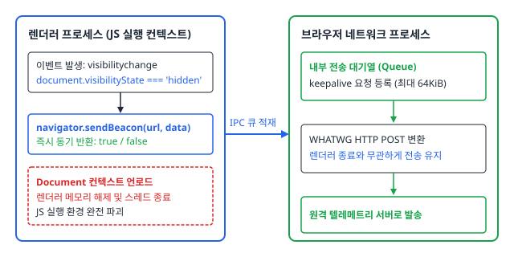
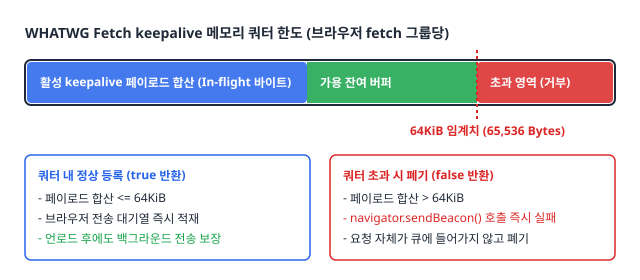

# 261127 Beacon API (navigator.sendBeacon)

> 한 줄 요약: 웹 페이지 언로드(이탈 · 탭 닫기) 시점에 사용자 체류 시간(dwellTime), 뷰포트 노출 지표, 에러 로그 등 필수 텔레메트리 데이터를 페이지 전환 지연이나 데이터 유실 없이 브라우저 네트워크 프로세스에 위임하여 비동기(asynchronous execution)로 전송하는 Web API다. · 분야: FE 엔지니어링(빌드 · 테스트 · 관측) · Baseline: Widely available (2018년 4월 Safari 11.1 지원 이후 모든 주요 브라우저 엔진에 구현 완료되어 약 98%의 글로벌 가용성을 가진 안정적 웹 표준) · 읽는 시간 약 6분

## 1. 왜 쓰는가
웹 애플리케이션 분석 및 관측 시스템의 핵심 과제 중 하나는 사용자가 페이지를 이탈하는 순간까지의 체류 시간(dwellTime)과 최종 뷰포트 노출 데이터를 유실 없이 수집하는 것이다 [1][2]. 그러나 과거 브라우저 런타임 환경에서는 페이지 수명 주기가 끝나는 시점에 안정적으로 HTTP 요청을 완결할 수 있는 공식 API가 존재하지 않았다 [1][4].

이로 인해 개발자들은 `unload` 또는 `beforeunload` 이벤트 핸들러 내부에서 동기식 `XMLHttpRequest`를 실행하거나 `new Image().src = url` 형태의 더미 이미지 요청(이미지 핑)을 삽입하는 우회 기법에 의존했다 [1][2]. 동기식 `XMLHttpRequest`는 요청이 네트워크를 거쳐 서버 응답을 받을 때까지 메인 스레드를 동기적으로 차단(blocking)하여 다음 페이지로의 내비게이션 전환과 브라우저 UI 렌더링을 완전히 멈추게 만들었다 [1][4]. 반대로 일반적인 비동기 `fetch`나 비동기 `XMLHttpRequest`를 호출하면, 브라우저가 Document 실행 컨텍스트를 파괴(unload)하는 즉시 진행 중이던 비동기 연결을 강제로 중단 및 폐기하여 심각한 텔레메트리 데이터 유실을 초래했다 [1][4].

이러한 성능 저하와 데이터 유실 딜레마를 해결하기 위해 W3C Web Performance Working Group은 Beacon API를 표준으로 제정했다 [1][2]. Beacon API의 핵심 인터페이스인 `navigator.sendBeacon`은 메인 스레드 실행이나 사용자 인터랙션을 전혀 지연시키지 않고, 렌더러 프로세스가 종료되더라도 브라우저 레벨에서 비동기(asynchronous execution) 전송을 끝까지 보장하도록 설계되었다 [1][2].

## 2. 핵심 개념
Beacon API의 아키텍처는 JavaScript 런타임이 동작하는 메인 스레드(렌더러 프로세스)와 네트워크 I/O를 전담하는 브라우저 프로세스를 분리하여 관리하는 데서 출발한다 [1][3].



- **전송 대기열 (Transmission Queue)**: `navigator.sendBeacon(url, data)`가 호출되면 브라우저는 전달된 페이로드를 내부 네트워크 전송 큐에 즉시 복사 적재한다 [1][2]. 적재가 정상적으로 완료되면 함수는 즉각 동기적으로 `true`를 반환하며 메인 스레드의 제어권을 반환한다 [1][2].
- **프로세스 독립성**: Document 컨텍스트와 렌더러 메모리가 즉시 파괴되더라도, 대기열에 담긴 데이터는 브라우저 네트워크 프로세스에 상주하므로 운영체제 네트워크 스택을 통해 독립적으로 원격 수집 서버에 전송된다 [1][3].
- **WHATWG keepalive 연계**: 브라우저 내부적으로 Beacon 요청은 WHATWG Fetch 규격의 `keepalive` 플래그가 활성화된 HTTP POST 요청으로 변환되어 처리된다 [1][3].
- **지원 페이로드 타입**: 전송 가능한 데이터 형식은 `USVString`, `Blob`, `FormData`, `URLSearchParams`, `ArrayBufferView`를 표준으로 지원한다 [1][2].



- **64KiB 쿼터 제한**: WHATWG Fetch 규약에 따라 현재 전송 중인(in-flight) 모든 `keepalive` 요청 바디 크기의 합산은 브라우저 fetch 그룹당 최대 64KiB(65,536바이트)로 엄격히 제한된다 [3]. 이 용량을 초과하여 대기열에 등록하려 하면 브라우저는 호출 즉시 `false`를 반환하고 해당 요청을 폐기한다 [1][3].

## 3. 동작 원리
`navigator.sendBeacon`의 호출 차례와 브라우저 내부 처리 시퀀스는 다음과 같다 [1][2][3].

```diagram
종류: 시퀀스
[JavaScript 런타임]
[브라우저 네트워크 프로세스]
[원격 텔레메트리 서버]
== 1. 큐 등록 단계 ==
JavaScript 런타임 -> 브라우저 네트워크 프로세스 : navigator.sendBeacon(url, data)
브라우저 네트워크 프로세스 --> JavaScript 런타임 : 큐 적재 성공 시 true 즉시 반환
== 2. 페이지 파괴 단계 ==
JavaScript 런타임 -> JavaScript 런타임 : Document 언로드 및 JS 렌더러 스레드 종료
== 3. 독립 백그라운드 전송 ==
브라우저 네트워크 프로세스 -> 원격 텔레메트리 서버 : HTTP POST 요청 (keepalive 플래그 활성)
원격 텔레메트리 서버 --> 브라우저 네트워크 프로세스 : 200 OK 응답 수신 (JS 미전달)
```

스펙에 명시된 동작 절차는 다음과 같다:
1. **대기열 등록 및 동기 반환**: `navigator.sendBeacon(url, data)` 호출 시 브라우저는 입력된 대상 URL의 유효성을 검사하고 페이로드 바이트 크기를 계산한다 [1][2]. 현재 브라우저 fetch 그룹 내에서 전송 대기 중인 `keepalive` 바디의 총합에 이번 페이로드를 더한 값이 65,536바이트(64KiB) 이하인 경우 내부 네트워크 큐에 등록하고 동기적으로 `true`를 반환한다 [1][3]. 64KiB를 초과하면 큐잉을 거부하고 동기적으로 `false`를 반환한다 [1][3].
2. **단방향 비동기 실행 (Fire-and-forget)**: 반환된 결과는 큐 적재 여부만을 나타내며, 네트워크 연결 수립 여부나 서버의 응답 상태(200 OK 등)는 클라이언트 JavaScript 환경으로 전달되지 않는다 [1][2].
3. **HTTP 계층 변환**: 큐에 적재된 요청은 브라우저 네트워크 계층에서 HTTP POST 메서드로 패킷화된다 [1]. 이때 요청 헤더의 `Content-Type`은 전달된 객체 타입에 따라 자동으로 설정된다(예: `Blob` 객체 사용 시 정의된 MIME 타입 반영) [1][2].
4. **생명주기 독립성 보장**: 사용자가 탭을 닫거나 새 URL로 이동하여 렌더러 프로세스의 Document와 힙 메모리가 해제되더라도, 브라우저 프로세스 레벨에서 전송 파이프라인이 유지되어 패킷 송출이 완료된다 [1][3].

## 4. 기본 사용법
다음은 JSON 형식의 분석 데이터를 `Blob` 객체로 감싸 `application/json` 타입으로 안전하게 전송하는 기본 구현이다 [1][2].

```js
// 1. 전송할 사용자 행동 로그 및 메타데이터 정의
const payloadData = {
  event: 'user_exit',
  timestamp: Date.now(),
  path: window.location.pathname,
};

// 2. JSON 문자열을 생성하고 Content-Type 헤더 지정을 위해 Blob 인스턴스로 래핑
const blob = new Blob([JSON.stringify(payloadData)], {
  type: 'application/json',
});

// 3. 대상 수집 엔드포인트 URL로 비콘 데이터 큐잉
const endpoint = '/api/telemetry';
const isQueued = navigator.sendBeacon(endpoint, blob);

// 4. 대기열 적재 결과 검증
if (isQueued) {
  // 브라우저 큐에 정상 적재됨: 메인 스레드 종료 후에도 네트워크 프로세스가 전송 완결
  console.log('비콘 데이터가 브라우저 전송 대기열에 성공적으로 등록되었습니다.');
} else {
  // 64KiB 쿼터 초과 또는 브라우저 제한으로 인해 요청 등록 실패
  console.warn('비콘 데이터 대기열 적재 실패: 페이로드 크기 초과 또는 네트워크 큐 거부');
}
```

줄별 설명:
- `1-5행`: 전송 대상 이벤트 이름, 타임스탬프, 현재 경로를 담은 일반 JavaScript 객체를 생성한다.
- `8-10행`: `JSON.stringify`로 객체를 직렬화한 후 `Blob` 생성자에 전달하며 `{ type: 'application/json' }` 옵션을 부여한다. `sendBeacon`은 커스텀 헤더 설정을 지원하지 않으므로, 서버가 JSON 본문임을 인식할 수 있도록 `Blob`의 MIME 타입을 활용한다 [1][2].
- `13-14행`: `navigator.sendBeacon`을 호출하여 브라우저 네트워크 전송 큐에 등록을 시도한다 [1][2].
- `17-23행`: `sendBeacon`의 동기 불리언 반환값(`isQueued`)을 검사한다. `true`인 경우 브라우저가 전송 책임을 인계받았음을 의미하며, `false`인 경우 전체 `keepalive` 누적 크기가 64KiB를 초과하여 전송이 무산되었음을 나타낸다 [1][3].

## 5. 실무 예시

### 실증 사례 1: Intersection Observer 노출 추적(sentinel) 및 체류 시간(dwellTime) 누적 전송
피드 아이템의 뷰포트 교차 여부를 감시하고, 사용자가 페이지를 이탈하는 순간까지의 누적 체류 시간을 단일 요청으로 수합하여 전송하는 구조다 [1][2].

- **상황**: 수십 개의 피드 카드가 뷰포트 50% 이상 노출된 시간을 측정하고, 탭 전환 또는 브라우저 닫기 시점에 누적된 지표를 손실 없이 전송해야 함.
- **코드**:
```js
const impressionBuffer = new Map();
const startTime = performance.now();

// 피드 아이템 노출 및 체류 시간 관측
const observer = new IntersectionObserver((entries) => {
  for (const entry of entries) {
    const id = entry.target.dataset.itemId;
    if (entry.isIntersecting) {
      impressionBuffer.set(id, { enterTime: performance.now(), dwellTime: 0 });
    } else if (impressionBuffer.has(id)) {
      const record = impressionBuffer.get(id);
      record.dwellTime += performance.now() - record.enterTime;
    }
  }
}, { threshold: 0.5 });

document.querySelectorAll('.feed-card').forEach((el) => observer.observe(el));

// 페이지 숨김 시점(탭 전환, 탭 닫기, 내비게이션 이탈)에 데이터 안전 플러시
document.addEventListener('visibilitychange', () => {
  if (document.visibilityState === 'hidden' && impressionBuffer.size > 0) {
    const payload = JSON.stringify({
      sessionDuration: Math.round(performance.now() - startTime),
      impressions: Array.from(impressionBuffer.entries()).map(([id, data]) => ({
        id,
        dwellTime: Math.round(data.dwellTime),
      })),
    });

    const blob = new Blob([payload], { type: 'application/json' });
    const isQueued = navigator.sendBeacon('/api/telemetry/dwell', blob);
    if (isQueued) {
      impressionBuffer.clear();
    }
  }
});
```
- **결과**: 페이지 언로드 시점에 메인 스레드 렌더링 파이프라인을 차단하지 않고, 피드 노출 시간 및 체류 지표를 단일 비콘 요청으로 브라우저 프로세스에 위임 전송 완료 [1][2].
- **주의점**: `visibilitychange` 이벤트 핸들러 내부에서 `document.visibilityState === 'hidden'` 상태를 필히 확인해야 하며, 전송 대기열 적재가 확인되면(`isQueued === true`) 버퍼를 즉시 비워 다음 복원 시 중복 전송이 발생하지 않도록 제어해야 한다 [4].

### 실증 사례 2: Sentry 스타일의 RUM 관측 Fallback 패턴 (fetch keepalive 우선 및 sendBeacon 결합)
에러 모니터링 SDK에서 커스텀 인증 헤더 전송을 시도하되, 네트워크 실패 환경에서 `sendBeacon`으로 안전하게 폴백하며 64KiB 초과를 방어하는 패턴이다 [3][6].

- **상황**: 사용자 이탈 시 에러 트레이스와 성능 데이터를 전송할 때 커스텀 헤더가 필요하나, 브라우저 호환성 및 네트워크 실패 상황에 대비한 견고한 다계층 폴백이 필요함.
- **코드**:
```js
function sendTelemetry(url, data) {
  const serialized = JSON.stringify(data);
  const byteLength = new TextEncoder().encode(serialized).length;

  // 64KiB 초과 시 네트워크 에러 방지를 위한 페이로드 경량화
  if (byteLength > 64 * 1024) {
    console.warn('Telemetry payload exceeds 64KiB keepalive quota, trimming non-critical breadcrumbs...');
    delete data.detailedBreadcrumbs;
  }

  const finalPayload = JSON.stringify(data);

  // 1순위: 커스텀 헤더가 필요할 때 fetch with keepalive 시도
  try {
    return fetch(url, {
      method: 'POST',
      body: finalPayload,
      headers: { 'Content-Type': 'application/json' },
      keepalive: true,
    }).catch(() => {
      // fetch 실패 시 2순위 navigator.sendBeacon 폴백
      const blob = new Blob([finalPayload], { type: 'application/json' });
      return navigator.sendBeacon(url, blob);
    });
  } catch (err) {
    const blob = new Blob([finalPayload], { type: 'application/json' });
    return navigator.sendBeacon(url, blob);
  }
}
```
- **결과**: `fetch(..., { keepalive: true })`의 헤더 제어 능력과 `navigator.sendBeacon`의 98% 글로벌 가용성을 결합하여 브라우저 종료 직전의 텔레메트리 유실률을 최소화함 [6][7].
- **주의점**: `fetch`의 `keepalive` 옵션과 `navigator.sendBeacon`은 동일한 브라우저 레벨의 64KiB 쿼터를 공유하므로, 전송 직전 직렬화된 바이트 크기를 사전에 계산(`TextEncoder`)하여 초과분을 필터링해야만 큐잉 거부를 방지할 수 있다 [3].

### 실증 사례 3: 차세대 fetchLater API 점진적 향상(Progressive Enhancement) 패턴
최신 브라우저 규격인 `fetchLater` 지원 여부를 감지하여 브라우저 자동 지연 전송을 사용하고, 미지원 브라우저에서는 `visibilitychange`와 `sendBeacon` 조합으로 폴백하는 구조다 [4][5].

- **상황**: 크롬 최신 엔진의 지연 전송 스펙을 우선 적용하면서도 레거시 브라우저 환경에서 동일한 전송 신뢰성을 유지해야 함.
- **코드**:
```js
function scheduleDeferredMetric(endpoint, metricData) {
  // 차세대 fetchLater API 지원 여부 확인 (Chrome 135+ 등)
  if ('fetchLater' in window) {
    return window.fetchLater(endpoint, {
      method: 'POST',
      body: JSON.stringify(metricData),
      headers: { 'Content-Type': 'application/json' },
      activateAfter: 30000, // 30초 내 미발송 시 또는 페이지 언로드 시 브라우저가 자동 전송
    });
  }

  // 폴백: visibilitychange + sendBeacon 패턴
  const flushBeacon = () => {
    if (document.visibilityState === 'hidden') {
      const blob = new Blob([JSON.stringify(metricData)], { type: 'application/json' });
      navigator.sendBeacon(endpoint, blob);
      document.removeEventListener('visibilitychange', flushBeacon);
    }
  };
  document.addEventListener('visibilitychange', flushBeacon);
}
```
- **결과**: 브라우저 백그라운드 스케줄러가 네트워크 트래픽을 최적화하도록 위임하면서, 미지원 클라이언트에서도 표준화된 라이프사이클 이벤트를 통해 안전하게 비콘을 플러시함 [5][7].
- **주의점**: 폴백 함수 내부에서 이벤트 처리가 완료된 후 반드시 `document.removeEventListener`를 호출하여 중복 바인딩 및 메모리 누수를 방지해야 한다 [4].

## 6. 장점 · 단점

| 장점 | 단점 |
| :--- | :--- |
| **언로드 시점 전송 보장**: 페이지 Document 파괴나 탭 종료 시점에도 네트워크 프로세스에서 요청이 취소되지 않고 완결된다 [1][3]. | **HTTP 메서드 고정**: HTTP POST 메서드로 고정되어 있으며 GET, PUT, DELETE 등 다른 메서드를 지정할 수 없다 [1]. |
| **UI 비차단(Non-blocking)**: 비동기 큐잉 방식으로 동작하므로 다음 페이지 내비게이션이나 UI 프레임 렌더링에 지연이 발생하지 않는다 [1][4]. | **커스텀 요청 헤더 불가**: Authorization이나 커스텀 토큰 헤더를 설정할 수 없으며 Blob의 Content-Type 지정만 가능하다 [1][6]. |
| **BFCache 파괴 방지**: unload 대신 visibilitychange와 연계할 경우 브라우저 뒤로가기/앞으로가기 캐시(BFCache)를 손상시키지 않는다 [4]. | **단방향 구조 (Fire-and-forget)**: 서버의 HTTP 상태 코드나 응답 본문을 클라이언트 JavaScript 코드가 수신하거나 검증할 수 없다 [1][2]. |
| **동기 적재 검증**: 함수 호출 즉시 불리언(true/false) 반환값을 통해 브라우저 대기열 적재 성공 여부를 즉시 확인할 수 있다 [1][2]. | **실패 감지 및 재시도 불가**: 네트워크 단절이나 원격 서버 장애 발생 시 클라이언트 레벨에서 에러를 감지하거나 재시도(retry)할 수 없다 [1]. |
| **우수한 글로벌 가용성**: 2018년 4월 Safari 11.1 지원 이후 주요 엔진에 모두 안착하여 약 98% 환경에서 폴리필 없이 동작한다 [7]. | **실행 컨텍스트 제한**: 메인 스레드의 window.navigator 인터페이스에서만 제공되며 Web Worker(WorkerNavigator) 환경에서는 사용할 수 없다 [1]. |

## 7. 한계와 함정
- **64KiB 페이로드 쿼터 임계치**: WHATWG 규정에 따라 동일 fetch 그룹 내에서 진행 중인 `keepalive` 요청 바디 크기의 합산이 64KiB(65,536바이트)를 넘으면 `sendBeacon`은 즉시 `false`를 반환하고 요청을 폐기한다 [1][3]. 따라서 대용량 에러 스택 트레이스, 세션 리플레이(Session Replay) 바이너리, 수백 개 이상의 누적 이벤트를 한 번에 전송하는 설계는 불가능하다 [3].
- **unload 이벤트의 완전 폐기 함정**: Chrome은 117 버전부터 `unload` 이벤트를 단계적으로 폐기하기 시작했으며 2026년 기준 기본적으로 실행이 차단된다 [4]. `unload` 리스너에 `sendBeacon`을 등록하면 리스너 자체가 호출되지 않아 데이터가 전송되지 않으므로, 반드시 `visibilitychange`(`document.visibilityState === 'hidden'`) 또는 `pagehide` 이벤트를 사용해야 한다 [4].
- **실시간 통신 및 즉시성 부적합**: 브라우저 네트워크 스케줄러가 시스템 리소스와 배터리 상태에 맞춰 실제 네트워크 패킷 발송 시점을 최적화하므로, 즉각적인 응답 처리가 요구되는 실시간 양방향 통신에는 적합하지 않다 [1].
- **모바일 OS의 OOM 프로세스 종료 한계**: 모바일 운영체제 환경에서 메모리 부족(OOM)으로 인해 브라우저 프로세스 전체가 운영체제에 의해 즉각 강제 종료되는 극단적인 상황에서는 대기열에 적재된 비콘도 물리적으로 유실될 수 있다 [4].
- **보안 및 CSP 구성**: 비콘 요청은 백그라운드에서 실행되지만 표준 CORS 규칙을 따르므로 수신 서버의 교차 출처 리소스 공유 설정이 올바르게 구성되어 있어야 한다 [1]. 또한 웹사이트의 Content Security Policy(CSP) 설정에서 `connect-src` 지시어에 비콘 수신 엔드포인트 도메인이 누락되어 있으면 브라우저가 전송을 차단하므로 주의가 필요하다 [1][2].

## 8. 다른 방법과 비교

| 방법 | 언제 | 비용 | 한계 |
| :--- | :--- | :--- | :--- |
| `navigator.sendBeacon` | 페이지 이탈 시점에 소용량 텔레메트리 데이터를 안전하게 단방향 전송할 때 [1][2] | 매우 낮음 (단순 큐 등록, 비차단) | POST 메서드 고정, 커스텀 헤더 설정 불가, 64KiB 쿼터 제한, 서버 응답 미수신 [1][3] |
| `fetch(url, { keepalive: true })` | 이탈 시 커스텀 인증 헤더 설정, 다양한 HTTP 메서드 사용, 응답 처리가 필요할 때 [3][6] | 낮음 (Promise 인스턴스 생성 및 비동기 파이프라인) | sendBeacon과 동일한 64KiB 쿼터를 공유하며 초과 시 에러 발생 [3][6] |
| `fetchLater()` (차세대) | 브라우저에 지연 전송 요청을 사전 등록하고 타임아웃 또는 언로드 시 자동 발송하고자 할 때 [5] | 매우 낮음 (브라우저 자체 스케줄러 위임) | 현재 최신 브라우저 중심 점진적 지원 중이며 구형 브라우저 폴백 필요 [5] |
| 동기식 XMLHttpRequest | 과거 unload 시점에서 페이지 종료를 막고 데이터를 전송하던 레거시 편법 [1][2] | 극도로 높음 (브라우저 UI 및 렌더링 스레드 차단) | 브라우저 UI를 프리징시키며 현대 브라우저 엔진에서 완전 금지 및 폐기됨 [1][4] |
| `new Image().src` | 구형 브라우저 환경에서 단순 핑 데이터를 전송할 때 사용하던 레거시 기법 [1][2] | 낮음 | GET 쿼리스트링 길이 제약, 페이지 언로드 시 브라우저에 의해 취소 유실 위험 [1][2] |
| Service Worker Background Sync | 오프라인 복구 및 페이지가 완전히 닫힌 후에도 신뢰성 있는 재시도 전송이 필요할 때 [4] | 높음 (서비스 워커 등록, 수명 주기 제어, 캐시 스토리지 관리) | 아키텍처 복잡도가 높으며 즉각적인 단순 관측 텔레메트리 전송 용도로는 무거움 |

이 기술(`navigator.sendBeacon`)을 고르지 않는 경우:
- 커스텀 인증 토큰(`Authorization` 헤더 등)을 전송 패킷에 반드시 포함해야 하는 환경 (`fetch(url, { keepalive: true })` 선택) [6].
- 서버의 응답 바디나 결과 상태 코드를 클라이언트가 받아 후속 비즈니스 로직을 분기해야 하는 환경.
- 에러 스택 트레이스 전체나 세션 리플레이 데이터처럼 페이로드 합산 크기가 64KiB를 초과하는 환경.
- 네트워크 단절 상황에서도 백그라운드 동기화를 통해 장기 재시도를 보장해야 하는 환경 (Service Worker Background Sync 선택).

## 9. 대비와 새로운 시도
- **`fetchLater()` API 표준화 및 도입**: WHATWG Fetch 표준 작업 그룹은 기존 Beacon API와 `fetch(..., { keepalive: true })`의 한계를 보완하기 위해 `fetchLater()` API를 표준화하고 있다 [5]. 구 PendingBeacon 제안에서 발전된 이 스펙은 Chrome 126 오리진 트라이얼을 거쳐 Chrome 135+ 환경 등에서 지원되고 있다 [5]. `activateAfter` 옵션을 통해 브라우저 내부 스케줄러에 전송을 사전 예약해 두고, 지정된 타임아웃 도달 시 또는 페이지 이탈 시점에 브라우저가 최적의 타이밍에 자동으로 발송하며, 대기 중인 요청을 동적으로 취소하거나 본문을 수정할 수 있는 제어권을 제공한다 [5].
- **Chrome의 unload 이벤트 완전 폐기 정착**: Chrome은 117 버전부터 단계적으로 진행해 온 `unload` 이벤트 폐기 작업을 완료하여 2026년 기준 기본 차단 상태로 전환했다 [4]. 이로써 모바일 기기의 배터리 수명을 저해하고 BFCache(뒤로가기/앞으로가기 캐시)를 무력화하던 레거시 패턴이 완전히 제거되었으며, `visibilitychange` 기반 비콘 플러시 패턴이 웹 표준 관측 아키텍처로 확립되었다 [4].
- **BFCache 친화적 관측 파이프라인**: 페이지가 파괴되지 않고 BFCache 상태로 전환될 때(visibilityState hidden) 즉시 비콘을 발송하여 누적된 체류 지표를 플러시하고, 이후 사용자가 뒤로가기로 페이지를 즉각 복원하면 `pageshow` 이벤트에서 새로운 관측 세션을 열어 측정 연속성을 보장하는 고도화된 라이프사이클 관측 가이드라인이 정착되었다 [4].
- **브라우저 진단 인프라 통합**: 브라우저 레벨에서 발생하는 네트워크 단절, CSP 위반, 감손 경고를 보고하는 Reporting API 및 네트워크 에러 로깅(NEL) 시스템이 Fetch keepalive 인프라와 결합하여 표준화된 텔레메트리 파이프라인을 구축하고 있다.
- **클라이언트 온디바이스 AI 관측 아키텍처와의 연계**: 프론트엔드 환경에서 온디바이스 언어 모델을 활용한 추론이나 지능형 인터랙션이 확대됨에 따라, 클라이언트 세션 내 토큰 소비량이나 사용자의 실제 상호작용 체류 시간(dwellTime)을 측정하는 관측 요구가 증가하고 있다. 이러한 실시간 AI 인터랙션 지표는 메인 스레드에 부하를 주지 않도록 경량 수합된 후, 페이지 전환 시 `navigator.sendBeacon`이나 `fetchLater`를 통해 브라우저 백그라운드 프로세스로 위임 전송되는 아키텍처로 통합되고 있다.

## 10. 다른 사람에게 설명하기
- **세 문장 요약**:
  1. `navigator.sendBeacon`은 사용자가 웹 페이지를 이탈할 때 메인 스레드 렌더링이나 화면 전환을 멈추지 않고 소용량 텔레메트리 데이터를 브라우저 네트워크 프로세스에 위임하여 비동기(asynchronous execution)로 전송하는 Web API다 [1][2].
  2. 브라우저 내부적으로 WHATWG Fetch 규격의 `keepalive` 플래그를 사용해 실행 컨텍스트 파괴 후에도 전송을 완결하지만, 활성 요청 바디의 총합이 64KiB로 엄격히 제한되는 단방향(fire-and-forget) 구조를 갖는다 [1][3].
  3. 현대 브라우저에서 `unload` 이벤트가 완전히 폐기되었으므로 BFCache를 보존하는 `visibilitychange`(hidden) 이벤트와 결합하여 사용하는 것이 실무 표준이다 [4][7].
- **스스로 확인할 질문**:
  1. Q. `navigator.sendBeacon` 함수가 반환하는 불리언(`true`/`false`) 값은 원격 서버의 HTTP 200 수신 성공과 브라우저 내부 전송 대기열 적재 성공 중 무엇을 나타내는가?
  2. Q. 동일한 브라우저 fetch 그룹 내에서 진행 중인 `keepalive` 요청과 `sendBeacon` 요청이 공유하는 최대 페이로드 용량 제한은 몇 바이트이며, 이를 초과할 때 브라우저는 어떻게 반응하는가?
  3. Q. BFCache(뒤로가기/앞으로가기 캐시) 복원 성능을 유지하고 현대 브라우저의 이벤트 폐기 정책에 대응하기 위해 `unload` 대신 `visibilitychange` 이벤트를 비콘 전송 시점으로 선택해야 하는 이유는 무엇인가?

## 핵심 낱말
- `navigator.sendBeacon` — 페이지 언로드 시점에도 비동기로 소용량 데이터를 안전하게 전송하는 Web API 메서드. (다시)
- `keepalive` — 페이지 문서 파괴 후에도 네트워크 요청이 취소되지 않고 유지되도록 보장하는 Fetch 플래그.
- `visibilitychange` — 탭 전환 및 페이지 이탈을 감지하여 비콘을 전송하기에 가장 안전한 브라우저 생명주기 이벤트.
- `dwellTime` — 사용자가 특정 UI 요소나 페이지에 실제로 머무른 체류 시간 측정 지표. (다시)
- `asynchronous execution` — 메인 스레드 렌더링 흐름을 차단하지 않고 백그라운드에서 작업을 처리하는 비동기 실행 구조. (다시)
- `BFCache` — 뒤로가기/앞으로가기 탐색 시 페이지를 즉각 복원하는 캐시로 unload 리스너 사용 시 비활성화됨.
- `fetchLater` — 지연 전송할 요청을 브라우저에 등록하고 페이지 종료 시 자동 발송하는 차세대 Web API.

## 참고 자료
1. [W3C Beacon Specification (Editor's Draft)](https://w3c.github.io/beacon/)
2. [MDN Web Docs: Beacon API (navigator.sendBeacon)](https://developer.mozilla.org/en-US/docs/Web/API/Beacon_API)
3. [WHATWG Fetch Standard: HTTP-network-or-cache fetch (keepalive quota)](https://fetch.spec.whatwg.org/#http-network-or-cache-fetch)
4. [Chrome for Developers: Deprecating the unload event](https://developer.chrome.com/docs/web-platform/deprecating-unload)
5. [Chrome for Developers: fetchLater API (Deferred Fetch)](https://developer.chrome.com/docs/web-platform/fetch-later)
6. [Sentry JavaScript SDK (makeFetchTransport & keepalive)](https://github.com/getsentry/sentry-javascript)
7. [Can I use: Beacon API (navigator.sendBeacon)](https://caniuse.com/beacon)
조사: 2026-11-27

## 내 리뷰
(읽고 느낀 점 · 궁금한 것을 적는다. 질문은 Q. 로 시작)
