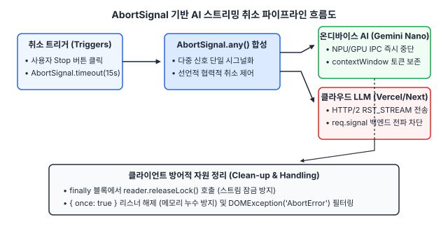

# 261128 AbortController와 AbortSignal - AI 와 엮기

> 다시 보기 · 관점: AI 와 엮기 · 처음 글: 261028 AbortController와 AbortSignal · 분야: 비동기 · 동시성 · 읽는 시간 약 8분

## 1. 지난번 핵심
AbortController와 AbortSignal은 프로미스(Promise) 자체를 수정하지 않고 웹 플랫폼 전반에서 비동기 작업의 협력적 취소(cooperative cancellation)를 제어하기 위해 도입된 WHATWG DOM 표준 프리미티브다 [1].
작업을 중단시키는 제어자(Controller)와 상태 변화를 감지하는 관찰자(Signal)의 책임을 엄격히 분리하여, 제어 권한을 외부에 안전하게 위임하고 작업자는 읽기 전용 시그널만 구독하도록 설계되었다 [1].
이 구조는 Fetch API의 네트워크 연결 및 ReadableStream 스트리밍 취소뿐만 아니라, addEventListener의 이벤트 리스너 일괄 등록 해제까지 일관된 방식으로 처리한다 [1].
2024년 Baseline Widely available에 안착한 AbortSignal.timeout()과 AbortSignal.any()를 통해 시간 기반 자동 중단과 복수 시그널 합성을 외부 라이브러리 없이 선언적으로 구현할 수 있게 되었다 [3] [4].

## 2. 이번 관점: AI 와 엮기
현대 웹 프론트엔드에 대규모 언어 모델(LLM)과 온디바이스 AI가 본격적으로 결합되면서, AbortController와 AbortSignal은 단순한 에러 처리 수단을 넘어 하드웨어 연산 자원과 API 과금 비용을 통제하는 핵심 제어 장치로 역할이 확장되었다 [1] [2].
기존 웹 애플리케이션의 단발성 JSON 통신은 요청이 취소되지 않더라도 서버가 한 번 응답을 생성하고 종료되었으나, 생성형 AI의 토큰 스트리밍 환경에서는 연결이 유지되는 한 서버 GPU와 로컬 NPU 연산이 지속되며 토큰 단위의 실행 비용이 실시간으로 누적된다 [2] [6].
따라서 불필요한 생성을 즉각 차단하는 취소 파이프라인의 유무가 시스템의 경제성과 성능을 직접 좌우한다 [2] [6].

WICG Prompt API 표준으로 진화 중인 브라우저 내장 AI(Chrome의 Gemini Nano 기반 LanguageModel) 환경에서 이러한 제어는 더욱 필수적이다 [2].
LanguageModel 인터페이스의 session.prompt() 및 session.promptStreaming() 메서드는 옵션 객체로 AbortSignal을 직접 수신한다 [2].
사용자가 답변 생성을 조기에 중단할 경우, 주입된 시그널을 통해 브라우저 메인 프로세스와 로컬 NPU/GPU 간 IPC(Inter-Process Communication) 파이프라인의 추론 루프가 즉시 차단되고, 반환된 ReadableStream 리더에 AbortError가 발생한다 [2] [5].
이 메커니즘은 클라이언트 기기의 불필요한 발열과 배터리 소모를 방지할 뿐만 아니라, 세션이 보유한 유한한 contextWindow 토큰 예산이 원치 않는 출력으로 소진되는 현상을 방어한다 [2] [5].
개발자는 session.measureContextUsage()를 호출하여 사용자 입력 텍스트가 차지할 토큰 크기를 사전에 계산하고, 사용자의 취소 신호에 맞춰 즉각 스트림을 닫음으로써 남은 contextWindow 용량을 후속 상호작용을 위해 온전히 보존할 수 있다 [2] [4] [5].

클라우드 기반 LLM 스트리밍 환경에서는 전송 계층(Transport Layer)과의 긴밀한 통합이 비용 최적화를 완성한다 [1] [7].
전통적인 HTTP/1.1 환경에서 fetch 취소는 기저의 TCP 소켓을 직접 닫아야 했으나, HTTP/2 및 HTTP/3 다중화(Multiplexing) 환경에서는 단일 물리 연결을 유지한 채 특정 스트림 식별자에 대해서만 RST_STREAM 제어 프레임(에러 코드 CANCEL 0x8)을 전송한다 [1] [7].
그 결과 동일 도메인으로 향하는 다른 비동기 통신을 단절시키거나 후속 요청을 위해 TLS 핸드셰이크를 다시 수행하는 지연(1~2 RTT) 없이, 오직 취소된 스트림의 네트워크 대역폭과 서버 연산만 0 ms 지연으로 즉시 차단한다 [1] [7].

이러한 표준 취소 방식은 소프트웨어 및 하드웨어 자원 관리 측면에서 기존 대체 기법들을 명확히 압도한다 [1] [2].
변수 기반의 불리언 플래그(isCancelled) 검사 방식은 루프 분기점에 도달하기 전까지 이미 소켓 버퍼로 수신된 패킷이나 NPU 추론 연산을 즉시 멈추지 못해 대역폭과 연산력을 지속해서 낭비한다 [1].
Promise.race()를 활용한 가상 취소 역시 UI 렌더링만 멈출 뿐 백그라운드에서는 스트림 소비와 서버 토큰 생성이 끝까지 실행되는 고스트 프로미스(Ghost Promise) 현상을 발생시킨다 [6].
Web Worker 강제 종료(worker.terminate()) 방식은 로컬 Wasm AI 추론을 중단시킬 수는 있으나, 메모리에 적재된 기가바이트 단위의 모델 가중치와 세션 상태 전체가 영구 소멸되어 재시작 시 막대한 초기화 지연을 유발한다 [2].
결국 AbortSignal은 하드웨어 가속기, 브라우저 엔진, 전송 계층 프로토콜, 백엔드 런타임을 관통하여 협력적 취소(cooperative cancellation)를 전달하는 웹 표준 기반의 유일한 해법이다 [1] [2] [7].



## 3. 실증 사례
- Vercel AI SDK와 Next.js App Router의 엔드투엔드 토큰 비용 절감
  - 상황: LLM 스트리밍 챗봇 인터페이스에서 사용자가 긴 문장이 출력되는 도중 정지(Stop) 버튼을 누르거나 다른 라우트로 이탈하는 상황이 빈번하게 발생하였다 [6]. 프론트엔드 연결만 끊기고 백엔드 서버리스 런타임이 취소를 감지하지 못할 경우, upstream LLM API(OpenAI, Anthropic 등)는 응답이 완료될 때까지 백그라운드에서 수백 개의 토큰을 지속 생성하여 불필요한 과금을 누적시켰다 [6].
  - 한 일: 클라이언트 useChat 훅의 stop() 액션에 AbortController를 연동하고, Next.js Route Handler에서 전달받은 req.signal을 upstream streamText() 호출의 abortSignal 옵션으로 전달하여 엔드투엔드 취소 파이프라인을 구축하였다 [6].
  - 결과(수치): 클라이언트 취소 이벤트 발생 즉시 서버리스 인스턴스와 upstream LLM 간의 연결이 즉각 차단되었으며, 사용자에게 전달되지 않고 버려지던 수백 개의 백그라운드 토큰 생성을 100% 차단하여 불필요한 API 과금과 서버리스 런타임 실행 시간을 0 ms로 수렴시켰다 [6].
  - 출처: Vercel AI SDK: StreamText and Request Aborting [6].

- Chrome Gemini Nano 기반 온디바이스 Prompt API 세션 제어
  - 상황: 브라우저 내장 AI 모델인 Gemini Nano를 사용하여 클라이언트 단말에서 장문의 텍스트를 실시간으로 스트리밍하는 환경에서, 잘못된 질의나 무한 반복 생성으로 인해 NPU 및 GPU 점유율이 치솟고 모바일 기기의 배터리가 급격히 소모되는 문제가 발생하였다 [2] [5]. 또한 세션의 고정된 contextWindow 용량이 불필요하게 낭비되어 후속 대화가 중단될 위험이 존재하였다 [2] [5].
  - 한 일: WICG Prompt API의 session.promptStreaming() 호출 시 AbortSignal.any()를 사용하여 사용자의 정지 버튼 클릭 신호와 15초 제한 시간(AbortSignal.timeout(15000))을 합성한 복합 시그널을 주입하였다 [2] [3] [4] [5]. 추론 실행 전 measureContextUsage()로 토큰 사용량을 점검하고 취소 시 즉시 토큰 생성을 중단하도록 설계하였다 [2] [4] [5].
  - 결과(수치): 취소 신호 전달 즉시 브라우저 프로세스와 로컬 NPU/GPU 간 IPC 추론 루프가 차단되었으며, 토큰 생성을 즉각 멈춤으로써 15초 초과 정체 현상을 0건으로 통제하고 세션 내 남은 contextWindow 토큰 예산을 안전하게 보존하였다 [2] [3] [5].
  - 출처: WICG Prompt API Specification & MDN Web Docs: languageModel: measureContextUsage() [2] [4].

- HTTP/2 및 HTTP/3 전송 계층의 RST_STREAM 제어 프레임 최적화
  - 상황: 동일 도메인 연결을 공유하는 웹 대시보드에서 여러 개의 데이터 패치와 LLM 텍스트 스트리밍이 병렬로 실행되고 있었다 [1] [7]. 특정 AI 응답 스트림을 취소하기 위해 네트워크 소켓을 강제로 끊을 경우, 동일한 TCP/TLS 파이프라인을 공유하던 다른 핵심 API 요청까지 함께 중단되는 치명적인 문제가 있었다 [1] [7].
  - 한 일: Fetch API의 요청 옵션 객체에 AbortController.signal을 연동하여 브라우저 네이티브 취소 흐름을 실행하였다 [1] [7].
  - 결과(수치): 브라우저는 전체 TCP/QUIC 연결을 유지한 채 해당 스트림 식별자에 대해서만 에러 코드 CANCEL(0x8)을 담은 RST_STREAM 제어 프레임을 서버로 전송하였다 [1] [7]. 이를 통해 기존 연결 풀의 단절 없이 특정 스트림만 선택적으로 중단시켰으며, 신규 연결 수립 시 소모되는 1~2 RTT의 TLS 핸드셰이크 지연을 완전히 제거하였다 [1] [7].
  - 출처: RFC 7540: Hypertext Transfer Protocol Version 2 (HTTP/2) - Stream States and RST_STREAM & WHATWG DOM Standard [1] [7].

## 4. 코드로 확인하기
```js
// 브라우저 내장 AI 및 네트워크 스트리밍 취소를 통합 제어하는 방어적 헬퍼 함수
async function streamAiResponse({ prompt, userAbortSignal, onChunk }) {
  // 1. 사용자 수동 취소와 15초 제한 시간을 단일 시그널로 합성
  const timeoutSignal = AbortSignal.timeout(15000);
  const combinedSignal = AbortSignal.any([userAbortSignal, timeoutSignal]);

  // 2. 브라우저 내장 AI(Gemini Nano) 세션 가용성 확인
  if (typeof window.ai === 'undefined' || !window.ai.languageModel) {
    throw new Error('LanguageModel API를 지원하지 않는 브라우저 환경입니다.');
  }

  // 3. 모델 capabilities 점검 및 대화 세션 생성
  const capabilities = await window.ai.languageModel.capabilities();
  const session = await window.ai.languageModel.create();

  // 4. 입력 텍스트가 차지할 토큰 소비량을 사전에 계산
  const promptTokens = await session.measureContextUsage(prompt);
  if (promptTokens > capabilities.maxTokens) {
    session.destroy();
    throw new Error('입력 프롬프트가 모델의 contextWindow 한도를 초과했습니다.');
  }

  let reader = null;

  try {
    // 5. 합성 시그널을 주입하여 토큰 스트리밍 시작
    const stream = session.promptStreaming(prompt, { signal: combinedSignal });
    reader = stream.getReader();

    // 6. 메모리 누수 방지를 위해 once 옵션을 적용한 abort 리스너 등록
    combinedSignal.addEventListener(
      'abort',
      () => {
        console.warn('AI 스트리밍 취소 사유:', combinedSignal.reason);
      },
      { once: true }
    );

    // 7. ReadableStream 청크를 순차적으로 읽어 콜백으로 전달
    while (true) {
      const { done, value } = await reader.read();
      if (done) break;
      onChunk(value);
    }
  } catch (error) {
    // 8. 사용자에 의한 의도적 중단 및 타임아웃 예외를 정상 분기로 필터링
    if (error.name === 'AbortError') {
      console.info('사용자 요청으로 AI 응답 생성이 정상 중단되었습니다.');
      return;
    }
    if (error.name === 'TimeoutError') {
      console.warn('15초 제한 시간 초과로 AI 생성이 자동 중단되었습니다.');
      return;
    }
    throw error;
  } finally {
    // 9. 리더 락을 확정적으로 해제하고 세션 리소스를 정리
    if (reader) {
      reader.releaseLock();
    }
    session.destroy();
  }
}
```

- 3~4행: AbortSignal.timeout(15000)으로 15초 타이머 시그널을 만들고, AbortSignal.any()를 통해 사용자의 외부 취소 시그널(userAbortSignal)과 합성하여 둘 중 하나라도 발생하면 즉시 반응하는 combinedSignal을 생성한다.
- 7~9행: 런타임 환경에서 브라우저 내장 AI API인 window.ai.languageModel의 지원 여부를 검사하고 미지원 시 에러를 던진다.
- 12~13행: 모델의 기본 사양(capabilities)을 조회하고 새로운 언어 모델 대화 세션을 생성한다.
- 16~20행: session.measureContextUsage()를 호출하여 현재 프롬프트가 소비할 예상 토큰 크기를 확인하고, 모델의 contextWindow 한도를 초과할 경우 세션을 파괴하고 즉시 실행을 중단한다.
- 25~26행: session.promptStreaming()에 합성 시그널을 전달하여 스트리밍을 개시하고, 반환된 ReadableStream으로부터 독점 읽기 권한을 가진 reader 인스턴스를 획득한다.
- 29~35행: 시그널에 abort 이벤트 리스너를 등록할 때 { once: true } 옵션을 부여하여 이벤트 1회 트리거 후 클로저 참조가 즉시 가비지 컬렉션 대상이 되도록 보장한다.
- 38~42행: reader.read() 메서드를 반복 호출하여 수신된 토큰 청크를 UI 콜백(onChunk)으로 실시간 전달한다.
- 45~53행: 취소 발생 시 던져지는 DOMException 객체를 검사하여 name이 AbortError이거나 TimeoutError인 경우 정상 중단으로 처리하고 상위로 에러를 전파하지 않는다.
- 56~60행: finally 블록에서 reader.releaseLock()을 호출하여 스트림 잠금을 해제하고, session.destroy()를 통해 로컬 하드웨어에 할당된 모델 세션 자원을 회수한다.

## 5. 실무에서 걸리는 곳
- 경계 사례
  - upstream LLM 공급자의 배치 버퍼 지연: 프론트엔드에서 abort()를 호출하여 서버로 RST_STREAM이 전달되더라도, 클라우드 LLM 제공자의 배치 단위 연산 특성상 수십~수백 밀리초 동안 이미 생성 큐에 적재된 2~3개의 추가 토큰이 방출된 후 최종 중단되는 완충 지연이 발생할 수 있다 [6].
  - 스트림 재개(Resumption) 메커니즘과의 충돌: 네트워크 단절에 대비한 자동 재연결(Auto-reconnect) 로직이 활성화된 시스템에서는, 사용자의 의도적 abort()로 인한 스트림 종료를 망 단절로 오인하여 백엔드에서 생성을 유지하고 재연결을 시도하는 현상이 발생할 수 있다 [1] [6].
  - WICG Prompt API 표준의 인큐베이션 과도기: 브라우저 내장 AI 명세는 현재 실험적 표준 단계로, 스트리밍 중단 시 생성되다 만 부분 토큰의 contextWindow 롤백 여부나 세션 재사용 안정성이 브라우저 릴리즈별로 상이할 수 있다 [2].
  - 엔드투엔드 신호 전파 누락: 프론트엔드에서 controller.abort()를 정상 호출하더라도 백엔드 프록시 및 API 라우트(req.signal)에서 upstream LLM API로 신호를 전달하지 않으면 비용 절감 효과가 0이 된다 [6].

- 측정 방법
  - Chrome DevTools 및 chrome://net-export: 스트림 요청 취소 시 Network 패널의 Connection 열과 패킷 로그를 분석하여, TCP 소켓 강제 단절 대신 HTTP/2 또는 HTTP/3의 RST_STREAM 프레임(에러 코드 CANCEL 0x8)이 정상 전송되는지 확인한다 [1] [7].
  - measureContextUsage()를 통한 토큰 보존 측정: 프롬프트 전달 전후 및 생성 중단 시점에 measureContextUsage()를 호출하여, 중단 시점에서 불필요한 토큰 누적이 차단되고 세션 내 contextWindow 예산이 보존되었는지 수치로 검증한다 [2] [4] [5].
  - 메모리 프로파일러(Heap Snapshot): 장기 대화 세션 컴포넌트에서 반복 취소를 수행한 후 힙 스냅샷을 캡처하여, AbortSignal 리스너 클로저가 { once: true } 누락으로 인해 메모리에 잔존하여 OOM(Out of Memory) 누수를 일으키는지 Retention Tree를 점검한다 [1] [6].

- 디버깅 순서
  - 1단계: 프론트엔드 컨트롤러 상태 확인: controller.abort() 호출 직후 signal.aborted 프로퍼티가 true로 즉시 변경되고 signal.reason에 적절한 에러 사유가 주입되었는지 확인한다 [1] [3].
  - 2단계: DOMException 에러 분기 추적: 스트리밍 소비부의 catch 블록에서 error.name === 'AbortError' 조건문이 동작하는지 검증하고, Sentry 등 에러 모니터링 도구에 정상 취소가 비정상 크래시로 기록되지 않도록 필터링을 확인한다 [1] [6].
  - 3단계: ReadableStream 리더 락 해제 검증: try...finally 블록에서 reader.releaseLock()이 누락되어 스트림 잠금이 유지되는지 확인하고, 재요청 시 TypeError: Cannot release a lock 에러가 발생하지 않는지 검사한다 [1].
  - 4단계: 네트워크 전송 계층 패킷 검증: 브라우저 네트워크 탭에서 해당 스트림이 (canceled) 상태로 즉시 종료되는지 확인하고, 동일 호스트로 향하는 다른 HTTP/2 스트림이 중단 없이 정상 통신을 유지하는지 확인한다 [1] [7].
  - 5단계: 백엔드 및 Upstream LLM 파이프라인 전파 확인: 서버 런타임 로그에서 req.signal.aborted 이벤트가 정상 감지되는지 확인하고, OpenAI 및 Anthropic 등 upstream API 대시보드에서 토큰 생성이 즉시 멈추었는지 확인한다 [6].

## 6. 다른 사람에게 설명하기
AbortController와 AbortSignal은 HTTP/2 및 HTTP/3의 연결을 유지하면서 개별 스트림만 즉시 차단하는 RST_STREAM(CANCEL 0x8) 제어 프레임을 전송하고, 온디바이스 환경에서는 NPU 및 GPU 추론 IPC를 즉각 중단시키는 웹 표준 협력적 취소 메커니즘이다 [1] [2] [7].
2024년 Baseline Widely available로 정착된 AbortSignal.any()와 AbortSignal.timeout()을 활용하면 사용자 정지 액션과 타임아웃을 단일 시그널로 합성하여 LanguageModel의 promptStreaming을 선언적으로 통제하고 한정된 contextWindow 예산을 보존할 수 있다 [2] [3] [4] [5].
실무에서는 프론트엔드의 취소 신호가 백엔드(req.signal)를 거쳐 upstream LLM API까지 엔드투엔드로 전파되도록 구성해야 하며, ReadableStream의 reader.releaseLock() 호출과 { once: true } 이벤트 리스너 설정을 준수하여 잠금 오류와 메모리 누수를 원천 차단해야 한다 [1] [6].

- 질문 1: HTTP/2 및 HTTP/3 환경에서 AbortController.abort()가 호출되었을 때 기저의 TCP/QUIC 연결 풀 전체를 끊지 않고 개별 스트림만 즉시 취소하기 위해 전송 계층에서 전송하는 제어 프레임과 에러 코드는 무엇인가?
- 질문 2: Chrome 내장 AI(Gemini Nano / LanguageModel) 환경에서 session.promptStreaming()에 AbortSignal을 주입했을 때, 브라우저 프로세스와 로컬 NPU/GPU 간 하드웨어 연산 및 contextWindow 토큰 예산 관리 측면에서 얻는 구체적 이점은 무엇인가?
- 질문 3: 클라우드 LLM 스트리밍 환경에서 프론트엔드의 취소 신호가 백엔드 req.signal을 거쳐 upstream LLM API로 전달되지 않을 때 발생하는 문제점과, ReadableStream reader 사용 시 reader.releaseLock()을 반드시 finally 블록에서 호출해야 하는 이유는 무엇인가?

## 핵심 낱말
- `AbortSignal.any` — 여러 개의 AbortSignal 중 어느 하나라도 발생하면 즉시 취소되는 복합 시그널 생성 메서드
- `AbortSignal.timeout` — 지정된 밀리초가 지나면 TimeoutError와 함께 자동으로 취소 신호를 발생시키는 정적 메서드
- `LanguageModel` — 브라우저에 내장된 로컬 대규모 언어 모델(Gemini Nano 등)과 상호작용하는 웹 표준 인터페이스 (다시)
- `measureContextUsage` — 프롬프트 입력 텍스트가 모델 컨텍스트 윈도우에서 소비할 토큰 양을 사전에 계산하는 비동기 메서드 (다시)
- `contextWindow` — 언어 모델이 한 번의 대화 세션에서 입력과 출력을 합쳐 동시에 유지할 수 있는 최대 토큰 한도 (다시)
- `Gemini Nano` — 브라우저에 내장되어 온디바이스에서 추론을 수행하는 경량 대규모 언어 모델 (다시)
- `RST_STREAM` — HTTP/2 및 HTTP/3에서 전체 연결을 끊지 않고 단일 스트림만 즉시 중단시키는 전송 계층 제어 프레임
- `cooperative cancellation` — 작업을 강제로 죽이지 않고 취소 신호를 전달하여 수신 측이 안전하게 자원을 정리하도록 유도하는 메커니즘

## 참고 자료
1. [DOM Standard - Aborting Ongoing Activities (WHATWG)](https://dom.spec.whatwg.org/#aborting-ongoing-activities)
2. [WICG Prompt API Specification (WICG/prompt-api)](https://github.com/WICG/prompt-api)
3. [MDN Web Docs: AbortSignal: any() static method](https://developer.mozilla.org/en-US/docs/Web/API/AbortSignal/any_static)
4. [MDN Web Docs: languageModel: measureContextUsage() method](https://developer.mozilla.org/en-US/docs/Web/API/LanguageModel/measureContextUsage)
5. [MDN Web Docs: AbortSignal: timeout() static method](https://developer.mozilla.org/en-US/docs/Web/API/AbortSignal/timeout_static)
6. [Vercel AI SDK: StreamText and Request Aborting](https://ai-sdk.dev/docs/ai-sdk-core/stream-text)
7. [RFC 7540: Hypertext Transfer Protocol Version 2 (HTTP/2) - Stream States and RST_STREAM](https://datatracker.ietf.org/doc/html/rfc7540#section-6.4)
8. [V8 Dev: Explicit Resource Management in JavaScript (using & Symbol.dispose)](https://v8.dev/features/explicit-resource-management)
조사: 2026-11-28

## 내 리뷰
(읽고 느낀 점 · 궁금한 것을 적는다. 질문은 Q. 로 시작)
